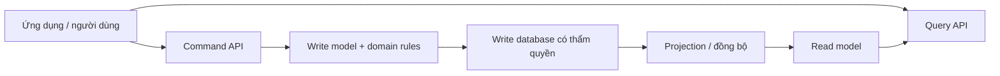
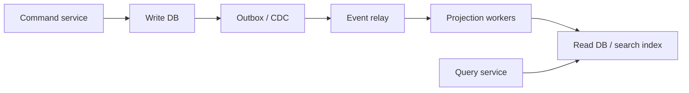
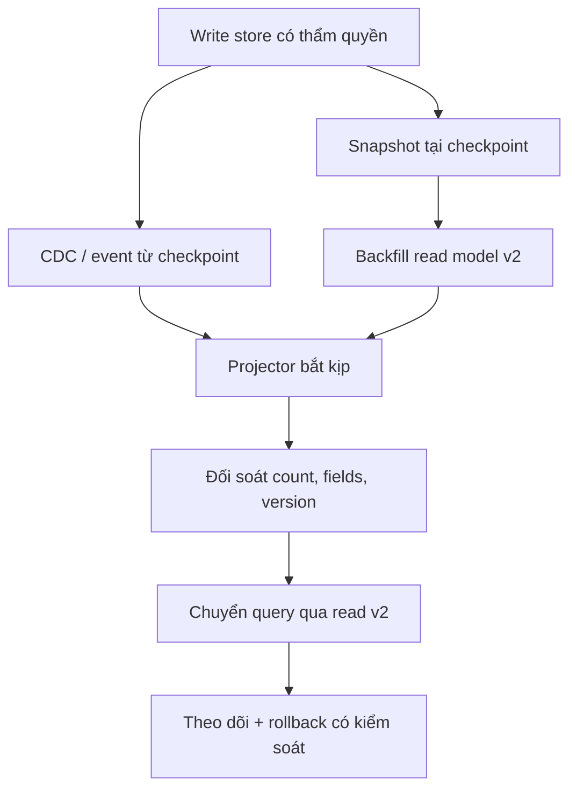
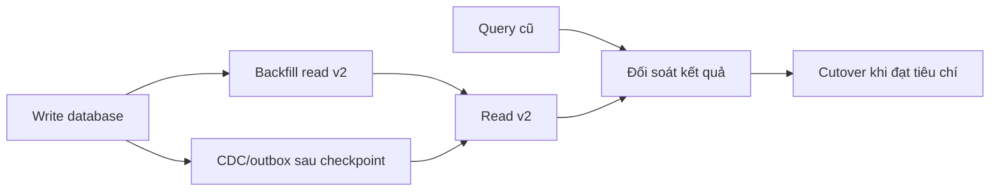

# Tách mô hình đọc với mô hình ghi theo CQRS khi nhu cầu khác biệt

## 1. Vì sao một mô hình không phải lúc nào cũng phục vụ tốt cả đọc và ghi?

Một hệ thống nghiệp vụ thường có hai nhóm yêu cầu không giống nhau:

- **Ghi (write):** tạo đơn hàng, đăng ký khóa học, thay trạng thái, kiểm tra ràng buộc, khóa, phiên bản, quyền cập nhật và tính nguyên tử.
- **Đọc (read):** tìm kiếm, lấy danh sách, hiển thị màn hình tổng hợp, lọc nhiều điều kiện, phân trang, xếp hạng và báo cáo.

Khi mới xây dựng, một lược đồ quan hệ chuẩn hóa với câu SQL phù hợp có thể đáp ứng cả hai. Khi quy mô và nghiệp vụ phát triển, việc ép mọi query đi qua cùng mô hình aggregate có thể tạo mâu thuẫn:

- Write model cần **giữ bất biến**, hạn chế những cập nhật không thuộc trách nhiệm của nó.
- Read model muốn **dữ liệu đã ghép sẵn**, ít phép nối và có chỉ mục theo đúng thao tác người dùng.
- Chỉ mục phục vụ tìm kiếm có thể làm tăng chi phí ghi.
- Một báo cáo đọc hàng triệu dòng không nên gây tải không kiểm soát lên hệ xử lý giao dịch.
- Một dashboard có thể chấp nhận trễ vài giây, trong khi cấp chỗ cuối cùng cho lớp học **không được dựa vào dữ liệu trễ**.

**CQRS (Command Query Responsibility Segregation)** là cách tách **trách nhiệm thực thi lệnh thay đổi trạng thái** và **trách nhiệm truy vấn dữ liệu**. Khi có nhu cầu thật, mỗi trách nhiệm có thể có **mô hình, cấu trúc lưu trữ và quy trình tối ưu riêng**.

Bài học thuộc chương **Ranh giới và tích hợp** của phạm vi **DATABASE_DATA_MODELING**. Mục tiêu mô-đun là rèn kỹ năng chuyển yêu cầu nghiệp vụ thành mô hình dữ liệu rõ ràng, từ thực thể, quan hệ và ràng buộc đến khóa, chỉ mục và lược đồ vật lý; so sánh mô hình quan hệ, document, đồ thị và phân tích để lựa chọn dễ tiến hóa và kiểm chứng.

**Sau bài này, bạn có thể:**

1. Phân biệt command, query, write model, read model và projection.
2. Xác định khi nào chênh lệch yêu cầu đọc/ghi đủ lớn để cân nhắc CQRS.
3. Chọn giữa tách logic trong một ứng dụng, tạo read tables hoặc tách read store.
4. Thiết kế write model bảo vệ bất biến và read model theo query shape.
5. Triển khai đồng bộ bằng transaction, outbox hoặc CDC với ngữ nghĩa rõ.
6. Xử lý dữ liệu trễ, sự kiện trùng/đến sai thứ tự và read-your-writes.
7. Rebuild projection, đối soát, kiểm thử và giám sát.
8. Chỉ rõ trường hợp **không nên** triển khai CQRS phân tán.

## 2. Command, query và projection là gì?

### 2.1. Command mang ý định thay đổi trạng thái

Ví dụ:

```text
PlaceOrder
ConfirmOrder
CancelOrder
EnrollLearner
CompleteLesson
PublishCourse
```

Một command không chỉ là câu `INSERT` hay `UPDATE`. Command `CancelOrder` phải xem đơn có thể hủy, người gọi có quyền, tiền đã thu có cần hoàn, và hai thao tác đồng thời có thể mâu thuẫn hay không.

**Write model** chịu trách nhiệm áp dụng các bất biến trong ranh giới transaction/aggregate phù hợp và công bố kết quả commit chính xác.

### 2.2. Query đọc dữ liệu không làm thay đổi trạng thái nghiệp vụ

Ví dụ:

```text
GetOrderDetail
ListOrdersByStatus
SearchOrdersByBuyer
GetLearnerDashboard
CountActiveEnrollments
```

**Read model** tổ chức dữ liệu để trả kết quả theo màn hình và bộ lọc. Nó không buộc phải có cùng quan hệ, thuộc tính hoặc dạng JSON của write aggregate.

Một query có thể ghi log hoặc metric kỹ thuật, nhưng nó không được âm thầm tạo đơn, giữ chỗ hoặc sửa trạng thái như tác dụng phụ không được công bố.

### 2.3. Projection xây read model từ nguồn ghi



Ví dụ write side lưu `orders`, `order_lines`, còn read side tạo một thẻ đơn:

```json
{
  "tenantId": "ORG-07",
  "orderId": "O-1001",
  "status": "CONFIRMED",
  "totalMinor": 350000,
  "itemCount": 3,
  "customerNameAtOrder": "Nguyen An",
  "placedAt": "2026-11-20T09:00:00Z",
  "sourceVersion": 4
}
```

Dữ liệu trên là **snapshot cho mục đích đọc**. Nguồn có thẩm quyền của trạng thái và tổng tiền vẫn ở phía ghi.

### 2.4. CQRS không đồng nghĩa Event Sourcing hoặc microservices

- **CQRS:** phân biệt command và query; có thể cùng một ứng dụng và cùng DB.
- **Event Sourcing:** sự kiện là nguồn tái dựng trạng thái nghiệp vụ; có thể kết hợp với CQRS nhưng không bắt buộc.
- **Event-driven integration:** chuyển thay đổi giữa các thành phần; có thể dùng cho CQRS với bảng OLTP thông thường.
- **Microservices:** ranh giới triển khai độc lập, không phải điều kiện để có CQRS.

Chỉ vì danh sách đơn cần một thẻ tóm tắt được index tốt **không có nghĩa** phải chuyển toàn bộ hệ thống sang event sourcing.

## 3. Phân tích nhu cầu: query shape và bất biến ghi

Giả sử một nền tảng bán khóa học có các thao tác:

| Mã | Nhu cầu | Trọng tâm |
| --- | --- | --- |
| C1 | Đặt đơn và chốt giá các dòng hàng | Bất biến tổng tiền, transaction |
| C2 | Xác nhận đơn khi đã đạt điều kiện | Chuyển trạng thái, concurrency |
| C3 | Hủy đơn và khởi tạo hoàn tiền nếu phù hợp | Idempotency, thẩm quyền |
| Q1 | Tra một đơn theo tenant và ID | Đọc điểm, độ mới quan trọng |
| Q2 | Danh sách 20 đơn mới nhất theo trạng thái | Lọc, sort, cursor pagination |
| Q3 | Tìm đơn theo người mua | Tìm kiếm, có thể ghép dữ liệu |
| Q4 | Dashboard số đơn theo tháng | Tổng hợp nhiều bản ghi |
| Q5 | Quyết định có được hoàn tiền không | Phải dựa nguồn có thẩm quyền |

C1–C3 yêu cầu mô hình bảo vệ ràng buộc. Q2–Q4 có thể được lợi từ cấu trúc phi chuẩn hóa, các chỉ mục khác nhau hoặc kho đọc riêng.

**Q5 tuy có dạng một phép đọc vẫn không nên mặc định dùng projection eventual-consistent.** Khi kết quả điều khiển một hành động có rủi ro cao, command handler phải xác minh lại điều kiện ở nguồn có thẩm quyền tại thời điểm commit.

### 3.1. Những câu hỏi cần thu thập trước khi chọn kiến trúc

- Read QPS so với write QPS? Chênh lệch tải giờ cao điểm bao nhiêu?
- Câu SQL hiện tại có thể giải quyết bằng index/DTO/view không?
- Những query nào cần join nhiều bảng, toàn văn hay tổng hợp trên tập lớn?
- Read-after-write cần ngay lập tức, trong 2 giây, hay trễ vài phút vẫn được?
- Mô hình đọc có phải kết hợp nhiều bounded contexts không?
- Có cần truy vấn theo dữ liệu lịch sử, hay chỉ trạng thái hiện tại?
- Có ngân sách vận hành queue, consumer, retry, reconciliation và rebuild không?
- Những ràng buộc nào **không được phép** dựa trên bản sao stale?

**Quyết định CQRS là quyết định mô hình dữ liệu và vận hành cùng lúc**, không phải chỉ tách hai lớp controller.

## 4. Ba mức tách CQRS và đánh đổi

### 4.1. Mức 1: tách handler/DTO, dùng chung bảng

```text
Command handler -> aggregate/domain service -> OLTP tables
Query handler   -> SQL/DTO riêng           -> cùng OLTP tables
```

Đây là bước ít rủi ro:

- Command đi qua validation, giao dịch và kiểm tra quyền.
- Query chỉ chọn các trường cần thiết, dùng SQL và index theo query shape.
- Không thêm độ trễ do sao chép bất đồng bộ.
- Mô hình đọc ở lớp mã có thể khác write domain object.

Nếu chỉ gặp một câu query chậm do thiếu index, mức 1 thường là ứng viên cần thử trước.

### 4.2. Mức 2: bảng đọc/view riêng trong cùng database

```text
Write: orders_write, order_lines_write
Read:  order_cards_read, order_daily_summary
```

Read tables có thể cập nhật **đồng bộ trong cùng transaction** hoặc **bất đồng bộ theo job/CDC**. Với đồng bộ cùng transaction, khả năng quan sát tại commit có thể mạnh hơn, đổi lại command phải chịu thêm chi phí duy trì read structure.

### 4.3. Mức 3: dịch vụ và database đọc riêng



Lợi thế:

- Đọc và ghi scale theo nhu cầu khác nhau.
- Read database có thể chuyên cho full-text, document hoặc báo cáo.
- Một thay đổi nguồn có thể phục vụ nhiều projection.

Chi phí:

- Đồng bộ, dữ liệu stale, event ordering, idempotency.
- Vận hành message broker/CDC và read store.
- Bảo mật bản sao, retention và khả năng rebuild.
- Phải xác định rõ nguồn sự thật và xử lý sự cố.

| Mức tách | Nơi lưu | Độ mới dữ liệu đọc | Phức tạp |
| --- | --- | --- | --- |
| DTO/handler riêng | Cùng bảng | Phụ thuộc transaction/replica đang đọc | Thấp |
| Read table đồng bộ | Cùng DB, cùng transaction | Có thể thống nhất tại commit | Vừa |
| Read table bất đồng bộ | Cùng DB nhưng khác luồng ghi | Có lag | Vừa–cao |
| Read store riêng | DB hoặc engine khác | Thường có lag | Cao |

Không cần đổi loại database chỉ để có CQRS. Tên gọi **không thay thế bằng chứng nhu cầu**.

## 5. Thiết kế write model từ bất biến nghiệp vụ

### 5.1. Aggregate và ranh giới giao dịch

Một aggregate `Order` có thể chứa:

```text
Order
  tenantId, orderId, customerId
  status, version, placedAt
  lines[]
  totalMinor
```

Bất biến ví dụ:

- Mỗi dòng có `quantity > 0`.
- Tổng tiền theo quy tắc chốt giá/chiết khấu của giao dịch.
- Đơn đã chốt không đổi giá vì bảng giá catalog hiện nay đổi.
- Chuyển trạng thái phải theo sơ đồ hợp lệ.
- Không thực hiện cùng một yêu cầu hủy/hoàn tiền hai lần vì retry.
- Mọi thay đổi thuộc aggregate phải được bảo vệ trong ranh giới consistency đã chọn.

Một aggregate không nhất thiết nằm trong một row. Trong RDBMS, các bảng `orders` và `order_lines` có thể tham gia **một transaction**.

### 5.2. DDL PostgreSQL minh họa write side

```sql
CREATE TABLE orders_write (
    tenant_id text NOT NULL,
    order_id text NOT NULL,
    customer_id text NOT NULL,
    status text NOT NULL,
    total_minor bigint NOT NULL,
    placed_at timestamptz NOT NULL,
    version bigint NOT NULL DEFAULT 1,
    PRIMARY KEY (tenant_id, order_id),
    CHECK (status IN ('DRAFT', 'CONFIRMED', 'CANCELLED')),
    CHECK (total_minor >= 0),
    CHECK (version > 0)
);

CREATE TABLE order_lines_write (
    tenant_id text NOT NULL,
    order_id text NOT NULL,
    line_no integer NOT NULL,
    course_id text NOT NULL,
    quantity integer NOT NULL,
    price_minor bigint NOT NULL,
    PRIMARY KEY (tenant_id, order_id, line_no),
    FOREIGN KEY (tenant_id, order_id)
      REFERENCES orders_write(tenant_id, order_id),
    CHECK (quantity > 0),
    CHECK (price_minor >= 0)
);
```

Các constraint chỉ bảo vệ một phần. Chúng không kiểm tra `total_minor` có bằng tổng giá các dòng theo chính sách hay không; logic nghiệp vụ và transaction vẫn cần đảm nhận.

### 5.3. Mẫu command có kiểm tra phiên bản

```sql
UPDATE orders_write
SET status = 'CONFIRMED',
    version = version + 1
WHERE tenant_id = 'ORG-07'
  AND order_id = 'O-1001'
  AND status = 'DRAFT'
  AND version = 3
RETURNING order_id, status, version, total_minor, placed_at;
```

Nếu không trả dòng nào, lệnh không được coi là thành công. Có thể không tồn tại, trạng thái đã khác hoặc có ghi cạnh tranh. Phải phân loại kết quả cùng cơ chế bảo mật thích hợp, tránh lộ dữ liệu của tenant khác.

**Read projection không được là nguồn duy nhất quyết định command hợp lệ** vì nó có thể chậm hơn write side.

## 6. Thiết kế read model dựa trên query shape

### 6.1. Một thẻ đơn đã được ghép sẵn

Đối với Q2 (danh sách đơn theo trạng thái và thời gian):

```sql
CREATE TABLE order_cards_read (
    tenant_id text NOT NULL,
    order_id text NOT NULL,
    status text NOT NULL,
    customer_name_at_order text NOT NULL,
    total_minor bigint NOT NULL,
    item_count integer NOT NULL,
    placed_at timestamptz NOT NULL,
    source_version bigint NOT NULL,
    is_deleted boolean NOT NULL DEFAULT false,
    projected_at timestamptz NOT NULL DEFAULT now(),
    PRIMARY KEY (tenant_id, order_id),
    CHECK (source_version > 0)
);

CREATE INDEX order_cards_list_idx
ON order_cards_read
    (tenant_id, status, placed_at DESC, order_id DESC);
```

Mỗi dòng là **một thẻ đơn**. Nó không tái hiện mọi chi tiết ghi, chỉ chứa dữ liệu đủ để hiển thị/lọc.

```json
{
  "tenantId": "ORG-07",
  "orderId": "O-1001",
  "status": "CONFIRMED",
  "customerNameAtOrder": "Nguyen An",
  "totalMinor": 350000,
  "itemCount": 3,
  "placedAt": "2026-11-20T09:00:00Z",
  "sourceVersion": 4
}
```

Tên trường `customerNameAtOrder` nói rõ **snapshot lúc đặt đơn**, khác với `customerNameCurrent` có nghĩa là tên khách hiện nay. Nếu màn hình muốn tên hiện tại, phải xác định nguồn cập nhật, sự kiện khi đổi tên và quy tắc đồng bộ.

### 6.2. Read model có thể phi chuẩn hóa có chủ đích

Với mỗi trường sao chép cần ghi:

| Trường | Nguồn có thẩm quyền | Khi nào thay đổi? | Có được chỉnh trên read store? |
| --- | --- | --- | --- |
| `status` | Order aggregate | Khi chuyển trạng thái | Không |
| `totalMinor` | Giá đã chốt của Order | Khi command được phép sửa | Không |
| `itemCount` | Các dòng hàng của Order | Khi thêm/bớt dòng hợp lệ | Không |
| `customerNameAtOrder` | Snapshot trên Order | Theo quy tắc sửa chứng từ | Không tùy tiện |
| `projectedAt` | Projection worker | Khi áp dụng event | Metadata kỹ thuật |

**Phi chuẩn hóa không có nghĩa dữ liệu không cần hợp đồng**. Read model vẫn có khóa, kiểu, chỉ mục, định nghĩa trường, version và chính sách bảo mật.

### 6.3. Nhiều read models cho nhiều query shapes

```text
order_cards_read    -> danh sách/filter/sort
order_search_index  -> tìm kiếm toàn văn
order_daily_totals  -> tổng hợp theo ngày
order_export_view   -> xuất file theo hợp đồng đối tác
```

Một số ứng viên có thể dùng:

- **Quan hệ:** danh sách có nhiều bộ lọc và index ghép.
- **Document:** màn hình cần aggregate lồng nhau có kích thước hữu hạn.
- **Search engine:** từ khóa/ngôn ngữ, ranking, faceting.
- **Graph:** duyệt nhiều bước giữa các thực thể.
- **Kho phân tích:** fact/dimension và báo cáo lớn.

Đây là nơi khả năng lựa chọn mô hình dữ liệu phát huy tác dụng. Tuy nhiên, mỗi projection có chi phí đồng bộ, lưu giữ, đối soát và bảo vệ riêng.

## 7. Đọc đồng bộ và bất đồng bộ: lựa chọn consistency

### 7.1. Đồng bộ trong cùng transaction

```text
BEGIN
  validate command
  update write tables
  update read table
COMMIT
```

Nếu read table ở **cùng database và transaction**, trạng thái có thể được commit nguyên tử cùng write row. Lợi ích là không có lag riêng giữa hai bảng sau khi commit từ cùng nguồn nhất quán.

Đánh đổi: command phải cập nhật read table/index và mọi lỗi read model có thể ảnh hưởng đường ghi. Khi cấu trúc read thay đổi thường xuyên, coupling tăng.

### 7.2. Bất đồng bộ

```text
write transaction -> outbox/CDC -> relay/queue -> projector -> read store
```

Lợi ích: command không chờ read index được cập nhật; read store có thể scale riêng. Đánh đổi: xuất hiện trạng thái trung gian giữa **write committed** và **read projected**.

### 7.3. Ba thời điểm không được đánh đồng

- **Accepted:** hệ đã nhận yêu cầu, chưa chắc xử lý xong.
- **Committed:** write transaction đã thành công.
- **Projected:** read model đã phản ánh phiên bản được yêu cầu.

Nếu command API trả:

```json
{
  "orderId": "O-1001",
  "commandStatus": "COMMITTED",
  "writeVersion": 4,
  "status": "CONFIRMED"
}
```

thì **không mặc nhiên** đồng nghĩa trang danh sách từ read store đã có `sourceVersion=4`.

### 7.4. Một số lựa chọn trung gian

- Cùng DB nhưng query handler đọc bảng khác bằng SQL view.
- Materialized view refresh theo batch.
- Read table cập nhật sync cho đường critical, projection async cho tìm kiếm.
- Replica đọc để giảm tải, nhưng vẫn dùng **cùng schema** và có thể có replication lag.

**Read replica không tự tạo CQRS** nếu vẫn dùng y nguyên write model và query shape. Ngược lại, CQRS không bắt buộc replica.

## 8. Vì sao dual-write trực tiếp dễ gây lỗi?

Một triển khai dễ nghĩ:

```text
1. Update orders_write ở DB A.
2. Update order_cards_read ở DB B.
3. Trả thành công.
```

Nếu bước 1 commit, bước 2 thất bại, hai nơi lệch. Nếu bước 2 commit rồi bước 1 rollback, read side có trạng thái chưa được nguồn chấp nhận.

Không thể biến hai write độc lập thành nguyên tử chỉ bằng `try/catch`. Một số hệ hỗ trợ giao dịch phân tán, nhưng chi phí và giới hạn là quyết định kiến trúc riêng.

**Transactional outbox** thường được dùng để ghi **trạng thái nguồn và một bản ghi thông điệp** trong cùng write transaction, sau đó phát thông điệp tới projector bất đồng bộ.

## 9. Transactional outbox với cơ sở dữ liệu quan hệ

### 9.1. Lược đồ outbox minh họa

```sql
CREATE TABLE outbox_events (
    event_id uuid PRIMARY KEY,
    tenant_id text NOT NULL,
    aggregate_type text NOT NULL,
    aggregate_id text NOT NULL,
    aggregate_version bigint NOT NULL,
    event_type text NOT NULL,
    event_schema_version integer NOT NULL,
    payload jsonb NOT NULL,
    occurred_at timestamptz NOT NULL,
    published_at timestamptz,
    CHECK (aggregate_version > 0)
);

CREATE INDEX outbox_pending_idx
ON outbox_events (occurred_at, event_id)
WHERE published_at IS NULL;
```

Ý nghĩa:

- `event_id`: nhận diện thông điệp, phục vụ deduplication và đối soát.
- `aggregate_version`: thứ tự thay đổi của **một aggregate**.
- `event_schema_version`: phiên bản định dạng payload, khác phiên bản trạng thái.
- `occurred_at`: thời điểm theo hợp đồng nguồn; không đồng nhất với projector receive time.
- `published_at`: dấu relay đã xác nhận theo cơ chế phát của dự án.

### 9.2. Transaction phải gắn kết write và outbox

```text
BEGIN TRANSACTION
  kiểm tra command, tenant và trạng thái
  update aggregate có điều kiện version
  đảm bảo đúng số dòng được cập nhật
  tạo event payload từ trạng thái mới hợp lệ
  insert outbox_events với event_id duy nhất
COMMIT

Nếu có lỗi trong transaction:
  ROLLBACK cả aggregate và outbox
```

Một ví dụ SQL minh họa:

```sql
BEGIN;

UPDATE orders_write
SET status = 'CONFIRMED',
    version = version + 1
WHERE tenant_id = 'ORG-07'
  AND order_id = 'O-1001'
  AND status = 'DRAFT'
  AND version = 3
RETURNING order_id, tenant_id, status, version,
          total_minor, placed_at;

-- CHỈ chèn nếu UPDATE trả đúng một dòng và payload khớp
-- trạng thái mới; kiểm tra này do app/procedure thực thi.
INSERT INTO outbox_events (
    event_id, tenant_id, aggregate_type, aggregate_id,
    aggregate_version, event_type, event_schema_version,
    payload, occurred_at
) VALUES (
    :event_id, 'ORG-07', 'Order', 'O-1001',
    4, 'OrderSummaryChanged', 1,
    :event_payload_jsonb, now()
);

COMMIT;
```

**Đây không phải thủ tục production hoàn chỉnh**: nếu UPDATE trả 0 dòng, đoạn SQL chưa tự chặn INSERT. Lớp điều phối transaction **phải kiểm tra**, rollback và phản hồi lỗi phù hợp. Các tham số có dấu `:` là placeholder minh họa, không phải cú pháp bind trực tiếp của mọi SQL client.

### 9.3. Outbox không bảo đảm “exactly once” đầu cuối

Một relay có thể:

1. Đọc outbox.
2. Phát thông điệp thành công.
3. Mất mạng trước khi ghi `published_at`.
4. Chạy lại và phát cùng event.

Consumer vì vậy thường phải chịu **at-least-once delivery** (nhận trùng) và đảm bảo xử lý idempotent. Dù một broker hoặc framework quảng bá cơ chế “exactly-once”, phải kiểm tra **phạm vi** bảo đảm có bao gồm database projection hay không.

CDC từ transaction log cũng là ứng viên; vẫn cần quản lý ordering, offset, retry và schema evolution. Outbox bình thường **không mặc nhiên là event store đầy đủ** nếu đã cleanup theo retention.

## 10. Event contract cho mô hình đọc

Một sự kiện full snapshot:

```json
{
  "eventId": "3e0242a1-748e-4e0a-8b2b-9d57ae0f1840",
  "eventType": "OrderSummaryChanged",
  "eventSchemaVersion": 1,
  "tenantId": "ORG-07",
  "orderId": "O-1001",
  "sourceVersion": 4,
  "occurredAt": "2026-11-20T09:02:00Z",
  "snapshot": {
    "status": "CONFIRMED",
    "customerNameAtOrder": "Nguyen An",
    "totalMinor": 350000,
    "itemCount": 3,
    "placedAt": "2026-11-20T09:00:00Z",
    "isDeleted": false
  }
}
```

**Đây là snapshot event**, nghĩa là có đủ những trường cần thay thế nội dung thẻ đơn. Nó khác delta event như `ItemAdded` hoặc `IncrementCount` chỉ biểu diễn thay đổi cục bộ.

Hợp đồng phải xác định:

1. **Identity:** `(tenantId, orderId)`, tránh nhầm hai tenant trùng orderId.
2. **Ordering:** `sourceVersion` tăng đơn điệu với các thay đổi của cùng order.
3. **Schema version:** reader phân biệt payload v1/v2 và chuyển đổi có kiểm soát.
4. **Snapshot semantics:** trường nào là lịch sử lúc đặt, trường nào là trạng thái hiện nay.
5. **Delete/tombstone semantics:** event cũ không được tạo lại đơn đã bị xóa.
6. **Quyền truy cập:** tránh phát thông tin nhạy cảm không cần thiết cho mọi consumer.
7. **Nguồn rebuild:** write store, event history hoặc snapshot+CDC nào đủ để dựng lại.

Event contract là hợp đồng tích hợp, không nên chỉ serialize toàn bộ domain aggregate nội bộ rồi dùng vĩnh viễn.

## 11. Projector: idempotency, thứ tự và version guard

### 11.1. Các sự kiện có thể đến trùng hoặc sai thứ tự

Giả sử nguồn có:

```text
v3 DRAFT
v4 CONFIRMED
v5 CANCELLED
```

Consumer nhận:

```text
v4, v4 (trùng), v5, v3 (đến muộn)
```

Nếu cứ ghi status từ event gần nhất được nhận, projection cuối có thể quay về DRAFT.

### 11.2. Full snapshot có thể dùng version guard

Với PostgreSQL, nếu event chứa **full snapshot** cho một read row:

```sql
INSERT INTO order_cards_read (
    tenant_id, order_id, status, customer_name_at_order,
    total_minor, item_count, placed_at, source_version,
    is_deleted, projected_at
)
VALUES (
    :tenant_id, :order_id, :status, :customer_name_at_order,
    :total_minor, :item_count, :placed_at, :source_version,
    :is_deleted, now()
)
ON CONFLICT (tenant_id, order_id)
DO UPDATE SET
    status = EXCLUDED.status,
    customer_name_at_order = EXCLUDED.customer_name_at_order,
    total_minor = EXCLUDED.total_minor,
    item_count = EXCLUDED.item_count,
    placed_at = EXCLUDED.placed_at,
    source_version = EXCLUDED.source_version,
    is_deleted = EXCLUDED.is_deleted,
    projected_at = now()
WHERE order_cards_read.source_version < EXCLUDED.source_version;
```

Một snapshot v5 có thể được áp dụng dù v4 chưa tới, **nếu** v5 chứa toàn bộ trạng thái read row và version thuộc cùng aggregate. Sau đó v4 bị bỏ qua hợp lý.

**Điều kiện giới hạn:**

- Không dùng kiểu này cho sự kiện delta phụ thuộc các thay đổi trước.
- Không dùng một sourceVersion đơn lẻ nếu read row được cấu thành từ nhiều aggregate độc lập.
- Không bảo vệ tự động các side effects như email và cộng bộ đếm.
- Việc ghi cần commit nguyên tử theo khóa read row.
- Xóa cần tombstone/version để event cũ không “hồi sinh” bản ghi.

### 11.3. Với delta event, phải phát hiện lỗ hổng sequence

Nếu event chỉ nói `AddItem` hoặc `RemoveItem`, projector cần theo dõi version liên tiếp hoặc cơ chế cung cấp đầy đủ thay đổi. Có thể:

- Partition message theo aggregate key.
- Buffer và retry khi thấy version bị nhảy.
- Dùng source snapshot để rebuild khi thiếu delta.
- Đối soát từng aggregate và lưu checkpoint.

Bỏ v3 chỉ vì đã thấy v4 không an toàn nếu v4 không chứa toàn bộ kết quả của v3.

### 11.4. Bộ đếm dẫn xuất thường khó hơn một read row

Nếu báo cáo lưu `confirmed_count` và mỗi lần nhận event CONFIRMED lại `count += 1`, event phát lại gây đếm đôi. Các phương án:

- Một contribution row cho mỗi order, tính tổng từ đóng góp hiện hành.
- Ledger eventId có unique, cập nhật counter trong cùng transaction.
- Rebuild toàn bộ tổng từ trạng thái đã chuẩn hóa khi khối lượng cho phép.

Cần xử lý cả chuyển `CONFIRMED → CANCELLED`: phải sửa đóng góp, không chỉ cộng.

## 12. Read-your-writes: người dùng nhìn thấy gì sau khi commit?

Tình huống: người dùng nhấn “Xác nhận đơn”; write DB đã commit phiên bản 4. Trang danh sách lập tức query read store nhưng vẫn hiển thị DRAFT phiên bản 3.

Đó là hệ quả của **eventual consistency**, nhưng có chấp nhận được hay không là quyết định sản phẩm.

### 12.1. Các cách xử lý

| Cách | Ý nghĩa | Đánh đổi |
| --- | --- | --- |
| Trả trạng thái mới từ command response | UI có thể hiển thị kết quả vừa commit | Danh sách read model vẫn có thể chưa đồng bộ |
| Optimistic UI | Hiển thị tạm thời theo ý định người dùng | Phải rollback khi command thất bại |
| `minSourceVersion` | Chỉ coi query đã bắt kịp khi version đủ mới | Có thể chờ hoặc timeout |
| Fallback write store | Đọc chi tiết có thẩm quyền khi projection trễ | Tăng tải write side |
| Cập nhật read đồng bộ | Projection commit trong cùng transaction | Tăng công việc của command |
| Hiển thị “đang đồng bộ” | Thành thật về độ trễ | Cần UX và hỗ trợ xử lý sự cố |

### 12.2. Hợp đồng minVersion cho một aggregate

```text
GET /orders/O-1001?minSourceVersion=4

Nếu read.sourceVersion >= 4:
  trả dữ liệu từ projection.

Nếu read.sourceVersion < 4:
  chờ có giới hạn, trả trạng thái chưa đồng bộ
  hoặc fallback write store theo hợp đồng.
```

Không treo query vô thời hạn. `minSourceVersion` chỉ có nghĩa cho **cùng order và cùng chuỗi version**; không tự chứng minh toàn bộ dashboard đa aggregate đã hoàn tất.

### 12.3. Giao dịch quan trọng cần nguồn có thẩm quyền

Command cấp chỗ cuối cùng trong lớp học, hoàn tiền hay trừ hạn mức phải kiểm tra bất biến từ write model tại commit. Không dùng count trên projection trễ làm điều kiện cuối để chấp nhận ghi.

### 12.4. Định nghĩa SLO độ mới

Ví dụ **giả định** để thảo luận:

```text
projection lag p95: dưới 2 giây
projection lag p99: dưới 10 giây
quá 30 giây: cảnh báo
```

Đây không phải tiêu chuẩn chung. SLO phải phản ánh hành vi sản phẩm, mức rủi ro và khả năng vận hành. Nên đo cả thời gian lag, version gap và tỷ lệ read rows có dữ liệu sai/mất.

## 13. Query side: chỉ mục, phân trang và giới hạn của bản sao

### 13.1. Chỉ mục theo query shape

Giả sử read table ở phần 6 đã có index:

```sql
CREATE INDEX order_cards_list_idx
ON order_cards_read
    (tenant_id, status, placed_at DESC, order_id DESC);
```

Một danh sách đơn đã xác nhận:

```sql
SELECT
    order_id, status, customer_name_at_order,
    total_minor, item_count, placed_at, source_version
FROM order_cards_read
WHERE tenant_id = 'ORG-07'
  AND status = 'CONFIRMED'
  AND is_deleted = false
ORDER BY placed_at DESC, order_id DESC
LIMIT 20;
```

Nếu index trên đã tồn tại từ DDL phần 6 thì **không tạo trùng** lần nữa. Query có điều kiện bằng trên tiền tố index và sort theo phần sau, nên đây là một ứng viên thiết kế hợp lý; phải đo query plan và kích thước thật để xác nhận.

### 13.2. Cursor pagination

Với trang tiếp theo, có thể dùng cặp khóa sắp xếp cuối cùng:

```sql
SELECT
    order_id, status, total_minor, placed_at
FROM order_cards_read
WHERE tenant_id = 'ORG-07'
  AND status = 'CONFIRMED'
  AND is_deleted = false
  AND (
      placed_at < :last_placed_at
      OR (
          placed_at = :last_placed_at
          AND order_id < :last_order_id
      )
  )
ORDER BY placed_at DESC, order_id DESC
LIMIT 20;
```

Đây là **keyset pagination** theo thứ tự giảm dần; yêu cầu `placed_at` và `order_id` có kiểu so sánh ổn định. Cursor nên được bảo vệ khỏi chỉnh sửa tùy ý, và quyền tenant vẫn phải kiểm tra ở API/query side.

Một vấn đề quan trọng: nếu trạng thái đơn đổi giữa hai lần lấy trang, bản ghi có thể vào hoặc ra tập lọc. Cursor không tự cung cấp **snapshot bất biến xuyên nhiều request**. Nếu nghiệp vụ yêu cầu một danh sách cố định để xuất báo cáo, phải chọn mốc dữ liệu và cơ chế snapshot riêng.

### 13.3. Read model không nhất thiết là một “siêu tài liệu”

Nếu một màn hình cần cả trạng thái đơn, người mua, mô tả khóa, số lượt học và gợi ý khác, một document chứa mọi dữ liệu nghe có vẻ thuận tiện. Nhưng khi một trường đổi:

- Có thể phải cập nhật hàng nghìn read rows.
- Nhiều nguồn có lịch sử/version khác nhau.
- Quyền truy cập từng trường khác nhau.
- Read row chứa dữ liệu không còn dùng nhưng vẫn chiếm index/storage.

Có thể tách:

```text
order_cards_read        -> danh sách đơn
order_details_read      -> chi tiết đơn
course_search_read      -> tìm kiếm khóa
learner_dashboard_read  -> tiến độ người học
```

Các mô hình này không nhất thiết cùng tốc độ cập nhật. Mỗi mô hình cần ghi rõ freshness và giới hạn.

### 13.4. Query quan trọng không nhất thiết lấy từ read store

Dashboard điều hành có thể chấp nhận trễ vài giây. Nhưng số tiền quyết toán cuối tháng cần:

- Định nghĩa giao dịch/hủy/hoàn tiền chính xác.
- Cutoff và phiên bản dữ liệu đầu vào.
- Nguồn tài chính có thẩm quyền.
- Đối soát với giao dịch thực.
- Khả năng tái dựng kết quả khi có dữ liệu đến muộn.

CQRS tạo khả năng dùng **mô hình phân tích riêng**, không mặc nhiên biến một counter eventual-consistent thành hệ thống kế toán.

## 14. Rebuild projection là một phần bắt buộc của thiết kế

Hãy đặt câu hỏi: **nếu read store bị xóa hoặc cần đổi schema, lấy dữ liệu từ đâu để xây lại?**

### 14.1. Rebuild từ trạng thái hiện tại của write store

Một projection chỉ cần trạng thái hiện tại có thể được xây từ:

```text
write orders + order lines
  -> tính lại order card cho từng order
  -> ghi read store v2
```

Điều kiện: write store còn tất cả trường mà read model cần, bao gồm snapshot lịch sử đúng nghĩa. Nếu write store chỉ giữ status hiện hành, không thể tái dựng **mọi lần đổi trạng thái trong quá khứ** chỉ từ một snapshot cuối.

### 14.2. Replay từ event history đủ dài

Nếu có một event store hoặc event log giữ đầy đủ sự kiện với version/order phù hợp, projector có thể tái chạy lịch sử để dựng bảng đọc.

**Outbox không đương nhiên là event store dài hạn.** Nếu các bản ghi outbox được dọn sau bảy ngày, không thể giả định replay lại toàn bộ năm năm đơn hàng từ outbox. Cần kiểm tra retention và nguồn rebuild trước khi dựa vào nó.

### 14.3. Backfill và đồng bộ tăng dần



Một quy trình an toàn cần:

1. Xác định **snapshot nhất quán** của write data hoặc một phương án quét có xử lý concurrency phù hợp.
2. Ghi checkpoint/offset có thể dùng để đọc thay đổi sau mốc đó.
3. Backfill dữ liệu hiện hành vào read store mới.
4. Áp dụng các thay đổi sau checkpoint mà không bỏ sót.
5. Chống event trùng và sai thứ tự bằng version/identity.
6. Đối soát tập khóa, giá trị, trạng thái và độ mới.
7. Chỉ cutover query khi đạt tiêu chí; giữ kế hoạch rollback.

Không thể chỉ quét write table một lần rồi phát event mới **từ thời điểm quét kết thúc** nếu trong quá trình quét đã có ghi: khoảng giữa có thể gây mất cập nhật.

### 14.4. Projection có phải nơi được sửa nghiệp vụ không?

**Không**, nếu nó được xác định là bản sao dẫn xuất. Một người vận hành sửa tay `order_cards_read.total_minor` để khớp dashboard sẽ làm thay đổi đó biến mất khi rebuild.

Nếu có dữ liệu cần hiệu chỉnh, phải sửa **nguồn có thẩm quyền** hoặc ghi một correction source có version/lineage, rồi tái chiếu read model. Nếu read side cho phép người dùng chỉnh trực tiếp, nó không còn đơn giản là projection thụ động và phải được mô hình hóa như một write ownership khác.

## 15. Lỗi đồng bộ và đối soát dữ liệu

### 15.1. Các failure modes cần thiết kế

| Sự cố | Rủi ro | Hành vi cần có |
| --- | --- | --- |
| Relay outbox dừng | Read side không nhận trạng thái mới | Theo dõi backlog/oldest age; restart |
| Relay phát lại | Event trùng | Idempotent consumer |
| Event mới đến trước event cũ | Read row quay ngược | Version guard khi snapshot đầy đủ |
| Thiếu delta event | Projection bị thiếu một thay đổi | Gap detection, retry hoặc rebuild |
| Schema event không đọc được | Consumer kẹt một message | Quarantine, compatibility, alert |
| Read DB hết dung lượng | Lag và lỗi query | Capacity, retry/backpressure, recovery |
| Cache chứa read row cũ | UI thấy trạng thái không đồng nhất | Cache TTL/invalidation theo version |
| Event xóa không được xử lý | Bản sao dữ liệu tồn tại ngoài policy | Tombstone + delete propagation |
| Rebuild áp dụng event sai checkpoint | Thiếu hoặc nhân đôi thay đổi | Snapshot/checkpoint có kiểm chứng |
| Hai worker cùng ghi read row | Race trên projection | Unique key, atomic upsert, version guard |

### 15.2. Đối soát theo hợp đồng projection

So sánh tổng số dòng trong write DB và read DB **không luôn đúng**: read store có thể bỏ các đơn đã xóa hoặc chỉ hiển thị trạng thái cụ thể.

Một phép đối soát tốt hơn:

1. Chọn một checkpoint hoặc một tập aggregate có `sourceVersion` đã biết.
2. Từ write side tính **read row dự kiến** theo mapping chính thức.
3. Từ read side lấy cùng tập khóa và version.
4. So sánh trường liên quan: trạng thái, tiền, số dòng, ngày, deleted flag.
5. Phân loại sai lệch là thiếu bản ghi, dữ liệu sai, version stale hoặc rule khác.
6. Reprocess/rebuild có giới hạn theo nguyên nhân, không sửa tay hàng loạt.

Nếu write store vẫn đang thay đổi, hai truy vấn chạy ở hai thời điểm khác nhau có thể báo lệch giả. Cần checkpoint/snapshot hoặc chỉ so những version đã bắt kịp.

### 15.3. Vận hành cần những metric nào?

- Tuổi outbox chưa được phát, số bản ghi pending, retry rate.
- Consumer lag theo thời gian và theo offset.
- Projection lag theo `sourceVersion` đối với các aggregate trọng yếu.
- Số event bị gửi trùng, bỏ qua đúng version, lỗi deserialize và DLQ.
- Số read rows thiếu, stale hoặc payload sai tại checkpoint.
- Thời gian rebuild và catch-up sau lỗi.
- Command p95/p99, conflict rate và write throughput.
- Query p95/p99 cho từng màn hình, dữ liệu quét/index được dùng.
- Dung lượng read store/index, chi phí queue và số bản sao chứa PII.
- Số lỗi phân quyền, xóa dữ liệu và sai khác tenant.

Các ngưỡng cảnh báo phải được định nghĩa bằng SLA/SLO nghiệp vụ; không có một “mức lag chuẩn CQRS” cho mọi hệ thống.

## 16. Quyền truy cập và vòng đời dữ liệu khi có nhiều bản sao

### 16.1. Tenant scope phải được bảo vệ ở cả hai phía

Trường `tenant_id` có thể xuất hiện trong write row, outbox event và read row. Nhưng **có trường tenant không đồng nghĩa đã phân quyền**.

Cần:

- Xác thực người gọi và kiểm tra quyền tenant trên command API.
- Áp dụng tenant/role filter trên query API và read database.
- Kiểm soát quyền truy cập broker, projector, bảng staging và công cụ export.
- Không tin một `tenantId` từ client nếu chưa liên hệ với quyền của người gọi.
- Tránh lộ thông tin qua số đếm, full-text search hoặc lỗi truy cập cross-tenant.

### 16.2. Giảm thiểu dữ liệu nhạy cảm

Nếu màn hình đơn chỉ cần mã, trạng thái và tổng tiền, không nên đưa toàn bộ email, số điện thoại, địa chỉ và thẻ thanh toán vào mỗi read projection.

Một trường nhạy cảm bị copy qua write DB → outbox → broker → search index → cache sẽ tạo nhiều điểm phải:

- Bảo vệ bằng quyền.
- Có chính sách retention.
- Xóa/sửa khi có yêu cầu hợp lệ.
- Kiểm tra log/backup và khả năng replay.
- Hạn chế truy cập cho consumer không cần trường đó.

Hash một email không tự biến nó thành dữ liệu vô danh; với tập giá trị đoán được, có thể suy ngược bằng thử từ điển.

### 16.3. Xóa, ẩn và tombstone

Nếu một đơn được ẩn/xóa khỏi query model, nên có tín hiệu đủ rõ như:

```json
{
  "tenantId": "ORG-07",
  "orderId": "O-1001",
  "sourceVersion": 9,
  "snapshot": { "isDeleted": true }
}
```

Nếu projector xóa vật lý read row ngay mà **không lưu tombstone/version ở nơi phù hợp**, một event cũ đến muộn có thể tạo lại đơn. Cần quyết định giữ tombstone bao lâu, quyền truy cập và cơ chế ngăn “hồi sinh” bản ghi sau khi dọn dữ liệu.

**Tombstone không có nghĩa giữ mãi dữ liệu nhạy cảm.** Có thể lưu định danh tối thiểu/metadata cần thiết, theo chính sách lưu giữ và yêu cầu xóa.

## 17. CQRS và ranh giới bounded context

### 17.1. Nguồn chịu trách nhiệm cập nhật phải rõ

Một màn hình đơn hàng có thể hiển thị:

```text
Order context:
  orderId, status, totalMinor, giá đã chốt

Payment context:
  payment status, refund status

Catalog context:
  course title hiện hành, category

Learner context:
  tên hiển thị/nhóm học viên
```

Read projection có thể gom các dữ liệu đó lại, nhưng **không được làm mờ quyền sở hữu**:

- Thông tin thanh toán do Payment context quyết định.
- Trạng thái đơn do Order context quyết định.
- Tiêu đề khóa current thuộc Catalog.
- Giá chốt đơn không bị thay khi Catalog đổi bảng giá.

Nếu cần sửa `payment_status`, không được ghi thẳng vào `order_cards_read` để coi như đã xử lý thanh toán. Lệnh phải đến context có thẩm quyền.

### 17.2. Mỗi nguồn có version riêng

Một read row ghép Order, Payment và Catalog không có một `sourceVersion` nguyên thủy chung cho cả ba.

Có thể cần:

```json
{
  "orderId": "O-1001",
  "orderVersion": 8,
  "paymentVersion": 5,
  "catalogVersion": 19,
  "projectedAt": "2026-11-21T02:00:00Z"
}
```

Version của từng nguồn chỉ có thể so sánh **trong phạm vi nguồn/aggregate đã quy định**, không cộng thành một “global version” tùy ý. Nếu màn hình yêu cầu một snapshot nhất quán xuyên nhiều context, cần mô tả cách phối hợp hoặc giới hạn điều kiện quan sát; không tự nhận là atomically consistent chỉ vì có ba version.

### 17.3. Khi query phức tạp vượt một bounded context

Một số lựa chọn:

- API composition khi số nguồn nhỏ và độ trễ chấp nhận được.
- Read projection có denormalization và đồng bộ bất đồng bộ.
- Graph read model cho quan hệ nhiều bước.
- Data mart cho báo cáo lớn.
- Bản snapshot nghiệp vụ được phát từ context có thẩm quyền.

Lựa chọn từ query shape, yêu cầu nhất quán, quyền truy cập và khả năng phục hồi. **CQRS không bắt buộc context nào cũng tự vận hành một database mới**.

### 17.4. Command nhiều context là một bài toán khác

Đặt đơn và thanh toán có thể là quy trình nhiều bước. Sự kiện OrderConfirmed không tự bảo đảm PaymentCharged đã xảy ra.

Có thể cần saga/process manager, trạng thái trung gian, retry idempotent và hành động bù/đối soát. Đây là bài toán nhất quán xuyên context, không được giải bằng việc chỉ copy trạng thái sang read model.

## 18. Lộ trình triển khai dần, tránh chuyển đổi rủi ro cao

### Giai đoạn 1 — Đo query và tối ưu điểm nghẽn hiện tại

- Phân loại command/query theo SLA.
- Đo read/write QPS, latency p95/p99, lock contention.
- Xem query plan, index, row count và khối lượng join.
- Kiểm tra có thể giải quyết bằng SQL DTO, index hoặc view hay không.

Không triển khai queue/read DB nếu vấn đề chỉ là `SELECT *` không cần thiết hoặc thiếu một chỉ mục hợp lý.

### Giai đoạn 2 — Tách command/query ở mức mã

- Command handler đi qua domain validation và transaction.
- Query handler trả DTO, không bắt mọi màn hình deserialize aggregate.
- Phân biệt read DTO với write input để tránh mass assignment.
- Viết hợp đồng về trường, quyền, freshness.

### Giai đoạn 3 — Chọn một read projection thí điểm

- Bắt đầu với query shape đang chậm hoặc có tải lớn.
- Xác định một row/tài liệu read biểu diễn điều gì (grain).
- Viết bảng nguồn-trường và index.
- Chọn đồng bộ hay bất đồng bộ bằng tiêu chí rõ.
- Nếu dùng async, hoàn thành outbox, event contract, projector, replay plan trước cutover.

### Giai đoạn 4 — Backfill và shadow reads



Chạy read v2 song song, so kết quả tại cùng định nghĩa/cùng checkpoint. Chênh lệch có thể do lag, semantics khác hoặc dữ liệu nguồn sai, không phải mặc định bug của projection.

### Giai đoạn 5 — Chuyển luồng đọc có kiểm soát

- Dùng routing/feature flag khi phù hợp.
- Theo dõi lỗi, độ mới, query latency và mismatch.
- Giữ đường rollback trong khoảng đã xác định.
- Không dọn nguồn rebuild hoặc event history khi chưa kiểm chứng kế hoạch khôi phục.

### Giai đoạn 6 — Thu gọn cấu trúc thừa

Khi read mới đã chứng minh hiệu quả và ổn định, cân nhắc bỏ index/đường query cũ không cần. Không giữ hai đường cập nhật vô thời hạn nếu không còn nghiệp vụ sử dụng.

## 19. Case study: ghi danh khóa học và dashboard học viên

### 19.1. Nghiệp vụ

Một nền tảng học tập yêu cầu:

1. Một học viên không được đăng ký trùng **cùng lớp/đợt học** theo quy tắc.
2. Số chỗ không thể âm dù có ghi danh đồng thời.
3. Học viên thấy dashboard gồm khóa đang học, trạng thái và tiến độ.
4. Giảng viên xem số học viên đã hoàn thành.
5. Dashboard đọc nhiều hơn ghi danh hàng chục lần.
6. Sau khi ghi danh, người dùng cần được báo trạng thái thật ngay, còn dashboard có thể trễ trong giới hạn rõ.

### 19.2. Write model đề xuất

```text
ClassOffering:
  tenantId, classId, courseId,
  capacity, reservedCount, version

Enrollment:
  tenantId, enrollmentId, learnerId, classId,
  status, version

LessonProgress:
  tenantId, learnerId, lessonId,
  status, completedAt, version
```

**Chọn grain đúng:** một học viên có thể học cùng khóa ở hai đợt khác nhau, nên unique theo `(learnerId, courseId)` có thể quá chặt. Nếu giới hạn một lần ghi danh **trên một lớp**, unique cần xét `(tenantId, learnerId, classId)` với trạng thái/vòng đời phù hợp.

Ví dụ giữ chỗ có điều kiện:

```sql
UPDATE class_offerings
SET reserved_count = reserved_count + 1,
    version = version + 1
WHERE tenant_id = :tenant_id
  AND class_id = :class_id
  AND reserved_count < capacity
RETURNING class_id, reserved_count, version;
```

Chỉ khi câu lệnh cập nhật đúng một dòng và các điều kiện ghi danh khác đã qua kiểm tra, mới tạo enrollment. Hai thao tác cần nằm trong **cùng transaction hoặc cơ chế nhất quán đã chọn**; nếu tạo enrollment thất bại, phần giữ chỗ phải rollback.

Dashboard hiển thị “còn một chỗ” có thể stale. **Write command vẫn phải từ chối người thứ hai** nếu chỗ đã được giữ, dù read projection chưa cập nhật.

### 19.3. Read model ứng viên

```text
learner_course_dashboard:
  tenant_id
  learner_id
  enrollment_id
  class_id
  course_title_current
  enrollment_status
  completed_lesson_count
  total_lesson_count
  next_lesson_title
  enrollment_source_version
  progress_source_version
  projected_at

instructor_class_summary:
  tenant_id
  class_id
  enrolled_count
  completed_learner_count
  source_checkpoint
  projected_at
```

Đây là **hai query shapes khác nhau**, có thể cập nhật qua các projection riêng. `course_title_current` là tên hiện hành từ Catalog, khác snapshot tên khóa trong chứng chỉ đã cấp.

Tổng hợp tiến độ của nhiều lesson/learner không thể dùng duy nhất version của một Order. Cần định nghĩa nguồn dữ liệu, version/checkpoint và cách cập nhật contribution để tránh đếm đôi event.

### 19.4. Trải nghiệm khi ghi danh

1. Học viên gửi command.
2. Write model kiểm tra chỗ, quyền, unique và commit.
3. Response trả `enrollmentId`, trạng thái và version thật.
4. UI hiển thị xác nhận đã commit.
5. Dashboard đọc projection; nếu chưa bắt kịp, hiện “đang đồng bộ” hoặc thực hiện fallback theo hợp đồng.
6. Theo dõi lag và lỗi xử lý event để không biến dữ liệu stale thành trạng thái cố định.

### 19.5. Khi nào không nên tách hạ tầng?

Nếu nền tảng nhỏ, dashboard chỉ JOIN vài bảng có index tốt và yêu cầu độ mới mạnh, giữ một RDBMS và tách DTO/handler thường đủ. Thêm broker và read DB chỉ nên sau khi đo có lợi ích rõ về query, scale hoặc khả năng phát triển.

## 20. Benchmark đọc/ghi và chi phí tổng thể

### 20.1. Thiết lập thử nghiệm công bằng

So sánh ít nhất:

1. SQL/DTO tối ưu trên write DB.
2. View hoặc read table sync cùng DB.
3. Read projection async (nếu bài toán đáng thử).

Dùng cùng tập dữ liệu về số đơn, số dòng, tỷ lệ trạng thái, tenant lớn/nhỏ, tải đọc/ghi đồng thời và cùng query result semantics. Tránh benchmark read projection khi write side đứng yên trong khi hệ thực tế phải cập nhật liên tục.

### 20.2. Chỉ số

| Nhóm | Thước đo |
| --- | --- |
| Command | p50/p95/p99, throughput, conflict, rollback |
| Query | p50/p95/p99, rows scanned, index usage, memory |
| Projection | lag p95/p99, version gaps, event retry, oldest backlog |
| Correctness | số read rows thiếu/sai, sai số đếm, sai tenant |
| Rebuild | thời gian backfill, catch-up, cutover và recovery |
| Vận hành | dung lượng index, broker cost, on-call, backup |
| Bảo mật | delete propagation, quyền truy cập, dữ liệu nhạy cảm |

Ví dụ **ngưỡng giả định** để thiết kế thí nghiệm: query danh sách p95 dưới 150 ms, command p95 dưới 300 ms, projection lag p99 dưới 5 giây. Đây không phải SLA phổ quát; ngưỡng thực tế phải do yêu cầu hệ thống quyết định.

### 20.3. Không chỉ đo SELECT nhanh hơn

Một projection có thể làm query nhanh hơn nhưng tăng tổng chi phí vì:

- Write side phải tạo outbox event.
- Queue và consumer cần chạy liên tục.
- Read store có nhiều index và bản sao.
- Đội phải xử lý dữ liệu stale, retry và rebuild.
- Dữ liệu nhạy cảm được copy rộng hơn.

**Chỉ chọn CQRS tách hạ tầng nếu lợi ích tổng thể vượt chi phí và rủi ro đó.**

## 21. Trường hợp không nên áp dụng CQRS phân tán

CQRS ở mức tách trách nhiệm có thể có ích ngay cả trong ứng dụng đơn giản, nhưng **CQRS với hai kho dữ liệu** không phải lựa chọn mặc định.

Không nên vội tách kho khi:

- CRUD đơn giản, số bảng ít, query đáp ứng SLA.
- Read/write QPS tương đương và không có vấn đề scale độc lập.
- Mọi màn hình đều cần dữ liệu mới ngay sau commit, nhưng dự án chưa có phương án đảm bảo trải nghiệm.
- Không có nguồn event/CDC đáng tin hoặc kế hoạch rebuild.
- Dữ liệu nhạy cảm khó được phép nhân bản.
- Đội chưa có nguồn lực vận hành queue, DLQ, reprocess và đối soát.
- Một số index hoặc rewrite query có thể giải quyết phần lớn vấn đề.
- Yêu cầu cần giao dịch xuyên nhiều context nhưng nhóm đang hiểu nhầm CQRS sẽ tự giải quyết.

**Bắt đầu từ cách đơn giản nhất đáp ứng ràng buộc.** Nên coi CQRS như một lựa chọn mở rộng kiến trúc, không phải mục tiêu tự thân.

## 22. Những hiểu nhầm thường gặp

**“CQRS bắt buộc hai database và nhiều microservices.”**  
Không. Có thể tách command/query handler và DTO trong một ứng dụng.

**“CQRS là Event Sourcing.”**  
Không. Event sourcing là một cách tổ chức nguồn trạng thái; CQRS có thể dùng write tables truyền thống.

**“Sau khi command trả thành công, read store chắc chắn đã đồng bộ.”**  
Sai với cập nhật async. Phải phân biệt accepted, committed và projected.

**“Event bus đảm bảo xử lý đúng một lần.”**  
Tùy phạm vi. Consumer phải được thiết kế cho retry, duplicate và sự cố mạng.

**“Có eventId là cộng counter bao nhiêu lần cũng không sai.”**  
Counter chỉ an toàn nếu kiểm tra event đã xử lý **trong cùng transaction** với lần cộng hoặc dùng contribution idempotent.

**“Read model là bản sao đầy đủ write model.”**  
Không. Read model cần phục vụ query shape, có thể là DTO, bảng tổng hợp, document hoặc index.

**“Mọi query đều phải đọc từ read DB.”**  
Query cần quyết định command có thể phải dựa vào nguồn có thẩm quyền để tránh stale data.

**“Outbox luôn cho phép replay từ ngày đầu tiên.”**  
Không. Nếu outbox đã được cleanup, chỉ replay được dữ liệu còn giữ.

**“Version lớn hơn luôn giúp bỏ qua mọi event cũ.”**  
Chỉ an toàn cho full snapshot đã có đủ trạng thái và version/ordering đúng; delta events cần xử lý gap.

**“Projection lỗi thì sửa trực tiếp bản sao.”**  
Sửa read side mà không sửa nguồn sẽ bị mất khi rebuild và che dấu sai lệch.

**“Thêm read store chắc chắn làm hệ thống đơn giản và nhanh hơn.”**  
Không. Chi phí tích hợp, data lag, vận hành, quyền truy cập và khôi phục có thể lớn hơn lợi ích.

## 23. Bài tập tự thực hành

### Bài tập A — Chọn mức tách

Một hệ có 5 triệu đơn. Mỗi phút có 20.000 lượt xem danh sách, 500 command thay trạng thái, và danh sách lọc theo tenant/status/date. Đội đề xuất ngay microservice + Elasticsearch.

**Yêu cầu:** xây ít nhất hai phương án trước khi chọn, chỉ ra index/SQL cần thử, SLO, chi phí và rủi ro dữ liệu stale.

**Gợi ý:** thử query DTO/index trên RDBMS trước; chỉ thêm search engine khi có yêu cầu tìm kiếm và thước đo chứng minh.

### Bài tập B — Event trùng và ngoài thứ tự

Projector nhận snapshot của cùng đơn:

```text
v7 CONFIRMED
v9 CANCELLED
v8 PAID
v9 CANCELLED (duplicate)
```

**Hỏi:** trạng thái read row cuối là gì? Vì sao v8 không ghi đè v9? Nếu các sự kiện chỉ là delta, câu trả lời có còn đúng không?

**Gợi ý:** với full snapshot/monotonic version hợp lệ, v9 thắng. Với delta cần đảm bảo xử lý các thay đổi phụ thuộc.

### Bài tập C — Đếm học viên hoàn thành

Một event `LessonCompleted` đôi khi bị phát hai lần. Dashboard cần tổng số bài đã hoàn thành từng học viên.

**Hỏi:** có thể chỉ dùng `count += 1` không? Thiết kế một contribution row unique theo `tenantId, learnerId, lessonId` và giải thích khi bài được đánh dấu chưa hoàn thành trở lại.

**Gợi ý:** tổng nên phản ánh **trạng thái đóng góp hiện hành**, không phải số lần event được nhận.

### Bài tập D — Rebuild dữ liệu 5 năm

Outbox được giữ 7 ngày. Write DB còn đơn hàng 5 năm nhưng chỉ giữ trạng thái cuối. Yêu cầu mới muốn lịch sử mọi lần đổi trạng thái.

**Hỏi:** từ outbox hiện tại có thể dựng lại đủ lịch sử không? Cần nguồn bổ sung và chính sách lưu giữ nào?

**Gợi ý:** snapshot write DB đủ cho thẻ trạng thái hiện hành nhưng không chứng minh quá khứ đã bị overwrite.

### Bài tập E — Cấp một chỗ cuối lớp

Hai học viên cùng nhìn dashboard ghi “còn một chỗ”. Cả hai gửi command gần nhau.

**Hỏi:** cần transaction, unique key và điều kiện capacity thế nào? Read model có vai trò gì? Người thứ hai nên nhận phản hồi gì nếu chỗ đã hết?

**Gợi ý:** kiểm tra capacity và ghi danh dựa vào write side, không dựa vào bản sao đang hiển thị.

### Bài tập F — Xóa dữ liệu cá nhân

Write side đã xóa một địa chỉ khỏi hồ sơ, nhưng read search index, event logs và cache còn bản sao.

**Hỏi:** danh sách các nơi cần kiểm tra, cách phát delete/correction event, tombstone, retention và quyền truy cập khi rebuild?

## 24. Quy trình thiết kế và checklist trước khi bàn giao

### 24.1. Quy trình mười hai bước

1. **Liệt kê command và query:** đầu vào, kết quả, tần suất và yêu cầu độ mới.
2. **Xác định invariants:** điều kiện nào phải đúng ngay khi commit.
3. **Ghi ownership:** context hoặc hệ nguồn nào chịu trách nhiệm từng trường.
4. **Thiết kế write model:** aggregate, khóa, unique, transaction, concurrency.
5. **Đo query hiện tại:** query plan, index, dữ liệu lệch và chi phí.
6. **Chọn mức CQRS phù hợp:** tách handler, read table hoặc read store.
7. **Thiết kế read model theo query shape:** grain, trường, chỉ mục, snapshot/current semantics.
8. **Định nghĩa propagation:** sync/outbox/CDC, event schema, retention, version.
9. **Thiết kế projector:** idempotency, ordering, gap, retry, tombstone.
10. **Thiết kế read-after-write:** response, minVersion, fallback và UX.
11. **Thiết kế recovery:** đối soát, rebuild, cutover, rollback, bảo mật.
12. **Benchmark và ghi quyết định:** chi phí tổng thể, SLA, giới hạn và tín hiệu xem lại.

### 24.2. Checklist

- [ ] Command/query được tách theo **trách nhiệm nghiệp vụ**, không chỉ HTTP method.
- [ ] Write model bảo vệ bất biến và quyền ghi tại commit.
- [ ] Read model phục vụ query shape thực, không sao chép write schema vô ích.
- [ ] Đã thử phương án đơn giản trước khi thêm read DB/broker.
- [ ] Nguồn sự thật và chính sách snapshot/current của mỗi trường rõ ràng.
- [ ] Khóa tenant/aggregate và version được định nghĩa đúng phạm vi.
- [ ] Nếu dùng outbox, write state và outbox nằm trong một transaction.
- [ ] Event contract có eventId, sourceVersion và eventSchemaVersion riêng.
- [ ] Projector xử lý trùng, sai thứ tự, delta gap và tombstone.
- [ ] Không dùng read projection stale để quyết định tiền/chỗ/quyền.
- [ ] Có hợp đồng read-your-writes và SLO lag phù hợp sản phẩm.
- [ ] Read query, sort, cursor và index đã được kiểm tra bằng dữ liệu đại diện.
- [ ] Có nguồn đủ dữ liệu để rebuild và checkpoint bắt kịp thay đổi.
- [ ] Có kế hoạch backfill, shadow query, cutover và rollback.
- [ ] Tenant/privacy/delete policy áp dụng cả cache, broker và read store.
- [ ] Có metric backlog, lag, retry, mismatch, command/query p95/p99.
- [ ] Đã tính chi phí lưu trữ, write amplification, vận hành và khôi phục.
- [ ] Các bản sao dẫn xuất không trở thành nguồn sự thật bí mật.
- [ ] Đã ghi điều kiện xem lại hoặc đơn giản hóa kiến trúc khi workload đổi.

**Điểm cần nhớ:** **CQRS tách trách nhiệm ghi đúng nghiệp vụ và đọc hiệu quả cho từng nhu cầu.** Write model ưu tiên ràng buộc, transaction và quyền cập nhật; read model có thể ưu tiên dữ liệu đã ghép sẵn, index và định dạng truy vấn. Khi tách nơi lưu, hệ thống phải trả chi phí **độ trễ, đồng bộ, idempotency, truy vết, bảo mật và khả năng xây lại**. Hãy quyết định từ query shapes, invariants, mức nhất quán cần thiết và số đo thực tế — không từ giả định rằng CQRS nhất định phải có nhiều dịch vụ.
