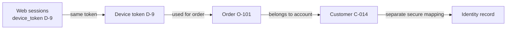
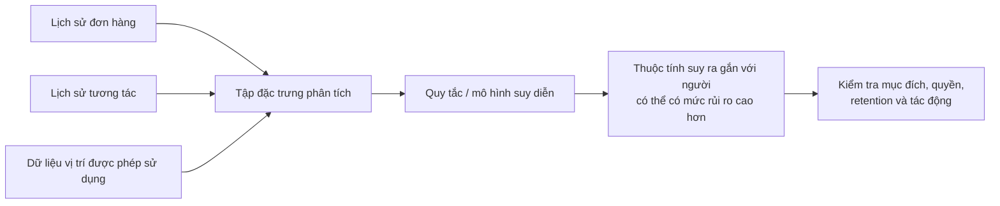
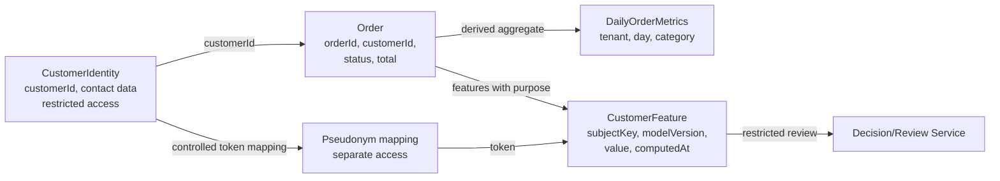
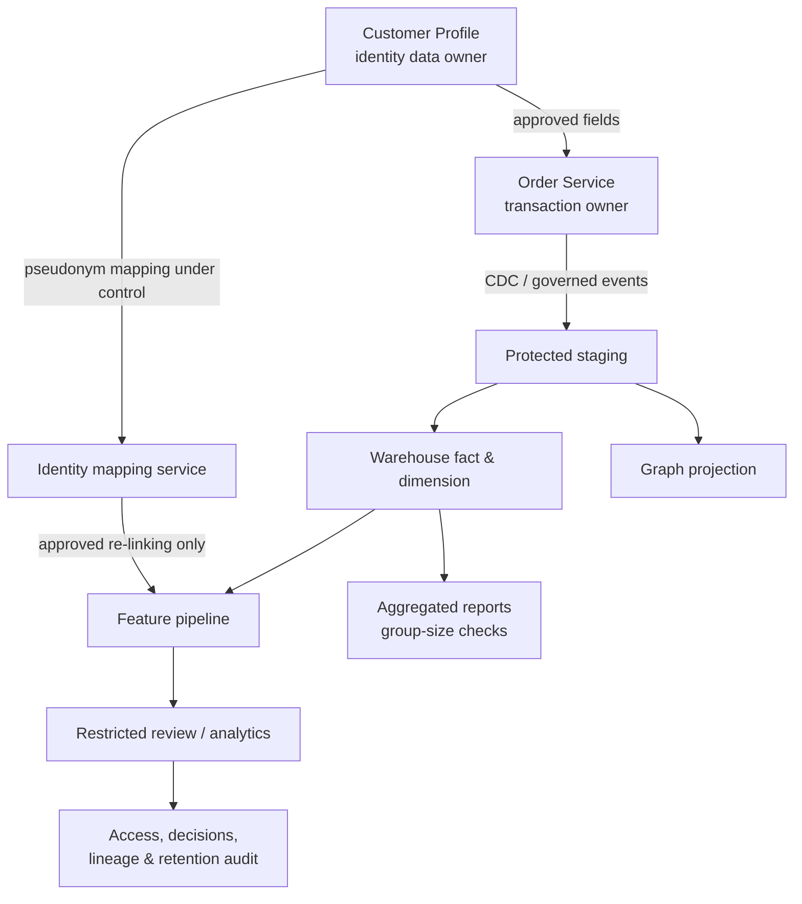

# Nhận diện dữ liệu cá nhân, dữ liệu nhạy cảm và thuộc tính suy ra

Một hệ thống bán hàng lưu tên khách, số điện thoại, địa chỉ giao hàng và lịch sử đơn. Những trường này tương đối dễ được nhận diện là **dữ liệu cá nhân**. Nhưng còn `device_id`, lịch sử duyệt sản phẩm, vị trí giao nhận gần nhà, phân khúc chi tiêu và điểm dự đoán “khả năng trả hàng” thì sao? Nếu mỗi trường được xem riêng lẻ, nhóm thiết kế có thể đánh giá chúng vô hại. Khi ghép nhiều bảng, document hoặc cạnh đồ thị, chúng có thể giúp **nhận diện một người, mô tả hành vi hoặc suy ra thông tin riêng tư về người đó**.

Bài học thuộc chương **Bảo vệ dữ liệu** của học phần **DATABASE_DATA_MODELING**. Mục tiêu của học phần là rèn kỹ năng chuyển yêu cầu nghiệp vụ thành thực thể, quan hệ và ràng buộc rõ ràng, tới lược đồ vật lý và mô hình quan hệ, document, đồ thị hoặc phân tích dễ kiểm chứng. Vì vậy, ta xem bảo vệ dữ liệu là **một yêu cầu thiết kế mô hình**, không chỉ là việc thêm mã hóa sau khi đã tạo bảng.

**Lưu ý phạm vi:** các định nghĩa pháp lý và danh mục dữ liệu nhạy cảm thay đổi theo quốc gia, ngành, hợp đồng và thời điểm. Bài này là **khung phân tích kỹ thuật và quản trị dữ liệu**, không thay thế đánh giá pháp lý đối với một hệ thống cụ thể. Những tình huống và định danh trong bài đều là **dữ liệu giả định**.

Sau bài học, bạn có thể:

- Nhận diện dữ liệu liên quan tới **một người có thể được xác định trực tiếp hoặc gián tiếp**, kể cả thông qua kết hợp nhiều trường.
- Phân biệt **định danh trực tiếp**, **định danh gián tiếp/quasi-identifier**, **dữ liệu hành vi**, **dữ liệu nhạy cảm** và **thuộc tính suy ra**.
- Giải thích vì sao `customer_id`, thiết bị, cookie, chuỗi vị trí hoặc điểm dự đoán có thể là dữ liệu cá nhân dù không chứa tên.
- Thiết kế **data inventory**, phân loại theo nhiều trục, lưu **provenance/lineage** của các thuộc tính được tính toán.
- Áp dụng **giảm thiểu dữ liệu, phân quyền theo mục đích, thời hạn lưu, kiểm soát bản sao và xóa/điều chỉnh có truy vết**.
- Viết kiểm tra SQL và hợp đồng dữ liệu giúp phát hiện trường chưa phân loại, phép suy diễn không có nguồn, hoặc dữ liệu được xuất quá phạm vi.
- Đánh giá tác động riêng tư khi chuyển dữ liệu từ relational sang document, graph và analytical warehouse.

## 1. Dữ liệu cá nhân không chỉ là “họ tên và số điện thoại”

Về mặt thiết kế, hãy bắt đầu bằng câu hỏi:

> “Thông tin này **liên quan đến một cá nhân** nào đó, và tổ chức hoặc bên có khả năng tiếp cận dữ liệu có thể nhận biết, phân biệt, liên kết hoặc tìm ra cá nhân đó bằng những phương tiện hợp lý trong bối cảnh sử dụng hay không?”

Có ít nhất ba trường hợp cần xem xét:

1. **Nhận diện trực tiếp:** một trường tự chứa thông tin nhận diện, chẳng hạn số định danh người, tên đi kèm dữ liệu liên lạc, địa chỉ email cá nhân.
2. **Nhận diện gián tiếp:** một mã như `customer_id` hoặc `device_id` trỏ tới một người thông qua bảng ánh xạ, hệ thống xác thực, dữ liệu giao dịch hoặc nguồn bên ngoài.
3. **Liên quan đến người dù không dùng để nhận diện:** một đánh giá, lịch sử mua, sở thích hoặc điểm dự đoán gắn với tài khoản người dùng có thể là thông tin cá nhân vì nó **mô tả người đó**.

Vì vậy, phát biểu “bảng này không có cột `name` nên không chứa dữ liệu cá nhân” thường **không đủ để kết luận**. Phải xét **khóa liên kết, ngữ cảnh, quyền truy cập, tập dữ liệu khác và khả năng tái nhận diện**.

### 1.1. Cần phân biệt “có thể xác định người” với “đã biết tên người”

Một mã `customer_id = C-014` có thể không cho nhà phân tích biết tên khách. Nhưng ứng dụng có bảng `customer_identity` ánh xạ `C-014` sang tài khoản đã đăng ký. Một người có quyền nối hai bảng vẫn có thể xác định cá nhân. Việc thay tên bằng mã **không tự biến dữ liệu thành ẩn danh**.

Tương tự, hệ thống có thể không biết tên một người duyệt web nhưng vẫn **phân biệt và theo dõi ổn định** các lần truy cập của cùng một thiết bị hoặc hồ sơ. Tùy khả năng liên kết và bối cảnh, chuỗi hành vi đó vẫn cần được xử lý như dữ liệu liên quan đến cá nhân.

### 1.2. Nhận diện theo ngữ cảnh chứ không chỉ theo kiểu dữ liệu

| Trường | Nhìn riêng lẻ | Ngữ cảnh khiến dữ liệu liên quan đến cá nhân |
| --- | --- | --- |
| `email` | Địa chỉ liên lạc | Liên kết đến người; kể cả email công việc của một nhân viên cụ thể |
| `customer_id` | Mã nội bộ | Có bảng mapping tới tài khoản/khách hàng |
| `device_id` | Mã thiết bị | Liên kết các lượt dùng/đơn hàng với một người hoặc nhóm người |
| `ip_address` | Địa chỉ mạng | Có thể kết hợp thời gian, log và tài khoản để liên hệ một phiên tới người |
| `delivery_location` | Tọa độ/địa chỉ | Có thể là nơi ở, nơi làm việc hoặc lịch sử di chuyển |
| `order_history` | Lịch sử giao dịch | Gắn với người mua, sở thích và hành vi tiêu dùng |
| `age_band` | Nhóm tuổi | Khi kèm vị trí, nghề nghiệp hoặc mã khách có thể giúp thu hẹp danh tính |
| `risk_score` | Điểm số mô hình | Khi tính cho một người, mô tả/đánh giá người đó |
| `favorite_category` | Phân loại sở thích | Nếu gắn với tài khoản, là thuộc tính suy ra về người |
| `daily_revenue_by_category` | Tổng tiền theo danh mục | Có thể ít rủi ro hơn nếu nhóm đủ rộng; ô quá nhỏ vẫn có thể tiết lộ cá nhân |

Không phải mọi địa chỉ IP, mã thiết bị hoặc số liệu tổng hợp đều mang cùng mức độ rủi ro trong mọi tình huống. Điều cần thiết là **đánh giá cách thông tin được thu thập, kết nối, truy cập và sử dụng**.

## 2. Bốn loại thông tin cần nhận diện trong mô hình dữ liệu

### 2.1. Định danh trực tiếp (*direct identifiers*)

Định danh trực tiếp giúp chỉ đến cá nhân bằng chính giá trị hoặc cùng một bối cảnh rất gần:

- Tên và thông tin liên hệ gắn với một người.
- Số định danh giấy tờ cá nhân theo hệ thống áp dụng.
- Tài khoản định danh gắn với hồ sơ đã xác minh.
- Địa chỉ email/số điện thoại cá nhân hoặc thông tin định danh định danh khác.
- Ảnh khuôn mặt hoặc mẫu sinh trắc được sử dụng để nhận diện người, tùy mục đích.

Một số dữ liệu như **tên phổ biến** không đủ duy nhất để xác định một người nếu đứng riêng; điều đó không làm nó mặc nhiên vô hại khi được lưu cùng đơn hàng, địa chỉ hoặc tài khoản.

### 2.2. Định danh gián tiếp và quasi-identifier

**Định danh gián tiếp** có thể không tiết lộ danh tính ngay nhưng kết hợp với bảng khác để xác định người. **Quasi-identifier** là thuộc tính hoặc tập thuộc tính có thể phân biệt một người trong một nhóm khi được kết hợp, ví dụ:

- Ngày sinh hoặc nhóm tuổi hẹp.
- Khu vực cư trú nhỏ.
- Nghề nghiệp, lịch làm việc hoặc cơ quan.
- Tổ hợp thời điểm–địa điểm hiếm.
- Lộ trình sử dụng dịch vụ và thiết bị.
- Mã tham chiếu khách hàng hoặc chuỗi cookie ổn định.

Không có một danh sách bất biến về “quasi-identifier”: cùng `postal_code` có thể không hiếm ở thành phố lớn nhưng đủ để nhận diện trong một nhóm nhỏ khi ghép tuổi và nghề nghiệp.

### 2.3. Dữ liệu hành vi hoặc dữ kiện liên quan đến cá nhân

Dữ liệu cá nhân không nhất thiết là dữ liệu nhận dạng. Lịch sử mua sắm, khoản chi tiêu, lựa chọn nội dung, thời điểm đăng nhập, tương tác hỗ trợ, phản hồi hay hành động sử dụng sản phẩm đều có thể mô tả **một cá nhân xác định hoặc có thể xác định**.

Đặc biệt, các trường `customer_id` xuất hiện trên:

```text
orders
search_events
device_sessions
support_tickets
loyalty_transactions
analytics_features
```

có thể cho phép dựng lại một hồ sơ chi tiết dù mỗi bảng chỉ lưu rất ít thông tin nhận dạng trực tiếp. Vì vậy, **khả năng JOIN** và lịch sử tích lũy cũng là yếu tố phải kiểm tra khi phân loại dữ liệu.

### 2.4. Thuộc tính suy ra (*inferred/derived attributes*)

Một thuộc tính suy ra được tính, phân loại hoặc dự đoán từ những dữ kiện khác:

- `preferred_category` = danh mục thường mua.
- `estimated_home_area` = khu vực nhà ở ước tính từ lịch sử vị trí.
- `likely_language` = ngôn ngữ sử dụng dự đoán từ hành vi.
- `churn_probability` = xác suất rời bỏ dịch vụ.
- `fraud_review_score` = điểm hỗ trợ rà soát giao dịch bất thường.
- `estimated_income_band` = nhóm thu nhập ước lượng từ tín hiệu hành vi.
- Một kết luận về tình trạng sức khỏe, tín ngưỡng, quan điểm hay đặc điểm riêng tư khác được **dự đoán** từ dữ liệu gián tiếp.

Thuộc tính được suy ra **không phải sự thật quan sát trực tiếp**. Nó cần ghi rõ **nguồn, phương pháp, thời điểm tính, mức độ tin cậy, phạm vi dùng và khả năng sai**. Nếu kết quả gắn với một người, nó vẫn có thể là dữ liệu cá nhân, và đôi khi rất nhạy cảm, **dù mọi đầu vào ban đầu trông bình thường**.

## 3. Dữ liệu nhạy cảm là lớp rủi ro cần xem trong bối cảnh

**Dữ liệu cá nhân nhạy cảm** thường chỉ những thông tin mà việc lộ lọt, phân biệt đối xử, suy diễn hoặc sử dụng không đúng mục đích có thể gây tác hại lớn hơn. Phạm vi **được luật, quy định và chính sách định nghĩa khác nhau**, nên không nên dùng một danh sách cố định như một tuyên bố pháp lý chung.

Những nhóm thường cần xem xét kỹ gồm:

| Nhóm thông tin | Ví dụ khái niệm | Vì sao cần bảo vệ cẩn trọng |
| --- | --- | --- |
| Sức khỏe | Kết quả xét nghiệm, chẩn đoán, thông tin điều trị | Có thể ảnh hưởng đời sống, việc làm, bảo hiểm, riêng tư |
| Sinh trắc dùng để xác định danh tính | Mẫu vân tay/khuôn mặt, template nhận dạng | Khó thay thế khi lộ; có thể gắn với định danh lâu dài |
| Tài chính cá nhân | Thông tin tài khoản, giao dịch và năng lực tài chính | Gian lận, lộ hành vi và thiệt hại kinh tế |
| Vị trí chính xác/lịch sử di chuyển | Hành trình thường xuyên, tọa độ nhà ở | Có thể tiết lộ thói quen, nơi sinh hoạt và quan hệ |
| Quan điểm/tín ngưỡng/đời sống riêng | Dữ liệu khai báo hoặc suy đoán | Nguy cơ xâm phạm quyền riêng tư và phân biệt đối xử |
| Thông tin trẻ em hoặc nhóm dễ bị tổn thương | Hồ sơ và hành vi gắn với nhóm cần bảo vệ đặc biệt | Mức rủi ro và trách nhiệm quản trị có thể cao hơn |
| Thông tin đăng nhập/bí mật xác thực | Mật khẩu, token, recovery secret | Có thể gây chiếm quyền và truy cập trái phép |

**Phân biệt:** “dữ liệu nhạy cảm của cá nhân” khác “bí mật thương mại”. Giá vốn sản phẩm, kế hoạch kinh doanh hay khóa API có thể là thông tin **mật của tổ chức**, nhưng không vì thế trở thành **dữ liệu cá nhân**. Ngược lại, một số thông tin cá nhân không phải bí mật doanh nghiệp vẫn cần bảo vệ phù hợp.

### 3.1. Nhãn `NOT_SENSITIVE` không chứng minh “an toàn”

Một email công việc có thể không thuộc danh mục dữ liệu cá nhân nhạy cảm được quy định riêng nhưng vẫn là thông tin liên hệ của người. Một giao dịch mua hàng đơn giản có thể bị xem là bình thường; nhiều giao dịch ghép lại có thể tiết lộ tình trạng riêng tư hoặc lộ trình hoạt động.

Vì thế nên phân loại **theo nhiều trục** thay vì chỉ một cờ `is_sensitive`.

### 3.2. Nhạy cảm có thể xuất hiện sau khi suy diễn

Ví dụ các lượt mua được dùng để dự đoán một thông tin sức khỏe hoặc tình trạng cá nhân. Ngay cả nếu `product_category` không được xếp ở mức bảo vệ đặc biệt, **đầu ra mô hình** có thể thuộc nhóm rủi ro cao hơn. Thiết kế phải xem lại cả **thuộc tính đầu ra, lineage và mục đích sử dụng**, không chỉ sao chép nhãn bảo vệ từ cột nguồn.

Một kết luận dự đoán về một người không trở thành “không nhạy cảm” chỉ vì nó có xác suất thấp. Ngược lại, độ tin cậy thấp cũng không đủ lý do để sử dụng tùy tiện; **dự đoán sai** có thể gây tác động bất lợi đáng kể.

## 4. Nhận diện bằng liên kết: một cột vô danh có thể trở nên rất cụ thể

### 4.1. Ví dụ hai bảng tự nhìn có vẻ ít thông tin

```text
Table: web_sessions
session_id | device_token | viewed_category | occurred_at
S-01       | D-9          | Home            | 09:00
S-02       | D-9          | Books           | 09:30

Table: order_devices
order_id | device_token
O-101    | D-9
```

Một bảng thứ ba có thể nối đơn hàng tới tài khoản:

```text
Table: orders
order_id | customer_id
O-101    | C-014
```

Từ đó có đường:



Để ghép thành hồ sơ người dùng, truy vấn không cần một trường `full_name` trong `web_sessions`. Một người có quyền với **cả ba bảng** có thể liên hệ những phiên đó với tài khoản C-014.

**Giới hạn suy luận:** `device_token` có thể được chia sẻ; thiết bị chung không chứng minh mọi phiên thuộc cùng một người. Liên kết dữ liệu có thể cho một **ứng viên danh tính**, không tự xác nhận danh tính hoặc hành vi của cá nhân. Nhưng ngay cả khi chưa chắc chắn, việc dữ liệu có thể ảnh hưởng đến một người vẫn là lý do cần kiểm soát.

### 4.2. Rủi ro tăng theo khả năng ghép dữ liệu

| Kỹ thuật ghép | Điều có thể xảy ra |
| --- | --- |
| JOIN trên `customer_id` | Kết hợp đơn, phiên, yêu cầu hỗ trợ thành hồ sơ cá nhân |
| JOIN trên `device_token` | Liên hệ nhiều tài khoản hoặc phiên qua một thiết bị |
| Ghép thời gian và tọa độ | Suy ra lịch trình, nơi thường xuất hiện |
| Ghép dữ liệu nội bộ với dữ liệu công khai | Thu hẹp tập người có thể là chủ thể của bản ghi |
| Graph traversal nhiều bước | Tìm mối liên hệ gián tiếp không thấy trong bảng riêng |
| Báo cáo nhóm rất nhỏ | Một ô số liệu có thể gần như đại diện cho một cá nhân |

Vì vậy một **danh sách cột được xem là vô danh** không đủ. Cần đánh giá **tổ hợp thuộc tính và toàn bộ bề mặt truy cập**: ai có thể nối được gì, qua giao diện nào, với những nguồn bổ sung nào.

### 4.3. Mã hash không tự làm dữ liệu ẩn danh

Nếu `email` được băm bằng hash thông thường rồi sử dụng ổn định trên nhiều hệ, giá trị hash vẫn có thể:

- Liên kết các bản ghi của **cùng một người**.
- Bị đoán hoặc thử lại với tập địa chỉ email phổ biến nếu không có cơ chế bảo vệ phù hợp.
- Được ánh xạ lại qua bảng nội bộ hoặc tập dữ liệu có liên hệ.

**Pseudonymization (giả danh hóa)** giúp giảm phơi lộ định danh trực tiếp nhưng dữ liệu có thể vẫn là dữ liệu cá nhân. **Anonymization (ẩn danh hóa)** đòi đánh giá việc nhận diện/liên kết có còn khả thi với nguồn và phương tiện hợp lý trong bối cảnh hay không; không chỉ “xóa tên và email”.

## 5. Thuộc tính suy ra: nguồn, phương pháp và ý nghĩa quyết định

### 5.1. Phân biệt quan sát, phép tính xác định và suy đoán

| Loại thuộc tính | Ví dụ | Mức chắc chắn |
| --- | --- | --- |
| **Observed** | `order.paid_at` do hệ giao dịch ghi nhận | Là phát biểu từ nguồn; còn phụ thuộc chất lượng nguồn |
| **Derived deterministic** | `total_paid_vnd` = tổng tiền các payment hợp lệ đã quy đổi | Đúng theo input và quy tắc tính; cần chính sách kỳ, currency và refund |
| **Heuristic inference** | `likely_home_area` từ địa điểm giao nhận lặp lại | Chỉ là phỏng đoán; dễ có false positive |
| **Predictive model output** | `churn_probability = 0.73` | Ước lượng có sai số, phụ thuộc model/version và dữ liệu |
| **Human assessment** | Ghi chú nhân viên “khả năng cần hỗ trợ” | Nhận định chủ quan có thể không chính xác |

Không nên gộp tất cả thành một cột `customer_status` có vẻ đã được xác minh. Đặc biệt, **suy đoán** không được tự nâng thành dữ kiện chắc chắn chỉ vì nó đã được ghi vào database.

### 5.2. Một thuộc tính suy ra cần có provenance gì?

Ví dụ `customer_features` lưu `return_risk_score` theo một người:

```text
subject_key        = PSEUDO-014
feature_code       = RETURN_REVIEW_SCORE
feature_value      = 0.73
value_type         = PROBABILITY
computed_at        = 2026-10-20T10:00:00Z
observation_window = [2026-07-20, 2026-10-20)
input_dataset      = feature_orders_v3
model_id           = review-model
model_version      = 4.2
purpose_code       = FRAUD_REVIEW_SUPPORT
quality_status     = MODEL_ESTIMATE
expires_at         = 2026-11-20T10:00:00Z
```

Điểm số **0,73** không nên được hiểu là “73% khả năng chắc chắn xảy ra sự kiện” nếu mô hình chưa được hiệu chuẩn với định nghĩa đó. `value_type = PROBABILITY` chỉ có ý nghĩa khi model contract định nghĩa rõ biến mục tiêu, cách hiệu chuẩn và giới hạn sử dụng.

Để hỗ trợ kiểm chứng và quyền của cá nhân theo chính sách áp dụng, nên giữ thêm:

- Nguồn dữ liệu đầu vào và **lineage** theo dataset/phiên bản.
- Điều kiện đủ điều kiện đưa chủ thể vào mô hình.
- Quy tắc lọc, gán nhãn, thời gian quan sát và xử lý dữ liệu thiếu.
- Khả năng mô hình gây tác động bất lợi; cách **human review** và phản hồi.
- Thời gian còn hiệu lực của suy đoán.
- Tác nhân/hệ thống được phép đọc và mục đích cụ thể.
- Chiến lược tính lại, xóa hoặc vô hiệu hóa khi nguồn thay đổi.

### 5.3. Thuộc tính suy ra có thể nhạy cảm hơn nguồn



Hệ thống không nên mặc định rằng vì input được phép dùng để xử lý đơn hàng nên **mọi mục đích suy đoán từ input** đều được phép. Mục đích thứ cấp, quyền truy cập và tác động của đầu ra phải được đánh giá riêng.

### 5.4. Proxy có thể tiết lộ đặc điểm không được lưu trực tiếp

Ngay cả khi database **không có cột thuộc tính nhạy cảm**, một biến như khu vực cư trú, lịch làm việc, lịch sử mua hay nhóm nội dung có thể **tương quan mạnh** với một đặc điểm riêng tư. Điều này tạo hai rủi ro:

1. **Rủi ro riêng tư:** mô hình suy ra một thuộc tính mà người đó chưa chủ động cung cấp.
2. **Rủi ro đối xử không công bằng:** hệ thống ra quyết định dựa trên một biến thay thế cho yếu tố không nên dùng.

Chỉ bỏ cột nhạy cảm khỏi tập đặc trưng **không tự giải quyết** hai rủi ro. Cần xem đầu ra, phép liên kết, mục đích, quy trình ra quyết định và kiểm thử tác động.

## 6. Phân loại dữ liệu theo nhiều trục, không chỉ một nhãn

Một mô hình metadata hữu ích nên tách ít nhất bốn trục:

1. **Liên hệ cá nhân:** có liên quan trực tiếp/gián tiếp đến cá nhân hay thực sự là thông tin phi cá nhân?
2. **Rủi ro/nhạy cảm:** mức độ bảo vệ cao hay thấp trong bối cảnh? Có danh mục nhạy cảm đặc biệt được áp dụng không?
3. **Nguồn gốc:** quan sát trực tiếp, nhập tay, sao chép, tính toán xác định hay suy luận thống kê?
4. **Mục đích và quyền:** ai được dùng, để làm gì, thời hạn bao lâu và theo chính sách nào?

Có thể thêm trục **độ tin cậy, tính chính xác, thời gian hiệu lực và nơi lưu trữ**. Không nên mã hóa tất cả thành một enum `PUBLIC | PII | SENSITIVE | INFERRED`, vì một cột vừa có thể là **PII**, vừa **sensitive**, vừa **inferred**.

### 6.1. Bảng phân loại mẫu

| Dữ liệu | Liên hệ cá nhân | Độ nhạy trong ví dụ | Origin | Quy tắc xử lý gợi ý |
| --- | --- | --- | --- | --- |
| `Customer.email` | Trực tiếp | Hạn chế | Người dùng cung cấp/đã xác minh | Chỉ đọc theo quyền, không đẩy vào log |
| `Order.customer_id` | Gián tiếp | Hạn chế | Hệ đặt hàng | Bảo vệ khóa JOIN, giữ tenant |
| `OrderLine.product_id` | Theo quan hệ với khách | Phụ thuộc sản phẩm/ngữ cảnh | Giao dịch | Bảo vệ lịch sử mua theo chủ thể |
| `Device.device_token` | Có thể liên kết | Hạn chế/rủi ro liên kết | Thiết bị/SDK | Chống theo dõi ngoài mục đích, retention phù hợp |
| `Delivery.precise_location` | Có thể nhận diện | Cao theo bối cảnh | Giao hàng | Giảm độ chi tiết sau hoàn tất nếu phù hợp |
| `Customer.age_band` | Quasi-identifier | Phụ thuộc tập nhóm | Khai báo hoặc tính từ ngày sinh | Không cung cấp nhóm quá nhỏ |
| `Feature.likely_home_area` | Liên quan đến người | Có thể cao | Suy ra | Đánh dấu ước lượng, giới hạn mục đích |
| `Feature.return_review_score` | Liên quan đến người | Có thể cao nếu tác động quyết định | Mô hình dự báo | Model/version, hạn dùng, review |
| `Aggregate.category_sales_monthly` | Thường tổng hợp | Phụ thuộc kích thước nhóm | Tính toán | Ngăn tiết lộ qua ô nhỏ/khác biệt truy vấn |
| `Catalog.category_name` | Không mặc nhiên liên quan người | Thường thấp | Danh mục | Xem xét trường hợp tên do người đặt chứa PII |

Các nhãn `Hạn chế`, `Cao` chỉ là **đề xuất nội bộ trong ví dụ**, không phải tên hạng mục pháp lý bắt buộc. Khi áp dụng thật phải liên hệ tiêu chuẩn tổ chức, luật và chính sách ngành.

### 6.2. Đánh giá ở nhiều cấp: field, record, dataset và query

Một cột `product_id` có thể được xem là ít nhạy cảm trong bảng catalog công khai. Nhưng cùng `product_id` trên **lịch sử mua của một người** cần được xử lý khác. Tương tự, dashboard `SUM(revenue)` theo cả nước có thể ít tiết lộ hơn báo cáo theo mã bưu chính hiếm và ngày cụ thể.

Do đó phân loại **ở mức cột** chỉ là một tầng. Cần thêm **data product/dataset classification** và **query result risk assessment** khi dữ liệu được JOIN, GROUP BY, export hoặc chia sẻ.

## 7. Ví dụ thiết kế thực thể cho hệ thống bán hàng

Giả sử một nền tảng bán hàng có ba nhu cầu:

- Xử lý đơn hàng và giao hàng cho một khách.
- Hỗ trợ chăm sóc khách trong khoảng thời gian đã định.
- Phân tích số đơn, doanh số và một số đặc trưng gắn với tài khoản.

Không phải mọi dịch vụ đều cần xem số điện thoại, vị trí chính xác hoặc điểm suy đoán của khách.

### 7.1. Tách danh tính, giao dịch và đặc trưng suy ra



Trong sơ đồ:

- `CustomerIdentity` lưu thông tin định danh và liên hệ cần cho nghiệp vụ.
- `Order` lưu giao dịch với `customer_id` và snapshot cần bảo toàn lịch sử.
- `DailyOrderMetrics` là dữ liệu tổng hợp theo hạt đã định; không cần sao chép mọi email.
- `CustomerFeature` lưu thuộc tính dẫn xuất với metadata về mục đích, phiên bản và thời gian.
- Bảng ánh xạ pseudonym được **bảo vệ riêng**, không chia sẻ rộng với pipeline phân tích.

**Không phải mọi use case cần một bảng ánh xạ riêng.** Đây là lựa chọn thiết kế nhằm phân tách quyền truy cập; cần đánh giá độ phức tạp, khóa và quy trình xóa.

### 7.2. Lược đồ quan hệ minh họa

Ví dụ PostgreSQL, các ID chỉ là dữ liệu giả. Đây là **lược đồ học thuật**, không phải mẫu bảo đảm tuân thủ đầy đủ cho dữ liệu thật.

```sql
CREATE TABLE customer_identity (
    tenant_id VARCHAR(32) NOT NULL,
    customer_id VARCHAR(40) NOT NULL,
    contact_email TEXT,
    contact_phone TEXT,
    contact_verified_at TIMESTAMPTZ,
    updated_at TIMESTAMPTZ NOT NULL,
    PRIMARY KEY (tenant_id, customer_id)
);

CREATE TABLE orders (
    tenant_id VARCHAR(32) NOT NULL,
    order_id VARCHAR(40) NOT NULL,
    customer_id VARCHAR(40) NOT NULL,
    status VARCHAR(24) NOT NULL,
    placed_at TIMESTAMPTZ NOT NULL,
    total_minor BIGINT NOT NULL,
    currency_code CHAR(3) NOT NULL,
    PRIMARY KEY (tenant_id, order_id),
    FOREIGN KEY (tenant_id, customer_id)
        REFERENCES customer_identity(tenant_id, customer_id),
    CHECK (total_minor >= 0)
);

CREATE TABLE customer_features (
    tenant_id VARCHAR(32) NOT NULL,
    subject_key VARCHAR(80) NOT NULL,
    feature_code VARCHAR(80) NOT NULL,
    feature_version VARCHAR(40) NOT NULL,
    value_numeric NUMERIC(18,8),
    quality_status VARCHAR(40) NOT NULL,
    purpose_code VARCHAR(80) NOT NULL,
    input_dataset_version VARCHAR(120) NOT NULL,
    computed_at TIMESTAMPTZ NOT NULL,
    expires_at TIMESTAMPTZ,
    PRIMARY KEY (
        tenant_id, subject_key,
        feature_code, feature_version, computed_at
    ),
    CHECK (expires_at IS NULL OR expires_at > computed_at)
);
```

Cần lưu ý:

- `orders.customer_id` là thông tin cá nhân **gián tiếp** vì nó trỏ tới hồ sơ cá nhân.
- `total_minor` và `currency_code` cần đi cùng nhau; lịch sử thanh toán có thể nhạy cảm theo bối cảnh.
- `customer_features.subject_key` là pseudonym **vẫn liên kết được qua ánh xạ có kiểm soát**; không được công bố như dữ liệu đã ẩn danh.
- `quality_status`, `purpose_code`, `input_dataset_version` và `computed_at` giúp phân biệt nguồn/độ tin cậy. Chúng **không tự cho phép sử dụng** một feature ngoài mục đích đã phê duyệt.
- Bảng chưa trình bày toàn bộ ràng buộc (ví dụ foreign key cho bảng ánh xạ, mã mục đích, quyền truy cập, data encryption, điều kiện xóa). Các yêu cầu ấy cần hợp đồng và cơ chế triển khai riêng.

### 7.3. Một bảng metadata để kiểm kê trường dữ liệu

Có thể lưu **mô tả** trường ở data catalog riêng, không trộn thông tin cá nhân thực vào bảng metadata:

```sql
CREATE TABLE data_field_catalog (
    asset_name VARCHAR(120) NOT NULL,
    field_name VARCHAR(120) NOT NULL,
    business_owner VARCHAR(120) NOT NULL,
    personal_relation VARCHAR(32) NOT NULL,
    sensitivity_tier VARCHAR(32) NOT NULL,
    origin_kind VARCHAR(32) NOT NULL,
    purpose_code VARCHAR(80) NOT NULL,
    retention_policy_id VARCHAR(80) NOT NULL,
    lineage_ref VARCHAR(200),
    last_reviewed_at TIMESTAMPTZ NOT NULL,
    PRIMARY KEY (asset_name, field_name),
    CHECK (
        personal_relation IN (
            'DIRECT', 'INDIRECT', 'CONTEXTUAL', 'NONE', 'UNKNOWN'
        )
    ),
    CHECK (
        origin_kind IN (
            'OBSERVED', 'DECLARED', 'COPIED',
            'DETERMINISTIC', 'INFERRED'
        )
    )
);
```

Trong thực tế, **một field có thể mang nhiều tag/mục đích**. Bảng trên được đơn giản hóa để làm rõ khái niệm; nếu cần nhiều mục đích và loại nhạy cảm, hãy dùng **bảng quan hệ con** `field_classification_tags`, `field_allowed_purposes` hoặc cấu trúc chính sách tương đương thay vì ép nhiều ý nghĩa vào một chuỗi.

Catalog cần có quy trình phê duyệt/phân công owner và **tự động phát hiện trường mới** sau schema migration. Nếu schema thêm cột mà catalog không cập nhật, hệ thống không thể tin vào giả định rằng mọi trường đã được phân loại.

## 8. Ghi nhận lineage cho dữ liệu suy ra

**Lineage** cho biết một dữ kiện có nguồn từ đâu, qua bước biến đổi nào và được tạo bằng phiên bản logic nào. Đây là yếu tố đặc biệt quan trọng với các kết quả **dẫn xuất hoặc dự đoán**.

### 8.1. Mô hình provenance tối thiểu

Một bản ghi `CustomerFeature` có thể trỏ tới một `FeatureRun`:

```text
FeatureRun
  run_id
  feature_code
  transformation_version
  model_version (nếu dùng model)
  input_dataset_id
  input_snapshot_or_watermark
  allowed_purpose
  started_at
  completed_at
  validation_status

CustomerFeature
  subject_key
  feature_code
  run_id
  value
  computed_at
  expires_at
  quality_status
```

Khi một bản ghi nguồn bị sửa, hạn chế hoặc xóa theo quy tắc áp dụng, hệ thống có thể sử dụng lineage để xác định **những features, projections và báo cáo cần tính lại hoặc đánh giá lại quyền lưu**.

### 8.2. Lineage không đồng nghĩa giải thích mô hình

Biết `model_version = 4.2` và `input_snapshot = X` giúp **truy vết sản xuất**. Nó chưa chứng minh vì sao một điểm số được gán cho một người, độ chính xác của mô hình hay tác động công bằng. Với quyết định quan trọng, có thể cần thông tin giải thích phù hợp, quy trình khiếu nại, kiểm định và giám sát hiệu năng.

### 8.3. Thuộc tính suy ra cần thời hạn dùng

Một `churn_score` tính từ hành vi 180 ngày trước có thể không còn đại diện cho tình trạng hiện tại. Nếu feature chỉ được dùng trong một tháng, `expires_at` phải tham gia kiểm tra đọc. Hết hạn **không biến giá trị thành không nhạy cảm**, và việc giữ lại sau hết hạn cần có mục đích/retention độc lập nếu được phép.

Ví dụ đọc feature đúng mục đích và thời gian:

```sql
SELECT
    feature_code,
    value_numeric,
    quality_status,
    computed_at,
    feature_version
FROM customer_features
WHERE tenant_id = :tenant_id
  AND subject_key = :subject_key
  AND purpose_code = :approved_purpose
  AND computed_at <= :as_of_time
  AND (
      expires_at IS NULL
      OR :as_of_time < expires_at
  );
```

**Truy vấn này chỉ minh họa lọc dữ liệu**, không phải một kiểm tra phân quyền hoàn chỉnh. Không được để client tự chọn `:approved_purpose`, `:tenant_id` hoặc `:subject_key` để vượt quyền. Backend phải xác minh chủ thể, mục đích và quyền từ ngữ cảnh đáng tin; chính sách còn có thể yêu cầu loại bỏ features không đạt quality hoặc không dùng trong quyết định tự động.

## 9. Phân quyền dựa trên cột, hàng, mục đích và ngữ cảnh

Các bảng có dữ liệu cá nhân thường cần **nhiều hơn một vai trò “được xem bảng”**:

- **Row-level/tenant isolation:** người thuộc tenant T-01 không được đọc T-02.
- **Column-level access:** nhân viên hỗ trợ có thể xem trạng thái đơn nhưng không mặc nhiên xem mọi dữ liệu nhạy cảm.
- **Purpose-based access:** quyền sử dụng dữ liệu cho giao hàng không tự cho phép tiếp thị hoặc phân tích đặc điểm cá nhân.
- **Contextual access:** có thể yêu cầu quan hệ công việc, vụ việc hỗ trợ, thời gian, khu vực hoặc yêu cầu phê duyệt.
- **Field masking/redaction:** giao diện chỉ hiển thị phần cần thiết khi xử lý nghiệp vụ.
- **Export/downstream control:** quyền xem trên UI không mặc nhiên cho phép xuất toàn bộ hồ sơ ra file, log hay bên thứ ba.

### 9.1. Thiết kế API theo nhu cầu, không trả nguyên entity

Một API hỗ trợ đơn hàng có thể trả:

```json
{
  "orderId": "O-101",
  "status": "DELIVERING",
  "contactPhoneMasked": "***-***-120",
  "deliveryArea": "District-X"
}
```

Không nên mặc định `SELECT * FROM customer_identity JOIN orders` rồi gửi mọi trường cho frontend vì “có thể sẽ dùng sau”. Dữ liệu không cần thiết trở thành **bề mặt rò rỉ** trong response, browser cache, log, analytics SDK và screenshot.

### 9.2. SQL minh họa view giới hạn trường

```sql
CREATE VIEW support_order_summary AS
SELECT
    tenant_id,
    order_id,
    status,
    placed_at,
    currency_code
FROM orders;
```

View giúp tạo **giao diện cột tối thiểu** cho một nhu cầu. Nó không tự bảo đảm tenant isolation hoặc authorization. Trong sản phẩm thật còn cần **thu hồi quyền truy vấn bảng gốc**, cấp quyền chính xác cho role ứng dụng, hàng rào tenant, kiểm soát identity của kết nối và chính sách lọc theo vụ việc.

Nếu dùng PostgreSQL Row-Level Security, việc thiết lập ngữ cảnh tenant phải được thực hiện ở tầng backend **đáng tin**, không cho client tùy ý đặt giá trị session; cũng phải chú ý connection pooling và những role có thể bypass RLS.

### 9.3. Token và encryption là hai công cụ khác nhau

- **Encryption at rest / in transit:** bảo vệ dữ liệu trên ổ đĩa hoặc khi truyền, trong giới hạn khóa và cấu hình; người có quyền giải mã vẫn có thể đọc dữ liệu.
- **Tokenization:** thay giá trị bằng token, tách ánh xạ có kiểm soát; vẫn cần xem token có liên kết được với một người hay không.
- **Pseudonymization:** dùng mã/giá trị thay thế để giảm trực tiếp việc thấy danh tính; dữ liệu thường vẫn có thể thuộc diện cá nhân.
- **Hashing/HMAC:** hỗ trợ kiểm tra/đối chiếu theo thiết kế; hash ổn định có thể trở thành mã định danh liên kết, và việc bảo mật key không tự tạo ẩn danh tuyệt đối.
- **Anonymization:** cần đánh giá rủi ro nhận diện thực tế sau xử lý; không thể bảo đảm chỉ bằng một tên hàm.

Không có công cụ đơn lẻ thay thế phân quyền, giảm thiểu dữ liệu, quản trị purpose và kiểm soát dữ liệu đã sao chép.

## 10. Tổ hợp các thuộc tính có thể làm lộ danh tính trong báo cáo

### 10.1. Bài toán nhóm quá nhỏ

Một dashboard nội bộ xuất số đơn theo:

```text
ward_name
age_band
occupation_group
calendar_day
product_category
```

Nếu một ô chỉ có **một khách**, người có thêm dữ liệu ngoài hệ thống có thể liên hệ số liệu giao dịch đó với người thực. Dù bảng báo cáo chỉ hiển thị **COUNT(*)** và **SUM(amount)**, nó vẫn có rủi ro tiết lộ.

Một giải pháp kỹ thuật có thể là **ngưỡng tối thiểu số chủ thể phân biệt**, giới hạn chiều phân nhóm, làm tròn, tổng hợp vùng rộng hơn, kiểm soát truy vấn lặp hoặc các kỹ thuật riêng tư khác tùy nhu cầu.

### 10.2. SQL minh họa kiểm tra số chủ thể phân biệt

```sql
WITH by_group AS (
    SELECT
        region_code,
        category_id,
        date_trunc('month', placed_at) AS order_month,
        COUNT(DISTINCT customer_id) AS distinct_customers,
        COUNT(*) AS order_count,
        SUM(total_minor) AS total_minor
    FROM order_reporting_view
    WHERE tenant_id = :tenant_id
      AND currency_code = 'VND'
    GROUP BY 1, 2, 3
)
SELECT
    region_code,
    category_id,
    order_month,
    distinct_customers,
    order_count,
    total_minor
FROM by_group
WHERE distinct_customers >= :approved_min_group_size;
```

`order_reporting_view` ở đây là **view giả định** có `category_id` đã được ánh xạ về một hạt dữ liệu không nhân tiền. Ngưỡng `:approved_min_group_size` do chính sách quyết định. Ví dụ này **không phải cơ chế anonymization đầy đủ**:

- Các truy vấn nhóm chồng lấn có thể bị **so sánh chênh lệch** để suy ra ô bị ẩn.
- Một số nhóm có nhiều khách vẫn có thể bị chi phối bởi một người.
- Nếu phân nhóm sản phẩm nhiều danh mục làm **nhân số tiền**, vấn đề chất lượng dữ liệu tồn tại song song với riêng tư.
- Người dùng có thể có quyền nhìn dữ liệu cá nhân qua kênh khác, làm tăng nguy cơ liên kết.

Cần đánh giá kết quả như **một sản phẩm dữ liệu** trong bối cảnh những phép truy vấn được phép, không chỉ tin một câu `HAVING COUNT(DISTINCT ...) >= k` đủ để ẩn danh.

### 10.3. Dữ liệu tổng hợp vẫn cần provenance

Một bảng `monthly_sales_by_region` có thể không chứa `customer_id`, nhưng nếu được tính từ các bản ghi cá nhân, nó vẫn cần lineage, định nghĩa metric, thời gian chốt và chính sách sử dụng. Điều đó giúp kiểm tra việc công bố và xử lý khi nguồn bị điều chỉnh. Không phải mọi tổng hợp đều phải xóa theo từng thay đổi nguồn; quyết định phụ thuộc chính sách và rủi ro tái nhận diện.

## 11. Truyền dữ liệu sang document, graph và kho phân tích

Một trường được phân loại đúng ở bảng nguồn **không có nghĩa các bản sao tự kế thừa chính sách**. ETL, cache, search, graph và warehouse có thể biến đổi tên trường, gộp/khử định danh hoặc tạo thêm suy diễn.

### 11.1. Relational database

Bảng `customers`, `orders`, `order_lines` phân tách danh tính và giao dịch bằng khóa/foreign key. Chuẩn hóa giúp mỗi sự thật có nơi cập nhật rõ, nhưng JOIN giữa các bảng vẫn có thể tạo hồ sơ rất chi tiết. Cần bảo vệ **đường JOIN**, phân quyền và dữ liệu trả về, không chỉ bảng danh tính.

### 11.2. Document database

Một document đơn hàng có thể nhúng:

```json
{
  "orderId": "O-101",
  "customerId": "C-014",
  "shipping": {
    "deliveryArea": "District-X",
    "recipientPhone": "example-placeholder"
  },
  "items": [
    {"productId": "P-01", "quantity": 1}
  ]
}
```

Cấu trúc này thuận tiện để tải một đơn, nhưng **sao chép thông tin liên hệ vào nhiều document** làm tăng số nơi phải cập nhật/xóa/hạn chế khi số điện thoại thay đổi hoặc không còn cần lưu. Cần phân biệt **snapshot lịch sử giao dịch có mục đích chính đáng** với bản sao không cần thiết.

### 11.3. Property graph

```text
(Customer C-014)-[:PLACED]->(Order O-101)
(Order O-101)-[:USED_DEVICE]->(Device D-9)
(Device D-9)<-[:USED_DEVICE]-(Order O-202)
(Customer C-055)-[:PLACED]->(Order O-202)
```

Graph giúp đi qua nhiều quan hệ nhanh và rõ, nhưng cũng làm **liên kết danh tính, thiết bị và hành vi** trở nên dễ truy vấn. Không được suy ra hai khách là một người chỉ từ thiết bị chung; đồng thời phải xem **toàn bộ đường đi** là dữ liệu có thể liên quan đến cá nhân và quản lý quyền truy vấn các cạnh phù hợp.

Graph dẫn xuất cần version/source lineage và quy tắc xóa cạnh khi source thay đổi. Nếu không, cạnh stale có thể kéo dài liên kết không còn đúng.

### 11.4. Dimensional model / warehouse

Một fact `fact_order_line` có `customer_key`, `product_key` và `amount`. Không thấy tên người trên fact nhưng nếu `dim_customer` ánh xạ `customer_key` tới danh tính, fact vẫn có thể liên quan đến cá nhân.

Nếu `dim_customer` dùng **SCD Type 2**, nhiều dòng có thể cùng một `customer_id`. Khi thực hiện quyền truy cập, hạn chế dữ liệu hoặc đối soát bản sao, phải tìm **mọi version** thuộc cùng người, không chỉ version hiện hành. Các bảng phân khúc và feature suy ra cũng có thể chứa những thông tin cá nhân riêng biệt cần quản trị.

### 11.5. Sơ đồ dòng dữ liệu có owner



Sơ đồ có tính nguyên lý: các mũi tên không tự cấp quyền. Mọi đường truyền dữ liệu cần hợp đồng **purpose, field allowlist, identity mapping, tenant isolation, lineage, retention, encryption và trách nhiệm sửa/xóa**.

## 12. Xác định mục đích sử dụng từ lúc thiết kế schema

**Purpose limitation/data minimization** có thể được thực hiện ở mức kiến trúc bằng cách hỏi:

1. Tác vụ cụ thể nào cần dữ liệu này?
2. Để thực hiện tác vụ đó có cần **giá trị chi tiết** không, hay chỉ cần nhóm/bucket?
3. Ai hoặc hệ thống nào thực sự cần đọc?
4. Dữ liệu được lưu bao lâu?
5. Có thể tách định danh trực tiếp ra khỏi bảng phục vụ phân tích không?
6. Khi thay đổi mục đích, ai duyệt và kiểm tra điều kiện hợp lệ?
7. Khi dữ liệu nguồn bị sửa/xóa/hạn chế, bản sao và dữ liệu suy ra sẽ thế nào?

### 12.1. Ví dụ giảm thiểu độ chi tiết vị trí

Một chức năng báo cáo nhu cầu giao hàng theo quận có thể chỉ cần `district_code`. Nếu đã hoàn tất giao hàng và không còn mục đích hợp lệ giữ tọa độ chi tiết, việc tiếp tục đưa **lat/lon chính xác** vào mọi bảng phân tích sẽ tăng rủi ro không cần thiết.

Tuy nhiên, giảm độ chi tiết không bảo đảm ẩn danh: trong một quận nhỏ hoặc thời điểm hiếm, tổ hợp với đơn hàng vẫn có thể giúp nhận diện cá nhân. Cần đánh giá **tập dữ liệu kết hợp** và yêu cầu nghiệp vụ.

### 12.2. Field-level purpose khác quyền đọc toàn bảng

Một nhân viên có thể cần số điện thoại để liên hệ giao hàng đang thực hiện, nhưng không cần lịch sử vị trí chi tiết hoặc điểm suy ra về thu nhập. Phân quyền `ROLE_SUPPORT -> SELECT customer_identity` quá rộng có thể không phản ánh đúng nhu cầu.

Có thể tổ chức API/read model theo từng tác vụ, kết hợp allowlist field, audit và thời hạn truy cập. Nếu hệ yêu cầu nhiều mục đích cho cùng trường, data catalog nên có **bảng mapping field–purpose**, không ép mỗi cột chỉ một mục đích.

## 13. Thu thập sự kiện, log, cache và backup cũng là mô hình dữ liệu

Dữ liệu cá nhân có thể xuất hiện ngoài các bảng nghiệp vụ:

- URL query chứa email hoặc token.
- Access log ghi body request/response.
- Trace chứa `customer_id`, vị trí, trạng thái giao dịch.
- Error message ghi nguyên payload lỗi.
- Cache chứa hồ sơ và chưa bị invalidated.
- Search index copy nhiều field để “sau này tìm”.
- Snapshot, export CSV, test database và backup.
- Feature store giữ các đặc trưng suy ra theo người.

Nếu chính sách chỉ định `CustomerIdentity.email` là restricted nhưng log tự động chứa email ở nhiều nơi không được kiểm kê, hệ thống vẫn có **bề mặt lưu trữ dữ liệu cá nhân không được quản lý**.

### 13.1. Kiểm soát log theo data contract

Một log sự kiện nghiệp vụ có thể giữ:

```json
{
  "eventType": "OrderConfirmed",
  "eventId": "EVENT-EXAMPLE-01",
  "tenantId": "T-01",
  "orderId": "O-101",
  "status": "CONFIRMED",
  "occurredAt": "2026-10-01T10:00:00Z"
}
```

Không đưa `contact_email`, `recipient_phone` hoặc nội dung riêng tư vào event chỉ vì payload nguồn có sẵn, trừ khi consumer có mục đích và quyền phù hợp. ID giao dịch vẫn có thể là **định danh gián tiếp**; event stream cần phân quyền và retention, không nên xem là dữ liệu công khai.

### 13.2. Môi trường thử nghiệm cũng phải có quy tắc

Đừng copy production data chứa thông tin cá nhân vào máy thử nghiệm hoặc môi trường phát triển chỉ để có dữ liệu “giống thật”. Có thể dùng **synthetic data** hoặc tập đã được xử lý có kiểm soát theo chính sách, và vẫn phải đánh giá nguy cơ tái nhận diện khi dùng dữ liệu lấy từ nguồn thật.

## 14. Xóa, sửa và giới hạn dữ liệu lan truyền tới bản sao suy ra

Một người đổi thông tin liên hệ hoặc yêu cầu xử lý dữ liệu theo cơ chế áp dụng. Hệ thống cần biết những nơi đang chứa bản sao hoặc dữ liệu tính từ thông tin đó.

### 14.1. Khác biệt giữa “xóa nguồn” và “không còn sử dụng dữ liệu”

Xóa hàng `customer_identity` không tự xóa:

- Email đã được copy vào `orders.shipping_snapshot`.
- Điểm `customer_features` tính từ lịch sử hành vi.
- Search document, graph edges, cache và warehouse.
- File xuất thủ công, log và bản sao lưu.

Cần **data lineage + copy inventory + deletion/retention policy**. Một số bản giao dịch hoặc dữ liệu kiểm toán có thể phải được lưu theo nghĩa vụ áp dụng; không nên hứa “xóa mọi dấu vết” khi kiến trúc có yêu cầu lưu giữ độc lập. Khi đó phải xác định rõ **giữ dữ liệu nào, vì sao, hạn chế quyền ra sao và khi nào kết thúc thời hạn lưu**.

### 14.2. Thuộc tính suy ra có cần tính lại?

Nếu một nguồn thay đổi hoặc bị đánh dấu không được dùng tiếp, feature suy ra có thể:

1. **Tính lại** từ dữ liệu nguồn còn được phép dùng.
2. **Vô hiệu hóa/hết hạn** cho tới khi có dữ liệu đủ điều kiện.
3. **Xóa hoặc hạn chế sử dụng** theo chính sách.
4. Giữ lịch sử quyết định đã thực hiện khi có cơ sở chính đáng, nhưng hạn chế truy cập và lưu lineage.

Không có câu trả lời duy nhất cho mọi dữ liệu; cần tính đến mục đích, ràng buộc lưu trữ, tính chính xác của feature và tác động của việc dựa trên dữ liệu cũ.

### 14.3. Event đến muộn có thể làm “sống lại” dữ liệu đã xóa

Nếu source phát `ProfileRedacted version 12`, consumer xóa trường email, rồi nhận event cũ `ProfileUpdated version 11`, một consumer không kiểm tra version có thể ghi email trở lại.

Giải pháp thường là **versioned tombstone/redaction marker**, xử lý idempotent và so nguồn có thẩm quyền. Đối với dữ liệu nhiều owner, version cần có phạm vi aggregate/field hợp lệ; không so version của Order và Customer như cùng một trục.

## 15. Data quality và quyền riêng tư hỗ trợ lẫn nhau

Dữ liệu sai, trùng hoặc không có provenance có thể khiến người dùng bị gán nhầm hành vi:

- Hai người có tên giống nhau bị merge sai.
- Một thiết bị gia đình bị gán duy nhất cho một người.
- Hàng lỗi hoặc hoàn tiền bị tính thành lịch sử mua.
- Một địa chỉ giao hàng tạm thời bị suy ra thành địa chỉ nhà.
- Thuộc tính suy ra đã hết hạn vẫn được dùng khi đánh giá hiện tại.

**Độ chính xác, khả năng sửa sai và provenance** là phần quan trọng của thiết kế bảo vệ dữ liệu, nhất là khi dữ liệu được dùng ra quyết định ảnh hưởng tới một người.

### 15.1. Kiểm tra thiết kế với các bất biến

| Bất biến | Cách kiểm tra |
| --- | --- |
| Khóa danh tính không trùng sai trong tenant | `(tenant_id, customer_id)` duy nhất; merge có quy trình xác minh |
| Không liên kết sai tenant | Foreign key, join và API đều dùng tenant scope |
| Cột mới được phân loại | So schema thực với data catalog; chặn release nếu thiếu metadata |
| Dữ liệu suy ra có nguồn | Feature chỉ publish khi `input_dataset_version`, method/model version hợp lệ |
| Không dùng feature hết hạn | Query/decision policy lọc `expires_at` |
| Dữ liệu không được dùng ngoài mục đích | Field allowlist và kiểm soát truy cập theo purpose |
| Bản sao được kiểm kê | Search/cache/warehouse/graph nằm trong copy inventory |
| Redaction có thể lan truyền | Đối soát source version và delete/redaction marker |
| Báo cáo nhóm nhỏ không lộ cá nhân | Kiểm tra số chủ thể phân biệt và rủi ro inference |
| Truy cập có audit phù hợp | Theo dõi ai truy cập tài sản nào, lúc nào và vì mục đích gì |
| Dữ liệu đầu vào của mô hình được đánh giá | Kiểm tra proxy, bias, missingness, độ tin cậy và tác động |

### 15.2. Truy vấn phát hiện trường chưa có metadata

Giả sử hệ thống duy trì catalog về những trường thuộc các bảng được quản trị. Với PostgreSQL, có thể so metadata của `information_schema.columns`:

```sql
SELECT
    c.table_name,
    c.column_name
FROM information_schema.columns AS c
LEFT JOIN data_field_catalog AS d
    ON d.asset_name = c.table_name
   AND d.field_name = c.column_name
WHERE c.table_schema = 'public'
  AND c.table_name IN (
      'customer_identity',
      'orders',
      'customer_features'
  )
  AND d.field_name IS NULL
ORDER BY c.table_name, c.ordinal_position;
```

Truy vấn trả các cột **chưa có bản ghi catalog**, không tự xác định chúng nhạy cảm. Khi một schema migration thêm cột, quy trình triển khai cần buộc owner phân loại và khai báo mục đích trước khi cho phép sử dụng.

### 15.3. Truy vấn phát hiện feature thiếu metadata tối thiểu

```sql
SELECT
    tenant_id,
    subject_key,
    feature_code,
    computed_at
FROM customer_features
WHERE purpose_code IS NULL
   OR input_dataset_version IS NULL
   OR quality_status IS NULL
   OR (
       expires_at IS NOT NULL
       AND expires_at <= computed_at
   );
```

Trong DDL minh họa, một số trường có `NOT NULL` và `CHECK` nên truy vấn có thể luôn rỗng khi constraint được thực thi; nhưng một kho analytical có thể không enforce như OLTP hoặc dữ liệu nhập từ nguồn chưa qua kiểm tra. Nó là **kiểm tra bổ sung**, chưa kiểm tra rằng `purpose_code` đã được phê duyệt, hoặc metadata lineage thật sự trỏ tới dataset hợp lệ.

### 15.4. Kiểm tra phân loại theo đầu ra, không chỉ theo nguồn

Một pipeline suy ra `estimated_home_area` từ dữ liệu giao hàng cần đăng ký **đầu ra** với phân loại và mục đích riêng. Không được áp dụng quy tắc “input là delivery area mức thấp, output cũng mức thấp” một cách máy móc, vì đầu ra có thể trở thành **vị trí sinh hoạt ước tính** và mang ý nghĩa riêng tư khác.

## 16. Quy trình đánh giá một trường hoặc feature mới

### Bước 1 — Mô tả dữ kiện bằng câu nghiệp vụ

Ví dụ: “`customer_features.preferred_category` là danh mục sản phẩm mà khách được ước tính quan tâm nhất từ các đơn đủ điều kiện trong 90 ngày gần đây.”

Phải nói rõ **là quan sát hay suy ra**, **của ai**, **trong khoảng nào** và **dùng để làm gì**. Chỉ tên cột `category` hoặc `score` không đủ.

### Bước 2 — Xác định khả năng liên hệ tới cá nhân

Trường có ID người trực tiếp không? Nếu không, có **khóa liên kết**, token, thiết bị, địa điểm, timestamp hoặc bảng ánh xạ nào giúp gắn nó với người không? Có thể được kết hợp với những nguồn mà tổ chức hoặc người nhận có quyền/khả năng tiếp cận không?

### Bước 3 — Phân loại nhạy cảm và tác động

Dữ liệu thuộc danh mục nhạy cảm theo quy tắc áp dụng không? Tổ hợp của các trường có thể tiết lộ thông tin nhạy cảm hoặc gây tác động xấu không? Nếu là suy luận, **đầu ra** có làm tăng rủi ro so với đầu vào không?

### Bước 4 — Ghi lineage, mục đích và tính hợp lệ

Nguồn nào cung cấp dữ liệu? Chủ sở hữu là ai? Mô hình/rule phiên bản nào đã tạo feature? Nó có hiệu lực đến lúc nào? Đâu là điều kiện hợp lệ để sử dụng trong nghiệp vụ? Có cách sửa hoặc hủy kết luận sai không?

### Bước 5 — Thiết kế nơi lưu và quyền truy cập tối thiểu

Trường thuộc bảng nguồn, projection, feature store hay một data mart? Có cần giữ định danh trực tiếp không? Bảng mapping được ai quản lý? API nào trả dữ liệu, có được export hay cache không?

### Bước 6 — Kiểm tra các đường đi của dữ liệu

Theo dõi `source → ETL/CDC → warehouse → feature → BI/API/export`. Với mỗi nơi, xác định phân loại, owner, retention, nguồn làm mới và hành vi khi cập nhật/xóa.

### Bước 7 — Viết test có điều kiện biên

Thử ít nhất: hai khách dùng chung thiết bị; hai khách có cùng tên; một khách đổi vùng; một feature hết hạn; bản ghi bị sửa; sự kiện xóa tới trước update cũ; dashboard chỉ còn một người; một consumer tự thêm cột chưa kiểm kê; một yêu cầu từ tenant khác.

### Bước 8 — Rà soát định kỳ khi mục đích hoặc công nghệ thay đổi

Một thuộc tính ít rủi ro lúc chỉ dùng để debug có thể trở nên nhạy cảm khi được kết hợp với dữ liệu vị trí hoặc làm đầu vào mô hình quyết định. Phân loại phải được **xem lại** khi có dữ liệu mới, đối tác mới, chính sách mới hoặc cách dùng mới.

## 17. Sai lầm thường gặp

1. **“Không có tên nên không phải dữ liệu cá nhân.”** Bảng vẫn có thể nhận diện gián tiếp qua ID, thiết bị và JOIN.
2. **“Hash email nghĩa là đã ẩn danh.”** Hash ổn định có thể liên kết/đoán/ánh xạ lại.
3. **“Chỉ dữ liệu do người dùng điền mới là dữ liệu cá nhân.”** Lịch sử hành vi và thuộc tính suy ra cũng có thể liên quan đến một người.
4. **“Dự đoán không phải dữ liệu nhạy cảm vì không chắc đúng.”** Dự đoán về đặc điểm riêng tư hoặc quyết định có tác động vẫn cần bảo vệ.
5. **“Mỗi cột có đúng một nhãn phân loại.”** Personal, sensitive, inferred và purpose là các trục khác nhau.
6. **“Cứ gắn `is_sensitive = false` là mọi sử dụng đều được phép.”** Mục đích, liên kết và bối cảnh vẫn quan trọng.
7. **“Graph chỉ chứa ID vô danh nên an toàn.”** Đường liên kết có thể suy ra danh tính hoặc hành vi.
8. **“Tổng hợp dữ liệu luôn ẩn danh.”** Nhóm nhỏ và truy vấn chồng lấn có thể tiết lộ cá nhân.
9. **“Data warehouse không cần chính sách riêng vì là bản copy.”** Projection có thể chứa thông tin cá nhân và suy luận mới.
10. **“Đặt RLS ở source là đủ.”** Cache, logs, exports và replicas có thể không dùng cùng policy.
11. **“Thuộc tính suy ra không cần hạn dùng.”** Feature cũ có thể sai, nhưng vẫn ảnh hưởng quyết định.
12. **“Một số điện thoại có thể copy ở mọi document để đọc nhanh.”** Tăng bề mặt rò rỉ, khó sửa và xóa.
13. **“Một device token tương đương một người.”** Thiết bị dùng chung và sai lệch định danh khiến liên kết không chắc chắn.
14. **“Chỉ cần mã hóa là đủ.”** Người có quyền giải mã vẫn cần giới hạn mục đích và quyền truy cập.
15. **“Xóa row nguồn là đã xóa toàn bộ dữ liệu.”** Feature, graph, search, logs và backup cần chính sách riêng.
16. **“Giữ một điểm suy ra mà không lưu model version cũng không sao.”** Không thể kiểm toán hoặc tái hiện kết quả đáng tin.
17. **“Kiểm tra data catalog chỉ một lần khi tạo bảng.”** Schema và use case thay đổi liên tục.
18. **“Vì một dữ kiện đúng về mặt số học nên được phép dùng ra quyết định.”** Tính chính xác kỹ thuật không thay thế đánh giá mục đích, quyền và tác động.

## 18. Bài tập thực hành và gợi ý đáp án

### Bài tập 1 — Dữ liệu không có tên người

Bảng `orders` chỉ có `tenant_id`, `order_id`, `customer_id`, `amount_minor`. Bảng `customer_identity` có ánh xạ `customer_id` tới email.

**Yêu cầu:** `orders` có thể chứa dữ liệu cá nhân không? Vì sao?

**Gợi ý:** **có thể có**. `customer_id` là định danh gián tiếp; các đơn và số tiền có thể gắn với một cá nhân qua bảng ánh xạ. Không có `name` trong `orders` không đủ chứng minh dữ liệu vô danh.

### Bài tập 2 — Thiết bị dùng chung

Hai khách sử dụng cùng một thiết bị để đặt hai đơn hàng.

**Yêu cầu:** có thể kết luận là cùng một người không? Cần phân loại `device_token` ra sao?

**Gợi ý:** không thể kết luận đồng danh tính chỉ từ thiết bị chung. Nhưng token có khả năng **liên kết** hành vi nên cần đánh giá như dữ liệu có thể liên quan đến cá nhân, giới hạn mục đích và retention.

### Bài tập 3 — Cột suy ra từ dữ liệu ít nhạy cảm

Một mô hình dùng lịch sử mua và giờ truy cập để dự đoán `estimated_home_area`.

**Yêu cầu:** có thể giữ nguyên nhãn nhạy cảm của các cột đầu vào cho đầu ra không?

**Gợi ý:** không. Đầu ra là **thuộc tính suy ra về vị trí sinh hoạt** và có thể mang rủi ro riêng tư cao hơn; cần phân loại lại, lưu method/model version, thời điểm tính, độ tin cậy và purpose.

### Bài tập 4 — Hash có làm dữ liệu ẩn danh?

Hệ thống băm email theo cùng một thuật toán và dùng kết quả làm `user_hash` trên mọi dataset.

**Yêu cầu:** có thể gọi các dataset đó đã ẩn danh không?

**Gợi ý:** không tự động. Hash ổn định có thể nối hồ sơ và có thể bị đoán/ánh xạ theo ngữ cảnh. Nên xem đó là **pseudonym hoặc định danh liên kết** cần kiểm soát cho tới khi đánh giá ẩn danh hóa đầy đủ.

### Bài tập 5 — Suy đoán và xác suất

Một pipeline lưu `return_review_score = 0.73` nhưng không ghi model version, thời gian tính hay tập dữ liệu đầu vào.

**Yêu cầu:** có vấn đề gì khi dùng điểm đó trong quy trình rà soát khách?

**Gợi ý:** không thể biết model, dữ liệu, hạn hiệu lực, chất lượng và khả năng tái hiện. `0.73` cũng không tự có nghĩa là xác suất đã được hiệu chuẩn. Cần lineage, mục đích, kiểm định và quy trình xem xét phù hợp.

### Bài tập 6 — Một báo cáo có một người

Dashboard trả doanh số theo khu vực, nghề nghiệp và ngày; một ô có đúng một khách.

**Yêu cầu:** có rủi ro gì dù không có email hoặc customer ID?

**Gợi ý:** ô có thể tiết lộ số liệu của người đó nếu bên đọc có nguồn bổ sung. Cần đánh giá nhóm nhỏ, truy vấn chênh lệch, phạm vi phân tích và các phương án giới hạn mức chi tiết.

### Bài tập 7 — Sửa thông tin đã copy

Khách đổi số điện thoại sau khi đã có nhiều đơn; số điện thoại cũng nằm trong search document.

**Yêu cầu:** có nên sửa trực tiếp search document rồi bỏ qua nguồn danh tính?

**Gợi ý:** sửa qua **nguồn có thẩm quyền** theo nghiệp vụ; sau đó cập nhật hoặc giữ snapshot lịch sử theo chính sách. Search là bản dẫn xuất cần đồng bộ, đồng thời phải kiểm tra các bản sao khác còn giữ số cũ hay không.

### Bài tập 8 — Xóa và tính lại feature

Một khách bị xóa/hạn chế dữ liệu theo chính sách áp dụng. Hệ thống còn lưu các `customer_features` suy ra từ lịch sử của khách.

**Yêu cầu:** có thể giữ các feature vô thời hạn vì “đã được tính toán” không?

**Gợi ý:** không mặc định. Feature vẫn có thể liên quan đến người và có thể chứa thông tin nhạy cảm được suy ra. Dùng lineage và chính sách để quyết định xóa, hạn chế, hết hạn hoặc giữ một phần có cơ sở riêng; kiểm tra mọi bản sao.

### Bài tập 9 — Phân loại đa trục

Một trường `inferred_health_flag` được mô hình dự đoán từ hoạt động ứng dụng và gắn với `subject_key`.

**Yêu cầu:** nên gắn các nhãn nào?

**Gợi ý:** đây có thể là **dữ liệu liên quan cá nhân qua pseudonym**, **thuộc tính suy ra**, **rủi ro nhạy cảm cao**, có **method/model provenance**, purpose và retention riêng. Không dùng một enum chỉ cho phép chọn `PII` *hoặc* `INFERRED`.

### Bài tập 10 — Phát hiện trường schema chưa kiểm kê

Ứng dụng thêm cột `contact_phone_backup` vào `customer_identity` nhưng data catalog chưa có mục tương ứng.

**Yêu cầu:** pipeline triển khai nên làm gì?

**Gợi ý:** phát hiện lệch schema–catalog, yêu cầu owner phân loại, xác định mục đích, quyền, retention và các bản sao trước khi sử dụng; không cho rằng cột mới tự thừa hưởng chính xác mọi quyền của cột cũ.

### Bài tập 11 — Relational, document và graph

Hệ thống có quan hệ `Customer → Order → Device`. Một data team muốn xuất toàn bộ graph để cộng tác nghiên cứu.

**Yêu cầu:** vì sao chỉ loại bỏ `Customer.name` chưa đủ?

**Gợi ý:** `customer_id`, `device_token`, chuỗi đơn và thời gian có thể liên kết tới cá nhân hoặc nguồn khác. Cần đánh giá rủi ro ở **đường đi graph**, giới hạn mục đích và field, giảm chi tiết, kiểm soát quyền, retention và các điều kiện chia sẻ thích hợp.

### Bài tập 12 — Lựa chọn kiến trúc

Một nền tảng cần xử lý đơn hàng, lưu thông tin liên hệ giao hàng, thống kê doanh số theo tháng và dự đoán nhóm khách có nguy cơ rời bỏ dịch vụ.

**Yêu cầu:** thiết kế các nơi lưu dữ liệu nào để giảm phơi lộ mà vẫn hỗ trợ nghiệp vụ?

**Gợi ý:** dùng nguồn danh tính có quyền truy cập hạn chế; nguồn giao dịch với khóa nghiệp vụ và snapshot thực sự cần; warehouse fact–dimension cho metric; feature store có pseudonym, version, lineage và purpose; data catalog, chính sách truy cập và cơ chế đồng bộ sửa/xóa xuyên bản sao. Không đẩy mặc định mọi thông tin liên hệ sang bảng phân tích hoặc feature.

## Tổng kết

**Dữ liệu cá nhân** không chỉ là tên hoặc số điện thoại; **mã khách, thiết bị, lịch sử giao dịch, vị trí và dữ liệu tổng hợp** có thể liên hệ đến một người qua bối cảnh hoặc phép JOIN. **Dữ liệu nhạy cảm** cần được đánh giá theo loại thông tin, khả năng gây tác hại và quy tắc áp dụng; sự nhạy cảm có thể xuất hiện từ **tổ hợp dữ liệu hoặc thuộc tính suy ra**, không chỉ từ các cột được người dùng điền trực tiếp. Một mô hình dữ liệu đáng tin phải phân loại theo nhiều trục, xác định owner và mục đích, lưu **nguồn gốc và phiên bản** của suy luận, giới hạn trường được lưu và truy cập, quản lý bản sao và kiểm tra khả năng sửa/xóa có truy vết. **Giảm tên trường không đồng nghĩa ẩn danh; đúng dữ liệu về mặt kỹ thuật không đồng nghĩa được phép dùng cho mọi mục đích.**
