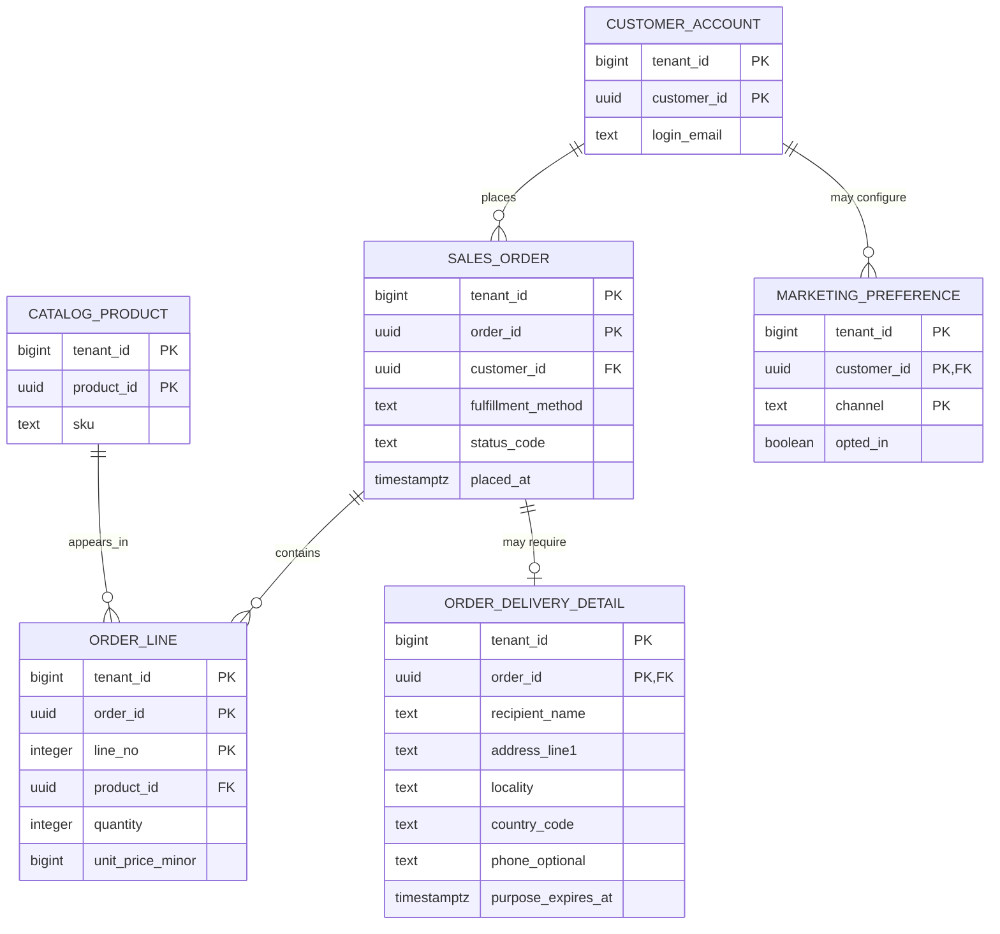
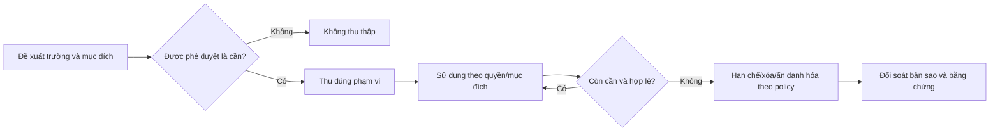

# Chỉ mô hình hóa dữ liệu cần thiết cho mục đích đã xác định

Một hệ thống có thể được bảo vệ bằng mã hóa, phân quyền chặt chẽ và kết nối an toàn, nhưng vẫn tạo ra rủi ro không cần thiết nếu **thu thập và lưu những dữ liệu không phục vụ mục đích đã xác định**. Ví dụ, một màn hình đặt hàng vật lý chỉ cần địa chỉ để giao hàng có thể vô tình yêu cầu ngày sinh, giới tính, mã giấy tờ và vị trí GPS chính xác vì “sau này có thể dùng”. Khi các trường ấy đi vào bảng giao dịch, log, sự kiện, cache, bản sao lưu và dashboard, việc xóa hoặc giới hạn truy cập trở nên khó hơn rất nhiều.

**Chỉ mô hình hóa dữ liệu cần thiết cho mục đích đã xác định** là một nguyên tắc thiết kế: trước khi thêm một thực thể, thuộc tính, khóa liên kết hoặc luồng sao chép, cần giải thích **dữ liệu phục vụ quyết định/hành động nào**, tại sao mức chi tiết đó là cần thiết, **ai** được sử dụng, trong **bao lâu**, và làm sao biết dữ liệu đã hết mục đích hoặc không còn hợp lệ để sử dụng.

Bài thuộc chương **Bảo vệ dữ liệu** của module **DATABASE_DATA_MODELING**. Theo mục tiêu module, ta sẽ chuyển yêu cầu nghiệp vụ thành mô hình dữ liệu rõ ràng từ thực thể, quan hệ, ràng buộc, khóa và lược đồ vật lý; đồng thời so sánh mô hình quan hệ, document, graph và phân tích để chọn cấu trúc **dễ kiểm chứng, dễ tiến hóa mà không tích lũy dữ liệu thừa**.

Các ví dụ minh họa dùng Java và **PostgreSQL 15+**. Bài tập trung vào **kỹ thuật mô hình hóa và quản trị vòng đời dữ liệu**, không phải tư vấn pháp lý. Nghĩa vụ pháp lý, căn cứ xử lý, thời hạn lưu giữ, yêu cầu về chấp thuận và quyền của chủ thể dữ liệu phải được xác định theo **khu vực pháp lý, loại dữ liệu, ngành và chính sách đã được phê duyệt**; không có một số ngày lưu giữ hay một cách lấy chấp thuận phù hợp với mọi hệ thống.

## 1. Phân biệt bảo vệ dữ liệu, tối thiểu hóa dữ liệu và giới hạn mục đích

Ba khái niệm liên quan chặt chẽ nhưng không thay thế cho nhau.

| Khái niệm | Câu hỏi | Ví dụ |
|---|---|---|
| **Tối thiểu hóa dữ liệu** (*data minimization*) | Có thật cần thu thập hoặc lưu **trường này, độ chi tiết này và từng bản ghi này** không? | Không yêu cầu ngày sinh nếu xác nhận đơn không cần biết tuổi |
| **Giới hạn mục đích** (*purpose limitation*) | Dữ liệu được thu và sử dụng cho **mục đích nào**, có được dùng cho mục đích khác không? | Email thông báo giao hàng không tự động trở thành danh sách quảng cáo |
| **Bảo mật dữ liệu** (*data security*) | Ai được đọc/ghi, dữ liệu được bảo vệ trước những rủi ro nào? | Phân quyền, mã hóa, ghi audit, bảo vệ khóa |
| **Giới hạn lưu giữ** (*retention limitation*) | Khi nào dữ liệu không còn cần cho mục đích hợp lệ và phải xử lý thế nào? | Xóa địa chỉ giao hàng sau mốc được chính sách phê duyệt cho phép |
| **Chất lượng và chính xác** | Dữ liệu có đủ đúng để phục vụ mục đích không? | Địa chỉ giao hàng chính xác tại thời điểm gửi kiện |
| **Trách nhiệm giải trình** | Có chứng minh được việc thu thập/sử dụng là có chủ đích không? | Data dictionary, owner, policy, log thay đổi, kiểm thử |

Mã hóa một trường không cần thiết **không làm trường ấy trở nên cần thiết**. Ngược lại, tối thiểu hóa dữ liệu không có nghĩa bỏ qua mã hóa hoặc phân quyền cho những trường còn lại.

### “Cần thiết” không đồng nghĩa “có thể hữu ích”

Một thuộc tính có thể giúp tạo báo cáo thú vị trong tương lai, nhưng nếu chưa có use case, quyền sử dụng, chủ sở hữu và chính sách vòng đời, lý do “biết đâu sau này dùng” thường không đủ mạnh để đưa vào mô hình chính thức.

Quyết định có thu một trường nên dựa trên **mục đích được xác định**, không dựa trên việc API của đối tác có sẵn trường đó hay database còn nhiều dung lượng.

## 2. Bắt đầu từ câu chuyện nghiệp vụ và tiêu chí chấp nhận

Ví dụ nền tảng bán hàng đa tenant có các quy trình:

1. **Đăng nhập tài khoản:** khách dùng email để đăng nhập và nhận thông tin tài khoản.
2. **Đặt hàng:** khách chọn sản phẩm và xác nhận giá/tiền tệ.
3. **Giao hàng vật lý:** cần tên người nhận và địa chỉ giao hàng trong thời gian xử lý giao.
4. **Bán sản phẩm số:** không cần địa chỉ giao vật lý.
5. **Hỗ trợ sau bán:** cần tra đơn và trạng thái xử lý; chỉ nhân viên có nhiệm vụ giao hàng mới cần thấy địa chỉ đầy đủ.
6. **Thông tin tiếp thị:** có một quy trình đăng ký tùy chọn, độc lập với việc mua hàng.
7. **Báo cáo vận hành:** cần số đơn, số lượng sản phẩm, doanh thu theo ngày và nhóm hàng; không cần địa chỉ từng khách.

Đây là các **mục đích khác nhau**, dù cùng liên quan đến một khách hàng và đơn hàng.

### Mẫu câu hỏi cho mỗi yêu cầu

Trước khi tạo một trường, hãy ghi:

- **Mục đích cụ thể:** quyết định/hành động nào sẽ sử dụng trường?
- **Căn cứ và thẩm quyền:** quy trình nào được phép xử lý, theo chính sách/đánh giá pháp lý nào?
- **Tối thiểu cần biết:** cần giá trị gốc, giá trị đã giảm độ chi tiết, một cờ boolean hay chỉ một kết quả xác minh?
- **Nguồn đáng tin cậy:** khách tự khai, dịch vụ thanh toán, đối tác giao hàng hay hệ thống quản trị?
- **Thời điểm cần:** khi đặt đơn, giao hàng, hỗ trợ, kiểm toán hay tổng hợp?
- **Phạm vi đối tượng:** mọi khách hay chỉ khách sử dụng một tính năng?
- **Người và hệ được truy cập:** vai trò nào, qua API nào, có phụ thuộc tenant không?
- **Thời hạn và cách kết thúc:** xóa, vô danh hóa, gộp số liệu, hạn chế sử dụng hay giữ theo nghĩa vụ cụ thể?
- **Cách chứng minh:** kiểm thử nào ngăn thu quá mức hoặc sao chép ngoài mục đích?

Nếu thiếu câu trả lời, đánh dấu **quyết định đang mở** thay vì tạo trước một cột `VARCHAR(255)`.

## 3. Ma trận mục đích → dữ liệu cần thiết

Bảng sau là **ví dụ thiết kế**, không phải một kết luận pháp lý áp dụng sẵn cho mọi doanh nghiệp.

| Mục đích | Dữ liệu nên xét là cần | Dữ liệu không tự động cần | Phạm vi sử dụng |
|---|---|---|---|
| Đăng nhập tài khoản | Account ID, email đăng nhập, credential được quản lý an toàn | Giới tính, địa chỉ nhận hàng, số giấy tờ | Dịch vụ định danh |
| Xử lý đơn hàng | Order ID, customer ID, dòng hàng, số lượng, đơn giá đã chốt, trạng thái | Vị trí GPS liên tục, ngày sinh, lịch sử duyệt web | Dịch vụ đơn hàng |
| Giao hàng vật lý | Tên người nhận, địa chỉ đủ để giao; số điện thoại **nếu quy trình vận chuyển thật sự cần** | Mọi thông tin định danh khác, tọa độ chính xác nếu địa chỉ đã đủ | Nhân viên/đối tác giao vận được ủy quyền |
| Bán hàng số | Địa chỉ email/định danh để cấp quyền tải hoặc nhận sản phẩm theo nhu cầu | Địa chỉ giao hàng vật lý | Dịch vụ cấp quyền số |
| Hỗ trợ sau bán | Order ID, trạng thái, lịch sử xử lý cần thiết | Toàn bộ hồ sơ khách hoặc địa chỉ đầy đủ cho mọi ticket | Nhân viên theo chức năng |
| Đăng ký email tiếp thị | Địa chỉ/kênh cần gửi, trạng thái đăng ký, bằng chứng cần thiết theo chính sách | Tất cả lịch sử mua hàng làm điều kiện mặc định | Hệ thống tiếp thị với mục đích riêng |
| Báo cáo doanh số theo ngày | Ngày kinh doanh, sản phẩm/nhóm, số lượng, tiền tệ, doanh thu | Tên, email, số điện thoại, địa chỉ của từng người mua | Data mart/BI |
| Phát hiện gian lận/bảo vệ an toàn | Những tín hiệu có mục đích và ngưỡng cần thiết đã được phê duyệt | Thu thập vô hạn mọi dữ liệu thiết bị “để dự phòng” | Bộ phận an toàn với thời hạn và kiểm soát riêng |

Điều này tạo hai quy tắc hữu ích:

1. **Dữ liệu cần cho một mục đích không tự được phép dùng cho mọi mục đích khác.**
2. **Dữ liệu cần vào một giai đoạn không tự cần giữ trong suốt vòng đời của thực thể chính.**

Ví dụ, dòng đơn và giá chốt có thể cần giữ để thực hiện nghĩa vụ sau bán theo chính sách; địa chỉ giao hàng có thể chỉ cần một khoảng ngắn hơn. Nếu gộp tất cả vào cùng một bảng `orders` và áp thời hạn lưu giữ lâu nhất cho mọi cột, dữ liệu giao hàng có thể bị giữ lâu không cần thiết.

## 4. Chọn đúng độ chi tiết: trường gốc, kết quả xác minh hay nhóm dữ liệu

Một mục đích có thể được phục vụ bằng **ít dữ liệu hơn** so với nguồn ban đầu.

| Câu hỏi nghiệp vụ | Không mặc định thu/lưu | Biểu diễn ít dữ liệu hơn nếu đáp ứng mục đích |
|---|---|---|
| Người dùng có đủ điều kiện tuổi? | Ngày sinh đầy đủ | Kết quả đủ/không đủ điều kiện từ luồng xác minh được phê duyệt |
| Có giao được đến khu vực này? | Tọa độ GPS chính xác liên tục | Mã khu vực/bưu chính phù hợp phạm vi giao |
| Khách đã xác minh email? | Toàn bộ lịch sử OTP và mã OTP thuần văn bản | Cờ xác minh, thời điểm, bằng chứng tối thiểu cần thiết |
| Có bao nhiêu khách ở từng nhóm tuổi? | Bảng sinh nhật từng người trong data mart | Thống kê theo nhóm tuổi nếu được phép và đủ an toàn |
| Đếm đơn theo tỉnh/thành? | Địa chỉ nhà đầy đủ trong bảng phân tích | Mã vùng đã chuẩn hóa hoặc tập tổng hợp |
| Hệ thống có hoạt động ổn định? | Body HTTP chứa thông tin cá nhân cho mọi request | Mã trạng thái, latency, request ID hạn chế, số lỗi |

Không phải lúc nào giảm độ chi tiết cũng bảo đảm **vô danh**: nhóm rất nhỏ, kết hợp nhiều thuộc tính hoặc dữ liệu công khai có thể vẫn nhận diện được một người. Phải đánh giá **khả năng liên kết và tái nhận dạng**, không chỉ kiểm tra có cột `name` hay không.

### Data minimization ở năm cấp

- **Cấp đối tượng:** có cần tạo bảng `CustomerProfileExtra` không?
- **Cấp thuộc tính:** có cần lưu `date_of_birth` hay chỉ một kết quả xác minh?
- **Cấp bản ghi:** cần mọi lần click hay chỉ các sự kiện phục vụ chỉ số đã định nghĩa?
- **Cấp thời gian:** cần lưu một tháng, một kỳ nghiệp vụ hay suốt đời?
- **Cấp liên kết:** có cần nối hành vi phân tích với danh tính khách hay chỉ tổng hợp theo ngày/sản phẩm?

Mô hình dữ liệu phải trả lời cả năm cấp. Xóa một cột “nhạy cảm” nhưng vẫn giữ ID liên kết toàn bộ hành vi của người dùng qua nhiều nguồn có thể chưa đạt mục tiêu giảm khả năng nhận diện.

## 5. Phân loại dữ liệu trước khi vẽ ERD

Cần phân biệt **dữ liệu cá nhân trực tiếp**, **dữ liệu có thể liên kết**, **dữ liệu giao dịch**, **dữ liệu suy ra** và **dữ liệu đã tổng hợp**.

| Loại | Ví dụ | Điều cần cẩn trọng |
|---|---|---|
| Định danh trực tiếp | Tên, email, số điện thoại, số giấy tờ | Kiểm soát truy cập, mục đích, thời hạn |
| Định danh gián tiếp | Customer ID ổn định, mã thiết bị, cookie, IP trong bối cảnh xác định | Có thể liên kết với người dù không chứa tên |
| Thông tin giao dịch | Order ID, thời gian mua, mặt hàng, giá chốt | Có thể tiết lộ hành vi hoặc sở thích khi gắn với cá nhân |
| Dữ liệu suy luận | Phân khúc rủi ro, điểm ưu tiên, nhóm quan tâm | Có thể ảnh hưởng quyền lợi; cần mục đích và khả năng giải thích |
| Dữ liệu vị trí | Địa chỉ giao, tọa độ, lịch sử di chuyển | Độ chi tiết và tần suất thu thường rất quan trọng |
| Dữ liệu tổng hợp | Doanh số ngày theo nhóm hàng | Vẫn có rủi ro khi nhóm quá nhỏ hoặc có khả năng liên kết |
| Dữ liệu kỹ thuật | Log request, trace, token, payload lỗi | Có thể vô tình chứa thông tin cá nhân và bí mật |

**Không nhầm “khóa kỹ thuật” với “không phải dữ liệu cá nhân”.** Một `customer_id` ngẫu nhiên vẫn có thể nhận diện gián tiếp nếu hệ thống có bảng ánh xạ tới người hoặc dữ liệu hành vi đủ để suy ra danh tính.

Đối với loại dữ liệu đòi hỏi kiểm soát đặc biệt theo quy định áp dụng, cần quy trình phê duyệt và đánh giá thích hợp trước khi đưa vào schema. Không coi một bảng có tên chung như `metadata_json` là ngoại lệ đối với các quy tắc bảo vệ.

## 6. Từ sơ đồ nghiệp vụ đến sơ đồ logic tối thiểu

Một cách tách ranh giới là giữ dữ liệu định danh tài khoản, đơn hàng, thông tin giao hàng và đăng ký tiếp thị ở **những thực thể khác nhau**.



Từ sơ đồ này đọc được:

- Một khách có thể có nhiều đơn; một đơn thuộc một khách trong cùng tenant.
- Một đơn có nhiều dòng; các dòng có **giá tại thời điểm mua**, không buộc đọc giá hiện tại.
- Một đơn **có thể không có** `OrderDeliveryDetail`. Sản phẩm số không cần địa chỉ giao hàng.
- Một khách có thể có hoặc không có bản ghi `MarketingPreference`; mua hàng **không mặc định tạo lựa chọn tiếp thị được chấp thuận**.
- Dữ liệu giao hàng có **vòng đời** khác dữ liệu đơn hàng và có thể được xóa theo chính sách mà không phải xóa cả đơn.

Sơ đồ chỉ là **mô hình logic**. Nó không tự bảo đảm mọi đơn giao vật lý luôn có delivery detail ở thời điểm bắt đầu giao, hay đơn kỹ thuật số không bị lỡ lưu địa chỉ. Các quy tắc theo trạng thái phải được mô tả riêng và cưỡng chế qua use case/transaction.

### Không phải mọi thông tin “liên quan” đều nên nằm ở cùng aggregate

Địa chỉ giao hàng **có liên quan** tới đơn, nhưng không cần trở thành cột bắt buộc trên mọi đơn. Điểm quan trọng là khả năng quản lý:

- **Mục đích:** giao hàng vật lý.
- **Phạm vi đọc:** người/tiến trình cần hoàn tất giao.
- **Thời điểm tạo:** lúc khách chọn giao vật lý.
- **Điều kiện sử dụng:** đơn còn cần giao/đối soát giao.
- **Thời điểm ngừng:** theo chính sách retention đã xác định.
- **Nguồn chân lý:** bản địa chỉ chốt cho lần giao đó, không phải địa chỉ hồ sơ hiện tại.

Nếu doanh nghiệp có nhiều kiện giao/địa chỉ cho một đơn, grain phải là **một đợt giao** hoặc **một địa chỉ cho từng đợt**, không ép thành đúng một `OrderDeliveryDetail`. Mô hình một–một ở ví dụ chỉ đúng với giả định **mỗi đơn có tối đa một lần giao đến một địa chỉ**.

## 7. Thiết kế khóa và quan hệ nhưng tránh liên kết không cần thiết

Khóa chính, khóa ngoại và chỉ mục giúp tính toàn vẹn. Tuy nhiên chúng cũng quyết định **mức độ dễ dàng liên kết dữ liệu** giữa các mục đích.

Một số nguyên tắc:

1. **Cùng tenant phải được bảo vệ:** FK ghép theo `(tenant_id, customer_id)` hoặc cơ chế tương đương để tránh tham chiếu chéo tenant.
2. **Không dùng email làm FK rộng khắp:** email có thể thay đổi, chia sẻ hoặc chứa dữ liệu cá nhân không cần sao chép. Dùng ID ổn định và hạn chế nơi giải mã ra email.
3. **Không thêm `customer_id` vào mọi sự kiện phân tích** nếu báo cáo không cần phân tích theo người.
4. **Không tạo một global profile ID liên kết mọi hành vi** chỉ để chuẩn bị cho một use case chưa xác định.
5. **Không coi thiếu FK là bảo vệ riêng tư:** quan hệ có thể vẫn được tái tạo qua mã nguồn, timestamp, thiết bị và dữ liệu khác.
6. **Không xóa khóa nghiệp vụ cần cho đối soát một cách mù quáng:** cần cân bằng khả năng kiểm toán với việc giới hạn định danh và thời hạn.

### Khóa ổn định nhưng không nhất thiết tồn tại mãi ở mọi nơi

Đơn hàng có thể giữ `order_id` để đối soát thanh toán. Bảng tổng hợp phân tích theo ngày/sản phẩm có thể **không cần** giữ `order_id` hoặc `customer_id`. Một bảng token giao hàng có thể chỉ cần **một token ngẫu nhiên có hạn sử dụng** thay vì cung cấp toàn bộ hồ sơ khách cho bên vận chuyển.

Tách khóa theo **mục đích** làm giảm khả năng liên kết không cần thiết. Nhưng một token vẫn có thể là dữ liệu liên kết nếu dịch vụ có bảng giải mã; phải bảo vệ lifecycle và quyền dùng token.

## 8. PostgreSQL: schema tách dữ liệu đơn và giao hàng

Đây là lược đồ **minh họa** cho giả định đơn giản: một tenant quản lý khách hàng, mỗi đơn có tối đa một địa chỉ giao vật lý, còn đơn số không có địa chỉ.

```sql
CREATE TABLE customer_accounts (
    tenant_id BIGINT NOT NULL,
    customer_id UUID NOT NULL,
    login_email TEXT NOT NULL,
    created_at TIMESTAMPTZ NOT NULL DEFAULT CURRENT_TIMESTAMP,

    CONSTRAINT pk_customer_accounts
        PRIMARY KEY (tenant_id, customer_id),
    CONSTRAINT uq_customer_login_email
        UNIQUE (tenant_id, login_email),
    CONSTRAINT ck_customer_login_email
        CHECK (btrim(login_email) <> '')
);

CREATE TABLE catalog_products (
    tenant_id BIGINT NOT NULL,
    product_id UUID NOT NULL,
    sku TEXT NOT NULL,

    CONSTRAINT pk_catalog_products
        PRIMARY KEY (tenant_id, product_id),
    CONSTRAINT uq_catalog_sku
        UNIQUE (tenant_id, sku),
    CONSTRAINT ck_catalog_sku CHECK (btrim(sku) <> '')
);

CREATE TABLE sales_orders (
    tenant_id BIGINT NOT NULL,
    order_id UUID NOT NULL,
    customer_id UUID NOT NULL,
    fulfillment_method TEXT NOT NULL,
    status_code TEXT NOT NULL DEFAULT 'DRAFT',
    currency_code CHAR(3) NOT NULL,
    placed_at TIMESTAMPTZ NOT NULL DEFAULT CURRENT_TIMESTAMP,
    fulfillment_completed_at TIMESTAMPTZ,

    CONSTRAINT pk_sales_orders
        PRIMARY KEY (tenant_id, order_id),
    CONSTRAINT fk_order_customer
        FOREIGN KEY (tenant_id, customer_id)
        REFERENCES customer_accounts (tenant_id, customer_id)
        ON DELETE RESTRICT,
    CONSTRAINT ck_fulfillment_method
        CHECK (fulfillment_method IN ('PHYSICAL', 'DIGITAL')),
    CONSTRAINT ck_order_status
        CHECK (status_code IN (
            'DRAFT', 'CONFIRMED', 'SHIPPING',
            'DELIVERED', 'CANCELLED'
        )),
    CONSTRAINT ck_currency
        CHECK (currency_code ~ '^[A-Z]{3}$')
);

CREATE TABLE order_lines (
    tenant_id BIGINT NOT NULL,
    order_id UUID NOT NULL,
    line_no INTEGER NOT NULL,
    product_id UUID NOT NULL,
    quantity INTEGER NOT NULL,
    unit_price_minor BIGINT NOT NULL,

    CONSTRAINT pk_order_lines
        PRIMARY KEY (tenant_id, order_id, line_no),
    CONSTRAINT fk_line_order
        FOREIGN KEY (tenant_id, order_id)
        REFERENCES sales_orders (tenant_id, order_id)
        ON DELETE RESTRICT,
    CONSTRAINT fk_line_product
        FOREIGN KEY (tenant_id, product_id)
        REFERENCES catalog_products (tenant_id, product_id)
        ON DELETE RESTRICT,
    CONSTRAINT ck_line_no CHECK (line_no > 0),
    CONSTRAINT ck_quantity CHECK (quantity > 0),
    CONSTRAINT ck_unit_price CHECK (unit_price_minor >= 0)
);

CREATE TABLE order_delivery_details (
    tenant_id BIGINT NOT NULL,
    order_id UUID NOT NULL,
    recipient_name TEXT NOT NULL,
    address_line1 TEXT NOT NULL,
    locality TEXT NOT NULL,
    country_code CHAR(2) NOT NULL,
    postal_code TEXT,
    contact_phone TEXT,
    collected_at TIMESTAMPTZ NOT NULL DEFAULT CURRENT_TIMESTAMP,
    purpose_expires_at TIMESTAMPTZ NOT NULL,

    CONSTRAINT pk_order_delivery_details
        PRIMARY KEY (tenant_id, order_id),
    CONSTRAINT fk_delivery_order
        FOREIGN KEY (tenant_id, order_id)
        REFERENCES sales_orders (tenant_id, order_id)
        ON DELETE RESTRICT,
    CONSTRAINT ck_delivery_name CHECK (btrim(recipient_name) <> ''),
    CONSTRAINT ck_delivery_address CHECK (btrim(address_line1) <> ''),
    CONSTRAINT ck_delivery_locality CHECK (btrim(locality) <> ''),
    CONSTRAINT ck_delivery_country
        CHECK (country_code ~ '^[A-Z]{2}$'),
    CONSTRAINT ck_delivery_retention
        CHECK (purpose_expires_at > collected_at)
);

CREATE TABLE marketing_preferences (
    tenant_id BIGINT NOT NULL,
    customer_id UUID NOT NULL,
    channel TEXT NOT NULL,
    opted_in BOOLEAN NOT NULL,
    decided_at TIMESTAMPTZ NOT NULL,

    CONSTRAINT pk_marketing_preferences
        PRIMARY KEY (tenant_id, customer_id, channel),
    CONSTRAINT fk_marketing_customer
        FOREIGN KEY (tenant_id, customer_id)
        REFERENCES customer_accounts (tenant_id, customer_id)
        ON DELETE RESTRICT,
    CONSTRAINT ck_marketing_channel
        CHECK (channel IN ('EMAIL', 'SMS'))
);
```

### Những gì DDL đã bảo vệ

- Bảng giao hàng chỉ lưu **một dòng theo đơn** trong giả định của ví dụ; không nhân nhiều địa chỉ do insert trùng.
- Các quan hệ có FK ghép **theo tenant**, không trỏ sang khách hoặc sản phẩm khác tenant.
- Đơn giá đã chốt và số lượng được lưu trên dòng hàng; `quantity > 0` và `unit_price_minor >= 0` được kiểm tra.
- `marketing_preferences` là thực thể riêng; **không** có cờ `allow_marketing` mặc định `TRUE` trên `customer_accounts`.
- Dòng giao hàng có mốc `purpose_expires_at` để dùng trong quy trình retention đã phê duyệt.

### Những gì DDL chưa tự bảo vệ

- `login_email` chưa có quy tắc chuẩn hóa hay xác minh; `UNIQUE` chỉ so giá trị theo ngữ nghĩa/collation của DB. Cần thuật toán email và policy rõ ràng.
- `contact_phone` để tùy chọn; database không biết đối tác giao hàng nào thật sự yêu cầu số điện thoại.
- `purpose_expires_at` tồn tại không chứng minh mốc đó hợp pháp/đúng chính sách hoặc purge sẽ tự chạy.
- Bảng `order_delivery_details` vẫn có thể được chèn cho một đơn `DIGITAL` nếu không có cổng nghiệp vụ; FK không kiểm tra `fulfillment_method` của đơn.
- Không có FK/CHECK đơn giản nào bảo đảm “đơn `SHIPPING` phải có địa chỉ giao” vì đó là bất biến xuyên bảng và theo trạng thái.
- Người dùng có quyền `SELECT` trên cả bảng có thể đọc các trường không cần cho nhiệm vụ nếu không có phân quyền và API thích hợp.

Đó là lý do **thiết kế schema chỉ là một phần của bảo vệ dữ liệu**; cần kết hợp logic nghiệp vụ, kiểm soát truy cập, giao thức xóa và đối soát.

## 9. Đặt quy tắc theo mục đích ở use case và transaction

Một đơn hàng vật lý có thể được tạo ở trạng thái `DRAFT`, rồi khách cung cấp địa chỉ trước khi chuyển sang `SHIPPING`. Một đơn hàng số không yêu cầu địa chỉ. Quy tắc nên được phát biểu rõ:

> Khi chuyển đơn `PHYSICAL` sang `SHIPPING`, phải có thông tin giao hàng hợp lệ và còn cần cho lần giao ấy. Khi đơn là `DIGITAL`, không thu hoặc lưu địa chỉ giao hàng vật lý chỉ vì DTO chung có trường đó.

Trong ứng dụng Java, có thể dùng hai request thay vì một class chứa mọi trường tùy chọn:

```java
// Java 17+, minh họa hợp đồng API (lược bỏ annotation validation).
public record CreateDigitalOrderRequest(
    java.util.List<CheckoutLineRequest> lines
) {}

public record CreatePhysicalOrderRequest(
    java.util.List<CheckoutLineRequest> lines,
    DeliveryContactRequest delivery
) {}

public record CheckoutLineRequest(
    java.util.UUID productId,
    int quantity
) {}

public record DeliveryContactRequest(
    String recipientName,
    String addressLine1,
    String locality,
    String countryCode,
    String postalCode,
    String contactPhone
) {}
```

Không có `tenantId`, `customerId`, `unitPriceMinor`, `statusCode` hay `purposeExpiresAt` để client tự ý định nghĩa:

- Tenant và khách hàng lấy từ ngữ cảnh xác thực đã được ủy quyền.
- Đơn giá được chốt theo dịch vụ/bảng giá đáng tin cậy.
- Loại đơn quyết định dữ liệu giao hàng nào được phép thu.
- Mốc purge được tính từ chính sách retention áp dụng, **không** do người gọi tự kéo dài.
- Nếu số điện thoại không cần cho luồng giao hàng cụ thể, ứng dụng không đưa nó vào bản ghi hoặc yêu cầu người dùng nhập.

### Kiểm tra “không gửi trường thừa”

Việc DTO không khai báo `dateOfBirth` không nhất thiết khiến JSON parser **tự động từ chối** field thừa. Một số cấu hình sẽ bỏ qua unknown properties. Cần chốt policy: trả lỗi validation hay bỏ qua nhưng không ghi/truyền, và kiểm thử rằng một field không thuộc allowlist **không đi vào DB, log hoặc event**.

### Trạng thái phải chuyển nguyên tử

Ở thời điểm xác nhận giao hàng, hai transaction đồng thời có thể lần lượt xóa dữ liệu giao và chuyển đơn sang `SHIPPING`. Nếu mỗi transaction chỉ kiểm tra điều kiện tại một thời điểm rồi commit riêng, có thể xảy ra đơn đang gửi nhưng không còn địa chỉ.

Một phương án là **khóa dòng order**, kiểm tra delivery detail và thay trạng thái trong cùng transaction; mọi đường cập nhật/xóa liên quan cần cùng quy ước khóa và authorization. Có thể dùng optimistic locking hoặc cơ chế constraint bổ sung, nhưng phải chứng minh không có đường ghi bypass.

**Không được đánh đổi bất biến nghiệp vụ lấy việc giữ dữ liệu lâu hơn vô hạn.** Quy trình xóa cần biết lúc nào đơn còn đang giao/đang tranh chấp theo chính sách, còn quy trình giao hàng không được lấy địa chỉ đã hết hiệu lực.

## 10. Tách “địa chỉ hiện tại” khỏi “địa chỉ đã giao”

Một người có thể cập nhật địa chỉ tài khoản sau khi đơn đã xuất kho. Nếu `OrderDeliveryDetail` trỏ động tới `Customer.currentAddress` và luôn đọc giá trị mới, chứng từ giao nhận hoặc xử lý tranh chấp có thể ghi sai địa điểm đã giao.

Có hai khái niệm khác nhau:

- **Địa chỉ hồ sơ hiện tại** nếu ứng dụng có tính năng sổ địa chỉ: phục vụ lần đặt tiếp theo; có mục đích và thời hạn riêng.
- **Địa chỉ được sử dụng cho một lần giao:** bản chụp tại thời điểm thực hiện giao; mục đích là giao/đối soát giao.

Snapshot giao hàng **có thể cần thiết**, nhưng phải được giới hạn cho những đơn cần giao vật lý, những trường thật sự dùng và khoảng thời gian được phê duyệt. Không nhân bản thêm snapshot vào bảng `orders`, `order_lines`, mọi event và mọi dashboard nếu không có mục đích tương ứng.

Nếu cần giữ bằng chứng giao hàng lâu hơn địa chỉ chi tiết, có thể thiết kế một **record giao hàng đã hoàn tất** chứa `carrier_reference`, trạng thái và thời điểm, sau đó xóa/giảm độ chi tiết địa chỉ khi hết mục đích. Tuy nhiên mã theo dõi vẫn có thể liên kết tới người nhận qua hệ vận chuyển, nên phải được phân loại và kiểm soát phù hợp.

## 11. Lưu ít hơn không có nghĩa làm mất toàn vẹn nghiệp vụ

Một số dữ liệu phải được giữ **đúng thời điểm** để bảo đảm tính chính xác của giao dịch:

| Dữ liệu | Vì sao có thể cần giữ | Điều không nên làm |
|---|---|---|
| `order_id` | Định danh đơn, đối soát và liên kết hậu mãi | Xóa ID rồi làm mất khả năng đối soát nghĩa vụ đang còn |
| `unit_price_minor` tại lúc mua | Xác định giá đã chốt của dòng | Thay bằng giá sản phẩm **hiện tại** khi rebuild |
| `currency_code` | Xác định đơn vị tiền giao dịch | Cộng các minor unit khác đồng tiền |
| `fulfillment_completed_at` | Chứng minh mốc hoàn tất cần cho quy trình | Giữ toàn bộ GPS/lộ trình nếu chỉ cần mốc hoàn tất |
| `delivery_address` | Giao hàng và giải quyết vấn đề giao theo chính sách | Giữ vô thời hạn cho phân tích doanh số |
| `marketing_preference` | Thực thi lựa chọn kênh truyền thông | Suy ra “đã đồng ý marketing” từ việc có đơn |

**Tối thiểu hóa không có nghĩa xóa mất dữ liệu cần cho tính đúng, nghĩa vụ hợp lệ hoặc kiểm toán.** Nó có nghĩa xác định rõ phần dữ liệu nào thực sự cần và giới hạn phần đó theo mục đích, quyền và thời hạn.

Ngược lại, “cần kiểm toán” không đủ để giữ **mọi bản sao**, mọi trường định danh hay mọi log. Phải nêu rõ đối tượng kiểm toán là gì và mức chứng cứ tối thiểu đủ cho việc kiểm tra ấy.

## 12. Mô hình vòng đời và thời hạn lưu giữ riêng từng nhóm

Không nên đặt một số ngày giữ dữ liệu cố định trong mã ứng dụng chỉ vì tiện viết cron job. Thời hạn nên xuất phát từ chính sách được phê duyệt và được gắn với **mục đích, loại dữ liệu, sự kiện bắt đầu đếm, phạm vi pháp lý và ngoại lệ**.

| Nhóm dữ liệu | Điểm bắt đầu xem xét retention | Kết thúc/cách xử lý dự kiến theo policy |
|---|---|---|
| Hồ sơ đăng nhập | Tạo tài khoản, chấm dứt tài khoản | Ngừng quyền, xử lý thông tin tài khoản theo policy |
| Đơn và dòng giá đã chốt | Đặt đơn/hoàn tất nghĩa vụ | Giữ phần giao dịch cần thiết trong thời hạn áp dụng |
| Địa chỉ giao một lần | Hoàn thành/hủy giao và kết thúc mục đích hỗ trợ phù hợp | Xóa hoặc giảm độ chi tiết riêng khỏi đơn |
| Dữ liệu hỗ trợ | Đóng ticket và các mốc có liên quan | Xóa nội dung/tệp chứa thông tin thừa theo chính sách |
| Dữ liệu tiếp thị | Thay đổi lựa chọn hoặc ngừng kênh | Ngừng xử lý, giữ bằng chứng tối thiểu nếu có yêu cầu |
| Log an toàn | Thời điểm sự kiện bảo mật | Hạn chế thời gian, truy cập, dữ liệu nhạy cảm |
| Dataset phân tích | Ngày tạo snapshot/dataset | Gộp/anonymize/delete theo tính cần thiết và rủi ro |
| Bản sao lưu | Thời điểm sao lưu và chu kỳ backup | Rotation và cơ chế xử lý khi restore theo chính sách |

Không nên tự điền ví dụ như “xóa mọi địa chỉ sau 30 ngày” như một **quy tắc phổ quát**. Có thể có tình huống trả hàng, tranh chấp, nghĩa vụ hợp đồng hoặc quy định ngành làm thay đổi điểm bắt đầu/điều kiện kết thúc. Cần **review có trách nhiệm**, ghi version của policy và giữ dấu vết khi thực thi.

### Mô hình trạng thái của dữ liệu



Quan trọng là **một mục đích kết thúc không nhất thiết khiến toàn bộ đối tượng bị xóa**. Có thể ngừng giữ địa chỉ chi tiết trong khi vẫn phải giữ đơn, giá và một số dữ liệu đối soát theo mục đích khác đã được xác định hợp lệ.

## 13. Quy trình xóa có kiểm chứng, không chỉ một lệnh DELETE

Giả sử `order_delivery_details.purpose_expires_at` được tính từ policy đã phê duyệt. Ta có thể **xác định ứng viên** bằng:

```sql
-- Chỉ tìm ứng viên; KHÔNG đủ điều kiện để xóa ngay.
SELECT
    d.tenant_id,
    d.order_id,
    d.purpose_expires_at
FROM order_delivery_details AS d
JOIN sales_orders AS o
  ON o.tenant_id = d.tenant_id
 AND o.order_id = d.order_id
WHERE d.purpose_expires_at < CURRENT_TIMESTAMP
  AND o.status_code IN ('DELIVERED', 'CANCELLED')
ORDER BY d.purpose_expires_at;
```

Câu này **chưa** kiểm tra mọi ngoại lệ: giữ dữ liệu do tranh chấp đang mở, yêu cầu bảo toàn bằng chứng, mục đích hỗ trợ còn hiệu lực hoặc sự kiện giao chưa hoàn tất thật. Nó cũng chưa đụng tới cache, hệ tìm kiếm, queue, export và các bản sao lưu.

Một quy trình purge nên:

1. **Chọn phạm vi:** tenant, mục đích, lớp dữ liệu, policy version và thời gian.
2. **Kiểm tra điều kiện đang tồn tại:** trạng thái đơn, các mốc hợp lệ và ngoại lệ có thẩm quyền (legal/retention hold nếu áp dụng).
3. **Đồng bộ với writer:** lock/version/cổng ghi để không có một bên vừa xóa, bên khác lại ghi địa chỉ cũ từ request đang xử lý.
4. **Xóa hoặc biến đổi đúng dữ liệu:** địa chỉ/phone ở bảng giao; không tự xóa bảng đơn nếu vẫn cần giao dịch.
5. **Phát thông báo làm sạch bản sao:** cache, search index, read projection, event materialization theo phương thức phù hợp.
6. **Ghi audit tối thiểu:** run ID, số record xử lý, policy version, kết quả và lỗi; không sao chép lại địa chỉ vào audit.
7. **Đối soát:** kiểm tra nơi cần xóa không còn bản ghi hoạt động ngoài các ngoại lệ đã ghi nhận.
8. **Xử lý retry/partial failure:** có idempotency và hàng đợi sửa những phần chưa hoàn tất.

### Xóa có thể là một quy trình nhiều hệ thống

Không nên viết “xóa khỏi PostgreSQL là xong” nếu địa chỉ còn tồn tại trong:

- Search index hoặc document read model.
- Cache ở edge hoặc dịch vụ vận chuyển.
- Event payload đã được consumer lưu thành bảng mới.
- File CSV do người dùng xuất.
- Kho dữ liệu phát triển/test được nạp từ production.
- Log/traces/attachments và dead-letter queue.
- Bản sao lưu với thời hạn và cơ chế phục hồi riêng.

Phần **backup** cần chính sách retention/rotation và quy trình đảm bảo khi restore không vô tình đưa dữ liệu đã được xử lý xóa quay lại phục vụ người dùng trái với chính sách. Không hứa rằng một lệnh SQL sẽ xóa ngay mọi byte trên tất cả bản sao vật lý.

### Giữ ít audit nhất có thể

Một log “đã xóa địa chỉ của order 9001” có thể cần để chứng minh tác vụ vận hành đã chạy, nhưng **không cần ghi nguyên địa chỉ** vào bản log. ID đơn/tenant vẫn có thể liên kết ngược tới cá nhân nên cần quyền đọc và thời hạn riêng.

## 14. Giới hạn truy cập theo mục đích, không chỉ theo tenant

Kiểm soát tenant giải quyết một câu hỏi: người của tenant A không được đọc dữ liệu tenant B. Nó **chưa** giải quyết câu hỏi: nhân viên hỗ trợ của tenant A có cần thấy số điện thoại và địa chỉ đầy đủ không?

Ví dụ ba vai trò:

| Vai trò | Cần xem | Không tự động cần |
|---|---|---|
| Nhân viên xử lý đơn | ID, trạng thái, số lượng, tiến độ giao | Email marketing, dữ liệu định danh ngoài đơn |
| Nhân viên giao hàng được phân công | Thông tin liên hệ giao của những đơn được giao xử lý | Toàn bộ lịch sử mua của khách, sở thích tiếp thị |
| Nhân viên phân tích | Ngày/nhóm sản phẩm/tiền tệ và số liệu tổng hợp | Tên, địa chỉ, phone từng người |

Có thể cung cấp **API hoặc database view** riêng:

```sql
-- View cho tác vụ vận hành không cần địa chỉ chi tiết.
CREATE VIEW order_operations_view AS
SELECT
    tenant_id,
    order_id,
    status_code,
    fulfillment_method,
    placed_at,
    fulfillment_completed_at
FROM sales_orders;
```

Việc tạo view **không tự hạn chế quyền** nếu cùng database role vẫn được `SELECT` bảng `order_delivery_details`. Cần phân quyền thực, xác thực/ủy quyền tại API, kiểm soát tenant (có thể dùng RLS theo thiết kế) và audit các truy cập nhạy cảm.

### Nguyên tắc giảm quyền

- **Least privilege:** mỗi dịch vụ có quyền tối thiểu để thực hiện nhiệm vụ.
- **Purpose-based access:** một vai trò chỉ nhận thông tin liên quan đến công việc đang thực hiện.
- **Field-level exposure:** response DTO có allowlist; không trả nguyên JPA entity hoặc `SELECT *` vào mọi API.
- **Time-bound access:** quyền/tokens giao hàng có thể hết hạn khi nhiệm vụ hoàn tất.
- **Separation of duties:** bộ phận phân tích không tự được đọc địa chỉ giao, bộ phận marketing không tự có toàn bộ lịch sử hỗ trợ.

Không dùng một API `GET /customer/{id}/everything` cho mọi mục đích chỉ vì database đã liên kết được mọi bảng.

## 15. Mã hóa, token hóa, băm và ẩn danh hóa không thay thế tối thiểu hóa

Các biện pháp kỹ thuật thường bị hiểu sai thành “đã làm dữ liệu an toàn nên giữ bao nhiêu cũng được”.

| Biện pháp | Có tác dụng | Không có nghĩa |
|---|---|---|
| **Mã hóa** | Giảm rủi ro khi không có khóa giải mã; cần quản lý khóa và phân quyền | Trường không còn là dữ liệu cá nhân |
| **Token hóa** | Thay giá trị gốc bằng token, giữ bảng/khả năng giải mã ở nơi có kiểm soát | Token không thể liên kết hay giải ngược |
| **Pseudonymization** | Tách một số định danh trực tiếp khỏi dữ liệu sử dụng | Dữ liệu đã vô danh hoàn toàn |
| **Hash định danh** | Hỗ trợ đối chiếu/kiểm tra trong một số thiết kế | Hash email thông thường là “ẩn danh” |
| **Aggregation** | Giảm độ chi tiết bản ghi theo người | Không có nguy cơ nhận diện lại ở nhóm rất nhỏ |
| **Access control** | Hạn chế người và hệ truy cập | Dữ liệu không cần thiết trở nên hợp lý để thu |

### Vì sao `SHA256(email)` không phải ẩn danh hóa chắc chắn?

Email có không gian giá trị đủ dự đoán để kẻ tấn công thử các địa chỉ phổ biến và so hash. Nếu hash **không có secret**, việc so đoán này thường tương đối dễ. Dùng HMAC có secret được quản lý tốt giúp giảm nguy cơ thử đoán không có khóa, nhưng giá trị HMAC ổn định vẫn **liên kết được các bản ghi** trong phạm vi key và vẫn có khả năng tái nhận diện nếu secret/nguồn liên kết được truy cập.

Không nên đưa `email_hash` vào mọi fact phân tích chỉ vì “đã hash”. Nếu mục đích chỉ là doanh thu theo ngày và nhóm sản phẩm, **không cần ID khách hàng**, dù ở dạng clear, token, hash hay HMAC.

### Mã hóa có đánh đổi vận hành

Mã hóa ở cột ứng dụng có thể ngăn các truy vấn tìm kiếm, so trùng hoặc sắp xếp thông thường. Nếu cần tìm khách theo thông tin nhạy cảm, phải thiết kế **chỉ mục tra cứu được phê duyệt, quyền truy cập và nguy cơ lộ mẫu truy vấn**. Không thêm một cột plaintext “cho dễ search” mà bỏ qua mục đích hạn chế dữ liệu ban đầu.

## 16. DTO, event, log và cache: nơi dữ liệu thừa dễ lan rộng

Một schema quan hệ chỉ có vài trường cá nhân nhưng application có thể phát tán chúng qua lớp trao đổi.

### DTO phản diện và DTO tối thiểu

```json
{
  "eventType": "ORDER_CONFIRMED",
  "orderId": "O-100",
  "customerName": "Ví dụ",
  "email": "example@invalid.test",
  "deliveryAddress": "Địa chỉ minh họa",
  "phone": "000000000",
  "dateOfBirth": "2000-01-01",
  "notes": "Nội dung do người dùng nhập"
}
```

Nếu consumer chỉ cần biết “đơn O-100 đã xác nhận để bắt đầu luồng xử lý”, phần lớn trường trên không cần được phát cho **mọi** subscriber.

```json
{
  "eventId": "EVT-500",
  "eventType": "ORDER_CONFIRMED",
  "tenantId": 42,
  "orderId": "O-100",
  "occurredAt": "2026-10-01T03:00:00Z",
  "schemaVersion": 1
}
```

Sự kiện tối thiểu có **định danh, loại, phạm vi và thời điểm**, không chứa toàn bộ thông tin người nhận. Service giao hàng có thể dùng một **kênh truy xuất có xác thực/ủy quyền và log**, theo mục đích, để lấy phần dữ liệu nó được phép dùng.

Lưu ý: `orderId` vẫn là một ID có khả năng liên kết; sự kiện nhỏ hơn **giảm phạm vi lộ dữ liệu** nhưng không nhất thiết trở thành anonymous.

### Những điểm cần review ở mỗi đường truyền

- **Request/response DTO:** field có trong hợp đồng vì nhu cầu nào? Endpoint danh sách có cần địa chỉ không?
- **Integration events:** mỗi consumer thực sự cần field nào? Có đang dùng “fat event” làm kho hồ sơ bất đắc dĩ không?
- **Logging:** có ghi body request, headers có token, thông tin người dùng hoặc payload lỗi không?
- **Tracing/metrics:** có đưa email, order ID nhạy cảm hay địa chỉ vào nhãn metric làm tăng cardinality và lộ thông tin?
- **Cache:** key/value có chứa PII, TTL và invalidation theo retention nào?
- **Dead-letter queue:** message lỗi chứa dữ liệu cá nhân sống bao lâu?
- **Search index:** có index nguyên văn địa chỉ để mọi dịch vụ tìm kiếm không?
- **Export/testing:** dữ liệu production có bị sao chép vào môi trường dev/BI không có mục đích rõ không?

**Không log toàn bộ request để dễ debug** là một cách giảm rủi ro rất thực tế. Nên ưu tiên request ID, loại lỗi, trạng thái, trace correlation và thông tin đủ để tái hiện không chứa dữ liệu cá nhân không cần thiết. Khi buộc phải lưu bằng chứng lỗi đặc biệt, dùng luồng riêng có quyền, thời hạn và audit.

## 17. Mô hình phân tích: chỉ lấy chỉ tiêu, tránh lưu định danh chi tiết

Một dashboard muốn **doanh số/ngày/sản phẩm** thường không cần bản sao bảng khách hàng đầy đủ. Hãy xác định fact và grain:

> Một dòng `fact_product_sales_daily` đại diện cho doanh số của **một tenant × ngày kinh doanh × sản phẩm × đồng tiền**.

Một schema minh họa:

```sql
CREATE TABLE fact_product_sales_daily (
    tenant_id BIGINT NOT NULL,
    business_date DATE NOT NULL,
    product_id UUID NOT NULL,
    currency_code CHAR(3) NOT NULL,
    order_count BIGINT NOT NULL,
    units_sold BIGINT NOT NULL,
    gross_amount_minor NUMERIC(28,0) NOT NULL,

    CONSTRAINT pk_product_sales_daily
        PRIMARY KEY (
            tenant_id, business_date, product_id, currency_code
        ),
    CONSTRAINT fk_daily_sales_product
        FOREIGN KEY (tenant_id, product_id)
        REFERENCES catalog_products (tenant_id, product_id),
    CONSTRAINT ck_daily_order_count CHECK (order_count >= 0),
    CONSTRAINT ck_daily_units CHECK (units_sold >= 0),
    CONSTRAINT ck_daily_amount CHECK (gross_amount_minor >= 0)
);
```

Bảng này **không chứa** `customer_id`, `email`, `recipient_name` hoặc địa chỉ. Query nguồn minh họa (giả định chỉ tính đơn `CONFIRMED`; doanh nghiệp phải chốt trạng thái được tính doanh thu):

```sql
SELECT
    o.tenant_id,
    (o.placed_at AT TIME ZONE 'Asia/Ho_Chi_Minh')::DATE
        AS business_date,
    l.product_id,
    o.currency_code,
    COUNT(DISTINCT o.order_id) AS order_count,
    SUM(l.quantity)::BIGINT AS units_sold,
    SUM(l.quantity::NUMERIC * l.unit_price_minor)
        AS gross_amount_minor
FROM sales_orders AS o
JOIN order_lines AS l
  ON l.tenant_id = o.tenant_id
 AND l.order_id = o.order_id
WHERE o.status_code = 'CONFIRMED'
GROUP BY
    o.tenant_id,
    (o.placed_at AT TIME ZONE 'Asia/Ho_Chi_Minh')::DATE,
    l.product_id,
    o.currency_code;
```

**Lưu ý:**

- `COUNT(DISTINCT o.order_id)` đếm **số đơn có sản phẩm đó**, không phải tổng số đơn toàn công ty nếu một đơn có nhiều sản phẩm; khi cộng các nhóm sản phẩm, một đơn có thể được đếm nhiều lần. Không cộng `order_count` xuyên sản phẩm rồi gọi là tổng đơn.
- Nếu báo cáo cần số đơn duy nhất toàn công ty/ngày, hãy có aggregate ở **grain tenant × ngày × currency** hoặc dùng chiến lược distinct phù hợp.
- Tổng tiền phải dùng **cùng đồng tiền**. Không cộng VND với USD mà không có tỷ giá/chính sách.
- Trạng thái `CONFIRMED` có thể đổi về `CANCELLED`; projection cần cơ chế làm mới/đối soát, không coi lần nạp đầu là bất biến.
- Nhóm rất nhỏ như một sản phẩm độc nhất trong một ngày có thể vẫn cho suy đoán giao dịch của một người. Cần xem **mục tiêu công bố, quyền xem, ngưỡng kích thước nhóm** và nguy cơ liên kết với dữ liệu ngoài.

### Pseudonymous data cũng cần mục đích

Nếu bộ phận phân tích thực sự cần **phân tích hành vi khách hàng theo cohort**, phải xác định rõ mục đích và rủi ro, rồi thiết kế một ID phân tích có phạm vi/độ liên kết phù hợp. Không tự động thêm `customer_id` vào mọi fact “để tiện join sau này”.

Càng nhiều dimension định danh hay thuộc tính có độ phân biệt cao, nguy cơ **tái nhận dạng và fan-out quan hệ** càng lớn. Data mart cần cùng nguyên tắc data minimization như OLTP, không được xem là vùng miễn trừ.

## 18. Document, graph và bảng phi chuẩn hóa: sao chép có chủ đích

### Document store

Một document đơn hàng có thể nhúng địa chỉ để read nhanh:

```json
{
  "orderId": "O-100",
  "status": "SHIPPING",
  "lines": [
    {"productId": "P-7", "quantity": 2}
  ],
  "delivery": {
    "recipient": "Ví dụ",
    "address": "Địa chỉ minh họa"
  }
}
```

Nếu document được giữ vì lịch sử đơn trong nhiều năm, địa chỉ nhúng cũng có nguy cơ được giữ **theo cùng vòng đời**, dù mục đích giao đã hết. Có thể dùng **subdocument riêng/collection riêng có thời hạn và quyền** hoặc cơ chế cập nhật xóa trường sau mốc được duyệt. Nhưng nếu document đã được sao vào read model/search cache, phải quản lý cả bản sao.

Việc đọc nhanh hơn không phải lý do tự động nhân dữ liệu cá nhân sang mọi document có liên quan.

### Graph

Graph có thể lưu quan hệ `Customer → Order → Product`. Thêm node/edge liên kết email, thiết bị, địa điểm, lượt xem và hành vi mua có thể tạo **mạng danh tính chi tiết** ngay cả khi từng thuộc tính riêng không nhạy cảm.

Cần hỏi mỗi cạnh có phục vụ **truy vấn/mục đích nào**, có cần giữ lịch sử hay chỉ trạng thái hiện tại, ai được chạy truy vấn đa bước và khi nào phải xóa/giảm liên kết. Không tạo cạnh “mọi thứ liên quan tới mọi thứ” chỉ vì graph engine thuận tiện cho tìm đường.

### Phi chuẩn hóa quan hệ và cache

Một bảng `order_read_model` có thể copy `customer_email` hoặc `delivery_address` để giảm join. Nhưng mỗi bản sao làm tăng:

- Số nơi cần phân quyền/mã hóa.
- Số nơi cần xóa khi hết mục đích.
- Khả năng data drift nếu nguồn được chỉnh sửa.
- Mức độ lộ thông tin khi một read model bị chia sẻ sai.

Trước khi copy field, hỏi **truy vấn nào thực sự cần field đó**, độ trễ chấp nhận, có thể fetch qua service được phân quyền khi cần hay không, và khả năng xóa/rebuild bản dẫn xuất. Cần lưu **nguồn chân lý, rule version, retention và owner** cho projection có dữ liệu cá nhân.

## 19. Thiết kế dữ liệu cho phát triển, kiểm thử và chia sẻ đối tác

Một quy trình nội bộ thường ít được mô hình hóa: dữ liệu production được sao sang môi trường development, gửi đối tác hoặc tải ra file để phân tích thủ công.

### Test data không phải lý do giữ bản sao hồ sơ thật

Ưu tiên tạo dữ liệu tổng hợp/giả lập (**synthetic data**) có các quan hệ và phân bố cần cho test:

- Hai tenant có cùng email minh họa nhưng khác ID.
- Một đơn vật lý có địa chỉ giả, một đơn số không địa chỉ.
- Đơn nhiều dòng và đổi giá catalogue sau mua.
- Dữ liệu retention đủ mốc để thử purge.
- Customer có/không có lựa chọn marketing.

Nếu buộc phải dùng dữ liệu thực để tái hiện lỗi phức tạp, phải có quy trình phê duyệt, giới hạn phạm vi, che/giảm dữ liệu, phân quyền, thời hạn và bằng chứng xóa. **Đổi tên nhưng giữ nguyên địa chỉ, số điện thoại hoặc transaction history** không phải khử nhận dạng đủ an toàn.

### Data contract khi chia sẻ đối tác

Với một đối tác giao hàng, hợp đồng dữ liệu có thể chỉ cần:

```text
DeliveryAssignment
  shipment_reference
  recipient_name
  delivery_address
  contact_phone      // chỉ nếu quy trình đã xác nhận cần
  delivery_window
```

Không nhất thiết gửi `customer_id` nội bộ, tổng giá trị đơn, lịch sử mua hoặc toàn bộ ghi chú hỗ trợ. Nếu đối tác cần xác nhận giao thành công, có thể trả **shipment reference + status + completed_at** thay vì gửi ngược toàn bộ hồ sơ người nhận.

Bản contract phải đi cùng giới hạn mục đích xử lý, quyền truy cập, cách xử lý lỗi, thời gian giữ, cơ chế trả/xóa và quy trình xử lý sự cố theo thỏa thuận và quy định áp dụng.

## 20. Kiểm thử và đối soát data minimization

Không thể chứng minh một thiết kế tối thiểu hóa chỉ bằng việc “trong ERD không thấy trường thừa”. Cần kiểm tra **quy tắc thu thập, lưu, sao chép, dùng và xóa** ở từng điểm.

| Ca kiểm thử | Tầng | Kết quả mong đợi |
|---|---|---|
| Tạo đơn `DIGITAL` | API + database | Không yêu cầu/lưu `OrderDeliveryDetail` |
| Tạo đơn `PHYSICAL` nháp | Domain | Chưa cần địa chỉ nếu chưa vào bước giao |
| Chuyển đơn vật lý sang `SHIPPING` thiếu địa chỉ | Transaction/domain | Bị từ chối, không tạo trạng thái nửa chừng |
| Gửi request có `dateOfBirth` ngoài hợp đồng | API contract | Không lưu/chuyển vào event/log; phản hồi unknown field theo policy |
| Client gửi `tenantId` của tenant khác | Security | Không sử dụng giá trị caller để vượt phạm vi tenant |
| Gán sản phẩm khác tenant vào đơn | Database | FK ghép từ chối |
| Email đăng nhập tồn tại trong tenant | Database + policy | Unique/normalization hoạt động theo định nghĩa |
| Không bật đăng ký marketing | Application | Không tự tạo `opted_in = TRUE` do mua hàng |
| Hủy đăng ký marketing | Application + integrations | Luồng gửi ngừng theo contract và policy |
| Nhân viên support đọc danh sách đơn | API/authorization | Không nhận địa chỉ/phone nếu không phục vụ vai trò |
| Nhân viên giao hàng không được phân công | Authorization | Không đọc detail của đơn khác |
| Cache hoặc search index chứa địa chỉ | Integration | Có mục đích/quyền/TTL và xử lý xóa tương ứng |
| Event `ORDER_CONFIRMED` | Contract | Không chứa toàn bộ hồ sơ khách nếu consumer không cần |
| Ghi lỗi request | Logging | Không log token, địa chỉ và nội dung nhạy cảm vô điều kiện |
| Purge địa chỉ đã hết mục đích hợp lệ | Lifecycle | Xóa detail nhưng giữ những trường đơn cần thiết |
| Purge gặp hold có hiệu lực | Lifecycle | Không xóa trái chính sách; có quyết định/audit rõ |
| Restore backup có bản ghi đã purge | Recovery test | Có quy trình kiểm tra/khôi phục trạng thái xóa trước khi phục vụ |
| Query phân tích theo ngày/sản phẩm | Warehouse | Không cần tải email/địa chỉ/customer ID vào fact tổng hợp |
| Báo cáo nhóm quá nhỏ | Privacy review | Bị hạn chế hoặc đánh giá nguy cơ nhận dạng theo policy |
| Thay retention policy | Migration | Các mốc purge được đánh giá/migration có kiểm chứng, không ghi đè tùy ý |
| Export dữ liệu cho đối tác | Contract test | Chỉ field trong danh sách cần thiết, đúng phiên bản |

### Kiểm tra “trường không được có” cũng quan trọng như “trường phải có”

Trong kiểm thử API và event contract, dùng danh sách **không được xuất hiện** bên cạnh danh sách field bắt buộc. Một serializer tự động thêm field mới có thể tạo **lỗi bảo vệ dữ liệu** ngay cả khi mọi unit test nghiệp vụ cũ vẫn pass.

Kiểm thử nên thực hiện trên cả **trạng thái cuối DB và các kênh phụ** (event, log giả lập, cache, projection), vì một request có thể bị từ chối nhưng payload đầy đủ đã bị log trước khi validation.

### Đối soát vòng đời

Một báo cáo vận hành retention có thể chứa:

- Số bản ghi tới hạn xử lý theo mục đích và tenant.
- Số bản ghi đã xử lý, bị giữ có căn cứ hoặc thất bại.
- Tuổi bản ghi quá hạn lớn nhất.
- Số bản sao chưa nhận thông báo xóa và thời gian hoàn tất.
- Tỷ lệ lỗi làm sạch read model/search/cache.
- Phiên bản policy đang áp dụng.
- Bằng chứng xử lý tối thiểu không kèm nội dung gốc.

Không dùng các metric ấy làm cớ thu lại dữ liệu địa chỉ đã xóa vào bảng audit.

## 21. Checklist review khi thêm một trường mới

Trước khi merge một thay đổi schema, một nhóm có thể dùng checklist:

1. **Mục đích:** use case cụ thể và owner nào yêu cầu?
2. **Tính cần thiết:** bỏ trường đi thì hành vi nào không thể thực hiện hoặc không đủ chính xác?
3. **Thay thế ít dữ liệu hơn:** boolean, nhóm, token, aggregate có đủ không?
4. **Grain:** một dòng thực thể, một giao dịch, một lần giao hay một sự kiện?
5. **Nguồn và quyền:** giá trị lấy từ đâu, ai được sửa, ai được đọc?
6. **Tenant và liên kết:** có mở rộng khả năng gắn dữ liệu với danh tính không?
7. **Thời điểm:** thu lúc nào, có cần ngay từ lúc tạo tài khoản không?
8. **Retention:** quy tắc xác định thời hạn, ngoại lệ, quy trình xóa là gì?
9. **Bản sao:** DTO, event, cache, BI, log, search, backup có nhận trường không?
10. **Độ chính xác:** có cần snapshot tại giao dịch hay chỉ giá trị hiện tại?
11. **Kiểm thử:** có test chứng minh **không thu, không lộ, không giữ quá mức** không?
12. **Thay đổi sau này:** nếu mục đích hết, có thể xóa trường mà không phá vỡ khóa/quan hệ/đối soát không?

Nếu một yêu cầu bổ sung chưa xác định được thời hạn hoặc ai chịu trách nhiệm, đặt trạng thái **cần đánh giá** thay vì triển khai “tạm”. Điều này làm chi phí sửa sai thấp hơn nhiều so với việc xóa dữ liệu đã đi vào nhiều bản sao.

## 22. Bài tập thực hành: nền tảng đặt lịch dịch vụ tại nhà

Một nền tảng hỗ trợ **đặt lịch sửa chữa thiết bị tại nhà** có các yêu cầu:

- Người dùng tạo tài khoản bằng email; có thể đặt lịch cho bản thân hoặc người nhận khác.
- Để thợ đến đúng nhà, hệ thống cần địa chỉ và khung giờ của **một lần hẹn**.
- Số điện thoại người nhận chỉ được yêu cầu nếu quy trình điều phối đã xác định thật sự cần gọi; không thu giấy tờ tùy thân mặc định.
- Thợ chỉ được thấy thông tin của **lịch hẹn mình được giao**, không thấy lịch sử các khách khác.
- Sau khi hoàn tất, hệ thống lưu trạng thái, thời gian hoàn thành, loại dịch vụ và số tiền phục vụ đối soát.
- Bộ phận phân tích muốn biết tỷ lệ hẹn thành công theo khu vực và tháng, không muốn theo dõi từng người.
- Đội tiếp thị muốn gửi ưu đãi cho những khách chọn nhận tin, không được suy ra chấp thuận từ việc đã đặt lịch.
- Dữ liệu phải có chính sách vòng đời, cách xử lý khi lịch bị hủy, tranh chấp và khi khách yêu cầu chấm dứt tài khoản.
- Có webhook cho đối tác điều phối, log ứng dụng, kho phân tích và backup.

Hãy thực hiện:

1. **Viết purpose-to-data matrix** cho tài khoản, đặt lịch, điều phối thợ, hỗ trợ, đối soát, marketing và báo cáo.
2. **Vẽ ERD logic** tối thiểu gồm `Account`, `Appointment`, `AppointmentVisitDetail`, `AssignedTechnician`, `MarketingPreference` và một fact tổng hợp theo vùng/tháng.
3. **Định nghĩa grain và khóa**: một cuộc hẹn, một lần thợ đến hay một lần thay đổi lịch? Khi một cuộc hẹn được dời, có cần sự kiện lịch sử riêng không?
4. **Phân biệt dữ liệu cần và không cần**: địa chỉ đầy đủ trong lịch hẹn đang thực hiện; vùng tổng hợp cho BI; không thêm GPS chính xác của thợ/người dùng nếu mục đích chưa được duyệt.
5. **Thiết kế FK và quyền** để thợ không đọc hẹn của tenant/đội khác; chỉ rõ FK không tự thay thế authorization.
6. **Thiết kế request/response DTO** cho khách, thợ và bộ phận phân tích; nêu field nào không được xuất hiện ở mỗi response.
7. **Xác định chính sách vòng đời** cho địa chỉ, thông tin liên hệ, lịch hẹn, log, webhook, export và backup. Không tự đặt một thời hạn phổ quát; ghi những quyết định còn cần owner/pháp lý xác nhận.
8. **Đề xuất quy trình purge** có kiểm tra trạng thái, hold, retry, làm sạch các bản sao và kiểm chứng sau restore.
9. **Lập ma trận kiểm thử** với đơn không có địa chỉ ở trạng thái nháp, lịch đang thực hiện thiếu địa chỉ, thợ không được phân công, request có field thừa, webhook phát tán quá nhiều thông tin, xóa địa chỉ và báo cáo nhóm nhỏ.
10. **So sánh quan hệ, document và graph**: cách lưu dữ liệu một lần hẹn, rủi ro nhúng địa chỉ/lịch sử, cách quản lý quan hệ thợ–lịch và retention.
11. **Viết data contract cho đối tác** điều phối chỉ chứa thông tin thiết yếu, quyền truy cập, mục đích và vòng đời.
12. **Đưa ra tiêu chí chấp nhận** để nhóm có thể kiểm chứng hệ thống không thu/lưu lâu hoặc truyền đi thông tin không cần thiết.

**Tiêu chí đạt:** mỗi bảng, trường và luồng bản sao đều có mục đích, chủ sở hữu và vòng đời; dữ liệu phân tích không vô cớ giữ danh tính cá nhân; quyền người dùng được kiểm soát theo nhiệm vụ và tenant; quy trình xóa không phá dữ liệu giao dịch còn cần thiết.

## 23. Tổng kết

- **Chỉ mô hình hóa dữ liệu cần cho mục đích xác định**: mục đích, độ chi tiết, phạm vi đối tượng, quyền dùng và thời hạn phải được quyết định trước khi thêm cột hoặc bảng.
- Tối thiểu hóa **khác với mã hóa và phân quyền**; cả ba đều cần thiết nhưng giải quyết những câu hỏi khác nhau.
- Giữ **dữ liệu giao dịch cần thiết** như giá đã chốt, tiền tệ và định danh đối soát; không vì tiện mà giữ địa chỉ, GPS hoặc hồ sơ khách quá lâu.
- Tách thực thể có **vòng đời khác nhau**: order với delivery detail, account với marketing preference, OLTP với fact phân tích.
- Khóa, FK và tenant scope bảo vệ toàn vẹn cấu trúc, nhưng **không tự kiểm soát mục đích truy cập** hoặc hết thời hạn xử lý.
- DTO, event, log, cache, search, export, môi trường kiểm thử và backup đều là **phạm vi cần đánh giá**, không chỉ các bảng chính.
- Hash/token/pseudonym không đồng nghĩa **ẩn danh hóa hoàn toàn**; dữ liệu tổng hợp cũng có thể có rủi ro khi quá chi tiết.
- Retention cần **chính sách được phê duyệt**, có xử lý ngoại lệ, đồng bộ với writer và kiểm chứng bản sao, thay vì chỉ một lệnh `DELETE`.
- Một data model tốt là mô hình có thể chứng minh **vì sao trường tồn tại, vì sao không cần trường khác, ai được dùng và khi nào trường phải biến mất**.
