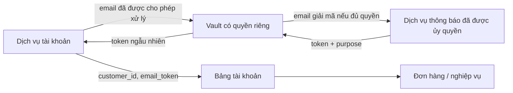
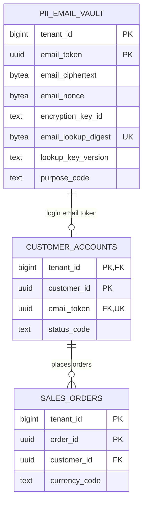

# Mã thay thế, mã hóa và ảnh hưởng đến truy vấn với ràng buộc

Một hệ thống quản lý tài khoản muốn **không lưu email dưới dạng văn bản đọc được** trong các bảng mà ứng dụng thông thường có thể truy cập. Tuy nhiên, nó vẫn phải hỗ trợ đăng nhập theo email, từ chối đăng ký trùng email trong cùng tenant, đổi địa chỉ liên hệ và nối tài khoản với đơn hàng. Nếu chỉ “mã hóa cột email” rồi giữ nguyên các câu `WHERE email = ?`, `UNIQUE(email)` hoặc `JOIN ... ON email`, hệ thống rất dễ mất khả năng tra cứu hoặc vô tình nới lỏng một bất biến dữ liệu.

Cùng một giá trị nhạy cảm có thể xuất hiện dưới nhiều cách biểu diễn: **bản gốc**, **bản mã (ciphertext)**, **mã thay thế (token)**, **dấu chỉ mục tra cứu có khóa (keyed blind index)** hoặc **thông tin suy ra ít chi tiết hơn**. Mỗi dạng phục vụ một nhiệm vụ khác nhau; không thể thay một dạng cho dạng khác chỉ vì chúng đều không hiển thị trực tiếp email.

Bài học thuộc chương **Bảo vệ dữ liệu** trong module **DATABASE_DATA_MODELING**, với mục tiêu rèn kỹ năng chuyển yêu cầu nghiệp vụ thành thực thể, quan hệ, khóa, chỉ mục, ràng buộc và lược đồ vật lý rõ ràng. Ta sẽ mô hình hóa một hệ thống đăng nhập đa tenant, chỉ ra tác động của mã hóa và tokenization đối với **tra cứu, tính duy nhất, khóa ngoại, sắp xếp, thống kê, hiệu năng và bảo trì vòng đời khóa**; đồng thời so sánh cách làm trong hệ quan hệ, document, graph và phân tích.

Các ví dụ dùng **Java 17+** và **PostgreSQL 15+**. Mã Java về HMAC nhằm mô tả nguyên tắc tính chỉ mục; phần mã hóa AEAD nên được triển khai qua thư viện đã được đánh giá, KMS/HSM và quy trình quản lý khóa thực tế. Bài không đưa ra một cấu hình bảo mật hay kết luận pháp lý áp dụng mặc định cho mọi sản phẩm.

## 1. Bắt đầu từ mục đích sử dụng, không bắt đầu từ thuật toán mã hóa

Giả sử một nền tảng SaaS có các yêu cầu:

1. Người dùng đăng ký một tài khoản với email và được phép thay đổi email sau khi xác minh quyền kiểm soát địa chỉ mới.
2. Email **chỉ cần duy nhất trong cùng tenant**; hai tenant có thể sử dụng cùng một địa chỉ.
3. Đăng nhập có thể tìm tài khoản bằng email đã nhập, nhưng chỉ dịch vụ định danh được phép đọc email ở dạng rõ khi thật sự cần.
4. Các bảng `sales_orders`, `audit_events` và báo cáo doanh thu chỉ cần `customer_id`, không cần sao chép email.
5. Các dịch vụ gửi thông báo được cấp quyền đọc địa chỉ liên hệ theo đúng mục đích; những dịch vụ khác chỉ thấy một token hoặc ID.
6. Cần phân biệt đăng nhập từ email với đăng ký tiếp thị: cùng một email không có nghĩa dữ liệu được sử dụng tự do cho cả hai mục đích.
7. Cơ sở dữ liệu phải ngăn hai request đồng thời tạo tài khoản trùng email theo quy tắc chuẩn hóa đã được chốt.
8. Có quy trình đổi khóa, di chuyển dữ liệu cũ, xử lý lỗi và xóa/giảm dữ liệu khi không còn mục đích hợp lệ.

Từ đó ta tách **ba quyết định khác nhau**:

| Câu hỏi | Quyết định thiết kế | Không nên nhầm với |
|---|---|---|
| Ai có quyền biết email gốc? | Quyền giải mã, token vault, API có kiểm soát | Việc ai có quyền SELECT bảng account |
| Tìm lại tài khoản theo email nào? | Chỉ mục tra cứu bằng giá trị chuẩn hóa và khóa phù hợp | Dùng trực tiếp ciphertext làm khóa tìm kiếm |
| Hai email có được coi là trùng không? | Bất biến chuẩn hóa + phạm vi tenant + ràng buộc nguyên tử | Chỉ kiểm tra bằng SELECT trước INSERT |

**Mục đích xác định cấu trúc cần có trước; thuật toán chỉ là công cụ thực thi cấu trúc đó.** Nếu không cần tra cứu theo email, hệ thống có thể tránh tạo chỉ mục liên kết email. Nếu chỉ cần xác nhận một điều kiện, có thể lưu kết quả xác minh phù hợp thay vì giữ giá trị gốc lâu hơn cần thiết.

## 2. Phân biệt tokenization, mã hóa, băm và dấu tra cứu

Các khái niệm thường bị gọi chung là “ẩn thông tin”, nhưng có tính chất khác nhau.

| Biểu diễn | Có thể khôi phục giá trị gốc? | Có thể so bằng nhau? | Rủi ro cần lưu ý |
|---|---|---|---|
| **Plaintext** | Có, đọc trực tiếp | Có với quy tắc so sánh của DB | Lộ trực tiếp khi bị đọc trái quyền |
| **Mã hóa ổ đĩa / TDE** | Database thường giải mã trong quá trình truy vấn được phép | Các truy vấn SQL thông thường vẫn hoạt động | Không chặn người có quyền SELECT đọc plaintext |
| **Mã hóa trường ngẫu nhiên bằng AEAD** | Có, với khóa và điều kiện giải mã đúng | **Không** so ciphertext để xác nhận hai plaintext bằng nhau | Khóa, nonce, quyền giải mã, metadata |
| **Mã hóa xác định (deterministic)** | Có, với khóa | Ciphertext của cùng plaintext có thể bằng nhau theo scheme | Lộ mẫu bằng nhau/tần suất; không nên tự thiết kế |
| **Token ngẫu nhiên opaque** | Có nếu token vault lưu ánh xạ và cấp quyền giải mã/giải token | Cùng token là cùng **entry được cấp**, không tự chứng minh plaintext bằng nhau nếu cấp token sai | Vault, vòng đời token, khả năng liên kết |
| **Hash không có khóa** | Không giải mã trực tiếp | Hash giống nhau gợi ý giá trị giống nhau | Dữ liệu dự đoán được như email có thể bị dò từ điển |
| **HMAC blind index** | Không giải mã từ digest nếu không có nguồn và secret | Hỗ trợ lookup bằng nhau theo input chuẩn hóa/khóa | Vẫn lộ equality và mẫu truy vấn; secret bị lộ làm tăng rủi ro dò đoán |
| **Dữ liệu tổng hợp/ẩn danh hóa thực sự** | Tùy kỹ thuật và nguy cơ tái nhận dạng | Không nhất thiết giữ được lookup theo cá nhân | Nhóm nhỏ hoặc join với nguồn ngoài có thể tái nhận dạng |

**Mã hóa** (*encryption*) nhằm bảo vệ tính bí mật của dữ liệu khi không có khóa. **Tokenization** thay giá trị bằng một định danh để giới hạn nơi cần giá trị gốc. **HMAC blind index** hỗ trợ một loại truy vấn đặc biệt — thường là **tìm bằng nhau** — mà không đặt plaintext vào index.

Các phương pháp này **có thể kết hợp**. Ví dụ lưu email bằng AEAD, dùng một token ngẫu nhiên để các bảng khác tham chiếu, và dùng HMAC để tìm token tương ứng với email đã chuẩn hóa.

### Vì sao hash email thuần không tương đương mã hóa?

`SHA-256("a@example.test")` không chứa khóa bí mật và không cho phép giải mã bằng một thao tác toán học trực tiếp. Nhưng email có nhiều giá trị phổ biến và kẻ tấn công có thể thử đoán, băm rồi đối chiếu. Một giá trị không đọc ra ngay **không đồng nghĩa đã vô danh**.

HMAC dùng secret riêng khiến người không có secret không thể tự tính digest cho các email đoán được một cách dễ dàng. Tuy nhiên, một digest cố định vẫn có thể dùng để **liên kết các bản ghi cùng email** và có thể bị dò nếu secret bị lộ. Vì thế không được công bố HMAC blind index như một định danh công khai “không có rủi ro”.

## 3. Threat model: đang bảo vệ khỏi ai và khỏi điều gì?

Một thiết kế hợp lý phải mô tả rủi ro cụ thể.

| Đối tượng / sự cố | Mục tiêu bảo vệ | Biện pháp thích hợp |
|---|---|---|
| Ổ đĩa/backup bị truy cập trái phép | Không đọc được dữ liệu khi thiếu khóa | Mã hóa at rest, quản lý backup và khóa |
| Người dùng SQL có quyền đọc một số bảng | Không đọc được email rõ ngoài nhiệm vụ | Mã hóa trường phía ứng dụng, giới hạn quyền/giải mã |
| Dịch vụ phân tích nhận bảng đơn | Không nhận dữ liệu định danh không cần thiết | Không đưa email vào fact; dùng surrogate key và aggregate |
| Consumer sự kiện chỉ cần biết tài khoản đã tạo | Không nhận toàn bộ hồ sơ người dùng | Event tối thiểu chứa ID và trạng thái |
| Hacker có bản sao DB nhưng không có lookup secret | Khó thử đoán email từ blind index | HMAC secret tách biệt, quyền và key management |
| Người có quyền gọi API lookup không giới hạn | Không lợi dụng API để liệt kê tài khoản | Authorization, rate limit, phản hồi chống enumeration |
| Kẻ có quyền DB **và** khóa giải mã | Hạn chế thiệt hại và phát hiện lạm dụng | Phân quyền tách biệt, audit, giới hạn phạm vi khóa và vận hành |

Một thiết kế có thể bảo vệ rất tốt khi **chỉ bị mất bản sao DB** nhưng kém hiệu quả nếu application server bị chiếm và có thể gọi KMS giải mã mọi bản ghi. Vì vậy phải đánh giá toàn bộ đường dữ liệu, bao gồm API, secret store, quyền runtime, log, cache và quyền truy cập dữ liệu đã giải mã trong bộ nhớ.

**Không có thuật toán nào tự giải quyết việc thu thập quá nhiều dữ liệu.** Nếu use case chỉ cần email, không nên lấy thêm ngày sinh hoặc số giấy tờ rồi mã hóa chúng “cho an toàn”.

## 4. Mã hóa at rest khác mã hóa trường

### 4.1. Mã hóa at rest / TDE

Một cơ sở dữ liệu có thể mã hóa file, disk volume hoặc backup. Khi ứng dụng truy cập hợp lệ, database vẫn thường xử lý `SELECT email` và trả về email ở dạng rõ. Cách này đặc biệt hữu ích với rủi ro mất ổ đĩa, snapshot hoặc media backup, nhưng không phải lớp ngăn người có quyền truy vấn đọc dữ liệu nhạy cảm.

### 4.2. Mã hóa ở cấp ứng dụng

Với **mã hóa trường phía ứng dụng**, database chỉ nhận:

```text
email_ciphertext: BYTEA
email_nonce: BYTEA
encryption_key_id: TEXT
```

Ứng dụng đã được cấp quyền sẽ lấy ciphertext, yêu cầu khóa/cơ chế decrypt phù hợp và trả kết quả cho đúng use case. DB có thể so sánh các byte ciphertext, nhưng **không biết nghĩa của email**, không thể kiểm tra regex email thực và không thể tìm cùng email bằng cách so ciphertext khi mã hóa dùng nonce ngẫu nhiên.

### 4.3. Sử dụng AEAD đúng vai trò

Một lựa chọn phổ biến là **AES-GCM** với khóa phù hợp và nonce **không bao giờ được sử dụng lại cùng khóa**, hoặc một AEAD hiện đại được thư viện/KMS hỗ trợ. Mã hóa có xác thực (*Authenticated Encryption with Associated Data – AEAD*) giúp phát hiện việc ciphertext hoặc metadata được bảo vệ bị sửa trái phép.

Đối với một email, dữ liệu liên quan (*AAD*) có thể gồm:

```text
purpose = ACCOUNT_LOGIN_EMAIL
tenant_id = 42
contact_token = token-opaque
schema_version = 1
```

Khi giải mã phải xây lại AAD nhất quán; nếu ciphertext bị chuyển sang token/tenant/purpose khác, xác thực phải thất bại. AAD không phải dữ liệu được giữ bí mật: **không đưa email rõ vào AAD** rồi nghĩ nó đã được mã hóa.

Ví dụ lược đồ ở phần 8 giả định **nonce 96 bit (12 byte)** cho AES-GCM và ciphertext chứa **authentication tag**. Nonce phải được sinh bằng CSPRNG với chiến lược và giới hạn sử dụng khóa phù hợp; random nonce làm xác suất trùng rất thấp chứ không phải lời bảo đảm toán học tuyệt đối. Dùng lại nonce với cùng khóa AES-GCM có thể phá hỏng các thuộc tính bảo mật quan trọng.

**Không bao giờ “làm AES-GCM trở thành deterministic” bằng cách cố định IV/nonce để hỗ trợ UNIQUE.** Đây không phải giải pháp tìm kiếm an toàn.

## 5. Tokenization: thay dữ liệu bằng định danh, không phải xóa mọi liên kết

**Token** là một giá trị đại diện cho một bản ghi hoặc giá trị nhạy cảm, thường không tiết lộ bản gốc bằng cấu trúc của chính token.



Một token ngẫu nhiên như UUID được cấp bởi vault không mang ý nghĩa “email đã chuẩn hóa”. Nó là **khóa tham chiếu**. Nếu hai lời gọi cùng email tạo hai token khác nhau và vault không có quy tắc tái sử dụng/unique, việc dùng token **không** ngăn hai tài khoản trùng email.

### Token theo mục đích và phạm vi

Tùy kiến trúc, token có thể được cấp:

- **Theo bản ghi:** cùng email ở hai tài khoản nhận hai token khác nhau.
- **Theo giá trị trong một tenant và mục đích:** cùng email chuẩn hóa trong `ACCOUNT_LOGIN` nhận cùng một vault record/token.
- **Theo đối tác hoặc phiên làm việc:** token ở nơi A không dùng được ở nơi B, giảm liên kết liên hệ giữa hệ thống.

Không có một chính sách token phù hợp cho tất cả. Với hệ thống cần `UNIQUE(tenant,email)`, token theo giá trị trong tenant có thể hữu ích nhưng **phải được cấp thông qua kiểm tra duy nhất nguyên tử**. Với nhu cầu giới hạn liên kết dữ liệu giữa các dịch vụ, token theo mục đích có lợi hơn token toàn cầu được phát tán khắp nơi.

**Tokenization là một dạng giảm lộ thông tin, không tự đồng nghĩa dữ liệu đã được ẩn danh.** Nếu một token ổn định liên kết đến email qua vault, hoặc nhiều bảng dùng cùng token để nối hành vi, nó vẫn có khả năng liên kết tới cá nhân.

## 6. Tra cứu bằng nhau khi ciphertext được mã hóa ngẫu nhiên

Giả sử hai lần mã hóa email `an@example.test` bằng AEAD với nonce khác nhau:

```text
Plaintext:  an@example.test
Nonce 1  -> ciphertext A
Nonce 2  -> ciphertext B
A != B   dù plaintext giống nhau
```

Vì vậy truy vấn sau **không hoạt động theo nghĩa tìm email**:

```sql
-- Sai về ngữ nghĩa với AEAD randomized:
SELECT contact_token
FROM pii_email_vault
WHERE email_ciphertext = :encrypt_email_again;
```

Mã hóa lại email thường cho ciphertext khác. Đổi sang mã hóa xác định chỉ để có `WHERE ciphertext = ?` lại làm **lộ sự bằng nhau và tần suất**, và vẫn không giải quyết tự nhiên tìm tiền tố, sắp xếp theo chữ hoặc khoảng giá trị.

### Blind index có khóa cho equality lookup

Chọn một thuật toán chuẩn hóa email theo policy:

\[
c = normalize(email)
\]

và một HMAC riêng cho chỉ mục:

\[
I=HMAC_{K_{lookup}}(
\text{purpose}\parallel\text{tenant}\parallel c).
\]

Trong đó:

- `K_lookup` là **secret tách biệt** với khóa mã hóa email.
- `purpose` là nhãn phạm vi để hạn chế sử dụng digest cho mục đích khác.
- `tenant` xác định phạm vi tìm kiếm và tránh trộn chỉ mục giữa các tenant.
- `c` là email đã chuẩn hóa thống nhất trước mọi thao tác đăng ký/đăng nhập/đổi địa chỉ.
- Các thành phần được mã hóa bằng định dạng **không nhập nhằng** (length prefix, định dạng có độ dài cố định hoặc một protocol rõ ràng), không nối chuỗi tùy ý.

Trong cùng phiên bản thuật toán/secret, cùng tenant + cùng email chuẩn hóa tạo cùng digest, hỗ trợ:

```sql
SELECT contact_token
FROM pii_email_vault
WHERE tenant_id = :tenant_id
  AND email_lookup_digest = :hmac_digest;
```

Query chỉ thực hiện **so bằng nhau trên digest**. Nó không giải mã email. Ứng dụng vẫn phải kiểm tra **quyền được tra**, chống lạm dụng endpoint và không ghi email/HMAC secret vào log.

### Rủi ro equality leakage

Ngay cả khi không biết email gốc, người được phép xem toàn bộ digests có thể biết những dòng nào sử dụng cùng một digest. Nếu hệ thống cho phép gọi tìm kiếm thử email không giới hạn, người dùng có thể tận dụng kết quả API để **liệt kê tài khoản**. Blind index không thay thế phân quyền, giới hạn tần suất hoặc phản hồi chống user enumeration.

## 7. Ràng buộc nào còn thực thi được khi lưu dữ liệu bảo vệ?

Cần phân biệt **các cột thật trong database** với những dữ liệu mà ứng dụng có thể giải mã.

| Bất biến | Có thể bảo vệ ở SQL khi chỉ lưu ciphertext/token? | Giới hạn |
|---|---|---|
| `customer_id` duy nhất | **Có**, PK/UNIQUE trên ID | Không chứng minh cùng người không có hai tài khoản |
| Token không trùng trong vault | **Có**, PK/UNIQUE trên token | Token trùng không phản ánh trực tiếp email trùng |
| Token tài khoản tồn tại trong vault | **Có**, FK | FK không chứng minh caller có quyền giải mã |
| Token thuộc cùng tenant | **Có**, FK ghép `(tenant_id,token)` | Cần scope tenant ở truy vấn/API |
| Email chuẩn hóa không trùng trong tenant | **Có điều kiện**, unique trên HMAC blind index | Chỉ đúng theo chuẩn hóa, key/version nhất quán, collision policy |
| Email có cú pháp hợp lệ | **Không** bằng `CHECK` trên ciphertext | Ứng dụng tin cậy xác thực trước mã hóa |
| Email đã được xác minh quyền sở hữu | **Không** do mã hóa/UNIQUE | Cần quy trình verification riêng |
| Độ dài địa chỉ email gốc | **Không trực tiếp** nếu chỉ có ciphertext | Cần validation ứng dụng và policy |
| Hai email có cùng domain | **Không** từ ciphertext randomized | Chỉ có thể nếu thiết kế metadata riêng có mục đích |
| Mã hóa sử dụng đúng AAD và khóa | **Không** qua PK/FK thông thường | AEAD decrypt test, key management, kiểm thử |
| Email không bị lộ trong log | **Không** bằng schema DB | Kiểm thử logger, tracing, event/DTO và quyền |

**Vùng bảo vệ của mỗi cơ chế khác nhau**: SQL constraints bảo vệ tính toàn vẹn của cột lưu trữ; AEAD bảo vệ nội dung và tính xác thực của ciphertext; ứng dụng/identity service bảo vệ ngữ nghĩa email và authorization.

Điểm quan trọng: nếu cùng email được tính HMAC bằng **hai key lookup khác nhau** trong một đợt nâng cấp mà không có chiến lược chuyển đổi, hai digests sẽ khác nhau. Một `UNIQUE(tenant_id,email_lookup_digest)` **không thể tự hiểu** chúng là một email.

## 8. PostgreSQL 15+: bảng vault và tài khoản dùng token

Ta xây mô hình gồm hai phần có vòng đời và quyền riêng:

- `pii_email_vault` giữ ciphertext và digest tra cứu, được quản lý bởi dịch vụ định danh.
- `customer_accounts` giữ ID tài khoản, token tham chiếu và trạng thái; không chứa email rõ.

Ví dụ tập trung vào **email dùng để đăng nhập**, không dùng chung vault row này như giấy phép xử lý email cho mục đích quảng cáo.

### 8.1. Sơ đồ quan hệ



Ký hiệu `||--o|` phản ánh **mỗi token trong ví dụ dùng cho tối đa một account**, nhưng vault có thể tạm có token chưa được gắn tài khoản khi tác vụ đang reserve/di chuyển. Quan hệ một–một phải được củng cố bằng unique thật, không chỉ sơ đồ.

### 8.2. DDL tối thiểu

```sql
CREATE TABLE pii_email_vault (
    tenant_id BIGINT NOT NULL,
    email_token UUID NOT NULL,
    purpose_code TEXT NOT NULL,
    email_ciphertext BYTEA NOT NULL,
    email_nonce BYTEA NOT NULL,
    encryption_key_id TEXT NOT NULL,
    email_lookup_digest BYTEA NOT NULL,
    lookup_key_version TEXT NOT NULL,
    created_at TIMESTAMPTZ NOT NULL DEFAULT CURRENT_TIMESTAMP,

    CONSTRAINT pk_pii_email_vault
        PRIMARY KEY (tenant_id, email_token),

    -- UNIQUE này hoạt động trên DIGEST, không trên plaintext.
    CONSTRAINT uq_email_lookup_in_tenant
        UNIQUE (tenant_id, email_lookup_digest),

    CONSTRAINT ck_email_vault_purpose
        CHECK (purpose_code = 'ACCOUNT_LOGIN'),
    CONSTRAINT ck_email_nonce_length
        CHECK (octet_length(email_nonce) = 12),
    CONSTRAINT ck_email_ciphertext_min_length
        CHECK (octet_length(email_ciphertext) > 16),
    CONSTRAINT ck_email_digest_length
        CHECK (octet_length(email_lookup_digest) = 32),
    CONSTRAINT ck_encryption_key_id
        CHECK (btrim(encryption_key_id) <> ''),
    CONSTRAINT ck_lookup_key_version
        CHECK (btrim(lookup_key_version) <> '')
);

CREATE TABLE customer_accounts (
    tenant_id BIGINT NOT NULL,
    customer_id UUID NOT NULL,
    email_token UUID NOT NULL,
    status_code TEXT NOT NULL DEFAULT 'PENDING_VERIFICATION',
    created_at TIMESTAMPTZ NOT NULL DEFAULT CURRENT_TIMESTAMP,

    CONSTRAINT pk_customer_accounts
        PRIMARY KEY (tenant_id, customer_id),

    CONSTRAINT uq_account_email_token
        UNIQUE (tenant_id, email_token),

    CONSTRAINT fk_account_login_email
        FOREIGN KEY (tenant_id, email_token)
        REFERENCES pii_email_vault (tenant_id, email_token)
        ON UPDATE RESTRICT
        ON DELETE RESTRICT,

    CONSTRAINT ck_account_status
        CHECK (
            status_code IN (
                'PENDING_VERIFICATION',
                'ACTIVE',
                'SUSPENDED',
                'CLOSED'
            )
        )
);

CREATE TABLE sales_orders (
    tenant_id BIGINT NOT NULL,
    order_id UUID NOT NULL,
    customer_id UUID NOT NULL,
    currency_code CHAR(3) NOT NULL,
    order_total_minor NUMERIC(20, 0) NOT NULL,

    CONSTRAINT pk_sales_orders
        PRIMARY KEY (tenant_id, order_id),

    CONSTRAINT fk_order_account
        FOREIGN KEY (tenant_id, customer_id)
        REFERENCES customer_accounts (tenant_id, customer_id)
        ON DELETE RESTRICT,

    CONSTRAINT ck_order_total
        CHECK (order_total_minor >= 0),
    CONSTRAINT ck_order_currency
        CHECK (currency_code ~ '^[A-Z]{3}$')
);
```

**Giả định chính xác của ví dụ:**

- Ứng dụng mã hóa email bằng một scheme **AEAD AES-GCM** được phê duyệt; `email_ciphertext` chứa cả authentication tag, `email_nonce` có 12 byte. Cơ sở dữ liệu không tự mã hóa, không biết AES key và không có lệnh giải mã cho role thông thường.
- `email_lookup_digest` là **HMAC-SHA-256 đầy đủ 32 byte** của email chuẩn hóa theo phạm vi tenant/mục đích. Không dùng SHA-256 trần và không tùy ý cắt digest.
- Mọi bản ghi hoạt động đang dùng **cùng phiên bản lookup key và thuật toán chuẩn hóa**. Rotation là quy trình riêng ở phần 14.
- `email_token` là token ngẫu nhiên không mang thông tin email; do dịch vụ đáng tin cậy cấp.
- Một vault row phục vụ tối đa một account trong cùng tenant/purpose; nếu nghiệp vụ cho phép nhiều account có cùng email thì cần đổi invariant và schema, không ép dữ liệu trái yêu cầu.
- Bảng này được dùng để giải thích **tính toàn vẹn**, không mô tả đầy đủ tất cả chính sách TTL, quyền truy cập KMS, xác minh email hoặc chống enumeration.

### 8.3. Bất biến được cưỡng chế

1. Không có hai vault rows cùng `(tenant_id,email_token)`.
2. Không có hai vault rows cùng `(tenant_id,email_lookup_digest)`.
3. Một account không trỏ token không tồn tại hoặc thuộc tenant khác.
4. Trong ví dụ một token không được gán cho hai accounts của cùng tenant.
5. Đơn hàng trỏ tài khoản đúng tenant qua FK ghép.
6. Các trường kỹ thuật không được `NULL` và một số metadata có kiểm tra định dạng/kích thước.

### 8.4. Bất biến chưa được cưỡng chế

- `email_ciphertext` có thực sự giải mã thành email hợp lệ không?
- HMAC digest có khớp với **plaintext được mã hóa** không?
- Người đăng ký có quyền sở hữu email không?
- Ciphertext có được mã hóa bằng đúng AAD/nonce/key theo quy định không?
- Có phải tất cả writer đang dùng cùng phiên bản lookup key và canonicalization?
- Vault row có bị tạo ra chỉ để giữ thông tin không còn mục đích hợp lệ không?

Cần **trusted write path, crypto contract, authorization, verification và kiểm thử**. PK/FK không kiểm chứng nội dung plaintext mà database không thể nhìn thấy.

## 9. Quy trình tạo tài khoản an toàn trước race condition

Giả sử người dùng đăng ký email `An@Example.test` trong tenant 42. Dịch vụ định danh thực hiện:

1. Kiểm tra quyền tạo tài khoản trong tenant 42.
2. Validate email theo policy và tạo `canonical_email`. Nếu chính sách coi `An@Example.test` tương đương `an@example.test`, cả hai phải chuẩn hóa nhất quán ở mọi đường ghi.
3. Tính `email_lookup_digest` bằng HMAC với **lookup key** được bảo vệ riêng.
4. Tạo `email_token` ngẫu nhiên.
5. Mã hóa giá trị email cần giữ bằng AEAD với **encryption key**, nonce mới và AAD gắn tenant/token/purpose.
6. Trong **một transaction**, chèn vault row và account row; để unique/FK quyết định tính đúng khi có truy cập đồng thời.
7. Xác minh địa chỉ và chuyển trạng thái tài khoản theo use case; không coi việc insert là bằng chứng sở hữu email.
8. Commit; chỉ sau khi thành công mới phát sự kiện/side effect bằng giao thức thích hợp (ví dụ outbox nếu cần).

```text
T1: HMAC(email) = digest D
T2: HMAC(email) = digest D

T1: INSERT vault (tenant=42, digest=D) -> thành công
T2: INSERT vault (tenant=42, digest=D) -> chờ / conflict
T1: INSERT customer account + COMMIT
T2: xử lý unique conflict theo policy
```

**Không nên dùng:**

```text
IF NOT EXISTS (SELECT ... WHERE digest = D)
THEN INSERT ...
```

Hai transaction có thể đều thấy “chưa tồn tại” trước khi cùng insert. Ràng buộc `UNIQUE(tenant_id,email_lookup_digest)` trong database là cơ chế nguyên tử để chọn người thắng. Ứng dụng phải bắt lỗi unique, đọc/đối chiếu theo policy và phản hồi không tiết lộ tài khoản của người khác.

### Trùng HMAC và trùng email không phải mệnh đề hoàn toàn đồng nghĩa

Nếu hai email đã chuẩn hóa khác nhau nhưng HMAC-256 va chạm, cùng digest có thể dẫn tới unique conflict dù plaintext khác. Xác suất va chạm với HMAC-SHA-256 đầy đủ trong phạm vi hợp lý là cực nhỏ nhưng **không bằng 0 về toán học**.

Khi có unique conflict:

- Không giả định ngay rằng người dùng đang đăng ký chính email của mình.
- Xử lý theo use case và threat model: không giải mã tùy tiện nếu caller không có quyền.
- Luồng kiểm tra có thẩm quyền có thể giải mã ứng viên để xác định canonical value hoặc phát hiện sai lệch hệ thống/lookup version.
- Không phát ra API public thông điệp có thể giúp **liệt kê email đã đăng ký**.

HMAC blind index là một **cam kết thực tế về xác suất va chạm rất thấp**, không phải phép so sánh plaintext hoàn hảo được tự động chứng minh bởi SQL.

## 10. Truy vấn đăng nhập theo email với blind index

Đầu vào được nhập vào một dịch vụ tin cậy:

```text
input_email
  -> validate & canonicalize
  -> HMAC(lookup_secret, purpose | tenant | canonical_email)
  -> equality query theo digest
  -> lấy account/token
  -> áp authentication và authorization
```

Truy vấn PostgreSQL:

```sql
-- :email_digest là 32-byte HMAC đã tính tại ứng dụng.
SELECT
    a.tenant_id,
    a.customer_id,
    a.status_code,
    v.email_token,
    v.encryption_key_id
FROM pii_email_vault AS v
JOIN customer_accounts AS a
  ON a.tenant_id = v.tenant_id
 AND a.email_token = v.email_token
WHERE v.tenant_id = :tenant_id
  AND v.purpose_code = 'ACCOUNT_LOGIN'
  AND v.email_lookup_digest = :email_digest;
```

Ràng buộc `UNIQUE(tenant_id,email_lookup_digest)` cũng tạo chỉ mục B-tree phù hợp để tìm theo hai cột này trong PostgreSQL. Không cần tạo thêm một index trùng hệt chỉ vì query cần nhanh.

**Đăng nhập không đồng nghĩa phải giải mã email.** Nếu chỉ cần tìm account ID rồi kiểm tra thông tin xác thực, đường đăng nhập có thể không cần gọi decrypt. Những use case gửi thư hoặc hiển thị email đã được xác minh mới cần dữ liệu rõ qua dịch vụ có quyền.

### Query equality không phải query plaintext

Câu SQL không thể tự giải thích “địa chỉ nào chứa chuỗi `@example.test`”, vì cột digest không giữ cấu trúc văn bản. Nếu nhu cầu thống kê domain có mục đích được phê duyệt, cần thiết kế nguồn dữ liệu ít chi tiết hơn (ví dụ domain đã chuẩn hóa) và đánh giá lại khả năng tái nhận dạng trước khi lưu.

Nếu email đã được đổi trong vault, HMAC digest mới phải được tính và ghi cùng transaction với ciphertext mới. Không được cập nhật mỗi `email_ciphertext` mà bỏ `email_lookup_digest` cũ: lookup sẽ tìm nhầm hoặc không tìm được.

## 11. Khóa ngoại và JOIN: dùng định danh ổn định, không dùng ciphertext

Dùng email trong FK hoặc JOIN thường gây vấn đề:

- Email thay đổi, nên không phải định danh bền vững của tài khoản.
- So ciphertext ngẫu nhiên không phản ánh sự bằng nhau plaintext.
- So HMAC digest tạo liên kết rộng giữa các dataset không thật sự cần.
- Một tài khoản có thể có nhiều địa chỉ liên hệ với các mục đích khác nhau.
- Một thay đổi thuật toán lookup/version có thể làm mọi phép join theo digest đổi nghĩa.

Trong thiết kế ví dụ:

```sql
SELECT
    o.order_id,
    o.currency_code,
    o.order_total_minor,
    a.customer_id
FROM sales_orders AS o
JOIN customer_accounts AS a
  ON a.tenant_id = o.tenant_id
 AND a.customer_id = o.customer_id
WHERE o.tenant_id = :tenant_id
  AND o.order_id = :order_id;
```

Không có join email, token vault hay giải mã dữ liệu cá nhân trong truy vấn đơn hàng thông thường. **Khóa ngoại ghép** bảo đảm đơn và account cùng tenant; các chỉ mục/PK hỗ trợ join theo định danh kỹ thuật.

### Token như khóa tham chiếu

Nếu một dịch vụ thật sự cần tham chiếu vault mà không cần email rõ, có thể lưu `email_token` và FK tới vault. Nhưng:

- Cần scope đúng tenant/purpose.
- Không tự cấp quyền detokenize chỉ vì có token.
- Không phát token toàn cục cho mọi service nếu việc liên kết chéo mục đích không cần thiết.
- Token có vòng đời: nếu bị revoke/rotate, phải có chiến lược mapping hoặc thay token trong những nơi được phép tham chiếu.

### FK không thay thế authorization

Một `FOREIGN KEY (tenant_id,email_token)` chỉ bảo vệ **sự tồn tại và phạm vi tenant**. Nó không chứng minh user gọi API có quyền đọc email của token ấy. Quyền đọc phải được áp ở application/service boundary và ở DB role theo thiết kế.

## 12. Tác động đến tìm kiếm, sắp xếp, lọc và GROUP BY

Hệ quản trị chỉ có thể dùng trực tiếp những cấu trúc mà nó nhìn thấy.

| Nhu cầu truy vấn | Plaintext / TDE | Ciphertext AEAD ngẫu nhiên | Token hoặc blind index |
|---|---|---|---|
| `WHERE email = ?` | Làm được với normalization/index phù hợp | **Không** theo ciphertext mới mã hóa | Blind index hỗ trợ equality; token hỗ trợ tìm theo token |
| `WHERE email LIKE 'an%'` | Có thể, tùy index/collation | Không | Không tự hỗ trợ từ token/HMAC toàn email |
| `ORDER BY email` | Có thể theo collation | Sắp byte ciphertext **không có ý nghĩa tên** | Sắp token/digest không phải thứ tự email |
| `GROUP BY email` | Có, nếu được phép | Không nhóm plaintext cùng nhau | Group digest cho cùng phạm vi/key nhưng có leakage |
| `UNIQUE(email)` | Có theo so sánh DB | Không thể dùng randomized ciphertext làm tương đương plaintext | Unique digest có điều kiện; unique token chỉ bảo vệ token |
| `MIN/MAX(email)` | Có theo thứ tự chữ nếu có nghĩa | Không | Không có nghĩa nghiệp vụ theo digest |
| JOIN theo email | Có thể nhưng dễ coupling/PII | Không đáng tin | Ưu tiên JOIN theo `customer_id` hoặc token được phép |
| Tìm gần đúng / full-text | Có nếu dùng công nghệ phù hợp và quyền | Không có sẵn | Cần thiết kế chuyên biệt, không tự có |
| Tìm theo ngày tạo, trạng thái | Có | **Có** nếu cột metadata không mã hóa | **Có** theo metadata không nhạy cảm được phép lưu |

### Truy vấn “rẻ” về kỹ thuật có thể “đắt” về bảo vệ dữ liệu

Tạo thêm một cột `email_domain`, `email_prefix`, mã vùng hay sort key có thể giúp một query mới chạy nhanh. Nhưng mỗi cột dẫn xuất có thể **tiết lộ một phần plaintext** và trở thành dữ liệu cá nhân/liên kết có mục đích riêng.

Cần hỏi:

1. Query mới phục vụ use case đã được phê duyệt nào?
2. Có thể trả kết quả **tổng hợp** thay vì lưu từng phần định danh?
3. Có cần tìm kiếm trực tiếp trên toàn bộ user không, hay chỉ trên danh sách đã được cấp quyền?
4. Có thể lấy tập ứng viên bằng metadata không nhạy cảm rồi decrypt **trong phạm vi nhỏ có quyền**?
5. Chi phí truy vấn và rủi ro rò rỉ thông tin có đáng để thêm index lộ dữ liệu không?

Không nên dùng **mã hóa giữ thứ tự (order-preserving)**, tự chế “searchable encryption” hoặc mã hóa xác định tùy tiện chỉ vì cần `ORDER BY`/`LIKE`. Những scheme chuyên biệt thường có leakage và điều kiện bảo mật riêng, cần đánh giá độc lập.

## 13. Java 17: tạo HMAC lookup digest đúng ranh giới

Đoạn Java dưới đây **chỉ minh họa tính blind index**, không thực hiện mã hóa email hay quản lý secret. Trong production, khóa HMAC phải được cung cấp bởi cơ chế tin cậy, có phân quyền, phiên bản và quy trình rotation.

```java
package example.identity;

import java.nio.ByteBuffer;
import java.nio.charset.StandardCharsets;
import java.security.GeneralSecurityException;
import java.util.Locale;
import java.util.Objects;
import javax.crypto.Mac;
import javax.crypto.SecretKey;

public final class EmailLookupIndex {
    private EmailLookupIndex() {}

    // Chính sách chuẩn hóa minh họa; cần được nghiệp vụ phê duyệt.
    public static String canonicalize(String email) {
        Objects.requireNonNull(email, "email");
        String result = email.strip().toLowerCase(Locale.ROOT);
        if (result.isEmpty()) {
            throw new IllegalArgumentException("empty email");
        }
        return result;
    }

    public static byte[] compute(
            SecretKey lookupKey,
            long tenantId,
            String canonicalEmail) throws GeneralSecurityException {

        if (tenantId <= 0) {
            throw new IllegalArgumentException("invalid tenant");
        }
        Objects.requireNonNull(canonicalEmail, "canonicalEmail");

        Mac mac = Mac.getInstance("HmacSHA256");
        mac.init(lookupKey);

        // Domain separation + fixed-length tenant identifier.
        mac.update(
            "ACCOUNT_LOGIN_EMAIL:v1".getBytes(StandardCharsets.UTF_8)
        );
        mac.update((byte) 0);
        mac.update(
            ByteBuffer.allocate(Long.BYTES)
                .putLong(tenantId)
                .array()
        );
        mac.update((byte) 0);

        return mac.doFinal(
            canonicalEmail.getBytes(StandardCharsets.UTF_8)
        );
    }
}
```

### Điều gì quan trọng hơn bản thân vài dòng Java?

- `SecretKey` được **inject từ dịch vụ quản lý khóa/secret**, không hard-code, không ghi vào log hoặc file cấu hình công khai.
- `Mac` được tạo và sử dụng cho **mỗi phép tính** trong ví dụ để không tái sử dụng state không an toàn giữa các request.
- Tenant ID được đưa vào input theo dạng **8 byte có độ dài cố định**; nhãn mục đích giúp tách miền sử dụng.
- Canonicalization phải được dùng **giống hệt** ở đăng ký, lookup, cập nhật và migration.
- `compute` giả định tham số đã là **canonicalEmail**; tên hàm và API phải ngăn gọi nhầm giá trị thô. Một lớp value object `CanonicalEmail` có thể tăng an toàn kiểu.
- Độ dài HMAC-SHA-256 là **32 byte**, phù hợp với `CHECK` ở DDL.

**Giới hạn cần nhớ:** `strip().toLowerCase(Locale.ROOT)` chỉ là quy tắc minh họa. Email thực tế có những vấn đề về Unicode, IDN, phần local, dấu chấm, `+tag` và chính sách provider. Không tự loại dấu chấm hoặc `+tag` của mọi địa chỉ; cũng không mặc định mọi hệ thống coi phần local không phân biệt hoa/thường. Một thay đổi canonicalization có thể làm **đổi danh tính so sánh và kết quả UNIQUE**, nên phải version và migration như một thay đổi dữ liệu.

### Crypto service nên trả gì?

Một giao diện ứng dụng có thể có ngữ nghĩa:

```java
public interface EmailProtectionService {
    ProtectedEmail protectForLogin(long tenantId, String validatedEmail);
    String decryptForAuthorizedUse(
        long tenantId,
        java.util.UUID emailToken,
        String authorizedPurpose
    );
}

public record ProtectedEmail(
    java.util.UUID emailToken,
    byte[] ciphertext,
    byte[] nonce,
    String encryptionKeyId,
    byte[] lookupDigest,
    String lookupKeyVersion
) {}
```

Đây là **hợp đồng minh họa**, chưa phải implementation AEAD, KMS, quyền truy cập hoặc kiểu immutable cho byte array. Trong mã thật, `byte[]` là mutable; cần defensive copies nếu được lưu trong DTO/record. `decryptForAuthorizedUse` không được tin chỉ một chuỗi `authorizedPurpose` do caller tự khai: quyền và mục đích phải được kiểm tra từ **context tin cậy**.

## 14. Đổi khóa: mã hóa và blind index có vòng đời khác nhau

**Đổi khóa mã hóa** và **đổi khóa tra cứu** là hai thay đổi khác nhau. Đánh đồng chúng dễ dẫn đến lookup thất bại hoặc bị tạo bản ghi trùng.

### 14.1. Rotation của khóa mã hóa AEAD

Nếu giữ `email_lookup_digest` dưới cùng lookup key, ta có thể:

1. Xác định bản ghi cần re-encrypt theo `encryption_key_id`.
2. Giải mã trong môi trường được quyền, xác thực AAD và plaintext.
3. Mã hóa lại bằng encryption key mới, nonce mới và AAD đúng.
4. Ghi **ciphertext, nonce và key ID** mới trong cùng transaction theo từng bản ghi/lô.
5. Xác minh có thể giải mã lại; kiểm tra lookup digest không đổi vì input canonical không đổi.
6. Thu hồi khóa cũ **chỉ sau khi** đã xác minh backup/restore, các bản còn cần và chính sách thay khóa.

Re-encrypt tạo ciphertext mới nhưng **không cần đổi token** nếu danh tính vault record vẫn giữ nguyên.

### 14.2. Rotation của lookup key HMAC phức tạp hơn

Với cùng email:

\[
HMAC_{K_1}(email)\neq HMAC_{K_2}(email)
\]

trong trường hợp bình thường. Nếu nửa bảng dùng key mới và nửa bảng dùng key cũ, một unique index trên **một cột digest** không chứng minh tính duy nhất của email xuyên hai nhóm.

**Không được đơn giản cập nhật `lookup_key_version` rồi cho writer mới ghi digest K2 trong khi dữ liệu cũ còn K1.** Hai account cùng email có thể mang hai digest khác nhau và vượt qua UNIQUE.

Một kế hoạch có thể dùng:

1. Chốt ngữ nghĩa canonicalization và khóa tra cứu hiện tại, chặn các writer bypass.
2. Thêm cột **digest mới** hoặc bảng mapping phụ có kiểm soát; giữ digest cũ trong giai đoạn chuyển đổi.
3. Trong giai đoạn dual-write, tính **cả K1 và K2** với mọi insert/update và cưỡng chế uniqueness trong phạm vi của **cả hai phiên bản**.
4. Backfill digest K2 cho toàn bộ hàng cũ theo lô, dùng version/khóa cạnh tranh để tránh ghi đè thay đổi mới.
5. Xác minh K2 đủ coverage và unique cho toàn bộ tập; xử lý lỗi/collision/khác canonicalization trước cutover.
6. Đổi read path sang K2 khi mọi writer và reader đã tương thích; không cho phép tạo khóa chỉ có một phía trong quá trình chuyển.
7. Sau khi chứng minh an toàn, xóa phụ thuộc K1 và thu hồi secret cũ theo chính sách.

**Chú ý về UNIQUE với NULL trong migration:** một cột `lookup_digest_v2` mới ban đầu chứa `NULL` không tự cưỡng chế unique cho những hàng chưa backfill; cần dựa trên invariant K1 vẫn hoạt động cho tất cả hàng trong giai đoạn đó. Nếu có writer chỉ biết K2 trong lúc hàng cũ chỉ có K1, vẫn có cửa sổ trùng. Lịch chuyển phải loại cửa sổ ấy một cách tường minh.

### 14.3. Đổi chính sách canonicalization còn khó hơn đổi key

Nếu phiên bản v1 coi `A@example.test` và `a@example.test` là hai email khác nhau, còn v2 gộp chúng, backfill v2 có thể phát hiện **xung đột nghiệp vụ có thật**. Không thể chỉ đổi HMAC hoặc tự động xóa một account. Cần quy trình phân giải danh tính, xác minh quyền sở hữu, thông báo và xử lý dữ liệu liên quan theo chính sách.

Đổi normalization là **migration định danh nghiệp vụ**, không đơn thuần đổi thuật toán.

## 15. Mã thay thế, quyền xóa và vòng đời dữ liệu

Giả sử account bị đóng. Ta phải phân biệt:

- **Dữ liệu cần giữ:** các giao dịch/đơn hàng, trạng thái và bằng chứng cần thiết theo mục đích hoặc nghĩa vụ còn hiệu lực.
- **Dữ liệu liên hệ không còn cần:** email rõ, token vault hoặc khả năng giải mã theo chính sách.
- **Định danh liên kết:** `customer_id` có thể vẫn cần cho giao dịch, nhưng phải xem khả năng liên kết tới cá nhân và quyền truy cập.
- **Bản sao:** search, cache, message, log, export và backup có vòng đời riêng.

`ON DELETE RESTRICT` trong ví dụ ngăn xóa vault row khi account còn tham chiếu. Đó là một **ràng buộc toàn vẹn có chủ đích**: muốn xóa dữ liệu liên hệ, cần có một quy trình ngừng/thay tham chiếu trước, không bypass FK bằng cách tắt kiểm tra.

### Crypto-shredding có điều kiện

Nếu dữ liệu được mã hóa bằng **khóa riêng không dùng chung** với các dữ liệu cần giữ, hủy khóa đó một cách có kiểm chứng có thể làm ciphertext trở nên không thể giải mã trong phạm vi threat model. Nhưng:

- Không có tác dụng với **plaintext đã sao ra log/cache/export**.
- Nếu nhiều record dùng chung key, hủy key có thể làm mất khả năng giải mã cả những record còn cần.
- Các bản sao key trong cache, backup, HSM replica hoặc hệ khác phải được xét.
- Token, HMAC digest và metadata liên kết vẫn tồn tại trừ khi có quy trình xóa/giảm riêng.

Không tuyên bố “đã xóa dữ liệu” chỉ vì đánh mất một DEK mà không kiểm kê các bản sao và nghĩa vụ liên quan.

### Retention theo mục đích

Email dùng cho đăng nhập có thể cần trong thời gian account hoạt động; địa chỉ giao hàng cho đơn vật lý có vòng đời khác. Không nên dùng một vault token toàn cầu cho mọi purpose và giữ lâu nhất theo một mục đích bất kỳ. Cần thiết kế hoặc phân tách record theo mục đích, chính sách retention và mapping có quyền.

## 16. Di chuyển từ cột plaintext sang mô hình được bảo vệ

Giả sử bảng cũ:

```text
customer_accounts_old(
  tenant_id,
  customer_id,
  login_email,
  ...
)
```

Muốn chuyển sang `customer_accounts` + `pii_email_vault` mà không mất tính duy nhất hay giao dịch.

### Giai đoạn 1 — Kiểm kê và chốt bất biến

- Xác định tất cả nơi giữ `login_email`: DB, chỉ mục, log, CDC, events, cache, exports, data warehouse, backups.
- Chốt **phạm vi UNIQUE**: trong tenant hay toàn nền tảng?
- Chốt canonicalization và cách xử lý hai email được coi là trùng sau chuẩn hóa.
- Chọn key management, AEAD, HMAC lookup, token scope, quyền và policy retention.
- Kiểm tra downstream có đang JOIN theo email hoặc dùng email làm business key không.

### Giai đoạn 2 — Xây schema mới và đường ghi được kiểm soát

- Tạo vault, unique digest, bảng account mới và FK ghép.
- Xây service validate/canonicalize/protect/decrypt có quyền riêng.
- Tất cả writer phải tạo ciphertext + digest + account link trong **một transaction** hoặc giao thức nhất quán đã được chứng minh.
- Không để một luồng chỉ ghi bảng mới trong khi luồng khác vẫn ghi plaintext cũ mà không đồng bộ danh tính.

### Giai đoạn 3 — Backfill và kiểm tra

Từng batch:

1. Đọc dòng cũ bằng quyền migration tối thiểu.
2. Chuẩn hóa email theo policy mới.
3. Tính HMAC và kiểm tra trùng; nếu xung đột, đưa ra xử lý nghiệp vụ.
4. Sinh token, encrypt bằng AEAD, tạo vault row và account mapping.
5. Đối soát số khách, số email duy nhất theo tenant, FK, số record chưa giải mã được.
6. Không ghi plaintext vào log migration; ghi định danh run và lỗi tối thiểu.

### Giai đoạn 4 — Cutover

Khi mọi reader/writer dùng đường mới và kiểm thử đạt:

- Ngừng truy vấn cột plaintext.
- Xóa hoặc cô lập plaintext khỏi bảng ứng dụng theo kế hoạch migration an toàn; không làm mất giao dịch đang cần.
- Thu hồi các quyền đọc cũ, kiểm tra backup, log, index/snapshot và cache theo chính sách.
- Đối soát sau cutover và diễn tập restore/rollback bảo đảm không tái xuất hiện plaintext ngoài mục đích.

**Không được “chạy backfill thành công” là kết luận đủ.** Với migration có dữ liệu cá nhân, phải có **số liệu chứng minh**, quản lý data lineage và kiểm tra toàn bộ đường sao chép.

## 17. Performance và chi phí truy vấn khi bảo vệ trường

Bảo vệ dữ liệu làm thay đổi khối lượng lưu, index và chi phí CPU/network.

| Tác động | Nguyên nhân | Hướng đánh giá |
|---|---|---|
| Ciphertext lớn hơn plaintext | Nonce, authentication tag, header/version, padding nếu có | Đo kích thước thực của row/index/backup |
| Equality lookup qua HMAC | Phải chuẩn hóa + HMAC rồi tìm B-tree | Đo latency ở ứng dụng + DB, cache an toàn nếu được phép |
| Decrypt tốn CPU/KMS call | Mã hóa/giải mã có chi phí và quyền | Decrypt chỉ khi cần, batch có giới hạn, theo dõi KMS |
| Không còn prefix/range sort | Ciphertext randomized và digest không giữ cấu trúc plaintext | Thiết kế lại use case hoặc index phụ được review |
| Rotation tạo I/O | Re-encrypt/reindex, write amplification | Chia lô, rollback và kiểm soát throughput |
| Token vault cần lookup | Một phép truy cập/remote call bổ sung | Đánh giá latency, availability và mô hình cache giới hạn |
| Khác key/version | Lookup và uniqueness có thể sai | Kiểm thử consistency, monitoring version |
| Nhiều người dùng query lookup | Có thể tạo oracle liệt kê tài khoản | Rate limit, phản hồi/authorization, anomaly detection |

### Chọn index theo truy vấn thật

Với DDL ở phần 8:

- `PRIMARY KEY (tenant_id,email_token)`: lookup vault bằng token.
- `UNIQUE (tenant_id,email_lookup_digest)`: equality lookup bằng HMAC.
- `PRIMARY KEY (tenant_id,customer_id)`: account và order join theo ID.
- `UNIQUE (tenant_id,email_token)`: mỗi token chỉ thuộc một account của tenant.
- `FOREIGN KEY` bảo vệ tham chiếu; index ở phía con cần xem thực tế truy vấn và engine.

Một index mới trên `email_ciphertext` **không tạo ra khả năng truy vấn plaintext bằng nhau** khi mã hóa ngẫu nhiên. Một index B-tree trên `email_lookup_digest` đủ cho equality, nhưng không tự hỗ trợ `LIKE`/`ORDER BY` theo email.

**Cân bằng:** đừng phục hồi một truy vấn không còn dùng được bằng cách vô tình tạo **cột plaintext bóng** hoặc đưa email rõ vào một index khác. Hãy hỏi lại mục đích, chọn phương án có giới hạn truy cập và chứng minh được giá trị nghiệp vụ.

## 18. Bảo mật đường ghi, đọc và logging

Mã hóa có thể được triển khai chuẩn mà vẫn lộ dữ liệu vì đường ứng dụng.

### Đường ghi

- Validate email trước encrypt; không ghi input email nguyên vào thông báo lỗi.
- Tính HMAC trong service được phép; không gửi secret xuống DB.
- Không ghi cả plaintext và ciphertext trong một audit event “để debug”.
- Chặn mass assignment: client không được tự cung cấp `email_lookup_digest`, `email_token`, `encryption_key_id` hay `tenant_id` để hệ thống tin ngay.
- Ghi audit sự kiện bảo vệ dữ liệu bằng thông tin tối thiểu, có correlation ID và quyền xem riêng.

### Đường đọc

- Mặc định lấy `customer_id`, trạng thái; chỉ decrypt nếu có **purpose + authorization**.
- Lọc tenant ngay trong truy vấn; không coi token UUID khó đoán là kiểm soát quyền.
- Không cache email đã giải mã ở các tầng mà không có TTL, phân quyền, chính sách xóa.
- Không trả nguyên entity vault về REST/GraphQL; DTO chỉ có field được chủ động công khai.
- Đánh giá log, APM, tracing và error reporting có ghi input email hay ciphertext/tag không cần thiết.

### Dịch vụ có quyền gọi KMS không nên có quyền mọi mục đích

Một dịch vụ gửi thư xác minh đăng nhập cần đúng email của đúng user/công việc. Điều đó không mặc định cấp quyền duyệt toàn bộ vault hoặc giải mã dữ liệu mục đích khác. Phân chia key, vault namespace, service role và audit theo purpose giúp giới hạn phạm vi thiệt hại khi một thành phần bị chiếm quyền.

## 19. Định danh và quyền liên kết trong hệ phân tích

Dữ liệu đơn hàng có thể được phục vụ bằng:

```text
FactOrderLine
  tenant_id
  order_id
  product_id
  quantity
  unit_price_minor
  business_date
```

Phần lớn báo cáo doanh thu theo ngày/sản phẩm **không cần** email, token vault hay HMAC digest. Nếu chỉ cần tổng hợp, có thể thiết kế mart với grain:

```text
FactProductSalesDaily
  tenant_id
  business_date
  product_id
  currency_code
  units_sold
  gross_amount_minor
```

Không có `customer_id`, `email_token`, `email_lookup_digest`. Điều này giảm khả năng liên kết dữ liệu phân tích với một người.

Nếu có mục đích hợp lệ để làm phân tích cohort theo khách hàng, cần xem:

- Mục đích và quyền sở hữu dữ liệu.
- ID phân tích có phải gắn trực tiếp với customer ID toàn hệ thống không?
- Có thể dùng token có phạm vi theo **một công việc phân tích** không?
- Có cho phép nối cohort qua nhiều mục đích không?
- Khi khách đóng tài khoản/thu hồi quyền, bảng phân tích và mapping được xử lý ra sao?
- Nhóm thống kê nhỏ có thể tái nhận dạng người dùng không?

**Pseudonymized analytics vẫn có thể là dữ liệu cá nhân trong thực tế pháp lý và kỹ thuật** khi có khả năng liên kết. Đừng cho rằng dùng token ngẫu nhiên hay HMAC là đủ để công bố tự do.

## 20. Quan hệ, document, graph và hệ thống phân tán

### 20.1. Cơ sở dữ liệu quan hệ

PK/FK/UNIQUE trên token, customer ID và blind index là cách thể hiện rõ bất biến. Tuy nhiên `CHECK` không thể kiểm chứng cú pháp email trong ciphertext, và một unique digest chỉ bảo vệ theo **cùng normalization/key/version**.

Nếu bảng partition theo tenant, `UNIQUE(tenant_id,email_lookup_digest)` phù hợp khi mọi dòng cùng tenant được định tuyến đến nơi cưỡng chế constraint. Nếu sharding theo khóa khác hoặc nhiều database độc lập, **unique cục bộ** có thể không đảm bảo email duy nhất toàn phạm vi nghiệp vụ; cần routing, registry hoặc cơ chế global unique phù hợp.

### 20.2. Document database

Một document account có thể chứa:

```json
{
  "tenantId": 42,
  "customerId": "account-opaque",
  "emailToken": "token-opaque",
  "status": "ACTIVE"
}
```

Email mã hóa nằm ở một collection/vault có phân quyền riêng. Unique index trên digest phải được kiểm tra **theo shard key và phạm vi uniqueness thực tế của engine**; không mặc định một index ở mỗi shard đã bảo vệ toàn cluster. Đừng nhúng ciphertext vào mọi document transaction nếu không cần, vì xóa/rotation sẽ phải tìm mọi bản sao.

### 20.3. Graph

Một graph lưu cạnh `Account → Order` hoặc `Account → Device` có thể truy vấn liên hệ qua ID/token. Khi dùng **token ổn định làm node key ở nhiều mục đích**, graph có thể kết nối rất nhiều hành vi, kể cả khi không có email rõ. Chính quan hệ nối lại có thể làm tăng khả năng tái nhận diện.

Cần giới hạn cạnh theo purpose, áp quyền graph traversal, xác định thời hạn lưu edge và tránh tạo một node “Person” nối mọi nguồn chỉ vì graph thuận tiện. Khi cần lấy email, chỉ dịch vụ được quyền mới đi qua vault.

### 20.4. Hệ phân tán và event sourcing

Một event `ACCOUNT_CREATED` có thể chỉ mang `tenant_id`, `customer_id`, event ID và timestamp; không cần email gốc cho mọi consumer. Nếu một consumer cần gửi xác minh, nó có thể nhận **reference có quyền truy xuất giới hạn**, thay vì event chứa email cho toàn bộ bus.

Với event sourcing, dữ liệu gốc thường được giữ lâu để replay; nếu event chứa plaintext/ciphertext nhạy cảm, rotation, xóa và purpose limitation phức tạp hơn. Cần cân nhắc lưu **mức dữ liệu tối thiểu** trong event và thiết kế reference theo vòng đời trước khi chọn immutable event log.

## 21. Kiểm thử: tính đúng dữ liệu và bảo vệ dữ liệu song hành

Một bộ test hữu ích phải chứng minh **cả tính toàn vẹn nghiệp vụ lẫn tính bảo mật của cách biểu diễn**.

| Tình huống | Kết quả mong đợi |
|---|---|
| Hai lần encrypt cùng email với nonce khác | Ciphertext khác, cùng plaintext có thể decrypt đúng |
| Decrypt ciphertext với AAD khác tenant | Xác thực AEAD thất bại |
| Ciphertext bị thay một byte | Xác thực AEAD thất bại |
| Đăng ký cùng email/canonical, cùng tenant | Một request thành công; request còn lại nhận unique conflict |
| Đăng ký cùng email, khác tenant | Hợp lệ nếu scope là trong tenant |
| Đổi chữ hoa/thường theo policy | Cùng canonical email tạo cùng digest |
| Hai input khác nhau nhưng provider xem tương tự | Không tự gộp nếu normalization chưa phê duyệt |
| HMAC với K1 và K2 | Digest khác; rotation không để tạo duplicate xuyên version |
| Hai request đồng thời đăng ký cùng email | DB unique/transaction ngăn race, không chỉ dựa trên SELECT |
| Cùng token được gán hai accounts | Unique `(tenant,email_token)` từ chối |
| Account tham chiếu token tenant khác | FK ghép từ chối |
| Chèn account không có vault row | FK từ chối |
| Client gửi trường `email_lookup_digest` giả | API không tin giá trị caller |
| Dịch vụ không có quyền decrypt | Không nhận plaintext hoặc không gọi được key service |
| Query `WHERE email_ciphertext = encrypt(input)` | Không được dùng làm equality lookup |
| Query bằng blind index | Tìm đúng account khi cùng normalization/key |
| Query `LIKE` hoặc `ORDER BY` trên digest | Không được tuyên bố có nghĩa như plaintext |
| Lookup secret bị thu hồi sai thời điểm | Test/monitoring phát hiện lookup không còn nhất quán |
| Thay email và cập nhật ciphertext nhưng quên digest | Contract/integration test phát hiện, rollback |
| Migration từ plaintext | Số record, unique scope, FK, khả năng decrypt và lookup khớp nguồn |
| Audit/event/log của đăng ký | Không chứa email rõ ngoài nơi có purpose/quyền được duyệt |
| Xóa account/vault theo policy | Không tạo orphan; xử lý các bản sao và quyền giữ lịch sử |
| Restore backup sau purge | Có quy trình ngăn dữ liệu đã xử lý xóa tái xuất hiện trái policy |
| Hệ thống hai shard | Không tạo trùng khi routing/unique có bảo đảm toàn scope |
| HMAC conflict rất hiếm trên hai email khác | Không tự xác nhận là cùng người; phân loại để điều tra |

### Test đồng thời phải có hai transaction thật

Một unit test gọi “check email rồi insert” hai lần tuần tự không phát hiện race. Kiểm thử cần hai transaction truy cập cùng digest:

```text
T1: bắt đầu INSERT vault(digest=D), chưa commit
T2: bắt đầu INSERT vault(digest=D)
T1: COMMIT
T2: phải nhận unique conflict hoặc kết quả tương đương
Kiểm tra: số vault row có digest D trong tenant = 1
```

Nếu backend là document/distributed store, cần kiểm thử trên **chính triển khai và phạm vi sharding** mà production sử dụng. Không suy rằng một unique index cục bộ luôn cưỡng chế global uniqueness.

### Test quyền và leakage

Ngoài happy path, thử:

- Tenant A tìm token của tenant B.
- User không có quyền nhưng đoán đúng email của người khác.
- Query lặp hàng nghìn email để liệt kê tài khoản.
- Service trả về full vault entity qua serializer.
- Migration log in ra plaintext vì exception.
- Token xuất hiện ở nhiều data mart không có cùng mục đích.
- Decrypt trong tình huống account đã bị đóng hoặc purpose đã hết.

Không coi “ciphertext nhìn như byte ngẫu nhiên” là đủ bằng chứng rằng hệ thống bảo vệ dữ liệu đúng.

## 22. Ma trận lựa chọn kỹ thuật cho từng yêu cầu

| Yêu cầu | Cách tiếp cận ưu tiên cân nhắc | Không nên mặc định |
|---|---|---|
| Chống lộ dữ liệu khi mất ổ đĩa | Encryption at rest/backup | TDE thay thế mọi quyền ở cấp SQL |
| Không cho DB role thông thường thấy email | Application-level AEAD + quyền tách | `pgcrypto` với khóa nằm trong SQL/log là luôn đủ |
| Dùng email làm khóa tìm đăng nhập | HMAC blind index, chuẩn hóa và scope rõ | Search bằng ciphertext randomized |
| Email duy nhất trong tenant | Unique digest cùng key/version + transaction | SELECT trước INSERT |
| Giảm sao chép email giữa dịch vụ | Opaque purpose-scoped token + vault | Một token toàn cầu cho mọi use case |
| Nối đơn với khách hàng | `customer_id`, FK ghép tenant | Join trên email/token digest |
| Tìm theo tiền tố hoặc domain | Đánh giá lại purpose, dùng derived attribute hạn chế nếu thật cần | Tự sáng chế deterministic AES hoặc lưu plaintext shadow |
| Sắp xếp theo email | Chỉ thực hiện ở luồng có quyền và thiết kế search phù hợp | `ORDER BY ciphertext` |
| Phân tích doanh thu theo sản phẩm | Aggregate không có email/token | HMAC email cho mọi fact “để dự phòng” |
| Rotation encryption key | Re-encrypt có kiểm chứng, giữ lookup ổn định nếu còn đúng | Đổi lookup secret cùng lúc không có migration |
| Rotation lookup secret | Dual index/dual validation/controlled cutover | Cho phép writer K1 và K2 xen kẽ không kiểm tra |
| Xóa dữ liệu liên hệ | Xác định mục đích, xử lý FK, vault, cache, log, backup | DROP ciphertext và tuyên bố mọi bản sao đã biến mất |
| Bảo vệ môi trường test | Synthetic data, quyền và masking đã kiểm chứng | Copy production rồi chỉ đổi tên |
| Chia nhiều shard | Constraint cùng routing key hoặc global coordination | Mỗi shard có UNIQUE là đủ cho toàn cluster |

**Không có thiết kế tốt nhất chung**: nếu nghiệp vụ không cần tìm equality bằng email, không nhất thiết tạo blind index. Nếu cần tra cứu thường xuyên với SLA thấp và quyền nghiêm ngặt, chỉ mục có khóa có thể là đánh đổi hợp lý. Mỗi trường phụ được tạo để truy vấn nhanh hơn cũng cần xem xét **mức thông tin nó tiết lộ**.

## 23. Bài tập thực hành: hồ sơ hội viên nhiều mục đích

Một nền tảng đặt dịch vụ có ba hệ thống:

- **Identity Service** lưu tài khoản theo tenant; đăng nhập bằng email, cần `UNIQUE(tenant, canonical_email)`.
- **Booking Service** lưu lịch hẹn, cần tham chiếu account nhưng không cần email rõ.
- **Notification Service** cần email đã xác minh khi thực sự gửi thông báo lịch hẹn; không được xem toàn bộ hồ sơ khách.
- **Marketing Service** chỉ dùng kênh email nếu người dùng đã đăng ký phù hợp với quy trình/policy; không tự dùng email vì đã đặt lịch.
- **Analytics** cần số lượt đặt theo tháng, dịch vụ và vùng; không cần kết nối dữ liệu với từng cá nhân.
- Dữ liệu được lưu trong một cụm PostgreSQL nhưng có kế hoạch tách tenant sang nhiều shard. Hệ thống cần lưu lịch sử đặt hẹn lâu hơn email liên hệ khi tài khoản đóng theo chính sách đã được phê duyệt.

Hãy thực hiện:

1. Viết ma trận **purpose → dữ liệu → quyền → thời hạn → owner** cho năm hệ thống.
2. Chọn dữ liệu nào giữ plaintext trong memory khi sử dụng, dữ liệu nào AEAD, dữ liệu nào token hóa và dữ liệu nào không cần đưa vào bảng downstream.
3. Định nghĩa **canonical_email** và phạm vi unique. Nêu lý do không mặc định xóa dấu chấm hoặc `+tag` trong email.
4. Thiết kế vault gồm `tenant_id`, `email_token`, ciphertext, nonce, key ID, lookup digest, lookup key version và purpose. Vẽ ERD với Account và Booking.
5. Viết PostgreSQL DDL cho PK/UNIQUE/FK ghép tenant, giải thích **constraint nào còn kiểm tra được nội dung nào** sau mã hóa.
6. Viết pseudocode đăng ký hai request đồng thời cùng email: HMAC, insert vault, insert account, commit và xử lý conflict.
7. Viết truy vấn tìm account bằng digest; giải thích vì sao không dùng `WHERE email_ciphertext = encrypt(input)`.
8. Thiết kế việc đổi email có xác minh và transaction cập nhật ciphertext/digest; nêu cách tránh một account dùng email chưa xác minh khi thay đổi.
9. Giả sử đổi `K_lookup_v1` sang `K_lookup_v2`: lập kế hoạch không tạo duplicate trong lúc backfill, rollback và cutover.
10. Thiết kế quyền Notification Service: dùng token, xác thực mục đích, hạn chế phạm vi và ghi audit tối thiểu.
11. Chỉ ra những truy vấn bị mất khi không lưu email rõ: `LIKE`, sort, filter theo domain. Chọn use case nào thực sự cần một giải pháp search riêng.
12. Thiết kế data mart aggregate **không chứa email hoặc token**; xem xét rủi ro nhóm nhỏ và độ liên kết.
13. Lập ít nhất 12 ca kiểm thử gồm race, khác tenant, sai AAD, rotation, lookup key version, FK, token dùng lại, log/event leakage, purge và restore.
14. Nêu cách thay đổi sharding mà vẫn giữ được `UNIQUE(tenant,email)`; giải thích vì sao unique trên từng shard bất kỳ là chưa đủ.
15. So sánh chi phí latency, CPU, index, KMS và rủi ro leakage của ba phương án: giữ plaintext với TDE, AEAD + HMAC blind index, token vault.

**Tiêu chí đạt:** phân biệt rõ **mã hóa nội dung**, **mã thay thế để tham chiếu** và **dấu tra cứu để cưỡng chế unique**; không dựa vào ciphertext ngẫu nhiên để tìm bằng nhau; không dùng hash không khóa như công cụ bảo vệ email; không tạo khoảng hở uniqueness khi rotation và không coi tokenization là ẩn danh hóa.

## 24. Tổng kết

- **Tokenization** thay giá trị gốc bằng một định danh có quản lý; token ổn định có thể liên kết bản ghi và không tự chứng minh plaintext là duy nhất.
- **Application-level AEAD** bảo vệ email rõ khỏi DB role không có quyền giải mã nhưng làm mất khả năng `WHERE`/`UNIQUE`/`ORDER BY` trực tiếp theo plaintext.
- **HMAC blind index** giúp tra cứu bằng nhau và có thể làm điểm cưỡng chế unique **theo cùng chuẩn hóa, tenant, purpose, key và version**, với rủi ro leakage và collision cần quản lý.
- **PK/FK/UNIQUE trên ID/token** vẫn bảo vệ cấu trúc quan hệ; chúng không tự chứng minh email hợp lệ, đã xác minh hoặc caller có quyền đọc.
- **Không dùng nonce cố định để biến AES-GCM thành deterministic**, không coi SHA-256 email thuần là ẩn danh và không dựa vào `SELECT` rồi `INSERT` để chống race.
- **JOIN theo customer ID**, không theo email mã hóa hoặc blind index nếu không có nhu cầu được phê duyệt.
- Prefix/range/order search không tự hoạt động trên ciphertext randomized hoặc HMAC; index phụ luôn kèm đánh đổi về lộ thông tin.
- **Rotation encryption key và lookup key khác nhau**; đổi lookup key phải bảo vệ uniqueness xuyên các phiên bản trong thời gian chuyển đổi.
- Giảm rủi ro phải áp dụng **toàn luồng**: input, vault, API, log, event, cache, analytics, backup, retention và quyền giải mã.
- Thiết kế tốt là thiết kế có thể chỉ rõ **dữ liệu nào được giữ, tại sao, được bảo vệ như thế nào, ràng buộc nào thật sự hoạt động và cách kiểm thử được cả tính đúng lẫn bảo mật**.
