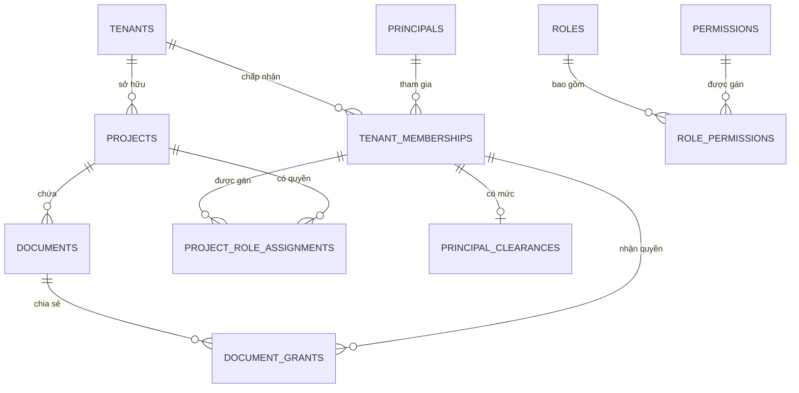
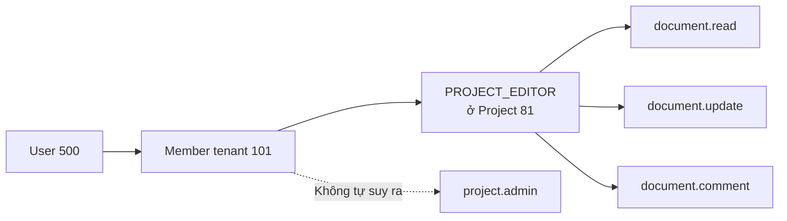
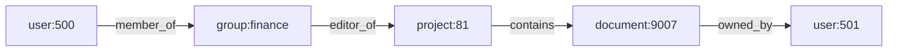
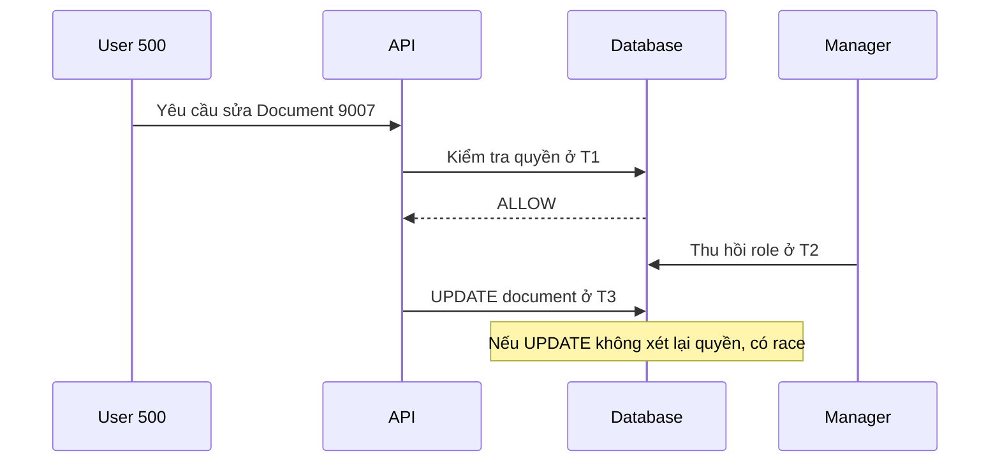

# Mô hình quyền truy cập theo chủ thể, tài nguyên, vai trò hoặc thuộc tính

Một hệ thống quản lý tài liệu phục vụ nhiều doanh nghiệp có các yêu cầu: nhân viên chỉ xem tài liệu trong dự án được tham gia; trưởng dự án có thể chỉnh sửa; chủ tài liệu được xem bản nháp của mình; tài liệu mức **hạn chế** chỉ mở cho người có mức cho phép phù hợp; người bị thu hồi quyền không được tiếp tục tải tệp dù biết ID hoặc URL cũ. Nên lưu quyền trực tiếp trên từng tài liệu, gán vai trò, dùng thuộc tính của người dùng/tài liệu, hay xét quan hệ giữa các thực thể?

Đó là bài toán **mô hình hóa ủy quyền** (*authorization modeling*). Nó không chỉ là câu lệnh `if (role == "ADMIN")` trong Java. Việc chọn chủ thể, tài nguyên, hành động, phạm vi và các ràng buộc SQL quyết định liệu hệ thống có thể bảo vệ dữ liệu khi số người dùng, tenant, vai trò và chính sách tăng lên hay không.

Bài thuộc chương **Bảo vệ dữ liệu** trong module **DATABASE_DATA_MODELING**: rèn kỹ năng chuyển yêu cầu thành thực thể, khóa, quan hệ, ràng buộc, chỉ mục và lược đồ lưu trữ có thể kiểm chứng. Trọng tâm là phân biệt **RBAC** (theo vai trò), **ABAC** (theo thuộc tính), **ACL** (danh sách cấp quyền trực tiếp), **ReBAC** (theo quan hệ) và cách kết hợp chúng trong một mô hình dữ liệu an toàn. Các ví dụ dùng PostgreSQL và SQL minh họa, nhưng nguyên tắc có thể áp dụng cho mô hình quan hệ, document hoặc hệ thống cấp quyền dạng đồ thị.

## 1. Xác thực là ai khác với được phép làm gì

**Authentication** xác nhận danh tính hoặc thực thể gọi hệ thống: người dùng, service account hay một tác vụ tự động. **Authorization** trả lời đối tượng đã được xác thực có được làm một hành động cụ thể trên một tài nguyên trong hoàn cảnh hiện tại không.

Một quyết định quyền thường có dạng:

```text
allow(
    subject,       // Ai đang yêu cầu?
    action,        // Muốn làm gì?
    resource,      // Trên tài nguyên nào?
    context        // Tenant, thời gian, trạng thái, môi trường...
) -> ALLOW | DENY
```

Ví dụ:

```text
subject  = user:500
action   = document.read
resource = document:(tenant=101, document=9007)
context  = {project=81, status=ACTIVE, classification=RESTRICTED}
result   = DENY vì subject không có clearance tương ứng
```

Có quyền truy cập dự án **không đồng nghĩa** được xem mọi tài liệu hạn chế trong dự án; có clearance cũng **không đồng nghĩa** tự động được vào mọi dự án.

### 1.1. Sáu khái niệm cần tách

| Khái niệm | Ý nghĩa | Ví dụ |
|---|---|---|
| **Subject/principal** | Định danh đang thực hiện hành động | `user:500`, `service:exporter` |
| **Resource** | Đối tượng cần bảo vệ | Tài liệu, dự án, đơn hàng, API, tệp |
| **Action/permission** | Hành động được xem xét | `document.read`, `document.update` |
| **Role** | Nhóm quyền có ý nghĩa chức năng | `PROJECT_VIEWER`, `PROJECT_EDITOR` |
| **Attribute** | Đặc điểm của subject/resource/context | Tenant, classification, trạng thái, thời điểm |
| **Relation** | Quan hệ giữa chủ thể và tài nguyên | Là thành viên dự án, chủ tài liệu, người được chia sẻ |

Từ đây, **người dùng**, **vai trò** và **quyền** không phải một thực thể. Một người dùng có thể có nhiều vai trò ở các phạm vi khác nhau; một vai trò chứa nhiều quyền; một quyền thường gắn với **hành động có tên ổn định**, không gắn cứng với ID của một tài nguyên cụ thể.

### 1.2. Nguyên tắc mặc định từ chối

Một policy dễ kiểm chứng nên bắt đầu:

```text
Nếu thiếu danh tính, tenant hoặc thông tin quyền cần thiết -> DENY.
Nếu membership đã bị thu hồi hoặc tài nguyên không còn hợp lệ -> DENY.
Chỉ ALLOW khi tất cả điều kiện bắt buộc và ít nhất một đường cấp quyền hợp lệ.
```

**Default deny** giúp một tài nguyên mới không vô tình mở công khai chỉ vì hệ thống chưa thêm rule. Không được biến một lỗi đọc database hoặc policy timeout thành `ALLOW` để “tránh ảnh hưởng trải nghiệm”.

## 2. Xác định phạm vi của tài nguyên và chủ thể

Giả sử ứng dụng có:

- `Tenant`: doanh nghiệp sử dụng hệ thống.
- `Principal`: user hoặc service account đã xác thực.
- `TenantMembership`: principal được tham gia tenant nào.
- `Project`: không gian làm việc thuộc một tenant.
- `Document`: tài liệu thuộc một project và tenant.
- `Role`/`Permission`: quyền theo nhiệm vụ.
- `DocumentGrant`: chia sẻ quyền trực tiếp trên một tài liệu.
- `PrincipalClearance`: mức phân loại tối đa được phép truy cập.

Một nguyên tắc bất biến:

> Tài liệu của tenant A không được cấp quyền hoặc liên kết tới thành viên tenant B bằng cách vô tình ghép các ID không có tenant scope.



Trong mô hình này, `principal_id` có thể là định danh toàn cục nhưng **các bảng gán quyền theo tenant vẫn phải chứa `tenant_id`**. Một người dùng có thể là `EDITOR` của dự án trong tenant 101 và `VIEWER` của tenant 202 mà không tạo hai tài khoản đăng nhập khác nhau.

### 2.1. Grain của các bảng phân quyền

| Bảng | Một hàng biểu diễn |
|---|---|
| `principals` | Một định danh actor được hệ thống nhận biết |
| `tenant_memberships` | Một principal có quan hệ thành viên với một tenant |
| `permissions` | Một hành động được đặt tên và quản lý |
| `roles` | Một bộ quyền theo chức năng |
| `role_permissions` | Một permission thuộc một role |
| `project_role_assignments` | Một principal có một role trong một project của tenant |
| `document_grants` | Một principal nhận một permission trực tiếp trên một tài liệu |
| `principal_clearances` | Mức phân loại được phê duyệt cho principal trong tenant |

Grain rõ giúp xác định **PK**, **UNIQUE** và cách thu hồi quyền. Không nên lưu danh sách ID người được xem dưới dạng chuỗi `"1,2,3"` trong cột tài liệu: khó kiểm chứng quan hệ, gán nhiều quyền, xử lý hết hạn và lập chỉ mục.

## 3. ACL: cấp quyền trực tiếp trên tài nguyên

**Access Control List (ACL)** thường là danh sách entry diễn đạt “chủ thể X được thực hiện hành động Y trên tài nguyên Z”. Ví dụ:

| Tài liệu | Chủ thể | Permission | Hết hạn |
|---|---|---|---|
| `doc:9007` | `user:500` | `document.read` | Không |
| `doc:9007` | `user:501` | `document.read` | 2027-01-01 |
| `doc:9010` | `user:501` | `document.update` | Không |

Nếu chỉ có vài tài liệu chia sẻ đặc biệt, ACL rất trực quan. Nhưng khi mỗi dự án có hàng nghìn tài liệu và hàng trăm nhân viên, gán riêng từng permission trên từng tài liệu tạo **rất nhiều entry** và khó quản lý khi nhân viên chuyển nhóm.

### 3.1. Ưu điểm và giới hạn

**Ưu điểm:** chia sẻ ngoại lệ dễ diễn đạt; thu hồi theo một tài liệu rõ; phù hợp quyền mời cộng tác, cấp quyền xem tạm thời.

**Giới hạn:** số dòng grant có thể tăng theo tích người dùng × tài nguyên; khó hiểu tổng quyền một người từ nhiều nguồn; quyền kế thừa hoặc quy tắc “tất cả tài liệu trong dự án” thường lặp lại nếu chỉ dùng ACL.

### 3.2. Một ACL chỉ chứa quyền ALLOW hay có DENY?

Ví dụ của bài chỉ lưu **grant cho phép**. Không có entry nghĩa là không được phép theo con đường ACL, nhưng subject có thể vẫn được phép qua role hoặc quan hệ chủ sở hữu. Nếu hệ thống có **explicit DENY**, phải viết rõ thứ tự ưu tiên:

```text
Mandatory restrictions (tenant, state, classification) -> phải đạt
Explicit deny (nếu mô hình hỗ trợ) -> từ chối
Ít nhất một allow grant/role/relation -> cho phép
Còn lại -> từ chối
```

Không thêm cột `effect='DENY'` rồi để các service tự chọn thứ tự xử lý. Một mô hình trộn ALLOW/DENY mà thiếu precedence sẽ cho kết quả khác nhau theo đường truy vấn.

## 4. RBAC: gán quyền qua vai trò

**Role-Based Access Control (RBAC)** tách hành động ra khỏi từng người. Một role ánh xạ đến tập permission; subject nhận role trong một phạm vi.



Ví dụ ma trận:

| Role trong project | `document.read` | `document.comment` | `document.update` | `project.manage_members` |
|---|---|---|---|---|
| `PROJECT_VIEWER` | Có | Không | Không | Không |
| `PROJECT_COMMENTER` | Có | Có | Không | Không |
| `PROJECT_EDITOR` | Có | Có | Có | Không |
| `PROJECT_ADMIN` | Có | Có | Có | Có |

Ma trận chỉ là **hợp đồng của ví dụ**, không phải định nghĩa bắt buộc cho mọi sản phẩm. Quyền như `document.delete` hoặc `billing.refund` nên được tách thành permission riêng vì mức rủi ro khác `document.update`.

### 4.1. Role phải có phạm vi

Gán `PROJECT_EDITOR` cho user 500 mà không nói **project nào** thường là mô hình thiếu. Cần role assignment chứa `tenant_id` và `project_id`:

```text
principal 500:
  tenant 101 / project 81 -> PROJECT_EDITOR
  tenant 101 / project 82 -> PROJECT_VIEWER
  tenant 202 / project 10 -> PROJECT_COMMENTER
```

Một role toàn cục như `PLATFORM_SUPPORT` không nên được sử dụng làm đường tắt đọc mọi dữ liệu tenant mà không có cơ chế quyền và audit riêng.

### 4.2. Vai trò không phải trạng thái nghiệp vụ

`order.status='CONFIRMED'` là trạng thái của đơn, không phải role. “Admin được sửa đơn đã hủy” có thể là quyết định sai nghiệp vụ ngay cả khi admin có permission `order.update`. Quy tắc hành vi phải kết hợp **quyền** và **trạng thái tài nguyên**.

### 4.3. Role hierarchy và separation of duties

Nếu `PROJECT_ADMIN` kế thừa quyền của `PROJECT_EDITOR`, có thể mô hình hóa role hierarchy thay vì sao chép ma trận. Nhưng phải tránh vòng lặp kế thừa (`A→B→A`), định nghĩa xử lý quyền phủ định và cache hiệu quả. Đối với hệ thống nhỏ, ma trận role–permission trực tiếp thường dễ kiểm tra hơn.

Một số nghiệp vụ yêu cầu **separation of duties**: người tạo yêu cầu thanh toán không được tự phê duyệt chính yêu cầu đó. Dù người ấy có role `APPROVER`, policy phải kiểm tra `resource.created_by != principal_id` hoặc một quy trình phê duyệt độc lập. RBAC thuần túy **không đủ** biểu đạt ràng buộc người thực hiện.

## 5. ABAC: quyết định bằng thuộc tính

**Attribute-Based Access Control (ABAC)** đánh giá các thuộc tính của subject, resource, hành động và môi trường. Không cần tạo role mới cho mọi tổ hợp “người thuộc nhóm A, tài liệu mật, ở vùng X, trong giờ Y”.

Ví dụ điều kiện đọc:

```text
subject.membership.status = ACTIVE
AND subject.clearance_level >= resource.classification_level
AND resource.status = ACTIVE
AND subject.tenant_id = resource.tenant_id
AND has_project_role_or_document_grant(subject, resource, "document.read")
```

Các thuộc tính có thể gồm:

| Nguồn thuộc tính | Ví dụ | Lưu ý tin cậy |
|---|---|---|
| Subject | Tenant membership, clearance, phòng ban | Lấy từ nguồn có thẩm quyền, có quy trình thay đổi |
| Resource | Classification, owner, status, project ID | Thuộc tính phải được bảo vệ khỏi chỉnh sửa tùy ý |
| Action | Read, update, export, approve | Có tên và ngữ nghĩa được chuẩn hóa |
| Environment | Thời gian, phiên đăng nhập, MFA đã xác thực | Không tin client tự khai báo các yếu tố nhạy cảm |
| Quan hệ | Chủ tài liệu, thành viên dự án, cấp trên | Cần dữ liệu quan hệ đúng và có hiệu lực |

### 5.1. Thuộc tính được lưu ở đâu?

Một số thuộc tính thuộc cột trực tiếp, như `documents.classification_level` và `documents.status`. Những thuộc tính cần lịch sử hoặc có quy trình cấp quyền, như clearance, nên dùng bảng riêng với FK và metadata thay đổi.

Không nhét tất cả attributes vào một cột JSON chỉ vì “ABAC linh hoạt”. JSON có thể phù hợp với thuộc tính tùy biến, nhưng các thuộc tính **quyết định bảo mật quan trọng** cần có kiểu, validation, index, kiểm soát người sửa và audit rõ.

### 5.2. Ví dụ phân loại tài liệu

Giả sử mã mức nhạy cảm:

```text
0 = PUBLIC_WITHIN_TENANT
1 = INTERNAL
2 = RESTRICTED
```

Một user có `max_classification_level=1` không được xem tài liệu mức 2, **dù** có vai trò `PROJECT_EDITOR`. “PUBLIC_WITHIN_TENANT” vẫn cần membership tenant trong chính sách ví dụ; nó **không có nghĩa** tài liệu công khai trên Internet.

Mức phân loại chỉ là một dimension. Nếu tài liệu bị khóa pháp lý hoặc ở trạng thái `DELETED`, cần thêm policy tương ứng; không tạo mức clearance cao để vô hiệu hóa mọi ràng buộc khác.

### 5.3. ABAC cần chính sách mạch lạc

Một hệ thống có nhiều điều kiện có thể gặp:

- Một policy cho phép vì role.
- Một policy từ chối vì classification.
- Một policy ngoại lệ vì chủ sở hữu.

Phải định nghĩa kết quả hợp nhất **trước khi code**. Trong bài này: tenant + membership + trạng thái + classification là **điều kiện bắt buộc** cho mọi đường đọc; sau đó chủ sở hữu, role hoặc ACL cung cấp đường ALLOW. Không có role nào vượt qua classification chỉ vì tên role chứa chữ `ADMIN`.

## 6. ReBAC: quyền dựa trên quan hệ giữa các đối tượng

**Relationship-Based Access Control (ReBAC)** xác định quyền từ quan hệ trong đồ thị: user là thành viên nhóm, nhóm thuộc dự án, dự án chứa tài liệu; hoặc user là chủ tài liệu.



Một rule có thể là:

```text
can_read(user, document)
  = user is owner of document
    OR user is member of a group with reader/editor relation
       to the parent project of document
    OR user has direct document.read grant
```

ReBAC hữu ích khi có nhiều cấp nhóm, tổ chức, thư mục, dự án, tài liệu và quyền **kế thừa**. Tuy nhiên, cần định nghĩa chiều đi, độ sâu, xử lý vòng lặp và khi nào quan hệ bị thu hồi.

### 6.1. ReBAC khác RBAC nhưng thường kết hợp

`PROJECT_EDITOR` là tên vai trò và bộ permission; “user 500 là editor của project 81” là **quan hệ có phạm vi tài nguyên**. Cùng một triển khai quan hệ `project_role_assignments` có thể vừa thể hiện RBAC (vai trò) vừa thể hiện ReBAC (được gán ở nút project và thừa hưởng tới tài liệu con).

Không cần chọn RBAC **hoặc** ReBAC theo nghĩa loại trừ nhau. Quan trọng là policy có đường quyền dễ giải thích, kiểm chứng và thu hồi.

### 6.2. Quan hệ kế thừa không tự nhiên vô hạn

Một thư mục con có thể thừa hưởng quyền từ thư mục cha, nhưng thư mục `restricted` có thể ngắt kế thừa. Nếu domain có nhiều cấp thư mục, phải định nghĩa:

- Có thừa hưởng theo cha → con không?
- Có ngoại lệ ngắt kế thừa không?
- Trường hợp nhiều cha hoặc group lồng nhau thì combine thế nào?
- Chuỗi quan hệ có cycle không và xử lý nó ra sao?
- Query liệt kê tài nguyên được phép phải hoạt động với đồ thị lớn thế nào?

Với dữ liệu dạng cây ổn định, bảng quan hệ cha–con và recursive CTE có thể đủ. Với quan hệ nhiều loại/đường đi phức tạp, cần cân nhắc graph model hoặc dịch vụ kiểm tra permission chuyên dụng, nhưng vẫn phải giữ nguồn quyền và bất biến tenant rõ ràng.

## 7. Kết hợp RBAC, ABAC, ACL và ReBAC thành một policy rõ ràng

Không có một cơ chế duy nhất phù hợp với mọi hệ thống. Ví dụ bài này dùng một **policy kết hợp**:

```text
can_read_document(principal, tenant, document)
  = authenticated(principal)
    AND active_member(principal, tenant)
    AND belongs_to(document, tenant)
    AND document.status = ACTIVE
    AND principal.clearance >= document.classification
    AND (
        principal = document.owner
        OR has_role_permission(
            principal, document.project, "document.read"
        )
        OR has_valid_direct_grant(
            principal, document, "document.read"
        )
    )
```

Trong đó:

- **Tenant + membership** là lớp ranh giới tổ chức.
- **Classification + trạng thái** là điều kiện bắt buộc thuộc nhóm ABAC.
- **Owner/project membership** là quan hệ theo ReBAC.
- **Role-permission** là RBAC trong project.
- **Direct grant** là ACL cho ngoại lệ.

Tài liệu mức 2 chỉ được mở khi user có clearance tối thiểu 2, **kể cả người đó là owner hoặc được cấp role EDITOR**. Trong policy này, không có role “siêu admin bỏ qua tất cả”; mọi quyền break-glass nếu tồn tại phải được quy định khác, có kiểm soát và audit.

### 7.1. Chính sách phải chỉ ra tác động khi thiếu dữ liệu

Nếu hồ sơ clearance không tồn tại, ví dụ mặc định của bài chọn **DENY**, không tự gán level 2. Nếu membership `SUSPENDED`, role assignment còn nằm trong DB cũng không còn hiệu lực. Nếu tài liệu `DELETED`, ACL chưa được dọn vẫn không cấp quyền đọc nội dung.

Đây là cách tạo **điều kiện bắt buộc bên ngoài phép OR quyền** để không có một nhánh grant nào vô tình vượt qua bảo vệ mức tenant, classification hoặc trạng thái tài nguyên.

### 7.2. Đừng suy từ permission này ra permission khác

`document.read` không nhất thiết cho phép `document.export`, `document.print` hoặc `document.share`. Một API xuất cả nghìn tài liệu có mức rủi ro khác xem một tài liệu; hãy đặt các hành động có tên riêng và quyết định theo hợp đồng.

Tương tự, `document.update` không đương nhiên cho phép sửa `classification_level` hay `owner_principal_id`. Những thuộc tính an ninh nhạy cảm có thể cần `document.reclassify` và `document.transfer_owner`, cùng quy trình phê duyệt riêng.

## 8. Thiết kế lược đồ quan hệ PostgreSQL cho quyền truy cập

Một mô hình tối giản đủ dùng cho ví dụ:

```sql
CREATE TABLE tenants (
    tenant_id BIGINT PRIMARY KEY,
    tenant_code VARCHAR(80) NOT NULL UNIQUE
);

CREATE TABLE principals (
    principal_id BIGINT PRIMARY KEY,
    principal_kind VARCHAR(12) NOT NULL
        CHECK (principal_kind IN ('USER', 'SERVICE')),
    display_name VARCHAR(160) NOT NULL
);

CREATE TABLE tenant_memberships (
    tenant_id BIGINT NOT NULL REFERENCES tenants(tenant_id),
    principal_id BIGINT NOT NULL REFERENCES principals(principal_id),
    membership_status VARCHAR(12) NOT NULL
        CHECK (membership_status IN ('ACTIVE', 'SUSPENDED', 'REVOKED')),
    PRIMARY KEY (tenant_id, principal_id)
);

CREATE TABLE projects (
    tenant_id BIGINT NOT NULL REFERENCES tenants(tenant_id),
    project_id BIGINT NOT NULL,
    project_name VARCHAR(200) NOT NULL,
    PRIMARY KEY (tenant_id, project_id)
);

CREATE TABLE documents (
    tenant_id BIGINT NOT NULL,
    document_id BIGINT NOT NULL,
    project_id BIGINT NOT NULL,
    owner_principal_id BIGINT NOT NULL,
    title VARCHAR(300) NOT NULL,
    classification_level SMALLINT NOT NULL
        CHECK (classification_level BETWEEN 0 AND 2),
    document_status VARCHAR(12) NOT NULL
        CHECK (document_status IN ('ACTIVE', 'ARCHIVED', 'DELETED')),
    version BIGINT NOT NULL DEFAULT 0 CHECK (version >= 0),
    PRIMARY KEY (tenant_id, document_id),
    FOREIGN KEY (tenant_id, project_id)
        REFERENCES projects(tenant_id, project_id),
    FOREIGN KEY (tenant_id, owner_principal_id)
        REFERENCES tenant_memberships(tenant_id, principal_id)
);

CREATE TABLE roles (
    role_code VARCHAR(60) PRIMARY KEY
);

CREATE TABLE permissions (
    permission_code VARCHAR(80) PRIMARY KEY
);

CREATE TABLE role_permissions (
    role_code VARCHAR(60) NOT NULL REFERENCES roles(role_code),
    permission_code VARCHAR(80) NOT NULL
        REFERENCES permissions(permission_code),
    PRIMARY KEY (role_code, permission_code)
);

CREATE TABLE project_role_assignments (
    tenant_id BIGINT NOT NULL,
    project_id BIGINT NOT NULL,
    principal_id BIGINT NOT NULL,
    role_code VARCHAR(60) NOT NULL REFERENCES roles(role_code),
    effective_from TIMESTAMPTZ NOT NULL DEFAULT CURRENT_TIMESTAMP,
    expires_at TIMESTAMPTZ,
    PRIMARY KEY (tenant_id, project_id, principal_id, role_code),
    FOREIGN KEY (tenant_id, project_id)
        REFERENCES projects(tenant_id, project_id),
    FOREIGN KEY (tenant_id, principal_id)
        REFERENCES tenant_memberships(tenant_id, principal_id),
    CHECK (expires_at IS NULL OR expires_at > effective_from)
);

CREATE TABLE document_grants (
    tenant_id BIGINT NOT NULL,
    document_id BIGINT NOT NULL,
    principal_id BIGINT NOT NULL,
    permission_code VARCHAR(80) NOT NULL
        REFERENCES permissions(permission_code),
    granted_at TIMESTAMPTZ NOT NULL DEFAULT CURRENT_TIMESTAMP,
    expires_at TIMESTAMPTZ,
    PRIMARY KEY (
        tenant_id, document_id, principal_id, permission_code
    ),
    FOREIGN KEY (tenant_id, document_id)
        REFERENCES documents(tenant_id, document_id),
    FOREIGN KEY (tenant_id, principal_id)
        REFERENCES tenant_memberships(tenant_id, principal_id),
    CHECK (expires_at IS NULL OR expires_at > granted_at)
);

CREATE TABLE principal_clearances (
    tenant_id BIGINT NOT NULL,
    principal_id BIGINT NOT NULL,
    max_classification_level SMALLINT NOT NULL
        CHECK (max_classification_level BETWEEN 0 AND 2),
    PRIMARY KEY (tenant_id, principal_id),
    FOREIGN KEY (tenant_id, principal_id)
        REFERENCES tenant_memberships(tenant_id, principal_id)
);

CREATE INDEX idx_documents_project
    ON documents(tenant_id, project_id, document_id);

CREATE INDEX idx_project_roles_principal
    ON project_role_assignments(
        tenant_id, principal_id, project_id, role_code
    );

CREATE INDEX idx_grants_principal
    ON document_grants(
        tenant_id, principal_id, permission_code, document_id
    );
```

Đây là **mô hình thiết kế cho bài học**, chưa là script migration production hoàn chỉnh. DDL giả định ID principal, tenant, project và document được cấp bởi cơ chế riêng với tính duy nhất tương ứng; các bảng vai trò và permission được seed hợp lệ trước khi gán. Chức năng auth/login, file storage, phiên đăng nhập, audit, quy trình phê duyệt và khóa mã hóa được mô hình hóa riêng khi triển khai.

### 8.1. Vai trò của khóa chính, khóa ngoài và ràng buộc

| Ràng buộc | Bất biến được bảo vệ |
|---|---|
| `PRIMARY KEY(tenant_id, document_id)` | Cùng một ID tài liệu có thể xuất hiện ở tenant khác, nhưng không trùng trong tenant |
| `FOREIGN KEY(tenant_id, project_id)` | Tài liệu thuộc project của **chính tenant ấy** |
| `FOREIGN KEY(tenant_id, owner_principal_id)` | Owner phải là membership đã được đăng ký của tenant |
| `FOREIGN KEY(tenant_id, principal_id)` ở ACL | Không cấp direct grant cho principal chưa là thành viên tenant |
| `PRIMARY KEY(role_code, permission_code)` | Một permission không bị chèn trùng vào cùng role |
| `CHECK classification_level BETWEEN 0 AND 2` | Mức phân loại nằm trong miền giá trị thiết kế |
| `CHECK expires_at > granted_at` | Khoảng hiệu lực grant hợp lệ khi có hạn hết |

**FK không kiểm tra membership còn `ACTIVE`**, vì trạng thái là điều kiện động của policy. Một bản ghi grant có thể vẫn tồn tại khi membership `REVOKED`, nhưng truy vấn quyền phải từ chối do kiểm tra trạng thái trước khi xét grant. Nếu muốn xóa grant theo vòng đời membership, đó là chính sách quản lý dữ liệu cần thiết kế riêng.

### 8.2. Role và permission có thể toàn cục hoặc tùy tenant

Ví dụ dùng `roles(role_code)` và `permissions(permission_code)` chung cho nền tảng, nên cùng tên `PROJECT_EDITOR` có cùng bộ quyền ở mọi tenant. Nếu mỗi tenant có thể tùy biến role, cần chuyển sang khóa scoped như `roles(tenant_id, role_code)` và `role_permissions(tenant_id, role_code, permission_code)`, đồng thời thêm FK ghép ở assignment.

Không cho tenant tùy ý tạo role có permission nền tảng nguy hiểm như `platform.read_all_tenants` chỉ vì tên role được lưu trong cùng một bảng. Tập permission có thể cấp phải có ranh giới rõ.

### 8.3. Vì sao cần version của document?

`documents.version` không quyết định ai có quyền, mà hỗ trợ **phát hiện stale update** khi nhiều người cùng sửa tài liệu. Một thao tác ghi an toàn thường cần đồng thời:

```text
authorized(subject, "document.update", resource)
AND resource.version = expected_version
AND resource.status = ACTIVE
```

Permission và optimistic locking giải quyết **hai rủi ro khác nhau**: người không có quyền sửa và người có quyền nhưng đang ghi dựa trên phiên bản cũ. Một số thứ tự thay đổi hoặc policy update liên quan đến revoke còn yêu cầu transaction/isolation phù hợp, được bàn ở phần sau.

### 8.4. Vì sao không lưu cột `allowed_user_ids`?

```json
{"allowed_user_ids":[500,501,502]}
```

Nếu nhét array/JSON này trong `documents`, rất khó dùng FK bảo đảm từng user thuộc cùng tenant, khó biểu diễn permission riêng, thời gian hết hạn, role nhóm và lịch sử cấp quyền. JSON có thể hữu ích cho metadata không quan trọng hoặc cấu trúc policy được version hóa trong một policy engine, nhưng **grant có quan hệ và ràng buộc an ninh cốt lõi** nên được mô hình hóa rõ.

## 9. Một câu truy vấn quyết định quyền đọc thực tế

Giả sử client đã xác thực thành `principal_id = 500`. Server đã kiểm tra rằng principal được phép yêu cầu tenant 101, nhưng vẫn cần kiểm tra trên **tài liệu cụ thể**.

### 9.1. Truy vấn `EXISTS` kết hợp các đường quyền

```sql
SELECT EXISTS (
    SELECT 1
    FROM documents AS d
    JOIN tenant_memberships AS m
      ON m.tenant_id = d.tenant_id
     AND m.principal_id = :principal_id
     AND m.membership_status = 'ACTIVE'
    LEFT JOIN principal_clearances AS c
      ON c.tenant_id = d.tenant_id
     AND c.principal_id = :principal_id
    WHERE d.tenant_id = :tenant_id
      AND d.document_id = :document_id
      AND d.document_status = 'ACTIVE'
      AND COALESCE(c.max_classification_level, -1)
          >= d.classification_level
      AND (
          d.owner_principal_id = :principal_id
          OR EXISTS (
              SELECT 1
              FROM project_role_assignments AS a
              JOIN role_permissions AS rp
                ON rp.role_code = a.role_code
               AND rp.permission_code = 'document.read'
              WHERE a.tenant_id = d.tenant_id
                AND a.project_id = d.project_id
                AND a.principal_id = :principal_id
                AND a.effective_from <= CURRENT_TIMESTAMP
                AND (
                    a.expires_at IS NULL
                    OR a.expires_at > CURRENT_TIMESTAMP
                )
          )
          OR EXISTS (
              SELECT 1
              FROM document_grants AS g
              WHERE g.tenant_id = d.tenant_id
                AND g.document_id = d.document_id
                AND g.principal_id = :principal_id
                AND g.permission_code = 'document.read'
                AND (
                    g.expires_at IS NULL
                    OR g.expires_at > CURRENT_TIMESTAMP
                )
          )
      )
) AS allowed;
```

Truy vấn này thực hiện đúng policy phần 7:

1. Chỉ xét tài liệu có **đúng tenant và ID**.
2. Principal phải là thành viên `ACTIVE` của tenant.
3. Tài liệu phải `ACTIVE`.
4. Clearance phải đủ; **thiếu clearance bị từ chối** vì `COALESCE(...,-1)`.
5. Cần ít nhất một đường cho phép: owner, role trong project hoặc direct grant còn hiệu lực.

Kết quả chỉ là `true/false`. Nó **chưa tự phát nội dung** tài liệu. Với API production, nên tích hợp điều kiện quyền trực tiếp vào truy vấn lấy dữ liệu, hoặc bảo đảm sự nhất quán giữa kiểm tra quyền và truy vấn dữ liệu theo giao dịch. Nếu kiểm tra `allowed=true` rồi mở một kết nối không kiểm soát để đọc tài liệu, có thể xảy ra lỗi **time-of-check/time-of-use**.

### 9.2. Chủ sở hữu không phải siêu quyền

Trong truy vấn trên, owner được phép **đọc** khi qua mọi rào bắt buộc. Không suy ra owner được xóa vĩnh viễn, đổi mức bảo mật, thêm thành viên hay chuyển quyền sở hữu. Mỗi hành động cần policy hoặc permission riêng.

### 9.3. Tên permission phải khớp use case

Một truy vấn có `rp.permission_code = 'document.read'` không được sao chép nguyên rồi dùng để phê duyệt thanh toán. Hãy xây các hành động có ngữ nghĩa cụ thể, tránh một permission chung `WRITE` cho mọi thao tác với hậu quả khác nhau.

## 10. Query kết quả phải có tenant scope và quyền ngay ở nơi đọc

### 10.1. Không đọc hết rồi lọc tại application

Sai khi dùng danh sách lớn:

```java
List<Document> docs = repository.findAll();
return docs.stream()
    .filter(doc -> permissionService.canRead(user, doc))
    .toList();
```

Trong khi chờ lọc, server đã kéo dữ liệu của nhiều tenant vào memory, có thể ghi log, cache hoặc gặp lỗi serialization ngoài dự kiến. Phân trang còn có thể sai vì DB phân trang dữ liệu toàn hệ thống rồi application loại các hàng không được phép.

Một query danh sách phải áp tenant + policy tại **nguồn dữ liệu** trước phân trang, hoặc dùng một phương án index quyền hiệu lực được kiểm chứng:

```sql
-- Ví dụ danh sách tài liệu có vai trò PROJECT_VIEWER/EDITOR phù hợp.
-- Chỉ minh họa NHÁNH ROLE; API đầy đủ còn phải thêm owner/ACL.
SELECT d.document_id, d.title, d.classification_level
FROM documents AS d
JOIN tenant_memberships AS m
  ON m.tenant_id = d.tenant_id
 AND m.principal_id = :principal_id
 AND m.membership_status = 'ACTIVE'
JOIN principal_clearances AS c
  ON c.tenant_id = d.tenant_id
 AND c.principal_id = :principal_id
WHERE d.tenant_id = :tenant_id
  AND d.document_status = 'ACTIVE'
  AND c.max_classification_level >= d.classification_level
  AND EXISTS (
      SELECT 1
      FROM project_role_assignments AS a
      JOIN role_permissions AS rp
        ON rp.role_code = a.role_code
       AND rp.permission_code = 'document.read'
      WHERE a.tenant_id = d.tenant_id
        AND a.project_id = d.project_id
        AND a.principal_id = :principal_id
        AND a.effective_from <= CURRENT_TIMESTAMP
        AND (a.expires_at IS NULL
             OR a.expires_at > CURRENT_TIMESTAMP)
  )
ORDER BY d.document_id DESC
LIMIT 50;
```

Truy vấn này **cố ý chỉ bao phủ quyền qua role**, vì minh họa cách push predicate xuống database. Để đáp ứng policy đầy đủ của bài, cần đưa cả nhánh owner và ACL từ mục 9 vào cùng truy vấn (và áp các điều kiện bắt buộc giống hệt). Không dùng riêng query này để kết luận “danh sách tất cả tài liệu được phép”.

### 10.2. Phân trang, đếm và tìm kiếm đều phải kiểm tra quyền

`COUNT(*)` và facets trong giao diện tìm kiếm có thể làm lộ số lượng tài liệu mật dù nội dung bị ẩn. Tìm kiếm theo tiêu đề, full-text index, autocomplete, export CSV, in tài liệu và lấy tệp qua URL phải áp **cùng ranh giới truy cập**, không chỉ endpoint `GET /documents/{id}`.

Với cursor pagination, cursor không phải bằng chứng quyền. Mỗi lần đọc trang tiếp phải kiểm tra quyền theo trạng thái hiện tại và sử dụng thứ tự ổn định. Nếu quyền thay đổi giữa hai trang, kết quả có thể thay đổi; đó là đặc tính cần định nghĩa, không được đảm bảo giả rằng danh sách là snapshot bất biến.

### 10.3. Đường ghi cần kiểm tra quyền và trạng thái cùng transaction

Ví dụ một truy vấn `UPDATE` có thể chỉ sửa nếu policy còn hợp lệ:

```sql
UPDATE documents AS d
SET title = :new_title,
    version = version + 1
WHERE d.tenant_id = :tenant_id
  AND d.document_id = :document_id
  AND d.document_status = 'ACTIVE'
  AND d.version = :expected_version
  AND EXISTS (
      SELECT 1
      FROM tenant_memberships AS m
      JOIN principal_clearances AS c
        ON c.tenant_id = m.tenant_id
       AND c.principal_id = m.principal_id
      WHERE m.tenant_id = d.tenant_id
        AND m.principal_id = :principal_id
        AND m.membership_status = 'ACTIVE'
        AND c.max_classification_level
            >= d.classification_level
  )
  AND (
      EXISTS (
          SELECT 1
          FROM project_role_assignments AS a
          JOIN role_permissions AS rp
            ON rp.role_code = a.role_code
           AND rp.permission_code = 'document.update'
          WHERE a.tenant_id = d.tenant_id
            AND a.project_id = d.project_id
            AND a.principal_id = :principal_id
            AND a.effective_from <= CURRENT_TIMESTAMP
            AND (a.expires_at IS NULL
                 OR a.expires_at > CURRENT_TIMESTAMP)
      )
      OR EXISTS (
          SELECT 1
          FROM document_grants AS g
          WHERE g.tenant_id = d.tenant_id
            AND g.document_id = d.document_id
            AND g.principal_id = :principal_id
            AND g.permission_code = 'document.update'
            AND (g.expires_at IS NULL
                 OR g.expires_at > CURRENT_TIMESTAMP)
      )
  )
RETURNING d.document_id, d.version;
```

Truy vấn minh họa **không cấp quyền UPDATE chỉ vì người đó là owner**; muốn cho chủ tài liệu cập nhật, cần bổ sung nhánh policy rõ ràng. Ngoài ra, nó cho phép sửa **title**, không cho tự sửa `classification_level`, `owner_principal_id` hay `tenant_id` qua cùng API.

Nếu `UPDATE` không trả hàng, nguyên nhân có thể là không tồn tại, không đủ quyền, status không cho phép, hoặc version cũ. Server cần xử lý lỗi theo hợp đồng API mà không vô tình xác nhận sự tồn tại của tài liệu bí mật.

**Lưu ý về tranh chấp quyền:** với `READ COMMITTED`, các phép đọc policy trong một statement dùng snapshot phù hợp với cơ chế database, nhưng thao tác **thu hồi membership chạy đồng thời** có thể xảy ra sát lúc update. Nếu yêu cầu “ngay khi thu hồi là không một giao dịch nào còn được ghi”, phải thiết kế locking/fencing/version policy và thứ tự commit rõ ràng; không được mặc định câu SQL trên bảo đảm quy tắc revocation tuyệt đối mọi interleaving.

## 11. Row-Level Security: bảo vệ thêm ở lớp database

**Row-Level Security (RLS)** trong PostgreSQL có thể buộc một DB role chỉ được thấy/ghi hàng thuộc tenant đã được server chọn. Đây là **defense in depth** giúp giảm hậu quả khi ứng dụng quên thêm tenant predicate.

Giả định DB role `app_runtime` đã được tạo, có quyền thao tác thích hợp, **không phải superuser, không có BYPASSRLS và không phải owner bảng**.

```sql
ALTER TABLE documents ENABLE ROW LEVEL SECURITY;
ALTER TABLE documents FORCE ROW LEVEL SECURITY;

CREATE POLICY documents_tenant_scope
ON documents
FOR ALL
TO app_runtime
USING (
    tenant_id =
    NULLIF(current_setting('app.tenant_id', true), '')::BIGINT
)
WITH CHECK (
    tenant_id =
    NULLIF(current_setting('app.tenant_id', true), '')::BIGINT
);
```

`USING` giới hạn hàng có thể truy cập; `WITH CHECK` ràng buộc hàng mới hoặc hàng sau update. Khi `app.tenant_id` không được đặt, biểu thức so sánh với `NULL` không cho phép truy cập hàng. Nếu giá trị setting sai định dạng số, thao tác có thể lỗi chuyển kiểu thay vì cho phép tất cả.

Trong giao dịch ứng dụng:

```sql
BEGIN;
SELECT set_config('app.tenant_id', '101', true);

SELECT document_id, title
FROM documents
ORDER BY document_id;

COMMIT;
```

Tham số `true` là phạm vi transaction. Ứng dụng phải xác thực principal, kiểm tra membership tenant và đặt context trên **đúng kết nối dùng để query** sau khi transaction bắt đầu. Với connection pooling, đặc biệt transaction pooling, không được dùng một tenant session setting được giữ qua các request.

### 11.1. RLS tenant không đủ để quyết định quyền tài liệu

Policy trên chỉ chặn các hàng **khác tenant**. Nó **không biết** user là VIEWER hay EDITOR ở project 81, cũng không biết clearance hay grant trên document. Vì vậy vẫn phải thực thi policy mục 7–10 hoặc một chính sách RLS nâng cao tương đương được thiết kế và kiểm thử riêng.

Ví dụ, nếu RLS cho phép đọc mọi `documents` của tenant 101 nhưng API dùng `SELECT *` dưới DB role, mà không áp object-level policy, tài liệu restricted của người khác trong cùng tenant vẫn có thể lộ. **Tenant isolation và authorization nội bộ tenant là hai ranh giới khác nhau.**

Một mô hình RLS chặt hơn có thể dùng policy phụ thuộc `current principal`, membership, project role và clearance; nhưng phải kiểm soát đặc quyền đọc bảng policy, hàm `SECURITY DEFINER`, recursion và chi phí truy vấn. Không coi việc thêm một biểu thức `EXISTS` vào RLS là bảo mật xong cho mọi đường ghi.

### 11.2. Những điều RLS không tự giải quyết

- Vai trò superuser hoặc có `BYPASSRLS` có thể vượt RLS; chủ bảng có quy tắc riêng, dù `FORCE ROW LEVEL SECURITY` giúp owner tuân policy trong nhiều trường hợp.
- Custom setting như `app.tenant_id` có thể bị thay bởi một session chạy SQL tùy ý; nó không phải một credential chống giả mạo.
- RLS trên `documents` không tự bảo vệ bảng `document_contents`, tệp trong object storage, search index, cache hoặc bảng xuất dữ liệu.
- FK/unique constraint và thông báo lỗi có những đặc tính riêng; không dùng RLS thay cho FK same-tenant hay đánh giá side channel.
- Khi role admin/support có đường bypass, phải dùng quy trình cấp quyền, giới hạn thời gian và audit riêng.

Nếu threat model cho phép tenant gửi SQL trực tiếp, cần dùng principal DB/role không thể tùy ý chọn tenant hoặc kiến trúc cách ly mạnh hơn. **App-set GUC chỉ nên xem là lớp bảo vệ dưới giả định ứng dụng kiểm soát SQL và tenant context.**

## 12. Quyền ở mức trường, bản ghi và nội dung tệp

Một quyền `document.read` có thể cho phép đọc metadata nhưng không cho xem body hoặc danh sách người được cấp quyền. Vì thế cần phân biệt:

| Phạm vi | Ví dụ cần bảo vệ | Lựa chọn thiết kế |
|---|---|---|
| Hàng/tài nguyên | Document 9007 | Object-level predicate/RLS |
| Cột/field | `salary_amount`, `secret_notes` | View/DTO + column privilege, tách bảng khi phù hợp |
| Tệp đính kèm | PDF lưu trong object storage | Xác thực trước khi phát nội dung/URL |
| Chỉ số tổng hợp | Count của tài liệu restricted | Query có policy, chống rò metadata |
| Kết quả tìm kiếm | Tiêu đề/snippet trong search index | Bộ lọc quyền trước hiển thị |
| Export/batch | Hàng nghìn tài liệu được xuất | Quyền `document.export` riêng, kiểm tra theo tập |

### 12.1. Tách dữ liệu nhạy cảm khi có lợi

Giả sử nội dung tài liệu lưu ở bảng khác:

```sql
CREATE TABLE document_contents (
    tenant_id BIGINT NOT NULL,
    document_id BIGINT NOT NULL,
    body_text TEXT NOT NULL,
    PRIMARY KEY (tenant_id, document_id),
    FOREIGN KEY (tenant_id, document_id)
        REFERENCES documents(tenant_id, document_id)
);
```

Việc tách bảng giúp kiểm soát quyền `SELECT` khác nhau và giảm khả năng đọc nhầm body trong truy vấn list metadata. Nhưng **tách bảng không tự tạo bảo mật**: `document_contents` cũng cần chính sách DB/đường API phù hợp. Nếu bảng này bị grant SELECT rộng cho runtime và có endpoint query tùy ý, vẫn có thể lộ toàn bộ nội dung.

### 12.2. Column masking và encryption là các cơ chế khác

Ẩn email thành `a***@example.com` trên UI là **masking**, không phải chứng minh endpoint khác không đọc được email gốc. Encryption bảo vệ dữ liệu khi lưu/truyền, nhưng ứng dụng có khóa giải mã vẫn có thể trả dữ liệu sai nếu authorization hỏng.

Một thiết kế tốt kết hợp:

- Quyền được phép xem trường nào.
- Query/DTO chỉ chọn đúng trường cần dùng.
- Cơ chế bảo vệ lưu trữ và đường truyền phù hợp.
- Audit khi xem hoặc xuất nội dung nhạy cảm theo chính sách.

### 12.3. Signed URL không đồng nghĩa quyền vĩnh viễn

Nếu tệp nằm trên object storage, server có thể cấp URL có chữ ký sau khi kiểm tra quyền. URL đó thường còn sử dụng được tới khi hết hạn hoặc bị vô hiệu theo cơ chế của nền tảng, **kể cả khi role của user vừa bị thu hồi**. Nếu cần thu hồi tức thì, có thể dùng proxy kiểm tra quyền từng lần tải, URL rất ngắn hạn hoặc cơ chế invalidation được provider hỗ trợ.

Không cho client tự xây object key từ `document_id` rồi truy cập bucket; phải có ràng buộc owner/tenant và quyền tệp tương ứng.

## 13. Đặc quyền tối thiểu, phân tách nhiệm vụ và chống tự nâng quyền

**Least privilege** nghĩa là cấp đúng quyền cần cho công việc, phạm vi nhỏ nhất và khoảng thời gian cần thiết. Một service chỉ cần đọc báo cáo không nên dùng account có quyền cấp role hoặc xóa tài liệu.

### 13.1. Cấp quyền cũng là hành động được kiểm soát

Một API:

```http
POST /tenants/101/projects/81/members
Content-Type: application/json

{"principalId":500,"roleCode":"PROJECT_ADMIN"}
```

không được tự chèn `project_role_assignments` chỉ vì người gọi có `document.update`. Nó cần permission như `project.manage_members`, ràng buộc role được phép cấp, điều kiện membership và audit.

Nếu một người có quyền thêm thành viên nhưng không được phép cấp vai trò ADMIN, cần policy:

```text
can_assign_role(actor, project, target, requested_role)
  = actor can manage project membership
    AND actor's grantable_roles contains requested_role
    AND target is valid tenant member
    AND no separation-of-duties rule is violated
```

Không thể bảo vệ bằng cách frontend ẩn lựa chọn `PROJECT_ADMIN`; phải kiểm tra ở server và dữ liệu được ghi.

### 13.2. Separation of duties

Quy tắc “người tạo hóa đơn không được tự duyệt hóa đơn” gồm:

```text
can_approve(invoice, actor)
  = has_permission(actor, "invoice.approve")
    AND invoice.status = PENDING
    AND invoice.created_by != actor
```

Nếu hai transaction cùng phê duyệt/chỉnh sửa trạng thái, cần thực thi điều kiện và cập nhật trong transaction/SQL nguyên tử hoặc optimistic locking. **Có role đúng nhưng trạng thái và quan hệ không đúng** thì vẫn phải DENY.

### 13.3. Người quản trị ngoại lệ

Cơ chế **break-glass** cho sự cố cần đặt ngoài đường đi thường ngày: xác thực mạnh, lý do, giới hạn thời gian/phạm vi, phê duyệt nếu yêu cầu, audit bất biến và thông báo sau sử dụng. Một cờ `is_super_admin=true` không có kiểm soát là điểm rủi ro lớn, nhất là hệ thống đa tenant.

## 14. Hiệu lực theo thời gian, thu hồi và nhất quán quyền

Một grant có thể hiệu lực từ 09:00 đến 17:00. Bài dùng `effective_from`/`expires_at` ở role assignment và `expires_at` ở direct grant. Cần thống nhất **khoảng nửa mở**:

```text
[effective_from, expires_at)
```

Nghĩa là đúng tại thời điểm bắt đầu, không còn hợp lệ tại `expires_at`. Với direct grant, `granted_at` là thời điểm bắt đầu theo đơn giản hóa của DDL. Dùng `TIMESTAMPTZ`/instant nhất quán; không dựa trên đồng hồ của client.

### 14.1. Thu hồi membership là điều kiện bắt buộc

Nếu đổi:

```sql
UPDATE tenant_memberships
SET membership_status = 'REVOKED'
WHERE tenant_id = :tenant_id
  AND principal_id = :principal_id;
```

thì policy phần 9 phải từ chối, dù các hàng `document_grants` hoặc `project_role_assignments` còn tồn tại. Đây là ưu điểm của việc đặt **active membership ngoài phép OR quyền**.

Tuy nhiên, truy vấn đang chạy, job đã lấy quyền trước đó, cache và signed URL cần chính sách thu hồi riêng. Không thể kết luận “REVOKED trong bảng là mọi tác vụ đang chạy dừng tức khắc” nếu chưa xác định ngữ nghĩa hệ thống phân tán.

### 14.2. Quyền có thể đổi giữa lúc kiểm tra và lúc sử dụng



Kết hợp kiểm tra quyền vào lệnh ghi (mục 10), transaction nhất quán hoặc lock/version là cách giảm cửa sổ race. Tuy nhiên, yêu cầu thu hồi “có hiệu lực ngay sau commit T2 đối với mọi write chưa commit” mạnh hơn một kiểm tra đơn giản trong isolation thông thường; có thể cần fencing token, khóa hàng cấp quyền, serialization hoặc điều phối phiên.

Hãy viết rõ **revocation SLA**: lập tức cho request bắt đầu sau khi quyền bị thu hồi, hay còn bao gồm các request đang chạy? Sự khác nhau quyết định chi phí kỹ thuật.

### 14.3. Lịch sử quyền phục vụ audit

Nếu xóa trực tiếp hàng grant, câu hỏi “user 500 có quyền đọc tài liệu này hôm thứ Hai không?” không thể trả lời từ bảng current-state. Cần nhật ký thay đổi/quyết định hoặc mô hình lịch sử:

```text
grant_created  @09:00 by admin:800
grant_revoked  @12:00 by admin:801
policy_version = v12
principal = 500
resource = document:9007
permission = document.read
```

Phân biệt **quyền có hiệu lực trong nghiệp vụ lúc T** với **hệ thống biết gì về quyền lúc T** khi dữ liệu được sửa hồi tố hoặc phát hiện lỗi. Với yêu cầu audit nghiêm ngặt, có thể cần mô hình bitemporal hoặc event log có revision, không chỉ bảng assignment hiện tại.

### 14.4. Version hóa policy

Nếu ngày mai `PROJECT_EDITOR` không còn được xem tài liệu restricted, bộ quyền có thể không đổi nhưng rule classification đã đổi. Cần version hoặc changelog của policy, cùng kế hoạch cập nhật cache và kiểm thử hành vi. Đừng để hai service triển khai hai bản logic khác nhau mà không có dấu hiệu/version.

## 15. Ngăn lộ thông tin qua lỗi, metadata và xử lý thất bại

Một hệ thống có thể từ chối đọc body nhưng vẫn rò thông tin qua:

- `404` cho tài liệu không tồn tại và `403` cho tài liệu tồn tại nhưng bí mật.
- Count, sort order, tên file, preview, thumbnail và autocomplete.
- Lỗi vi phạm unique/FK làm lộ ID hoặc mã tenant khác.
- Log và tracing chứa tiêu đề, nội dung, token hoặc đường dẫn có chữ ký.
- Tốc độ phản hồi khác biệt rõ giữa tài liệu tồn tại và không tồn tại.

### 15.1. Chọn phản hồi API theo hợp đồng

Với tài nguyên private, có thể trả `404 Not Found` cho cả “không tồn tại” và “không được biết tài nguyên này tồn tại”, tùy yêu cầu. `403 Forbidden` hữu ích khi người dùng được biết tài nguyên tồn tại nhưng không có quyền thao tác. Điều quan trọng là **không tiết lộ điều ngoài quyền người gọi** và giữ chính sách nhất quán giữa các endpoint.

Không trả toàn bộ stack trace SQL, tên schema, membership của tenant khác hoặc chi tiết policy nội bộ vào client. Hệ thống audit nội bộ có thể lưu reason code cần thiết, nhưng kiểm soát quyền đọc audit.

### 15.2. Xử lý lỗi hệ thống theo hướng đóng

Nếu service cấp quyền/DB policy unavailable:

```text
Decision service timeout -> Không cấp ALLOW mới.
Missing membership        -> DENY.
Missing clearance         -> DENY (theo policy của bài).
Unknown permission code   -> DENY.
Unknown resource          -> Không trả dữ liệu.
```

Một số ứng dụng có yêu cầu availability đặc biệt có thể dùng cache quyết định với TTL ngắn và quy tắc chấp nhận rủi ro rõ, nhưng không tự diễn dịch lỗi timeout thành ALLOW. **Fail-closed** là mặc định phù hợp cho dữ liệu nhạy cảm.

## 16. Hiệu năng kiểm tra quyền khi dữ liệu lớn

Một trang danh sách 50 tài liệu có thể cần kiểm tra hàng nghìn quan hệ role/group/ACL. Nếu gọi dịch vụ quyền **50 lần riêng lẻ** sau khi tải tài liệu, có thể tạo N+1 và làm sai phân trang.

### 16.1. Đặt predicate gần dữ liệu

Với mô hình quan hệ, có thể sử dụng:

- `EXISTS`/semi-join theo tenant, project và principal, tránh join nhiều bảng làm nhân bản document.
- Query theo tập ID khi kiểm tra nhiều tài liệu trong cùng request.
- View/read model chứa các cạnh quan hệ để truy vấn quyền có kiểm soát.
- Predicate quyền ở truy vấn danh sách **trước** `LIMIT` và các phép tổng hợp nhạy cảm.
- Index trên đường đi có cardinality lớn, kiểm chứng bằng query plan.

`EXISTS` thường là cách diễn đạt thích hợp cho câu hỏi “có ít nhất một grant/role phù hợp không?”, vì không tạo nhiều bản sao tài liệu khi user có cả role và ACL. Không phải mọi hệ quản trị đều chọn cùng execution plan; vẫn phải đo.

### 16.2. Chọn chỉ mục theo query

Lược đồ phần 8 đã có:

```sql
CREATE INDEX idx_project_roles_principal
ON project_role_assignments(
    tenant_id, principal_id, project_id, role_code
);

CREATE INDEX idx_grants_principal
ON document_grants(
    tenant_id, principal_id, permission_code, document_id
);
```

Hai câu lệnh trên là **nhắc lại index đã tạo trong DDL**, không phải migration bổ sung cần chạy lần hai. Đối với kiểm tra một tài liệu cụ thể, PK của `documents`, `project_role_assignments` và `document_grants` cũng có thể đã hỗ trợ tìm kiếm hiệu quả. Không thêm chỉ mục trùng nếu kế hoạch truy vấn không chứng minh lợi ích.

Để chọn thêm index, xem:

- Kiểm tra quyền **một document** hay liệt kê **mọi document của một principal**?
- Có lọc theo `tenant_id`, `project_id`, `permission_code` không?
- Khối lượng grants/roles là bao nhiêu, có skew giữa project không?
- Tỷ lệ truy vấn đọc so với tốc độ cấp/thu hồi quyền?
- Có phải scan nhiều tài liệu để trả 50 tài liệu được phép không?

### 16.3. Cache quyền phải có khóa đầy đủ

Một khóa cache dễ sai:

```text
canRead(documentId=9007) -> true
```

Nó thiếu subject, tenant và action. Một khóa đủ ngữ cảnh hơn:

```text
principal=500
tenant=101
resource=document:9007
action=document.read
policy_version=v12
membership_version=4
attribute_version=9
```

Nếu policy phụ thuộc thời gian, MFA, network zone hoặc grant expiration, cache còn phải xét **thời hạn hiệu lực/context**. Không lưu `ALLOW` vô thời hạn khi role, membership hoặc classification có thể đổi.

Một số hệ thống dùng **authorization graph/cache** chuyên dụng để trả lời nhanh các truy vấn quan hệ, nhưng vẫn phải kiểm chứng độ mới sau revoke và cơ chế token/version. Cache chỉ là bản tăng tốc của dữ liệu quyền có thẩm quyền, không được trở thành nguồn sự thật độc lập không thể thu hồi.

### 16.4. Ghi nhận chi phí của policy

```sql
EXPLAIN (ANALYZE, BUFFERS)
SELECT document_id, title
FROM documents
WHERE tenant_id = 101
  AND project_id = 81
ORDER BY document_id DESC
LIMIT 50;
```

Đây là query **chỉ để đánh giá đường index cơ sở**, chưa áp đầy đủ authorization; không được dùng nguyên nó trong API tài liệu hạn chế. Khi benchmark, thêm toàn bộ policy thực tế, dùng dữ liệu đại diện cho user có nhiều/nhiều ít role, grant và tài liệu. Đo query count, số hàng đọc, CPU, p95 latency, thời gian revoke có hiệu lực và tần suất cache miss.

Không nên tối ưu bằng cách **bỏ điều kiện quyền** khỏi truy vấn list rồi lọc ở frontend. Một kết quả nhanh nhưng trả dữ liệu ngoài quyền vẫn là lỗi bảo vệ dữ liệu.

## 17. Audit, lineage quyền và quản trị chính sách

Một quyết định `DENY` hoặc `ALLOW` quan trọng có thể cần giải thích sau sự cố. Hệ thống nên phân biệt:

1. **Chính sách hiện tại**: role nào gồm permission nào, rule ABAC nào đang áp dụng.
2. **Nguồn quyền**: ai cấp role/grant cho ai, trên tài nguyên nào và từ lúc nào.
3. **Lịch sử quyết định**: request nào được cho phép/từ chối dựa trên policy version và trạng thái nào.
4. **Lịch sử truy cập**: tài nguyên nào thực sự được đọc, sửa, tải, xuất hoặc xóa.

Một quyết định ALLOW không chứng minh client đã tải thành công tệp; một request đến resource không tồn tại cũng không tự chứng minh có hành vi truy cập dữ liệu. Audit cần phân biệt **decision** với **execution/outcome**.

### 17.1. Lược đồ audit minh họa

```sql
CREATE TABLE authorization_audit (
    audit_id BIGINT GENERATED ALWAYS AS IDENTITY PRIMARY KEY,
    tenant_id BIGINT,
    principal_id BIGINT,
    resource_type VARCHAR(80) NOT NULL,
    resource_id VARCHAR(120),
    action_code VARCHAR(80) NOT NULL,
    decision VARCHAR(8) NOT NULL
        CHECK (decision IN ('ALLOW', 'DENY', 'ERROR')),
    reason_code VARCHAR(60) NOT NULL,
    policy_version VARCHAR(40) NOT NULL,
    request_id VARCHAR(120) NOT NULL,
    decided_at TIMESTAMPTZ NOT NULL DEFAULT CURRENT_TIMESTAMP
);

CREATE INDEX idx_authorization_audit_tenant_time
    ON authorization_audit(tenant_id, decided_at DESC);
```

`tenant_id` hoặc `resource_id` có thể null khi không xác định được tenant/resource từ request đã thất bại, nên bảng audit ví dụ **không ràng buộc FK tới documents**: audit còn cần giữ thông tin sau khi tài nguyên đã xóa, nhưng retention và xóa/ẩn danh dữ liệu audit phải theo chính sách riêng.

Không lưu token, mật khẩu, toàn bộ document body hoặc thuộc tính nhạy cảm không cần thiết vào `reason_code`. Nhật ký cần hạn chế quyền, bảo đảm tính toàn vẹn, chống sửa/xóa trái phép theo threat model và có retention phù hợp.

### 17.2. Reason code giúp kiểm thử và điều tra

Một số mã:

```text
TENANT_MISMATCH
NO_ACTIVE_MEMBERSHIP
INSUFFICIENT_CLEARANCE
NO_APPLICABLE_ALLOW
GRANT_EXPIRED
RESOURCE_NOT_ACTIVE
POLICY_EVALUATION_ERROR
```

Reason code là **metadata nội bộ**; không nhất thiết trả nguyên văn cho client. Bằng cách lưu `policy_version`, người vận hành có thể hiểu vì sao kết quả đổi sau một lần cập nhật rule.

### 17.3. Quản lý thay đổi policy như thay đổi dữ liệu quan trọng

Nếu sửa role `PROJECT_EDITOR` để thêm `document.export`, đó có thể mở quyền cho hàng nghìn user. Cần:

- Thẩm định phạm vi người/tài nguyên bị ảnh hưởng trước khi triển khai.
- Có migration/phiên bản policy và quy trình phê duyệt.
- Kiểm thử negative test để ngăn mở quá quyền.
- Có rollback policy rõ ràng và cache invalidation.
- Theo dõi tỷ lệ deny/allow và truy cập bất thường sau thay đổi.

Không để các team tự viết bảng role–permission khác nhau cho cùng một hành động rồi hy vọng chúng tự khớp.

## 18. Kiểm thử quyền bằng ma trận và tình huống đối kháng

### 18.1. Bộ dữ liệu thử

Giả định tài liệu `(tenant=101, document=9007)` thuộc project 81, trạng thái `ACTIVE`, classification 2 (`RESTRICTED`), owner là principal 500.

| Principal | Tenant membership | Role trong project 81 | Clearance | Direct grant |
|---|---|---|---:|---|
| 500 | 101: ACTIVE | Không có | 2 | Không |
| 501 | 101: ACTIVE | PROJECT_EDITOR | 1 | Không |
| 502 | 101: ACTIVE | PROJECT_VIEWER | 2 | Không |
| 503 | 101: ACTIVE | Không có | 2 | `document.read` còn hiệu lực |
| 504 | 101: REVOKED | PROJECT_EDITOR cũ | 2 | Grant cũ |
| 600 | Chỉ 202: ACTIVE | PROJECT_ADMIN tại 202 | 2 trong 202 | Không |

Giả sử `PROJECT_VIEWER` có `document.read` và `PROJECT_EDITOR` có `document.read` lẫn `document.update`.

### 18.2. Kết quả đọc tài liệu 9007

| Subject | Kỳ vọng | Lý do |
|---|---|---|
| 500 | ALLOW | Owner, membership ACTIVE, clearance 2 |
| 501 | DENY | Có role đọc nhưng clearance 1 thấp hơn 2 |
| 502 | ALLOW | Role đọc hợp lệ, clearance đủ |
| 503 | ALLOW | ACL trực tiếp còn hiệu lực, clearance đủ |
| 504 | DENY | Membership đã REVOKED |
| 600 | DENY | Không thuộc tenant 101 |
| Anonymous | DENY | Không có authenticated principal |

Nếu đổi tài liệu sang `DELETED`, **tất cả subject đều DENY** theo policy đọc của bài, kể cả owner 500. Nếu grant 503 hết hạn, 503 không còn đường ALLOW; nếu role 502 bị thu hồi, 502 cũng không còn đường ALLOW.

### 18.3. Test xâm phạm ranh giới tenant

Tạo:

```text
Tenant 101: Document (101, 9007) thuộc Project (101, 81)
Tenant 202: Document (202, 9007) thuộc Project (202, 81)
```

IDs local **có thể trùng giữa tenant**. Kiểm tra:

- Query `WHERE document_id = 9007` mà không có tenant context không được dùng ở API.
- Cố gán project role tenant 101 vào project chỉ tồn tại ở tenant 202 bị FK ghép từ chối.
- Cố cấp `document_grants` cho principal không có membership tenant 101 bị FK từ chối.
- `JOIN` giữa documents và assignments luôn dùng đủ tenant/project IDs, không join chỉ theo `project_id`.
- Cache key và download URL không trả tài liệu tenant 202 khi subject chỉ thuộc 101.

### 18.4. Test trạng thái và thời gian

| Tình huống | Kết quả mong đợi |
|---|---|
| Grant chưa có hiệu lực hoặc đã hết hạn | DENY trừ khi có đường cấp quyền khác |
| Membership chuyển ACTIVE → REVOKED | DENY cho request mới theo policy |
| Document ACTIVE → DELETED | DENY mọi đường đọc thông thường |
| Classification tăng 1 → 2 | Principal clearance 1 mất quyền |
| Role bị xóa khỏi project | Quyền từ role không còn; ACL khác có thể vẫn cho phép |
| Document đổi owner | Chủ cũ chỉ còn quyền nếu có role/ACL khác |
| Policy engine lỗi/timeout | Không cấp ALLOW mới |
| Request xuất file nhưng chỉ có `document.read` | DENY khi export cần permission riêng |

### 18.5. Test concurrency và nhiều đường truy cập

Chạy hai transaction: một thu hồi role, một update tài liệu; xác định chính xác **điểm nào** quyền thu hồi có hiệu lực theo hợp đồng. Kiểm tra optimistic locking khi hai editor cùng sửa. Sau đó thử:

- Search và faceted count.
- Bulk export, import, delete và background job.
- Object storage download và signed URL.
- API GraphQL có nested relation, REST list/detail và pagination.
- Cache lạnh/ấm, tenant switching trong connection pool.
- Reporting/warehouse và read replica có độ trễ.
- Admin/support impersonation và break-glass.

Một bộ test chỉ gọi `GET /documents/9007` không đủ để chứng minh hệ thống an toàn.

### 18.6. Test quyền không chỉ là unit test policy

**Unit test** kiểm tra các rule ALLOW/DENY riêng. **Integration test** kiểm tra SQL/FK/RLS thực sự chặn truy cập. **End-to-end test** kiểm tra response, tệp, cache và export không rò dữ liệu. **Migration test** kiểm tra việc chuyển phiên bản schema/policy không mở quyền quá mức.

Đặc biệt, hãy test **đúng DB role của runtime**. Một test chạy bằng superuser có thể vượt RLS và cho kết quả không đại diện production.

## 19. Những sai lầm thường gặp khi thiết kế quyền truy cập

**Sai lầm 1 — “Đăng nhập được thì được xem tài liệu.”** Authentication chỉ chứng minh danh tính; authorization quyết định trên từng tài nguyên/hành động.

**Sai lầm 2 — “Chỉ cần cột `is_admin` trên user.”** Cờ toàn cục không diễn đạt vai trò trong tenant/project, phạm vi được quản trị hay ràng buộc dữ liệu hạn chế.

**Sai lầm 3 — “User có role EDITOR ở tenant A thì có quyền sửa ở B.”** Role phải có phạm vi; membership và permission được kiểm tra theo **đúng tenant**.

**Sai lầm 4 — “Có direct grant thì bỏ qua classification.”** ACL cho phép một đường quyền nhưng vẫn phải tuân điều kiện bắt buộc ABAC/tenant.

**Sai lầm 5 — “Owner có mọi quyền.”** Ownership có thể cấp một số hành động nhưng không tự cho phép xóa vĩnh viễn, chuyển quyền, hạ mức phân loại hay vượt legal hold.

**Sai lầm 6 — “`document.read` đương nhiên cho phép export và share.”** Mỗi hành động quan trọng cần permission/ngữ nghĩa riêng.

**Sai lầm 7 — “Lưu mảng user IDs trong document là đủ.”** Khó bảo vệ FK same-tenant, expiry, role inheritance, thu hồi và audit.

**Sai lầm 8 — “FK chỉ cần document ID hoặc principal ID.”** Khi ID local theo tenant, FK phải chứa tenant scope để ngăn tham chiếu sang tenant khác.

**Sai lầm 9 — “Frontend ẩn nút là đã chặn quyền.”** Server và DB phải kiểm tra bất kể client gửi request thế nào.

**Sai lầm 10 — “Query list lấy hết rồi lọc ở Java.”** Vừa tăng memory, vừa có nguy cơ lộ dữ liệu và sai pagination/count.

**Sai lầm 11 — “Một policy cho phép và một policy từ chối thì lấy kết quả nào cũng được.”** Phải định nghĩa precedence; điều kiện bắt buộc và explicit deny không được bị nhánh OR khác vô hiệu.

**Sai lầm 12 — “Cache `allowed=true` vĩnh viễn.”** Revoke, clearance, trạng thái tài liệu và expiry làm quyết định thay đổi.

**Sai lầm 13 — “RLS bằng session variable là bảo mật tuyệt đối.”** Runtime role, SQL injection, session context và khả năng đổi custom GUC quyết định tính an toàn.

**Sai lầm 14 — “DB RLS cho documents thì tệp trong bucket tự an toàn.”** Object storage, search, cache, logs và export phải có chính sách riêng.

**Sai lầm 15 — “Một lần kiểm tra ALLOW rồi update ở transaction khác vẫn an toàn.”** Quyền và trạng thái có thể đổi giữa kiểm tra và ghi; phải thiết kế consistency phù hợp.

**Sai lầm 16 — “Xóa grant là xong việc audit.”** Lịch sử cấp/thu hồi và quyết định có thể cần được giữ theo chính sách; bảng trạng thái hiện tại không trả lời lịch sử.

**Sai lầm 17 — “Deny thì trả toàn bộ lý do policy cho client.”** Chi tiết như “tài liệu restricted tồn tại” có thể làm lộ thông tin.

**Sai lầm 18 — “Service account được miễn quyền vì không phải người dùng.”** Batch/export/service-to-service cũng là principal, cần phạm vi và quyền tối thiểu.

**Sai lầm 19 — “Cứ tạo thêm vai trò cho mọi tổ hợp thuộc tính.”** Role explosion làm khó quản trị; thuộc tính và quan hệ có thể diễn đạt phần biến thiên tốt hơn.

**Sai lầm 20 — “RBAC, ABAC, ACL, ReBAC bắt buộc chọn một.”** Trong hệ thống thực, chúng thường bổ sung nhau; quan trọng là có policy hợp nhất mạch lạc và kiểm thử được.

## 20. Quy trình xây dựng mô hình quyền từ yêu cầu nghiệp vụ

**Bước 1 — Liệt kê chủ thể.** Người dùng, nhóm, service account, tài khoản hỗ trợ, robot/job; xác định cơ chế xác thực và identity có thẩm quyền.

**Bước 2 — Liệt kê tài nguyên và grain.** Tenant, project, document, comment, attachment, export; nêu mỗi hàng đại diện điều gì và tài nguyên thuộc phạm vi nào.

**Bước 3 — Đặt tên hành động.** Phân biệt `read`, `comment`, `update`, `delete`, `export`, `share`, `approve`, `manage_members`. Tránh permission `ALL` không có nghĩa rõ.

**Bước 4 — Viết bất biến bắt buộc.** Cùng tenant, membership active, tài liệu active, clearance phù hợp, trạng thái nghiệp vụ hợp lệ; xác định quy tắc khi thông tin thiếu.

**Bước 5 — Xác định các đường ALLOW.** Role ở project, owner, ACL direct grant, quan hệ kế thừa; định nghĩa precedence nếu có explicit deny.

**Bước 6 — Chọn mô hình bảng/khóa.** PK và FK scoped theo tenant, role–permission, assignment có resource scope, grants, attributes cùng constraint hiệu lực thời gian.

**Bước 7 — Thiết kế đường enforcement.** Predicate tại DB/query, API, policy service và khi phù hợp RLS/column privilege; không để các đường truy cập tự diễn giải quyền theo cách khác nhau.

**Bước 8 — Thiết kế revoke và thời gian.** Expiry, trạng thái membership, version policy, cache invalidation, signed URL, request đang chạy và cách khôi phục lịch sử.

**Bước 9 — Thiết kế audit.** Ai cấp/thu hồi quyền, quyết định nào dùng policy version nào, resource nào thực sự được truy cập; bảo vệ nhật ký và tránh ghi bí mật không cần thiết.

**Bước 10 — Kiểm thử ranh giới.** Trường hợp ALLOW và DENY, ID trùng tenant, quyền hết hạn, user đổi vai trò, concurrent revoke, bypass API, search/export, connection pooling.

**Bước 11 — Đo hiệu năng.** Truy vấn danh sách có policy, cardinality của grant, index, cache hit, p95 latency và chi phí cập nhật quyền.

**Bước 12 — Quản lý thay đổi.** Review policy, migration dữ liệu, test hồi quy và giám sát sau phát hành; các quyền nhạy cảm cần quy trình phê duyệt riêng.

### 20.1. Checklist khi review một mô hình quyền

| Câu hỏi | Dấu hiệu phải xem lại |
|---|---|
| Subject đã được xác thực chưa? | Tin vào ID do client tự nhập |
| Action có tên và phạm vi rõ không? | `WRITE_ALL` dùng cho cả sửa và phê duyệt |
| Resource thuộc tenant nào? | Query chỉ lọc document ID |
| FK của grant có chặn cross-tenant không? | Chỉ dùng `principal_id` hoặc `project_id` |
| Role assignment có scope không? | Một role EDITOR toàn cục cho mọi project |
| Những điều kiện nào luôn bắt buộc? | ACL/owner bỏ qua classification |
| Không có dữ liệu quyền thì sao? | Mặc định ALLOW |
| Có kiểm tra trạng thái tài nguyên không? | Tài liệu DELETED vẫn tải được bằng URL |
| Có expiry/revocation và cache invalidation không? | Quyền đã thu hồi vẫn sống trong cache |
| Có quyền field/export/search riêng không? | Chặn detail nhưng search snippet bị lộ |
| Policy có một định nghĩa nguồn không? | Backend và worker diễn giải khác nhau |
| Có audit đủ để giải thích quyết định không? | Xóa grant là mất toàn bộ lịch sử |
| Test dùng DB role thực và tenant context thật không? | Test chỉ chạy bằng superuser |
| Có kiểm thử với dữ liệu lớn không? | Filter 10.000 tài liệu sau khi load vào Java |

## 21. Bài tập thực hành: quyền truy cập kho hồ sơ nhiều công ty

**Bối cảnh:** một SaaS lưu hồ sơ hợp đồng cho 100 công ty. Mỗi công ty có các dự án và tài liệu. Nhân viên có thể tham gia nhiều công ty. Dữ liệu được chia ba mức `0=PUBLIC_WITHIN_TENANT`, `1=INTERNAL`, `2=RESTRICTED`. Hệ thống cần các vai trò VIEWER, EDITOR, ADMIN theo từng project; chủ hồ sơ được đọc tài liệu của mình nếu qua giới hạn classification; một số đối tác được mời vào tenant và cấp quyền đọc một tài liệu cụ thể với thời hạn 7 ngày.

Các yêu cầu:

- Không được xem hồ sơ của công ty khác.
- Editor sửa tài liệu trong dự án được gán nhưng không được tự đổi classification hoặc cấp vai trò ADMIN.
- Đối tác chỉ xem tài liệu được chia sẻ, hết hạn thì mất quyền.
- Nhân viên thu hồi membership bị từ chối ngay đối với các request mới.
- Khi có tranh chấp đồng thời, không để một editor ghi đè nội dung dựa trên version cũ.
- Có thể audit ai cấp quyền và vì sao việc tải tài liệu được cho phép.

### 21.1. Câu hỏi

1. Xác định subject, resource, action và context cho thao tác tải `Document 9007`.
2. Phân loại yêu cầu nào nên diễn đạt bằng RBAC, ABAC, ACL và ReBAC; có cần phối hợp không?
3. Viết grain, PK và unique key cho bảng `tenant_memberships`, `project_role_assignments` và `document_grants`.
4. Viết FK để một direct grant của tenant A không thể trỏ tới document của tenant B hoặc người không thuộc A.
5. Vì sao role `PROJECT_EDITOR` không được bỏ qua `classification_level`?
6. Một user là OWNER của tài liệu, nhưng clearance 1 trong khi document có classification 2. Kết quả đọc là gì?
7. Một đối tác được grant đọc trong 7 ngày, nhưng sau 2 ngày membership bị thu hồi. Grant còn hiệu lực trong bảng có cho phép đọc không?
8. Khi tài liệu chuyển từ `ACTIVE` sang `DELETED`, mọi direct grant cũ có được đọc tiếp không?
9. Dùng RLS theo `tenant_id` có đủ bảo vệ tài liệu RESTRICTED giữa hai user cùng tenant không?
10. Một danh sách 50 tài liệu được phép phải làm gì trước khi `LIMIT 50`?
11. Đề xuất index giúp kiểm tra quyền theo một user trên nhiều project và document.
12. Thiết kế test khi hai request một bên revoke role, một bên update document.
13. Thiết kế cách xử lý URL tải tệp đã ký khi quyền người dùng bị thu hồi.
14. Vì sao API `document.export` nên có permission riêng với `document.read`?
15. Muốn giải thích quyền tại tuần trước, phải lưu thêm dữ liệu gì ngoài bảng grant hiện tại?

### 21.2. Ma trận ví dụ cần giải

Giả sử Document 9007 thuộc tenant 101/project 81, classification 2, status ACTIVE.

| Principal | Role | Clearance | Quan hệ khác | Kỳ vọng đọc |
|---|---|---:|---|---|
| Alice | VIEWER project 81 | 2 | Active member 101 | ALLOW |
| Bình | EDITOR project 81 | 1 | Active member 101 | DENY |
| Chi | Không có role | 2 | Owner, active member 101 | ALLOW |
| Dũng | Không có role | 2 | Direct grant còn hạn, active member 101 | ALLOW |
| Hà | EDITOR project 81 | 2 | Membership đã REVOKED | DENY |
| Lan | ADMIN tenant 202 | 2 tại tenant 202 | Không tham gia tenant 101 | DENY |

Từ ma trận này, hãy thử thay `document_status` thành `DELETED`, hết hạn ACL của Dũng hoặc giảm clearance của Alice về 1, rồi giải thích vì sao kết quả thay đổi theo policy.

### 21.3. Hướng giải

**1.** Subject là principal đã xác thực, resource là `document:(tenant=101,id=9007)`, action là `document.read` (hoặc `document.download` nếu hệ thống tách quyền tải), context gồm project, membership, status, classification, thời gian và policy version.

**2.** RBAC quản lý quyền theo role trong project. ABAC kiểm tra classification, status và tenant. ReBAC xác định owner/member quan hệ với project/tài liệu. ACL chia sẻ ngoại lệ cho đối tác trên một document. Policy hợp nhất phải mặc định DENY và kiểm tra rào bắt buộc trước nhánh ALLOW.

**3.** `tenant_memberships` có PK `(tenant_id, principal_id)`; assignment có PK `(tenant_id, project_id, principal_id, role_code)`; grant có PK `(tenant_id, document_id, principal_id, permission_code)`. Nếu cần lưu nhiều lần cấp/thu hồi lịch sử dưới cùng khóa, dùng bảng audit hoặc mô hình revision riêng.

**4.** `document_grants(tenant_id, document_id)` tham chiếu `documents(tenant_id, document_id)` và `(tenant_id, principal_id)` tham chiếu `tenant_memberships`. Chỉ FK theo `document_id` hoặc `principal_id` là không đủ nếu ID không độc nhất toàn cục.

**5–8.** Classification, membership active và trạng thái tài liệu là điều kiện bắt buộc với mọi đường quyền. Owner clearance thấp vẫn DENY; membership REVOKED khiến grant chưa hết hạn không còn cho phép; document DELETED không còn được đọc theo policy hiện tại.

**9.** RLS chỉ kiểm tra tenant ID **chưa đủ** cho role/ACL/clearance trong cùng tenant. Cần object-level policy ở query/RLS mở rộng, quyền DB và kiểm thử.

**10.** Áp điều kiện authorization lên **tập dữ liệu nguồn** trước phân trang; không lấy 50 hàng đầu rồi lọc ở ứng dụng.

**11.** Dùng index phù hợp với lookup `(tenant_id, principal_id, project_id)` cho role assignments và `(tenant_id, principal_id, permission_code, document_id)` cho grant; kiểm chứng bằng `EXPLAIN` trên dữ liệu thật.

**12.** Định nghĩa thời điểm thu hồi có hiệu lực; kiểm tra write trong transaction có predicate quyền/phiên bản, rồi thử interleaving commit khác nhau. Nếu yêu cầu revoke tức thì đối với mọi write chưa commit, cần thiết kế lock/fencing/serialization phù hợp.

**13.** Signed URL có thể tồn tại sau revoke. Dùng hạn rất ngắn, proxy kiểm tra quyền mỗi request hoặc cơ chế invalidation thực tế được provider hỗ trợ, tùy SLA và threat model.

**14.** Export thường có phạm vi lớn, dễ mang dữ liệu ra ngoài hệ thống; nên có permission và audit riêng, không suy từ khả năng đọc một tài liệu.

**15.** Cần log các lần cấp/thu hồi, thời gian hiệu lực, actor, policy version và quyết định thực tế; nếu thay đổi hồi tố, cân nhắc lưu cả thời gian hiệu lực và thời gian hệ thống ghi nhận.

### 21.4. Bài kiểm tra SQL tự làm

Trong môi trường thử nghiệm, dựng hai tài liệu có cùng `document_id = 9007` ở tenant 101 và 202. Tạo grant đọc cho user của tenant 101, rồi cố chèn grant:

```sql
-- Giả định Document (101, 9999) không tồn tại,
-- chỉ có Document (202, 9999).
INSERT INTO document_grants (
    tenant_id, document_id, principal_id,
    permission_code, granted_at
)
VALUES (
    101, 9999, 500,
    'document.read', CURRENT_TIMESTAMP
);
-- Kỳ vọng: vi phạm FK cùng tenant, không thể trỏ sang (202, 9999).
```

Tiếp theo, kiểm tra query phần 9 trả đúng ma trận; xóa role khỏi project, hạ clearance, thu hồi membership và đổi trạng thái document. Cuối cùng thử truy vấn dưới DB role runtime, không phải superuser, để xác minh tenant RLS và **object-level permission cùng hoạt động**.

## 22. Ghi nhớ

**Authorization** phải trả lời được: *chủ thể nào*, *được làm hành động nào*, *trên tài nguyên nào*, *trong phạm vi và hoàn cảnh nào*. **RBAC** gom permission theo vai trò, **ACL** cấp quyền trực tiếp cho tài nguyên, **ABAC** áp các điều kiện theo thuộc tính, còn **ReBAC** đánh giá quan hệ chủ sở hữu/thành viên và quyền kế thừa. Trong nhiều hệ thống, chính sách đúng là **kết hợp cả bốn** thay vì chọn một cách cực đoan.

Một mô hình dữ liệu bảo vệ được quyền truy cập cần có **grain và khóa tenant-scoped**, PK/FK/UNIQUE ràng buộc đúng quan hệ, bảng assignment/grant có thời gian hiệu lực, thuộc tính nhạy cảm được kiểm soát nguồn sửa, truy vấn có permission trước khi trả dữ liệu, và chính sách default-deny khi thiếu thông tin. RLS, phân quyền cột, encryption, cache, signed URL và audit là các lớp bổ trợ với trách nhiệm khác nhau, không cái nào thay thế mọi kiểm tra còn lại.

Cuối cùng, quyền **thay đổi theo thời gian** và chịu tác động của concurrency, cache, policy version, search, export, file storage và hệ thống nền. Chỉ khi đã kiểm chứng các ca cross-tenant, classification, revoke, lỗi query, ghi đồng thời và khôi phục lịch sử quyết định, mô hình ủy quyền mới đủ rõ ràng để phát triển an toàn theo yêu cầu nghiệp vụ.
