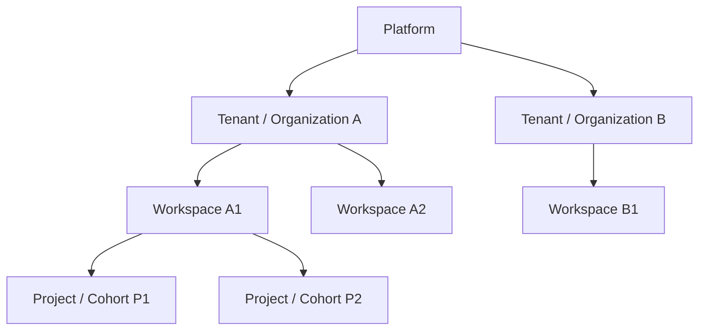
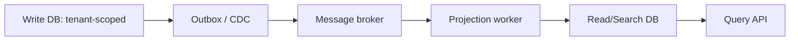
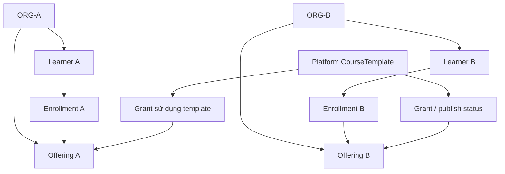

# Ranh giới tổ chức và nguy cơ liên kết dữ liệu chéo phạm vi

## 1. Một khóa tham chiếu đúng về cú pháp vẫn có thể sai về quyền truy cập

Trong một nền tảng học tập phục vụ nhiều doanh nghiệp, hai tổ chức có thể cùng có học viên mang mã `U-100` hoặc cùng sử dụng khóa học mang tên “Nhập môn SQL”. Một câu truy vấn chỉ nối theo mã học viên có thể trả kết quả hợp lệ về mặt SQL nhưng lại ghép **dữ liệu của tổ chức A với dữ liệu của tổ chức B**.

Ví dụ, một hệ thống có:

```text
Tổ chức ORG-A:
  Learner U-100 = học viên An
  Course  C-01  = SQL cơ bản

Tổ chức ORG-B:
  Learner U-100 = học viên Bình
  Course  C-01  = SQL nâng cao
```

Nếu truy vấn:

```sql
SELECT l.display_name, c.title
FROM enrollments AS e
JOIN learners AS l
  ON l.learner_id = e.learner_id
JOIN courses AS c
  ON c.course_id = e.course_id;
```

thì các mã `U-100` hoặc `C-01` trùng nhau giữa tổ chức có thể khiến hệ thống kết nối sai bản ghi. Nguy cơ không chỉ là lỗi báo cáo: dữ liệu cá nhân, kết quả học tập, quyền quản lý hoặc quyết định nghiệp vụ có thể bị lộ/sử dụng sai phạm vi.

**Ranh giới tổ chức** là quy tắc quyết định ai sở hữu dữ liệu, dữ liệu thuộc phạm vi nào, những liên kết nào hợp lệ và ai được phép quan sát hoặc thay đổi chúng. **Liên kết dữ liệu chéo phạm vi** là việc nối, tham chiếu, tổng hợp, suy luận hoặc sao chép dữ liệu từ các phạm vi mà không có quyền/hợp đồng tương ứng.

Bài này thuộc chương **Bảo vệ dữ liệu** của mô-đun **DATABASE_DATA_MODELING**. Phạm vi mô-đun là chuyển yêu cầu nghiệp vụ thành mô hình dữ liệu rõ ràng — thực thể, quan hệ, ràng buộc, khóa, chỉ mục và lược đồ vật lý — đồng thời so sánh mô hình quan hệ, document, đồ thị và phân tích để chọn cấu trúc phù hợp, dễ tiến hóa và kiểm chứng.

**Sau bài này, bạn có thể:**

1. Phân biệt tenant, tổ chức, workspace, project, chủ sở hữu và phạm vi được chia sẻ.
2. Xác định ranh giới dữ liệu ngay ở mô hình khái niệm, khóa, khóa ngoại và query.
3. Chặn liên kết chéo tenant ngoài ý muốn bằng composite key/FK, kiểm tra quyền và RLS khi thích hợp.
4. Phân tích rủi ro từ các định danh toàn cục, email, mã bên thứ ba và dữ liệu suy diễn.
5. Thiết kế liên kết chia sẻ hợp lệ với quyền, thời gian hiệu lực, thu hồi và audit.
6. Tìm lỗ hổng xuyên phạm vi ở SQL, document, graph, cache, search và data warehouse.
7. Thiết kế kiểm thử âm, threat modeling và quy trình migration không làm mất tính cô lập.

## 2. “Phạm vi” không chỉ là một cột `tenant_id`

Một hệ thống có thể tồn tại nhiều tầng ranh giới:



Các thuật ngữ có thể mang nghĩa khác nhau tùy hệ thống:

| Khái niệm | Câu hỏi cần hỏi | Ví dụ |
| --- | --- | --- |
| **Tenant** | Đơn vị cô lập dữ liệu, định tuyến và chính sách? | Một công ty thuê dịch vụ SaaS |
| **Organization** | Thực thể nghiệp vụ quản lý thành viên/tài nguyên? | Công ty, trường, đối tác |
| **Workspace** | Nhóm tài nguyên và cộng tác trong một tổ chức? | Nhóm vận hành khu vực |
| **Project / Cohort** | Phạm vi nghiệp vụ nhỏ hơn cần phân quyền? | Lớp học, dự án riêng |
| **Owner** | Ai chịu trách nhiệm cập nhật và vòng đời dữ liệu? | Organization tạo khóa học |
| **Viewer / Grantee** | Ai được cấp quyền xem hoặc sử dụng? | Đối tác được xem thống kê |
| **Data subject** | Dữ liệu nói về ai, quyền riêng tư của ai bị tác động? | Học viên, khách hàng |

**Không mặc định tenant và organization luôn là một.** Một tenant có thể quản lý nhiều pháp nhân; một tổ chức có thể tham gia nhiều workspace; có thể có tài nguyên dùng chung do platform sở hữu.

Cần phân biệt:

- **Phạm vi sở hữu:** nơi có thẩm quyền ghi, sửa và xóa bản gốc.
- **Phạm vi lưu trữ:** partition, database hoặc region chứa bản ghi.
- **Phạm vi truy cập:** các tổ chức/người dùng có quyền nhìn thấy dữ liệu.
- **Phạm vi liên kết:** những loại quan hệ nào được phép nối hai thực thể.
- **Phạm vi phân tích:** dữ liệu có thể được tổng hợp hoặc so sánh ở cấp nào.

Một bảng có `tenant_id` là dấu hiệu tốt, nhưng **không chứng minh mọi mối liên hệ, chỉ mục, bản sao và truy vấn đã bị cô lập đúng**.

## 3. Vì sao liên kết chéo phạm vi đặc biệt nguy hiểm?

Có ít nhất bốn dạng sai lệch:

1. **Rò rỉ trực tiếp:** câu truy vấn của ORG-A trả tên hoặc email của học viên ORG-B.
2. **Làm sai dữ kiện nghiệp vụ:** điểm học tập của học viên A gắn nhầm vào hồ sơ B vì cùng mã nội bộ.
3. **Rò rỉ suy diễn:** dù không trả bản ghi B, số đếm hoặc kết quả “có liên kết” tiết lộ sự tồn tại của một người/dự án bên B.
4. **Lan truyền sang bản sao:** một liên kết sai trong nguồn được đẩy sang cache, search index, graph projection hoặc warehouse, khiến sai phạm tồn tại lâu hơn.

Ví dụ:

```text
ORG-A có 15 học viên hoàn thành lớp X.
ORG-B có 8 học viên hoàn thành lớp X.

Query sai JOIN theo course_id mà bỏ tenant_id:
  COUNT(DISTINCT learner_id) có thể ra một số bất kỳ:
  - lẫn học viên hai tổ chức,
  - đếm thiếu nếu learner_id trùng,
  - đếm thừa do bản ghi join nhân đôi.
```

Không thể sửa bằng việc thêm `DISTINCT` bừa bãi. `DISTINCT` có thể che lỗi nhân bản dòng nhưng không xác lập quyền nối dữ liệu, và còn có thể che việc hai thực thể khác nhau bị nhập làm một.

**Lỗi liên kết chéo không chỉ là lỗi phân quyền ở API.** Nó có thể xuất phát từ thiết kế khóa, khóa ngoại, mapping định danh, query, pipeline tích hợp hoặc mô hình phân tích.

## 4. Xác lập bất biến phạm vi trước khi vẽ bảng

Trước khi chọn schema, cần viết các **bất biến** mà dữ liệu phải tuân thủ. Ví dụ nền tảng học tập:

- Mỗi `Learner` do một tổ chức quản lý, trừ khi có cơ chế định danh toàn nền tảng được thỏa thuận.
- Một `Enrollment` luôn trỏ tới `Learner` và `CourseOffering` trong đúng **phạm vi đăng ký** đã xác định.
- Một lớp có thể sử dụng **khóa học chung do platform xuất bản**, nhưng chỉ theo một quan hệ cấp quyền/phiên bản cụ thể.
- Tổ chức có quyền xem báo cáo tổng hợp không đương nhiên có quyền đọc hồ sơ chi tiết.
- Việc chia sẻ một tài nguyên không chuyển quyền sở hữu bản gốc, trừ khi nghiệp vụ quy định.
- Khi thu hồi quyền chia sẻ, các query và bản sao dẫn xuất phải phản ánh thu hồi theo yêu cầu độ mới đã công bố.
- Không được nối hai danh tính thành “cùng người” chỉ vì email hoặc họ tên giống nhau.

### 4.1. Ma trận phạm vi của các thực thể

| Thực thể | Grain | Chủ sở hữu | Phạm vi truy cập mặc định |
| --- | --- | --- | --- |
| `Learner` | Một hồ sơ học viên trong tenant | Organization | Tenant và vai trò được cấp |
| `CourseOffering` | Một đợt mở lớp | Organization tổ chức lớp | Workspace/lớp được ủy quyền |
| `Enrollment` | Một lượt học viên đăng ký vào lớp | Organization quản lý ghi danh | Tenant và người liên quan |
| `CourseTemplate` | Một định nghĩa nội dung khóa | Platform hoặc organization tác giả | Phụ thuộc ACL/quyền xuất bản |
| `Payment` | Một giao dịch thanh toán | Payment/Order context | Vai trò tài chính và chủ thể liên quan |
| `AuditEvent` | Một sự kiện kiểm toán | Hệ thống quản trị có thẩm quyền | Truy cập đặc biệt, tối thiểu cần thiết |

Cụm “phạm vi” có thể là tổ hợp `tenant_id`, `workspace_id`, `course_offering_id` hoặc ACL động. Chọn đúng grain trước khi tạo khóa.

### 4.2. Phân loại liên kết

Mỗi quan hệ nghiệp vụ cần được gắn một loại:

- **Nội phạm vi bắt buộc:** Learner thuộc tenant A ghi danh vào lớp của tenant A.
- **Đến tài nguyên chung được phép:** lớp của tenant A dùng template do platform công bố.
- **Được chia sẻ bằng thẩm quyền rõ:** tenant A cho phép tenant B xem một tài nguyên cụ thể.
- **Cross-tenant được quản trị riêng:** ví dụ tổ chức điều phối có quyền tổng hợp báo cáo liên tổ chức sau khi phê duyệt.
- **Không được phép:** nhân viên A truy cập bản chấm điểm riêng của học viên B không có quyền.

Đừng dùng một khóa ngoại đa dụng mà không phân biệt năm loại này.

## 5. Khóa và tên định danh: cùng mã không chắc cùng thực thể

### 5.1. Khóa cục bộ có phạm vi

Nếu mã học viên được cấp riêng trong mỗi tenant, khóa nghiệp vụ phải gồm cả phạm vi:

```text
Learner business key = (tenant_id, learner_code)

(ORG-A, U-100) ≠ (ORG-B, U-100)
```

Mã `learner_code` riêng lẻ không đủ làm identity toàn hệ thống. Điều này ảnh hưởng:

- Khóa chính/unique.
- Khóa ngoại của Enrollment.
- Khóa cache.
- Key của search document.
- ID của event và projection.
- Tên file/object storage.
- Mapping trong warehouse hoặc data lake.

### 5.2. UUID toàn cục vẫn không thay thế quyền truy cập

Một `learner_id` dạng UUID có xác suất trùng thấp giúp giảm nguy cơ trùng ID, nhưng không tự trả lời:

- Học viên thuộc tenant nào?
- Ai được đọc hoặc sửa hồ sơ?
- Có được phép join với lớp của tenant khác không?
- Dữ liệu có thể được chuyển/ghép ở phạm vi nào?

Ngay cả khi các ID là global unique, **quan hệ và quyền vẫn phải kiểm tra phạm vi**. “Không bị đụng khóa” và “được quyền liên kết” là hai thuộc tính khác nhau.

### 5.3. Định danh từ bên thứ ba phải có namespace

Giả sử hai đối tác cùng gửi `external_student_id = 12345`. Không được gộp vào một người khi chưa biết nguồn cấp ID:

```text
External identity:
  (provider_id, provider_tenant_or_account, external_student_id)
```

Tương tự với `crm_contact_id`, `customer_code` và `payment_reference`. Một nhà cung cấp có thể chỉ bảo đảm duy nhất trong một account, không phải toàn nền tảng.

**Khóa tương đương (same-as)** phải là một khẳng định nghiệp vụ có nguồn chứng minh, phạm vi, hiệu lực và khả năng thu hồi; không phải một phép JOIN dựa vào chuỗi giống nhau.

## 6. Lược đồ quan hệ: khóa ghép giữ ranh giới tenant

### 6.1. DDL PostgreSQL bảo vệ tham chiếu cùng tenant

Ví dụ sau giả định **Learner, CourseOffering và Enrollment đều là dữ liệu nội tenant**. Quan hệ chia sẻ liên tenant sẽ được thiết kế riêng ở phần sau.

```sql
CREATE TABLE organizations (
    org_id text PRIMARY KEY,
    org_name text NOT NULL
);

CREATE TABLE learners (
    org_id text NOT NULL REFERENCES organizations(org_id),
    learner_id text NOT NULL,
    display_name text NOT NULL,
    PRIMARY KEY (org_id, learner_id)
);

CREATE TABLE course_offerings (
    org_id text NOT NULL REFERENCES organizations(org_id),
    offering_id text NOT NULL,
    title text NOT NULL,
    capacity integer NOT NULL CHECK (capacity >= 0),
    PRIMARY KEY (org_id, offering_id)
);

CREATE TABLE enrollments (
    org_id text NOT NULL,
    learner_id text NOT NULL,
    offering_id text NOT NULL,
    status text NOT NULL,
    enrolled_at timestamptz NOT NULL DEFAULT now(),

    PRIMARY KEY (org_id, learner_id, offering_id),
    FOREIGN KEY (org_id, learner_id)
      REFERENCES learners (org_id, learner_id),
    FOREIGN KEY (org_id, offering_id)
      REFERENCES course_offerings (org_id, offering_id),
    CHECK (status IN ('ACTIVE', 'COMPLETED', 'CANCELLED'))
);

CREATE INDEX enrollment_offering_lookup
    ON enrollments (org_id, offering_id, learner_id);
```

**Tại sao khóa ngoại phải ghép?**

Nếu dùng hai FK riêng `enrollments.learner_id → learners.learner_id` và `enrollments.offering_id → course_offerings.offering_id`, không có ràng buộc nào đảm bảo ba bản ghi cùng tenant. Ở lược đồ trên, PostgreSQL chỉ chấp nhận Enrollment khi:

- Tồn tại `(org_id, learner_id)` trong Learners.
- Tồn tại `(org_id, offering_id)` trong CourseOfferings.

Việc có cùng `org_id` trong cả hai FK bảo vệ **bất biến cùng tenant ở cấp tham chiếu**.

### 6.2. Một tình huống ghi bị từ chối

Giả sử chỉ có:

```text
learners:         (ORG-A, U-100)
course_offerings: (ORG-B, CLASS-01)
```

Lệnh:

```sql
INSERT INTO enrollments
    (org_id, learner_id, offering_id, status)
VALUES
    ('ORG-A', 'U-100', 'CLASS-01', 'ACTIVE');
```

phải thất bại vì `(ORG-A, CLASS-01)` không tồn tại ở `course_offerings`. Nó **không được phép** trỏ tới `(ORG-B, CLASS-01)` chỉ vì cùng `offering_id`.

Nếu nghiệp vụ **thực sự** cho học viên A học lớp của B, không nên “sửa” bằng cách bỏ `org_id` khỏi FK. Cần thiết kế một mối quan hệ liên tenant được cấp phép, ghi rõ ai sở hữu enrollment, ai sở hữu offering và quyền nào được thừa nhận.

### 6.3. Đừng dùng FK để thay thế authorization

Composite FK giúp ngăn dữ liệu tham chiếu sai tenant, nhưng không chặn một người dùng **hợp lệ ở A** xem mọi learner của A nếu vai trò chỉ cho phép xem lớp riêng. Nó cũng không bảo vệ query đọc ở API khi không áp điều kiện quyền.

Cần đồng thời:

- **Tính toàn vẹn tham chiếu:** khóa/FK/check.
- **Phạm vi truy cập:** xác thực, ủy quyền, chính sách row/column.
- **Nguồn có thẩm quyền:** ai được tạo/sửa/xóa.
- **Luồng tích hợp:** bản sao/read projection và sự kiện cũng giữ cùng phạm vi.

## 7. Truy vấn sai và truy vấn có ranh giới

### 7.1. JOIN thiếu tổ chức

Truy vấn sai:

```sql
SELECT e.offering_id, l.display_name
FROM enrollments AS e
JOIN learners AS l
  ON l.learner_id = e.learner_id
WHERE e.org_id = 'ORG-A';
```

Mặc dù đã lọc `e.org_id`, điều kiện JOIN bỏ `l.org_id` vẫn có thể trả learner thuộc B nếu cùng `learner_id`. **Lọc tenant ở một bảng không tự bảo vệ các bảng được nối.**

Truy vấn đúng với phạm vi nội tenant:

```sql
SELECT e.offering_id, l.display_name
FROM enrollments AS e
JOIN learners AS l
  ON l.org_id = e.org_id
 AND l.learner_id = e.learner_id
WHERE e.org_id = :trusted_org_id;
```

`:trusted_org_id` phải lấy từ **ngữ cảnh đã được xác thực/ủy quyền**. Không được lấy trực tiếp một `orgId` do người dùng tự gửi rồi coi như quyền truy cập.

### 7.2. Lọc đầy đủ cả trong subquery

Ví dụ truy vấn “học viên chưa ghi danh lớp”:

```sql
SELECT l.learner_id
FROM learners AS l
WHERE l.org_id = :trusted_org_id
  AND NOT EXISTS (
      SELECT 1
      FROM enrollments AS e
      WHERE e.org_id = l.org_id
        AND e.learner_id = l.learner_id
        AND e.offering_id = :offering_id
  );
```

Nếu bỏ `e.org_id = l.org_id`, một enrollment của tổ chức khác có cùng learner/offering ID có thể làm query loại sai học viên.

### 7.3. GROUP BY cũng cần scope

Truy vấn:

```sql
SELECT learner_id, COUNT(*)
FROM enrollments
GROUP BY learner_id;
```

có thể gộp nhiều học viên khác nhau cùng mã của các tenant. Nếu báo cáo là **cho từng tổ chức**:

```sql
SELECT org_id, learner_id, COUNT(*) AS enrollment_count
FROM enrollments
WHERE org_id = :trusted_org_id
GROUP BY org_id, learner_id;
```

Cũng phải kiểm tra người dùng có quyền xem số liệu của tất cả học viên trong tenant hay chỉ một workspace/lớp cụ thể. **Đúng khóa nhóm không đồng nghĩa đúng thẩm quyền báo cáo.**

## 8. Row-Level Security: một lớp phòng vệ tại database

PostgreSQL hỗ trợ **Row-Level Security (RLS)** để lọc các dòng mà một database role được phép SELECT, INSERT, UPDATE hoặc DELETE. Nó có thể bổ sung bảo vệ cho một ứng dụng nhiều tenant có bảng chia sẻ.

### 8.1. Ví dụ policy theo ngữ cảnh tổ chức

Giả sử `learners`, `course_offerings` và `enrollments` đều có cột `org_id`. Ta bật RLS:

```sql
ALTER TABLE learners ENABLE ROW LEVEL SECURITY;
ALTER TABLE course_offerings ENABLE ROW LEVEL SECURITY;
ALTER TABLE enrollments ENABLE ROW LEVEL SECURITY;

-- Bảo vệ cả trường hợp truy cập bằng table owner không có BYPASSRLS.
ALTER TABLE learners FORCE ROW LEVEL SECURITY;
ALTER TABLE course_offerings FORCE ROW LEVEL SECURITY;
ALTER TABLE enrollments FORCE ROW LEVEL SECURITY;

CREATE POLICY learners_org_policy ON learners
USING (org_id = current_setting('app.org_id', true))
WITH CHECK (org_id = current_setting('app.org_id', true));

CREATE POLICY offerings_org_policy ON course_offerings
USING (org_id = current_setting('app.org_id', true))
WITH CHECK (org_id = current_setting('app.org_id', true));

CREATE POLICY enrollments_org_policy ON enrollments
USING (org_id = current_setting('app.org_id', true))
WITH CHECK (org_id = current_setting('app.org_id', true));
```

Trong ví dụ, `current_setting('app.org_id', true)` trả `NULL` nếu session chưa có cấu hình, nên điều kiện bằng với `org_id` không phải TRUE và chính sách **fail closed** đối với dữ liệu không có ngữ cảnh.

**Quan trọng:** RLS không thay thế bảo vệ role:

- PostgreSQL superuser và role có `BYPASSRLS` có thể vượt RLS; không dùng các role này cho đường ứng dụng thông thường.
- Table owner thường có thể vượt RLS nếu không có `FORCE ROW LEVEL SECURITY`.
- Cách dùng session parameter chỉ an toàn khi kết nối/SQL do **ứng dụng đáng tin** kiểm soát. Một người dùng SQL có quyền tự chạy `set_config('app.org_id', ...)` có thể mạo nhận tổ chức; RLS dựa vào GUC do client tự chọn **không** là ranh giới bảo mật cho những kết nối không đáng tin.
- Các thao tác qua view, function, `SECURITY DEFINER` và dữ liệu dẫn xuất có semantics quyền riêng; cần kiểm tra đường thực thi, không chỉ ba bảng.
- Policy ở đây chỉ minh họa cách cô lập theo tổ chức. Quyền theo vai trò, lớp hoặc workspace phải được thiết kế thêm khi nghiệp vụ yêu cầu.

### 8.2. Gắn context trong transaction

Một ứng dụng Java dùng connection pool nên gắn tenant **theo transaction**, không để lại giá trị session từ request trước:

```sql
BEGIN;

SELECT set_config('app.org_id', :authorized_org_id, true);

SELECT learner_id, display_name
FROM learners
ORDER BY learner_id;

COMMIT;
```

Tham số `:authorized_org_id` phải do tầng xác thực/ủy quyền xác định. Tham số cuối `true` khiến cấu hình chỉ có hiệu lực ở **transaction hiện tại**. Khi rollback/commit, nó không được dùng lại như quyền của request khác.

Nếu app dùng connection pool, transaction pooling, async task hoặc một query chạy qua kết nối khác, phải kiểm chứng thiết lập context ở **đúng kết nối thực thi câu SQL**. Không nên dùng một biến toàn cục trong Java để thay quyền từng request.

### 8.3. RLS và composite FK giải quyết hai bài toán khác nhau

- **Composite FK:** không cho Enrollment tạo liên kết learner/offering ngoài tổ chức của chính row.
- **RLS:** giới hạn row mà một role có thể đọc/ghi theo context.

Cả hai đều cần thiết trong nhiều hệ thống. RLS không tự chứng minh mỗi FK được mô hình đúng. Composite FK cũng không ngăn người dùng đọc một row nội tenant mà họ không được cấp quyền xem.

## 9. Chia sẻ hợp lệ: mô hình quyền rõ thay vì bỏ ranh giới

Không phải mọi liên kết vượt tổ chức đều sai. Có những trường hợp hợp lệ:

- Một khóa học do platform sở hữu được nhiều trường sử dụng.
- Hai công ty cùng tham gia dự án với tài nguyên được chia sẻ có giới hạn.
- Một chuyên gia được mời xem một workspace của đối tác.
- Một tổ chức tổng quản được cấp quyền xem số liệu tổng hợp của các chi nhánh.

**Điểm khác biệt là quyền được cấp rõ ràng và có thể kiểm chứng.**

### 9.1. Ownership khác visibility

Một tài nguyên nên có một nơi chịu trách nhiệm cập nhật chính:

```text
resource:
  owner_org_id
  resource_id
  content_version
  lifecycle_status
```

Các tổ chức khác không tự có quyền ghi chỉ vì nhìn thấy hoặc tham chiếu resource. Có thể xây quan hệ cấp quyền:

```text
resource_grant:
  owner_org_id
  resource_id
  grantee_org_id
  permission
  effective_from
  effective_to
  granted_by
  revoked_at
```

Trong đó `permission` có thể là `VIEW`, `USE_AS_TEMPLATE` hoặc một tập quyền riêng được xác định rõ. Quyền `VIEW` không mặc định cho phép `EDIT` hoặc `EXPORT`.

### 9.2. DDL minh họa cho sharing có thẩm quyền

```sql
CREATE TABLE shared_resources (
    owner_org_id text NOT NULL REFERENCES organizations(org_id),
    resource_id text NOT NULL,
    title text NOT NULL,
    version bigint NOT NULL,
    PRIMARY KEY (owner_org_id, resource_id),
    CHECK (version > 0)
);

CREATE TABLE resource_grants (
    owner_org_id text NOT NULL,
    resource_id text NOT NULL,
    grantee_org_id text NOT NULL REFERENCES organizations(org_id),
    permission text NOT NULL,
    effective_from timestamptz NOT NULL,
    effective_to timestamptz,
    revoked_at timestamptz,
    granted_by text NOT NULL,

    PRIMARY KEY (
        owner_org_id, resource_id,
        grantee_org_id, permission, effective_from
    ),
    FOREIGN KEY (owner_org_id, resource_id)
      REFERENCES shared_resources(owner_org_id, resource_id),
    CHECK (permission IN ('VIEW', 'USE_AS_TEMPLATE')),
    CHECK (effective_to IS NULL OR effective_from < effective_to)
);
```

Lược đồ minh họa lưu lịch sử cấp quyền ở mức cơ bản; nó chưa bảo vệ các khoảng grant chồng nhau hoặc kiểm chứng `granted_by` có quyền cấp. Hệ thống thực cần ràng buộc/transaction, quản trị phiên bản quyền và audit thích hợp.

### 9.3. Truy vấn resource đã chia sẻ với điều kiện rõ

```sql
SELECT r.owner_org_id, r.resource_id, r.title
FROM shared_resources AS r
JOIN resource_grants AS g
  ON g.owner_org_id = r.owner_org_id
 AND g.resource_id = r.resource_id
WHERE g.grantee_org_id = :authorized_org_id
  AND g.permission = 'VIEW'
  AND g.effective_from <= :as_of
  AND (g.effective_to > :as_of OR g.effective_to IS NULL)
  AND (g.revoked_at > :as_of OR g.revoked_at IS NULL);
```

**Giới hạn của câu query:** đây là minh họa phép tính quyền **theo thời điểm được khai báo**, không phải policy bảo mật đầy đủ. Nghiệp vụ phải quyết định:

- Người được cấp quyền `USE_AS_TEMPLATE` có mặc nhiên được xem không?
- Một grant có thể bị thu hồi ngay hay có hiệu lực từ mốc tương lai?
- Người gọi có quyền xem một resource dù grant do họ tạo không?
- Chủ sở hữu có quyền thay đổi/ẩn resource đang được chia sẻ không?
- Vai trò người dùng **trong tổ chức nhận quyền** có được truy cập không?
- Nếu resource có nội dung nhạy cảm bị chia sẻ, cần thêm phê duyệt nào?

Truy vấn theo thời gian lịch sử chưa chắc tái dựng được quyết định quyền trong quá khứ khi bản ghi grant bị sửa trực tiếp. Cần audit/bitemporal khi có yêu cầu đó.

### 9.4. Thu hồi phải lan tới bản sao

Một resource được cấp quyền cho ORG-B rồi bị thu hồi. Nếu read projection hoặc search index còn bản sao nội dung, việc xóa grant tại DB chủ **không tự thu hồi được bản sao**.

Cần thiết kế:

- Kiểm tra quyền **tại thời điểm truy cập** khi nội dung nhạy cảm và độ mới là bắt buộc.
- Sự kiện `ResourceGrantRevoked`, phiên bản grant và projector.
- Cache invalidation/TTL và chính sách xử lý khi consumer lag.
- Quy tắc cho bản export đã cấp và dữ liệu nằm ngoài hệ thống chủ.
- Audit và đối soát những quyền đã bị thu hồi.

**Không dùng eventual-consistent cache làm nguồn kiểm tra quyền duy nhất nếu nghiệp vụ yêu cầu thu hồi có hiệu lực ngay.**

## 10. Liên kết danh tính xuyên tổ chức: nguy cơ không chỉ nằm ở JOIN

Hai tổ chức có thể có cùng email:

```text
ORG-A learner U-100 -> email@example.com
ORG-B learner B-808 -> email@example.com
```

Có ít nhất ba khả năng:

1. Đây là cùng một người đang tham gia hai tổ chức.
2. Đây là địa chỉ email dùng chung hoặc được chuyển giao.
3. Đây là dữ liệu sai, cũ hoặc chưa được xác thực.

**Không được mặc định khả năng (1) chỉ vì chuỗi trùng.**

### 10.1. Không gộp người theo email như một quy tắc mặc định

Sai lầm:

```sql
SELECT a.learner_id, b.learner_id
FROM learners_a AS a
JOIN learners_b AS b
  ON lower(a.email) = lower(b.email);
```

Một phép nối như vậy có thể giúp **tạo ứng viên đối soát** trong hệ thống được phép, nhưng **không đủ để xác nhận cùng danh tính**. Nếu được dùng để kết hợp kết quả học tập, lịch sử mua hoặc quyền người dùng, nó có thể gây rò rỉ và sai nghiệp vụ.

Để quản trị mapping danh tính, cần xác định:

- Ai được phép tạo khẳng định `same_person`?
- Nguồn chứng minh nào đủ tin cậy (xác thực trực tiếp, sự kiện liên kết tài khoản, thỏa thuận tích hợp)?
- Phạm vi mapping: dùng cho đăng nhập, báo cáo tổng hợp hay hồ sơ cá nhân?
- Việc liên kết có cần sự cho phép/đồng ý theo chính sách áp dụng?
- Mapping có hiệu lực từ khi nào, ai có quyền thu hồi?
- Nếu một tài khoản tách ra hoặc bị hợp nhất sai thì sao?

### 10.2. Một cấu trúc quản trị identity link

```text
identity_links:
  link_id
  source_namespace
  source_subject_id
  target_namespace
  target_subject_id
  purpose
  assertion_source
  asserted_at
  effective_from
  revoked_at
  verified_by
```

**Định danh liên kết không đồng nghĩa quyền truy cập toàn bộ dữ liệu của hai phía.** Có thể xác nhận “hai hồ sơ thuộc cùng người” nhưng vẫn không được chuyển điểm học tập giữa hai tổ chức nếu không có thẩm quyền hoặc mục đích phù hợp.

### 10.3. Hash và pseudonymization không tự phá khả năng liên kết

Ví dụ:

```text
hash(email) = SHA-256(normalized_email)
```

Nếu hai bên cùng hash cùng email theo cùng quy tắc, họ có thể **liên kết hồ sơ** dù không nhìn thấy email nguyên văn. Với email từ tập có thể đoán, một hash không có biện pháp bảo vệ phù hợp có thể bị dò bằng từ điển.

Điều cần hiểu:

- **Pseudonymization** giảm mức lộ một số thông tin, không tự biến dữ liệu thành vô danh.
- Dữ liệu có thể bị liên kết chéo qua token, hash, ID thiết bị, IP, thời gian hoặc thuộc tính hiếm.
- Token hóa có phạm vi và quản trị khóa riêng có thể giảm liên kết ngoài ý muốn, nhưng không miễn kiểm tra quyền và mục đích.
- Hệ cần đối soát danh tính có thể thiết kế một dịch vụ danh tính được kiểm soát, thay vì phát hash ổn định cho mọi người dùng.

**Bảo vệ khỏi liên kết chéo phạm vi bao gồm cả ngăn suy luận về cùng danh tính**, chứ không chỉ ngăn query trả cột email.

## 11. Chọn cấu trúc liên kết theo loại ranh giới

Một lỗi kiến trúc phổ biến là dùng một trường `target_id` chung cho mọi mối quan hệ và để ứng dụng tự diễn giải nó trỏ tới đâu. Cách này thiếu thông tin về **loại thực thể, phạm vi và thẩm quyền**.

Thay vào đó, hãy đặt câu hỏi:

- Quan hệ **chỉ nội tenant** hay có thể nối hai tenant?
- Đối tượng đích do **tenant**, **platform** hay **một nhà cung cấp khác** sở hữu?
- Quyền truy cập có **theo vai trò**, **theo tài nguyên** hoặc **theo sự đồng ý của chủ thể** không?
- Quyền có thể bị thu hồi, hết hạn hoặc thay đổi theo version không?
- Quan hệ trỏ tới **dữ liệu gốc** hay một **snapshot được phép sao chép**?
- Nếu một bên xóa tài nguyên, các bên còn lại sẽ thấy gì?

### 11.1. Ba mô hình ứng viên

| Loại quan hệ | Biểu diễn nên cân nhắc | Bất biến chính |
| --- | --- | --- |
| Chắc chắn cùng tenant | Composite FK gồm `tenant_id` và ID | Không được tham chiếu chéo phạm vi |
| Tenant dùng tài nguyên platform | FK tới tài nguyên platform + bảng quyền/xuất bản | Tenant chỉ dùng phiên bản được cho phép |
| Hai tenant chia sẻ tài nguyên | Resource owner + grant/ACL/version và audit | Không chuyển quyền sở hữu; truy cập phải dựa vào grant còn hiệu lực |
| Đồng nhất danh tính hai nguồn | Identity mapping có provenance và purpose | Trùng tên/email không tự là cùng người |
| Báo cáo nhiều tenant | Kho dữ liệu và chính sách phân quyền/tổng hợp riêng | Không lộ hàng chi tiết hoặc nhóm nhỏ ngoài quyền |
| Quy trình xuyên miền | API/sự kiện hợp đồng rõ, không join trực tiếp bảng nội bộ | Mỗi miền vẫn giữ quyền sở hữu trạng thái |

**Không dùng “cross-tenant=true” trên mọi row làm một công tắc cho phép truy cập không giới hạn.** Phải định nghĩa **ai**, **được làm gì**, **với tài nguyên nào**, **trong khoảng thời gian nào** và **dưới mục đích nào**.

### 11.2. Khi tài nguyên được sao chép có chủ đích

Ví dụ tenant A dùng khóa học mẫu do platform xuất bản. Có hai lựa chọn:

1. **Tham chiếu trực tiếp bản gốc** và kiểm tra quyền tại lúc đọc/dùng.
2. **Sao chép thành bản thuộc tenant A**, giữ `source_template_id` và `source_version` để truy vết.

Hai lựa chọn khác nhau về ownership:

- Với tham chiếu, thay đổi hoặc thu hồi của bản gốc có thể ảnh hưởng tenant A.
- Với sao chép, tenant A có thể sửa riêng; bản sao cần chính sách cấp phép, nội dung nhạy cảm và cách xử lý bản gốc bị xóa.

Nếu giữ `source_template_id` để lineage, **không được dùng nó như chứng cứ tenant A được đọc nội dung bản gốc sau khi quyền đã bị thu hồi**.

## 12. Document model: dữ liệu lồng nhau có thể chứa liên kết chéo phạm vi

Trong document database, nhiều hệ lưu một aggregate dạng JSON:

```json
{
  "tenantId": "ORG-A",
  "offeringId": "CLASS-01",
  "title": "SQL căn bản",
  "learners": [
    { "learnerId": "U-100", "progress": 0.5 }
  ]
}
```

Việc một document có `tenantId` ở cấp gốc **không chứng minh** mọi `learnerId` bên trong thực sự thuộc ORG-A. Nếu ứng dụng lấy một học viên từ cache theo `learnerId` mà không kiểm tra tenant, thông tin của ORG-B có thể được nhúng sai vào document của A.

### 12.1. Khi nhúng dữ liệu, cần kiểm tra lúc ghi

Ví dụ dữ liệu nhập từ API:

```json
{
  "tenantId": "ORG-A",
  "offeringId": "CLASS-01",
  "learnerIds": ["U-100", "U-200"]
}
```

Không được chấp nhận mảng ID chỉ vì request do người dùng ORG-A gửi. Write service phải:

1. Xác thực tổ chức và quyền quản lý lớp.
2. Kiểm tra mỗi learner thuộc đúng phạm vi được phép.
3. Từ chối hoặc cách ly những ID không hợp lệ.
4. Ghi nguyên tử trong ranh giới phù hợp với database/aggregate.
5. Phát sự kiện có `tenantId`, `offeringId` và danh tính đã được kiểm tra nếu tạo projection.

### 12.2. MongoDB: `$lookup` phải mang ranh giới phạm vi

Một phép nối nguy hiểm có thể chỉ dùng mã học viên. Cách minh họa an toàn hơn với pipeline trong `$lookup`:

```javascript
db.enrollments.aggregate([
  {
    $match: {
      tenantId: trustedTenantId,
      offeringId: requestedOfferingId
    }
  },
  {
    $lookup: {
      from: "learners",
      let: {
        enrollmentTenant: "$tenantId",
        enrollmentLearner: "$learnerId"
      },
      pipeline: [
        {
          $match: {
            $expr: {
              $and: [
                { $eq: ["$tenantId", "$$enrollmentTenant"] },
                { $eq: ["$learnerId", "$$enrollmentLearner"] }
              ]
            }
          }
        }
      ],
      as: "learner"
    }
  }
]);
```

`trustedTenantId` phải được lấy từ context được ủy quyền, không từ request tùy ý. Kiểm tra cả `tenantId` và `learnerId` ở collection đích; nếu collection có nhiều namespace, bổ sung phạm vi tương ứng.

**Lưu ý:** ví dụ mô tả logic truy vấn, không phải ràng buộc database tự động ngăn mọi cross-tenant reference. Cần index theo `tenantId, learnerId`, validation/kiểm tra ghi, kiểm thử và quyền truy cập của ứng dụng. Khả năng thực thi/index cho dạng `$expr` phụ thuộc phiên bản/cấu trúc dữ liệu.

### 12.3. Document ID global không có nghĩa nội dung global

Một `_id` duy nhất toàn collection làm truy xuất bản ghi đơn giản, nhưng API vẫn phải xác minh chủ sở hữu/được chia sẻ. Không dùng một GET theo `_id` rồi trả document trước khi kiểm tra `tenantId` hoặc quyền tài nguyên.

## 13. Graph model: đường đi có thể vượt ranh giới qua nút trung gian

Đồ thị rất hữu ích khi cần duyệt nhiều quan hệ, nhưng cũng tăng nguy cơ **liên kết ngoài ý muốn** vì một đường đi có thể qua nhiều nút/cạnh ở các phạm vi khác nhau.

Ví dụ:

```text
(User A, ORG-A)
     -> (Course X, ORG-A)
     -> (Skill S, Shared)
     -> (Course Y, ORG-B)
     -> (Learner B, ORG-B)
```

Nếu một truy vấn đề xuất học viên dựa vào “đường đi liên quan” mà không hạn chế phạm vi, kết quả có thể suy ra sự tồn tại hoặc thông tin thuộc ORG-B.

### 13.1. Chỉ kiểm tra hai đầu là chưa đủ

Một mẫu truy vấn thiếu kiểm soát:

```cypher
MATCH p = (start:Learner {tenantId: 'ORG-A', learnerId: 'U-100'})
          -[*1..4]->
          (candidate:Learner)
WHERE candidate.tenantId = 'ORG-A'
RETURN p;
```

Hai đầu đều là ORG-A, nhưng **nút trung gian** có thể thuộc ORG-B hoặc đi qua một cạnh bị cấm. Đường đi đó vẫn có thể tiết lộ quan hệ ngoài quyền.

Một mẫu minh họa kiểm tra nút trên đường đi:

```cypher
MATCH p = (start:Learner {tenantId: 'ORG-A', learnerId: 'U-100'})
          -[:KNOWS|MEMBER_OF*1..3]->
          (candidate)
WHERE all(n IN nodes(p) WHERE n.tenantId = 'ORG-A')
RETURN p;
```

Đây **chưa phải** policy hoàn chỉnh. Nó chỉ minh họa ý tưởng lọc **tất cả nút**; còn phải kiểm tra loại cạnh, thuộc tính cạnh, quyền cá nhân và khả năng dữ liệu `Shared` được phép đi qua theo nghiệp vụ. Cú pháp độ dài biến thiên và cách match path phụ thuộc phiên bản graph database.

### 13.2. Một nút được chia sẻ không tự cấp quyền duyệt tất cả cạnh

Ví dụ `Skill: SQL` có thể là nút chung toàn platform. Điều đó không có nghĩa truy vấn của tenant A được đi từ Skill sang **mọi learner đang có kỹ năng SQL** ở tenant B.

Cần phân biệt:

- Quyền sử dụng/nhìn thấy **nút tham chiếu chung**.
- Quyền duyệt một **cạnh** mang dữ liệu cá nhân.
- Quyền quan sát **nút đích** và sự tồn tại của đường đi.
- Quyền tính số lượng/cộng đồng qua các cạnh, kể cả không trả ID.

Một thiết kế an toàn thường ưu tiên query bắt đầu từ tập được phép, kiểm tra từng bước và hạn chế loại quan hệ cũng như độ sâu.

### 13.3. Không dùng graph traversal để suy diễn đồng nhất danh tính

Hai hồ sơ cùng email, cùng IP hoặc cùng thiết bị có thể **liên quan**, nhưng không tự chứng minh cùng người. Nếu đồ thị liên kết chúng và tự gộp quyền/trạng thái, hậu quả có thể lớn hơn một JOIN SQL sai vì kết quả lan theo nhiều bước.

## 14. Cache, search index và vector search: ranh giới phải đi theo khóa

### 14.1. Cache key thiếu tenant

Sai:

```text
cache key = "learner:" + learnerId

ORG-A gọi learner U-100:
  cache["learner:U-100"] = dữ liệu của An

ORG-B gọi learner U-100:
  cache hit -> nhận dữ liệu của An
```

Cách tổ chức khóa tối thiểu:

```text
cache key = tenantId + ":learner:" + learnerId
```

Tuy nhiên **tenant-aware key chưa đủ** nếu một người chỉ được xem một phần learner trong tenant. Khi bản cache chứa dữ liệu phụ thuộc quyền, cần:

- Không chia sẻ response có lọc quyền giữa các principal không tương đương.
- Cấu trúc cache key gắn **phạm vi quyền hoặc phiên bản ACL** nếu phù hợp.
- Kiểm tra quyền trước khi trả cache.
- Invalidate khi grant bị thu hồi hoặc dữ liệu nhạy cảm bị xóa.
- Chọn TTL theo mức nhất quán được chấp nhận.

Cache chung của dữ liệu thật sự public có thể không cần tenant key, nhưng trạng thái **public** phải là kết quả của một chính sách có thẩm quyền, không phải giả định từ việc dữ liệu được nhiều người đọc.

### 14.2. Search index thiếu bộ lọc scope

Một search document có thể chứa:

```json
{
  "documentId": "ORG-A:CLASS-01",
  "tenantId": "ORG-A",
  "offeringId": "CLASS-01",
  "title": "SQL căn bản",
  "learnerNames": ["An", "Bình"]
}
```

Khi ORG-B tìm “Bình”, không được nhận document ORG-A chỉ vì kết quả khớp full-text. Search API phải áp tenant/ACL filter trước khi trả kết quả và các facet/count phù hợp.

**Nguy cơ suy diễn từ thống kê:** ngay cả khi danh sách bản ghi bị lọc, một số hệ có thể tính gợi ý tìm kiếm, facet, highlight hoặc tổng số hit trên tập rộng hơn. Những đầu ra này cũng cần tuân thủ phạm vi.

### 14.3. Vector search và embeddings

Nếu lưu embedding của nội dung nội bộ trong cùng vector index:

- Việc hàng xóm gần nhất (*nearest neighbor*) không tự bảo đảm phân quyền.
- Metadata `tenantId`/`resource ACL` cần được áp dụng theo khả năng của engine, không chỉ lọc vài kết quả cuối khi có nguy cơ rò rỉ.
- Trích đoạn trong kết quả và ngữ cảnh đưa vào mô hình ngôn ngữ phải đã qua kiểm tra quyền.
- Embedding có thể mang tín hiệu liên quan tới nội dung gốc; không mặc định nó an toàn để công khai.
- Khi quyền chia sẻ bị thu hồi, index và cache liên quan phải được cập nhật theo chính sách.

Một chiến lược riêng index theo tenant có thể giảm rủi ro thao tác nhầm ở một số workload, nhưng tăng chi phí vận hành. Dùng index chung với ACL lọc cẩn thận có thể phù hợp trong hệ khác. **Chọn dựa trên threat model, giới hạn engine và kiểm thử thực tế.**

### 14.4. Tên file, object storage và CDN

Không để người dùng tải file chỉ vì họ đoán được đường dẫn như:

```text
/exports/ORG-A/report-2026.csv
```

Tên object có chứa tenant là cách tổ chức, không phải một quyền truy cập. Cần signed URL hoặc cơ chế kiểm soát truy cập phù hợp, hạn chế thời gian, ngăn public exposure và xử lý bản xuất đã cấp.

## 15. Event, CQRS, CDC và dữ liệu đồng bộ chéo miền

Một hệ thống có thể đã bảo vệ write DB bằng composite FK và RLS nhưng lại tạo rò rỉ qua projection đọc.



Ở mỗi bước, scope có thể bị mất:

- Event thiếu `tenantId` hoặc dùng ID không có namespace.
- Consumer đọc message của mọi tenant và ghi nhầm một read row cùng ID.
- Projector dùng key `orderId` thay vì `tenantId + orderId`.
- Search index quên ghi `owner_org_id`.
- Cache kết quả query không được partition theo quyền.
- Batch rebuild bỏ qua grant/revocation đã xảy ra.

### 15.1. Hợp đồng sự kiện nên mang scope

```json
{
  "eventId": "ca6a712a-8ca2-4488-9f07-0f44fac1bb33",
  "eventType": "EnrollmentChanged",
  "eventSchemaVersion": 1,
  "ownerOrgId": "ORG-A",
  "enrollmentId": "E-100",
  "learnerId": "U-100",
  "offeringId": "CLASS-01",
  "sourceVersion": 6,
  "occurredAt": "2026-11-20T10:00:00Z"
}
```

Metadata này giúp consumer định tuyến, deduplicate và đối soát. Nhưng **có `ownerOrgId` trong payload không cho phép consumer tự bỏ qua authorization**; broker topic, consumer service account và read API đều cần quyền thích hợp.

### 15.2. Idempotency key cũng phải có scope

Nếu mỗi tenant cấp `requestId = 123`, một bảng xử lý idempotency chỉ unique theo `requestId` có thể làm request của B bị coi là bản phát lại của A.

Khóa nên phản ánh phạm vi và loại hành động, chẳng hạn:

```text
(tenant_id, command_type, idempotency_key)
```

Không phải mọi idempotency key đều được đặt ở cấp tenant; nếu nghiệp vụ có transaction xuyên nhiều tenant, cần xác định phạm vi khác. Mấu chốt là **không nhầm hai yêu cầu độc lập chỉ vì token trùng trong hai namespace**.

### 15.3. Projection cần version riêng và xử lý revoke

Với một read row sở hữu bởi tenant A, projector có thể dùng khóa `(ownerOrgId, resourceId)` và chỉ áp snapshot event có `sourceVersion` mới hơn. Khi cấp quyền cho B, projection có thể tạo **view phục vụ B** nếu hợp đồng cho phép.

Khi thu hồi:

- Không chỉ xóa row grant ở write DB.
- Cần invalidation hoặc thông báo revoke có version.
- Tránh event cũ đến muộn tạo lại grant.
- Nếu quyền phải có hiệu lực ngay, đường đọc cần kiểm tra nguồn quyền có thẩm quyền hoặc một cơ chế đảm bảo tương đương; bản sao eventual-consistent có thể không đủ.

**Độ trễ projection là một phần của mô hình bảo mật**, không chỉ là vấn đề trải nghiệm người dùng.

## 16. Warehouse, báo cáo và nguy cơ tái nhận diện

Khi dữ liệu được gom vào data warehouse hoặc data lake, một số hệ tách khỏi cơ chế authorization của OLTP. Nếu pipeline nạp `tenant_id` nhưng query BI không lọc, có thể xảy ra liên kết trái phép ở quy mô lớn.

### 16.1. Star schema phải giữ scope trong fact và dimension

Ví dụ:

```text
fact_enrollment:
  tenant_id
  learner_sk
  offering_sk
  event_date
  enrollment_count

dim_learner:
  learner_sk
  tenant_id
  learner_bk
  segment

dim_offering:
  offering_sk
  tenant_id
  offering_bk
  category
```

Một surrogate key duy nhất toàn kho có thể giúp join chính xác về mặt kỹ thuật, nhưng điều đó không tự cấp quyền phân tích dữ liệu của mọi tenant. BI cần chính sách cấp quyền, user-to-tenant mapping và đúng nguồn metric.

Một ví dụ tổng hợp nội tenant:

```sql
SELECT
    f.tenant_id,
    d.category,
    SUM(f.enrollment_count) AS enrollments
FROM fact_enrollment AS f
JOIN dim_offering AS d
  ON d.offering_sk = f.offering_sk
 AND d.tenant_id = f.tenant_id
WHERE f.tenant_id = :authorized_tenant_id
GROUP BY f.tenant_id, d.category;
```

Điều kiện `d.tenant_id = f.tenant_id` là **kiểm tra nhất quán scope**, không thay thế việc fact và dimension phải được xây đúng ngay từ ETL.

### 16.2. Báo cáo liên tổ chức có thể hợp lệ nhưng không được mặc định

Có những chương trình cần báo cáo tổng hợp của nhiều đối tác, ví dụ “tỷ lệ hoàn thành chung của các tổ chức tham gia”. Khi đó phải xác định:

- Ai có quyền yêu cầu báo cáo?
- Tập tenant tham gia là những ai, có được kiểm tra động không?
- Dữ liệu có được tổng hợp đủ mức, có phải che nhóm nhỏ không?
- Có được export hay kết hợp với dữ liệu bên ngoài không?
- Thời gian lưu, mục đích sử dụng và quyền phản đối/thu hồi (nếu áp dụng) ra sao?
- Tập dữ liệu dẫn xuất có lineage đến từng nguồn không?

**Tổng hợp không đồng nghĩa vô danh.** Một nhóm có một học viên, một giao dịch hoặc một giá trị hiếm có thể cho phép suy ra thông tin cá nhân dù báo cáo chỉ hiển thị số đếm.

### 16.3. Kết hợp nhiều bộ dữ liệu có thể tạo rò rỉ mới

Hai bảng riêng lẻ có thể không chứa tên:

```text
dataset A: tenant, nhóm tuổi, mã lớp, điểm trung bình
dataset B: tenant, ngày đăng ký, mã lớp, giới tính
```

Khi kết hợp theo nhóm nhỏ, thời gian hoặc các thuộc tính hiếm, người quan sát có thể suy ra một cá nhân. Rủi ro còn tăng khi đối chiếu nguồn công khai.

Các biện pháp có thể gồm:

- Giảm độ chi tiết và hạn chế trường trước khi xuất.
- Kiểm soát số lượng nhóm nhỏ và truy vấn lặp để suy luận hiệu số.
- Tách quyền truy cập row-level khỏi quyền tổng hợp.
- Áp dụng kỹ thuật bảo vệ thống kê phù hợp khi cần và đã được đánh giá, không xem một ngưỡng che nhóm là bảo đảm tuyệt đối.
- Ghi rõ purpose, lineage và thời gian lưu dữ liệu.

Nếu dùng kỹ thuật như differential privacy, cần thiết kế ngân sách và semantics chính xác; không chỉ thêm nhiễu tùy ý rồi tuyên bố dữ liệu đã được bảo vệ.

## 17. Ranh giới vật lý: một database hay nhiều database?

Một mô hình đa tenant có thể được đặt trong nhiều kiến trúc:

| Kiến trúc | Ưu điểm thường thấy | Rủi ro cần đánh giá |
| --- | --- | --- |
| **Shared tables, tenant column** | Dễ tổng hợp hạ tầng, ít schema | Query thiếu scope, RLS sai, cache/query liên tenant |
| **Schema per tenant** | Phân tách đối tượng DB rõ hơn | Routing/schema drift, migration và quyền role |
| **Database per tenant** | Cô lập tài nguyên và một số lỗi tốt hơn | Chi phí vận hành, backup, nâng cấp, global analytics |
| **Shard/bucket theo tenant** | Scale và phân phối tải | Router sai, rebalance/cutover, transaction xuyên shard |
| **Region-specific tenancy** | Placement theo yêu cầu dữ liệu | Replica/log/backup có thể đi sai nơi nếu thiếu chính sách |

**Cô lập vật lý không tự giải quyết quyền ứng dụng.** Nếu API dùng credential có thể đọc mọi database tenant và router nhận `tenantId` từ client không kiểm chứng, hệ thống vẫn có lỗ hổng IDOR/BOLA.

Ngược lại, shared database **không tất yếu là không an toàn** nếu được thiết kế, cấu hình và kiểm thử kỹ; mức độ phù hợp phụ thuộc threat model, yêu cầu khách hàng, giới hạn sản phẩm và vận hành.

### 17.1. Chuyển tenant giữa shard không được phá scope

Khi di chuyển ORG-A từ shard 1 sang shard 2:

- Router phải biết owner hiện hành.
- Cache route cũ không được tiếp tục ghi vào nơi sai.
- Dữ liệu của ORG-B trong shard cũ không được copy theo.
- Đối soát theo `org_id` và ID nguồn sau chuyển.
- Log, backup và bản sao tạm phải được bảo vệ theo policy.
- Nếu có read projection riêng, phải xác định thời điểm chuyển và cách bắt kịp.

Partition key và ranh giới tổ chức có thể trùng nhau hoặc khác nhau. Việc chọn đúng cấu trúc lưu trữ không thay thế kiểm tra authorization.

## 18. API và Java: context đã được ủy quyền phải đi xuyên các tầng

Giả sử endpoint:

```text
GET /organizations/{orgId}/learners/{learnerId}
```

Một sai lầm là để handler dùng thẳng `orgId` từ URL làm quyền. Kẻ gọi thuộc ORG-A có thể thay URL thành ORG-B.

### 18.1. Bước kiểm tra quyền trước khi gọi repository

Pseudocode Java:

```java
record AuthorizedOrgScope(String orgId, String actorId) {}

AuthorizedOrgScope requireOrgScope(
        AuthenticatedPrincipal principal,
        String requestedOrgId,
        Permission requiredPermission) {

    if (!authorizationService.isAllowed(
            principal.userId(), requestedOrgId, requiredPermission)) {
        throw new AccessDeniedException();
    }

    return new AuthorizedOrgScope(requestedOrgId, principal.userId());
}

LearnerDto getLearner(
        AuthenticatedPrincipal principal,
        String requestedOrgId,
        String learnerId) {

    AuthorizedOrgScope scope = requireOrgScope(
        principal, requestedOrgId, Permission.VIEW_LEARNER);

    return learnerRepository.findInOrg(
        scope.orgId(), learnerId);
}
```

Các kiểu `AuthenticatedPrincipal`, `Permission`, `AccessDeniedException` và service ở trên là **pseudocode định hướng**, không phải tệp Java độc lập có thể biên dịch ngay.

**Quy tắc:** repository nhận một scope đã được xác thực, và SQL vẫn phải mang điều kiện org. Không xây query lấy learner theo `learnerId` rồi kiểm tra tenant sau khi đã trả/ghi log toàn bộ dữ liệu.

### 18.2. Context không được rò giữa request

Trong ứng dụng Java sử dụng connection pool:

- Không để `orgId` trong static mutable field dùng chung.
- Không giữ biến tenant trong `ThreadLocal` mà quên clear khi tái sử dụng thread.
- Không tái sử dụng session variable của DB giữa hai request.
- Với transaction-local setting trong PostgreSQL, phải đặt scope ở **cùng transaction/connection** với câu query.
- Với xử lý async, context phải được truyền tường minh và kiểm chứng, không phụ thuộc thread ngẫu nhiên.
- Một background job có quyền tổng hợp nhiều tenant cần role và hợp đồng riêng, không dùng “tenant=*” tùy tiện.

### 18.3. Phân quyền không được phụ thuộc vào client filter

Một API list:

```text
GET /learners?orgId=ORG-A&limit=20
```

có thể được sử dụng hợp lệ khi `orgId` chỉ là **tham số chọn tổ chức được phép**. Trước khi query, API phải xác nhận principal có quyền với tổ chức đó. Với một tài khoản được phép xem nhiều tổ chức, cần xác định rõ tập scope nào được query và có thể trả dữ liệu trộn hay không.

Khi query có pagination, count hoặc export, cùng chính sách phải áp dụng nhất quán. Không chỉ lọc ở frontend.

## 19. Threat modeling: xem ranh giới nào có thể bị vượt qua

**Threat model** không chỉ hỏi “có hacker không?”, mà hỏi “một người dùng hoặc thành phần có quyền hạn chế có thể làm hệ thống sử dụng dữ liệu ngoài phạm vi không?”. Nguồn lỗi có thể là ác ý, vô tình hoặc sự cố đồng bộ.

### 19.1. Các đường tấn công/lỗi điển hình

| Tình huống | Điểm yếu | Hậu quả | Phòng vệ chính |
| --- | --- | --- | --- |
| Người dùng A thay `orgId` thành B trong URL | BOLA/IDOR, thiếu object-level authorization | Xem hoặc sửa dữ liệu B | Kiểm quyền trên resource và scope; không tin URL |
| JOIN Enrollment với Learner chỉ theo ID | Thiếu khóa phạm vi ở điều kiện nối | Lẫn danh tính/điểm giữa tenant | Composite key/FK, join đầy đủ |
| Query có filter ở bảng đầu nhưng subquery không lọc | Lọc phạm vi không lan qua quan hệ | Suy luận hoặc trả dữ liệu ngoài phạm vi | Scope trong mọi nhánh truy vấn |
| Cache theo `learnerId` | Thiếu namespace cache | Trả response tenant khác | Cache key và policy dựa trên quyền |
| Search document có tenant nhưng query không lọc | Search index không áp quyền | Rò rỉ kết quả và facets | Authorization-aware search |
| Cùng hash email ở hai nguồn | Identity linkage không được phép | Suy diễn người dùng xuất hiện ở hệ khác | Scope token, hạn chế mapping và purpose |
| Export dùng service account quyền toàn cục | Bypass policy người dùng | Xuất hàng loạt thông tin ngoài quyền | Scoped export role, kiểm tra quyền, audit |
| Cấp VIEW nhưng read projection giữ sau revoke | Cache/projection stale | Tiếp tục xem tài nguyên đã thu hồi | Authoritative permission check, invalidation |
| CDC thiếu tenant trong event | Projection key thiếu phạm vi | Ghi đè row tenant khác | Event contract, scoped key, reconciliation |
| RLS dựa vào GUC do SQL client tự đặt | Không có trusted identity boundary | Người có quyền SQL tự mạo nhận tenant | Trusted app/DB auth, hạn chế role |
| Báo cáo nhóm một người | Aggregate re-identification | Suy luận dữ liệu cá nhân | Kiểm soát công bố, nhóm nhỏ và quyền |
| Shard router tin tenant do client gửi | Routing không kèm authorization | Truy cập đúng shard nhưng sai tenant | Auth trước route, policy trên shard |

**BOLA (Broken Object Level Authorization)** thường xuất hiện khi endpoint có resource ID trực tiếp. Một ID khó đoán không thay thế kiểm tra quyền đối với resource đó.

### 19.2. Các bước lập threat model đơn giản

1. Vẽ luồng dữ liệu: client → API → service → DB → event → projection → cache/search → export.
2. Đánh dấu ở mỗi nút: dữ liệu thuộc tổ chức nào, được đọc/ghi bởi ai?
3. Tìm các **trust boundary**: thông tin nào do client cung cấp, thông tin nào được xác thực, thông tin nào do hệ thống khác gửi?
4. Tìm những phép nối/tìm kiếm/tổng hợp có thể làm **scope biến mất**.
5. Xem hệ thống phản ứng thế nào khi quyền bị thu hồi, dữ liệu đến trễ hoặc token cache cũ.
6. Viết negative tests chứng minh người dùng ngoài quyền không xem/sửa/suy ra thông tin.
7. Ghi residual risk, trách nhiệm quản lý và giới hạn của từng biện pháp.

### 19.3. Một quyền đúng ở API không cứu được mọi pipeline

Nếu API đã lọc đúng nhưng nightly ETL dùng credential có quyền toàn DB rồi nối sai hai nguồn, dữ liệu phân tích có thể vẫn bị lẫn. Vì vậy threat model phải bao gồm **job nền, batch, replay, migration và thao tác quản trị**, không chỉ request trực tuyến.

## 20. Migration: thêm ranh giới tenant vào hệ dữ liệu đã tồn tại

Một hệ thống cũ có thể chỉ có:

```text
learners(learner_id PRIMARY KEY, display_name)
courses(course_id PRIMARY KEY, title)
enrollments(learner_id, course_id, status)
```

Khi mở rộng thành SaaS nhiều tenant, việc thêm mỗi cột `tenant_id` rồi cập nhật code là chưa đủ.

### 20.1. Bước 1 — Định nghĩa namespace và nguồn của tenant

Trước khi thêm khóa:

- Mỗi learner hiện tại thuộc tổ chức nào? Có bằng chứng?
- Có mã cũ trùng nhau giữa các nguồn không?
- Một khóa học là sở hữu riêng hay tài nguyên platform?
- Một enrollment có thể liên tổ chức hợp lệ không?
- Các dữ liệu thiếu tenant được xử lý thế nào?

Nếu không biết tổ chức thật của một bản ghi, **không được đoán tenant từ tên, email hoặc quan hệ gần nhất** rồi lưu như sự thật. Hãy đưa vào vùng đối soát/quarantine, bổ sung mapping từ nguồn có thẩm quyền hoặc nêu rõ giới hạn.

### 20.2. Bước 2 — Backfill và kiểm tra tham chiếu

Sau khi có `org_id` ở các bảng, cần kiểm tra các row Enrollment có learner và offering đúng cùng tenant.

Truy vấn đối soát kiểu PostgreSQL:

```sql
SELECT
    e.org_id, e.learner_id, e.offering_id
FROM enrollments AS e
LEFT JOIN learners AS l
  ON l.org_id = e.org_id
 AND l.learner_id = e.learner_id
LEFT JOIN course_offerings AS c
  ON c.org_id = e.org_id
 AND c.offering_id = e.offering_id
WHERE l.learner_id IS NULL
   OR c.offering_id IS NULL;
```

Đây là kiểm tra **tham chiếu mồ côi theo tenant**. Nó không phát hiện mọi vấn đề quyền sâu hơn, ví dụ người học có quyền tham gia lớp hay không; cần kiểm tra riêng.

Nếu cơ sở dữ liệu hiện tại chưa có cột `org_id`, truy vấn chỉ chạy **sau bước backfill schema** trong môi trường phù hợp.

### 20.3. Bước 3 — Dọn khóa trùng và thêm constraint

Một mã `U-100` từng được coi là global unique có thể cần chuyển thành composite key `(org_id, learner_id)`. Nếu có dữ liệu trùng hoặc sai, phải xử lý trước khi thêm FK.

Đối với triển khai lớn, có thể dùng lộ trình **expand–migrate–contract**:

1. **Expand:** thêm trường, index và đường ghi mới tương thích.
2. **Migrate:** backfill tenant có thẩm quyền, sửa các FK/read API/batch.
3. **Verify:** đối soát row count, referential integrity và ranh giới quyền.
4. **Enforce:** thêm NOT NULL, unique, composite FK và RLS theo kế hoạch.
5. **Contract:** bỏ đường truy cập/khóa cũ không còn an toàn.

Không tạo constraint mạnh trước khi hiểu dữ liệu vi phạm và chiến lược xử lý; không hạ yêu cầu bảo vệ chỉ để migration “chạy qua”.

### 20.4. Bước 4 — Nâng cấp tất cả query và bản sao

Không chỉ sửa API chính. Cần rà soát:

- SQL JOIN, subquery, group by, stored procedure và view.
- Repository method và cache key.
- Search index và read projection.
- Event key, idempotency key và broker partition key.
- Object storage path, export, backup, restore.
- Job tích hợp đối tác, data mart và mô hình machine learning.
- Monitoring/alert query và công cụ admin.

Nếu bản sao cũ không có tenant, có thể phải **rebuild từ nguồn** sau khi đã thêm metadata phạm vi, thay vì chỉ đổi một dòng code filter.

### 20.5. Bước 5 — Chuyển luồng có khả năng rollback

Có thể chạy kiểm thử bóng (*shadow query*) và đối soát trước khi chuyển người dùng sang query mới. Kịch bản rollback phải xét rằng sau khi ghi theo khóa composite mới, mã/ID cũ có thể không còn đủ để định tuyến dữ liệu.

Không rollback sang API “chỉ dùng learnerId” nếu điều đó tái mở lỗ hổng cross-tenant. Rollback an toàn có thể là dừng tính năng hoặc giữ đường truy vấn cũ nhưng đã được bọc kiểm tra quyền đầy đủ.

## 21. Case study: nhiều doanh nghiệp dùng chung nội dung khóa học

### 21.1. Bối cảnh

Nền tảng `LearnHub` (tên minh họa) phục vụ ba tổ chức:

- **ORG-A:** có học viên riêng và lớp đào tạo nội bộ.
- **ORG-B:** có học viên riêng; một số mã học viên trùng với ORG-A.
- **ORG-C:** đơn vị điều phối có thể mua quyền sử dụng một số mẫu khóa của platform cho thành viên được phép.

Nền tảng có kho **CourseTemplate** dùng chung, nhưng mỗi tổ chức tự tạo **CourseOffering** (lớp/đợt học), quản lý **Enrollment** và **Progress** riêng.

Yêu cầu:

1. ORG-A không được biết học viên hoặc kết quả của ORG-B.
2. ORG-A và ORG-B có thể cùng dùng một template công khai.
3. Một template chưa công khai chỉ được sử dụng khi có grant hợp lệ.
4. Việc thu hồi grant không xóa lịch sử giao dịch đã được phép, nhưng không được tự cho phép tạo lớp mới từ template đó.
5. Có báo cáo tổng hợp cho một chương trình liên tổ chức được phê duyệt, không phải xem mọi hồ sơ chi tiết.
6. Dữ liệu tìm kiếm và cache không được lẫn tổ chức.

### 21.2. Mô hình khái niệm



Mô hình này tách:

- **Danh tính và lớp nội tenant:** Learner, Offering, Enrollment.
- **Tài nguyên platform:** CourseTemplate, có version.
- **Quyền dùng tài nguyên:** grant hoặc publish policy.
- **Báo cáo liên tổ chức:** mô hình dẫn xuất với thẩm quyền riêng.

### 21.3. Lược đồ ứng viên

```text
organizations(org_id, ...)

learners(
  org_id, learner_id, ...
  PK(org_id, learner_id)
)

course_templates(
  owner_org_id, template_id, published_version, visibility, ...
  PK(owner_org_id, template_id)
)

template_grants(
  owner_org_id, template_id,
  grantee_org_id, permission, effective_from, revoked_at, ...
)

course_offerings(
  org_id, offering_id,
  source_template_owner_org_id,
  source_template_id,
  source_template_version,
  ...
  PK(org_id, offering_id)
)

enrollments(
  org_id, learner_id, offering_id, status, ...
  PK(org_id, learner_id, offering_id)
)

learner_progress(
  org_id, learner_id, offering_id, lesson_id,
  progress_state, ...
)

authorized_program_members(
  program_id, org_id, permission, effective_from, revoked_at
)

program_aggregate_report(
  program_id, metric_version, period, cohort_count, ...
)
```

**Bất biến cần thêm:**

- Mỗi Offering thuộc đúng một tenant theo chính sách hệ thống.
- Tham chiếu template giữ owner và version, không dùng `template_id` riêng lẻ nếu mã chỉ unique theo owner.
- Khi tạo Offering, command phải kiểm tra quyền dùng template ở **thời điểm nghiệp vụ quy định**.
- Khi ghi Enrollment, FK learner/offering cùng `org_id`.
- Một báo cáo liên tổ chức chỉ gồm những tổ chức có quyền tham gia chương trình ở mốc xác định.
- Một read projection có chứa nội dung được chia sẻ phải xét quyền hiện hành nếu yêu cầu revoke ngay.

### 21.4. Luồng đăng ký an toàn

```text
1. Người dùng ORG-A gửi yêu cầu ghi danh learner U-100
   vào offering CLASS-01 thuộc ORG-A.

2. Auth service xác nhận người gọi được phép ghi danh
   người học U-100 trong lớp đó.

3. Command handler dùng org_id=ORG-A từ context
   đã được xác thực, không tin scope khác do client đưa.

4. Transaction kiểm tra lớp/khả năng nhận học viên,
   ghi Enrollment với composite FK cùng org_id.

5. Outbox event mang (org_id, enrollmentId, version).

6. Projector ghi read row với key gồm org_id,
   đồng thời giữ nguồn và version phục vụ đối soát.

7. Query API chỉ trả dữ liệu cho người có quyền,
   kể cả khi read store và cache chứa nhiều tenant.
```

### 21.5. Luồng chia sẻ template an toàn

```text
1. CourseTemplate do platform/owner quản lý.
2. Owner xuất bản hoặc cấp grant cho ORG-B.
3. ORG-B tạo CourseOffering tham chiếu đúng template/version.
4. Command kiểm tra grant/visibility tại thời điểm tạo.
5. Learner và Enrollment của ORG-B vẫn thuộc ORG-B.
6. Khi quyền sử dụng template bị thu hồi:
   - chặn tạo lớp mới nếu policy yêu cầu;
   - xác định lớp đã tạo được tiếp tục dùng hay phải ẩn;
   - cập nhật search/cache/read projection;
   - không xóa lịch sử ghi danh trái chính sách.
```

Không được suy từ “ORG-B dùng cùng CourseTemplate” thành “ORG-B được thấy danh sách học viên của ORG-A”.

### 21.6. Những quyết định còn phải hỏi nghiệp vụ

- Nếu một học viên chuyển ORG-A sang ORG-B, có được chuyển cả lịch sử học tập không? Ai có thẩm quyền?
- Nếu platform thay phiên bản template, offering đang chạy có tự nâng cấp không?
- Nếu ORG-C được cấp quyền chỉ xem số liệu tổng hợp, kích thước nhóm tối thiểu và quyền export ra sao?
- Nếu ORG-B đã tạo bản sao template trước khi grant bị thu hồi, quyền đối với bản sao được quy định thế nào?
- Nếu ORG-A xóa một learner vì chính sách dữ liệu, các bản sao ở search và báo cáo xử lý ra sao?

**Không có câu trả lời mặc định an toàn cho mọi sản phẩm**; cần ghi rõ hợp đồng quyền, thời gian hiệu lực và nguồn có thẩm quyền.

## 22. Kiểm thử âm: chứng minh dữ liệu không bị liên kết sai

Kiểm thử an toàn phải có cả **tình huống không được phép**, không chỉ xác nhận một query đúng trả dữ liệu.

### 22.1. Bộ dữ liệu có chủ đích trùng mã

Tạo dữ liệu test:

```text
ORG-A:
  learner U-100 = An
  offering CLASS-01 = A-Intro
  enrollment (U-100, CLASS-01) = ACTIVE

ORG-B:
  learner U-100 = Bình
  offering CLASS-01 = B-Intro
  enrollment (U-100, CLASS-01) = COMPLETED
```

Nếu test chỉ tạo ID luôn khác nhau, lỗi JOIN thiếu tenant có thể **không bị phát hiện**. Cần dữ liệu trùng mã và tài nguyên khác quyền để buộc hệ thống chứng minh phạm vi.

### 22.2. Ma trận kiểm thử gợi ý

| Kiểm thử | Kỳ vọng |
| --- | --- |
| User A xem learner U-100 trong ORG-A | Chỉ thấy An theo quyền |
| User A yêu cầu learner U-100 ở ORG-B | Bị từ chối hoặc không tìm thấy theo policy, không lộ Bình |
| User A thay orgId trong URL/body | Không đổi scope nếu không được ủy quyền |
| Tạo Enrollment org A trỏ tới learner B | Composite FK/validation từ chối |
| JOIN theo learnerId khi ID trùng | Test phát hiện lỗi nếu bỏ tenant |
| Subquery `NOT EXISTS` thiếu org | Test phát hiện kết quả sai |
| GROUP BY learnerId ở báo cáo nội tenant | Chỉ gồm dữ liệu tenant được phép |
| Cache truy cập lần lượt A rồi B với cùng ID | Không trả nhầm response giữa tenant |
| Search query cùng từ khóa ở A/B | Không lộ kết quả/facet ngoài quyền |
| Graph path đi qua nút B rồi trở về A | Không trả path nếu đường đi trái policy |
| User B xem template do A chia sẻ hợp lệ | Đúng nội dung và đúng permission |
| Thu hồi grant của B rồi đọc lại | Phản ánh revoke theo mức nhất quán đã cam kết |
| Projection nhận event không có tenant | Reject/quarantine thay vì đoán scope |
| Dữ liệu source hash email giống nhau | Không tự hợp nhất hồ sơ nếu chưa có mapping |
| Export/analytics chạy bằng service account | Chỉ xuất tenant/chương trình được phép |
| Dữ liệu cá nhân đã bị xóa/ẩn | Read store, index, cache và pipeline tuân thủ policy |
| RLS không có `app.org_id` | Không trả dữ liệu nội tenant |
| Connection pool tái dùng giữa hai tenant | Không rò context từ request trước |

### 22.3. Kiểm tra RLS bằng role thực, không phải superuser

Một bài thử RLS cần chạy dưới **role ứng dụng không có quyền vượt RLS**:

1. Mở transaction, đặt `app.org_id = 'ORG-A'` từ context đã được phê duyệt.
2. SELECT learner của ORG-A và xác nhận chỉ trả bản ghi được phép.
3. Thử SELECT learner có cùng ID ở ORG-B và xác nhận không lộ.
4. Thử INSERT/UPDATE row có `org_id='ORG-B'` và xác nhận `WITH CHECK` từ chối.
5. Commit/rollback, dùng lại connection cho ORG-B, xác nhận không kế thừa scope A.
6. Chạy một query khi chưa đặt scope, xác nhận policy fail closed.

Không kiểm chứng RLS bằng superuser rồi kết luận policy đã hoạt động. Kiểm tra thêm quyền của view, function và service role có thể tạo đường bypass.

### 22.4. Property-based testing

Ngoài bộ dữ liệu cố định, có thể sinh nhiều tenant và ID trùng với thuộc tính mong đợi:

```text
For every authorized tenant T:
  All returned tenant-scoped rows must satisfy
    row.tenantId == T
  unless there is an explicit, valid sharing rule.

For every enrollment E:
  learner(E).tenantId == E.tenantId
  offering(E).tenantId == E.tenantId
  or E must use a separate, formally authorized cross-scope model.
```

Đối với shared resource, không thể áp một quy tắc `row.tenantId == T` máy móc: quyền có thể cho phép tenant khác xem tài nguyên. Test phải dựa trên **policy chia sẻ cụ thể**, không phải chỉ một phép so sánh tenant.

### 22.5. Kiểm thử trạng thái lỗi và concurrency

Phải thử các thời điểm:

- Grant bị thu hồi ngay giữa lúc query/search đang chạy.
- Projector nhận event revoke và grant theo thứ tự ngược.
- Hai request đồng thời tạo cùng identity link.
- Route tenant thay đổi trong lúc connection pool có request đang chạy.
- Batch ETL chạy lại sau lỗi ở nửa chừng.
- Quyền người dùng đổi nhưng JWT/session/cache còn thông tin cũ.

Mỗi bài thử cần **kỳ vọng an toàn khi lỗi**: từ chối, retry, xác minh lại quyền, quarantine hoặc giới hạn quyền — không mặc định fallback sang truy vấn toàn bộ dữ liệu.

## 23. Đối soát, giám sát và kiểm toán

Một bộ biện pháp phòng vệ cần được quan sát sau khi chạy thật. Lỗi dữ liệu chéo phạm vi có thể âm thầm đi qua nhiều ngày nếu chỉ giám sát HTTP 500.

### 23.1. Chỉ số nên theo dõi

- Số bản ghi thiếu `tenant_id/org_id` hoặc có namespace không hợp lệ.
- Số FK sai tenant hoặc dữ liệu tham chiếu mồ côi trong batch.
- Tỷ lệ request bị từ chối vì scope/ACL.
- Số lần role/quyền truy cập bị thay đổi, cấp/thu hồi grant.
- Số result ngoài phạm vi được phát hiện trong shadow testing hoặc canary.
- Tỷ lệ event/projection không có tenant hoặc có key sai namespace.
- Độ trễ revoke propagation vào read/search/cache.
- Số báo cáo/export cross-tenant và chủ thể được cấp phép.
- Chênh lệch số liệu khi tính theo tenant so với tổng đã phê duyệt.
- Số mapping danh tính đang chờ xác minh hoặc bị thu hồi.
- Lỗi migration/backfill liên quan tenant và thời gian sửa.

Các metric này phải **không tự tiết lộ dữ liệu cá nhân** cho dashboard giám sát. Hạn chế log raw payload, email và token; dùng định danh truy vết có phạm vi, quyền và retention rõ.

### 23.2. Audit hữu ích phải ghi quyết định thẩm quyền

Với một lần truy cập tài nguyên đã chia sẻ, audit có thể gồm:

```text
requestId
actorId (được bảo vệ theo policy)
authorizedOrgId
resourceOwnerOrgId
resourceId
permissionChecked
grantId / policyVersion
decision = ALLOW | DENY
eventTime
serviceName
```

Audit cần thiết để điều tra nhưng **không phải lý do lưu dữ liệu nhạy cảm vô thời hạn**. Cũng phải kiểm soát quyền xem audit, chống sửa trái phép và đồng bộ thời gian.

### 23.3. Đối soát data lineage

Một KPI của chương trình liên tổ chức nên có đường truy vết:

```text
Báo cáo tổng hợp
  -> phiên bản quy tắc metric
  -> tập tenant/chương trình được phép
  -> tập fact đã được kiểm tra
  -> identity/resource mapping có nguồn
  -> dữ liệu gốc và thời điểm áp dụng
```

Khi phát hiện một mapping danh tính sai, phải biết những báo cáo, cache và bản sao nào bị ảnh hưởng để sửa theo quy trình và, nếu cần, phát hành lại số liệu.

## 24. Những hiểu nhầm và sai lầm thường gặp

**“Có UUID global là không thể rò dữ liệu giữa tenant.”**  
UUID giảm nguy cơ đụng khóa, không bảo vệ ủy quyền hoặc quan hệ.

**“Đã thêm `WHERE tenant_id = ?` ở bảng đầu nên JOIN an toàn.”**  
Các bảng/subquery khác vẫn có thể ghép theo ID không có scope.

**“Bảng nào cũng có tenant_id nên không cần FK ghép.”**  
Các cột tenant tồn tại độc lập không bắt buộc chúng phải cùng giá trị khi tham chiếu; composite FK giúp bảo vệ bất biến.

**“RLS là đủ cho mọi loại quyền và mọi kết nối.”**  
RLS phụ thuộc role, policy, quyền bypass và nguồn tạo context. Nó không thay thế quyền ở API hoặc bảo vệ mọi pipeline dẫn xuất.

**“Cùng email/hash là cùng một người, có thể gộp hồ sơ.”**  
Trùng thông tin là tín hiệu, không phải bằng chứng danh tính hay quyền chia sẻ.

**“Chia sẻ template có nghĩa chia sẻ cả học viên đang dùng template.”**  
Quyền trên tài nguyên chung không tự mở rộng sang dữ liệu riêng của các tenant.

**“Xóa grant ở write DB là thu hồi quyền ngay trên mọi read replica.”**  
Projection/cache có thể trễ. Quyền nhạy cảm cần cơ chế kiểm tra nguồn có thẩm quyền hoặc bảo đảm độ mới phù hợp.

**“Tổng hợp số liệu không thể làm lộ dữ liệu cá nhân.”**  
Nhóm nhỏ, thuộc tính hiếm và phép so sánh báo cáo có thể làm lộ dữ liệu qua suy luận.

**“Cache key gồm tenantId là mọi người trong tenant có thể dùng chung response.”**  
Phân quyền theo workspace, vai trò và resource vẫn phải được áp dụng.

**“Một database riêng mỗi tenant bảo đảm API không có lỗi IDOR.”**  
Router hoặc service account có quyền quá rộng vẫn có thể đọc sai database.

**“Search/vector index chỉ chứa metadata hoặc embedding nên không cần quyền.”**  
Kết quả, snippet, facet và sự hiện diện của một tài nguyên vẫn có thể tiết lộ thông tin.

**“Migration thêm cột tenant là hoàn tất.”**  
Cần backfill có thẩm quyền, dọn dữ liệu, constraint, query, cache, event, search, warehouse và kiểm thử âm.

## 25. Quy trình thiết kế và checklist bàn giao

### 25.1. Quy trình mười hai bước

1. **Vẽ bản đồ phạm vi:** platform, tenant, organization, workspace, project và vai trò.
2. **Xác định ownership:** mỗi thực thể/thuộc tính do ai cập nhật và chịu trách nhiệm vòng đời.
3. **Xác định grain:** một row/document/edge biểu diễn thực thể hay quan hệ gì, thuộc scope nào?
4. **Phân loại liên kết:** nội tenant, platform chung, được cấp quyền, cross-org phân tích, hoặc bị cấm.
5. **Thiết kế khóa:** business key có namespace, composite PK/FK, mapping định danh có thẩm quyền.
6. **Thiết kế authorization:** kiểm tra ở API, DB/RLS khi thích hợp, read projections và jobs nền.
7. **Thiết kế sharing:** resource owner, grant, mục đích, thời gian hiệu lực, revoke và audit.
8. **Thiết kế bản sao:** event, cache, search, graph và data mart giữ đủ scope, lineage, quyền và delete semantics.
9. **Thiết kế dữ liệu phân tích:** chỉ số, mức tổng hợp, ngăn suy diễn nhóm nhỏ và kiểm soát export.
10. **Kiểm thử âm:** ID trùng giữa tenant, liên kết sai, role bypass, stale cache, migration và concurrency.
11. **Giám sát/đối soát:** orphan references, projection mismatch, grant revoke lag và audit.
12. **Lập tài liệu đánh đổi:** phạm vi có thể chia sẻ, độ trễ thu hồi, giới hạn engine, người phê duyệt và điều kiện xem lại.

### 25.2. Checklist

- [ ] Đã phân biệt tenant, organization, workspace, project và phạm vi quyền.
- [ ] Mỗi loại dữ liệu có chủ sở hữu và grain rõ.
- [ ] Business key gồm namespace/phạm vi thật sự đảm bảo duy nhất.
- [ ] Không dùng UUID toàn cục như một cơ chế ủy quyền.
- [ ] Quan hệ bắt buộc cùng tenant có composite FK hoặc kiểm tra tương đương đủ mạnh.
- [ ] Query JOIN, subquery và GROUP BY đều mang đầy đủ ngữ nghĩa scope.
- [ ] Scope truy vấn đến từ context đã xác thực, không từ client tùy ý.
- [ ] Nếu dùng RLS, đã kiểm tra role, BYPASSRLS, owner, GUC và connection pooling.
- [ ] API kiểm tra quyền resource/workspace, không chỉ tenant ở cấp cao.
- [ ] Quyền chia sẻ được biểu diễn tường minh, có hiệu lực, revoke và audit.
- [ ] Resource được chia sẻ không làm lộ các liên kết riêng ngoài quyền.
- [ ] Không tự hợp nhất hồ sơ theo email, phone, external ID hoặc hash trùng.
- [ ] Mapping danh tính có provenance, purpose, quyền và khả năng thu hồi.
- [ ] Document embed và graph traversal có kiểm tra scope ở mọi quan hệ cần thiết.
- [ ] Cache key/search/vector retrieval không cho lẫn tenant hoặc role.
- [ ] Read projection, outbox, CDC và event keys giữ thông tin scope cần thiết.
- [ ] Thu hồi quyền/xóa dữ liệu có đường lan tới bản sao và giới hạn độ trễ rõ.
- [ ] Báo cáo liên tổ chức chỉ dùng tập dữ liệu được cấp quyền và hạn chế suy diễn.
- [ ] Index/partition/shard/region là cấu trúc lưu trữ, không bị nhầm thành quyền truy cập.
- [ ] Migration có backfill, quarantine, constraint và thử nghiệm trước cutover.
- [ ] Test cố ý dùng cùng mã ID ở nhiều tenant và kiểm tra phản hồi ngoài quyền.
- [ ] Có negative tests cho RLS, IDOR/BOLA, cache leak, export và revoke.
- [ ] Audit và metrics đủ để điều tra mà không tạo thêm rò rỉ dữ liệu nhạy cảm.
- [ ] Có kế hoạch đối soát và tái tạo các projection khi sửa mapping sai.
- [ ] Quyền quản trị, tài khoản dịch vụ và job nền áp dụng nguyên tắc đặc quyền tối thiểu.

### 25.3. Bài tập tự kiểm tra

1. ORG-A và ORG-B đều có `learnerId = U-100`. Khóa chính và khóa ngoại của Enrollment nên có những trường gì?
2. Một câu SQL lọc `e.org_id = ORG-A` nhưng JOIN learner chỉ theo `learner_id`. Vì sao nó vẫn không an toàn?
3. Nếu ORG-A được dùng CourseTemplate của platform, có tự được xem danh sách học viên ORG-B dùng template đó không? Tại sao?
4. RLS dựa vào `app.org_id` có an toàn khi người dùng có thể gửi bất kỳ SQL nào qua cùng database role không?
5. Một quyền xem tài nguyên vừa bị thu hồi. Read projection còn trễ 10 giây: xử lý thế nào nếu nghiệp vụ yêu cầu thu hồi ngay?
6. Hai nguồn CRM cùng gửi hash email giống nhau. Điều gì còn thiếu trước khi có thể xác nhận same-as?
7. Khi query graph chỉ kiểm tra tenant của hai nút đầu/cuối, dữ liệu chéo phạm vi có thể đi qua đâu?
8. Một cached response cùng tenant nhưng thuộc workspace bí mật được người không có role xem. Vì sao cache key theo tenant chưa đủ?
9. Vì sao báo cáo tổng hợp một nhóm chỉ có một người vẫn có thể tiết lộ thông tin?
10. Khi thêm tenant_id cho dữ liệu cũ, những bản ghi không suy ra được tổ chức có thẩm quyền nên được xử lý thế nào?
11. Một job export có service account quyền toàn nền tảng. Cần kiểm tra những gì trước khi trả file cho user?
12. Một projection search có ownerOrgId chính xác nhưng vẫn trả kết quả tenant khác. Ngoài mô hình dữ liệu, tầng nào cần kiểm tra?

**Điểm cần nhớ:** **Bảo vệ ranh giới tổ chức không dừng ở việc thêm một cột `tenant_id` hoặc một điều kiện `WHERE`.** Cần mô hình hóa chính xác **chủ sở hữu, khóa có phạm vi, quan hệ hợp lệ, quyền truy cập và nguồn có thẩm quyền**; sau đó bảo vệ nhất quán qua SQL, document, graph, search, cache, sự kiện, dữ liệu phân tích và các bản sao. Những liên kết chéo tổ chức hợp lệ phải được cấp quyền rõ ràng, có khả năng thu hồi và kiểm chứng. Thiết kế tốt là thiết kế chứng minh được **dữ liệu được nối đúng đối tượng, đúng mục đích và đúng phạm vi**, kể cả khi mã trùng, dữ liệu đến trễ hoặc một thành phần gặp lỗi.

