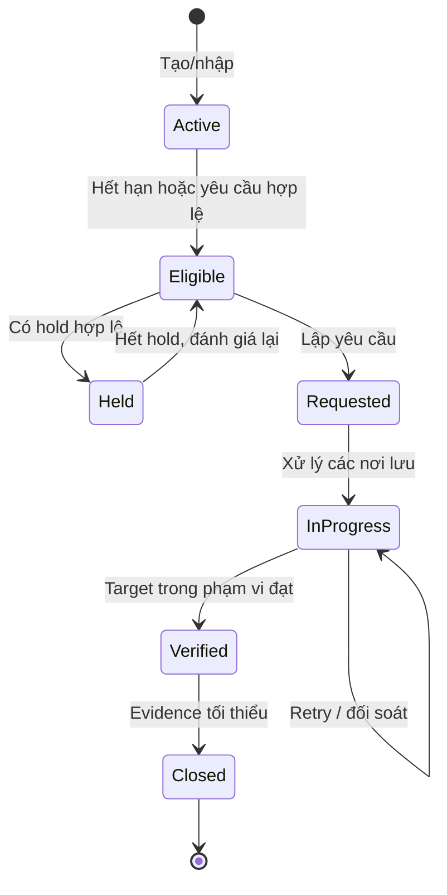
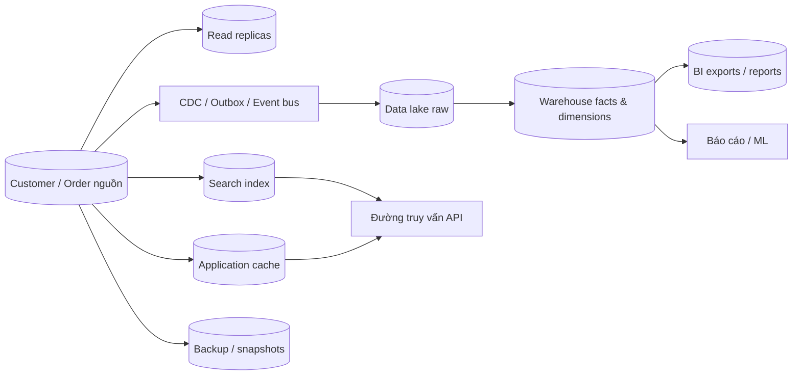
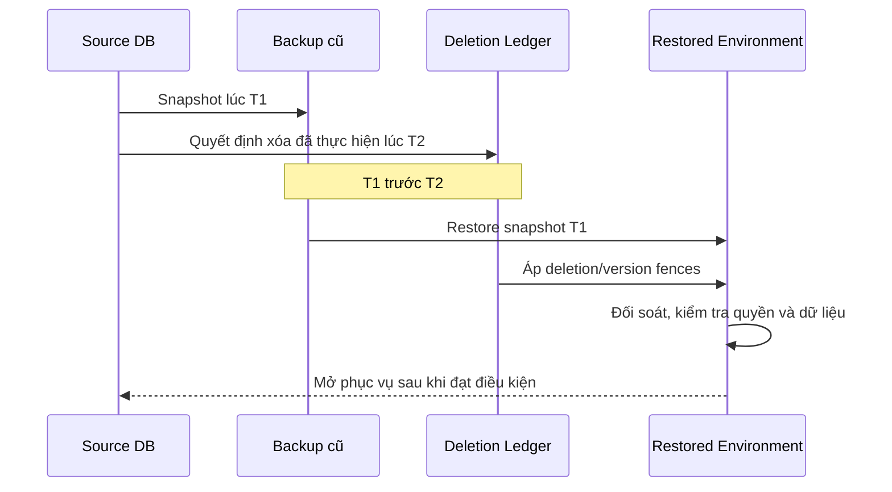
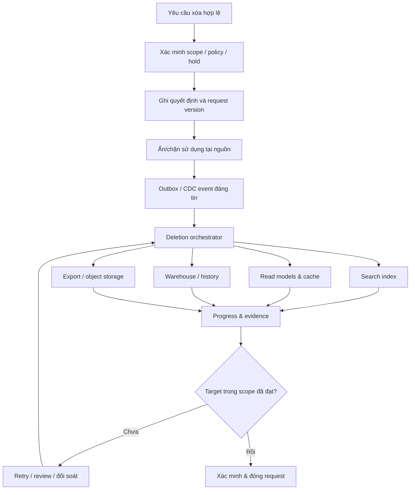

# Thời hạn lưu, điều kiện xóa và dữ liệu còn nằm trong bản sao hoặc lịch sử

## Mục tiêu học tập

Sau bài học, bạn có thể:

- Phân biệt **thời hạn lưu dữ liệu (retention period)**, **thời điểm hết hạn**, **điều kiện xóa**, **xóa logic**, **xóa vật lý** và **không còn truy cập được qua ứng dụng**.
- Chuyển quy định nghiệp vụ về lưu giữ và xóa thành **hợp đồng vòng đời dữ liệu** có chủ sở hữu, đối tượng, mốc thời gian, ngoại lệ, phạm vi và bằng chứng kiểm chứng.
- Thiết kế mô hình tách **dữ liệu giao dịch cần lưu**, **dữ liệu nhận diện cá nhân**, **dữ liệu dẫn xuất**, **sự kiện lịch sử** và **chỉ mục** để xóa đúng phần mà không làm hỏng bất biến nghiệp vụ.
- Lập **bản đồ các bản sao**: primary, replica, read model, materialized view, cache, search index, analytics, CDC/outbox, queue, object storage, snapshot, backup và môi trường thử nghiệm.
- Giải thích vì sao `DELETE` hoặc TTL hết hạn **không chứng minh** dữ liệu đã biến mất khỏi mọi tệp, replica và bản sao lưu.
- Thiết kế quy trình xóa **chịu lỗi, idempotent, có thứ tự**, chống sự kiện cũ và snapshot cũ tái tạo dữ liệu bị xóa.
- Phân biệt thực thi xóa với **audit bằng chứng xóa** mà không tạo thêm một kho thông tin nhạy cảm.
- Xác định cách kiểm thử, đối soát và giám sát **deletion lag, orphan records, restore rehydration, lifecycle policy violations**.
- Đánh giá đánh đổi giữa **khả năng kiểm toán, nghĩa vụ lưu giữ, yêu cầu bảo mật, khôi phục thảm họa và dữ liệu phân tích lịch sử**.

Trong module **DATABASE_DATA_MODELING**, việc chuyển yêu cầu nghiệp vụ thành mô hình dữ liệu không dừng ở khóa chính, quan hệ, chuẩn hóa, chỉ mục và schema vật lý. Khi thiết kế **bảo vệ dữ liệu**, phải trả lời thêm: **một thực thể còn được lưu vì mục đích gì, ai được quyền xem, khi nào phải ngừng dùng, điều kiện nào cho phép xóa, và làm thế nào các bản sao/hệ lịch sử tuân theo cùng quyết định?**

Bài này tập trung vào **mô hình hóa ranh giới và vòng đời dữ liệu**. Quy định pháp lý cụ thể khác nhau theo quốc gia, ngành, loại dữ liệu và căn cứ xử lý; các khoảng lưu nêu dưới đây là **ví dụ thiết kế**, không phải thời hạn bắt buộc cho mọi tổ chức.

---

## 1. Đặt vấn đề: xóa hồ sơ không có nghĩa xóa mọi thứ liên quan

Giả sử một nền tảng thương mại có các hệ:

- **Identity/Customer Service:** tài khoản khách, email, số điện thoại, địa chỉ.
- **Order Service:** đơn hàng, dòng hàng, trạng thái và lịch sử thay đổi.
- **Payment/Accounting:** giao dịch thu tiền, hoàn tiền và chứng từ cần đối soát.
- **Catalog:** sản phẩm, SKU và phân loại.
- **Search/Analytics:** chỉ mục và dữ liệu tổng hợp phục vụ tìm kiếm, báo cáo.
- **Infrastructure:** cache, replica, message bus, CDC, object store và backup.

Một khách yêu cầu đóng tài khoản và xóa dữ liệu cá nhân. Điều gì sẽ xảy ra nếu chỉ chạy:

```sql
DELETE FROM customers
WHERE customer_id = 'user_42';
```

Bảng `customers` không còn hàng đó nhưng dữ liệu có thể vẫn nằm ở:

```text
orders.customer_email_snapshot
shipments.delivery_phone
search_customer_index
customer_profile_cache
analytics_customer_dimension_history
cdc_raw/customer_events
data_export/customer_2026.csv
database_snapshot_yesterday
offsite_backup_last_week
support_ticket_attachments
```

Nếu xóa luôn mọi dòng đơn hàng, tổ chức có thể vô tình phá vỡ khả năng giải quyết hoàn tiền hoặc nghĩa vụ lưu giữ hợp lệ. Nếu giữ mọi thông tin cá nhân “đề phòng cần dùng lại”, lại có thể vượt quá mục đích và thời gian lưu giữ được xác định.

**Bài toán cần giải** là **xác định phạm vi được lưu/xóa theo mục đích và quan hệ dữ liệu**, sau đó bảo đảm các đường xử lý và các bản sao thực thi đúng quyết định.

### 1.1. Bốn câu hỏi phải trả lời trước khi viết DELETE

1. **Dữ liệu nào?** Cả tài khoản, một thuộc tính, một quan hệ, một sự kiện hay tập bản ghi lịch sử?
2. **Vì sao giữ/xóa?** Hết mục đích sử dụng, hết thời hạn, người có quyền yêu cầu, giao dịch hủy hay có căn cứ khác?
3. **Từ khi nào?** Theo thời điểm tạo, hoàn tất, đóng tài khoản, giao dịch cuối, kết thúc hợp đồng hay sự kiện khác?
4. **Những nơi nào liên quan?** Bản chính, bản sao phục vụ đọc, lịch sử, bản export, snapshot và backup?

Thiếu bất kỳ câu hỏi nào, lược đồ có thể cho phép xóa về mặt SQL nhưng vẫn **không thể vận hành và kiểm chứng xóa**.

## 2. Sáu khái niệm vòng đời phải tách bạch

| Khái niệm | Ý nghĩa trong mô hình | Không được tự suy ra |
| --- | --- | --- |
| **Retention** | Khoảng/quy tắc lưu dữ liệu theo mục đích và căn cứ | Mọi bảng đều áp một TTL |
| **Expiration** | Thời điểm giá trị không còn hiệu lực cho mục đích cụ thể | Bytes đã bị thu hồi khỏi ổ đĩa |
| **Logical delete/soft delete** | Bản ghi có trạng thái xóa hoặc bị ẩn khỏi ứng dụng | Không còn bản vật lý hoặc sao lưu |
| **Physical deletion/purge** | Thu hồi hoặc loại dữ liệu theo cơ chế lưu trữ | Backup, log và bản sao khác cũng đã được xử lý |
| **Archival** | Chuyển dữ liệu sang vùng lưu khác theo chính sách | Đã xóa hoặc không còn là dữ liệu nhạy cảm |
| **Deletion evidence** | Bằng chứng quy trình và kết quả theo phạm vi công bố | Chứng minh tuyệt đối mọi bit trên mọi phương tiện đã biến mất |

Một session có TTL 30 phút, chứng từ có chính sách lưu giữ riêng nhiều năm, audit event có quy tắc lưu/che thông tin khác, cache sản phẩm có TTL vài phút. Không thể gán thời hạn của **session** cho **mọi record chứa userId**.

### 2.1. Xóa có nhiều cấp độ

1. **Không còn dùng ở API đang hoạt động:** query/command thông thường không trả dữ liệu.
2. **Bản chính và bản sao vận hành đã xử lý:** primary, replica, search/index/cache/read model.
3. **Hệ dẫn xuất và lịch sử được xử lý theo chính sách:** analytics, event log, dữ liệu export, lịch sử có thể nhận diện.
4. **Bản sao lưu được quản lý an toàn:** không phục vụ trực tiếp; hết hạn theo vòng đời hoặc áp lại xóa trước khi restore được mở phục vụ.
5. **Thu hồi vật lý/cryptographic erasure theo khả năng hệ thống:** có minh chứng và giới hạn rõ.

Một API trả `204 No Content` có thể xác nhận **yêu cầu đã được chấp nhận hoặc xử lý trong phạm vi cụ thể**, không tự động chứng minh cả năm cấp độ.

### 2.2. Hết hạn khác “đã xóa”

```text
T0        Bản ghi được tạo, expiresAt = T0 + 90 ngày
T0+90d    Bản ghi hết hiệu lực theo chính sách
T0+90d+δ  Worker/lifecycle job mới xóa vật lý hoặc ẩn
T0+90d+Δ  Backup cũ hết hạn theo lịch riêng
```

Các khoảng δ và Δ là đặc điểm quy trình/hạ tầng; chúng cần được đo và kiểm soát, không mặc định bằng 0.

## 3. Phân loại dữ liệu trước khi đặt thời hạn lưu

Một bảng `orders` có thể chứa cả số tiền cần kiểm toán và email giao hàng không cần giữ cùng thời hạn.

| Nhóm dữ liệu | Ví dụ | Mục đích chính | Điều cần xem khi xóa |
| --- | --- | --- | --- |
| Hồ sơ định danh | Tên, email, điện thoại | Xác thực, hỗ trợ khách | Xóa trường hay toàn hồ sơ |
| Thông tin giao dịch | Order ID, tổng tiền, thu/hoàn | Thực hiện, giải trình giao dịch | Thời hạn/ngoại lệ giữ riêng |
| Dữ liệu vận chuyển | Địa chỉ, điện thoại người nhận | Giao hàng | Không nhất thiết giữ ngang chứng từ |
| Session/token | Session ID, refresh token | Xác thực tạm | TTL ngắn; thu hồi đúng thời điểm |
| Telemetry/log | Request ID, IP, trace, payload | Vận hành, bảo mật | Giới hạn PII, retention và redaction |
| Search/index/cache | Email index, summary profile | Tối ưu đọc | Đồng bộ cập nhật và xóa |
| Analytics/feature | SCD2 khách, hành vi, cohort | Báo cáo, dự báo | Xem tính nhận diện và nhu cầu giữ |
| Backup/snapshot | Ảnh dữ liệu cũ | Khôi phục sự cố | Retention, cô lập, restore controls |
| Audit evidence | Request ID, thời gian, kết quả | Chứng minh xử lý | Tránh lưu lại payload đã xóa |

**Cùng một thực thể có thể chịu nhiều chính sách ở cấp trường và mục đích.** Thiết kế bảng nguyên khối làm xóa chọn lọc khó hơn, nhất là khi trường bị sao chép nhiều nơi.

### 3.1. Một ma trận lưu giữ không nên chỉ có “số ngày”

| Thuộc tính | Ví dụ minh họa |
| --- | --- |
| `data_class` | `DELIVERY_CONTACT` |
| `purpose` | Giao hàng, hỗ trợ xử lý sự cố |
| `authority_owner` | Fulfillment domain |
| `scope` | Tenant, loại hồ sơ, vùng chính sách |
| `retention_start_event` | `shipment_delivered_at` |
| `retention_duration` | 90 ngày trong ví dụ |
| `not_before_condition` | Không có hold hợp lệ đang hiệu lực |
| `expiration_action` | Redact điện thoại/địa chỉ |
| `downstream_targets` | Search, cache, analytics, object store |
| `exception/hold_policy` | Tranh chấp mở có quy trình riêng |
| `verification_method` | Query tồn dư + job manifest + restore test |
| `policy_version` | `delivery_contact_v3` |
| `service_level` | Ví dụ thực hiện trong 24 giờ sau đủ điều kiện |

**90 ngày và 24 giờ chỉ là số giả định cho bài học**. Không sao chép chúng thành quy tắc pháp lý chưa được phê duyệt.

## 4. Mốc bắt đầu tính thời hạn là quyết định nghiệp vụ

Các cách tính khác nhau làm bản ghi bị xóa sớm hoặc quá muộn:

- **CreatedAt:** từ lúc thực thể phát sinh.
- **LastActivityAt:** từ lần hoạt động hợp lệ cuối; thích hợp một số dữ liệu sliding retention.
- **CompletedAt/ClosedAt:** từ khi hoàn tất giao dịch hoặc đóng hồ sơ.
- **ContractEndedAt:** từ khi kết thúc quan hệ hợp đồng.
- **EventTime:** từ khi sự kiện xảy ra ở nguồn.
- **ReceivedAt:** từ khi hệ thống nhận dữ liệu.
- **BusinessTriggerAt:** một mốc được chính sách xác định.
- **DeletionRequestAt:** khi nhận yêu cầu xóa hợp lệ, không nhất thiết mọi dữ liệu được xóa ngay.

Công thức cơ bản:

\[
expiresAt = retentionStartAt + retentionDuration
\]

Nhưng **được phép xóa** có thể cần nhiều điều kiện:

\[
eligibleToPurge =
expired \land \neg activeHold \land \neg requiredDependency
\]

Trong đó `requiredDependency` là điều kiện đã được chính sách định nghĩa, không phải mọi foreign key đều chặn xóa mãi mãi.

### 4.1. Thời gian nghiệp vụ khác thời gian ingest

Một thiết bị gửi:

```json
{
  "eventId": "evt_120",
  "observedAt": "2026-10-01T10:00:00Z",
  "receivedAt": "2026-10-20T10:00:00Z",
  "deviceId": "dev_8"
}
```

Chính sách minh họa: giữ phép đo 30 × 24 giờ kể từ `observedAt`. Nếu ghi với `TTL=30 ngày` từ lúc nhận, dữ liệu được giữ 19 ngày quá mốc đã định.

```text
expiresAt = observedAt + 30 days
ttlRemainingSeconds = max(0, expiresAt - now)

if ttlRemainingSeconds <= 0:
    handleAlreadyExpiredEvent()
else:
    storeWithAppropriateDeadlineOrTTL()
```

Cần chú ý làm tròn, giới hạn TTL, độ lệch đồng hồ và ngữ nghĩa ghi đè. Nếu yêu cầu không trả dữ liệu sau `expiresAt` dù dọn nền chậm, đường đọc có thể cần tự kiểm tra deadline.

### 4.2. Ngày lịch khác duration cố định

“90 ngày” có thể là 90 × 24 giờ từ instant UTC, 90 ngày lịch theo timezone shop, đến cuối kỳ kinh doanh hoặc một mốc đóng sổ. Với vùng có DST, ngày lịch có thể dài/ngắn hơn 24 giờ. Hợp đồng phải nói rõ **timezone, ranh giới, dữ liệu thiếu timestamp và sự kiện đến muộn**.

### 4.3. Khi dữ liệu được chỉnh sửa

Nếu nhân viên sửa địa chỉ giao hàng ngày thứ 80, retention có bắt đầu lại? Không thể để đáp án phụ thuộc ngẫu nhiên vào lệnh `UPDATE` có reset TTL:

- **Absolute retention:** deadline giữ nguyên khi sửa metadata.
- **Sliding retention:** chỉ những sự kiện hợp lệ được gia hạn theo hợp đồng.
- **Retention theo hồ sơ vụ việc:** tính từ khi vụ việc kết thúc.
- **Ngoại lệ:** có chủ sở hữu, lý do, giới hạn, lịch review.

## 5. Điều kiện xóa: quyền yêu cầu, căn cứ giữ và trạng thái

Một yêu cầu xóa hợp lệ không luôn có nghĩa mọi dữ liệu liên quan bị xóa ngay. Ngược lại, căn cứ giữ một loại dữ liệu không cho phép giữ vô hạn những trường không cần thiết.

| Đối tượng | Câu hỏi | Hướng thiết kế khả dĩ |
| --- | --- | --- |
| Session, refresh token | Còn cần cho tài khoản? | Thu hồi/vô hiệu đúng hợp đồng |
| Hồ sơ marketing | Còn mục đích/căn cứ giữ? | Xóa/ẩn và dọn index |
| Địa chỉ giao hàng | Còn nhu cầu giao/hỗ trợ? | Deadline/redact riêng |
| ID và số tiền đơn | Cần giải trình giao dịch hợp lệ? | Giữ tối thiểu theo policy |
| Payment record | Cần chứng từ/đối soát? | Giữ theo quy tắc riêng, quyền chặt |
| Hành vi cá nhân | Còn mục đích? | Xóa hoặc xử lý giảm khả năng nhận diện |
| Aggregate | Có thật không còn nhận diện? | Đánh giá tái nhận diện |

### 5.1. Giữ theo ngoại lệ (hold)

Một hồ sơ có thể tạm hoãn xóa vì tranh chấp/điều tra hoặc nghĩa vụ hợp lệ. Hold phải là **đối tượng có điều kiện và quyền**, không phải cờ `do_not_delete=true` tồn tại vô hạn:

```text
retention_hold:
    hold_id
    subject_type
    subject_id
    scope_of_data
    reason_code
    authorized_by
    effective_from
    review_at
    released_at
    policy_reference
```

Quy tắc:

1. Hold chỉ áp vào **phạm vi cần thiết**.
2. Người tạo/gỡ hold phải có quyền.
3. Hold có audit, lý do, lịch review.
4. Khi hold gỡ, **đánh giá lại điều kiện xóa**, không tự đặt lại toàn bộ tuổi lưu.
5. Hold không là lý do mặc định giữ mọi PII và bản sao mãi mãi.

### 5.2. Mô hình trạng thái xóa



Trong thực tế có thể có `REJECTED`, `PARTIALLY_COMPLETED`, `BLOCKED`, `REQUIRES_REVIEW`. Không âm thầm đổi tất cả thành `DONE` để dashboard hiển thị tốt.

**Yêu cầu xóa** và **dữ liệu bị xóa** là hai thực thể khác nhau. Request theo dõi tiến độ mà không cần chứa toàn bộ payload nhạy cảm.

## 6. Thiết kế schema để xóa chọn lọc mà không phá dữ liệu giao dịch

Lược đồ đơn hàng ban đầu:

```sql
CREATE TABLE orders (
    shop_id             VARCHAR(40),
    order_id            VARCHAR(40),
    customer_id         VARCHAR(40),
    customer_email      VARCHAR(255),
    shipping_phone      VARCHAR(30),
    shipping_address    TEXT,
    status              VARCHAR(24),
    total_minor         BIGINT,
    currency_code       CHAR(3),
    completed_at_utc    TIMESTAMP,
    PRIMARY KEY (shop_id, order_id)
);
```

Bảng pha trộn thực thể giao dịch, thông tin liên hệ và quan hệ khách–đơn. Một retention duy nhất có thể gây xóa/giữ sai.

### 6.1. Tách theo vòng đời

```text
order_core
    PK (shopId, orderId)
    status, totalMinor, currencyCode, completedAt
    retentionPolicyRef, retentionStartAt

order_customer_link
    PK (shopId, orderId)
    customerId, linkState, expiresAt

order_delivery_contact
    PK (shopId, orderId, contactVersion)
    encryptedAddress, encryptedPhone, validFrom, expiresAt

customer_profile
    PK (tenantId, customerId)
    fields thuộc vòng đời hồ sơ

order_audit_events
    PK (shopId, orderId, eventId)
    eventType, occurredAt, minimalActorRef
```

Đây là **minh họa ranh giới**, không bắt buộc đúng năm bảng. Có thể dùng quan hệ/document, nhưng phải xác định transaction, truy vấn, quyền và vòng đời.

Khi hết mục đích giao hàng, có thể dọn `order_delivery_contact` mà không phá `order_core`. Khi xóa hồ sơ, có thể chấm dứt `order_customer_link` theo chính sách mà không mất chứng từ cần giữ.

### 6.2. Toàn vẹn tham chiếu khi xóa

`ON DELETE CASCADE` có thể xóa nhiều hàng trong một database transaction, nhưng:

- Có thể xóa **quá nhiều** dữ liệu giao dịch cần giữ.
- Không tự lan tới search/analytics/cache/object store/backup.
- Không tự xử lý quan hệ liên dịch vụ.
- Không thể tùy tiện biến quan hệ nghiệp vụ bắt buộc thành `NULL`.

| Quan hệ | Hành vi cần cân nhắc |
| --- | --- |
| Session → Account | Thu hồi/cascade đúng phạm vi |
| Order core → Delivery contact | Xóa/redact contact theo thời hạn riêng |
| Order core → Payment reference | Giữ/xử lý theo chứng từ, không cascade tùy tiện |
| Order → Search index | Đồng bộ theo index engine hoặc event |
| Fact → Customer dimension | Xem cắt liên kết nhận diện hay xử lý fact |
| Historical actor reference | Xem audit và giảm khả năng nhận diện |

### 6.3. Pseudonymization không đồng nghĩa anonymization

- **Pseudonymization:** thay email/user ID bằng mã khác, nhưng vẫn có thể nối lại qua mapping hoặc dữ liệu phụ.
- **Anonymization:** không còn nhận diện theo tiêu chuẩn và bối cảnh đánh giá áp dụng; phải xem khả năng kết hợp dữ liệu.

Giữ `SHA256(email)` không tự khiến dữ liệu ẩn danh: email có thể bị đoán và hash lại. Mã ngẫu nhiên vẫn có thể liên kết tới order chi tiết. Cần đánh giá **độ hạt, tính hiếm, liên kết ngoài và quyền**.

## 7. Data inventory: bản sao nào cần nằm trong phạm vi?

Một giá trị có thể được **sao chép, biến đổi, cache, xuất hoặc snapshot** qua nhiều quy trình.



Các loại bản sao:

1. **Gần nguyên bản:** replica, snapshot, backup.
2. **Bản đọc có tổ chức lại:** by-customer table, search index, materialized view.
3. **Bản dẫn xuất chứa thuộc tính:** feature store, dimension history, cache.
4. **Bản trích xuất:** CSV, object export, attachment, môi trường thử nghiệm.
5. **Log/sự kiện:** outbox, CDC, dead-letter queue, audit, trace.
6. **Metadata có thể nhận diện:** key, URL, filename, object tags, index terms.

Dữ liệu cá nhân có thể nằm trong **tên object hoặc partition key**, không chỉ trong payload.

### 7.1. Bảng kiểm kê copy inventory

| Trường | Ví dụ | Ý nghĩa |
| --- | --- | --- |
| `dataset_id` | `search_customer_v2` | Định danh nơi lưu |
| `owner_service` | Customer Search | Ai thực thi xóa |
| `upstream_dataset` | Customer profile CDC | Nguồn dẫn xuất |
| `data_classes` | Email, display name | Loại dữ liệu có mặt |
| `storage_type` | Index, cache, table, object | Cách xóa/ẩn |
| `record_locator` | `(tenantId, customerId)` | Cách tìm dữ liệu |
| `lineage_version` | Search pipeline v2 | Cách dựng dữ liệu |
| `retention_policy` | customer-index-v3 | Quy tắc giữ |
| `deletion_capability` | delete by ID / rebuild | Hành vi thực thi |
| `maximum_delete_lag` | SLA minh họa | Kỳ vọng/cảnh báo |
| `restore_behavior` | Rebuild only from sanitized source | Chống khôi phục dữ liệu cũ |
| `verification_procedure` | Query index + replay test | Bằng chứng |

Nếu không biết bản sao ở đâu hoặc không có **record locator**, rất khó xóa có kiểm chứng. Đây là lý do **lineage** và **định danh ổn định** thuộc thiết kế bảo vệ dữ liệu.

### 7.2. Aggregate có thật sự không nhận diện?

Một mart có `orders_per_day_by_region` nhưng chỉ có một khách trong một vùng/ngày có thể vẫn làm lộ thông tin khi kết hợp dữ liệu ngoài. Việc không có `customerId` hoặc dùng `GROUP BY` không tự bảo đảm ẩn danh.

Cần xem fact nào còn ID cá nhân, dimension nào giữ mapping, những nhóm có quy mô nhỏ, sự kết hợp các chiều được công bố và export chứa thuộc tính nhạy cảm.

## 8. Xóa trong bảng chính, read model và chỉ mục

Một đơn hàng được quản lý theo `(shopId, orderId)` nhưng tồn tại nhiều đường đọc:

```text
orders_by_id(shopId, orderId)
orders_by_customer_month(shopId, customerId, month, createdAt, orderId)
orders_by_status_day(shopId, status, day, changedAt, orderId)
orders_search_index(orderId, customerEmail, ...)
orders_analytics_fact(orderId, customerSk, ...)
```

Khi một đơn bị xóa hoặc phải loại thông tin nhận diện:

- Xóa/ẩn hàng chính có thể chỉ là **một bước**.
- Entry `orders_by_customer_month` còn lộ quan hệ khách–đơn.
- Search index còn cho tìm theo email.
- Read model theo status có thể chứa tên khách.
- Analytics dimension có thể vẫn chứa email, và fact vẫn nối tới dimension.

### 8.1. Hai loại hành động khác nhau

**Xóa thực thể theo hợp đồng:** nếu đủ điều kiện, phải loại các biểu diễn dẫn xuất của thực thể.

**Redaction chọn lọc:** giữ dữ liệu giao dịch tối thiểu nhưng loại thông tin liên hệ và đường liên kết nhận diện không cần thiết. Trong trường hợp này, “xóa orderId ở mọi bảng” có thể sai vì đơn còn cần phục vụ nghiệp vụ khác.

Một event có thể nói rõ:

```json
{
  "eventId": "evt_del_17",
  "subjectType": "CUSTOMER",
  "subjectId": "user_42",
  "tenantId": "shop_17",
  "action": "REDACT",
  "dataClasses": ["CONTACT_EMAIL", "DELIVERY_PHONE"],
  "policyVersion": "customer-contact-v3",
  "subjectVersion": 18,
  "requestedAt": "2026-11-22T10:00:00Z"
}
```

**Đây là ví dụ event contract**, không phải định dạng chung cho mọi sản phẩm. `dataClasses` phải ánh xạ tới các trường thực tế của từng hệ mà không sao chép payload nhạy cảm vào event.

### 8.2. Hợp đồng cho read model

| Thuộc tính | Câu hỏi |
| --- | --- |
| Source of truth | Bản gốc có thẩm quyền ở đâu? |
| Granularity | Một hàng là thực thể/sự kiện gì? |
| Replicated fields | Thuộc tính nào được sao chép? |
| Deletion semantics | Xóa hàng, xóa cột hay redact? |
| Propagation | Transaction/index engine/CDC/projection? |
| Staleness SLA | Bản sao được phép chậm bao lâu? |
| Rebuild source | Có thể tái tạo từ đâu? |
| Deletion fence | Làm sao event cũ không tái sinh dữ liệu? |
| Verification | Query/chứng cứ nào xác nhận kết quả? |

Read model không có nguồn chân lý và đường rebuild dễ trở thành **kho dữ liệu mồ côi** không biết phải giữ hay xóa theo quy tắc nào.

## 9. Replica, lịch sử MVCC, tombstone và bản vật lý

Cần phân biệt dữ liệu **không còn hiển thị trong truy vấn** và dữ liệu **không còn trong cấu trúc lưu trữ**.

### 9.1. Replica vật lý

Hệ phân tán thường nhân bản qua node/region để chịu lỗi. Khi xóa:

- Hệ cần phổ biến thay đổi theo mô hình nhất quán của sản phẩm.
- Replica offline có thể chưa nhận/hòa giải lệnh xóa.
- Đường đọc qua replica chậm có thể có mức nhất quán khác nhau.
- Trong một số engine, bỏ marker xóa quá sớm tạo nguy cơ bản cũ tái xuất hiện.

Không áp cách vận hành tombstone của một DB sang mọi DB. Cơ chế LSM, MVCC, hash/range và replication của từng engine có giới hạn khác nhau.

### 9.2. Lịch sử MVCC và versioned object

Trong nhiều cơ sở dữ liệu quan hệ hoặc kho có versioning:

- `DELETE` thường làm row **không còn thấy trong snapshot mới**.
- Phiên bản cũ có thể tồn tại vì transaction đang chạy, snapshot hoặc time-travel.
- VACUUM/compaction/GC có thể thu hồi sau khi thỏa điều kiện.
- Snapshot, object version hoặc replica khác có thể còn bản cũ.

Nếu DB có `AS OF` hoặc historical query, phải định nghĩa **dữ liệu đã xóa còn được truy vấn qua lịch sử trong bao lâu**, quyền nào được phép truy cập và cách tuân chính sách xóa.

### 9.3. Tombstone trong hệ LSM/wide-column

Một số hệ LSM sử dụng **tombstone** làm dấu một khóa/cell/range đã bị xóa, giúp đọc và đồng bộ replica không tái sử dụng giá trị cũ.

```text
T1: SSTable cũ lưu key=K -> value=V1
T2: DELETE(K) sinh tombstone mới
T3: GET(K) không thấy V1 theo quy tắc hòa giải
T4: compaction/GC thu hồi byte cũ khi đủ điều kiện
```

Nếu replica mang V1 cũ quay lại sau khi tombstone bị loại mà chưa đồng bộ an toàn, có nguy cơ **zombie data** trong một số cấu hình. Tuy nhiên:

- Tombstone không phải soft-delete flag ứng dụng.
- `gc_grace_seconds` ở một số hệ không xác định “ngày chắc chắn dữ liệu biến mất”.
- Không tự giảm khoảng giữ tombstone nếu chưa hiểu repair và replica vắng mặt.
- TTL có thể tạo chi phí dọn/tombstone theo sản phẩm, không phải mọi key–value store hoạt động như Cassandra.

### 9.4. Lịch sử nghiệp vụ là bản sao có mục đích khác

Một bảng `customer_history` hoặc dimension SCD2 lưu trạng thái cũ:

```text
customer_dimension_history:
  customer_sk, customer_id, segment,
  valid_from, valid_to,
  email_snapshot
```

Nếu email xóa khỏi `customers_current` nhưng `customer_dimension_history` vẫn giữ `email_snapshot`, việc xóa chưa bao phủ mọi đường nhận diện. Có thể tách **lịch sử phân nhóm** khỏi **lịch sử thuộc tính nhận diện**, tùy căn cứ và mục đích; không xóa hết SCD2 chỉ vì một cột PII khi phần lịch sử còn lại có thể được giữ ở dạng phù hợp.

## 10. Backup, snapshot và nguy cơ dữ liệu bị xóa sống lại

Backup được thiết kế để phục hồi trạng thái **cũ**. Nếu backup 1/11 chứa dữ liệu được xóa ngày 15/11, restore trực tiếp backup đó vào 20/11 có thể **tái tạo dữ liệu đã xóa**.



**Quy trình backup và quy trình xóa không thể thiết kế độc lập.**

### 10.1. Restore runbook tối thiểu

1. Xác định **mốc backup**, phạm vi tenant và dữ liệu được khôi phục.
2. Kiểm tra những yêu cầu xóa đã được xử lý sau mốc đó.
3. Restore vào môi trường **cô lập**, chưa mở API hoặc pipeline downstream.
4. Phát lại thay đổi/biện pháp xóa cần thiết từ **deletion ledger đáng tin** và log nguồn có đủ thời hạn.
5. Đối soát phiên bản, danh tính, mục tiêu xóa và quyền.
6. Rebuild index/cache/read model **chỉ từ nguồn đã kiểm tra**.
7. Lưu bằng chứng kiểm thử/phê duyệt trước khi mở phục vụ.
8. Nếu log xóa không đủ vì đã hết hạn, xử lý như **blocker**, không mở nguồn chưa scrub cho người dùng.

Đây là quy trình khái niệm; triển khai phụ thuộc backup tool, DR architecture, mã hóa và yêu cầu chính sách.

### 10.2. Backup bất biến không hỗ trợ DELETE từng hàng

Nhiều snapshot/backup được lưu nguyên khối và không thể dùng `DELETE WHERE customer_id=...` trực tiếp. Những phương án có thể xem xét:

- **Backup retention giới hạn:** backup cũ hết hạn theo lịch có kiểm soát.
- **Cô lập quyền:** backup không dùng như database truy vấn trực tiếp.
- **Restore-and-reapply:** áp deletion ledger trước khi mở phục vụ.
- **Key lifecycle:** dùng mã hóa và quản lý khóa với phạm vi phù hợp.
- **Backup architecture phù hợp:** nếu chính sách đòi xóa chọn lọc nhanh, phải chọn sản phẩm/cách phân đoạn hỗ trợ.

Không báo cáo “đã xóa vật lý” nếu thực tế chỉ chặn quyền truy cập. Phải ghi rõ **cơ chế, độ trễ và giới hạn**.

### 10.3. Cryptographic erasure có điều kiện

Hủy khóa mã hóa **có thể** khiến dữ liệu không thể giải mã nếu:

- Dữ liệu chỉ tồn tại ở dạng mã hóa bằng các khóa bị hủy.
- Không có plaintext ở log/cache/export.
- Không còn bản sao khóa, key-wrapping material hoặc key recovery khác.
- Hủy khóa không làm mất dữ liệu khác phải giữ.
- Lifecycle khóa có bằng chứng theo chính sách.

Một khóa chung cho cả triệu user không thể bị hủy để xóa chọn lọc một user mà không ảnh hưởng tất cả. Phương án per-subject/per-object encryption key phải được cân nhắc từ **giai đoạn mô hình hóa** nếu định sử dụng. Crypto erasure không giải quyết bản plaintext từng xuất ra khỏi vùng mã hóa.

## 11. Event log, CDC và lịch sử có thể tái tạo dữ liệu bị xóa

Một profile có thể được dựng lại từ event:

```text
CustomerCreated(v1)
EmailChanged(v2)
AddressChanged(v3)
CustomerDeleted(v4)
```

Nếu consumer chỉ phát lại đến v3, hoặc v4 đã hết retention, rebuild có thể **tái tạo profile cũ**. Nếu v4 đến trước v3, áp event theo thứ tự nhận có thể làm dữ liệu “sống lại”.

### 11.1. Bốn lớp xử lý xóa khác nhau

- **Storage tombstone:** metadata engine để hòa giải record/replica và compaction.
- **Domain deletion event:** thông báo thực thể/trường bị xóa theo quyết định.
- **Application deletion fence:** trạng thái bền vững ngăn event cũ được áp lại.
- **Audit record:** dấu vết request/tiến độ, tối thiểu PII.

Không thể thay một lớp bằng một lớp khác rồi mong giải quyết mọi vấn đề.

### 11.2. Sự kiện xóa cần định danh và phiên bản

```json
{
  "eventId": "del_evt_902",
  "entityType": "CUSTOMER",
  "tenantId": "shop_17",
  "subjectId": "user_42",
  "subjectVersion": 18,
  "action": "DELETE_OR_REDACT",
  "policyVersion": "customer-retention-v3",
  "requestId": "req_301",
  "effectiveAt": "2026-11-22T09:00:00Z",
  "scope": ["PROFILE", "CONTACT_SEARCH", "IDENTITY_LINK"]
}
```

Ví dụ event contract, **không phải định dạng chuẩn**. Payload nên đủ để định vị và xác định phạm vi nhưng không mang email/địa chỉ nếu không cần.

- `subjectVersion` có nguồn cấp và thứ tự ổn định theo đúng phạm vi entity.
- `eventId` khác `subjectId`: một thực thể có nhiều event.
- `requestId` theo dõi workflow, không thay idempotency của từng thao tác đích.
- `policyVersion` giải thích vì sao target được yêu cầu xóa.
- Nếu tạo lại hồ sơ mới được phép, cần **identity epoch/generation** và quy tắc nối lịch sử rõ.

### 11.3. Projection có thể chạy lại an toàn

```text
onCustomerEvent(event):
    key = (event.tenantId, event.subjectId)
    state = durableProjectionState.readOrDefault(key)

    if event.generation < state.activeGeneration:
        return

    if event.generation == state.activeGeneration
       and event.subjectVersion <= state.lastAppliedVersion:
        return

    if event.action == DELETE_OR_REDACT:
        applyIdempotentRedactionOrDeletion(key, event.scope)
        recordDeletionFence(key, event.subjectVersion, event.generation)
    else:
        if event.generation == state.activeGeneration
           and event.subjectVersion <= state.deletionFenceVersion:
            return
        applyIdempotentUpsert(key, event)

    commitCheckpointWithConcurrencyControl(
        key, event.subjectVersion, event.generation
    )
```

**Giả mã thể hiện bất biến**, không phải transaction hoàn chỉnh. Cần xử lý event delta thiếu trung gian, checkpoint khác kho, và bảo vệ `version check + write` bằng CAS/transaction/serial processing phù hợp; `GET` rồi `PUT` vô điều kiện vẫn có race.

### 11.4. Vì sao deletion fence có retention riêng?

Nếu event log có thể replay trong hai năm nhưng fence chỉ giữ một ngày, một consumer chạy bù sau một tuần có thể tái sinh dữ liệu.

Nguyên tắc khái niệm:

\[
T_{\text{fence}} \geq T_{\text{replay horizon}}
\]

Chưa đủ để đảm bảo an toàn tuyệt đối: còn backup, snapshot, external exports, các pipeline cũ và ID reuse. Nếu không thể giữ fence đủ lâu ở dạng liên kết cá nhân, cần generation marker, scrubbed snapshots, replay filter và restore controls phù hợp chính sách.

## 12. Quy trình xóa phân tán không có transaction bao trùm mọi nơi

Giả sử nguồn có thẩm quyền phải xóa profile và truyền yêu cầu tới search, cache, warehouse, object storage và các read model.



Ngay cả khi thay đổi nguồn và outbox được commit nguyên tử, các target vẫn có thể xóa **không cùng lúc**.

### 12.1. Lỗi dual-write đơn giản

```text
deleteCustomerInSource()
deleteSearchIndex()
deleteAnalyticsDimension()
deleteCache()
return "done"
```

Nếu process crash sau bước đầu, các bản sao còn. Retry cần an toàn, target tạm offline cần hàng đợi bền, không bỏ qua. Quy trình tốt hơn:

1. Xác thực và ghi request.
2. Thực hiện thay đổi nguồn với cơ chế giao dịch phù hợp.
3. Phát yêu cầu qua transactional outbox/CDC nếu được hỗ trợ.
4. Lưu tiến độ từng target `PENDING/IN_PROGRESS/VERIFIED/FAILED/BLOCKED`.
5. Retry theo `requestId + target + action/version`.
6. Kiểm tra trạng thái thực ở target thay vì chỉ ACK.
7. Chặn dữ liệu cũ tái tạo trong và sau quá trình xóa.

### 12.2. DDL cho theo dõi tiến độ

```sql
CREATE TABLE deletion_request (
    request_id        VARCHAR(64) PRIMARY KEY,
    tenant_id         VARCHAR(64) NOT NULL,
    subject_type      VARCHAR(40) NOT NULL,
    subject_id        VARCHAR(100) NOT NULL,
    policy_version    VARCHAR(80) NOT NULL,
    request_version   BIGINT NOT NULL,
    requested_at      TIMESTAMPTZ NOT NULL,
    effective_at      TIMESTAMPTZ,
    status            VARCHAR(32) NOT NULL
);

CREATE TABLE deletion_target_progress (
    request_id        VARCHAR(64) NOT NULL,
    target_id         VARCHAR(100) NOT NULL,
    action_code       VARCHAR(40) NOT NULL,
    target_status     VARCHAR(32) NOT NULL,
    last_attempt_at   TIMESTAMPTZ,
    verified_at       TIMESTAMPTZ,
    attempt_count     INTEGER NOT NULL DEFAULT 0,
    failure_code      VARCHAR(80),
    PRIMARY KEY (request_id, target_id, action_code),
    FOREIGN KEY (request_id)
        REFERENCES deletion_request(request_id)
);
```

Ledger chứa `subject_id` cũng là một dữ liệu có thể nhận diện. Cần quyền, mã hóa, retention và xem xét token/lookup bảo vệ nếu phù hợp.

### 12.3. VERIFIED phải nói đúng loại bằng chứng

Có thể kiểm tra:

- Query không còn trả field/record thuộc phạm vi.
- Job manifest xác nhận object/file cần xóa được xử lý.
- Search index không còn document hoặc trường nhạy cảm.
- Projection đã scrub, job sau không tái tạo.
- Restore test áp deletion ledger trước khi mở API.
- Backup bất biến được kiểm soát theo vòng đời riêng.

**Không gộp “đã gửi lệnh” với “đã xác minh mọi bản sao”**.

## 13. Tính đúng dưới cập nhật đồng thời: xóa, sửa, tạo lại

Một khách yêu cầu xóa hồ sơ trong khi worker khác nhận event cập nhật email cũ:

```text
T1: Profile v17, email=old@example.test
T2: Delete request/version v18
T3: Search projection đã xóa profile
T4: Event v17 đến muộn
```

Nếu projection áp `UPSERT` v17 ở T4, email đã xóa xuất hiện trở lại.

Cần source version, deletion fence, conditional update, retry/đối soát và ngữ nghĩa rõ cho **tạo lại hồ sơ hợp lệ**.

### 13.1. Write fence khi bắt đầu xóa

Ngoài phát delete event, có thể cần **write fence** ở nguồn:

```text
profile_state = DELETION_IN_PROGRESS
eligible_commands = RESTRICTED
```

Ví dụ khi profile đang xóa, không cho pipeline marketing nhập lại email từ CSV cũ; chỉ cho phép command cần để thực hiện yêu cầu được xác thực. Quy tắc cụ thể theo domain, nhưng phải **ngăn dữ liệu cũ đổ ngược vào**.

### 13.2. Tạo lại cùng định danh

Nếu sau này người dùng đăng ký mới bằng cùng email:

- **Generation mới:** có danh tính mới theo quyền/mục đích mới, không ngầm nối với lịch sử đã xóa.
- **Khôi phục hồ sơ cũ:** chỉ nếu chính sách và quyền cho phép, với dữ liệu còn được lưu hợp lệ.

Tái sử dụng `customerId` có thể nối sai vào đơn/lịch sử cũ. Nên có ID mới hoặc epoch/generation với identity-resolution rule rõ ràng.

## 14. SCD Type 2 và bảng lịch sử vẫn có thông tin cần xóa

Một dimension khách lưu nhiều version:

```text
dim_customer_history:
  customer_sk=101, customer_id=user_42,
  email=old@example.test, valid_to=2026-08-01

  customer_sk=205, customer_id=user_42,
  email=new@example.test, valid_to=NULL
```

Xóa email ở current row không đủ nếu cả hai version còn email.

### 14.1. Tách lịch sử ngữ nghĩa khỏi thông tin nhận diện

Có thể thiết kế:

```text
dim_customer_segment_history:
    customer_sk, canonical_customer_id,
    segment, valid_from, valid_to

restricted_customer_identity:
    canonical_customer_id, encryptedContact,
    contactRetentionDeadline

fact_order:
    order_id, amountMinor, currencyCode,
    customer_sk_if_permitted
```

Khi xóa nhận diện, phải xác định:

- Có được giữ phân khúc lịch sử ở **độ hạt cá nhân** không?
- Nếu không, cắt liên kết hay chỉ giữ aggregate nào?
- `customer_sk` còn nối tới mapping gốc khác không?
- Nếu fact giao dịch được giữ, có bỏ PII không cần thiết không?
- Xóa/chỉnh dimension có làm sai metric đã công bố không?

### 14.2. Xóa dimension row có thể làm mất fact

Nếu fact FK tới `customer_sk`, xóa dimension có thể bị FK chặn, làm inner join loại fact, hoặc làm số liệu theo segment sai/thiếu.

Vì vậy cần chọn **redact thuộc tính**, **giữ member tối thiểu không nhận diện**, **map tới unknown/erased member**, hoặc **xóa fact** theo policy. Không chỉ chạy `DELETE FROM dim_customer` rồi bỏ qua fact.

### 14.3. Tổng hợp không tự là ẩn danh

Một mart theo vùng/ngày chỉ có một khách trong một ô có thể bị tái nhận diện qua thông tin ngoài. Đánh giá aggregation/anonymization phải xét **quy mô nhóm, tính hiếm, các chiều và khả năng kết hợp dữ liệu**.

## 15. TTL, batch purge và partition theo thời gian

TTL giúp tự động hết hạn ở một số engine nhưng không thay retention contract.

### 15.1. TTL theo key, item, cell

Một số key–value store dùng TTL ở cấp key; document store có TTL index ở cấp document; wide-column có thể có TTL theo cell:

- Update một trường có thể làm mới hoặc không làm mới TTL.
- Một row có thể còn vài cell khi cell khác đã hết hạn.
- Worker dọn nền có thể bất đồng bộ.
- Tombstone/compaction có thể gây chi phí lưu trữ/đọc trước khi bytes được thu hồi.
- Locator/index/cache không tự có deadline giống source.

**Phải kiểm tra engine thực tế**, không suy ra ngữ nghĩa chung từ chữ `TTL`.

### 15.2. Xóa theo batch

Một purge job nên:

1. Chọn record đã đủ điều kiện, batch có giới hạn.
2. Kiểm tra lại hold, phiên bản chính sách và bất biến ngay lúc commit.
3. Dùng idempotent marker để retry không xóa nhầm bản mới.
4. Ghi checkpoint/tiến độ.
5. Phát yêu cầu dọn các bản sao.
6. Quan sát backlog và deletion lag.
7. Giới hạn tải để không nghẽn workload trực tuyến.

Truy vấn chọn ứng viên, **không phải lệnh xóa an toàn hoàn chỉnh**:

```sql
SELECT d.record_id, d.entity_version, d.expires_at
FROM retention_candidates AS d
WHERE d.expires_at <= CURRENT_TIMESTAMP
  AND d.lifecycle_status = 'ACTIVE'
ORDER BY d.expires_at, d.record_id
FETCH FIRST 1000 ROWS ONLY;
```

Sau `SELECT` có thể xuất hiện hold mới/record version mới. Xóa cần recheck hoặc conditional delete/transaction theo version, không dựa duy nhất vào kết quả đọc trước đó.

### 15.3. Bucket ngày hỗ trợ lifecycle, không tự xóa dữ liệu

Ví dụ:

```text
sensor_events_by_device_day
    partition = (tenantId, deviceId, dayBucketUTC)
    sort      = (observedAt DESC, eventId)
```

Bucket ngày giúp giới hạn lịch sử và tìm nhóm cần xét; nhưng:

- Xóa partition có thể tạo tombstone, không thu hồi bytes ngay.
- Chỉ drop physical partition khi **mọi record đều đủ điều kiện** và không có hold.
- Event đến muộn có thể ghi vào bucket cũ.
- Các record cùng bucket có thể có retention khác nhau.
- Bucket quá nhỏ tăng fan-out, bucket quá lớn gây nóng/chi phí đọc.

Thiết kế partition phục vụ truy vấn và lifecycle, nhưng vẫn phải tôn trọng **điều kiện ở cấp record**.

## 16. Quyền riêng tư, bảo mật và bằng chứng kiểm toán

Quy trình xóa đụng tới dữ liệu nhạy cảm, nên bản thân hệ thống theo dõi xóa cũng phải được bảo vệ.

### 16.1. Những loại bằng chứng có ích

- `requestId` và thời điểm yêu cầu được xác nhận.
- Loại đối tượng và phạm vi/nhóm dữ liệu được xử lý.
- Policy version và quyết định giữ/xóa.
- Target bắt buộc và tiến độ từng nơi.
- Mã lỗi/thời gian retry, không cần payload nhạy cảm.
- Verification method và kết quả.
- Mốc đóng yêu cầu và chủ sở hữu ngoại lệ.

**Không cần sao chép email hoặc toàn bộ hồ sơ đã xóa vào audit log** chỉ để chứng minh việc xóa. Nếu cần reference định danh để chống replay/audit, thiết kế phân quyền và retention cho chính reference đó.

### 16.2. Mã hóa không thay quản lý vòng đời

Mã hóa at rest/in transit bảo vệ khỏi truy cập trái phép, nhưng không tự định nghĩa **được phép giữ đến bao giờ**. Tương tự:

- Hash không luôn tạo dữ liệu ẩn danh.
- Pseudonymization vẫn có thể liên kết lại.
- Archive không tự là xóa.
- API không trả giá trị không có nghĩa backup đã hết dữ liệu.
- Replica đọc stale không có nghĩa record đã bị hủy vĩnh viễn.

### 16.3. Phạm vi tenant

Nếu `user_42` chỉ duy nhất **trong một tenant**, yêu cầu xóa phải có `tenantId` đáng tin trong khóa và kiểm tra quyền.

```text
targetKey = (tenantId, subjectType, subjectId)
```

Không chấp nhận tenant ID do client cung cấp mà không xác thực/ủy quyền. Identity crosswalk xuyên nhiều tenant không tự cấp quyền đọc hoặc xóa dữ liệu chéo tenant.

## 17. Retention registry và deletion ledger

Một kiến trúc nhiều hệ có thể tổ chức hai thành phần logic:

1. **Retention registry:** quy tắc/phiên bản cho loại dữ liệu và owner.
2. **Deletion ledger:** quyết định đã xác thực và trạng thái từng target.

### 17.1. Chính sách lưu minh họa

```yaml
policyId: delivery-contact-v3
owner: fulfillment-domain
dataClasses:
  - DELIVERY_ADDRESS
  - DELIVERY_PHONE
scope:
  entityType: SHIPMENT
  regionPolicy: example-policy
startEvent: DELIVERED_AT
duration: P90D
action: REDACT
holds:
  - OPEN_DISPUTE
verification:
  - primary-field-absent
  - search-index-absent
  - analytics-identity-link-removed
restoreRule: reapply-deletion-ledger-before-serve
```

YAML là **hợp đồng minh họa**, không phải cấu hình thư viện cụ thể hoặc quy định pháp lý chung. `holds` phải gắn với chính sách, quyền và dữ liệu có thẩm quyền.

### 17.2. Registry không thay nguồn chân lý nghiệp vụ

Policy registry quản lý quy tắc, nhưng không tự biết:

- Đơn đã giao chưa.
- Refund/tranh chấp đã đóng chưa.
- Hợp đồng đã kết thúc hay chưa.
- Hồ sơ thuộc tenant nào.
- Record là nguồn hay cache dẫn xuất.

Các thông tin đó phải được lấy từ **domain có thẩm quyền** và version phù hợp khi đánh giá chính sách.

### 17.3. Mô hình quan hệ

```text
RetentionPolicy 1 ---- N DataClassPolicy
DataClassPolicy N ---- N DatasetTarget
DeletionRequest 1 ---- N TargetProgress
DatasetTarget 1 ---- N VerificationRule
DeletionRequest N ---- 1 SubjectScope
Hold 1 ---- N SubjectScope / DataClass
```

Các quan hệ N–M cần bridge có khóa và hiệu lực nếu được hiện thực bằng cơ sở dữ liệu quan hệ. Nếu một data class có trong ba dataset, phải biết **mỗi dataset thực thi thế nào**, không chỉ một cờ “đã xóa”.

## 18. Backfill, di trú và thay đổi retention policy

Một tổ chức trước đây giữ thông tin giao hàng lâu hơn, nay rút ngắn thời hạn. Các bản ghi cũ phải được xử lý theo **mốc hiệu lực và ngoại lệ**, không chỉ đổi TTL cho bản ghi mới.

### 18.1. Quy trình rút ngắn thời hạn

1. Xác nhận policy mới, phạm vi, thời điểm áp dụng và người phê duyệt.
2. Kiểm kê dataset/bản sao có data class liên quan.
3. Tính `expiresAt` cho **record lịch sử** từ đúng thời gian nghiệp vụ, không dùng lúc backfill.
4. Phát hiện active hold, ngoại lệ, record thiếu timestamp.
5. Chạy **dry run** với số lượng, phân bố và đặc biệt số record được giữ lại vì hold.
6. Xóa/redact theo batch với checkpoint, conditional action và rate limit.
7. Đồng bộ search, analytics, cache, read models.
8. Đối soát count theo data class/tenant/date/version; kiểm tra mẫu và KPI.
9. Áp policy mới cho write pipeline.
10. Rà soát backup/restore, export và đường ingest có thể đưa dữ liệu cũ trở lại.

Nếu chính sách **kéo dài thời hạn**, chỉ được áp cho dữ liệu còn tồn tại hợp lệ; không mặc định có thể khôi phục dữ liệu đã xóa đúng policy cũ.

### 18.2. Snapshot cũ không được ghi đè quyết định xóa mới

```text
T1: snapshot customer raw còn user_42
T2: deletion request user_42 đã VERIFIED
T3: backfill job đọc snapshot T1
T4: backfill ghi lại dim_customer -> user_42 xuất hiện
```

Bảo vệ bằng:

- Snapshot/log checkpoint và deletion fence.
- Chỉ publish khi dataset đã áp tất cả yêu cầu xóa liên quan.
- Job idempotent, version-aware.
- Kiểm thử rebuild từ snapshot cố tình chứa dữ liệu đã xóa.
- Quyền ghi không cho worker cũ ghi đè dữ liệu mới/cấu hình chính sách mới.

### 18.3. Bản sao mới phải có cách xóa trước khi ra mắt

Nếu tạo `customer_search_v2`, CSV export mới hoặc mart chứa email, thành phần đó phải được đăng ký vào **copy inventory** và **deletion orchestration** trước production.

Quy tắc thiết kế: **không thêm bản sao dữ liệu nhạy cảm nếu chưa có owner, mục đích, retention, deletion/rebuild path và kiểm thử**.

## 19. Kiểm chứng xóa: theo lớp và đúng phạm vi

Không có một SQL query duy nhất chứng minh dữ liệu đã biến mất khỏi **mọi replica, log và backup**. Cần kiểm chứng theo target.

### 19.1. Nguồn vận hành

```sql
-- Chỉ kiểm tra đường dữ liệu mà database này nhìn thấy.
SELECT COUNT(*) AS remaining_contact_rows
FROM order_delivery_contact
WHERE tenant_id = :tenant_id
  AND customer_id = :customer_id
  AND email IS NOT NULL;
```

Query trên không nói gì về search index, snapshot hoặc backup. Nếu email không nằm ở bảng này, phải kiểm tra trường liên quan theo inventory, không coi count=0 là bằng chứng đầy đủ.

### 19.2. Read model, search và cache

- Query theo `(tenantId, customerId)` và ID phụ trong index.
- Xác minh field PII bị loại hoặc document không còn theo scope.
- Thử tìm bằng email/phone mà **không log nội dung nhạy cảm**.
- Kiểm tra cache/invalidation ngay cả khi TTL chưa hết.
- Đối chiếu phiên bản xóa đã áp vào projection.

### 19.3. Analytics và lịch sử

- Kiểm tra current dimension và **mọi SCD2 version**.
- Kiểm tra raw/event/feature tables thuộc phạm vi chính sách.
- Kiểm tra fact FK tới dimension đã redact; không làm mất/nhiều KPI ngoài dự kiến.
- Đối soát metric theo currency/grain.
- Kiểm tra export, dashboard snapshot và đường chia sẻ ngoài warehouse.

### 19.4. Backup và restore

- Manifest, tuổi backup và lịch lifecycle.
- Quyền/cơ chế cô lập backup.
- Deletion ledger cần áp sau mốc snapshot.
- Kết quả **restore drill**: không mở API trước scrub/reconcile.
- Hồ sơ giới hạn không thể xóa chọn lọc tức thời.

Không tuyên bố **physically erased** nếu mới chỉ xác minh truy vấn tại primary.

## 20. Chỉ số vận hành và SLA

| Chỉ số | Ý nghĩa | Phản ứng khi vượt mục tiêu |
| --- | --- | --- |
| `retention_eligible_backlog` | Record đủ điều kiện nhưng chưa xử lý | Xem purge worker/hold/throughput |
| `expiration_visibility_lag` | Hết hạn tới lúc API không còn trả giá trị | Kiểm tra TTL, read guard |
| `deletion_target_lag` | Thời gian từng target đạt mục tiêu | Retry/điều tra target chậm |
| `deletion_request_p95` | Phân bố thời gian hoàn tất request | So SLA theo data class |
| `unverified_deletion_targets` | Target thiếu bằng chứng | Không đóng request sớm |
| `orphan_index_count` | Index trỏ tới bản ghi đã xóa | Cleanup/reconciliation |
| `rehydration_incidents` | Dữ liệu xóa bị tái tạo bởi replay/restore | Sửa fence/generation |
| `historical_pii_findings` | PII còn trong history sau xử lý | Kiểm tra SCD/export/raw |
| `retention_policy_drift` | Dataset áp sai duration/version | Sửa pipeline, backfill |
| `hold_review_overdue` | Hold tới hạn review chưa xử lý | Chuyển owner |
| `backup_retention_violations` | Backup quá hạn | Kiểm tra lifecycle job |
| `restore_scrub_failures` | Restore chưa áp đủ xóa | Chặn cutover |
| `purge_retry_dead_letters` | Xóa lỗi lặp không được xử lý | Review/escalate |

SLA phải gắn với **cấp độ xóa**. Ví dụ “trong 24 giờ sau đủ điều kiện, API và search không còn trả PII” khác hoàn toàn “mọi bản backup vật lý biến mất trong 24 giờ”.

Không gắn email, điện thoại, địa chỉ làm label cho metric; chúng vừa tạo cardinality lớn vừa sao chép PII.

## 21. Bộ kiểm thử bắt buộc

| Nhóm | Tình huống | Kết quả phải chứng minh |
| --- | --- | --- |
| Policy | Hồ sơ đúng hạn | `expiresAt` từ mốc nghiệp vụ |
| Event time | Event đến muộn 20 ngày | Không reset retention theo ingest |
| Boundary | Đúng tại `expiresAt` | Quy tắc dấu bằng nhất quán |
| Timezone | Business date có DST | Không dùng 24 giờ nếu policy theo ngày lịch |
| Hold | Xóa khi active hold | Giữ đúng phần thuộc hold, trạng thái chờ |
| Hold | Hold được gỡ | Đánh giá lại, không tồn backlog vô hạn |
| Selective | Xóa delivery phone, giữ order total | Không phá giao dịch hợp lệ |
| Foreign key | Xóa profile, order fact còn hợp lệ | Không cascade sai/KPI không mất |
| Index | Source customer đã xóa | Cache/search/read model đạt SLA |
| History | Dimension có 3 email version | Xử lý tất cả version thuộc scope |
| Replica | Replica offline rồi quay lại | Không phục hồi giá trị cũ trái bảo đảm |
| Tombstone | Xóa nhiều record cùng partition | Đo latency/compaction và repair safety |
| CDC | v18 delete trước v17 update | Event cũ không tái tạo profile |
| Retry | Cùng request xóa 3 lần | Idempotency, không xác nhận giả |
| Partial failure | Search xóa xong, warehouse lỗi | Retry target độc lập |
| Snapshot | Backfill snapshot trước xóa | Deletion fence chặn tái tạo |
| Backup | Restore snapshot cũ | Scrub/reapply trước khi phục vụ |
| Metadata | PII trong object key/filename | Inventory và workflow xử lý |
| Identity | ID tái sử dụng | Không nối lịch sử sai generation |
| Multi-tenant | Tenant A xóa record B | Bị từ chối |
| Aggregate | Nhóm ngày/vùng chỉ có một khách | Đánh giá rủi ro tái nhận diện |
| Policy migration | 180 ngày rút còn 90 ngày | Phân loại đúng quá hạn và ngoại lệ |
| Evidence | Target VERIFIED | Chứng cứ đúng, không lưu lại payload |
| Performance | Triệu record hết hạn một ngày | Batch/rate limit, online SLA không vỡ |

### 21.1. Fault injection

Một thiết kế chỉ thử đường thành công thường bỏ qua lỗi quan trọng:

- Consumer crash **sau khi xóa index, trước khi ACK**.
- Event cũ đến **sau** deletion event.
- Replica ngắt kết nối trước xóa rồi trở lại.
- Restore snapshot cũ trong môi trường cô lập.
- Hold được tạo đồng thời với purge.
- Hai purge worker tranh cùng record/version.
- Rebuild mart từ raw cũ và mapping mới.
- Quyền tenant đổi trong lúc xóa các bản sao.

Mục tiêu là chứng minh hệ thống **tiến tới trạng thái đúng** nhờ retry, fencing và reconciliation, thay vì chỉ hoạt động khi mọi thành phần trực tuyến.

## 22. Các sai lầm thiết kế thường gặp

| Sai lầm | Hậu quả | Cách sửa |
| --- | --- | --- |
| Ghi `retention=90d` nhưng không có mốc | Xóa sớm/muộn | Event/timezone/expiry rõ |
| Một TTL cho bảng nhiều mục đích | Xóa cả dữ liệu cần giữ hoặc giữ PII quá lâu | Data class và vòng đời riêng |
| Mọi UPDATE reset TTL | Dữ liệu được giữ quá hạn | Absolute deadline |
| DELETE primary rồi tuyên bố mọi nơi đã xóa | Index/backup/replica còn | Copy inventory, verify |
| Dùng soft-delete như purge | Byte/history còn | Phân biệt visibility và purge |
| TTL thay authorization | Truy vấn trước hạn/qua bản sao vẫn lộ | AuthZ/redaction |
| Cascade Order khi Customer bị xóa | Mất giao dịch/chứng từ | Tách PII, policy riêng |
| Order snapshot giữ email mãi | PII sống trong nhiều bảng | Giảm nhân bản, field lifecycle |
| Quên SCD2/log/export | PII lịch sử còn | Kiểm kê mọi version |
| Backfill từ snapshot cũ | Dữ liệu sống lại | Deletion fence, restore scrub |
| Fence giữ ngắn hơn replay | Event muộn tái tạo bản ghi | Thiết kế theo replay horizon |
| Last-write-wins theo ingest time | Event cũ ghi đè xóa | Source version/generation |
| Giảm `gc_grace_seconds` tùy tiện | Zombie data tùy engine | Repair/compaction đúng sản phẩm |
| Hash email rồi gọi anonymous | Tái nhận diện | Đánh giá bối cảnh |
| Archive là xóa | Dữ liệu vẫn tồn tại | Retention/access/purge riêng |
| Hủy một khóa chung để xóa một user | Mất dữ liệu khác hoặc còn plaintext | Key scope và copy inventory |
| Đóng request chỉ vì ACK | Chưa verify target | Kiểm chứng độc lập |
| Không lưu evidence | Khó audit/reconcile | Metadata tối thiểu có quyền |
| Lưu profile vào audit log | Tạo bản sao nhạy cảm mới | Audit theo ID/trạng thái |
| Khóa chứa tenant nên bỏ kiểm tra quyền | Có thể xóa chéo tenant | AuthN/AuthZ |
| Policy mới không xử lý lịch sử | Record cũ quá hạn | Backfill có đối soát |
| Chỉ kiểm count sau xóa | Có thể làm sai join/KPI | Đối soát theo grain/metric |

## 23. Quy trình thiết kế có thể lặp lại

1. **Xác định mục đích và loại dữ liệu:** PII, giao dịch, telemetry, event, index, aggregate.
2. **Chỉ rõ chủ sở hữu:** domain và policy được phê duyệt.
3. **Định nghĩa retention start/action:** mốc, duration, timezone, ngoại lệ, điều kiện đủ.
4. **Chọn grain và ranh giới:** xóa entity, thuộc tính, quan hệ hay event?
5. **Thiết kế quyền:** ai được yêu cầu, thực thi, verify và xem chứng cứ?
6. **Lập copy inventory:** primary, replica, cache, index, history, raw, CDC, export, snapshot, backup.
7. **Thiết kế workflow:** trạng thái, outbox, target progress, retry, idempotency, fencing.
8. **Quản lý lịch sử:** SCD, time-travel, replay horizon và deletion ledger.
9. **Thiết kế restore:** backup isolation, scrub, deletion reapply, verify trước publish.
10. **Xem tác động nghiệp vụ:** FK, KPI, nghĩa vụ giữ; tránh xóa/giữ sai.
11. **Kiểm thử và quan sát:** boundary, race, replica stale, orphan, p95 lag.
12. **Chuẩn bị tiến hóa:** bản sao mới hoặc policy mới cần migration/backfill.
13. **Công bố phạm vi cam kết:** API visibility, operational copies, history, backup, physical reclaim.

### 23.1. Phiếu quyết định cho data class

| Mục | Ví dụ `DELIVERY_PHONE` |
| --- | --- |
| Thực thể | Contact giao hàng |
| Grain | Một contact version/shipment |
| Mục đích | Giao hàng và hỗ trợ liên quan |
| Source of truth | Fulfillment Service |
| Retention start | `shipment_delivered_at` |
| Expiration | Theo policy ví dụ, timezone rõ |
| Ngoại lệ | Hold phê duyệt, review định kỳ |
| Hành động | Redact phone, giữ order core nếu cần |
| Bản sao | Search, cache, analytics, object export |
| Lịch sử | Kiểm tra version và log chứa phone |
| Restore | Áp deletion ledger trước khi phục vụ |
| Verification | Field/index absent, target progress |
| Metric | P95 deletion lag, orphan index |
| Owner | Fulfillment + Data Protection |

## 24. Bài tập vận dụng

### Bài tập A — Hai thời hạn trên một đơn

Bảng `orders` chứa `orderId`, `totalMinor`, `customerEmail` và `shippingPhone`. Thông tin giao hàng chỉ được dùng trong khoảng ngắn, dữ liệu giao dịch có chính sách giữ lâu hơn.

**Câu hỏi:** Có nên đặt một TTL chung? Đề xuất schema hoặc cách redact.

**Gợi ý:** tách `order_core` và `order_delivery_contact`/`order_customer_link` theo vòng đời; xác định owner, deadline, bản sao cần dọn; không cascade phần giao dịch hợp lệ.

### Bài tập B — Event đến muộn

Thiết bị ghi sự kiện ngày 1/11, hệ nhận ngày 20/11; chính sách ví dụ 30 × 24 giờ từ `observedAt`.

**Câu hỏi:** TTL còn lại khi nhận là bao nhiêu? Nếu sửa record ngày 25/11, tuổi có tự gia hạn không?

**Gợi ý:** khoảng 11 ngày nếu cùng giờ; tính deadline từ observedAt. Sửa metadata không gia hạn nếu policy absolute.

### Bài tập C — Xóa profile nhưng có refund chưa hoàn tất

Khách yêu cầu xóa profile, vẫn có order hoàn tất, refund đang mở và dashboard doanh số.

**Câu hỏi:** xóa/giữ những gì, domain nào quyết định?

**Gợi ý:** phân loại profile, PII vận chuyển, customer–order link, phần giao dịch; xem hold/policy theo từng loại; giữ tối thiểu nếu hợp lệ, không giữ PII không cần thiết.

### Bài tập D — Backup phục hồi dữ liệu đã xóa

Backup ngày 1/11, customer được xóa 15/11, cần restore ngày 20/11.

**Câu hỏi:** các bước trước khi mở hệ phục hồi?

**Gợi ý:** cô lập, áp deletion ledger và log sau snapshot, verify primary/index/cache/analytics/quyền, rồi mới mở API; không chỉ kiểm tra restore “thành công”.

### Bài tập E — Event sai thứ tự

```text
v18 CUSTOMER_DELETE
v17 EMAIL_CHANGED (late)
v18 CUSTOMER_DELETE (retry)
```

**Câu hỏi:** nếu xử lý theo thứ tự nhận, lỗi gì? Cơ chế idempotency nào phù hợp?

**Gợi ý:** v17 có thể tái tạo email; dùng version/generation, deletion fence, conditional write và checkpoint.

### Bài tập F — SCD2 và xóa email

Dimension khách có ba version email; fact tham chiếu `customer_sk`.

**Câu hỏi:** xóa email khỏi current đủ chưa? Xóa cả dimension làm KPI sai thế nào?

**Gợi ý:** xem mọi version; redact PII, giữ member tối thiểu hoặc remap fact theo policy; kiểm thử orphan FK và total metric.

### Bài tập G — Search index mới

Nhóm sản phẩm xây `customer_search_v2` từ CDC, tìm theo email nhưng hệ xóa chưa biết index mới.

**Câu hỏi:** cần gì trước production?

**Gợi ý:** đăng ký inventory, owner, data class, deletion consumer/version fence, rebuild/restore policy, tests, SLA metric.

### Bài tập H — Hold và purge đồng thời

Purge worker chọn record hết hạn; một hold hợp lệ được tạo trước lúc worker xóa.

**Câu hỏi:** vì sao `SELECT candidate` rồi `DELETE` vô điều kiện nguy hiểm?

**Gợi ý:** điều kiện đã đổi; recheck hold/version trong transaction/conditional delete phù hợp, dùng trạng thái điều phối và audit.

### Bài tập I — Mã hóa và xóa chọn lọc

Object store đã mã hóa nhưng log còn email plaintext và toàn tenant dùng một khóa chung.

**Câu hỏi:** hủy khóa có xóa an toàn dữ liệu một người không?

**Gợi ý:** không; còn plaintext và khóa chung làm mất dữ liệu người khác. Cần inventory và phạm vi key.

### Bài tập J — KPI xóa

Hệ có 10.000 yêu cầu xóa/tháng, dashboard báo “99% gửi lệnh thành công”.

**Câu hỏi:** thiếu thông tin gì để chứng minh đã thực hiện theo policy?

**Gợi ý:** target VERIFIED, request lag, backlog, orphan index, PII lịch sử, restore drill, SLA theo data class và phân biệt API visibility với backup lifecycle.

## Tổng kết kiến thức

**Thời hạn lưu** là quy tắc gắn với mục đích, loại dữ liệu, mốc thời gian, phạm vi và ngoại lệ. **Điều kiện xóa** không chỉ là “qua N ngày”: phải xác nhận quyền, căn cứ xử lý, hold, quan hệ nghiệp vụ và phiên bản dữ liệu. **Xóa logic**, **ngừng trả qua API**, **xóa khỏi bản sao**, **thu hồi vật lý** và **xử lý backup** là các bước khác nhau, cần mô tả/kiểm chứng tách biệt.

Thiết kế tốt thường **tách dữ liệu nhận diện khỏi phần giao dịch cần giữ**, có copy inventory, workflow xóa chịu lỗi, tiến độ target, idempotency và cơ chế chống sự kiện/snapshot cũ tái tạo dữ liệu đã xóa. SCD history, replica, cache, index, CDC và backup nằm trong phạm vi thiết kế ngay từ đầu.

Trước khi chốt lược đồ, hãy hỏi: **“Tôi có thể chỉ rõ dữ liệu nào còn được giữ vì mục đích gì, khi nào từng loại phải hết hiệu lực, những bản sao nào đã được xử lý, và bằng chứng nào cho thấy khôi phục hoặc phát lại sự kiện không làm dữ liệu đã xóa xuất hiện trở lại?”**
