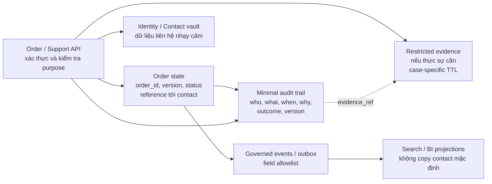
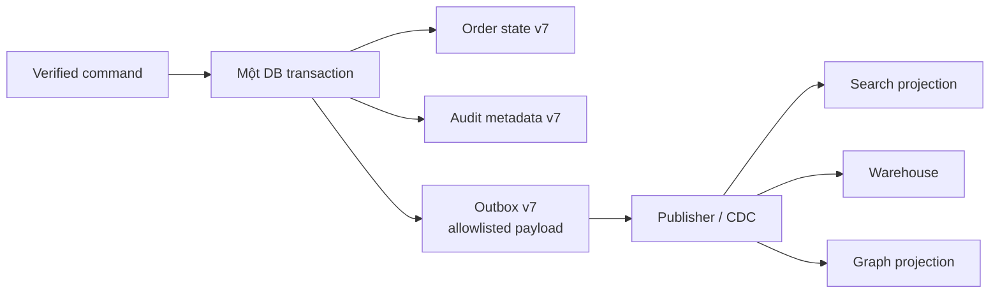

# Cân bằng truy vết nghiệp vụ với yêu cầu hạn chế dữ liệu nhạy cảm

Một khách hàng yêu cầu sửa số điện thoại giao hàng. Bộ phận hỗ trợ cần chứng minh **ai đã yêu cầu thay đổi, ai xử lý, lúc nào, thông qua nghiệp vụ nào và kết quả ra sao**. Nhưng nếu ứng dụng đưa cả **số điện thoại cũ, số mới, địa chỉ giao hàng, token xác thực và nội dung trao đổi** vào audit log “để sau này dễ điều tra”, log lại trở thành nơi lưu thêm dữ liệu nhạy cảm, được nhân bản rộng và có thể còn tồn tại lâu hơn dữ liệu chính.

Bài toán không phải lựa chọn giữa **truy vết mọi thứ** và **không lưu dấu vết**. Thiết kế tốt phải xác định **bằng chứng nghiệp vụ tối thiểu cần giữ**, **thông tin chi tiết nào cần một kho bằng chứng hạn chế**, **ai có quyền liên kết tới danh tính thật**, và **đến khi nào dữ liệu còn cần được lưu**.

Đây là bài học trong chương **Bảo vệ dữ liệu**, thuộc học phần **DATABASE_DATA_MODELING**. Học phần rèn khả năng chuyển yêu cầu nghiệp vụ thành thực thể, quan hệ, ràng buộc, khóa, chỉ mục và lược đồ vật lý; đồng thời cân nhắc mô hình quan hệ, document, graph và phân tích. Vì vậy, bài này tiếp cận truy vết và bảo vệ dữ liệu như **quyết định mô hình hóa và vận hành**: một bản ghi đại diện cho điều gì, mang những thuộc tính nào, liên kết được với ai, được sao chép tới đâu và được kiểm tra bằng cách nào.

**Phạm vi:** ví dụ và thời hạn lưu trong bài đều là giả định học tập. Yêu cầu pháp lý về bảo vệ dữ liệu, lưu giữ chứng từ, quyền của chủ thể dữ liệu, điều tra và nghĩa vụ kiểm toán phụ thuộc khu vực pháp lý, ngành, hợp đồng và mục đích xử lý. Bài không đưa ra kết luận pháp lý cho một hệ thống cụ thể.

Sau bài học, bạn có thể:

- Phân biệt **truy vết nghiệp vụ**, **nhật ký truy cập**, **lineage dữ liệu**, **bằng chứng giao dịch** và **khả năng tái dựng trạng thái**.
- Thiết kế **audit event tối thiểu** mà vẫn giải thích được ai làm gì, khi nào, vì sao, trên đối tượng nào và kết quả ra sao.
- Tách **identity vault**, **business state**, **audit metadata** và **restricted evidence** theo phạm vi truy cập và thời hạn lưu.
- Hiểu tại sao **mã giả danh, ID đơn hàng, correlation ID, hash** vẫn có thể liên quan đến cá nhân.
- Chọn kiểm soát phù hợp cho **PII trong logs, CDC, outbox, search, analytics, graph, backups và file export**.
- Thiết kế cập nhật, xóa/ẩn danh, retention, legal hold, tombstone và replay sao cho không vô tình làm sống lại dữ liệu đã hạn chế.
- Kiểm thử tính **đầy đủ truy vết** song song với **giảm thiểu dữ liệu**, thay vì chỉ tối ưu một phía.

## 1. Tại sao truy vết và giảm thiểu dữ liệu có vẻ mâu thuẫn?

Nhóm nghiệp vụ thường cần trả lời:

1. Đơn `O-101` đã chuyển từ `CREATED` sang `CONFIRMED` khi nào?
2. Hệ thống hay nhân viên nào thực hiện?
3. Lệnh đến từ API, hàng đợi hay thao tác quản trị?
4. Quy tắc hoặc phiên bản chính sách nào được áp dụng?
5. Có sự cố, sửa sai hoặc hoàn tác nào sau đó không?
6. Kết quả truy vết có đủ để đối soát giao dịch và giải thích sự cố không?

Nhóm bảo vệ dữ liệu đồng thời cần hỏi:

1. Thông tin nào thực sự cần để trả lời sáu câu trên?
2. Có cần lưu **giá trị cũ và mới** của số điện thoại không, hay chỉ cần loại trường đã đổi?
3. Ai được phép liên kết `actor_ref` hoặc `customer_ref` về một người?
4. Bản sao nhật ký được gửi tới monitoring, log search và bên cung cấp dịch vụ nào?
5. Khi không còn mục đích hợp lệ, dữ liệu được xóa, hạn chế hoặc giữ lại theo nghĩa vụ nào?
6. Từ một audit ID, người xem có thể suy ra lịch sử riêng tư của khách tới mức nào?

Hai nhóm câu hỏi không loại trừ nhau. **Truy vết tốt là giữ đúng bằng chứng cần thiết; giảm thiểu tốt là loại bỏ phần không cần thiết cho mục đích ấy.**

### 1.1. Không phải cứ “audit” là phải lưu toàn bộ payload

Giả sử nghiệp vụ “đổi số điện thoại nhận hàng”. Có ba thiết kế:

| Thiết kế | Lưu gì trong audit | Lợi ích | Rủi ro |
| --- | --- | --- | --- |
| **Toàn bộ trước/sau** | Số điện thoại cũ, mới; request body; header; token | Dễ dựng lại payload | Dữ liệu nhạy cảm bị sao chép, log lâu, nhiều người truy cập |
| **Chỉ timestamp** | “Có thao tác lúc 10:00” | Ít phơi lộ | Không đủ biết đối tượng, hành động, kết quả và trách nhiệm |
| **Audit metadata có kiểm soát** | Event ID, order ID, actor ref, action, field group, version, reason, outcome, time, evidence ref | Truy vết được luồng nghiệp vụ | Vẫn có dữ liệu gián tiếp; cần quyền, retention và evidence riêng |

Thiết kế thứ ba thường cân bằng hơn **nếu mục tiêu chỉ là chứng minh thao tác và kết quả**. Nhưng với một tranh chấp cần chứng minh **giá trị cụ thể đã được khách phê duyệt**, metadata có thể không đủ; khi đó lưu **bằng chứng chi tiết được bảo vệ riêng** và chỉ trong phạm vi/độ dài cần thiết.

### 1.2. “Cần cho điều tra” không có nghĩa “lưu vô hạn”

Dữ liệu có thể hữu ích trong một cuộc điều tra giả định nhưng điều đó chưa đủ để biện minh việc giữ mọi bản payload vô thời hạn. Cần định nghĩa:

- **Tình huống điều tra cụ thể**, ví dụ tranh chấp địa chỉ nhận hàng trong thời gian hỗ trợ.
- **Bằng chứng tối thiểu**, ví dụ thời điểm xác nhận, phiên bản trạng thái, kết quả xác minh.
- **Thời hạn**, bắt đầu tính từ sự kiện nào; có ngoại lệ lưu giữ được phê duyệt hay không.
- **Bề mặt truy cập**, ví dụ bộ phận vận hành được xem metadata, nhóm xử lý tranh chấp chỉ xem chứng cứ trong vụ việc được giao.
- **Cách kiểm tra tính toàn vẹn**, tránh sửa log hoặc tráo chứng cứ.
- **Hành vi sau khi hết mục đích**, xóa, hạn chế, tổng hợp hoặc giữ bản ghi tối thiểu theo nghĩa vụ áp dụng.

## 2. Năm loại dữ liệu thường bị nhầm là một “audit log”

### 2.1. Business event — sự kiện thay đổi nghiệp vụ

Ví dụ `OrderConfirmed`, `DeliveryContactChanged` hoặc `RefundApproved`. Nó cho biết **một thay đổi đã được chấp nhận trong miền nghiệp vụ**.

Các thuộc tính tiêu biểu:

```text
event_id
tenant_id
aggregate_type / aggregate_id
aggregate_version
event_type
occurred_at
actor_ref / actor_type
reason_code
outcome
policy_version
correlation_id
```

Sự kiện không nhất thiết phải chứa mọi field của đối tượng. Cần quyết định nó là **full-state snapshot** hay **delta**. Nếu event được dùng để dựng lại toàn bộ trạng thái, thiết kế phải giải quyết cách chứa/tham chiếu thông tin nhạy cảm một cách có kiểm soát.

### 2.2. Access log — nhật ký truy cập dữ liệu

Một yêu cầu đọc thông tin nhạy cảm dù **không làm thay đổi** nghiệp vụ vẫn có thể cần được ghi nhận:

```text
actor_ref       = STAFF-PSEUDO-09
resource_type   = CustomerContact
resource_ref    = CONTACT-REF-01
action          = READ
purpose_code    = DELIVERY_SUPPORT
decision        = ALLOW
accessed_at     = ...
request_id      = ...
```

Nhật ký này chứng minh **ai đã truy cập tài nguyên nào với mục đích gì theo hệ thống**. Nó không nhất thiết cần chứa **số điện thoại đã đọc**. Để đánh giá quyền, có thể cần phân biệt **yêu cầu truy cập**, **quyết định cho phép** và **việc dữ liệu thực sự được trả thành công**.

### 2.3. Data lineage — nguồn gốc dữ liệu và quá trình biến đổi

Một trường `fraud_review_score` có thể được tính từ nhiều nguồn. Lineage ghi:

```text
dataset/source version
pipeline run
transformation/model version
input time window
output data asset
quality and validation status
```

Lineage giúp biết **giá trị được tạo ra như thế nào**, không phải bằng chứng rằng một nhân viên đã bấm nút phê duyệt. Nó có thể chứa ID hoặc mối liên hệ tới cá nhân và vì thế cũng cần phân loại, phân quyền.

### 2.4. Evidence — bằng chứng chi tiết

Ví dụ một chứng từ thanh toán, một xác nhận giao hàng hoặc một tài liệu khách cung cấp để giải quyết tranh chấp. Dữ liệu này có thể chứa **thông tin liên hệ, chữ ký, địa chỉ, nội dung trao đổi** và các thuộc tính cần bảo vệ cao.

**Không nên nhét evidence vào mọi bản business event**. Một bản metadata có thể giữ `evidence_ref` trỏ tới kho riêng với chính sách phê duyệt, thời hạn và audit truy cập.

### 2.5. Operational logs — log vận hành

Log HTTP, trace, exception, metrics và debug thường nhằm **quan sát sức khỏe hệ thống**. Chúng không tự trở thành audit trail đủ tin cậy chỉ vì được ghi ra đĩa. Chúng có thể bị sampling, mất vì overload, thay đổi định dạng, có retention ngắn hoặc chỉ phản ánh kết quả dự kiến trước khi transaction commit.

Ví dụ `"Attempting to confirm order"` trong application log **không chứng minh** đơn đã chuyển sang `CONFIRMED`. Muốn chứng minh một thay đổi đã cam kết, audit cần gắn với **kết quả thực sự của transaction** hoặc cơ chế đáng tin tương đương.

## 3. Phân tích dữ liệu cá nhân bên trong hệ thống truy vết

### 3.1. Mã định danh gián tiếp vẫn có thể là dữ liệu cá nhân

Một audit event không chứa email nhưng có:

```text
tenant_id = T-01
order_id = O-101
customer_ref = C-014
actor_ref = STAFF-PSEUDO-09
request_id = REQ-... 
```

Một hệ thống có thể nối `order_id` tới đơn, từ đơn tới khách và từ `actor_ref` tới nhân viên. **Không lưu tên trực tiếp không có nghĩa nhật ký đã ẩn danh.** Cần kiểm soát quyền JOIN hoặc giải mã liên kết.

Ngoài ra, audit trail gắn với nhân viên có thể là dữ liệu về **hoạt động công việc của cá nhân**. Bảo vệ dữ liệu không chỉ áp dụng cho khách hàng mà còn cho nhân viên, đối tác, người nhận hàng và những người khác có thể được nhận diện.

### 3.2. Correlation ID và request ID cũng là một đường liên kết

`correlation_id` giúp nối sự kiện qua API, message broker và pipeline. Nếu ID ổn định và được dùng qua nhiều hệ/phiên, nó có thể cho phép xây hồ sơ hành vi. Không nên đưa mã tài khoản, email hoặc token phiên đăng nhập **nguyên giá trị** làm correlation ID.

Tạo ID ngẫu nhiên hoặc không chứa thông tin có thể giảm lộ định danh trực tiếp, nhưng **khả năng kết nối các bản ghi** vẫn tồn tại. Vì vậy phải quản lý log và tracing như những tài sản dữ liệu có thể liên quan đến cá nhân.

### 3.3. Hash và token không tự làm dữ liệu vô danh

Băm email bằng thuật toán thông thường không chứng minh thông tin đã ẩn danh: email có thể bị đoán từ tập giá trị phổ biến, hoặc hash được dùng làm mã liên kết giữa nhiều nguồn.

Các lựa chọn có đánh đổi:

| Kỹ thuật | Giá trị sử dụng | Điều không tự bảo đảm |
| --- | --- | --- |
| **Random opaque reference** | Tham chiếu hồ sơ mà không mang nội dung gốc | Không ngăn mapping nội bộ tìm lại danh tính |
| **Tokenization** | Tách ánh xạ danh tính trong kho hạn chế | Token vẫn có thể link tới cùng người |
| **HMAC có khóa** | Kiểm tra/đối chiếu ổn định nếu thiết kế phù hợp | Vẫn link được, phụ thuộc bảo vệ khóa |
| **Encryption** | Hạn chế đọc giá trị nếu không có khóa | Không giải quyết quyền sử dụng sau giải mã |
| **Hash chain** | Hỗ trợ phát hiện thay đổi một chuỗi bản ghi | Không chứng minh thông tin nguồn ban đầu đúng |
| **Anonymization** | Nhằm giảm khả năng nhận diện thực tế | Không đạt được chỉ bằng xóa tên hoặc băm một cột |

Nếu dùng digest của dữ liệu rất dễ đoán, ví dụ một trạng thái chỉ có `PAID/PENDING` hoặc số điện thoại trong tập hẹp, **hash không có khóa** có thể tiết lộ giá trị bằng cách thử đoán. Khi mục tiêu chỉ là chứng minh **có thay đổi một nhóm trường**, có thể **không cần giữ bất kỳ digest nào của giá trị nhạy cảm**.

### 3.4. Dữ liệu suy ra trong audit cũng cần bảo vệ

Một bản ghi `"RISK_REVIEW_SCORE_CHANGED"` có thể tiết lộ rằng người đó bị đánh giá rủi ro, ngay cả khi không chứa điểm số. Mức độ bảo vệ phụ thuộc mục đích, tác động và khả năng liên kết. Audit event có thể cần **event_type tổng quát**, quyền giới hạn hoặc chia tách dữ kiện để không làm lộ suy luận riêng tư cho nhóm vận hành không cần biết.

## 4. Xây dựng một hợp đồng truy vết theo yêu cầu nghiệp vụ

Không nên chọn cột log bằng cách “copy hết object”. Hãy bắt đầu từ **câu hỏi kiểm toán**.

| Câu hỏi cần trả lời | Bằng chứng tối thiểu thường cần | Có cần giá trị PII nguyên bản? |
| --- | --- | --- |
| Có thay đổi trạng thái đơn không? | Aggregate key, version, before/after **status code**, thời gian commit | Thường không |
| Ai phê duyệt hoàn tiền? | Actor ref, role/quyền lúc phê duyệt, action, decision, reason, version | Thường không cần tên/email trong từng event |
| Ai xem số điện thoại? | Actor ref, resource ref, action, purpose, policy decision, timestamp | Không cần số điện thoại trong log truy cập |
| Số điện thoại mới có được khách xác nhận? | Quy trình xác thực, thời điểm xác nhận, evidence ref có kiểm soát | Có thể cần chứng cứ riêng theo thời hạn hợp lệ |
| Thay đổi bắt nguồn từ giao diện nào? | Request/correlation ID, source service, command ID, time | Không cần request body đầy đủ |
| Vì sao một feature được tạo? | Dataset/model version, input window, run ID, approved purpose | Thường đủ metadata; chi tiết đầu vào phải hạn chế |
| Dữ liệu đã được xóa/hạn chế ở các bản sao nào? | Deletion request ID, scope, consumer acknowledgments, watermarks | Có thể giữ token tham chiếu hạn chế, không cần giữ lại nội dung đã xóa |

**Một audit contract tốt nói rõ cả điều KHÔNG được ghi:** mật khẩu, bearer token, khóa bí mật, nội dung tự do không qua lọc, số điện thoại nguyên bản, địa chỉ đầy đủ hoặc payload thô khi không thực sự cần thiết.

### 4.1. Phân loại mức bằng chứng

Có thể chia yêu cầu thành ba lớp:

- **Lớp A — metadata nghiệp vụ:** ai/đối tượng/hành động/thời gian/kết quả/phiên bản/mục đích. Mặc định ưu tiên.
- **Lớp B — dữ kiện đã giới hạn:** giá trị trạng thái, nhóm thay đổi, số tiền và đơn vị theo quyền; chỉ lưu nếu cần giải thích hoặc đối soát.
- **Lớp C — bằng chứng nhạy cảm:** tài liệu, payload, dữ liệu định danh hoặc bản ghi có khả năng tác động cao; lưu riêng với lý do, quyền và retention cụ thể.

“Lớp A” **không phải công khai**. Ngay cả metadata cũng có thể liên kết tới cá nhân; nó chỉ ít lộ nội dung hơn các lớp khác.

### 4.2. Phân biệt actor, subject và recipient

Một hành động đổi địa chỉ có thể có:

- **Actor:** nhân viên hỗ trợ hoặc chính khách hàng gửi lệnh.
- **Subject:** người có dữ liệu được thay đổi.
- **Business object:** đơn hàng bị tác động.
- **Recipient:** người nhận hàng, có thể khác người mua.
- **Approver:** người phê duyệt một hành động nhạy cảm.

Không nên gộp tất cả thành `user_id` khi ý nghĩa khác nhau. Một audit event ghi `actor_ref` nhưng không có subject nếu nghiệp vụ cần kiểm toán tác động lên người sẽ gây khó kiểm tra. Ngược lại, đưa tên đầy đủ của mọi vai trò vào event làm tăng dữ liệu dư thừa; dùng **tham chiếu có phạm vi và mapping được bảo vệ** khi thích hợp.

## 5. Ví dụ xuyên suốt: đổi thông tin giao hàng của đơn O-101

Giả sử hệ bán hàng có yêu cầu:

1. Khách C-014 đặt đơn `O-101`.
2. Nhân viên hỗ trợ S-09 xử lý yêu cầu đổi số điện thoại người nhận.
3. Cần lưu dấu **ai, vì sao, khi nào, đã vượt qua bước kiểm tra nào và kết quả gì**.
4. Nếu có tranh chấp trong khoảng thời gian được phê duyệt, nhóm chuyên trách có thể kiểm tra evidence.
5. Thông tin liên hệ không được tự động đi vào log, search, analytics hoặc audit phổ thông.
6. Khi kết thúc mục đích và thời hạn, phải có chính sách xóa/hạn chế đúng phạm vi, không phá vỡ yêu cầu lưu giao dịch cần thiết.

### 5.1. Bốn vùng dữ liệu



**Nguồn chịu trách nhiệm**:

- `Order Service` quyết định trạng thái và phiên bản đơn.
- `Contact/Profile Service` quản lý giá trị liên hệ, chính sách xác minh và quyền đọc.
- `Audit service/transaction` giữ metadata của hành động đã cam kết.
- `Restricted evidence store` lưu chứng cứ cụ thể theo mục đích, quyền và thời gian đã định.
- Search/warehouse là **bản dẫn xuất**, không sở hữu giá trị liên hệ và không được ngầm tái tạo trường nhạy cảm.

Việc tách này là **mô hình tham khảo**, không bắt buộc có bốn database vật lý. Có thể triển khai thành schema, bảng, keyspace, quyền truy cập và khóa mã hóa tách biệt nếu thực sự đáp ứng được ranh giới kiểm soát.

### 5.2. Hạt dữ liệu (*grain*) của từng bản ghi

| Tài sản dữ liệu | Grain | Khóa | Thuộc tính cần chú ý |
| --- | --- | --- | --- |
| `orders` | Một đơn hiện hành | `(tenant_id, order_id)` | `version`, status, contact reference |
| `contact_records` | Một hồ sơ liên hệ hoặc phiên bản liên hệ được quản trị | `(tenant_id, contact_ref)` | Thông tin thực, thời hạn, trạng thái, quyền |
| `order_audit_event` | Một thay đổi nghiệp vụ **đã được chấp nhận** của một đơn | `(tenant_id, event_id)` | aggregate version, actor ref, reason, outcome |
| `data_access_audit` | Một lần truy cập hoặc quyết định truy cập theo contract | `(tenant_id, access_event_id)` | actor, resource, purpose, decision |
| `restricted_evidence` | Một hiện vật bằng chứng được quản lý | `evidence_ref` | loại chứng cứ, encrypted object ref, retention |
| `order_search_projection` | Một document chỉ mục của đơn | `(tenant_id, order_id)` | chỉ field đã allowlist, version nguồn |
| `deletion_work_item` | Một hành động hạn chế/xóa cho một tài sản đích | `(request_id, destination)` | scope, trạng thái, evidence về completion |

Các khóa hỗ trợ trace xuyên các nơi, nhưng **quyền JOIN và giải mã mapping phải bị giới hạn**. Một bảng chứa nhiều mã giả danh vẫn có thể là dữ liệu liên quan đến cá nhân.

### 5.3. Hành động đổi liên hệ không nhất thiết tạo bản sao giá trị cũ trong audit

Ví dụ metadata:

```json
{
  "eventId": "4b32fd40-b111-4e68-8b25-005100000001",
  "tenantId": "T-01",
  "aggregateType": "Order",
  "aggregateId": "O-101",
  "aggregateVersion": 7,
  "eventType": "DELIVERY_CONTACT_UPDATED",
  "fieldGroup": "DELIVERY_CONTACT",
  "actorType": "STAFF",
  "actorRef": "STAFF-REF-09",
  "purposeCode": "ORDER_SUPPORT",
  "reasonCode": "CUSTOMER_VERIFIED_REQUEST",
  "policyVersion": "support-policy-v3",
  "outcome": "COMMITTED",
  "occurredAt": "2026-10-01T10:00:00Z",
  "correlationId": "REQ-RANDOM-01",
  "evidenceRef": "EV-CASE-01"
}
```

Payload này **không chứa số điện thoại cũ/mới**, địa chỉ, thông tin xác thực hay token đăng nhập. `evidenceRef` chỉ được giải tham chiếu qua chính sách của kho bằng chứng; không phải URL công khai.

Sự kiện trên cho phép chứng minh **có thay đổi nhóm thông tin liên hệ được chấp nhận**, có actor và lý do được ghi nhận. Nó **không cho phép khôi phục số điện thoại cũ**, và đó là một giới hạn có chủ đích. Nếu doanh nghiệp có nghĩa vụ lưu giá trị cũ/new trong khoảng thời gian nhất định, phải thiết kế **kho evidence hạn chế**, không biến audit chung thành bản sao vĩnh viễn của dữ liệu nhạy cảm.

### 5.4. Hai luồng truy vấn khác quyền

Luồng vận hành thông thường:

```text
Support ticket -> order_id -> audit event metadata
               -> actor/purpose/version/outcome
Không đọc contact value hoặc evidence content
```

Luồng điều tra được phê duyệt:

```text
Case assignment + verified purpose + policy decision
    -> audit event -> evidence_ref
    -> restricted evidence store
    -> decrypt/view only approved fields
    -> access log for evidence read
```

Như vậy **quyền xem metadata không đồng nghĩa quyền xem chứng cứ**. Hệ thống phải ghi nhận chính hành động xem evidence, tránh việc “audit log được truy cập tự do vì nó dùng cho kiểm toán”.

## 6. Thiết kế lược đồ quan hệ minh họa

Ví dụ dưới đây sử dụng **PostgreSQL** ở mức khái niệm. Chúng không đủ thay thế cơ chế xác thực, bảo mật khóa, phân quyền hay chính sách pháp lý. Mọi giá trị ID và thời gian chỉ là giả định.

### 6.1. Bảng nghiệp vụ và audit metadata

```sql
CREATE TABLE orders (
    tenant_id VARCHAR(32) NOT NULL,
    order_id VARCHAR(64) NOT NULL,
    version BIGINT NOT NULL DEFAULT 1,
    status VARCHAR(30) NOT NULL,
    contact_ref VARCHAR(100),
    currency_code CHAR(3) NOT NULL,
    total_minor BIGINT NOT NULL,
    updated_at TIMESTAMPTZ NOT NULL,
    PRIMARY KEY (tenant_id, order_id),
    CHECK (version > 0),
    CHECK (total_minor >= 0)
);

CREATE TABLE order_audit_event (
    tenant_id VARCHAR(32) NOT NULL,
    event_id UUID NOT NULL,
    order_id VARCHAR(64) NOT NULL,
    order_version BIGINT NOT NULL,
    event_type VARCHAR(80) NOT NULL,
    field_group VARCHAR(80),
    actor_type VARCHAR(32) NOT NULL,
    actor_ref VARCHAR(100) NOT NULL,
    purpose_code VARCHAR(80) NOT NULL,
    reason_code VARCHAR(80),
    policy_version VARCHAR(80) NOT NULL,
    outcome VARCHAR(30) NOT NULL,
    correlation_id VARCHAR(100),
    evidence_ref VARCHAR(100),
    occurred_at TIMESTAMPTZ NOT NULL,
    recorded_at TIMESTAMPTZ NOT NULL DEFAULT CURRENT_TIMESTAMP,

    PRIMARY KEY (tenant_id, event_id),
    UNIQUE (tenant_id, order_id, order_version),
    CHECK (order_version > 0),
    CHECK (outcome = 'COMMITTED')
);

CREATE INDEX order_audit_by_object_time_idx
    ON order_audit_event
    (tenant_id, order_id, order_version);
```

**Giả định rất quan trọng:** mỗi lần tăng `orders.version` ở ví dụ này tạo **đúng một audit event nghiệp vụ**. Vì vậy mới có `UNIQUE(tenant_id, order_id, order_version)`. Nếu một version có nhiều event độc lập hoặc nhiều thực thể cùng thay đổi, cần **định nghĩa grain/khóa khác**; không được dùng constraint này để làm mất những sự kiện hợp lệ.

Cột `outcome = COMMITTED` chỉ lưu **hành động đã cam kết**. Những yêu cầu **bị từ chối**, **thất bại xác thực** hoặc **bị policy deny** có thể được ghi ở **security/access audit** khác với schema, retention và quyền riêng. Không đưa `DENIED` vào cùng log rồi diễn giải đó là thay đổi thực tế của order.

`contact_ref` của `orders` là định danh gián tiếp có thể trỏ tới thông tin nhạy cảm; bảng đơn vẫn cần quyền truy cập đúng scope. Chỉ mục giúp truy vấn theo ID, **không phải cơ chế bảo mật**.

### 6.2. Tách kho bằng chứng có metadata và thời hạn

```sql
CREATE TABLE restricted_evidence_index (
    tenant_id VARCHAR(32) NOT NULL,
    evidence_ref VARCHAR(100) NOT NULL,
    case_ref VARCHAR(100) NOT NULL,
    object_storage_ref VARCHAR(300) NOT NULL,
    evidence_type VARCHAR(80) NOT NULL,
    purpose_code VARCHAR(80) NOT NULL,
    retention_policy_id VARCHAR(80) NOT NULL,
    retention_due_at TIMESTAMPTZ,
    hold_status VARCHAR(24) NOT NULL DEFAULT 'NONE',
    created_at TIMESTAMPTZ NOT NULL,
    created_by_ref VARCHAR(100) NOT NULL,
    PRIMARY KEY (tenant_id, evidence_ref),
    CHECK (hold_status IN ('NONE', 'APPROVED_HOLD'))
);
```

Bảng này **không lưu dữ liệu liên hệ nguyên bản**; nội dung evidence nằm trong kho đối tượng được bảo vệ bằng quyền và mã hóa phù hợp. `object_storage_ref` cũng cần bảo vệ: nó là tham chiếu tới dữ liệu, có thể chứa tên path nhạy cảm nếu thiết kế kém; không dùng URL có token truy cập dài hạn làm giá trị index.

Việc khai báo `retention_due_at` **không tự xóa dữ liệu**. Cần job/quy trình thực thi có phê duyệt và đối soát; đồng thời phải xem **retention khác nhau giữa bản ghi nghiệp vụ, audit metadata và evidence**, và xử lý riêng trường hợp `APPROVED_HOLD`.

### 6.3. Bảng kiểm tra truy cập vào dữ liệu hạn chế

```sql
CREATE TABLE data_access_audit (
    tenant_id VARCHAR(32) NOT NULL,
    access_event_id UUID NOT NULL,
    actor_ref VARCHAR(100) NOT NULL,
    resource_type VARCHAR(80) NOT NULL,
    resource_ref VARCHAR(100) NOT NULL,
    action_code VARCHAR(32) NOT NULL,
    purpose_code VARCHAR(80) NOT NULL,
    policy_version VARCHAR(80) NOT NULL,
    decision VARCHAR(16) NOT NULL,
    accessed_at TIMESTAMPTZ NOT NULL,
    request_id VARCHAR(100),
    PRIMARY KEY (tenant_id, access_event_id),
    CHECK (decision IN ('ALLOW', 'DENY'))
);
```

Dữ liệu này mô tả một **quyết định truy cập đã ghi nhận**, không tự bảo đảm đã ghi chính xác **số byte trả về**, **người thực sự sử dụng nội dung** hoặc **thông tin đã được xuất**. Nếu yêu cầu kiểm toán phân biệt `AUTHZ_DECISION` và `DATA_DELIVERED`, schema/event type cần thể hiện hai giai đoạn.

Đặc biệt, `DENY` phải được ghi qua kênh phù hợp mà không lộ payload nhạy cảm của request đã bị từ chối.

### 6.4. Không dùng cột `audit_payload JSONB` như cửa hậu

Một bảng chỉ có `payload JSONB` tự do, cho phép mọi service đẩy đối tượng bất kỳ, sẽ nhanh chóng tích lũy số điện thoại, địa chỉ, token hoặc request body. Nếu cần metadata mở rộng, nên sử dụng **schema được kiểm soát với allowlist các trường và kiểm tra tự động**, không chấp nhận mọi khóa lạ theo mặc định.

Ví dụ danh sách cho phép:

```text
allowed:
  order_id, event_type, aggregate_version,
  actor_ref, purpose_code, reason_code,
  field_group, policy_version, outcome,
  correlation_id, evidence_ref, occurred_at

not allowed in general audit:
  old_phone, new_phone, full_address,
  authorization_header, access_token,
  full_request_body, identity_document,
  raw_health_detail, unrestricted_notes
```

Ngay cả `free_text_reason` cũng có thể bị người dùng điền dữ liệu cá nhân. Dùng **reason code có danh mục**, chỉ mở ghi chú tự do ở nơi có chính sách riêng nếu cần.

## 7. Gắn audit với transaction thực sự đã cam kết

### 7.1. Vì sao ghi log bên ngoài transaction dễ sai?

Hai thao tác rời nhau:

```text
1. UPDATE orders SET contact_ref = ...
2. INSERT audit_event ...
```

Nếu cập nhật đơn thành công nhưng tiến trình crash trước bước 2, **dữ liệu đã thay đổi nhưng thiếu audit**. Nếu ghi audit trước rồi UPDATE bị rollback, **audit nói đã thay đổi nhưng nguồn không đổi**.

Đối với thay đổi nằm trong **cùng database**, có thể ghi state và audit event trong **một transaction**. Nếu thay đổi liên quan tới kho contact bên ngoài hoặc nhiều service, một transaction cục bộ **không đủ** để bảo đảm tất cả đồng thời nguyên tử; cần event/outbox, workflow có trạng thái, idempotency và reconciliation.

### 7.2. Ví dụ cập nhật có version và audit trong cùng transaction

Giả sử API đã xác thực nhân viên, purpose và yêu cầu khách; `contact_ref` mới được cấp bởi service quản lý thông tin liên hệ. Transaction chỉ thay **tham chiếu**, không chứa số điện thoại thực.

```sql
BEGIN;

WITH changed AS (
    UPDATE orders
       SET contact_ref = :new_contact_ref,
           version = version + 1,
           updated_at = CURRENT_TIMESTAMP
     WHERE tenant_id = :tenant_id
       AND order_id = :order_id
       AND version = :expected_version
    RETURNING tenant_id, order_id, version, updated_at
),
audit_written AS (
    INSERT INTO order_audit_event (
        tenant_id, event_id, order_id, order_version,
        event_type, field_group,
        actor_type, actor_ref,
        purpose_code, reason_code, policy_version,
        outcome, correlation_id, evidence_ref, occurred_at
    )
    SELECT
        tenant_id, :event_id, order_id, version,
        'DELIVERY_CONTACT_UPDATED', 'DELIVERY_CONTACT',
        'STAFF', :verified_actor_ref,
        'ORDER_SUPPORT', :approved_reason_code,
        :policy_version,
        'COMMITTED', :correlation_id,
        :evidence_ref, updated_at
    FROM changed
    RETURNING event_id
)
SELECT COUNT(*) AS committed_audit_rows
FROM audit_written;

-- Ứng dụng phải xác minh committed_audit_rows = 1.
-- Nếu bằng 0, xử lý not-found/version conflict; không báo thành công.
-- Ứng dụng COMMIT chỉ khi kiểm tra đạt; nếu không ROLLBACK.
-- Không tự động COMMIT trong ví dụ này.
```

Trong code ứng dụng thật, **không nên COMMIT vô điều kiện** như khi đọc từng dòng ví dụ. Phải xác minh số row và các điều kiện nghiệp vụ trước khi commit; nếu không đạt phải `ROLLBACK`. Câu lệnh trên minh họa cơ chế ghi **trong cùng transaction** và optimistic concurrency, không phải một stored procedure đầy đủ có nhánh lỗi.

Cơ chế này cho metadata audit thấy cùng transaction với `orders`; nó chưa tự chứng minh bản evidence bên ngoài đã tồn tại hoặc nội dung evidence là hợp lệ. Nếu quy trình yêu cầu evidence, phải xác nhận và quản lý trạng thái liên hệ với evidence theo workflow được thiết kế.

### 7.3. Sự kiện retry và idempotency

API hoặc consumer có thể nhận lại cùng command. `event_id` ổn định và `order_version` giúp ngăn ghi trùng, nhưng **một lần retry** có thể gặp `version` đã thay đổi và trả “conflict” dù lệnh lần trước đã thành công. Nếu contract muốn retry trả kết quả cũ, cần `command_id/idempotency_key` và **bảng lưu kết quả command** hoặc cơ chế tra cứu đáng tin, không chỉ dựa vào `event_id`.

Không được để retry tạo thêm audit event “COMMITTED” khi không có thay đổi nguồn. Cũng không được gọi một lỗi nghiệp vụ là “đã xác nhận” vì trước đó có một log ghi “attempt”.

### 7.4. Outbox và audit phục vụ hai nhu cầu khác nhau

**Audit event** giúp truy vết hoạt động đã commit. **Transactional outbox** giúp đưa thay đổi tới consumer qua đường publish có thể retry.



Nếu cùng transaction tạo audit và outbox, các bản sao có cơ hội cập nhật từ một thay đổi có version. Tuy nhiên **outbox không bảo đảm exactly-once tới mọi consumer**: có thể publish lặp, consumer ghi xong nhưng chưa ack. Các projection phải xử lý duplicate và out-of-order bằng `event_id`, `aggregate_version` hoặc chiến lược phù hợp.

Một sự kiện outbox **không cần chứa toàn bộ chứng cứ**. Gửi chỉ những field consumer được phép nhận; một consumer muốn đọc thêm thông tin hạn chế phải gọi dịch vụ có policy, không dùng broker như kho PII mở rộng.

## 8. Truy vấn được những gì nếu audit chỉ giữ metadata?

### 8.1. Truy vết chuỗi thay đổi nghiệp vụ

```sql
SELECT
    order_version,
    event_type,
    field_group,
    actor_type,
    actor_ref,
    purpose_code,
    reason_code,
    policy_version,
    outcome,
    occurred_at,
    recorded_at,
    evidence_ref
FROM order_audit_event
WHERE tenant_id = :tenant_id
  AND order_id = :order_id
ORDER BY order_version;
```

Truy vấn giúp xác định **thứ tự thay đổi theo version**. `occurred_at` và `recorded_at` có thể khác nhau vì độ trễ; không nên thay version bằng chỉ timestamp để quyết định thứ tự có thẩm quyền. Với multi-source events, phải xác định trục thứ tự theo từng aggregate/source; `version 7` của Order không so trực tiếp với version của Customer.

Đây là **truy vấn metadata**, chưa xác minh người gọi được phép xem audit. Backend phải áp dụng tenant isolation, purpose và quyền xem dữ liệu liên quan đến nhân viên/khách; không cho client tự gửi `actor_ref` hoặc `tenant_id` rồi nhận toàn bộ log.

### 8.2. Kiểm tra khoảng trống trong chuỗi audit

Giả sử contract quy định từ `version = 1` đến version hiện tại, mỗi phiên bản phải có đúng một event đã commit. Có thể dùng kiểm tra:

```sql
SELECT
    o.tenant_id,
    o.order_id,
    o.version AS current_version,
    COUNT(a.event_id) AS audit_event_count,
    MIN(a.order_version) AS first_audit_version,
    MAX(a.order_version) AS last_audit_version
FROM orders AS o
LEFT JOIN order_audit_event AS a
  ON a.tenant_id = o.tenant_id
 AND a.order_id = o.order_id
WHERE o.tenant_id = :tenant_id
GROUP BY o.tenant_id, o.order_id, o.version
HAVING COUNT(a.event_id) <> o.version
    OR MIN(a.order_version) IS DISTINCT FROM 1
    OR MAX(a.order_version) IS DISTINCT FROM o.version;
```

Đây là ví dụ kiểm tra **trong giả định version bắt đầu từ 1 và mỗi version có một event**, kể cả sự kiện tạo ban đầu. Nếu hệ thống import dữ liệu cũ với baseline `version 20` hoặc audit chỉ bắt đầu sau một ngày nhất định, điều kiện này **không phù hợp** cho bản ghi lịch sử và phải dùng `audit_baseline_version` đã ghi nhận.

Kiểm tra số lượng và version **không chứng minh event là đúng nội dung**. Có thể còn thiếu bằng chứng, actor được gán sai hoặc nguồn thay đổi ngoài đường command; cần thêm kiểm tra transaction, policy và reconciliation.

### 8.3. Nhật ký truy cập phải ghi nhận việc dùng evidence

```sql
SELECT
    actor_ref,
    resource_type,
    resource_ref,
    action_code,
    purpose_code,
    decision,
    policy_version,
    accessed_at
FROM data_access_audit
WHERE tenant_id = :tenant_id
  AND resource_type = 'RESTRICTED_EVIDENCE'
  AND resource_ref = :evidence_ref
ORDER BY accessed_at;
```

Log cho biết các quyết định truy cập liên quan đến evidence, nhưng nếu có yêu cầu chứng minh nội dung đã được **giao thành công** hay không, cần event truy cập chi tiết hơn. Một log `ALLOW` không tự đồng nghĩa người dùng đã đọc hết tài liệu; cũng không phải bằng chứng tài liệu ấy được gửi ra ngoài.

### 8.4. Chứng minh “đã xóa” không có nghĩa giữ nguyên dữ liệu đã xóa

Một deletion manifest có thể chứa:

```text
deletion_request_id
subject_ref (trong vùng bảo vệ)
scope + purpose
approved_policy_version
target_asset
processed_at
result_status
consumer_watermark
verification_run_id
exception_or_hold_code
```

Những metadata này hỗ trợ giải thích quá trình xử lý. Chúng **không cần sao chép lại số điện thoại hoặc nội dung hồ sơ đã bị hạn chế**. Dù vậy, `subject_ref` và `target_asset` vẫn có thể là định danh gián tiếp, nên manifest vẫn phải chịu retention và phân quyền thích hợp.

## 9. Tính toàn vẹn của audit và giới hạn của kỹ thuật mật mã

Nếu một người có quyền ghi tùy ý có thể sửa audit để xóa dấu, truy vết không đáng tin. Cần chọn kiểm soát theo mô hình đe dọa:

- Phân tách quyền ghi nghiệp vụ, quyền lưu audit và quyền quản trị kho chứng cứ.
- Chính sách **append-only** hoặc WORM (*write once, read many*) khi phù hợp.
- Backup, lưu trữ độc lập, kiểm tra bất biến theo phiên bản.
- Chữ ký số, MAC/HMAC, hash chain hoặc Merkle commitment khi nhu cầu toàn vẹn đòi hỏi.
- Khóa và quyền quản trị được bảo vệ; rotation, revocation và kiểm toán truy cập.
- Phát hiện khoảng trống, thay đổi trái phép hoặc bản ghi đến muộn.
- Cơ chế khôi phục/đối soát sau sự cố.

### 9.1. Hash chain giúp phát hiện sửa đổi trong những điều kiện nào?

Một sơ đồ khái niệm:

```text
H_0 = trusted_anchor
H_i = H( H_(i-1) || canonical_event_i )
```

Nếu ai đó thay đổi một event, giá trị hash của các bước sau sẽ khác **nếu chuỗi được kiểm tra với anchor tin cậy**. Nhưng:

- Bên có quyền viết lại toàn bộ chuỗi **và anchor** có thể tạo chuỗi mới nếu không có neo/trust boundary độc lập.
- Hash không chứng minh event ban đầu phản ánh một thay đổi có thật.
- Hash không tự cung cấp confidentiality; metadata hoặc payload được băm vẫn có thể liên kết tới người.
- Hash của dữ liệu ít entropy có thể bị suy đoán; không mặc định digest an toàn cho PII.
- Không có khóa chữ ký thì hash chain không tự là bằng chứng **ai** đã ghi.
- Một chuỗi toàn cục trong hệ phân tán có thể gây chi phí ordering; cần xác định phạm vi chain hoặc cơ chế checkpoint.

Vì vậy, **tamper-evidence khác với privacy và khác với business correctness**.

### 9.2. Chữ ký số và quyền sửa/xóa vẫn có thể cùng tồn tại

Nếu cần chứng minh nguồn phát hành, có thể ký **metadata hoặc commitment được thiết kế cẩn trọng**. Nếu phải xóa nội dung nhạy cảm sau thời hạn, nên tách payload nhạy cảm khỏi metadata cần giữ và tránh cam kết rằng một digest vĩnh viễn của PII luôn an toàn.

Một chiến lược có thể là ký **manifest sự kiện có định danh hạn chế** và lưu evidence mã hóa theo hạn riêng. Khi evidence hết hạn, audit còn lại có thể xác nhận “đã tồn tại chứng cứ theo quy trình” nhưng không còn cho phép khôi phục nội dung. Đây là **đánh đổi có chủ đích**, không phải lỗi hệ thống.

### 9.3. Mã hóa và crypto-shredding có điều kiện

Nếu evidence được mã hóa bằng khóa riêng theo đối tượng/phạm vi, việc hủy khóa (*crypto-shredding*) có thể làm nội dung mã hóa không đọc được **trong phạm vi mọi bản sao ciphertext đều phụ thuộc hoàn toàn vào khóa đã hủy**.

Không được tuyên bố “đã xóa hoàn toàn” chỉ vì hủy một khóa nếu:

- Nội dung có bản plaintext trong log, cache, export, search hoặc file tạm.
- Có bản backup của khóa hoặc bản giải mã.
- Dữ liệu đã được chuyển đổi sang một feature có thể tiết lộ lại nội dung.
- Metadata còn nhận diện cá nhân vượt mục đích.
- Hệ thống vẫn còn khóa khác cho phép giải mã.

Crypto-shredding là **một công cụ trong chiến lược giảm dữ liệu**, không thay thế kiểm kê bản sao và xác nhận hoàn tất.

## 10. Thiết kế retention theo loại dữ liệu và sự kiện kích hoạt

### 10.1. Không áp một TTL cho toàn bộ hệ thống

Một chính sách ví dụ (các con số **minh họa, không phải yêu cầu pháp luật**):

| Tài sản | Mục đích | Mốc tính thời hạn | Retention ví dụ | Trường hợp cần xem xét |
| --- | --- | --- | --- | --- |
| Request/debug log | Điều tra sự cố ngắn hạn | Thời điểm phát sinh | 14 ngày | Sự cố đang điều tra |
| Contact snapshot cho giao hàng | Hoàn thành giao nhận/hỗ trợ | Khi kết thúc giao hàng | 30 ngày sau mốc | Khiếu nại còn mở |
| Restricted evidence của tranh chấp | Kiểm tra yêu cầu cụ thể | Khi vụ việc kết thúc | 90 ngày sau mốc | Hold được duyệt |
| Order audit metadata | Truy vết thay đổi giao dịch | Khi đơn đóng/hoàn tất | Theo lịch nghiệp vụ và nghĩa vụ áp dụng | Audit, tranh chấp, retention |
| Analytics features gắn người | Phân tích có mục đích | Thời điểm tính lại/không còn dùng | Theo feature contract | Model review, quyền liên quan |
| Backup | Khôi phục hệ thống | Chu kỳ backup | Theo chính sách backup | Restore có tái áp deletion không? |

Thời hạn phải được xác lập dựa trên **mục đích, nghĩa vụ và khả năng khôi phục**; một số dữ liệu cần giữ lâu hơn, dữ liệu khác phải hủy sớm hơn. Chọn `14/30/90 ngày` chỉ để thể hiện **các lớp có thời hạn khác nhau**, không phải khuyến nghị mặc định.

### 10.2. Retention phải có trigger và quy tắc dừng

Một policy rõ ràng hơn câu “giữ hai năm”:

```text
asset: restricted_delivery_evidence
purpose: DELIVERY_DISPUTE_HANDLING
start_event: dispute_case_closed
retention_duration: policy_specific_duration
access: approved_case_reviewers_only
deletion: purge ciphertext and eligible derivatives
exceptions: documented legal/regulatory hold
owner: privacy_and_dispute_team
verification: deletion job + reconciliation
```

Nếu `start_event` không được định nghĩa, hệ thống có thể dùng nhầm `created_at`, `last_updated_at` hoặc `case_closed_at` và xóa quá sớm/quá muộn. Nếu một trường được giữ để phục vụ hai nghĩa vụ độc lập, cần đánh giá sự chồng lấn và **không mặc định quyền dùng cho mục đích A mở rộng sang B**.

### 10.3. Hold không được trở thành lý do lưu vô hạn

Một **legal/regulatory hold** hoặc lệnh giữ chứng cứ theo quy trình phải có:

- Đối tượng/phạm vi cụ thể.
- Người có quyền phê duyệt.
- Lý do và thời điểm bắt đầu.
- Điều kiện rà soát/kết thúc.
- Quyền truy cập thu hẹp trong thời gian hold.
- Audit khi thêm, gia hạn và gỡ hold.

Hold không đồng nghĩa mọi employee đều được đọc evidence hoặc tự giữ thêm các bản sao ngoài hệ.

### 10.4. “Xóa dữ liệu nguồn” có thể không hợp lệ hoặc chưa đủ

Khi người dùng yêu cầu hạn chế/xóa dữ liệu, cần phân biệt:

1. **Thông tin có thể xóa ngay** vì không còn mục đích hoặc nghĩa vụ lưu.
2. **Thông tin cần giữ có giới hạn** theo nghĩa vụ áp dụng và được hạn chế truy cập/sử dụng.
3. **Thông tin được tách định danh/ẩn danh** nếu phương pháp và đánh giá thực sự đáp ứng yêu cầu.
4. **Dữ liệu dẫn xuất** cần xóa, vô hiệu hóa hoặc tính lại.
5. **Backups** phải tuân chính sách khôi phục và tái áp dụng deletion theo phạm vi khả thi/quy định.

Không có một đáp án pháp lý chung cho mọi trường hợp; nhiệm vụ của mô hình dữ liệu là **cho phép xác định và thực thi quyết định đúng đã được phê duyệt**.

## 11. Bản sao, CDC, outbox, cache và backup có thể làm rò dữ liệu

### 11.1. Data copy inventory phải ghi cả trường và mục đích

Một bản vẽ luồng dữ liệu không đủ nếu chỉ có mũi tên “database → warehouse”. Cần lập danh sách:

| Bản sao | Trường có thể chứa | Có quyền đọc danh tính không? | Thời gian/làm mới | Xử lý sửa/xóa |
| --- | --- | --- | --- | --- |
| Orders OLTP | order, contact ref | Theo backend command | Realtime | Source-of-truth workflow |
| Identity/contact vault | contact nguyên bản | Rất hạn chế | Theo nghiệp vụ | Policy có thẩm quyền |
| Outbox/stream | event ID, metadata cho phép | Không mặc định | Theo retention log | Tombstone và purge đúng policy |
| Search | order ID, status, field allowlist | Không cần contact nguyên bản | Async | Versioned delete/redaction |
| Warehouse | fact, dimension, pseudonym | Theo data product | Batch/CDC | SCD, retention, erasure map |
| Graph projection | customer/order/device relation | Liên kết gián tiếp | Async | Xóa cạnh, kiểm tra graph |
| Cache | Kết quả query/API | Phụ thuộc cache key và scope | TTL/invalidate | Invalidate/rekey |
| Monitoring/logs | request ID, actor ref | Có thể liên kết | Streaming | Redaction/short retention |
| Backup/archive | Bản chụp dữ liệu/khóa | Theo quy trình khôi phục | Lịch backup | Tái áp deletion khi restore |

Một **field allowlist** cho mỗi consumer giúp giảm rủi ro hơn mô hình “copy mọi cột rồi ẩn trên giao diện”. Quyền truy cập phải áp dụng ngay tại nơi lưu và API, không chỉ tại UI.

### 11.2. Event replay có thể hồi sinh dữ liệu đã hạn chế

Tình huống:

```text
v11: ContactUpdated(new_value_ref)
v12: ContactRedacted
Consumer áp dụng v12, xóa thông tin
Sau đó replay v11 tới muộn
```

Nếu consumer chỉ kiểm tra event type mà không lưu **version hoặc marker**, nó có thể tạo lại dữ liệu cũ.

Giải pháp thường có:

- **Versioned tombstone/redaction marker**.
- Consumer chỉ áp dụng version mới hơn trong đúng phạm vi aggregate/source.
- Snapshot/rebuild có **watermark** và áp dụng lại những quyết định xóa/hạn chế còn hiệu lực.
- Cơ chế ngăn old event ghi trường đã bị redacted dù payload cũ còn trong broker.
- Rà soát retention của event stream để nội dung nhạy cảm không tồn tại lâu hơn cần thiết.

`aggregate_version` chỉ có thứ tự trong **một chuỗi thay đổi của đúng aggregate/owner**. Không so version 12 của Contact với version 12 của Order như thể tương đương.

### 11.3. Một bản backup phục hồi có thể vi phạm quyết định xóa mới

Giả sử hệ khôi phục backup **chụp trước lúc xử lý yêu cầu xóa**. Những bản ghi đã xóa có thể xuất hiện lại trong bản khôi phục. Kế hoạch backup phải chỉ rõ:

1. Dữ liệu khôi phục được cách ly trước khi cho phép truy cập.
2. Danh sách deletion/redaction còn hiệu lực được giữ và có thể tái áp.
3. Các key/policy/consumer được đồng bộ theo phiên bản đúng.
4. Chạy đối soát trước khi mở hệ cho người dùng.
5. Ghi nhận các ngoại lệ không thể khắc phục và chủ thể chịu trách nhiệm.

Không có quy trình restore thì lời hứa “đã xóa ở source” có thể chỉ đúng cho database đang chạy, không đúng cho vòng đời dữ liệu.

## 12. Kiểm soát quyền truy cập vào audit và evidence

### 12.1. Không tạo một role `AUDIT_ADMIN` có toàn quyền mọi thứ

Phân quyền nên phản ánh **mục đích và trách nhiệm**:

| Vai trò/tác vụ | Được xem | Không nên mặc định xem |
| --- | --- | --- |
| Hỗ trợ đơn hàng | Trạng thái, audit event tối thiểu của vụ việc | Nội dung evidence nhạy cảm của mọi khách |
| Kiểm toán quy trình | Chuỗi thay đổi, policy version, outcome, actor ref | Số điện thoại, token, request body |
| Điều tra được giao | Evidence của vụ việc, theo phê duyệt | Toàn bộ hồ sơ không liên quan |
| Data engineer | Schema/quality/lineage/metrics | Định danh thật hoặc nội dung riêng tư |
| Security incident responder | Metadata, bằng chứng được cấp theo vụ việc | Truy cập không giới hạn ngoài phạm vi điều tra |
| Analytics | Facts/aggregates/feature được duyệt | Contact value hoặc bảng pseudonym mapping |
| Dịch vụ vận hành hạ tầng | Log hệ thống tối thiểu | Quyền đọc business evidence chỉ vì vận hành máy chủ |

Có thể dùng **RBAC** cho vai trò nền, **ABAC** cho purpose, case assignment, tenant, thời gian, độ nhạy và trạng thái phê duyệt. Một policy decision point cần kiểm tra **cả điều kiện thực thi**, không chỉ tên role. Quyền của quản trị viên kỹ thuật cần được hạn chế, giám sát và phân tách theo rủi ro.

### 12.2. View giới hạn cột là một lớp bảo vệ, không phải toàn bộ chính sách

```sql
CREATE VIEW order_audit_summary AS
SELECT
    tenant_id,
    order_id,
    order_version,
    event_type,
    field_group,
    actor_type,
    purpose_code,
    reason_code,
    outcome,
    occurred_at
FROM order_audit_event;
```

View này **bỏ `actor_ref`, `evidence_ref` và `correlation_id`** để giảm phơi lộ cho một số dashboard. Nhưng `order_id` vẫn có thể liên kết tới người, và SQL view không tự bảo đảm tenant isolation. Cần:

- Thu hồi quyền đọc bảng gốc từ vai trò chỉ cần view.
- Đảm bảo backend xác định tenant và purpose từ ngữ cảnh xác thực.
- Dùng chính sách hàng (row-level) hoặc API filtering không thể bị client tùy ý thay.
- Kiểm tra quyền truy vấn các bảng mapping khác; tránh đi đường vòng JOIN.
- Kiểm toán quyền export và truy cập số lượng lớn.

Với PostgreSQL Row-Level Security hoặc session context, không được để người dùng SQL không tin cậy có thể tự đặt `tenant_id` rồi đọc tenant khác. Các vai trò có thể bypass RLS và quy tắc connection pooling cũng phải được đánh giá riêng.

### 12.3. Break-glass phải có phê duyệt và dấu vết riêng

Một quy trình khẩn cấp có thể cho phép truy cập evidence vượt đường thông thường để xử lý sự cố, nhưng cần:

- Xác định sự cố, người yêu cầu và người phê duyệt.
- Quyền hẹp theo resource, thời hạn và mục đích.
- Audit truy cập và hoạt động sau khi được cấp.
- Thông báo/đánh giá hậu kiểm theo chính sách.
- Thu hồi tự động quyền khi hết hạn.
- Bảo vệ chính audit của break-glass khỏi sửa/xóa trái phép.

Không xây “nút bỏ qua phân quyền” không có log vì khó truy vết hoặc tiện vận hành.

## 13. Cân bằng truy vết với khả năng tái dựng dữ liệu

### 13.1. Audit log không đồng nhất với event sourcing

**Audit log tối thiểu** trả lời: có thay đổi gì, bởi ai, khi nào, theo quy tắc nào. Nó có thể **không đủ dữ liệu để tái dựng toàn bộ state**.

**Event sourcing** lưu chuỗi sự kiện làm nguồn trạng thái. Nếu mỗi event chứa đầy đủ PII để dựng lại dữ liệu cũ, yêu cầu hạn chế/xóa trở nên khó hơn. Có thể cân nhắc:

- Không đưa PII nguyên bản vào event stream dài hạn.
- Lưu **reference tới kho thông tin hạn chế** và cơ chế version/retention.
- Tách event có ngữ nghĩa nghiệp vụ khỏi payload có thời hạn.
- Dùng encryption/key separation có kiểm soát khi cần giữ chứng cứ.
- Quản lý snapshots, redaction events và replay sao cho không tái lộ dữ liệu.
- Giải thích giới hạn: sau khi evidence bị xóa, **không thể dựng lại mọi giá trị cũ**; đó có thể là yêu cầu thiết kế đúng.

Không nên tuyên bố “event sourcing bảo đảm khả năng xóa dữ liệu” hoặc “event sourcing bắt buộc vi phạm quyền xóa”: cả hai đều quá đơn giản. Phải xem **payload, key, bản sao, policy và nhu cầu tái dựng**.

### 13.2. Bitemporal/history không đồng nghĩa phải lưu PII mãi

Một mô hình hai trục thời gian có thể cần:

- **Valid time:** dữ kiện có hiệu lực trong nghiệp vụ khi nào?
- **System/record time:** hệ thống biết và ghi nhận phiên bản ấy khi nào?

Điều này hữu ích cho truy vết sửa sai hồi tố. Nhưng lưu mọi phiên bản của thông tin nhạy cảm vô hạn không tự được phép chỉ vì hệ thống hỗ trợ bitemporal. Có thể giữ **lịch sử trạng thái nghiệp vụ**, **metadata thay đổi** và **evidence nhạy cảm có thời hạn khác nhau**.

### 13.3. Giá trị nghiệp vụ và bằng chứng có thể có retention khác nhau

Ví dụ:

```text
Order.status transition: cần kiểm toán vòng đời đơn
Changed field group: DELIVERY_CONTACT
Contact value old/new: chỉ cần cho tranh chấp có căn cứ
Access log: cần điều tra ai đã xem evidence
Evidence content: giữ theo case-specific policy
```

Không phải mọi thành phần trên phải **cùng một thời hạn**. Ngược lại, xóa evidence cần được thể hiện trong metadata một cách trung thực để người xem hiểu vì sao không còn khôi phục được giá trị cũ.

## 14. Truy vết trong relational, document, graph và analytical

### 14.1. Relational

**Điểm mạnh:** bảng giao dịch có khóa, foreign key, transaction, version và chỉ mục; dễ ghi audit metadata trong cùng transaction nếu cùng database.

**Cần lưu ý:** chuẩn hóa không tự bảo vệ dữ liệu. `customer_id` trên `orders` vẫn có thể JOIN tới contact, audit và feature. Phân tách schema, quyền cột/hàng và mapping cần được áp dụng.

Một thay đổi kéo qua **nhiều database/service** không được bảo đảm nguyên tử chỉ nhờ transaction của một bảng; cần workflow có sự kiện bền vững và reconciliation.

### 14.2. Document

Một `OrderDocument` có thể nhúng contact snapshot để hiển thị nhanh, nhưng cũng khiến contact được lặp trên nhiều document và backup. Nếu cần giữ snapshot theo chứng từ, phải ghi rõ mục đích và thời hạn; nếu chỉ để tiện hiển thị, cân nhắc **reference tới contact service** thay vì copy.

Audit document có thể dùng allowlist rõ; một trường `metadata: {...}` không được phép chứa tùy ý số điện thoại hoặc token.

### 14.3. Property graph

Graph có thể biểu diễn:

```text
(Customer C-014)-[:PLACED]->(Order O-101)
(Staff S-09)-[:PERFORMED]->(AuditEvent E-07)
(AuditEvent E-07)-[:AFFECTED]->(Order O-101)
(AuditEvent E-07)-[:SUPPORTED_BY]->(Evidence EV-01)
```

Mạng quan hệ giúp điều tra “ai thay đổi đối tượng nào”, nhưng nó cũng tăng khả năng **liên kết danh tính**. Các đỉnh/edge `AuditEvent`, `Actor`, `Customer` có thể là dữ liệu cá nhân dù không chứa tên. Cần bảo vệ đường traversal, tránh mở quyền rộng để người xem duyệt toàn mạng.

Graph projection phải có quy tắc **xóa hoặc rút gọn cạnh/đỉnh** khi nguồn thay đổi hoặc dữ liệu không còn được phép giữ. Không được dùng graph stale để khẳng định một quan hệ hoặc quyền hiện tại.

### 14.4. Dimensional/analytical warehouse

Một warehouse có thể chứa:

```text
fact_order_line         -- mỗi dòng hàng
fact_order_status       -- mỗi sự kiện trạng thái hoặc snapshot theo contract
fact_data_access        -- mỗi hoạt động truy cập
dim_customer            -- có thể SCD Type 2
dim_actor               -- định danh giả danh có hạn chế
dim_date
```

Không gộp `order_status`, `access_log` và `order_line` vào một fact không có grain rõ. Nếu `dim_customer` có nhiều version cho một khách, việc xóa/hạn chế phải tìm **mọi phiên bản và các fact liên quan**, không chỉ bản hiện tại. Các báo cáo aggregate nhỏ có thể vẫn có rủi ro nhận diện qua tổ hợp dimensions.

Một warehouse không cần sao chép thông tin liên hệ nguyên bản chỉ để đếm đơn theo tháng. Dùng các khóa và dimension đủ cho metric được duyệt; quản lý quyền với customer keys và các phép drill-through.

### 14.5. So sánh theo nhu cầu truy vết

| Câu hỏi | Mô hình thích hợp để đánh giá | Kiểm soát dữ liệu |
| --- | --- | --- |
| Ai đổi trạng thái đơn? | Relational audit/event table | Metadata, actor ref, version, access policy |
| Ai xem evidence? | Access audit riêng | Resource ref, purpose, decision/outcome |
| Trạng thái tại ngày X? | Temporal/history hoặc event model đủ dữ liệu | Chỉ giữ lịch sử cần thiết; PII có hạn riêng |
| Bản sao nào đã nhận redaction? | Deletion manifest/CDC acknowledgments | Token được bảo vệ, version/watermark |
| Đối tượng nào liên quan đến một vụ việc? | Graph hoặc relational JOIN theo quyền | Kiểm soát traversal và liên kết danh tính |
| Bao nhiêu đơn thay contact mỗi tháng? | Analytical fact theo sự kiện | Aggregate theo grain, không cần contact value |
| Có chứng cứ để xử lý tranh chấp không? | Restricted evidence store | Phê duyệt, encryption, retention và access audit |

Không nên chọn công nghệ lưu trữ **chỉ vì nó có chức năng audit mặc định**. Cần kiểm tra chính xác audit đó ghi **trước hay sau commit**, có bỏ mất event không, có truy vết actor/purpose không, có bao gồm dữ liệu nhạy cảm ngoài ý muốn không và có thể dùng làm chứng cứ đến mức nào.

## 15. Đối soát tính đầy đủ và giảm thiểu dữ liệu

Một hệ thống muốn đạt cả hai mục tiêu phải kiểm tra **audit completeness** và **privacy minimization** độc lập.

### 15.1. Invariant về truy vết

| Invariant | Kiểm tra |
| --- | --- |
| Mọi thay đổi được chấp nhận có dấu vết | Với mỗi `aggregate_version` cần có event tương ứng theo contract |
| Event không trùng nghiệp vụ | Khóa ID/version và command idempotency |
| Version theo đúng aggregate | Không so các stream không chung ordering |
| Audit đã commit, không chỉ là attempt | Ghi cùng transaction hoặc cơ chế có chứng cứ chắc chắn |
| Truy vấn truy vết giải thích được hành động | actor, command/event type, occurred/recorded, purpose, reason, policy, outcome |
| Evidence được tham chiếu có thể tìm khi còn thời hạn | Evidence index, access policy và storage ref hợp lệ |
| Mọi truy cập evidence được đánh dấu | Audit truy cập riêng, giám sát sai lệch |
| Không thể sửa audit trái phép mà không phát hiện | Append controls, integrity checks và review độc lập |

### 15.2. Invariant về bảo vệ dữ liệu

| Invariant | Kiểm tra |
| --- | --- |
| Không có PII nguyên bản trong audit phổ thông | Schema allowlist, kiểm tra payload và thử log redaction |
| Không có secret trong telemetry | Test với token giả và header giả, quét nơi nhận |
| Mapping pseudonym được bảo vệ | Phân quyền riêng và access audit |
| Dữ liệu mỗi consumer không vượt nhu cầu | Event payload allowlist, data contract |
| Không ghi nhầm tenant | Key `(tenant_id, object_id)` ở nguồn, audit, projection |
| Evidence có retention/purpose rõ | Metadata policy, due date và hold status |
| Dữ liệu hết hạn được xử lý | Job thực thi, verification và exception tracking |
| Event cũ không hồi sinh nội dung redacted | Versioned tombstone, replay test |
| Backup restore tái áp deletion | Restore drill và đối soát |
| Feature/graph/warehouse được kiểm kê | Lineage và copy inventory |
| Các vai trò chỉ thấy trường cần thiết | Permission tests, redacted views/API |
| Một audit/report aggregate không lộ nhóm nhỏ | Đánh giá query/linkage và risk rules |

### 15.3. SQL phát hiện evidence đã đến hạn mà chưa hold

```sql
SELECT
    tenant_id,
    evidence_ref,
    retention_policy_id,
    retention_due_at,
    hold_status
FROM restricted_evidence_index
WHERE retention_due_at IS NOT NULL
  AND retention_due_at <= CURRENT_TIMESTAMP
  AND hold_status = 'NONE';
```

Đây là **hàng đợi cần xem xét/xử lý**, không phải câu lệnh cho phép xóa ngay mọi object. Job thực thi phải xác minh policy, trạng thái vụ việc, quyền hold, bản sao và giao dịch; sau xóa phải ghi nhận kết quả và đối soát. Nếu index còn trường `object_storage_ref`, không đưa đường dẫn nhạy cảm vào các dashboard phổ thông.

### 15.4. SQL đối soát audit version với đơn

```sql
SELECT
    o.tenant_id,
    o.order_id,
    o.version,
    MAX(a.order_version) AS last_audit_version
FROM orders AS o
LEFT JOIN order_audit_event AS a
  ON a.tenant_id = o.tenant_id
 AND a.order_id = o.order_id
WHERE o.tenant_id = :tenant_id
GROUP BY o.tenant_id, o.order_id, o.version
HAVING MAX(a.order_version) IS DISTINCT FROM o.version;
```

Query bắt trường hợp **version audit cuối khác nguồn**, nhưng **không phát hiện mọi khoảng trống giữa các version**. Cần kiểm tra grain và baseline theo contract, như phần trước, hoặc đối soát từng change ID. Một bản audit có version bằng nguồn **không chứng minh** đã xóa hết dữ liệu dư thừa; phải chạy kiểm tra privacy riêng.

### 15.5. Schema review và kiểm tra payload mở rộng

Nếu một developer thêm trường `request_body` vào một event schema hoặc log middleware bật chế độ dump body, có thể làm lộ PII dù data model chính không đổi. Quy trình phát hành nên:

1. So sánh **schema/API/event contract** với field allowlist.
2. Từ chối field chưa được phân loại và phê duyệt.
3. Dùng payload giả chứa token/email/số điện thoại để thử **redaction**.
4. Kiểm tra đường đi tới log collector, error tracker, broker, warehouse và export.
5. Xác minh retention/access ở consumer, không chỉ source.
6. Tài liệu hóa thay đổi và người chịu trách nhiệm.

Không nên dùng một bài kiểm tra regex làm bảo đảm duy nhất: PII có thể nằm trong text tự do, giá trị được mã hóa, identifiers lạ hoặc feature suy ra.

## 16. Quy trình thiết kế từng bước: traceable by design, minimal by default

### Bước 1 — Phát biểu câu hỏi nghiệp vụ và rủi ro

Ví dụ: “Khi liên hệ giao hàng bị đổi, phải biết **ai xử lý, trường nào thay đổi, khi nào, yêu cầu có được xác minh và đã commit chưa**.”

Tách câu hỏi có thể trả bằng metadata khỏi câu hỏi phải xem giá trị chi tiết. Không ghi payload trước rồi mới tìm cách bảo vệ.

### Bước 2 — Xác định source owner và identity boundaries

Ai sở hữu giá trị liên hệ? Ai sở hữu trạng thái đơn? Actor, subject và recipient có thể khác nhau ra sao? Những ID nào nối được tới người? Chọn khóa có tenant scope, không trộn version của các nguồn.

### Bước 3 — Viết data contract theo grain

Một `order_audit_event` là một thay đổi đã commit của đúng một đơn theo contract. Một `data_access_audit` là một hoạt động/decision truy cập theo contract. Một `restricted_evidence` là một hiện vật có vòng đời. Không dùng cùng một bảng để chứa nhiều grain mà không thể diễn giải.

### Bước 4 — Thiết kế metadata tối thiểu và forbidden fields

Cho phép `event_id`, `aggregate_key`, `version`, `event_type`, `actor_ref`, `purpose`, `reason_code`, `policy_version`, `time`, `outcome`, `evidence_ref` nếu cần. Cấm token, password, contact raw, request body tự do và dữ liệu nhạy cảm ngoài mục đích.

### Bước 5 — Lưu evidence theo quyền và retention riêng

Nếu một use case cần giữ nội dung, tạo vùng hạn chế với phê duyệt, object encryption, key management, retention trigger, hold và access audit. Không nhân bản nội dung ấy sang log phổ thông.

### Bước 6 — Gắn audit với commit và xử lý idempotency

Dùng transaction khi thuộc cùng nguồn; với nhiều service, dùng outbox/workflow có trạng thái, source version, retry, reconciliation. Tránh log “COMMITTED” trước khi nghiệp vụ thành công.

### Bước 7 — Phân quyền các đường đọc và đường liên kết

View/API chỉ trả metadata phù hợp; bước giải identity/evidence qua policy decision. Có quyền đọc audit không đồng nghĩa quyền JOIN mọi dataset. Kiểm tra tenant và case/purpose từ ngữ cảnh tin cậy.

### Bước 8 — Quản lý toàn bộ bản sao và vòng đời

Kiểm kê stream, search, graph, warehouse, cache, files, backups; xác định cách xóa/redact/recompute, watermark và tombstone. Diễn tập restore để không tái lộ dữ liệu đã hạn chế.

### Bước 9 — Đo hai nhóm SLO

Một nhóm SLO cho **completeness, ordering, integrity, reconciliation**; nhóm khác cho **phơi lộ dữ liệu, quyền truy cập, retention overdue, deletion propagation, unauthorized exports**. Cải thiện nhóm này không được phá vỡ nhóm kia.

### Bước 10 — Thử các tình huống biên trước khi đưa vào vận hành

Chạy thử duplicate command, failover, out-of-order event, tenant trùng ID, evidence hết hạn, hold được duyệt, access deny, replays sau redaction, group/report nhỏ và backfill từ backup cũ. Chỉ khi có kết quả thực nghiệm mới kết luận đường truy vết đáng tin và lượng dữ liệu giữ là phù hợp.

## 17. Những tình huống biên và cách xử lý

| Tình huống | Sai lầm thường gặp | Cách thiết kế cần có |
| --- | --- | --- |
| Cập nhật order thành công nhưng ghi audit thất bại | Mất dấu thay đổi | Transaction chung hoặc workflow có đối soát |
| Log “update attempted” nhưng transaction rollback | Hiểu nhầm đã commit | Phân biệt attempted/denied/committed |
| Retry cùng command ba lần | Tạo ba sự kiện “thành công” | Idempotency key và version |
| User đổi số điện thoại | Audit lưu cả số cũ/mới vô hạn | Metadata + evidence hạn chế khi cần |
| Nhân viên đọc evidence tranh chấp | Không có dấu truy cập | Access audit theo resource, purpose, decision |
| Event cũ tới sau redaction | Dữ liệu bị phục hồi | Tombstone/version, replay policy |
| Backup trước lúc xóa được restore | Dữ liệu xuất hiện lại | Restore quarantine + reapply deletion |
| Actor token được dùng toàn hệ | Liên kết lịch sử nhân viên rộng | Giới hạn scope, mapping và retention |
| Outbox copy toàn bộ request body | Broker trở thành kho PII | Field allowlist, schema validation |
| Search index vẫn chứa contact | Xóa source không đủ | Copy inventory, deletion propagation |
| Warehouse SCD lưu nhiều identity versions | Chỉ xóa bản hiện hành | Tìm mọi phiên bản và fact dẫn xuất |
| Evidence bị hold | Job TTL xóa hoặc nhóm đọc quá rộng | Hold có phê duyệt/phạm vi, hạn chế quyền |
| Report một nhóm chỉ có một người | Tổng hợp nhưng vẫn lộ riêng tư | Small-group risk, query controls |
| Hash event có raw email | Digest vẫn có thể bị đoán | Thiết kế commitment/secret phù hợp hoặc không lưu digest |
| Hai tenant cùng `O-101` | Audit lẫn người | Khóa có tenant, authorization trên query |
| Audit service bị quyền sửa hàng cũ | Xóa dấu vết | Append restrictions, integrity monitoring |
| Sự kiện thuộc nhiều owners | So sai version khác trục | Version theo owner/aggregate và lineage |
| Export audit CSV | Dữ liệu đi ra ngoài kiểm soát | Export approval, watermark, access logging |

## 18. Sai lầm phổ biến cần tránh

1. **“Audit càng nhiều payload càng tốt.”** Dữ liệu nhạy cảm bị copy sang một hệ có retention và quyền truy cập khác.
2. **“Không log gì thì bảo vệ dữ liệu tốt nhất.”** Có thể mất bằng chứng cần thiết về thao tác và truy cập bất hợp lệ.
3. **“Chỉ cần timestamp.”** Không biết actor, đối tượng, hành động, kết quả và phiên bản.
4. **“Lưu hash của mọi PII là ẩn danh.”** Hash ổn định có thể liên kết/đoán và không tự giải quyết quyền dùng dữ liệu.
5. **“Mã giả danh không còn là dữ liệu cá nhân.”** Mapping, JOIN và ngữ cảnh có thể nhận diện người.
6. **“Event đã gửi là giao dịch đã commit.”** Publish và commit phải có quan hệ đáng tin, không giả định.
7. **“Transactional outbox bảo đảm exactly once mọi nơi.”** Consumer vẫn phải chống duplicate.
8. **“Một log audit là đủ cho mọi mục đích.”** Access, business change, lineage và evidence có grain/retention khác.
9. **“Không cần lưu mục đích vì có actor.”** Cùng actor có thể được phép làm việc A nhưng không được làm B.
10. **“Chỉ bảo vệ bảng chứa tên người.”** Order ID, graph edge và correlation ID cũng có thể liên kết tới người.
11. **“Log bên thứ ba không tính vào data inventory.”** Export, telemetry và dịch vụ phụ vẫn là bề mặt dữ liệu.
12. **“TTL trong metadata tự xóa nội dung.”** Cần thực thi, kiểm tra và xử lý hold.
13. **“Có backup tức là xóa không bao giờ cần kiểm tra.”** Restore có thể phục hồi dữ liệu đã hạn chế.
14. **“Mã hóa xong thì mọi người được quyền đọc.”** Encryption và authorization giải quyết hai việc khác nhau.
15. **“Hash chain chứng minh sự kiện là thật.”** Nó hỗ trợ phát hiện sửa dữ liệu theo giả định, không xác thực nghiệp vụ nguồn.
16. **“Event sourcing phải giữ toàn bộ PII mãi để replay.”** Cần tách bằng chứng có vòng đời, thiết kế replay/redaction có giới hạn.
17. **“Xóa ở source là đã xóa khắp hệ.”** Cache, warehouse, graph, search, outbox và logs cần chính sách.
18. **“Không lưu số mới thì không audit được việc đổi số.”** Metadata vẫn chứng minh thay đổi, nếu đúng mục đích; bằng chứng giá trị dùng kho riêng khi thật sự cần.
19. **“Audit actor ref chắc chắn không nhạy cảm.”** Lịch sử hành động của nhân viên cũng có thể là dữ liệu cá nhân.
20. **“Cùng `status=COMMITTED` nên có thể xác nhận mọi thứ.”** Cần phân biệt transaction source, evidence ngoại hệ, consumer lag và thao tác hiển thị.
21. **“Quyền đọc summary là quyền xem evidence.”** Cần hai chính sách và audit truy cập riêng.
22. **“Tất cả log giữ cùng một thời hạn để dễ vận hành.”** Mỗi mục đích và loại dữ kiện có retention khác nhau.
23. **“Một ngưỡng nhóm đủ lớn sẽ ẩn danh mọi thống kê.”** Có thể suy ra qua differencing, linkage và nhóm chồng lấn.
24. **“Chỉ cần quét regex để bắt PII.”** Thông tin suy ra, ID gián tiếp và dữ liệu tự do cần đánh giá ngữ cảnh.

## 19. Bài tập thực hành và gợi ý đáp án

### Bài tập 1 — Chọn bằng chứng tối thiểu

Một nhân viên sửa số điện thoại giao hàng cho đơn `O-101`. Hệ cần biết ai xử lý, lúc nào, lý do, policy nào và transaction đã thành công chưa.

**Yêu cầu:** đề xuất các trường audit; trường nào không nên ghi trực tiếp?

**Gợi ý:** `event_id`, `tenant_id`, `order_id`, `order_version`, `event_type`, `field_group=DELIVERY_CONTACT`, `actor_ref`, `purpose_code`, `reason_code`, `policy_version`, `occurred_at`, `outcome`, có thể `evidence_ref`. Không ghi số điện thoại cũ/mới, token xác thực, toàn bộ request body vào audit chung nếu không cần cho mục đích đó.

### Bài tập 2 — Khi nào metadata chưa đủ?

Một tranh chấp yêu cầu chứng minh người nhận đã xác nhận **một số điện thoại cụ thể** tại thời điểm giao hàng, theo chính sách có thẩm quyền.

**Yêu cầu:** có nên đẩy giá trị vào mọi audit event không?

**Gợi ý:** không. Audit metadata có thể tham chiếu `evidence_ref` tới kho bằng chứng mã hóa, quyền hẹp, case assignment, retention và access log riêng. Nếu không có cơ sở giữ giá trị, không được lưu chỉ vì dự phòng.

### Bài tập 3 — Hash và mã giả danh

Một hệ thay `customer_id` bằng HMAC ổn định, dùng chung trong order audit, warehouse và graph.

**Yêu cầu:** đã ẩn danh chưa? Có thể phát sinh rủi ro gì?

**Gợi ý:** chưa mặc định. Giá trị ổn định vẫn cho phép liên kết nhiều hành vi, mapping hoặc quyền truy cập khác có thể nhận diện người. HMAC giúp tránh một số kiểu đoán giá trị khi khóa được bảo vệ, nhưng không xóa nghĩa cá nhân và không tự bảo đảm mục đích sử dụng hợp lệ.

### Bài tập 4 — Audit thiếu do dual write

Ứng dụng cập nhật `orders.status` rồi mới gửi event audit. Nó crash ngay sau khi commit DB.

**Yêu cầu:** lỗi gì và thiết kế nên thay đổi thế nào?

**Gợi ý:** có thay đổi nguồn nhưng thiếu audit. Ghi audit metadata trong cùng transaction của database nguồn khi phù hợp, hoặc dùng outbox/workflow bền vững và đối soát nếu liên quan nhiều service. Không ghi “COMMITTED” trước khi nguồn commit.

### Bài tập 5 — Đọc audit và đọc chứng cứ

Nhóm vận hành cần biết một vụ việc có đổi contact hay không. Nhóm điều tra được chỉ định cần xem chứng cứ.

**Yêu cầu:** có nên cho cả hai nhóm `SELECT * FROM restricted_evidence` không?

**Gợi ý:** không. Nhóm vận hành nhận view/audit metadata; nhóm điều tra qua policy theo case, purpose, thời hạn và audit truy cập. Quyền đọc audit không tự chuyển thành quyền giải mã evidence.

### Bài tập 6 — Replay làm sống lại PII

Contact `v12` được redacted nhưng consumer sau đó áp dụng event `v11` chứa tham chiếu cũ.

**Yêu cầu:** xử lý thế nào?

**Gợi ý:** giữ versioned tombstone/redaction marker; không áp dụng event cũ, hoặc áp dụng lại quyết định redaction khi rebuild. Kiểm tra retention stream và các bản sao không còn được phép lưu nội dung.

### Bài tập 7 — Backup và yêu cầu xóa

Nguồn đã xử lý yêu cầu xóa một trường liên hệ; hai ngày sau hệ phải restore backup trước ngày xóa.

**Yêu cầu:** vì sao không thể mở hệ phục hồi ngay? Cần bước nào?

**Gợi ý:** backup có thể chứa dữ liệu đã bị hạn chế. Cần cô lập môi trường restore, tái áp deletion/redaction và policy, đối soát projection và quyền trước khi mở truy cập; ghi nhận các ngoại lệ theo quy trình áp dụng.

### Bài tập 8 — Kiểm tra được gì từ hash chain?

Một hệ dùng `H_i = H(H_(i-1) || event_i)` cho audit.

**Yêu cầu:** hash chain bảo đảm điều gì, không bảo đảm điều gì?

**Gợi ý:** hỗ trợ phát hiện thay đổi nếu anchor/checkpoint đáng tin. Nó không tự chứng minh nội dung sự kiện đúng, ai ghi, hay dữ liệu được giữ riêng tư; nếu attacker kiểm soát cả chuỗi và anchor, có thể tái tạo chain. Cần phân quyền, ký/neo khi phù hợp, bảo vệ khóa và kiểm tra nguồn.

### Bài tập 9 — Retention theo mục đích

Debug logs dùng để điều tra lỗi ngắn hạn; evidence hỗ trợ tranh chấp; audit giao dịch cần giữ theo nghĩa vụ áp dụng.

**Yêu cầu:** có nên đặt TTL 5 năm cho cả ba cho “dễ quản trị”?

**Gợi ý:** không mặc định. Phải xác định mục đích, trigger bắt đầu retention, thời hạn được phê duyệt, hold và cách xử lý xóa/hạn chế riêng. Số năm cụ thể phải do chính sách/đánh giá có thẩm quyền quyết định, không suy ra từ sự tiện lợi.

### Bài tập 10 — Report quá chi tiết

Warehouse báo “số yêu cầu đổi contact theo vùng, ngày và nhóm tuổi”; một ô chỉ có một khách.

**Yêu cầu:** có thể xem đây là dữ liệu ẩn danh vì chỉ dùng COUNT không?

**Gợi ý:** không chắc. Các nhóm nhỏ và truy vấn chồng lấn có thể cho phép suy ra hoạt động của cá nhân. Cần đánh giá phạm vi người dùng, độ chi tiết, ngưỡng nhóm, differencing và đường liên kết khác.

### Bài tập 11 — Đối soát hai mục tiêu

Pipeline mới có đầy đủ mọi audit event nhưng đưa `request_body` và `authorization_header` vào log tìm kiếm.

**Yêu cầu:** hệ đã đạt yêu cầu chưa? Nên kiểm tra gì?

**Gợi ý:** chưa. Completeness không thay privacy. Cần kiểm tra field allowlist, redaction, access/retention của log collector và consumer; loại bỏ token/PII, xử lý bản đã lộ theo quy trình và bổ sung test chống tái diễn.

### Bài tập 12 — Chọn fact và dimension phân tích

Nhóm BI muốn đếm số lần đổi contact theo tháng, đồng thời đo số lượt đọc evidence của nhân viên.

**Yêu cầu:** có nên dùng một fact chứa cả thay đổi đơn và truy cập evidence không?

**Gợi ý:** cần tách grain: **một thay đổi nghiệp vụ đã commit** và **một lần/decision truy cập evidence** là hai loại sự kiện. Có thể dùng hai fact hoặc datasets tương ứng với dimension thời gian và các mã tham chiếu cho phép, không mang contact raw. Không ghép trực tiếp hai fact rồi `COUNT(*)` nếu gây nhân kết quả.

### Bài tập 13 — Hai nhân viên cùng thao tác

Hai nhân viên gửi lệnh thay đổi cùng một đơn ở `version = 6`. Một lệnh được chấp nhận và tăng lên v7, lệnh kia thất bại do optimistic concurrency.

**Yêu cầu:** có nên lưu hai `COMMITTED` audit event?

**Gợi ý:** không. Chỉ lệnh commit thực tế tạo audit version 7. Lệnh thất bại có thể được ghi riêng trong operational/security attempt log khi cần, nhưng không được biểu diễn như một thay đổi trạng thái đã thành công.

### Bài tập 14 — Dữ liệu có thể cần giữ nhưng hạn chế dùng

Một đơn hàng phải được giữ để giải quyết nghĩa vụ hợp lệ nhưng thông tin liên hệ chi tiết không còn cần cho hoạt động thường ngày.

**Yêu cầu:** có bắt buộc xóa toàn bộ đơn hoặc cho mọi bộ phận tiếp tục xem contact không?

**Gợi ý:** không thể khẳng định một trong hai lựa chọn mà chưa đánh giá nghĩa vụ áp dụng. Có thể giữ thông tin giao dịch cần thiết, hạn chế/tách/giảm dữ liệu contact và phân quyền chặt chẽ; mọi quyết định phải có policy, mục đích và khả năng kiểm tra.

## Tổng kết

**Truy vết nghiệp vụ** không đồng nghĩa **lưu toàn bộ dữ liệu nhạy cảm**, và **bảo vệ dữ liệu** không đồng nghĩa **xóa mọi dấu vết**. Hãy giữ một **audit trail tối thiểu nhưng có cấu trúc**, gồm đối tượng, hành động, actor tham chiếu, thời điểm, mục đích, lý do, phiên bản, kết quả và bằng chứng được tham chiếu khi thực sự cần. Tách **nội dung liên hệ/danh tính** và **evidence nhạy cảm** vào vùng truy cập hạn chế, có retention và audit riêng. Gắn bản ghi truy vết với transaction đã cam kết, chống duplicate/out-of-order, kiểm soát bản sao, tombstone và restore. Đồng thời phải nhớ rằng **mã giả danh, log metadata, graph links và aggregate chi tiết vẫn có thể liên quan đến cá nhân**. Một thiết kế đáng tin phải chứng minh đồng thời hai điều: **đủ bằng chứng để giải thích và đối soát nghiệp vụ**, và **không giữ hoặc cho truy cập dữ liệu nhiều hơn mức cần thiết cho mục đích được phép**.
