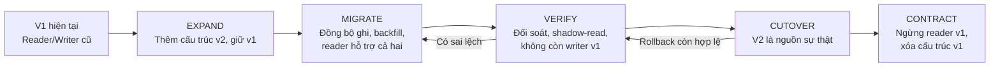

# Đọc hoặc ghi nhiều phiên bản trong giai đoạn chuyển đổi

## 1. Tiến hóa mô hình không diễn ra trong một lần triển khai

Trong module `DATABASE_DATA_MODELING`, ta chuyển yêu cầu nghiệp vụ thành mô hình dữ liệu rõ ràng: từ thực thể, quan hệ, ràng buộc đến chuẩn hóa, khóa, chỉ mục và lược đồ vật lý; sau đó cân nhắc mô hình quan hệ, document, đồ thị và phân tích để dễ kiểm chứng và tiến hóa. Ở chương **Tiến hóa mô hình**, bài toán thực tế là **một thay đổi dữ liệu thường đi qua nhiều phiên bản ứng dụng và nhiều lô dữ liệu cùng tồn tại**.

Giả sử ứng dụng thương mại đang lưu trọng lượng sản phẩm bằng cột `weight_grams INTEGER` (v1). Một phiên bản mới muốn sử dụng `weight_kg NUMERIC(12,3)` (v2), với giá trị canonical theo kilogram. Đội dự kiến triển khai cuốn chiếu:

1. Một số máy chủ vẫn chạy ứng dụng v1, chỉ đọc/ghi `weight_grams`.
2. Một số máy chủ chạy ứng dụng v2, có thể đọc/ghi định dạng mới.
3. Hàng triệu bản ghi lịch sử chưa được chuyển đổi.
4. Các tác vụ nhập liệu và consumer độc lập chưa nâng phiên bản.
5. Pipeline báo cáo có thể đọc cả dữ liệu cũ lẫn dữ liệu mới trong cùng ngày.

Nếu chỉ chạy `ALTER TABLE ... DROP COLUMN weight_grams` trong một lần phát hành, ứng dụng cũ hỏng. Nếu thêm cột mới rồi để từng ứng dụng tự cập nhật hai cột mà không có nguồn sự thật, hai giá trị có thể lệch. Nếu backfill hàng cũ trong khi một writer vẫn đang sửa chúng, một job chạy sai có thể **ghi đè dữ liệu mới hơn**.

**Mục tiêu:** chuyển dần từ v1 sang v2, nhưng tại từng thời điểm đều biết **ai được phép ghi, ai được phép đọc, quy tắc chuyển đổi, bất biến dữ liệu và cách phát hiện sai lệch**.

### Kết quả học tập

Sau bài này, người học có thể:

1. Phân biệt **phiên bản schema**, **phiên bản dữ liệu**, **phiên bản API/event** và **phiên bản ứng dụng**; hiểu vì sao chúng không đổi cùng lúc.
2. Lập kế hoạch `expand → migrate → contract` với compatibility matrix cho reader/writer v1–v2.
3. Thiết kế **dual-read**, fallback, shadow-read, read repair, dual-write có kiểm soát và một **nguồn sự thật** rõ ràng.
4. Phát hiện và giải quyết race giữa backfill, writer cũ/mới, CDC và retry.
5. Chọn transaction cục bộ, trigger, outbox/inbox, idempotency hoặc đồng bộ cuối cùng theo ranh giới database.
6. Đưa vào vận hành các tiêu chí cutover, rollback, deprecation và kiểm tra sau triển khai.
7. Phân biệt chuyển đổi không mất thông tin với thay đổi ngữ nghĩa không thể suy ngược, tránh tạo dữ liệu lịch sử giả.

## 2. Bốn thứ được gọi là “phiên bản” nhưng có vòng đời khác nhau

| Loại phiên bản | Ví dụ | Ai sở hữu? | Điều cần kiểm soát |
|---|---|---|---|
| **Database schema version** | v1 có `weight_grams`; v2 thêm `weight_kg` | Chủ sở hữu lược đồ/DB | DDL, khóa/constraint, index, khả năng ứng dụng cũ còn chạy |
| **Record/data format version** | Hàng legacy chỉ có gram; hàng mới đã có kilogram | Chủ sở hữu dữ liệu + migration | Backfill, null, tính tương đương, provenance |
| **Application version** | App v1 chỉ biết gram; app v2 hiểu cả hai | Mỗi dịch vụ/đội triển khai | Rolling deploy, feature flags, cache và luồng ghi |
| **API/event contract version** | `ProductWeightChanged v1` truyền `weight_grams`; v2 truyền `weight_kg` | Producer của contract | Consumer compatibility, retry, replay, mapping |

Không nên đặt một cột `schema_version = 2` rồi kết luận mọi phần đã ở v2. Cột đó có thể chỉ nói **payload** có cấu trúc v2; ứng dụng hiện tại vẫn đang đọc bảng legacy hoặc consumer vẫn nhận event v1.

### Một nguyên tắc nền tảng

**Chỉ có một nguồn quyết định tính đúng tại một thời điểm chuyển đổi**, ngay cả khi nhiều biểu diễn cùng tồn tại. Ví dụ:

- Giai đoạn A: `weight_grams` là nguồn sự thật, `weight_kg` là biểu diễn dẫn xuất.
- Giai đoạn B: reader mới sử dụng `weight_kg`, nhưng mọi writer vẫn tuân thủ việc ghi `weight_grams` hoặc bảo đảm chuyển đổi có kiểm tra.
- Giai đoạn C: khi không còn writer v1 và điều kiện đảo chiều đã thỏa, `weight_kg` trở thành nguồn sự thật.
- Giai đoạn D: chỉ khi không còn reader v1, loại `weight_grams`.

Hai cột không tự là “hai nguồn sự thật ngang hàng”. Nếu một hệ thống chấp nhận hai giá trị khác nhau mà không có quy tắc chọn, lỗi ngữ nghĩa đã xuất hiện ngay cả khi mọi câu SQL thành công.

## 3. Expand–migrate–contract thay cho “big-bang schema change”



| Pha | Cách làm | Điều bắt buộc chứng minh |
|---|---|---|
| **Expand** | Thêm cột/bảng/index/field mới theo cách ứng dụng cũ vẫn dùng được | App v1 tiếp tục chạy bình thường |
| **Migrate – compatibility** | Bảo vệ ghi cũ và mới, áp converter nhất quán | Không có hàng mới chỉ được ghi ở v1 mà v2 không biết |
| **Migrate – backfill** | Chuyển dữ liệu cũ từng lô, idempotent | Không mất dữ liệu do concurrent writer |
| **Migrate – dual-read** | Reader v2 hiểu cả bản cũ và bản mới | Không sai khi đọc hàng chưa backfill |
| **Verify** | So sánh ngữ nghĩa, số hàng, giá trị, p95, lỗi | Sai lệch có nguyên nhân và ngưỡng được duyệt |
| **Cutover** | Đổi quyền sở hữu ghi và đường đọc mặc định | Không còn đường ghi cũ gây lệch |
| **Contract** | Bỏ field/schema/compatibility code cũ | Consumer, rollback/replay và retention đã sẵn sàng |

**Không phải lúc nào các pha cũng tuyến tính tuyệt đối.** Có thể chạy shadow-read trước khi backfill hoàn tất, hoặc rollout đọc theo tenant; nhưng mọi bước cần **bất biến và điều kiện dừng riêng**. Xóa cấu trúc cũ là hành động khó đảo ngược hơn việc thêm cấu trúc mới, nên phải đi sau chứng cứ.

## 4. Compatibility matrix: ai đọc/ghi được gì?

Trước mỗi deployment, lập ma trận thay vì chỉ ghi “backward compatible”.

| Thành phần | Dữ liệu chỉ có v1 | Dữ liệu có v1 và v2 nhất quán | Dữ liệu chỉ có v2 |
|---|---|---|---|
| **Reader v1** | Đọc được | Đọc được `weight_grams` | **Không đọc được** |
| **Reader v2 có fallback** | Chuyển v1 → v2 khi đọc | Đọc `weight_kg` | Đọc được |
| **Writer v1** | Ghi v1 | Có thể làm v2 lỗi thời nếu thiếu đồng bộ | Không có trường v1 để ghi |
| **Writer v2 dual-write** | Ghi cả hai nếu phép đổi hai chiều xác định | Ghi nhất quán | Có thể tiếp tục ghi cả hai trong pha overlap |
| **Writer v2-only** | Chưa an toàn khi reader v1 còn sống | Chỉ an toàn sau khi chấm dứt phụ thuộc v1 | Phù hợp trạng thái cuối |

Ma trận cho thấy một điểm nguy hiểm: **reader v2 hỗ trợ fallback chưa đủ**. Nếu writer v1 vẫn sửa `weight_grams` mà không cập nhật `weight_kg`, reader mới ưu tiên giá trị v2 có thể đọc giá trị **cũ hơn**.

Đồng thời, **dual-write ở ứng dụng mới chưa đủ** khi còn các writer cũ, SQL batch, import job hoặc CDC handler chưa nâng phiên bản. Phải thống kê tất cả các **đường ghi thực tế**, không chỉ HTTP endpoint chính.

### Phân biệt các chiều tương thích

- **Backward-readable:** code mới đọc được dữ liệu cũ.
- **Forward-readable:** code cũ chịu được dữ liệu được viết bởi code mới.
- **Backward-writable:** code cũ ghi mà không phá cấu trúc/giá trị mới.
- **Forward-writable:** code mới ghi mà không phá dữ liệu cần cho code cũ.
- **Semantic compatibility:** kết quả sau chuyển đổi vẫn đúng **ý nghĩa nghiệp vụ**, không chỉ đúng kiểu.

Một schema có thể tương thích cú pháp nhưng không tương thích nghĩa. Ví dụ đổi `amount` từ **đơn vị cent** sang **đơn vị đồng** nhưng giữ kiểu `INTEGER` sẽ không bị bộ kiểm tra kiểu dữ liệu phát hiện.

## 5. Ví dụ chính: chuyển gram sang kilogram trong PostgreSQL 16

Ta dùng một phép đổi có thể kiểm tra tính tương đương:

\[
\mathrm{weight\_kg}=\frac{\mathrm{weight\_grams}}{1000}
\]

Giả định nghiệp vụ: mỗi sản phẩm có một trọng lượng vận chuyển, có thể chưa biết (`NULL`), không âm, và **độ chính xác hiện tại là một gram**. `0` là giá trị 0 thật, **không đồng nghĩa chưa biết**. Phạm vi một tenant và một sản phẩm được xác định bằng khóa ghép.

### 5.1. Schema v1 ban đầu

```sql
CREATE TABLE product_shipping_profile (
    tenant_id BIGINT NOT NULL,
    product_id BIGINT NOT NULL,
    weight_grams INTEGER,
    updated_at TIMESTAMPTZ NOT NULL DEFAULT CURRENT_TIMESTAMP,
    CONSTRAINT pk_product_shipping_profile
        PRIMARY KEY (tenant_id, product_id),
    CONSTRAINT ck_weight_grams_nonnegative
        CHECK (weight_grams IS NULL OR weight_grams >= 0)
);

INSERT INTO product_shipping_profile (
    tenant_id, product_id, weight_grams
)
VALUES
    (42, 1001, 1250),
    (42, 1002, 0),
    (42, 1003, NULL);
```

Cả ba hàng hợp lệ:

- Sản phẩm 1001: 1.250 kg.
- Sản phẩm 1002: 0.000 kg, không được xem là thiếu.
- Sản phẩm 1003: `NULL`, tức chưa biết theo hợp đồng ví dụ.

**Không tự đổi `NULL` thành 0 khi backfill.** Nếu trọng lượng chưa đo được, ghi 0 làm dữ liệu có vẻ hoàn chỉnh nhưng dẫn đến tính phí vận chuyển sai.

### 5.2. Expand: thêm cột v2 nhưng giữ nguyên v1

```sql
ALTER TABLE product_shipping_profile
    ADD COLUMN weight_kg NUMERIC(12, 3);
```

Thêm cột nullable không có giá trị mặc định lớn thường là thay đổi metadata tương đối nhẹ trong PostgreSQL, **nhưng vẫn cần khóa DDL và kế hoạch migration**. Không mặc định mọi `ALTER TABLE` đều “zero downtime”; phải thử với kích thước bảng, thời điểm tải và phiên bản DBMS thực tế.

Ngay sau DDL, các hàng cũ vẫn có `weight_kg IS NULL`; ứng dụng v1 không biết cột mới và tiếp tục chạy được. **Chưa cho reader mới tin tuyệt đối vào `weight_kg`.**

## 6. Một chiều ghi có thẩm quyền trong giai đoạn overlap

Trong giai đoạn app v1 còn ghi, ta chọn `weight_grams` là **canonical source of truth**. Cột `weight_kg` chỉ là dẫn xuất có thể tính lại từ `weight_grams`.

Một trigger tạm thời trong PostgreSQL bảo vệ cả các writer cũ chưa nâng code:

```sql
CREATE OR REPLACE FUNCTION product_weight_v1_to_v2()
RETURNS TRIGGER
LANGUAGE plpgsql
AS $$
DECLARE
    expected_kg NUMERIC(12, 3);
BEGIN
    -- Theo hợp đồng hiện tại, phép đổi chính xác đến một gram.
    expected_kg := (NEW.weight_grams::numeric / 1000)::numeric(12, 3);

    IF TG_OP = 'INSERT' THEN
        -- App cũ không gửi weight_kg (NULL mặc định): được chấp nhận.
        -- App mới gửi weight_kg khác giá trị suy từ v1: từ chối.
        IF NEW.weight_kg IS NOT NULL
           AND NEW.weight_kg IS DISTINCT FROM expected_kg THEN
            RAISE EXCEPTION
                'weight_kg conflicts with canonical weight_grams'
                USING ERRCODE = '23514';
        END IF;
    ELSE
        -- Nếu client CHỦ ĐỘNG đổi weight_kg, giá trị phải khớp v1.
        -- Writer cũ chỉ đổi grams: weight_kg chưa đổi so với OLD,
        -- và trigger sẽ tính lại biểu diễn dẫn xuất.
        IF NEW.weight_kg IS DISTINCT FROM OLD.weight_kg
           AND NEW.weight_kg IS DISTINCT FROM expected_kg THEN
            RAISE EXCEPTION
                'weight_kg conflicts with canonical weight_grams'
                USING ERRCODE = '23514';
        END IF;
    END IF;

    NEW.weight_kg := expected_kg;
    RETURN NEW;
END;
$$;

CREATE TRIGGER trg_product_weight_v1_to_v2
BEFORE INSERT OR UPDATE ON product_shipping_profile
FOR EACH ROW
EXECUTE FUNCTION product_weight_v1_to_v2();
```

Giải thích:

1. Writer v1 gửi `weight_grams = 1500`; trigger tính `weight_kg = 1.500` trong **cùng transaction/hàng**.
2. Writer v2 tạm thời gửi **cả** `weight_grams = 1750` và `weight_kg = 1.750`; trigger xác minh hai biểu diễn đồng nghĩa.
3. Nếu một request chỉ gửi `weight_kg = 1.750` nhưng giữ `weight_grams = 1500`, trigger từ chối thay vì im lặng cho phép hai nguồn sự thật.
4. Nếu cần cập nhật từ cả hai giao diện, **API mới phải đổi kg → grams theo quy tắc chính xác rồi gửi cả hai**; không được giả định trigger này hỗ trợ v2-only.
5. `NULL` được giữ làm thiếu dữ liệu, khác `0`; biểu thức tính từ `NULL` cho ra `NULL`.

**Ranh giới của ví dụ:** trigger bảo vệ các lệnh thông thường chạy qua PostgreSQL với trigger được bật. Các đường ghi đặc quyền, replication, import đặc biệt hay thao tác tạm vô hiệu trigger phải nằm trong quyền và quy trình riêng. Trigger cũng không tự chứng minh giá trị trọng lượng là chính xác ngoài thế giới thực.

### 6.1. Thử với cả writer cũ và mới

```sql
-- Writer v1 chỉ đổi cột legacy.
UPDATE product_shipping_profile
SET weight_grams = 1500,
    updated_at = CURRENT_TIMESTAMP
WHERE tenant_id = 42 AND product_id = 1001;

-- Writer v2 đang ở chế độ dual-write.
UPDATE product_shipping_profile
SET weight_grams = 1750,
    weight_kg = 1.750,
    updated_at = CURRENT_TIMESTAMP
WHERE tenant_id = 42 AND product_id = 1001;

-- Truy vấn kiểm tra hai biểu diễn.
SELECT tenant_id, product_id, weight_grams, weight_kg
FROM product_shipping_profile
WHERE tenant_id = 42 AND product_id = 1001;
```

Đoạn trên chỉ nên chạy trên dữ liệu thử. Kết quả cuối của sản phẩm 1001 là `weight_grams = 1750`, `weight_kg = 1.750`. Nếu các thao tác cập nhật đồng thời cùng một sản phẩm, PostgreSQL điều phối khóa hàng để các update tuần tự theo thứ tự thực thi; nhưng chính sách **tránh lost update theo yêu cầu người dùng** vẫn cần optimistic version hoặc điều kiện ghi có kiểm tra.

## 7. Dual-read: ưu tiên định dạng mới nhưng fallback có kiểm soát

Khi cột mới chưa được backfill hết, reader v2 cần hiểu cả hai biểu diễn:

```sql
SELECT
    tenant_id,
    product_id,
    CASE
        WHEN weight_kg IS NOT NULL THEN weight_kg
        WHEN weight_grams IS NOT NULL
            THEN (weight_grams::numeric / 1000)::numeric(12, 3)
        ELSE NULL
    END AS effective_weight_kg,
    CASE
        WHEN weight_kg IS NOT NULL THEN 'V2'
        WHEN weight_grams IS NOT NULL THEN 'V1_FALLBACK'
        ELSE 'UNKNOWN'
    END AS read_source
FROM product_shipping_profile;
```

Ở đây, `read_source` là tín hiệu kỹ thuật hữu ích để đo tỷ lệ fallback. **Không lấy `COALESCE(weight_kg, 0)`** vì 0 là trọng lượng thực, còn `NULL` có thể là chưa biết. Nếu chưa có trigger hoặc luồng ghi đồng bộ đáng tin, “ưu tiên v2” có thể trả giá trị **lỗi thời**, nên chỉ bật sau khi đã bảo vệ write path.

### 7.1. Các chế độ đọc có mục đích khác nhau

| Chế độ | Cách hoạt động | Lợi ích | Rủi ro |
|---|---|---|---|
| **V1 primary, V2 shadow** | Trả kết quả v1, tính v2 để so sánh nhưng không ảnh hưởng người dùng | Quan sát sai lệch trước cutover | Tốn CPU/I/O, cần bảo vệ dữ liệu cá nhân trong log |
| **V2 preferred, V1 fallback** | Có v2 thì đọc v2; nếu thiếu thì chuyển v1 | Triển khai reader mới khi backfill chưa xong | Nếu v2 stale, fallback không kích hoạt; cần đối soát |
| **V2 only** | Đọc duy nhất v2 | Đơn giản, giảm nhánh code | Chỉ an toàn khi coverage và writer đã đạt ngưỡng |
| **Read repair** | Khi phát hiện v2 thiếu, bổ sung từ v1 theo chính sách | Tăng tốc chuyển đổi dữ liệu “nóng” | Có write-on-read, race, retry, side effect |

**Read repair không được mặc định chạy `UPDATE` trong mọi câu `SELECT`.** Ứng dụng đọc nhiều lần có thể gây bùng nổ ghi, deadlock và khác biệt latency. Nếu dùng, phải gửi tác vụ idempotent và kiểm tra dữ liệu chưa bị writer mới sửa trước khi cập nhật.

### 7.2. Shadow-read nên so ngữ nghĩa thay vì so chuỗi hiển thị

Không so `"1.25"` và `"1.250"` bằng chuỗi rồi kết luận lỗi; đây là hai cách biểu diễn cùng giá trị số. Ngược lại, `"1.25kg"` và `"1250g"` trông khác nhưng cùng lượng nếu đúng quy tắc đơn vị.

So sánh sau **chuẩn hóa có kiểm tra**:

- Giá trị số và đơn vị canonical.
- `NULL`/không áp dụng/không biết theo hợp đồng.
- Độ chính xác và cách làm tròn.
- Phạm vi định danh (`tenant_id`, `product_id`).
- Phiên bản dữ liệu và thời điểm nguồn; không đối chiếu hai snapshot ghi khác nhau rồi coi là drift.

Shadow-read thường phải có metric `disagreement_count`, `fallback_ratio`, sample mismatch và latency riêng. Chỉ log các khóa cần thiết; không gửi giá trị nhạy cảm vào telemetry ngoài phạm vi truy cập.

## 8. Backfill không được đè lên cập nhật đồng thời

Sau khi trigger đã bảo vệ đường ghi mới, ta chuyển các hàng legacy còn thiếu biểu diễn v2 theo từng lô. Điều kiện **idempotent**:

> Chạy lại một lô không làm khác kết quả khi dữ liệu nguồn không đổi; khi nguồn đổi trong lúc lô chạy, bản ghi được chuyển theo phiên bản nguồn **mới nhất được khóa và đọc**.

Trong PostgreSQL 16:

```sql
WITH batch AS (
    SELECT tenant_id, product_id
    FROM product_shipping_profile
    WHERE weight_kg IS DISTINCT FROM
          (weight_grams::numeric / 1000)::numeric(12,3)
    ORDER BY tenant_id, product_id
    LIMIT 500
    FOR UPDATE SKIP LOCKED
)
UPDATE product_shipping_profile AS p
SET weight_kg =
        (p.weight_grams::numeric / 1000)::numeric(12,3)
FROM batch AS b
WHERE p.tenant_id = b.tenant_id
  AND p.product_id = b.product_id
RETURNING p.tenant_id, p.product_id,
          p.weight_grams, p.weight_kg;
```

Điểm cần hiểu:

- `FOR UPDATE SKIP LOCKED` cho phép nhiều worker xử lý các hàng khác nhau; không ngăn writer nghiệp vụ theo nghĩa toàn cục.
- `UPDATE` vẫn chạy trigger nên v2 được tính lại từ giá trị `weight_grams` hiện thời theo chính sách v1-authoritative.
- Mỗi lô nhỏ giúp giảm thời gian giữ lock và áp lực WAL; kích cỡ 500 chỉ để minh họa, cần benchmark.
- Khi một hàng đang bị writer khác khóa, job có thể **bỏ qua tạm thời** và xử lý ở lượt sau. Do đó không kết luận “đã hoàn tất” chỉ vì một batch trả 0 hàng trong lúc tải ghi còn tiếp diễn.
- Nếu dữ liệu legacy có trạng thái lỗi, chuyển ngoại lệ ra báo cáo; không tự thay `NULL`/số âm/giá trị ngoài miền bằng số giả để đạt tiến độ.

### 8.1. Race cổ điển nếu backfill làm ở ngoài transaction

```text
Thời điểm     Worker backfill                  Writer ứng dụng
-----------   --------------------------------  ----------------------
t1            Đọc weight_grams = 1250
t2                                               Đổi grams thành 1500
t3            Ghi weight_kg = 1.250 (từ snapshot cũ)
t4            Reader v2 thấy 1.250, reader v1 thấy 1500
```

Đây là mô hình lỗi khi job đọc rồi ghi hai bước thiếu điều kiện. Chỉ thêm một delay hay retry không bảo đảm sửa hết. Một giao thức an toàn là:

- Tính trực tiếp từ hàng được khóa trong câu `UPDATE`/transaction.
- Hoặc dùng **optimistic compare-and-set** theo `row_version`/giá trị nguồn, chỉ ghi nếu phiên bản không đổi.
- Có trigger/constraint bảo vệ bất biến tương đương trong suốt giai đoạn overlap.
- Đối soát sau backfill và tiếp tục giám sát drift khi writer cũ còn tồn tại.

### 8.2. Optimistic concurrency cho thao tác nghiệp vụ

Nếu nhiều người có thể đồng thời sửa trọng lượng của cùng sản phẩm, trigger chỉ bảo vệ **hai đơn vị đồng nhất**; nó không bảo vệ yêu cầu “người cập nhật sau không ghi đè thay đổi người cập nhật trước mà không biết”. Một cột `row_version` có thể hỗ trợ:

```sql
ALTER TABLE product_shipping_profile
    ADD COLUMN row_version BIGINT NOT NULL DEFAULT 1;

-- Câu UPDATE của API chỉ được thực hiện khi version người dùng đã đọc
-- vẫn là version hiện tại. Nếu RETURNING 0 hàng: báo conflict.
UPDATE product_shipping_profile
SET weight_grams = 2000,
    row_version = row_version + 1,
    updated_at = CURRENT_TIMESTAMP
WHERE tenant_id = 42
  AND product_id = 1001
  AND row_version = 1
RETURNING tenant_id, product_id, row_version, weight_grams, weight_kg;
```

Khi thực sự vận hành, mọi đường ghi thay đổi payload cần tuân thủ versioning, không chỉ API mới; nếu writer v1 bỏ qua `row_version` thì optimistic concurrency chưa được bảo đảm toàn cục. Có thể dùng DB trigger tăng version theo mọi cập nhật nghiệp vụ, nhưng phải phân biệt update backfill kỹ thuật để tránh tăng version làm sai xung đột của người dùng.

## 9. Kiểm tra đồng nhất sau backfill bằng SQL có nghĩa rõ

```sql
-- Giá trị drift phải bằng 0 trước khi tin v2 hoàn toàn.
SELECT COUNT(*) AS mismatched_rows
FROM product_shipping_profile
WHERE weight_kg IS DISTINCT FROM
      (weight_grams::numeric / 1000)::numeric(12,3);

-- Mô tả coverage (không đếm hàng NULL/NULL là sai lệch).
SELECT
    COUNT(*) AS total_rows,
    COUNT(*) FILTER (WHERE weight_grams IS NOT NULL)
        AS rows_with_known_weight_v1,
    COUNT(*) FILTER (WHERE weight_kg IS NOT NULL)
        AS rows_with_known_weight_v2,
    COUNT(*) FILTER (
        WHERE weight_grams IS NOT NULL AND weight_kg IS NULL
    ) AS rows_missing_v2
FROM product_shipping_profile;
```

**Không dùng `weight_kg <> weight_grams / 1000` để kiểm tra toàn bộ**, vì phép so sánh với SQL `NULL` trả UNKNOWN, những hàng có một phía NULL có thể không xuất hiện trong kết quả. `IS DISTINCT FROM` xem NULL là một trạng thái có thể so sánh một cách xác định.

Khi bảng rất lớn, một kiểm tra toàn bảng có thể tốn I/O. Có thể chia theo tenant/range khóa và chạy lặp với checkpoint, nhưng phải công khai rằng **sampling không chứng minh không có sai lệch**; tại cutover có thể cần full validation hoặc constraint DB được kiểm chứng.

### 9.1. Bổ sung constraint sau khi dữ liệu sạch

Khi đã backfill và sửa dữ liệu lệch:

```sql
ALTER TABLE product_shipping_profile
ADD CONSTRAINT ck_weight_v1_v2_equivalence
CHECK (
    weight_kg IS NOT DISTINCT FROM
        (weight_grams::numeric / 1000)::numeric(12,3)
) NOT VALID;

ALTER TABLE product_shipping_profile
    VALIDATE CONSTRAINT ck_weight_v1_v2_equivalence;
```

`NOT VALID` cho phép thêm `CHECK` mà không quét toàn bộ dữ liệu ngay khi khai báo; constraint mới vẫn được thực thi cho các hàng ghi tiếp theo theo cách PostgreSQL áp dụng. `VALIDATE CONSTRAINT` kiểm tra dữ liệu cũ. Đây là kỹ thuật giảm phạm vi một số thao tác, **không bảo đảm không có lock hoặc không có ảnh hưởng hiệu năng**.

Constraint này phản ánh **quy tắc chuyển đổi cụ thể đến 1 gram**. Nếu sau này v2 cho phép trọng lượng có độ chính xác nhỏ hơn 1 gram, không thể ép ngược về integer grams mà không mất thông tin; phải thay hợp đồng, lộ trình cắt reader/writer cũ và constraint theo tiêu chí mới. **Đừng duy trì vĩnh viễn constraint chỉ vì đã viết nó trong migration.**

## 10. Dual-write: “cùng ghi hai nơi” không đồng nghĩa atomic

Có nhiều dạng dual-write rất khác nhau:

| Trường hợp | Có thể atomic trong một transaction DB? | Cần lưu ý |
|---|---|---|
| Hai cột trên **cùng một hàng** của một DB | Có, bằng update/trigger/constraint | Bất biến chuyển đổi, race nghiệp vụ, chi phí ghi |
| Hai bảng **cùng một database** | Có, nếu mọi thay đổi chung transaction | Ghi phải qua owner/giao thức thống nhất |
| Hai database độc lập | Thường không atomic nếu chỉ dùng hai lời gọi | Chết giữa hai commit gây lệch; cần chiến lược đồng bộ |
| DB + message broker | Không atomic bằng hai lệnh gửi tự do | Transactional outbox/inbox, retry/idempotency |
| OLTP + search index/warehouse | Thường eventual consistency | CDC/stream, watermark, reconciliation, replay |

**Sai lầm thường gặp:**

```text
API handler:
  UPDATE database_v1
  UPDATE database_v2
  return HTTP 200
```

Nếu commit v1 thành công rồi v2 lỗi, hệ thống lệch. Nếu request retry, có thể v1 cập nhật lại, v2 nhân event hoặc làm sai thứ tự. Dùng `try/catch` hay retry đơn giản **không tạo atomicity** giữa hai hệ thống.

### Một nguồn ghi và dữ liệu dẫn xuất

Nếu tách v2 sang database mới, thiết kế thường an toàn hơn:

1. Chọn DB nào là **source of truth** trong từng pha.
2. Ghi nghiệp vụ vào DB đó với revision/event ID ổn định.
3. Ghi outbox **cùng transaction** với thay đổi nguồn.
4. Đồng bộ sang DB đích bằng consumer idempotent, bảo vệ thứ tự theo aggregate.
5. Đối soát lag, số phiên bản, số record và nội dung giữa hai phía.
6. Chỉ cắt đọc sang v2 sau khi độ trễ/coverage/semantics đạt tiêu chí.

Đây là **nhất quán cuối cùng có kiểm soát**; một request có thể thấy v1 mới hơn v2 trong một khoảng ngắn. API/read path phải công bố hoặc xử lý yêu cầu consistency của người dùng thay vì giả vờ hai DB luôn đồng bộ.

## 11. Outbox/CDC: chuyển dữ liệu mà không bỏ sót sự kiện

Một bảng outbox tối thiểu minh họa, thuộc **database nguồn**:

```sql
CREATE TABLE migration_outbox (
    event_id UUID PRIMARY KEY,
    tenant_id BIGINT NOT NULL,
    entity_type VARCHAR(60) NOT NULL,
    entity_id BIGINT NOT NULL,
    entity_revision BIGINT NOT NULL,
    event_type VARCHAR(100) NOT NULL,
    payload JSONB NOT NULL,
    created_at TIMESTAMPTZ NOT NULL DEFAULT CURRENT_TIMESTAMP,
    delivered_at TIMESTAMPTZ,
    CONSTRAINT ck_migration_event_revision
        CHECK (entity_revision > 0),
    CONSTRAINT ck_migration_payload_object
        CHECK (jsonb_typeof(payload) = 'object')
);

CREATE INDEX idx_migration_outbox_pending
    ON migration_outbox (created_at, event_id)
    WHERE delivered_at IS NULL;
```

Với một update nghiệp vụ, bản ghi nguồn và event phải được commit **cùng transaction**. Trong trường hợp ví dụ, có thể phát event `ProductWeightChanged` mang `weight_grams`/`weight_kg` và revision; consumer sử dụng revision để bỏ bản cũ.

**Outbox không tự tạo exactly-once delivery.** Publisher có thể gửi thành công nhưng mất ACK, rồi gửi lại. Consumer cần inbox/ledger có `event_id` duy nhất, xử lý cùng transaction với hiệu ứng dữ liệu đích. Một schema chỉ có `delivered_at` không giải quyết thứ tự và việc consumer đã commit hay chưa.

### CDC và “snapshot + stream” có một đường đua riêng

Khi sao chép dữ liệu từ database cũ sang database mới, quy trình hay có:

1. Lấy **snapshot/backfill** dữ liệu hiện có.
2. Theo dõi **change stream** (CDC) để bắt cập nhật xảy ra trong lúc snapshot chạy.

Nếu bắt stream quá muộn, sẽ có **khoảng trống**; nếu áp stream và snapshot không kiểm soát thứ tự, snapshot cũ có thể **ghi đè** một update mới.

Giải pháp cần **high-watermark/LSN hoặc checkpoint** phù hợp với engine, cùng phép apply theo phiên bản monotonic. Đừng viết “copy hết bảng, sau đó mới bật CDC” rồi giả định không mất thay đổi trong lúc copy.

### Phân biệt offset và business revision

Offset trong một broker/partition cho biết vị trí xử lý, không nhất thiết là version của một thực thể khi nhiều nguồn ghi. Với cùng sản phẩm, cần quy tắc ordering theo entity ID, sequence do nguồn cấp hoặc timestamp được chứng minh đủ phân giải — không dùng `received_at` để quyết định bản nào “mới hơn” khi event đến ngược thứ tự.

## 12. Ghi ở nơi mới bằng so sánh revision

Một record nguồn có revision tăng đơn điệu theo **mỗi thực thể** cho phép consumer bỏ update cũ đến muộn.

Ví dụ bảng đích tách riêng (PostgreSQL để minh họa hành vi, nhưng về triển khai có thể ở database khác):

```sql
CREATE TABLE product_weight_projection_v2 (
    tenant_id BIGINT NOT NULL,
    product_id BIGINT NOT NULL,
    weight_kg NUMERIC(12,3),
    source_revision BIGINT NOT NULL,
    updated_from_event UUID NOT NULL,
    CONSTRAINT pk_weight_projection_v2
        PRIMARY KEY (tenant_id, product_id),
    CONSTRAINT ck_weight_projection_revision
        CHECK (source_revision > 0),
    CONSTRAINT ck_weight_kg_nonnegative
        CHECK (weight_kg IS NULL OR weight_kg >= 0)
);

-- Áp sự kiện có revision 15; retry revision 15 hoặc event 14 không ghi đè.
INSERT INTO product_weight_projection_v2 (
    tenant_id, product_id, weight_kg,
    source_revision, updated_from_event
)
VALUES (
    42, 1001, 1.750,
    15, '00000000-0000-4000-8000-000000000015'::uuid
)
ON CONFLICT (tenant_id, product_id)
DO UPDATE SET
    weight_kg = EXCLUDED.weight_kg,
    source_revision = EXCLUDED.source_revision,
    updated_from_event = EXCLUDED.updated_from_event
WHERE product_weight_projection_v2.source_revision
      < EXCLUDED.source_revision;
```

**Giới hạn quan trọng:** câu `ON CONFLICT ... WHERE revision < ...` bảo vệ không ghi đè bởi revision nhỏ hơn, nhưng nếu **cùng revision mang payload khác**, nó sẽ im lặng không cập nhật. Consumer cần phát hiện và báo lỗi **revision collision**, đối soát hash/nội dung canonical hoặc lưu ledger. Nó cũng chỉ có tác dụng khi nguồn thực sự bảo đảm revision tăng đúng trên từng thực thể.

Với thao tác delete/tombstone, bảng đích phải lưu trạng thái xóa hoặc revision của tombstone. Nếu xóa hẳn hàng projection và quên revision cuối, một sự kiện update cũ đến trễ có thể **hồi sinh** bản ghi đã xóa.

## 13. Khi nào cần nhiều writer, và khi nào nên từ chối?

Không nên để v1 và v2 **cùng được phép ghi độc lập** nếu chưa có giao thức giải quyết xung đột. “Multi-master” làm nảy sinh câu hỏi mà việc đổi schema không giải quyết:

- Nếu v1 ghi 1,250 kg lúc t1 và v2 ghi 1,300 kg lúc t2 nhưng event t2 đến trước t1, giá trị nào thắng?
- Nếu mỗi hệ có đồng hồ sai, `last write wins` dựa vào timestamp nào?
- Nếu một bên cập nhật trọng lượng còn bên kia cập nhật đơn vị/nguồn đo, có nên merge field không?
- Nếu nghiệp vụ yêu cầu người dùng xác nhận xung đột, liệu có được tự chọn một phía?

### Những lựa chọn có căn cứ

| Chính sách | Khi phù hợp | Cần bảo vệ |
|---|---|---|
| **Single writer/source of truth** | Phần lớn migration OLTP | Hành trình ghi rõ, sự kiện dẫn xuất và read model |
| **Single owner + adapters** | Nhiều API/consumer vẫn cần format khác | Mọi thay đổi đi qua owner; không ghi ngược vào DB projection |
| **Optimistic concurrency / CAS** | Nhiều yêu cầu sửa cùng một aggregate | Bản revision mong đợi, xử lý conflict ở client |
| **Application-level merge** | Các field độc lập có quy tắc gộp được phê duyệt | Provenance, thứ tự và ràng buộc liên field |
| **Last-write-wins** | Chỉ khi chấp nhận mất một cập nhật và nguồn thời gian/order đáng tin | Clock skew, tie, audit; không phù hợp nhiều dữ liệu tài chính |
| **CRDT/commutative operations** | Có phép toán thực sự kết hợp/giao hoán | Không áp dụng tùy tiện cho mỗi field |

Với trọng lượng sản phẩm, **single writer + CAS** thường đơn giản và dễ kiểm chứng hơn cố hỗ trợ mọi writer v1/v2 cùng quyền sửa trong suốt migration.

## 14. Phiên bản hợp đồng API và event không đồng nghĩa phiên bản schema DB

Giả sử bên ngoài đang nhận:

```json
{
  "event_id": "evt-81001",
  "event_type": "catalog.product-weight-changed",
  "schema_version": 1,
  "product_ref": "SKU-1001",
  "weight_grams": 1750
}
```

Một contract v2 có thể là:

```json
{
  "event_id": "evt-81001",
  "event_type": "catalog.product-weight-changed",
  "schema_version": 2,
  "product_ref": "SKU-1001",
  "shipping_weight": {
    "value": "1.750",
    "unit": "kg"
  }
}
```

Hai JSON trên diễn tả **cùng một sự kiện logic** ở hai cách biểu diễn cho ví dụ. Trong thực tế, phải định nghĩa chính sách ID khi dual-publish: nếu cùng consumer đăng ký cả v1 và v2, nó **không được tính đó là hai lần thay đổi trọng lượng**. Có thể dùng cùng `logical_event_id` và dedup theo mục đích, hoặc phát vào các kênh tách rõ phiên bản với migration consumer có kiểm soát.

### Read/write compatibility của API

- Consumer v1 có thể không hiểu object `shipping_weight` của v2.
- Consumer v2 nên có decoder v1 để xử lý event cũ còn trong retention hoặc được replay.
- Nếu producer phát đồng thời v1/v2, phải xác định bộ nào được consumer nào nhận và khi nào ngừng bản cũ.
- Các field tùy chọn, enum mới và thay đổi `NULL` cần test; JSON schema có thể đúng nhưng ngữ nghĩa đơn vị vẫn sai.
- Dữ liệu tiền hoặc đo lường nên có kiểu/độ chính xác và đơn vị rõ; không chỉ thay tên `weight`.

**Đừng cập nhật contract bằng cách đổi nghĩa field cũ tại chỗ.** Nếu hôm qua `weight` là gram, hôm nay lại là kilogram mà vẫn giữ tên/kiểu số, consumer có thể nhân hoặc chia 1.000 lần mà không phát hiện bằng parser.

## 15. Phiên bản dữ liệu trong document/JSON và DB schema

Với document database hoặc cột JSONB, việc bổ sung field không nhất thiết cần DDL, nhưng **hợp đồng dữ liệu vẫn phải version** khi cấu trúc hoặc ngữ nghĩa thay đổi:

```json
{
  "product_ref": "SKU-1001",
  "schema_version": 2,
  "shipping_weight": {
    "unit": "kg",
    "value": "1.750"
  }
}
```

Một document versioned cần trả lời:

1. `schema_version` thuộc **toàn document**, một thành phần hay một event?
2. Giá trị v1 có thể chuyển lossless sang v2 không? Nếu không, trường nào là “chưa xác định”?
3. Decoder dùng nhánh nào khi `schema_version` thiếu hoặc không hợp lệ?
4. Hệ có cho phép **mixed-version collection** hay phải backfill trước khi đọc v2-only?
5. Nếu concurrent update một subdocument, có `etag`/revision hoặc optimistic CAS bảo vệ không?
6. Index/mapping truy vấn qua field cũ và mới có thể trả dữ liệu trùng/thiếu như thế nào?

Một pattern truy vấn JSONB tạm thời có thể là:

```sql
-- Giả định bảng document staging: product_payload(product_ref, payload JSONB).
-- Câu SQL mang tính minh họa, bảng này không nằm trong DDL mục 5.
SELECT
    product_ref,
    CASE
        WHEN payload ->> 'schema_version' = '2'
            THEN (payload #>> '{shipping_weight,value}')::numeric
        WHEN payload ->> 'schema_version' = '1'
            THEN ((payload ->> 'weight_grams')::numeric / 1000)
        ELSE NULL
    END AS normalized_weight_kg
FROM product_payload;
```

**Cẩn trọng:** toán tử ép kiểu `::numeric` có thể gây lỗi nếu payload chưa được validate. Trong pipeline thực, trước khi cast phải kiểm tra JSON type, miền số, đơn vị, `NULL`, khóa vắng và version. `CASE ELSE NULL` trong minh họa cũng không đủ làm chính sách production cho version không hỗ trợ: cần quarantine/cảnh báo, không âm thầm biến lỗi dữ liệu thành giá trị chưa biết.

### Mapping không thể đảo ngược

Ví dụ chuyển `full_name` thành `first_name`/`last_name`, hoặc địa chỉ văn bản thành cấu trúc quốc gia/tỉnh/đường, có thể **không tồn tại phép tách đúng cho mọi dữ liệu cũ**. Không được đánh dấu bản ghi v2 “đã xác thực” chỉ vì một heuristic tách chuỗi chạy thành công.

Một mô hình tốt sẽ:

- Giữ giá trị nguồn nguyên văn và nguồn xác minh khi cần.
- Có trạng thái chuyển đổi như `PARSED`, `MANUAL_REVIEW`, `UNRESOLVED`.
- Chỉ sử dụng field mới cho quyết định nghiệp vụ nếu đủ tin cậy.
- Không dùng dual-write chiều ngược nếu phép ghép làm mất sắc thái hoặc thay đổi nghĩa.

## 16. Sự khác nhau giữa chuyển đổi không mất thông tin và thay đổi mô hình nghiệp vụ

| Thay đổi | Có thể chuyển một–một? | Rủi ro thực tế |
|---|---|---|
| `weight_grams INTEGER` → `weight_kg NUMERIC(12,3)` với độ chính xác 1 g | Có, trong miền dữ liệu hiện tại | Mở rộng độ chính xác sau này có thể phá khả năng ghi ngược |
| `price_cents` → decimal price với currency xác định | Có điều kiện | Phải chốt đơn vị nhỏ nhất, currency và làm tròn |
| `full_name` → `given_name`/`family_name` | Không tổng quát | Văn hóa tên khác nhau; heuristic có thể sai |
| `status_text` → enum trạng thái mới | Có điều kiện | Nhiều giá trị cũ không tương ứng 1–1 với state mới |
| `order.shipping_address_text` → address có cấu trúc | Không tổng quát | Dữ liệu thiếu/nhập không chuẩn; cần xác minh |
| Một order có một payment → nhiều payment transactions | Không tương đương đơn giản | Thay cardinality và grain, không thể suy lịch sử thanh toán từ order hiện trạng |
| Một customer → party roles buyer/payer/recipient | Không phải rename field | Identity và vai trò khác nhau, cần hợp đồng |
| Dòng fact theo đơn → dòng fact theo từng event | Thay grain | Dễ nhân số liệu và mất idempotency nếu không định danh event |

**Đổi schema không đồng nghĩa dữ liệu mang được toàn bộ ngữ nghĩa mới.** Nếu v2 yêu cầu một thuộc tính mà v1 không bao giờ ghi nhận, backfill không thể tạo sự thật lịch sử từ khoảng trống. Phải ghi nhận giới hạn nguồn và xử lý ngoại lệ.

## 17. Dữ liệu dẫn xuất: projection, materialized view và search index

Đôi khi v2 không chỉ là một cột mới mà là một **read model khác**:

- OLTP ghi đơn hàng chuẩn hóa; v2 có document search phục vụ tìm kiếm.
- Các thay đổi tài khoản được phát thành event; v2 dựng bảng `customer_summary`.
- Dòng sự kiện theo thời gian được tổng hợp vào rollup 5 phút/1 giờ.
- Dữ liệu fact giao dịch được ánh xạ vào star schema của data warehouse.

Trong các trường hợp đó, **dual-write** nên được hiểu là **nguồn ghi một lần, hệ dẫn xuất cập nhật theo change stream** nếu kiến trúc cho phép, không phải mỗi API ghi thẳng vào mọi kho.

### Ba điều cần đối soát

1. **Coverage:** mọi thực thể hoặc sự kiện đủ điều kiện từ nguồn có mặt ở projection?
2. **Freshness:** projection đang chậm nguồn bao nhiêu, và khi nào API cần đọc trực tiếp nguồn?
3. **Semantic equivalence:** phép biến đổi có giữ đúng tên, mã, đơn vị, thời điểm, grain và trạng thái không?

Số hàng không phải lúc nào cũng bằng nhau giữa v1 và v2: một order có nhiều lines; một event có thể sinh nhiều index documents; một fact có thể được tổng hợp vào một bucket. Đối soát phải dựa trên **quan hệ grain được định nghĩa**, không ép hai bảng khác grain có cùng row count.

## 18. Cutover đọc: từ shadow sang v2-only

Một lộ trình an toàn:

1. **Shadow-read:** reader v1 trả kết quả cho người dùng, reader v2 chạy song song để so sánh (có giới hạn sampling và tài nguyên).
2. **Canary:** một tenant/nhóm yêu cầu nhỏ sử dụng v2; các tenant khác dùng v1.
3. **Progressive rollout:** tăng dần tỷ lệ theo metrics và khả năng rollback.
4. **V2 preferred:** reader dùng v2 và fallback có quan sát; lỗi v2 rõ ràng không được biến thành fallback v1 im lặng nếu làm mất bất biến.
5. **V2 only:** chỉ khi tất cả bản ghi cần đọc đã có v2, writer đã bảo vệ và rollback có lộ trình.

### Metric cutover nên đo theo lớp

| Nhóm | Metric | Mục đích |
|---|---|---|
| Coverage | % record đủ dữ liệu v2 theo tenant/phân vùng | Biết có thể bỏ fallback chưa |
| Correctness | Drift giá trị canonical, sai kiểu, sai FK, invalid state | Phát hiện sai trước khi đọc v2-only |
| Performance | p50/p95/p99 latency, DB load, lock wait | Tránh migration thành sự cố hiệu năng |
| Availability | Error rate, timeout, circuit breaker, fallback rate | Ứng dụng tiếp tục phục vụ ổn định |
| Pipeline | CDC lag, outbox backlog, DLQ, retry count | Biết projection đã bắt kịp nguồn |
| Business | Tổng tiền/số lượng/tỷ lệ báo cáo theo grain | Đo ngữ nghĩa, không chỉ row count |
| Operational | Số writer/reader v1 còn sống, phiên bản app thực tế | Chứng minh đủ điều kiện gỡ compatibility |

**Không đặt một ngưỡng “99% coverage là đủ” tùy tiện.** Với hàng trọng yếu như invoice, quyền truy cập hoặc phí vận chuyển, **1% dữ liệu chưa chuyển** có thể bao gồm những giao dịch quan trọng nhất. Quyết định cutover phải nêu rõ phần còn thiếu, mức chấp nhận rủi ro và chính sách ngoại lệ.

## 19. Chuyển quyền ghi từ v1 sang v2

Đây thường là bước rủi ro hơn đổi reader, vì writer v2-only có thể tạo dữ liệu **không biểu diễn được** ở v1.

### Pha overlap: v1 vẫn là nguồn sự thật

- Mọi ghi của app v1 được trigger/chức năng chung cập nhật v2.
- App mới có thể đọc v2, nhưng nếu ghi thì gửi grams và kilograms đồng nghĩa.
- Writer v2-only bị từ chối.
- Constraint/bộ đối soát chứng minh hai cột nhất quán.

### Pha chuyển owner ghi

Chỉ sau khi:

1. Không còn app/batch/job v1 nào có quyền ghi (theo cả telemetry, code path và permission thực tế).
2. Backfill hoàn tất theo tiêu chí dữ liệu.
3. API/event consumers đã sẵn sàng với v2 hoặc còn một projection v1 **có thể tái tạo không mất nghĩa**.
4. Đã chọn chính sách tương thích khi rollback.

Khi đó, có thể chuyển sang ghi `weight_kg` làm nguồn sự thật. Nếu reader v1 vẫn còn, một adapter/trigger chiều v2 → grams có thể duy trì v1 **chỉ khi phép chuyển đổi ngược còn không mất thông tin**. Ví dụ 1.750 kg ↔ 1750 g là đúng, nhưng 1.7505 kg không thể biểu diễn chính xác bằng integer grams.

**Không tự đảo trigger hiện có mà không kiểm tra quy tắc và writer.** Trigger mục 6 có chủ đích lấy `weight_grams` làm canonical; khi đảo quyền sở hữu phải triển khai **giao thức mới** phù hợp, kiểm thử v1 reader còn tồn tại, ranh giới độ chính xác và dữ liệu NULL. Đôi khi giải pháp ít rủi ro nhất là giữ v1 canonical lâu hơn cho tới khi reader cũ được ngừng.

### Pha v2-only

Chỉ cho phép v2-only ghi sau khi v1 không còn là yêu cầu tương thích; bỏ ràng buộc **v1 = v2** khi nó cản việc mở rộng ngữ nghĩa v2. Có thể để lại v1 như field deprecate chỉ đọc trong một thời gian, nhưng phải xác định rõ nó không còn nguồn sự thật và consumer cũ sẽ kết thúc khi nào.

## 20. Contract: xóa cột cũ là bước cuối, không phải phần cleanup vô hại

Sau khi không còn reader/writer v1, không còn replay yêu cầu format cũ và rollback window đã đóng, mới cân nhắc loại bỏ tương thích v1:

```sql
-- CHỈ MINH HỌA PHA CUỐI, KHÔNG CHẠY KHI APP V1 CÒN HOẠT ĐỘNG.
DROP TRIGGER IF EXISTS trg_product_weight_v1_to_v2
    ON product_shipping_profile;

DROP FUNCTION IF EXISTS product_weight_v1_to_v2();

ALTER TABLE product_shipping_profile
    DROP CONSTRAINT IF EXISTS ck_weight_v1_v2_equivalence;

ALTER TABLE product_shipping_profile
    DROP COLUMN weight_grams;
```

Sau bước này, ứng dụng v1 không thể hoạt động như trước. **Rollback code đơn thuần không đủ** vì cột cũ đã bị xóa; muốn quay về phải có bản backup, dữ liệu có thể chuyển ngược và kế hoạch tái lập cho mọi ghi xảy ra sau contract.

Khi cột v1 bị xóa, kiểm tra lại:

- Index, trigger, view, function, ORM mapping và job còn tham chiếu v1 không?
- API/event có phát lại v1 payload từ kho lưu trữ không?
- Backup/restore có hỗ trợ schema mới và dữ liệu mới không?
- Có yêu cầu retention hoặc audit dùng biểu diễn cũ không?
- Tên `weight_kg` có đúng định nghĩa và đơn vị cho mọi consumer không?

Nếu không chứng minh được, **hoãn contract** an toàn hơn là xóa sớm để “sạch schema”.

## 21. Rollback: kế hoạch trước khi chuyển, không phải sau khi lỗi

| Pha | Rollback có thể làm gì? | Nguy cơ |
|---|---|---|
| Expand | Ngừng reader/writer v2, tiếp tục v1 | V2 mới ít phụ thuộc, rollback dễ hơn |
| Dual-read/shadow | Tắt feature flag; giữ v1 canonical | Phải bảo đảm dữ liệu v1 chưa bị lệch |
| Dual-write v1 canonical | Tắt writer mới, giữ trigger chuyển v1→v2 hoặc dừng sau đánh giá | Trigger/DDL vẫn phải kiểm soát, có thể ảnh hưởng ghi |
| Cutover đọc v2-only nhưng v1 vẫn đầy đủ | Quay đọc về v1 | Có thể chậm hoặc khác ngữ nghĩa nếu v2 đã thay đổi luật |
| V2 canonical và đã có dữ liệu không biểu diễn được ở v1 | Không thể chỉ rollback binary | Cần forward fix hoặc migration ngược có kiểm soát, có thể mất nghĩa |
| Drop v1 | Phải tái tạo schema/dữ liệu và bắt kịp mọi ghi mới | Hành động phá vỡ compatibility, có thể cần downtime |

**Rollback không được làm mất dữ liệu được chấp nhận sau cutover.** Một kế hoạch không đầy đủ thường chỉ nói “triển khai lại v1” mà không trả lời **v1 sẽ đọc những record v2-only đã được ghi trong thời gian đó như thế nào**.

### Phân biệt rollback và roll-forward

Khi xảy ra lỗi mapping/semantic, có thể an toàn hơn **sửa tiến (roll-forward)**: giữ code v2, sửa converter, chạy lại backfill/CDC từ nguồn và đối soát. Đây không phải lúc nào cũng lựa chọn đúng, nhưng phải được cân nhắc nếu backward migration làm mất thông tin hoặc phải dừng nhiều consumer.

## 22. Trường hợp dữ liệu tài chính, temporal và fact table

Chuyển đổi schema **không được vô tình đổi grain, thời gian hoặc bất biến nghiệp vụ**:

### Dòng giao dịch và tiền tệ

Nếu v1 lưu `order.total_amount`, v2 lưu dòng `order_line` và các khoản discount/tax riêng, không được giả định backfill có thể tái tạo **chính xác cấu phần lịch sử** từ tổng tiền. Cần giữ một dòng `LEGACY_ADJUSTMENT` nếu được phê duyệt hoặc ghi trạng thái không đầy đủ, thay vì bịa dòng giảm giá để tổng khớp.

### SCD2 và đổi danh mục

Nếu chuyển `product.category_id` hiện tại sang bảng lịch sử quan hệ, chỉ có category hiện tại **không đủ** để suy category tại mọi thời điểm quá khứ. Backfill phải dựa log/nguồn xác minh hoặc ghi rõ phạm vi lịch sử chưa biết. Reader v2 không được join fact tháng trước sang category hiện tại rồi gọi là as-of.

### Fact grain và de-dup

Nếu v1 có fact cấp order nhưng v2 có fact cấp line, một order sinh nhiều line hợp lệ. Không dùng `COUNT(v1) = COUNT(v2)` làm tiêu chí; đối soát theo **grain**, số lượng dòng, tổng tiền và source identifiers. Khi dual-publish event v1/v2, consumer không được tính cùng một giao dịch hai lần.

### Temporal validity và event ordering

Khi phiên bản v2 thêm `valid_from/valid_to`, không nên dùng `loaded_at` làm ngày hiệu lực nếu business cho phép tương lai hoặc sửa hồi tố. Một event có `occurred_at` cũ nhưng `received_at` mới vẫn phải đi qua quy tắc thời gian thích hợp.

## 23. Những lỗi thiết kế và vận hành thường gặp

| Ngộ nhận | Vì sao nguy hiểm | Cách xử lý |
|---|---|---|
| “Thêm cột là đã migrate.” | Dữ liệu cũ chưa backfill, reader mới thấy NULL | Expand + backfill + kiểm tra coverage |
| “App v2 dual-write là đủ.” | App v1/batch còn ghi một phía | Kiểm kê toàn bộ writer, trigger/owner hoặc gate |
| “Ưu tiên v2 nếu không NULL luôn đúng.” | v2 có thể stale sau ghi của app v1 | Bảo vệ write path và đo drift |
| “`COALESCE` về 0 giải quyết dữ liệu thiếu.” | Đánh tráo unknown thành giá trị thật | Tôn trọng NULL/không áp dụng |
| “Backfill đọc trước, ghi sau vẫn an toàn.” | Concurrent update làm v2 lùi | Lock/CAS, tính từ nguồn trong transaction |
| “`ON CONFLICT DO NOTHING` có nghĩa retry giống nhau.” | Cùng ID có payload khác cũng bị bỏ | So nội dung, revision và correction |
| “Đã có outbox là exactly once.” | Broker/consumer có thể retry | Inbox idempotency và business-effect dedup |
| “CDC bật sau snapshot không bao giờ mất dữ liệu.” | Có khoảng thay đổi giữa snapshot và stream | Snapshot + CDC watermark/checkpoint chuẩn |
| “Last-write-wins theo timestamp luôn công bằng.” | Clock skew/ordering lệch gây mất update | Revision theo entity hoặc xử lý xung đột |
| “Một schema v2 hợp lệ nghĩa là semantic v2 đúng.” | Trường khác tên/đơn vị nhưng nghĩa sai | Semantic contract và validation |
| “Backfill có thể tạo lịch sử mà v1 chưa lưu.” | Không có nguồn để suy giá trị quá khứ | Đánh dấu unknown, nguồn chứng minh |
| “Hai bản event v1/v2 là hai thay đổi.” | Double counting ở consumer nghe cả hai | Logical event identity và plan version |
| “Đếm row count bằng nhau là đủ.” | Grain có thể thay đổi, giá trị vẫn sai | Đối soát theo grain, measure và domain |
| “Bật v2-only ngay khi 99% hàng có v2.” | 1% còn lại có thể quan trọng | Coverage và ngoại lệ theo criticality |
| “Đã cutover có thể drop v1 ngay.” | Rollback/replay/consumer cũ còn cần | Contract sau deprecation window |
| “Rollback bằng redeploy bản cũ.” | Bản cũ không đọc dữ liệu v2-only | Phân tích khả năng đảo ngược và write history |

## 24. Bộ kiểm thử chuyển đổi theo trạng thái

| Ca | Tình huống | Kỳ vọng |
|---|---|---|
| T1 | App v1 ghi `weight_grams=1250` sau expand | App v1 không hỏng; v2 thành 1.250 nhờ cơ chế đồng bộ |
| T2 | App v2 gửi cả `1500g` và `1.500kg` | Chấp nhận, hai giá trị nhất quán |
| T3 | App v2 gửi `1500g` và `1.700kg` | Bị từ chối trước commit |
| T4 | App cố ghi v2-only khi v1 canonical | Bị từ chối hoặc qua adapter chuyển về gram được phê duyệt |
| T5 | `weight_grams = NULL` | v2 cũng NULL, không thành 0 |
| T6 | `weight_grams = 0` | v2 là 0.000, không bị xem là unknown |
| T7 | Backfill và writer cập nhật cùng hàng | Không ghi đè v2 bằng snapshot v1 cũ |
| T8 | Backfill chạy lại nhiều lượt | Nội dung cuối không đổi, drift không tăng |
| T9 | Reader v2 đọc hàng chưa backfill | Fallback đúng, có metric báo fallback |
| T10 | V2 chứa giá trị stale không NULL | Drift monitor phát hiện; không âm thầm coi là đúng |
| T11 | Consumer nhận trùng một event ID | Không tạo effect kinh doanh lần hai |
| T12 | Consumer nhận revision 16 trước revision 15 | Bản 15 không ghi đè bản 16 |
| T13 | Cùng revision có payload khác | Cảnh báo collision, không tự bỏ qua |
| T14 | Snapshot DB v1 và CDC bắt đầu chồng nhau | Không mất event, không ghi lùi revision |
| T15 | Payload JSON v1 thiếu `schema_version` | Quy tắc nhận diện/quarantine rõ ràng |
| T16 | Event v1 replay khi hệ đã phát v2 | Decoder cũ hoặc migration route còn hỗ trợ |
| T17 | V1 và v2 khác nhau do đổi đơn vị/làm tròn | So canonical value và quy tắc độ chính xác |
| T18 | Người dùng sửa record trên hai máy song song | CAS phát hiện lost update thay vì silent overwrite |
| T19 | Cắt reader v2-only khi còn hàng chưa backfill | Canary/guardrail chặn hoặc có ngoại lệ công khai |
| T20 | Rollback sau khi v2 ghi giá trị không biểu diễn được ở v1 | Không thực hiện rollback mù; chọn migration ngược/forward fix |
| T21 | Thay đổi v2 ảnh hưởng FK hoặc dữ liệu tham chiếu | Vi phạm được phát hiện, không âm thầm bỏ hàng |
| T22 | Mọi app v1 đã tắt nhưng job hằng tháng còn dùng v1 | Inventory writer/reader tìm ra job trước khi drop cột |

### 24.1. Một assertion không chỉ dựa vào số hàng

```sql
-- Kiểm tra giá trị cuối cùng của ví dụ khi nguồn v1 vẫn có thẩm quyền.
SELECT
    tenant_id,
    product_id,
    weight_grams,
    weight_kg,
    CASE
        WHEN weight_kg IS NOT DISTINCT FROM
             (weight_grams::numeric / 1000)::numeric(12,3)
        THEN 'CONSISTENT'
        ELSE 'DRIFT'
    END AS validation_state
FROM product_shipping_profile
WHERE tenant_id = 42
ORDER BY product_id;
```

Với hàng `1001` đã cập nhật trong mục 6, trạng thái phải là `CONSISTENT` và giá trị 1750g/1.750kg. Hàng `1002` có giá trị 0 tương đương 0.000, hàng `1003` có `NULL` ở cả hai phía. Nếu có một hàng drift, không nên tự cho rằng “chỉ số ít, bỏ qua được”: cần tìm con đường ghi nào đã vi phạm nguồn sự thật.

## 25. Bài thực hành: chuyển từ một trường giá sang biểu diễn có loại tiền tệ

**Bối cảnh:** hệ thống bán hàng B2B có 30 triệu dòng sản phẩm trên nhiều tenant. V1 lưu `price_cents INTEGER` với giả định đơn vị tiền tệ cố định theo tenant; v2 phải lưu `amount NUMERIC(18,4)` và `currency_code` theo từng bảng giá. Một số tenant thanh toán bằng tiền không có hai chữ số thập phân thông dụng; dữ liệu v1 cũ không ghi nhận mã currency ở mỗi hàng. Trong 6 tuần rollout, app v1 và v2 chạy song song; kho phân tích đồng bộ bằng CDC, search index có độ trễ 1–5 phút. Phần mềm billing chạy cuối tháng vẫn chưa nâng phiên bản.

### Các nhiệm vụ

1. **Xác định sự thật v1:** dữ liệu `price_cents` có thực sự luôn là cent không? Tenant nào có currency cố định, mốc hiệu lực đổi currency và giá trị nào thiếu nguồn xác minh?
2. **Viết compatibility matrix:** reader/writer v1, reader v2 fallback, writer v2 dual-write, billing cuối tháng, CDC consumer và search index; đánh dấu ô không thể hỗ trợ.
3. **Chọn nguồn sự thật theo pha:** lúc nào v1 có thẩm quyền, lúc nào v2 có thẩm quyền; điều kiện nào làm việc đảo chiều **không mất thông tin**?
4. **Thiết kế expand:** thêm cột hoặc bảng mới, FK/currency catalog, constraint có thể kiểm tra; không chặn app v1.
5. **Thiết kế migration/backfill:** xử lý trường hợp tenant có lịch sử đổi currency, hàng không biết currency, số tiền ngoài miền mới, cập nhật đồng thời.
6. **Dual-read:** viết quy tắc đọc với fallback cho những tenant có currency đã xác minh; bản ghi chưa biết phải trả lỗi/quarantine hay UNKNOWN thay vì đoán.
7. **Dual-write:** nếu app v1 vẫn ghi cents, làm sao cập nhật v2 nhất quán? Nếu v2 có phần lẻ không thể biểu diễn ở cents, có được phép v2-only trước khi billing nâng phiên bản không?
8. **CDC/replay:** lựa chọn high-watermark và source revision, tránh snapshot cũ ghi đè event mới; thiết kế idempotency cho hai phiên bản payload.
9. **Đối soát:** so số bản ghi, giá trị quy đổi theo từng currency và tenant, số bản ghi không thể chuyển, p95 latency và rollback eligibility.
10. **Cutover:** lập feature flags, canary và tiêu chí go/no-go có chủ sở hữu phê duyệt; xác định khi nào xóa `price_cents`.
11. **Rollback:** giả sử v2 đã ghi một giá có bốn chữ số thập phân, không thể biểu diễn nguyên vẹn trong integer cents. Chọn rollback, compensation hay forward fix và giải thích dữ liệu nào sẽ mất nếu cố quay ngược.
12. **Báo cáo:** giải thích vì sao không được cộng số tiền khác currency nếu chưa có chính sách tỷ giá/nguồn thời điểm; đối soát fact phải giữ đúng grain.

### Checklist trước khi đóng migration

- [ ] Đã xác định đầy đủ phiên bản schema, dữ liệu, app, API/event và consumer tồn tại.
- [ ] Ma trận read/write compatibility được kiểm thử trên mọi đường ghi, cả batch/import/CDC.
- [ ] Trong mỗi pha có một nguồn sự thật và quy tắc chuyển đổi chính xác, kể cả `NULL`/đơn vị/độ chính xác.
- [ ] Dual-read có shadow/fallback/metrics; không che lỗi v2 bằng fallback vô điều kiện.
- [ ] Backfill có checkpoint, điều kiện idempotent, xử lý concurrent writes và kiểm thử race.
- [ ] Dual-write trong một DB có transaction/constraint; xuyên DB dùng replication/outbox và đối soát độ trễ.
- [ ] Source revision, event ID và policy ordering bảo vệ retry/correction/deletion.
- [ ] Dữ liệu không thể chuyển lossless được nhận diện và xử lý, không tự bịa giá trị mới.
- [ ] Coverage, semantic drift, p95/p99, backlog, errors và các chỉ số nghiệp vụ đều được đo.
- [ ] Cutover có tiêu chí chứng minh không còn writer/reader cũ và có cửa sổ rollback rõ.
- [ ] Contract chỉ chạy sau khi đã kiểm chứng replay, retention, quyền truy cập và kế hoạch khôi phục.
- [ ] Quyết định rollback hay roll-forward không làm mất dữ liệu được chấp nhận sau cutover.

**Đọc và ghi nhiều phiên bản không phải là mục tiêu lâu dài mà là trạng thái chuyển tiếp có hợp đồng rõ ràng.** Thiết kế an toàn đòi hỏi biết phiên bản nào đang có thẩm quyền, những reader/writer nào còn sống, dữ liệu nào chuyển đổi được mà không mất nghĩa, và kiểm chứng điều đó dưới tải ghi đồng thời lẫn dữ liệu đến muộn. Khi chỉ có một nguồn sự thật trong từng pha, backfill có thể chạy lại, projection có thể tái dựng và cutover có chứng cứ, mô hình mới có thể thực sự thay thế mô hình cũ mà không đánh đổi tính đúng đắn.
