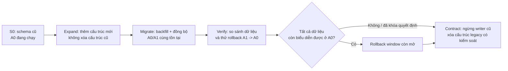
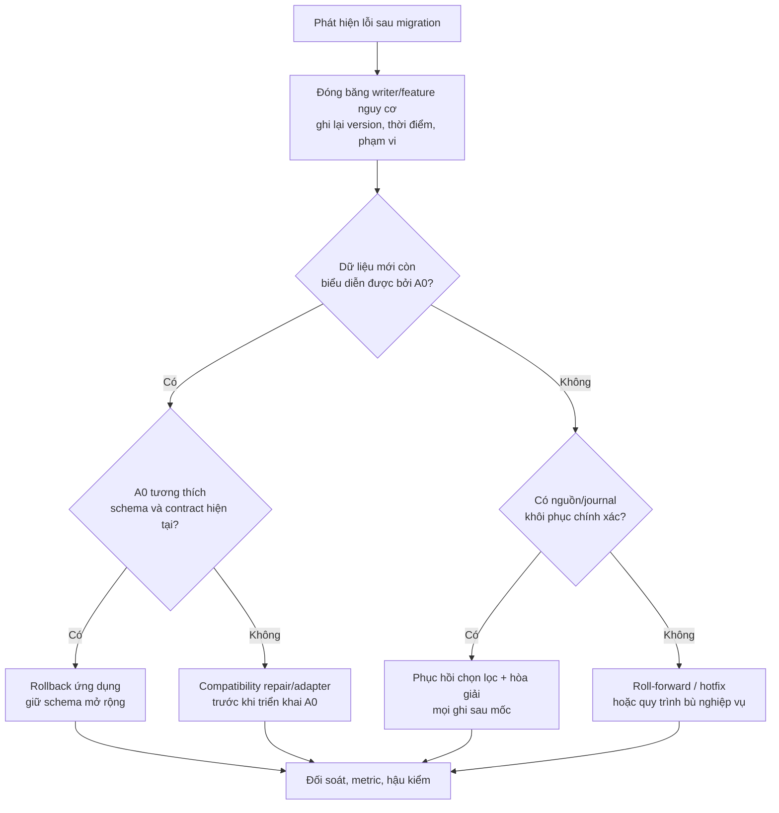

# Kiểm tra khả năng quay về phiên bản cũ và giới hạn khi mất thông tin

Một nhóm phát triển thay hai cột `first_name`, `last_name` bằng `display_name` để hỗ trợ tên hiển thị tự do. Migration chạy thành công; ứng dụng mới đọc và ghi được tên. Khi phát hiện lỗi nghiệp vụ, nhóm định triển khai lại ứng dụng cũ. Nhưng phiên bản cũ vẫn cần **hai trường tên riêng**, trong khi khách hàng mới đã nhập `display_name = "An (nhóm hỗ trợ)"` và không có quy tắc đáng tin để tách thành `first_name` và `last_name`.

Việc **chạy được một câu lệnh `ALTER TABLE` ngược lại** không có nghĩa đã **khôi phục được giá trị và ý nghĩa dữ liệu**. Nếu thông tin gốc bị xóa, chuẩn hóa mất chi tiết, gộp nhiều trạng thái thành một hoặc ghi dữ liệu mới mà phiên bản cũ không hiểu, rollback có thể là **bất khả thi về mặt thông tin**, dù DDL đảo chiều vẫn thực thi.

Bài thuộc chương **Tiến hóa mô hình** của module **DATABASE_DATA_MODELING**. Mục tiêu là chuyển yêu cầu nghiệp vụ thành mô hình dữ liệu có khóa, ràng buộc, lược đồ vật lý rõ ràng, so sánh các mô hình quan hệ, document, đồ thị và phân tích để hệ thống dễ tiến hóa và kiểm chứng. Ta tập trung vào câu hỏi: **Phiên bản cũ còn đọc/ghi đúng dữ liệu đã được phiên bản mới tạo ra không? Nếu không, mất thông tin ở đâu và cần bảo vệ bằng cơ chế nào?**

## 1. “Rollback” gồm nhiều thao tác khác nhau

Trong một đợt triển khai, có ít nhất bốn trạng thái có thể thay đổi độc lập:

| Thành phần | Ví dụ thay đổi | “Quay lại” thực sự yêu cầu gì? |
| --- | --- | --- |
| **Ứng dụng** | `A0` dùng `first_name/last_name`, `A1` dùng `display_name` | Chạy lại mã `A0` và xử lý **mọi dữ liệu hiện có** một cách đúng nghĩa |
| **Lược đồ** | Thêm rồi xóa cột, thay constraint/index | Lược đồ còn tương thích với truy vấn và ghi của `A0` |
| **Dữ liệu** | Gộp trường, chuyển đơn vị, cập nhật trạng thái, đổi khóa | Khôi phục những giá trị **có thể đảo ngược**, không bịa lại thông tin đã mất |
| **Hợp đồng bên ngoài** | API/event v2 thêm giá trị enum, thay ID hoặc nghĩa của field | Các producer/consumer cũ hiểu được dữ liệu mới hoặc có adapter an toàn |

**Application rollback** là triển khai lại mã cũ; **schema rollback** là thay đổi cấu trúc database; **data rollback** là khôi phục/chuyển lại các giá trị; **business rollback** là đưa luồng nghiệp vụ về trạng thái hợp lệ (có thể cần bút toán bù, không phải xóa lịch sử). Bốn việc đó không tự động xảy ra cùng nhau.

Ví dụ đội đã chạy code `A1` trên schema mở rộng `S1` và ghi một số sự kiện v2. Đưa ứng dụng về `A0` chỉ an toàn nếu:

1. `A0` còn kết nối và truy vấn được schema hiện tại.
2. `A0` hiểu được **tất cả giá trị đang tồn tại** hoặc có một phép chiếu/adapter được kiểm chứng.
3. Dữ liệu do `A0` ghi tiếp không làm hỏng dữ liệu mới hoặc vi phạm ràng buộc.
4. Các side effect đã phát sinh (gửi tiền, gửi email, xuất event) được xử lý nhất quán.
5. Nếu cần tái lập báo cáo lịch sử, cách đo và ý nghĩa dữ liệu vẫn được bảo toàn.

Không được đánh giá rollback chỉ bằng câu hỏi “bộ migration có file `down.sql` không?”.

## 2. Ba mức độ khả nghịch của thay đổi

| Nhóm | Ví dụ | Khả năng quay về |
| --- | --- | --- |
| **Có thể đảo về tương đối trực tiếp** | Thêm cột nullable chưa được dùng; thêm index; thêm bảng phụ độc lập | Thường có thể bỏ cấu trúc mới, **nếu không có dữ liệu/consumer còn phụ thuộc** |
| **Đảo được khi giữ thông tin và điều kiện** | Đổi tên cột, tách trường có mapping đầy đủ, chuyển đơn vị có precision rõ, chuyển khóa với bảng đối chiếu | Chỉ an toàn nếu lưu đủ dữ liệu gốc, có phép nghịch đảo và không phát sinh giá trị mới ngoài miền cũ |
| **Mất thông tin / không đảo chính xác** | Xóa dữ liệu gốc, làm tròn mất chữ số, gộp nhiều trạng thái, giảm độ chính xác, dedup không lưu nguồn, anonymize không thể đảo | Không có phép nghịch đảo tổng quát; cần **khôi phục nguồn gốc** hoặc chấp nhận roll-forward/giảm chức năng |

Một thao tác `ADD COLUMN` nhìn qua có vẻ an toàn nhưng trở nên khó rollback khi phiên bản mới đã ghi **giá trị chỉ tồn tại ở cột mới**. Ngược lại, một `RENAME COLUMN` về mặt DDL có thể đảo, nhưng trong hệ nhiều phiên bản đang chạy đồng thời nó làm ứng dụng cũ/new nhận lỗi vì thiếu tên cột. Vì vậy cần xem **dữ liệu + hành vi phiên bản + thời điểm triển khai**, không chỉ bản chất DDL.

### 2.1. Phép biến đổi có nghịch đảo hay không?

Gọi `f` là phép chuyển dữ liệu từ định dạng cũ sang mới:

\[
f: D_{\mathrm{old}} \rightarrow D_{\mathrm{new}}
\]

Muốn phục hồi **chính xác** giá trị cũ từ giá trị mới, cần một phép `g` sao cho:

\[
g(f(x)) = x
\quad \text{với mọi } x \text{ hợp lệ trong miền cũ}
\]

Điều này đòi hỏi `f` không làm hai giá trị cũ **khác nhau** trở thành **cùng một giá trị mới** trong phạm vi cần khôi phục. Nói cách khác, trên miền thực tế phải **không mất thông tin phân biệt** (*injective*), hoặc phải giữ phần thông tin bị bỏ trong một nguồn đáng tin bổ sung.

Ví dụ:

- `("Mary Ann", "van der Meer")` → `"Mary Ann van der Meer"`.
- `("Mary", "Ann van der Meer")` → **cùng** `"Mary Ann van der Meer"`.

Không thể suy chắc chắn cặp tên ban đầu chỉ từ chuỗi cuối. Kể cả dùng `split(" ", 2)` cũng không phục hồi được trường hợp thứ nhất; nó chỉ chọn một cách tách tùy ý.

**Kết luận:** Đảo lược đồ là thao tác kỹ thuật; đảo dữ liệu đòi hỏi đủ thông tin để tìm được giá trị gốc. Lưu thông tin gốc, ánh xạ hoặc lịch sử phiên bản có thể biến một migration vốn mất thông tin thành migration **có thể khôi phục trong phạm vi và thời gian xác định**.

## 3. Ba câu hỏi trước khi chấp nhận kế hoạch rollback

### 3.1. Khả năng tương thích của **đọc**

Ứng dụng cũ có thể đọc cả các hàng mà ứng dụng mới vừa ghi không? Chẳng hạn:

- Cột cũ đã bị xóa hoặc đổi tên?
- Enum mới có giá trị chưa tồn tại trong code cũ?
- Giá trị `NULL` trở nên hợp lệ nhưng code cũ không xử lý?
- Key mới/đơn vị tiền mới có nằm ngoài miền cũ?
- Dữ liệu hiện được lưu ở document/collection/bảng khác?

Đọc được dữ liệu **không đồng nghĩa hiểu đúng nghĩa**. Nếu v2 có `PAYMENT_AUTHORIZED` mà v1 chỉ có `PAID`, map `AUTHORIZED → PAID` có thể gây lỗi thu tiền hoặc ghi nhận doanh thu.

### 3.2. Khả năng tương thích của **ghi**

Ứng dụng cũ có thể tiếp tục ghi mà không phá dữ liệu v2 không?

- Constraint mới có từ chối một kiểu ghi hợp lệ của v1?
- V1 có ghi thiếu cột mới mà v2 coi là bắt buộc?
- V1 có ghi đè field mới bằng `NULL`/default khi cập nhật cả row?
- Hai phiên bản đang chạy có dùng cùng định nghĩa `version`, timestamp và trạng thái?
- Mã cũ có tái chạy một side effect đã thực hiện ở phiên bản mới?

Trong giai đoạn hai phiên bản cùng tồn tại, **read compatibility** và **write compatibility** phải được thử **cả hai chiều** theo những producer/consumer liên quan.

### 3.3. Khả năng phục hồi **dữ liệu đã biến đổi**

Trước khi xóa dữ liệu, hỏi:

- Có giữ giá trị gốc hay một nhật ký thay đổi đủ để khôi phục không?
- Dữ liệu mới có giá trị nào **không biểu diễn được** trong mô hình cũ?
- Có biết một bản ghi đã được chuyển theo **quy tắc phiên bản nào**?
- Có thể đối soát số lượng, tổng tiền, khóa và checksum sau backfill/reverse không?
- Có cần khôi phục **những cập nhật xảy ra trong lúc migration chạy** không?

Chỉ có một bản backup trước migration không tự đáp ứng câu cuối: restore nguyên bản backup có thể làm mất các giao dịch hợp lệ phát sinh **sau thời điểm backup**.

## 4. Ma trận tương thích ứng dụng và schema

Ví dụ với bảng khách hàng:

- `A0`: ứng dụng cũ đọc/ghi `first_name, last_name`.
- `A1`: ứng dụng tương thích chuyển tiếp, biết cột `display_name` nhưng vẫn duy trì các trường cũ.
- `A2`: ứng dụng mới **chỉ** ghi `display_name` và hỗ trợ chuỗi không thể tách.
- `S0`: schema chỉ có hai cột cũ.
- `S1`: schema mở rộng có cả ba cột.
- `S2`: schema rút gọn chỉ còn `display_name`.

| Ứng dụng | `S0` cũ | `S1` mở rộng | `S2` đã bỏ cột cũ |
| --- | --- | --- | --- |
| `A0` | Được | **Được nếu** trigger/đường ghi giữ tương thích và constraint không cản | Không, nếu vẫn truy cập cột cũ |
| `A1` | Không nếu `A1` yêu cầu cột mới | **Được**, trong phạm vi dữ liệu hai chiều còn tương thích | Không nếu `A1` vẫn ghi trường cũ |
| `A2` | Không | Có thể chạy nhưng **phá khả năng về A0** khi ghi tên không tách được | Được nếu migration/feature đã hoàn tất |

Ma trận **không phải bảng chân lý tự động**. Mỗi ô “Được” cần test thực tế: code, SQL, migration tool, dữ liệu mới, trigger, queue và những phiên bản còn đang ghi. Với một feature thật, có thể tạo `A1` hỗ trợ cả `S0` và `S1` nhờ feature detection, nhưng phải thiết kế và kiểm chứng chủ đích, không mặc định.

### 4.1. “Rollback window” là một hợp đồng

**Rollback window** là khoảng thời gian có bằng chứng rằng còn có thể quay lại trạng thái vận hành cũ. Nó kết thúc **không chỉ khi xóa cột**, mà có thể kết thúc từ lúc **một writer mới tạo dữ liệu không biểu diễn được bằng mô hình cũ**.

Ví dụ khi `A2` ghi `display_name = "Cửa hàng số 7"` cho một customer vốn không có first/last, dù `S1` vẫn giữ hai cột legacy, `A0` có thể đọc tên trống và ghi sai dữ liệu. Từ thời điểm đó, quay lại `A0` phải bị chặn hoặc đi qua adapter có chính sách xử lý được phê duyệt.

## 5. Expand → Migrate → Contract thay vì đổi phá vỡ tức thời

Một mẫu tiến hóa thường dùng là **expand–migrate–contract**:



Trong thực tế, chỉ được đi vào `Contract` sau khi **đã quyết định chấm dứt khả năng hỗ trợ ứng dụng cũ**, hoặc có cách dịch ngược đã kiểm chứng. Không hiểu sơ đồ là “phải chờ mất tính tương thích rồi mới contract”; cốt lõi là mỗi giai đoạn có **điều kiện vào/ra và điểm rollback** rõ.

| Giai đoạn | Hành động chính | Còn rollback ứng dụng về A0? | Điều kiện |
| --- | --- | --- | --- |
| **Expand** | Thêm nullable column/table/index và adapter | Thường có | Không phá read/write cũ |
| **Migrate** | Backfill dữ liệu, đồng bộ writer, kiểm tra projection | Có điều kiện | Dữ liệu cũ được bảo toàn và cập nhật mới được đồng bộ |
| **Verify** | Shadow read, diff, replay, thử rollback | Có điều kiện | Test cả dữ liệu vừa ghi và concurrency |
| **Cutover** | Chuyển read/write sang mô hình mới | Phụ thuộc dữ liệu mới | Đánh giá lại mốc không thể quay về |
| **Contract** | Dừng support legacy, xóa cột/index/mapping cũ | Thường không trực tiếp | Hết consumer cũ, có kế hoạch recovery/roll-forward |

Đây là **quy trình ra quyết định**, không phải cam kết rằng mọi engine thực hiện DDL online không khóa. Với PostgreSQL, MongoDB, Cassandra hoặc data warehouse, thời gian khóa, backfill, replication lag và transaction semantics khác nhau. Thử nghiệm trên engine/phiên bản và quy mô thật trước khi triển khai.

## 6. Ví dụ PostgreSQL: đổi hai tên thành một tên hiển thị

Giả sử schema ban đầu:

```sql
CREATE TABLE customer_profile (
    customer_id BIGINT PRIMARY KEY,
    first_name TEXT,
    last_name TEXT,
    updated_at TIMESTAMPTZ NOT NULL DEFAULT now()
);

INSERT INTO customer_profile (
    customer_id, first_name, last_name
) VALUES
    (101, 'Mary Ann', 'van der Meer'),
    (102, 'Mary', 'Ann van der Meer'),
    (103, 'An', NULL);
```

Hai bản 101 và 102 có **cặp tên gốc khác nhau**, nhưng hàm nối chuỗi không phân biệt được chúng:

```sql
SELECT
    customer_id,
    CONCAT_WS(' ', first_name, last_name) AS display_name
FROM customer_profile
ORDER BY customer_id;
-- 101: Mary Ann van der Meer
-- 102: Mary Ann van der Meer
-- 103: An
```

Đây là ví dụ quan sát sự mất thông tin về **ranh giới hai trường**; không phải khuyến nghị tách tên cá nhân thành first/last theo cách cố định ở mọi quốc gia.

### 6.1. Expand: thêm cột nhưng giữ thông tin gốc

```sql
ALTER TABLE customer_profile
ADD COLUMN display_name TEXT;
```

Trong giai đoạn tương thích, quyết định **nguồn sự thật vẫn là `first_name`/`last_name`**. `display_name` tạm là **derived projection**. Mọi thay đổi ở hai trường cũ phải làm projection được cập nhật, kể cả khi writer là ứng dụng A0. Một lựa chọn PostgreSQL là trigger:

```sql
CREATE OR REPLACE FUNCTION set_display_name_from_legacy()
RETURNS trigger
LANGUAGE plpgsql
AS $$
BEGIN
    NEW.display_name := NULLIF(
        CONCAT_WS(
            ' ',
            NULLIF(BTRIM(NEW.first_name), ''),
            NULLIF(BTRIM(NEW.last_name), '')
        ),
        ''
    );
    RETURN NEW;
END;
$$;

CREATE TRIGGER trg_customer_display_name_legacy
BEFORE INSERT OR UPDATE OF first_name, last_name
ON customer_profile
FOR EACH ROW
EXECUTE FUNCTION set_display_name_from_legacy();
```

Trigger giữ `display_name` đồng bộ **khi một writer thực sự INSERT hoặc UPDATE các trường nguồn**. Nó **không** tự bảo vệ trường hợp một ứng dụng A2 viết **chỉ `display_name`**; trong rollback window phải **không cho phép** luồng ghi kiểu A2 chưa biểu diễn được bằng legacy.

Một kiến trúc dùng application-level dual write, CDC hoặc read-on-fallback cũng có thể phù hợp, nhưng phải xử lý đúng **old writers, race giữa hai bản cập nhật, retry và lag**, không chỉ viết hai lệnh SQL độc lập rồi cho rằng chúng luôn nguyên tử.

### 6.2. Migrate: backfill và đối soát

Sau khi tạo trigger, backfill các hàng cũ:

```sql
UPDATE customer_profile
SET display_name = NULLIF(
    CONCAT_WS(
        ' ',
        NULLIF(BTRIM(first_name), ''),
        NULLIF(BTRIM(last_name), '')
    ),
    ''
)
WHERE display_name IS DISTINCT FROM NULLIF(
    CONCAT_WS(
        ' ',
        NULLIF(BTRIM(first_name), ''),
        NULLIF(BTRIM(last_name), '')
    ),
    ''
);
```

Trên dữ liệu thật, một `UPDATE` toàn bảng có thể tạo lock, WAL, bloat, replication lag và áp lực I/O. Hãy thử và chọn **batch theo khóa**, checkpoint, rate limit và retry/resume phù hợp; query nguyên khối ở đây chỉ để minh họa logic.

Kiểm tra mỗi hàng có `display_name` phù hợp với phép chiếu:

```sql
SELECT COUNT(*) AS inconsistent_rows
FROM customer_profile
WHERE display_name IS DISTINCT FROM NULLIF(
    CONCAT_WS(
        ' ',
        NULLIF(BTRIM(first_name), ''),
        NULLIF(BTRIM(last_name), '')
    ),
    ''
);
-- 0 nghĩa là phép chiếu nhất quán tại thời điểm đọc.
```

Đây là một **kiểm tra tính nhất quán projection**. Nó không chứng minh phép ghép chuỗi đúng với tên hiển thị người dùng mong muốn. Hai điều khác nhau:

- *Correct transformation*: đúng theo hàm được định nghĩa.
- *Correct business meaning*: hàm đó phản ánh nhu cầu nghiệp vụ hay không.

### 6.3. Deploy ứng dụng tương thích A1

A1 có thể đọc `display_name` để hiển thị nhưng **ghi qua cặp trường cũ** khi rollback window còn mở. Nếu sản phẩm bắt đầu cho phép tên hiển thị không tách được, đó là **thay đổi semantic và write contract**, cần mốc cutover riêng.

Trong thời gian A0 và A1 cùng chạy:

- A0 vẫn đọc và ghi cột cũ, trigger cập nhật projection.
- A1 đọc cả hai cách hoặc đọc `display_name` sau khi đã backfill và verified.
- Không cho A1 ghi giá trị `display_name` mà không giữ cặp legacy tương ứng.
- Nếu có cache, search index hoặc event payload tên, phải xác định refresh/invalidations.
- Theo dõi lag/consistency và thử rollback trên **hàng vừa thay đổi**, không chỉ trên bản ghi không cập nhật.

### 6.4. Rollback A1 → A0 trong cửa sổ an toàn

Ở thời điểm này, cách quay lại thường an toàn hơn là:

1. Tắt feature mới/điều chỉnh writer để không tạo dữ liệu ngoài miền cũ.
2. Đảm bảo A0 vẫn tương thích với schema **S1 có cả hai cấu trúc**.
3. Triển khai A0 hoặc chuyển lưu lượng về A0.
4. **Giữ nguyên `display_name` và trigger** tạm thời; không cần chạy `DROP COLUMN display_name` ngay khi rollback code.
5. Đối soát record vừa ghi, metrics và business effects.

Rollback ứng dụng **không buộc phải rollback DDL**. Việc để một cột nullable chưa dùng trong database thường ít rủi ro hơn thao tác phá hủy schema trong lúc khắc phục sự cố.

### 6.5. Khi nào không thể rollback A2 → A0?

Giả sử A2 cho phép tự do nhập:

```sql
UPDATE customer_profile
SET display_name = 'An (nhóm hỗ trợ)'
WHERE customer_id = 103;
```

Trigger `UPDATE OF first_name,last_name` không chạy trong câu lệnh trên. Hàng 103 hiện vẫn có `first_name='An'`, `last_name=NULL`, còn `display_name` là chuỗi mới. A0 đọc **“An”** thay vì chuỗi người dùng hiện muốn hiển thị. Nếu A0 ghi lại `first_name`, trigger có thể ghi đè projection mới.

Tại thời điểm A2 ghi dữ liệu chỉ mô hình mới hiểu, **rollback bảo toàn ngữ nghĩa về A0 không còn an toàn** dù hai cột cũ **chưa bị xóa**. Cách lựa chọn:

- Tạm vô hiệu hóa feature không tương thích và **roll-forward bằng hotfix**.
- Sử dụng một **compatibility adapter** có quy tắc tường minh, được phê duyệt (có thể làm giảm chức năng, không khôi phục được first/last gốc).
- Nếu đã lưu dữ liệu legacy và không có bản ghi mới nằm ngoài miền, trở lại A0 sau khi đối soát.
- Nếu có thông tin cần thiết từ **nguồn sự thật khác**, tái dựng một cách có kiểm chứng và lưu provenance.

Không nên tự chia `display_name` thành first/last rồi tuyên bố “rollback thành công”. Một phép tách tùy ý chỉ **sáng tạo một kết quả**, không chứng minh đúng dữ liệu gốc.

### 6.6. Contract: chỉ xóa cột sau khi chấm dứt hỗ trợ legacy

Ví dụ về **DDL chỉ được chạy sau go/no-go quyết định hết rollback window**:

```sql
-- Chỉ minh họa bước Contract, KHÔNG chạy trong giai đoạn
-- A0/A1 còn dùng các cột legacy hoặc còn cần rollback về A0.
DROP TRIGGER trg_customer_display_name_legacy
ON customer_profile;

DROP FUNCTION set_display_name_from_legacy();

ALTER TABLE customer_profile
    DROP COLUMN first_name,
    DROP COLUMN last_name;
```

Đây là thay đổi **phá hủy thông tin và compatibility**, không phải thao tác vệ sinh vô hại. Các ứng dụng, view, job ETL, index, trigger và đối tác phụ thuộc cột cũ phải được tìm và di chuyển trước; engine có thể từ chối DROP nếu còn dependency, và không nên dùng `CASCADE` để xóa dây chuyền khi chưa hiểu ảnh hưởng.

Sau `Contract`, quay về A0 đòi hỏi dựng lại schema **và** có dữ liệu first/last phù hợp — điều thường **không thể** suy từ một `display_name`.

## 7. Vì sao DOWN migration không phải bằng chứng có thể quay về?

Một migration tool có thể khai báo:

```sql
-- up.sql
ALTER TABLE customer_profile ADD COLUMN display_name TEXT;

-- down.sql (dễ viết nhưng không đánh giá dữ liệu đã tạo)
ALTER TABLE customer_profile DROP COLUMN display_name;
```

`down.sql` trên chỉ bỏ cột mới. Nếu phiên bản mới đã ghi thông tin duy nhất trong `display_name`, câu lệnh ấy làm **mất dữ liệu mới**. Nó không hề khôi phục first/last, cũng không khôi phục những external events và side effects đã phát sinh.

Một file down đúng cú pháp mới trả lời **“có thể đổi cấu trúc theo chiều ngược không?”**; còn kiểm tra rollback đầy đủ phải trả lời:

1. Lược đồ cũ có chạy được với code cũ không?
2. Mọi giá trị mới có **được biểu diễn đúng** trong mô hình cũ không?
3. Dữ liệu ghi mới có được giữ, không bị xóa hoặc khôi phục thiếu không?
4. Hệ ngoài có nhận/hiểu sự kiện do code mới phát đi không?
5. Có thể phục hồi trạng thái nghiệp vụ hợp lệ sau tác động đã thực hiện không?

## 8. Những phép biến đổi dữ liệu dễ làm mất thông tin

| Biến đổi | Trường hợp cũ | Biểu diễn mới | Vì sao khó đảo? |
| --- | --- | --- | --- |
| **Ghép trường** | `first_name` + `last_name` | `display_name` | Không biết ranh giới hai trường |
| **Làm tròn** | Giá `DECIMAL(12,4)` | `DECIMAL(12,2)` | Chữ số thập phân bị loại |
| **Giảm độ rộng/precision** | `BIGINT` | `INT` | Một số cũ nằm ngoài phạm vi mới; chuyển đổi có thể bị từ chối hoặc cắt sai |
| **Ép ID thành số** | Mã `"00123"` | Số `123` | Mất số 0 đầu, định dạng và namespace |
| **Chuẩn hóa không lưu bản gốc** | `"AbC"` và `"abc"` | `"abc"` | Hai giá trị khác nhau trở thành một |
| **Gộp trạng thái** | `AUTHORIZED`, `CAPTURED` | `PAID` | Không biết trạng thái thanh toán gốc |
| **Tổng hợp sự kiện** | Từng event chi tiết | Tổng theo ngày | Không phục hồi được phân bố, ID và thứ tự từng sự kiện |
| **Gộp danh tính** | Hai customer BK | Một canonical ID | Thiếu lịch sử mapping thì không biết fact thuộc bản nào |
| **Dedup không lưu evidence** | Nhiều row nguồn | Một row được chọn | Không thể phục hồi các row bị loại và lý do |
| **Bỏ timezone/offset** | Local time kèm zone/offset | Chỉ ngày/giờ không zone | Không suy chắc được instant gốc, nhất là DST |
| **Redaction/anonymization** | PII có định danh | Token/bản đã xóa | Nếu cố ý không giữ khóa khôi phục, đảo ngược có thể không được phép hoặc không khả thi |

Một số biến đổi có thể được phục hồi nếu **nguồn dữ liệu đáng tin vẫn còn**. Nhưng điều đó phụ thuộc retention, quyền truy cập, đủ dữ liệu, tính nhất quán và quy trình nối những cập nhật xảy ra sau migration. “Có backup” không đồng nghĩa “mọi thao tác đều reversible”.

### 8.1. Đơn vị đo và tiền tệ

Chuyển `amount_cents BIGINT` → `amount DECIMAL` có thể đảo chính xác nếu biết currency/exponent và không làm tròn thêm. Nhưng nếu chỉ lưu một `amount` không kèm `currency` hoặc dùng số thực nhị phân rồi làm tròn theo quy tắc khác, không thể mặc định khôi phục cent ban đầu.

Nếu v2 cho phép tiền tệ mới mà v1 chỉ hỗ trợ VND, dù số tiền không mất chữ số, **mô hình cũ không biểu diễn được currency mới**. Đây là **mất tương thích miền giá trị**, khác với mất thông tin do hàm biến đổi.

### 8.2. Thay đổi ý nghĩa của trạng thái

Một enum cũ `PAID` có thể chỉ biểu thị “đã nhận tiền”; v2 tách `PAYMENT_AUTHORIZED` và `PAYMENT_CAPTURED`. Không map cả hai sang `PAID` nếu v1 coi `PAID` là đã thu tiền, vì như vậy có thể mở quyền giao hàng hoặc ghi doanh thu quá sớm.

Có thể chọn chuyển v2 `PAYMENT_AUTHORIZED` về v1 `PENDING` nếu hệ thống cũ có trạng thái tương đương, **nhưng phải chứng minh mọi use case dựa trên trạng thái ấy vẫn đúng**; không phải cứ mất chi tiết là được phép đổi theo hướng gần giống.

## 9. Lưu “thông tin đủ để quay lại”: cần cả giá trị và provenance

Các cách hỗ trợ khôi phục thường gồm:

| Cơ chế | Giữ được gì? | Hạn chế |
| --- | --- | --- |
| **Cột cũ song song** | Giá trị legacy trên cùng row | Dễ bị stale nếu writer mới không cập nhật |
| **Migration journal** | Giá trị trước/sau, row ID, rule version, timestamp | Chi phí ghi/lưu; phải bảo vệ dữ liệu nhạy cảm |
| **Bảng mapping ID/version** | Liên kết business key/surrogate key trước và sau | Không khôi phục nội dung đã xóa nếu mapping không đủ |
| **Event log có retention** | Sự kiện gốc để tái dựng projection | Phải bảo đảm log đầy đủ, ordered đủ theo key, schema phiên bản và xử lý correction |
| **CDC/change log** | Biến động dữ liệu trong cửa sổ theo dõi | Có hạn retention, không thay thế nguồn sự thật nếu mất offset |
| **Snapshot/backup + PITR** | Trạng thái ở một thời điểm khôi phục được | Có thể không chứa các ghi hợp lệ sau thời điểm đó; restore cần kiểm chứng |
| **Dual-format read/write** | Phục vụ các phiên bản khác nhau trong giai đoạn chuyển tiếp | Đồng bộ, xung đột, write amplification và logic phức tạp |

Một journal thiết kế minh họa:

```sql
CREATE TABLE customer_name_migration_journal (
    migration_id TEXT NOT NULL,
    customer_id BIGINT NOT NULL,
    row_version BIGINT NOT NULL,
    legacy_first_name TEXT,
    legacy_last_name TEXT,
    new_display_name TEXT,
    transform_version TEXT NOT NULL,
    captured_at TIMESTAMPTZ NOT NULL DEFAULT now(),
    PRIMARY KEY (migration_id, customer_id, row_version)
);
```

Đây là **lược đồ audit/journal tham khảo**, chưa tự có trigger/pipeline để ghi đầy đủ mọi bản thay đổi. Muốn journal dùng để khôi phục phải bảo đảm **atomicity hoặc quy trình reconciliation giữa cập nhật row và ghi journal**, thứ tự version rõ, đủ các update xảy ra trong migration và quyền/retention phù hợp.

**Không được lưu PII chỉ để “phòng rollback” vô hạn:** giá trị tên, địa chỉ, định danh có thể thuộc dữ liệu nhạy cảm. Nhu cầu khôi phục phải được cân bằng với chính sách tối thiểu hóa, mã hóa, xóa dữ liệu và thời hạn lưu giữ. Việc lưu bản gốc ở nơi bí mật không tự làm biến đổi trở nên hợp lệ về quyền riêng tư.

## 10. Cần kiểm tra điều kiện “khả năng quay lại” ở thời điểm nào?

Không đợi đến khi lỗi production mới chạy thử.

| Mốc | Câu hỏi | Bằng chứng cần có |
| --- | --- | --- |
| **Trước DDL** | App A0 còn chạy với schema mở rộng không? | Migration dry-run + integration tests A0/S1 |
| **Sau expand** | Constraint/default/index có làm hỏng writer cũ không? | Shadow/compat tests, quan sát lỗi ghi |
| **Trong backfill** | Row đang cập nhật đồng thời có bị stale projection hay bỏ sót? | Sample diff, counters, checkpoint, retry |
| **Trước cutover reader** | New read cho kết quả đúng với legacy không? | So sánh cặp đọc có kiểm soát và thống kê mismatch |
| **Sau canary A1** | A0 có đọc/ghi đúng các row A1 vừa thay đổi không? | Rollback drill trên dữ liệu mới và luồng đồng thời |
| **Trước A2 new-only writes** | Tất cả giá trị mới có biểu diễn được về v1 không? | Data domain compatibility tests; quyết định rollback window |
| **Trước contract** | Còn consumer cũ không? Dữ liệu cũ đã hết cần chưa? | Inventory dependency, telemetry, backup/recovery test |
| **Sau contract** | Nếu lỗi, lộ trình phục hồi thực tế là gì? | Roll-forward/hotfix runbook + restore drill |

Giai đoạn **A1** là lúc nên thử “ứng dụng mới ghi, ứng dụng cũ đọc; ứng dụng cũ ghi, ứng dụng mới đọc” bằng **đúng kiểu dữ liệu mới và edge cases**, không chỉ dùng fixtures đời cũ.

## 11. Quy trình rollback drill bằng dữ liệu có kiểm soát

Một **rollback drill** là thí nghiệm phục hồi có tiêu chí thành công rõ ràng, thực hiện trên môi trường đại diện và dữ liệu đã được bảo vệ.

1. **Chụp baseline:** phiên bản ứng dụng, migration/schema, số dòng, checksum hoặc aggregates theo phạm vi, version contracts, trạng thái queue và dữ liệu nguồn.
2. **Expand:** chạy DDL không phá hủy, khởi động A0 trên S1; xác minh CRUD và transaction cũ.
3. **Backfill:** cố ý thêm các hàng có `NULL`, chuỗi Unicode, khoảng trắng, update đồng thời, retry và sự kiện đến muộn.
4. **A1 mixed traffic:** để A0/A1 đọc–ghi cùng lúc theo kịch bản được phép, quan sát divergence và locking.
5. **Giả lập sự cố:** tắt feature, triển khai lại A0 **nhưng giữ S1**, xử lý queue và retry đang có.
6. **So kết quả:** A0 đọc được hàng vừa do A1 ghi? Tổng tiền/đếm fact và FK còn đúng? Có lost update, duplicate, fallback sai hay không?
7. **Mở lại A1:** kiểm tra khả năng roll-forward sau rollback, thay vì để dữ liệu ở trạng thái lưng chừng.
8. **Thử điểm không khả nghịch:** bật A2 tạo dữ liệu new-only; xác nhận cơ chế **chặn rollback**, thông báo người vận hành và phương án khác.
9. **Ghi bằng chứng:** thời gian khôi phục quan sát được, dữ liệu có thể mất nếu restore, mismatch, các công việc thủ công và quyết định go/no-go.

**Không chạy thử DROP/restore phá hủy trên production** chỉ để chứng minh có thể rollback. Drill thực tế nên dùng bản sao/fixture và kịch bản có kiểm soát; bước production cần change plan, backup validation, quyền và cửa sổ vận hành phù hợp.

### 11.1. Invariant quan trọng hơn việc SQL “không lỗi”

| Invariant | Điều cần xác minh |
| --- | --- |
| **Danh tính** | Không tạo trùng business key; PK/FK và mapping còn đúng |
| **Tổng hợp** | Tổng doanh thu, số dư, số lượng event không đổi ngoài những correction hợp lệ |
| **Tính đầy đủ** | Không thiếu row/field bắt buộc, null mới được xử lý đúng |
| **Định nghĩa metric** | Không gộp `AUTHORIZED` với `CAPTURED` làm sai doanh thu |
| **Độ chính xác** | Tiền, tỷ giá, đơn vị đo, precision không tự bị cắt/làm tròn |
| **Trạng thái** | App cũ không thực hiện transition nguy hiểm trên giá trị mới |
| **Idempotency** | Reprocessing không nhân đôi payment/shipment/event |
| **Lịch sử** | Event time, effective time và SCD version vẫn có thể tái lập khi cần |
| **Freshness** | Backfill và rollback không khiến dashboard báo dữ liệu đã đầy đủ khi chưa hoàn tất |
| **Bảo mật** | Policy phân quyền và xóa dữ liệu vẫn đúng sau restore/replay |

## 12. Rollback ứng dụng khác phục hồi bằng backup/PITR

**Point-in-time recovery (PITR)** đưa cơ sở dữ liệu trở về một thời điểm được hỗ trợ bởi backup và log. Đây là **khôi phục trạng thái**, không phải phép đảo chính xác của một migration đơn lẻ.

Ví dụ:

```text
09:00  backup/snapshot trước migration
09:15  thêm cột display_name
09:30  backfill kết thúc
10:00  ghi 2.000 đơn hàng mới
10:30  phát hiện migration gây lỗi báo cáo
```

Restore trực tiếp database về 09:00 có thể **loại bỏ 2.000 đơn hàng hợp lệ** và những side effect liên quan trong khoảng 09:00–10:30. Nếu chỉ restore một bảng từ bản cũ sang database đang chạy, còn nguy cơ vi phạm FK, version, sequence, transaction history, event offsets và data consistency với các bảng khác.

Một chiến lược phục hồi có thể là:

1. **Restore bản sao tách biệt** tới mốc trước migration.
2. Lấy dữ liệu/giá trị gốc cần phục hồi từ bản sao đó.
3. Đối chiếu với các cập nhật hợp lệ đã đến sau mốc restore.
4. Thiết kế cách hòa giải xung đột có kiểm chứng theo business key/event ID/version.
5. Chỉ áp kết quả vào production sau khi chứng minh bất biến và có khả năng rollback thao tác hòa giải.

Không tự nhận PITR có thể phục hồi chính xác **một hàng hoặc một bảng** theo cách độc lập với phần còn lại; khả năng thực tế phụ thuộc hệ quản trị, công cụ và kế hoạch khôi phục. Các chỉ số **RPO** (mức mất dữ liệu chấp nhận) và **RTO** (thời gian khôi phục chấp nhận) phải được đặt bởi nghiệp vụ và **đo bằng thử nghiệm**, không lấy từ số ghi trên slide.

### 12.1. Backup không thay thế kiểm tra tính khả nghịch

Backup giúp có nguồn dữ liệu để phục hồi, nhưng:

- Nó có thể hết retention hoặc chưa bao phủ lần ghi cuối.
- Có thể không chứa log CDC, event bus hay object storage liên quan.
- Restore có thể mất nhiều giờ/ngày tùy dữ liệu; RTO không phù hợp.
- Không thể “rút lại” email, thông báo, giao dịch ngân hàng đã gửi ra ngoài bằng cách restore DB.
- Snapshot chứa PII cần tuân thủ quyền truy cập và chính sách xóa.

Vì vậy nên phân loại trước migration nào có thể rollback bằng **cấu hình/code**, migration nào cần **data repair**, và migration nào chỉ có **roll-forward**.

## 13. Khi nào nên roll-forward thay vì rollback?

**Roll-forward** là giữ schema/data mới và sửa code hoặc áp một migration bổ sung để khắc phục. Nó thường an toàn hơn khi dữ liệu mới không còn biểu diễn được bằng mô hình cũ.

| Tình huống | Hướng ưu tiên cần đánh giá | Vì sao |
| --- | --- | --- |
| Mới thêm nullable column, chưa có new-only writes | Rollback code A1→A0, giữ schema mở rộng | Ít phá dữ liệu, dễ quan sát |
| Backfill sai nhưng còn dữ liệu gốc | Dừng writer, repair/backfill lại có kiểm chứng | Không cần restore toàn bộ DB |
| Writer mới đã tạo trạng thái ngoài miền cũ | Hotfix/roll-forward hoặc compatibility adapter được phê duyệt | V1 không biểu diễn đúng dữ liệu mới |
| Đã DROP cột nguồn và không còn source đáng tin | Phục hồi từ backup/journal nếu đủ, hoặc xử lý loss có chủ đích | Down migration không tạo lại giá trị |
| Đã gửi payment/email/event ra hệ ngoài | Business compensation, idempotency và reconciliation | DB rollback không đảo side effect |
| Có sự cố nghiêm trọng và PITR là lựa chọn cuối | Disaster recovery theo RPO/RTO đã được chấp thuận | Có thể mất dữ liệu hợp lệ sau restore |

**Không phải mọi rollback đều xấu.** Quan trọng là chọn kỹ thuật tương ứng **trạng thái dữ liệu và hậu quả**, thay vì tự động chạy `down.sql` khi CI/CD báo lỗi.

## 14. Tính tương thích của hợp đồng API và event

Mô hình dữ liệu không chỉ là bảng trong database. Schema event, REST DTO, search index và projection analytics cũng tiến hóa.

### 14.1. Thêm field thường dễ hơn đổi nghĩa field

Event v1:

```json
{
  "schema_version": 1,
  "payment_id": "p-100",
  "status": "PAID"
}
```

Event v2:

```json
{
  "schema_version": 2,
  "payment_id": "p-100",
  "status": "PAYMENT_AUTHORIZED",
  "authorization_expires_at": "2030-05-10T00:00:00Z"
}
```

Consumer v1 có thể không hiểu giá trị `PAYMENT_AUTHORIZED`, dù JSON vẫn parse được và trường mới là optional. Vấn đề là **ý nghĩa và miền giá trị**, không chỉ kiểu.

| Thay đổi event | Khả năng tiêu thụ bởi consumer cũ | Điều cần kiểm tra |
| --- | --- | --- |
| Thêm field optional không đổi semantics | Có thể tương thích nếu consumer bỏ qua field lạ | Parser strict/lenient, default, contract |
| Bỏ field mà consumer cũ yêu cầu | Thường breaking | Có thể duy trì adapter/payload v1 không? |
| Thêm enum value mới | Có thể breaking dù schema vẫn parse | Unknown enum policy, dead-letter, state rules |
| Đổi đơn vị từ cent → major unit | Breaking về nghĩa | Version, explicit unit, precision |
| Gộp event chi tiết thành summary | Mất thông tin đối với consumer cần từng event | Giữ raw event/dual stream nếu cần |
| Đổi ID hoặc key | Có thể phá dedup và join | Mapping, migration window, version |

### 14.2. Reader–writer compatibility phải được test theo chiều

Giữa producer `P0/P1` và consumer `C0/C1`, cần chạy bộ tình huống:

- `P0 → C1`: consumer mới có đọc event cũ không?
- `P1 → C0`: consumer cũ có đọc và hiểu **dữ liệu mới** không?
- `P1 → C1`: semantic của phiên bản mới đúng không?
- Replay event v1 qua consumer mới có tạo state giống quy tắc lịch sử không?

Nếu `P1 → C0` không an toàn, **không thể rollback riêng consumer** về C0 mà tiếp tục cho P1 xuất event. Cần điều phối producer, adapter/down-conversion thực sự đúng nghĩa, dual-publish có kiểm soát hoặc chấp nhận roll-forward.

### 14.3. Xóa schema cũ chưa đủ: queue có thể chứa event cũ

Ngay cả khi mọi producer đã chuyển v2, message broker/DLQ và event log có thể còn dữ liệu v1. Consumer v2 phải hỗ trợ đọc v1 trong khoảng retention/replay cần thiết, hoặc có migration/reprocess riêng. Tương tự, khi rollback producer v1, một consumer chỉ hiểu v2 có thể không hoạt động nếu không có compatibility contract.

**Không dùng “giữ field v1 cho có” nhưng gán nó nghĩa mới.** Schema compatibility phải đi cùng **semantic compatibility**.

## 15. Khác biệt khi tiến hóa các mô hình lưu dữ liệu

| Mô hình | Dạng thay đổi | Giới hạn rollback đặc thù |
| --- | --- | --- |
| **Quan hệ (PostgreSQL/MySQL...)** | DDL, constraint/index, chuẩn hóa/tách bảng, đổi PK/FK | DDL có thể đảo nhưng data migration/join back không có phép nghịch đảo; transaction/lock khác nhau theo engine |
| **Document** | Thêm/bỏ field, đổi cấu trúc nested array, schema on read | Một collection có nhiều document version; bỏ field hoặc gộp array mất thứ tự/cardinality nếu không lưu nguồn |
| **Wide-column/KV** | Đổi partition key, clustering, TTL, key encoding | Có thể cần bảng mới/backfill; dữ liệu đã hết TTL hoặc routing đổi không tự quay lại |
| **Graph** | Gộp node, đổi loại cạnh, chuẩn hóa identity, đổi hướng cạnh | Gộp identity và xóa edge có thể mất provenance; traversal cũ không còn cùng nghĩa |
| **Columnar/warehouse** | Đổi fact grain, partition/sort, aggregate, schema Parquet | Tổng hợp mất chi tiết; rewrite partition, materialized view và bảng báo cáo cần restatement |

Một số nguyên tắc chung:

- **Document:** `field absent`, `field: null` và `field: []` có thể mang nghĩa khác nhau. Một migration điền tất cả bằng `null` có thể phá khả năng khôi phục ý nghĩa “chưa gửi”.
- **Wide-column:** TTL xóa dữ liệu theo chính sách engine. Sau khi dữ liệu hết hạn và bị loại khỏi bộ lưu, không thể chỉ giảm TTL rồi kỳ vọng nó xuất hiện lại; cần nguồn/backup còn lưu hợp lệ.
- **Graph:** một node merge giữa hai business entity có thể làm mất ranh giới quan hệ nếu không giữ ID gốc và mapping từng cạnh.
- **Analytical fact:** thay grain từ **dòng giao dịch** sang **tổng theo ngày** làm mất event ID; có thể tính lại tổng nhưng không tái tạo được các dòng chi tiết chỉ từ số tổng.

Không áp một công thức chung như “mọi NoSQL schema-less đều backward compatible”. Schema vẫn tồn tại trong **code, index, key, contract và ý nghĩa của dữ liệu**, dù database không ép mọi document có cùng cột.

## 16. Tính đúng của dữ liệu trong lúc dual write và backfill

Một sơ đồ “viết cả cũ và mới” nghe an toàn nhưng dễ sai:

```text
time  old_first,last      new_display_name
10:00 "Mary", "Smith"    "Mary Smith"
10:01 old writer changes last -> "Jones"
10:01 new reader still sees  "Mary Smith"  (stale)
```

Nếu hai write thực hiện ở hai storage khác nhau mà không có một transaction chung, có thể có **partial success**. Ngay trong một DB, hai ứng dụng có thể cập nhật cùng row theo thứ tự không lường trước. Thiết kế phải xác định:

1. **Authoritative representation:** trong rollback window cái nào là nguồn sự thật?
2. **Hướng đồng bộ:** old → new, new → old hay hai chiều? Có mất thông tin khi đi ngược không?
3. **Consistency:** sync trong transaction, trigger, CDC/outbox hay async eventual?
4. **Conflict resolution:** row version, compare-and-set, event ordering, timestamp có đáng tin?
5. **Backfill race:** job có thể ghi đè dữ liệu mới hơn được cập nhật trong khi quét không?
6. **Completeness:** đến lúc cutover, làm sao biết đã đồng bộ tất cả row và job async hết lag?

Trong ví dụ tên, đồng bộ **old → new** là deterministic. Đồng bộ **new → old** cho tên tự do **không có quy tắc chính xác**. Vì vậy không thể tuyên bố “dual write hai chiều sẽ giữ rollback mãi mãi”; cần xác định rõ miền giá trị được phép trong từng giai đoạn.

### 16.1. Cách kiểm tra backfill không lấn cập nhật mới

Kỹ thuật tùy engine gồm:

- Chỉ update hàng có `projection_version`/`source_version` chưa được xử lý.
- So sánh version hoặc điều kiện update để không ghi đè một row vừa thay đổi.
- Dùng CDC sau snapshot để bắt các thay đổi xảy ra trong lúc backfill.
- Idempotent reprocessing theo primary/business key.
- Kiểm tra row-count, mismatch theo cohort, max lag và checkpoint.

**Không chỉ kiểm tra “job backfill completed”.** Một job hoàn tất mà bỏ sót thay đổi đồng thời vẫn có thể khiến ứng dụng cũ hoặc mới đọc sai.

## 17. Quyết định mất thông tin phải được ghi nhận

Trước một migration không thể đảo chính xác, nhóm kỹ thuật và chủ sở hữu nghiệp vụ cần một **quyết định có bằng chứng**:

| Nội dung quyết định | Ví dụ cần ghi |
| --- | --- |
| Dữ liệu mất gì? | Ranh giới `first_name/last_name`, precision giá, chi tiết event |
| Có thể lấy lại từ đâu? | Cột legacy, mapping, backup, event log; thời hạn tồn tại |
| Những phiên bản nào bị phá vỡ? | `A0`, consumer v1, ETL cũ, dashboard lịch sử |
| Khi nào hết rollback window? | Sau A2 new-only writes hoặc trước DROP legacy |
| Hành vi nếu phát hiện lỗi sau mốc ấy? | Roll-forward, adapter hạn chế tính năng, restore có hòa giải |
| RPO/RTO và tác động nghiệp vụ? | Có mất giao dịch hợp lệ hoặc phải tạm ngừng chức năng không? |
| Ai phê duyệt và kiểm chứng? | Owner nghiệp vụ, data steward, SRE/DBA theo tổ chức |
| Cách kiểm toán? | Migration ID, phiên bản code/schema, timestamps, runbook, kết quả drill |

**Có những trường hợp không nên bảo toàn dữ liệu gốc:** ví dụ yêu cầu xóa dữ liệu cá nhân theo chính sách pháp lý. Khi đã cố ý loại bỏ khả năng khôi phục, phải thiết kế rollback theo hướng **không tái sinh dữ liệu đã xóa**, không giữ bản sao bí mật “để phòng khi cần”. Tính khả nghịch luôn bị giới hạn bởi **quyền và chính sách dữ liệu**.

## 18. Đường lui an toàn theo từng mức sự cố



“Đóng băng writer” không nhất thiết là tắt hệ thống: có thể tắt một feature, chặn loại event mới hoặc chuyển lưu lượng về đường tương thích. Mục tiêu là **không tiếp tục tạo dữ liệu mà đường lui không hiểu**, trong khi vẫn giữ các nghiệp vụ an toàn.

### 18.1. Runbook ngắn

1. Xác định **phiên bản đang chạy** (application, schema, event producer/consumer, migration/transform version).
2. Chặn **write path không tương thích**; phân loại lỗi chỉ ảnh hưởng read hay đã sửa data.
3. Kiểm tra compatibility matrix và **dữ liệu thực đã được tạo**, không chỉ feature flag cấu hình.
4. Ưu tiên rollback **application-only** trên schema mở rộng nếu an toàn.
5. Nếu cần repair, restore một bản độc lập để so dữ liệu gốc, rồi hòa giải write mới.
6. Nếu không thể khôi phục đủ nghĩa, dùng roll-forward và quy trình bù có kiểm chứng.
7. Đối soát PK/FK, counts, amounts, trạng thái, event ID, queue lag, dashboard và quyền truy cập.
8. Ghi biên bản sự cố và cập nhật **mốc không thể rollback** cho lần sau.

## 19. Những nhầm lẫn thường gặp

| Nhầm lẫn | Điều thực sự xảy ra | Hướng sửa |
| --- | --- | --- |
| “Có down migration nên hoàn toàn reversible” | DDL đảo được, dữ liệu mới có thể đã mất hoặc đổi nghĩa | Kiểm tra hàm chuyển đổi, schema và phiên bản app |
| “Chưa drop cột cũ nên luôn rollback được” | Writer mới có thể đã tạo dữ liệu không biểu diễn được ở v1 | Giới hạn write contract và rollback window |
| “Cứ restore backup là xong” | Mất giao dịch hợp lệ sau backup và lệch side effects | Restore bản độc lập + hòa giải, đo RPO/RTO |
| “Tách chuỗi theo dấu cách để khôi phục họ tên” | Phép ghép không có nghịch đảo duy nhất | Giữ các trường gốc hoặc chấp nhận mất nghĩa |
| “Đổi tiền từ 4 xuống 2 số lẻ không ảnh hưởng gì” | Precision bị mất; báo cáo/đối soát có thể lệch | Kiểm tra mức sai số và giữ dữ liệu gốc |
| “Thêm enum mới là backward compatible” | Code v1 có thể reject hoặc diễn giải sai giá trị | Thử dữ liệu v2 với consumer v1 |
| “Dual write tự giữ hai format giống nhau” | Partial write, race, stale projection hoặc mapping không đảo | Source of truth, version, sync/reconcile |
| “Job backfill báo success là dữ liệu đúng” | Có thể thiếu updates đến cùng lúc | Shadow diff, lag, invariant, replay |
| “Tổng hàng giữ nguyên nghĩa là migration đúng” | Cùng row count nhưng mất currency/trạng thái/precision | Kiểm tra semantic và nghiệp vụ |
| “Rollback database cũng đảo được email/payment” | Side effect ngoài DB đã xảy ra | Idempotency và compensation |
| “Xóa legacy ngay sau cutover” | Consumer/queue cũ vẫn tồn tại | Quan sát hết dependency và retention trước contract |
| “Mọi hệ document schema-less nên đổi thoải mái” | App vẫn có schema kỳ vọng và meaning | Versioning, backward/forward compatibility tests |
| “Giữ PII vô hạn để có rollback” | Vi phạm chính sách bảo vệ dữ liệu | Retention và xóa theo yêu cầu, chọn phương án khác |

## 20. Bài tập vận dụng

### Bài tập A — Hợp nhất tên

Một hệ cũ có `first_name="Mary Ann"`, `last_name="van der Meer"`. Hệ mới chỉ lưu `display_name`. Hãy chứng minh bằng **hai cặp tên khác nhau** vì sao không thể khôi phục duy nhất hai trường từ một chuỗi. Thiết kế giai đoạn expand/migrate, đường ghi tương thích và mốc chấm dứt rollback.

**Gợi ý:** giữ cặp field legacy trong cửa sổ tương thích, chỉ cho writer mới tạo dữ liệu có phép chiếu về định dạng cũ; thử với tên có nhiều phần, `NULL`, Unicode và update đồng thời.

### Bài tập B — Đổi độ chính xác của tiền

Bảng cũ lưu `unit_price DECIMAL(12,4)`, schema mới lưu `DECIMAL(12,2)`. Hãy tạo hai giá khác nhau khi làm tròn cho kết quả mới như nhau; giải thích vì sao `ALTER COLUMN ... TYPE DECIMAL(12,4)` chạy ngược **không khôi phục được** các chữ số ban đầu.

**Gợi ý:** thay đổi precision là thay đổi thông tin; muốn khôi phục chính xác phải giữ giá gốc/đơn vị/quy tắc làm tròn trong nguồn đáng tin.

### Bài tập C — Thêm trạng thái thanh toán

V1 dùng `PENDING, PAID, CANCELLED`. V2 thêm `PAYMENT_AUTHORIZED` và `PAYMENT_CAPTURED`, trong đó `PAID` của v1 chỉ tương ứng tiền đã được capture. Hãy lập ma trận consumer v1/v2 và producer v1/v2, xác định khi nào rollback v2→v1 nguy hiểm và đề xuất compatibility mapping không diễn giải nhầm authorization là đã thu tiền.

**Gợi ý:** một mã có thể parse được nhưng ý nghĩa vẫn không tương thích; đừng hạ trạng thái đã capture hay tự mở quyền giao hàng chỉ từ authorization.

### Bài tập D — Partition và retention

Hệ telemetry mới đổi từ bucket ngày sang giờ, và đặt TTL 30 ngày thay vì 365 ngày. Sau 60 ngày, một nhóm muốn rollback về mô hình cũ để truy vấn lịch sử 1 năm. Điều gì **không thể** lấy lại chỉ bằng đổi routing và tăng TTL? Hãy nêu dữ liệu nguồn/backup cần có và cách kiểm chứng số event đã tái dựng.

**Gợi ý:** dữ liệu đã bị loại theo retention không tự tái xuất; routing version, event ID và nguồn replay phải được lưu trong thời gian phù hợp.

### Bài tập E — Báo cáo đã tổng hợp

Kho phân tích gộp bảng `sales_line` (một dòng sản phẩm) thành `daily_revenue_by_store`. Kế hoạch rollback yêu cầu tái tạo các đơn bán lẻ từ bảng tổng. Hãy giải thích vì sao không thể, thiết kế một nguồn giao dịch/append-only event log để reprocess, và định nghĩa số liệu đối soát.

**Gợi ý:** tổng tiền không chứa order ID, số lượng từng dòng, thứ tự và phân bố. Có thể kiểm tra tổng khớp, nhưng không dựng được các dòng nguồn từ tổng.

### Bài tập F — Thử rollback khi hai phiên bản cùng ghi

A0 và A1 cùng chạy. A0 ghi `first_name/last_name`; A1 đọc `display_name`. Một backfill quét tất cả bản ghi và đồng thời có 1.000 updates trong 10 phút. Hãy thiết kế thí nghiệm với trigger/CDC hoặc source version để chứng minh không bị stale/lost update và có thể rollback A1→A0 sau canary.

**Gợi ý:** thử update ngay trước/trong/sau backfill; đối chiếu cả dữ liệu mới cập nhật, không chỉ snapshot ban đầu; đo lag và mismatch theo cohort.

### Bài tập G — PITR có giao dịch hợp lệ sau migration

09:00 backup, 09:30 migration, 10:00 ghi 2.000 đơn hợp lệ, 10:30 phát hiện lỗi. Đề xuất kế hoạch xử lý không làm biến mất 2.000 đơn chỉ vì muốn phục hồi schema 09:00. Nêu giới hạn của PITR, vai trò event log và tiêu chí RPO/RTO phải phê duyệt.

**Gợi ý:** restore bản độc lập, lấy dữ liệu gốc, hòa giải bản ghi mới theo ID/version; hoặc roll-forward nếu migration chỉ gây lỗi read projection.

## 21. Checklist trước khi tuyên bố “có thể rollback”

- [ ] Đã phân biệt **application**, **schema**, **data** và **contract/business rollback**.
- [ ] Có ma trận tương thích A0/A1/A2 với S0/S1/S2, gồm **đọc và ghi**.
- [ ] Đã xác định **rollback window** và event/feature nào khiến rollback hết an toàn.
- [ ] Mọi phép chuyển dữ liệu đều được đánh giá khả nghịch: có phép nghịch đảo chính xác hay cần thêm nguồn gốc?
- [ ] Với các phép ghép, làm tròn, xóa, dedup, aggregate và đổi ID đã lưu dữ liệu gốc/mapping nếu thực sự cần phục hồi.
- [ ] Đã đặt **nguồn sự thật** và cách đồng bộ các cột/định dạng trong cửa sổ tương thích.
- [ ] Backfill có checkpoint, idempotency, xử lý updates đồng thời, lag và đối soát.
- [ ] Trước cutover đã test A0 đọc dữ liệu A1 ghi và A1 đọc dữ liệu A0 ghi.
- [ ] Đã test giá trị mới ngoài miền cũ, không chỉ dữ liệu fixture của v1.
- [ ] Có kiểm thử PK/FK, counts, aggregates, precision, enum semantics, event idempotency và version history.
- [ ] Chưa contract/drop cấu trúc cũ khi consumer, queue, batch hoặc read model còn phụ thuộc.
- [ ] Có kế hoạch **roll-forward** hoặc compensation cho những thay đổi không đảo được.
- [ ] Backup/PITR được thử khôi phục, có RPO/RTO thực tế và quy trình hòa giải ghi sau backup.
- [ ] Việc lưu journal/backup/provenance phù hợp bảo mật, retention và chính sách xóa.
- [ ] Đã đo canary, metrics, drift, queue lag và thời gian recovery trước go/no-go.
- [ ] Runbook quy định rõ ai quyết định rollback, ai duyệt mất thông tin và cách thông báo ảnh hưởng.
- [ ] Không chỉ kiểm tra migration tool báo thành công; đã kiểm chứng **nghĩa dữ liệu và tác động nghiệp vụ**.

**Ghi nhớ:** **Rollback an toàn là một đặc tính được thiết kế và kiểm chứng**, không phải khả năng suy ra từ việc có file `down.sql` hoặc nút “Redeploy old version”. Khi dữ liệu được chuyển theo hàm mất thông tin, ứng dụng mới tạo giá trị vượt miền cũ hoặc hiệu ứng đã lan ra hệ bên ngoài, việc quay lại có thể chỉ còn là **khôi phục chọn lọc, hòa giải hoặc roll-forward**. Hãy giữ nguồn gốc đủ lâu khi được phép, xác định mốc không thể đảo ngược và thử **cả đọc lẫn ghi trên dữ liệu mới** trước khi tuyên bố hệ thống còn đường lui.
