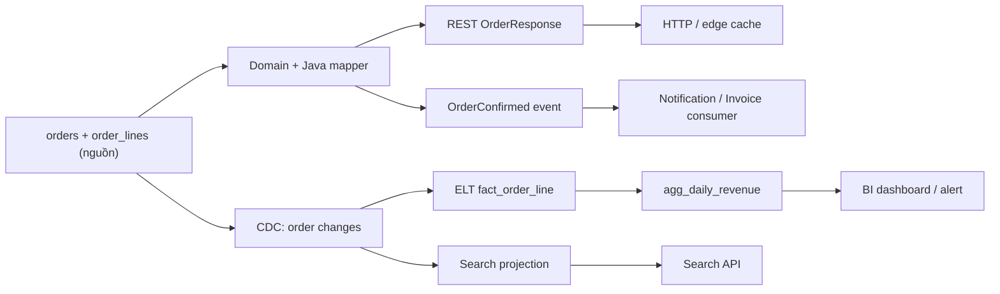
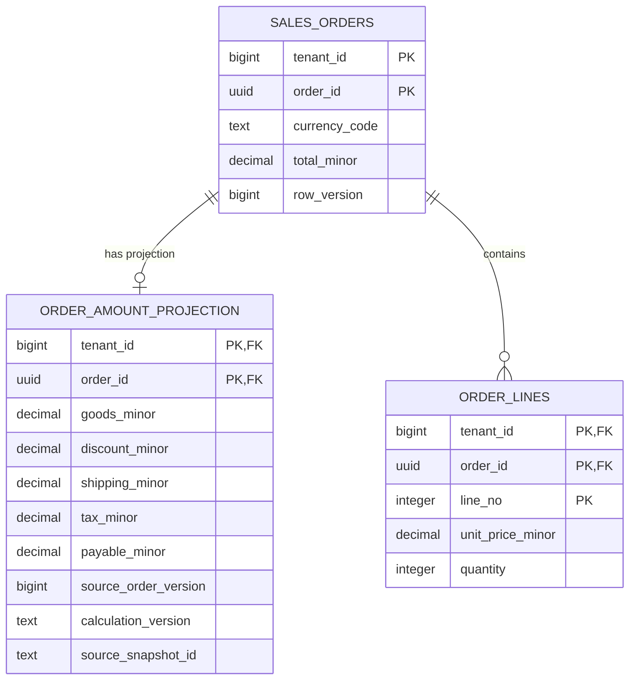

# Đánh giá tác động đến bên sử dụng và dữ liệu dẫn xuất

Một thay đổi ở mô hình dữ liệu hiếm khi chỉ ảnh hưởng đến một bảng. Khi đổi cách biểu diễn tổng tiền của đơn hàng, bảng nguồn có thể được migration thành công, nhưng API vẫn trả trường cũ; consumer sự kiện tiếp tục dùng công thức cũ; cache giữ bản chưa cập nhật; bảng phân tích đã tổng hợp theo quy tắc trước đó; một dashboard có thể hiển thị doanh thu lớn hơn hoặc nhỏ hơn thực tế dù tất cả truy vấn SQL đều chạy.

Vấn đề cốt lõi của **tiến hóa mô hình** (*model evolution*) là: **một thay đổi về cấu trúc, danh tính hoặc ý nghĩa dữ liệu lan tới những bên sử dụng và những bản dẫn xuất nào; ai phải thay đổi, thay đổi theo thứ tự nào và cần bằng chứng gì trước khi cắt bỏ mô hình cũ?**

Bài học thuộc chương **Tiến hóa mô hình** của module **DATABASE_DATA_MODELING**. Theo mục tiêu học tập của module, ta sẽ biến yêu cầu nghiệp vụ thành mô hình thực thể, quan hệ, ràng buộc, khóa, chỉ mục và lược đồ vật lý có thể kiểm chứng; đồng thời đánh giá cách các lựa chọn quan hệ, document, graph và phân tích tác động tới khả năng tiến hóa. Bài tập trung vào **đánh giá ảnh hưởng** (*impact assessment*): lập bản đồ phụ thuộc, kiểm tra tương thích dữ liệu, phân loại dữ liệu dẫn xuất, xây kế hoạch migration/backfill, chạy đối soát và kiểm tra khả năng quay lại khi thay đổi chưa đạt.

Ví dụ triển khai dùng **PostgreSQL 15+** và Java 17+, nhưng tư duy đánh giá tác động không phụ thuộc một ORM, database hay message broker cụ thể. Những đoạn code minh họa giả định ứng dụng có transaction, authorization và pipeline phù hợp; không có một checklist nào thay thế việc đo và thử trên kiến trúc thật.

## 1. Đừng đánh đồng thay đổi lược đồ với thay đổi hợp đồng dữ liệu

**Lược đồ vật lý** là bảng, cột, kiểu, index, partition và FK. **Hợp đồng dữ liệu** còn bao gồm ý nghĩa, đơn vị, grain, thời điểm, độ đầy đủ, khả năng cập nhật và đối tượng được phép dùng dữ liệu ấy.

| Lớp hợp đồng | Ví dụ | Điều có thể hỏng khi thay đổi |
|---|---|---|
| **Nghiệp vụ/miền** | “Tổng phải trả = hàng hóa − giảm giá + phí giao + thuế” | Giá trị cũ và mới không còn cùng nghĩa |
| **Lược đồ SQL** | `orders.total_minor NUMERIC(20,0)` | Query, view, trigger, ORM, stored procedure không tìm thấy cột |
| **Định danh và quan hệ** | `(tenant_id, order_id)` là khóa logic | FK, phép join, dedupe, upsert, đường dẫn API |
| **API** | Response `totalAmountMinor`, status và currency | Ứng dụng di động/client tích hợp đọc sai hoặc không đọc được |
| **Event/message** | `OrderConfirmedV1.totalMinor` | Consumer sự kiện, replay, schema registry |
| **CDC / replication** | Dòng `orders` được phát qua change stream | Connector, pipeline và downstream schema mapping |
| **Dữ liệu dẫn xuất** | `order_read_model`, search index, cache, data mart | Kết quả cũ chưa hội tụ, không thể rebuild hoặc sai metric |
| **Vận hành** | Backup, audit, quyền, retention, alert | Restore đưa lại dữ liệu cũ, quy trình purge không hoàn chỉnh |

Một thay đổi có thể **tương thích về cú pháp nhưng phá hợp đồng ngữ nghĩa**. Ví dụ giữ tên `total_minor` và kiểu `BIGINT`, nhưng từ “tổng đã trừ giảm giá” chuyển thành “tổng trước giảm giá”, mọi truy vấn cũ vẫn chạy mà số liệu sai.

Ngược lại, đổi tên cột vật lý và giữ cùng nghĩa qua một view/adapter tương thích có thể ít ảnh hưởng tới API hơn nhiều.

**Nguyên tắc:** trước khi hỏi “migration này có chạy được không?”, phải hỏi “**những ai tin dữ liệu đang mang ý nghĩa gì?**”.

## 2. Xác định đúng đối tượng và phạm vi đánh giá

**Bên sử dụng** (*consumer*) không chỉ là một người mở dashboard. Đó là mọi thành phần dựa vào cấu trúc hoặc ý nghĩa dữ liệu:

- **Đường ghi:** controller, command handler, domain service, batch importer, scheduler, webhook receiver.
- **Đường đọc:** repository/query, Java/JPA entity, API, mobile/web client, export, template hóa đơn.
- **Tích hợp:** event publisher/consumer, CDC connector, ETL/ELT, đồng bộ CRM/ERP, bên thứ ba.
- **Dữ liệu dẫn xuất:** bảng tổng hợp, materialized view, search index, read model, cache, warehouse fact/dimension, feature store.
- **Kiểm soát:** alert, fraud rule, reconciliation, data quality, audit log, retention/purge, backup/restore, quyền.
- **Con người và quy trình:** analyst sở hữu metric, đối tác nhận file, bộ phận tài chính, đội hỗ trợ/đối soát.

Một consumer có thể đang chạy **phiên bản ứng dụng cũ** trong vài ngày, hoặc một batch job chỉ chạy cuối tháng. Nếu chỉ kiểm tra phiên bản code đang deploy, rất dễ bỏ sót consumer hiếm khi hoạt động.

### Phạm vi dữ liệu phải được nêu chính xác

Với mỗi thay đổi, ghi:

1. **Đối tượng:** `Order`, `OrderLine`, `Customer`, fact doanh thu hay graph edge?
2. **Tenant/phân vùng/khu vực:** thay toàn bộ dữ liệu hay chỉ một nhóm?
3. **Thời kỳ hiệu lực:** từ bây giờ trở đi hay áp lại cho dữ liệu lịch sử?
4. **Ngữ nghĩa:** field bị đổi kiểu, đổi grain, đổi công thức, đổi trạng thái hay đổi chính sách thời gian?
5. **Đường ghi và đọc:** có nhiều writer, nhiều bản app, hệ thống offline không?
6. **Nguồn chân lý:** thành phần nào có thẩm quyền giải thích giá trị cuối cùng?
7. **SLA:** consumer nào đòi nhất quán ngay; consumer nào chấp nhận trễ?
8. **Yêu cầu bảo vệ:** có phát sinh trường định danh hoặc bản sao dữ liệu nhạy cảm mới không?

Một tài liệu “đổi field A thành B” không có phạm vi và thời gian hiệu lực là **chưa đủ** để đánh giá tác động.

## 3. Lập inventory người dùng dữ liệu và các bản dẫn xuất

Hãy tạo **bảng kiểm kê phụ thuộc** trước khi vẽ kế hoạch migration.

| Consumer / dữ liệu | Đọc gì và ở đâu? | Hợp đồng phụ thuộc | Người chịu trách nhiệm | Cách xác minh |
|---|---|---|---|---|
| Order service | `orders.total_minor` | Kiểu, currency, trạng thái | Order team | Integration test/query |
| REST API `GET /orders/{id}` | Domain order → response | `totalAmountMinor` | API team | Contract test hai phiên bản |
| Java/JPA repository | Cột, nullable, enum | Mapping và transaction | Backend team | Test trên DB thật |
| `OrderConfirmedV1` | Event snapshot | Total + schema V1 | Integration team | Consumer compatibility |
| CDC connector | WAL/row changes | Tên cột và DDL | Platform/Data team | CDC end-to-end |
| Search index | Order ID, amount, status | Mapping, freshness | Search team | Reindex + query assertion |
| Cache | Response theo `tenant:orderId` | TTL, invalidation | Backend/Infra | Read-after-write test |
| `fact_order_line` | Price × quantity, discount | Grain và amount definition | Data team | Source–fact reconciliation |
| `agg_daily_revenue` | `SUM` theo ngày/currency | Metric version, timezone | BI owner | So tổng theo cohort |
| Invoice renderer | Số tiền in hóa đơn | Giá trị lịch sử có thẩm quyền | Finance team | Golden invoice comparison |
| Audit/retention | Trường và bản sao cần giữ/xóa | Policy, quyền | Security/Compliance | Purge/restore test |

Không được ghi consumer “unknown” rồi coi như không có. Cần có **owner hoặc giả định có rủi ro**, một kế hoạch tìm phụ thuộc và tiêu chí chặn cutover nếu consumer quan trọng chưa được nhận diện.

### Những nguồn thông tin inventory có thể dùng

- API specification, schema registry, hợp đồng event, định nghĩa Java DTO.
- Metadata catalog, lineage từ ETL, bảng phụ thuộc SQL, materialized view, dashboard definitions.
- Telemetry truy vấn, truy cập bảng/cột, job scheduler, CDC topics và subscriptions.
- Test contract đang được chạy cho các ứng dụng/deployment cũ.
- Danh sách consumer do các đội sở hữu, kể cả export CSV và truy vấn ad hoc quan trọng.

**Giới hạn:** runtime telemetry có thể không thấy một job chỉ chạy quý một lần; static search có thể bỏ sót dynamic SQL; catalog có thể thiếu file export và cache ngoài DB. Phải kết hợp nhiều nguồn và yêu cầu owner xác nhận thay vì tuyên bố “không có người dùng” khi log trống.

## 4. Vẽ đồ thị lineage để nhìn tác động trực tiếp và gián tiếp

Một nguồn có thể nuôi nhiều tầng dẫn xuất. Thay đổi ở gốc có thể ảnh hưởng tới tầng hai, ba mà người thiết kế bảng không hề nhìn thấy.



Một cạnh nên có metadata:

| Thuộc tính cạnh | Ví dụ | Vì sao quan trọng? |
|---|---|---|
| Nguồn → đích | `orders.total_minor → order_read_model.payable_minor` | Biết consumer nào đọc thật |
| Phép biến đổi | Sao chép, `SUM`, join, normalize, currency conversion | Biết cần tính lại gì |
| Grain đích | Một đơn; một dòng; một ngày × sản phẩm | Tránh nhân số đo khi rebuild |
| Đồng bộ | Synchronous, CDC, scheduled batch | Biết độ trễ và ordering |
| Khóa dòng/idempotency | `(tenant_id,order_id)` | Biết ghi đè hoặc dedupe thế nào |
| Thời gian hiệu lực | Ngày đặt vs ngày thanh toán vs ngày hoàn | Tránh đổi kỳ báo cáo |
| Quy tắc/phiên bản | `amount_rule_v1` | So sánh output cũ–mới |
| Owner và SLA | Data team, ≤ 15 phút | Biết ai phê duyệt và độ trễ chấp nhận |

### Tác động trực tiếp so với tác động bắc cầu

- **Trực tiếp:** bỏ `orders.total_minor` làm một câu `SELECT total_minor` thất bại.
- **Bắc cầu:** CDC bỏ field cũ làm ETL không tính `fact_order_line`, khiến `agg_daily_revenue` stale, rồi alert “doanh thu giảm” báo sai.

**Không chỉ dừng ở những cạnh đầu tiên.** Đánh giá tác động phải đi hết đồ thị phụ thuộc tới nơi dữ liệu được ra quyết định hoặc công bố, đồng thời tránh đếm một consumer hai lần khi có nhiều đường dẫn tới nó.

## 5. Phân loại thay đổi theo tác động, không theo kích thước DDL

| Loại thay đổi | Ví dụ | Tác động thường gặp |
|---|---|---|
| **Bổ sung tương thích** | Thêm cột nullable mới, giữ reader cũ | Writer/reader mới, backfill và giới hạn null |
| **Loại bỏ/đổi tên** | Xóa `total_minor` | SQL/ORM/API/CDC có thể gãy trực tiếp |
| **Đổi kiểu** | `BIGINT → NUMERIC`, `TEXT → ENUM` | Overflow, serialization, precision, Java mapping |
| **Đổi tính bắt buộc** | Nullable → `NOT NULL` | Late data, legacy rows, writer cũ không cung cấp |
| **Đổi giá trị/hợp đồng enum** | `PAID → SETTLED` | State machine, filter, dashboard, retry |
| **Đổi khóa/identity** | `customer_id` cũ → canonical ID | PK/FK, join, dedupe, event id, cache key |
| **Đổi grain** | Một đơn → một dòng đơn | Số đo bị fan-out, query aggregate, uniqueness |
| **Đổi công thức** | Doanh thu trước → sau giảm giá | Metric drift dù schema không đổi |
| **Đổi mốc thời gian** | Ngày tạo → ngày hoàn tất | Phân bổ kỳ, partition, watermark |
| **Đổi SCD/history** | Category current → as-of transaction | Phân loại lịch sử và restatement |
| **Đổi mức bảo vệ** | Email rõ → token/AEAD | Search/sort/unique, quyền và vòng đời |
| **Đổi phân vùng/shard** | Theo tenant → theo ngày | Global uniqueness, FK, lookup, retention |

### Tương thích có nhiều chiều

Một thay đổi cần đánh giá ít nhất:

1. **Schema compatibility:** dữ liệu cũ và mới có parse được không?
2. **API/event compatibility:** client/consumer hiện tại có dùng được không?
3. **Semantic compatibility:** cùng field có tiếp tục cùng nghĩa không?
4. **Historical compatibility:** dữ liệu quá khứ có còn so sánh được không?
5. **Operational compatibility:** zero-downtime, latency, transaction và rollback có đáp ứng không?
6. **Security/privacy compatibility:** quyền, mã hóa, retention và data minimization có còn đúng không?

Thêm một cột nullable có thể tương thích với reader cũ nhưng không tương thích với một consumer JSON có cấu hình **từ chối trường lạ** nếu field cũng được thêm vào response. Vì vậy “additive = luôn an toàn” là một kết luận quá đơn giản.

## 6. Ví dụ xuyên suốt: thay đổi cách biểu diễn tổng tiền đơn hàng

Hệ thống hiện có:

```text
sales_orders
  tenant_id
  order_id
  placed_at
  currency_code
  status_code
  total_minor            -- Tổng khách phải trả tại lúc đặt
  row_version

order_lines
  tenant_id
  order_id
  line_no
  quantity
  unit_price_minor       -- Giá đã chốt của dòng
```

`total_minor` được định nghĩa là **số tiền phải trả tại lúc đặt**, theo một currency duy nhất trên đơn. Nó có thể gồm giảm giá đơn hàng, phí vận chuyển và thuế. Dòng đơn chỉ có `quantity × unit_price_minor`, **không đủ** để tính lại toàn bộ số phải trả nếu không có chứng từ/nguồn giá chốt bổ sung.

Yêu cầu mới: tài chính muốn phân biệt thành phần:

\[
\text{payable\_minor}
=
\text{goods\_minor}
-\text{discount\_minor}
+\text{shipping\_minor}
+\text{tax\_minor}.
\]

Các định nghĩa cần chốt:

- `goods_minor`: giá trị hàng hóa đã chốt, cùng currency với đơn.
- `discount_minor`: tổng giảm giá đã chốt, biểu diễn **số không âm** để trừ **một lần**.
- `shipping_minor`: khoản phí giao hàng phải thu, không âm.
- `tax_minor`: khoản thuế tính vào số phải trả, không âm.
- `payable_minor`: số khách phải trả ở mốc nghiệp vụ đã định nghĩa.
- `calculation_version`: phiên bản quy tắc tính, bao gồm làm tròn và phân bổ.
- `source_order_version`: phiên bản thay đổi của order đã được projection áp dụng.

**Không mặc định** `goods_minor = total_minor` và ba thành phần còn lại bằng 0 cho mọi dữ liệu cũ. Điều đó làm các thành phần có vẻ chính xác dù chưa biết giảm giá, thuế và phí từng phát sinh. Nếu lịch sử chỉ còn tổng cũ, có thể **không thể** tái dựng các thành phần đúng.

### Bản đồ tác động của ví dụ

| Consumer | Phụ thuộc hiện tại | Việc cần xác minh |
|---|---|---|
| Checkout | Tạo `total_minor` | Nguồn và thứ tự tính thành phần |
| Domain `Order` | Invariant số tiền | Công thức, currency, overflow, rounding |
| API v1 | `totalAmountMinor` | Giữ nghĩa, deprecate hay version? |
| Invoice | Tổng phải trả lúc mua | Không tính lại bằng giá hiện tại |
| Event `OrderConfirmedV1` | Một total | Consumer cũ còn chạy được không? |
| CDC | Cột `total_minor` | Mapper xử lý field mới hay cũ? |
| Search/card | Tổng tiền hiển thị | Rebuild hoặc cập nhật index |
| Cache | JSON response | TTL/invalidation và key version |
| BI | `SUM(total_minor)` | Grain, lọc trạng thái và metric definition |
| Finance control | Tổng payable đã chốt | Đối soát giữa chứng từ và projection |

Thay đổi này vừa là **schema evolution** vừa là **semantic and derived-data evolution**. Có thể bổ sung cột mới mà không làm vỡ API, nhưng nếu báo cáo mới đổi từ payable thành goods rồi vẫn gắn nhãn “doanh thu”, kết quả sẽ sai.

## 7. Bước đầu: chốt nguồn chân lý và tính tái tạo được

Mỗi giá trị cần biết là **nguồn** hay **dẫn xuất**.

| Giá trị | Phân loại trong ví dụ | Cách kiểm chứng |
|---|---|---|
| `unit_price_minor` trên dòng | Snapshot giao dịch nguồn | Đối chiếu dòng đơn đã chốt |
| Mức discount áp dụng | Snapshot/sự kiện ưu đãi đã chốt | Đối chiếu lịch sử khuyến mãi/quy tắc |
| Phí giao đã chốt | Snapshot hóa đơn/giao dịch | Không đọc phí giao hiện tại |
| Thuế đã chốt | Chứng từ hoặc rule snapshot có hiệu lực | Kiểm tra tỷ lệ, rounding, thời điểm |
| `total_minor` cũ | Giá trị tổng lịch sử đã chốt | Là nguồn kiểm soát trong migration |
| `order_amount_projection` mới | Bản dẫn xuất từ các nguồn đầy đủ | Có thể rebuild và đối soát |
| `agg_daily_revenue` | Bản tổng hợp qua nhiều đơn | Rebuild theo grain/metric version |
| Cache/search | Bản sao phục vụ đọc | Có TTL/refresh/rebuild riêng |

Có hai loại lịch sử:

1. **Tái tạo được:** còn đủ snapshot giao dịch để tính chính xác, không phụ thuộc giá/thuế hiện tại.
2. **Không tái tạo đầy đủ:** chỉ còn `total_minor` mà thiếu một hay nhiều thành phần đã chốt.

Với nhóm (2), phải đánh dấu `UNRECONSTRUCTABLE` hoặc giữ cách trình bày tổng cũ theo đúng hợp đồng; không sinh số giả cho các cột mới. Tùy mục đích và phê duyệt, có thể sử dụng giá trị suy đoán cho một mô hình thống kê riêng **có nhãn ước lượng**, nhưng không ghi như số liệu kế toán gốc.

### Tại sao “rebuild từ dữ liệu hiện tại” nguy hiểm?

Nếu giá catalogue thay đổi sau khi mua, hoặc chính sách thuế/giảm giá được cập nhật, công thức chạy ở hiện tại có thể cho kết quả khác giao dịch quá khứ. Cần **snapshot, effective-time, rule version, currency và rounding policy**. Không được ghi đè lịch sử giá đã chốt bằng cách tính mới chỉ để làm hai báo cáo khớp về hình thức.

## 8. Thiết kế mới: một projection tiền có grain rõ ràng

Thay vì xóa cột cũ ngay, thêm một bảng riêng để có thể backfill và so song song.



**Grain:** một dòng `order_amount_projection` đại diện cho **một đơn trong một tenant, ở phiên bản nguồn đã xử lý và theo một quy tắc tính cụ thể**. Bảng dưới chỉ lưu **trạng thái projection mới nhất** cho mỗi đơn, không lưu mọi bản lịch sử. Nếu cần lịch sử version của phép tính hoặc nhiều policy song song, phải chọn grain/bảng khác; không thay ngầm PK mà không xem consumer.

### PostgreSQL DDL minh họa

```sql
-- Đây là bảng ví dụ cho ứng dụng đã có sales_orders.
-- Giả định sales_orders có PK (tenant_id, order_id).
CREATE TABLE order_amount_projection (
    tenant_id BIGINT NOT NULL,
    order_id UUID NOT NULL,
    goods_minor NUMERIC(20,0) NOT NULL,
    discount_minor NUMERIC(20,0) NOT NULL,
    shipping_minor NUMERIC(20,0) NOT NULL,
    tax_minor NUMERIC(20,0) NOT NULL,
    payable_minor NUMERIC(20,0) NOT NULL,
    source_order_version BIGINT NOT NULL,
    calculation_version TEXT NOT NULL,
    source_snapshot_id TEXT NOT NULL,
    computed_at TIMESTAMPTZ NOT NULL DEFAULT CURRENT_TIMESTAMP,

    CONSTRAINT pk_order_amount_projection
        PRIMARY KEY (tenant_id, order_id),

    CONSTRAINT fk_projection_order
        FOREIGN KEY (tenant_id, order_id)
        REFERENCES sales_orders (tenant_id, order_id)
        ON DELETE RESTRICT,

    CONSTRAINT ck_components_nonnegative
        CHECK (
            goods_minor >= 0
            AND discount_minor >= 0
            AND shipping_minor >= 0
            AND tax_minor >= 0
            AND discount_minor <= goods_minor
        ),
    CONSTRAINT ck_payable_formula
        CHECK (
            payable_minor =
                goods_minor - discount_minor
                + shipping_minor + tax_minor
        ),
    CONSTRAINT ck_source_order_version
        CHECK (source_order_version >= 0),
    CONSTRAINT ck_calculation_version
        CHECK (btrim(calculation_version) <> ''),
    CONSTRAINT ck_source_snapshot
        CHECK (btrim(source_snapshot_id) <> '')
);

CREATE INDEX ix_projection_rule
    ON order_amount_projection (calculation_version, computed_at);
```

**Đã được SQL bảo vệ:** một projection/đơn/tenant, FK cùng tenant, công thức thành phần, các số không âm và metadata nguồn không rỗng.

**Chưa được SQL bảo vệ:** liệu `goods_minor` đúng bằng tổng các dòng nguồn, `discount_minor` có thực sự thuộc đơn này, `source_snapshot_id` có tồn tại ở hệ khác, và `source_order_version` có phải bản mới nhất. Đây là các **bất biến xuyên bảng/hệ thống**, cần trusted writer, transaction/snapshot và đối soát.

Nếu nghiệp vụ cho phép số tiền âm do điều chỉnh hoặc credit note, không gắn mọi loại giao dịch vào cùng quy tắc `>= 0`; hãy tách loại chứng từ và công thức theo domain, không nới ràng buộc chỉ để insert thành công.

## 9. Lập ma trận tương thích: old/new reader và old/new writer

Trong lúc triển khai, có thể đồng thời tồn tại hai phiên bản ứng dụng.

| Writer / Reader | Reader cũ (đọc `total_minor`) | Reader mới (đọc projection) |
|---|---|---|
| **Writer cũ** chỉ ghi total | Phải tiếp tục đúng | Chỉ đúng nếu projection được cập nhật từ nguồn đầy đủ hoặc reader có fallback có nhãn |
| **Writer mới** ghi nguồn/total/projection | Phải giữ nghĩa total cho tới khi hết reader cũ | Đúng nếu transaction và công thức projection nhất quán |
| **Batch import cũ** | Có thể đúng với schema mở rộng | Dễ tạo **thiếu projection** |
| **CDC/replay** | Consumer cũ phải đọc được schema chuyển tiếp | Consumer mới phải chịu late/out-of-order và rebuild |

Không nên nói “đã dual-write” khi một đường import hoặc repair tool vẫn chỉ ghi cột cũ.

### Lựa chọn chiến lược ghi

- **Một nguồn chân lý + projection dẫn xuất:** writer ghi nguồn giao dịch đáng tin cậy; projection được xây đồng bộ trong cùng transaction hoặc bất đồng bộ có watermark/SLA. Dễ xác định phải sửa nơi nào khi lệch.
- **Dual-write có kiểm soát:** trong một database transaction, writer có thể cập nhật cột tương thích và projection; phải bảo đảm mọi đường ghi tham gia. Nếu có nhiều database, hai lời gọi ghi riêng **không nguyên tử**.
- **CDC/outbox:** phát thay đổi/sự kiện sau commit để consumer dẫn xuất cập nhật idempotent. Chấp nhận độ trễ và xử lý replay.
- **View tương thích:** có thể giữ hình dạng cũ qua view hoặc adapter nếu cùng nghĩa, nhưng view không sửa được công thức nghiệp vụ đã đổi.

Không đặt hai giá trị độc lập ở vị trí “đều là nguồn chân lý” mà không có quy tắc chọn bên thắng. Khi xảy ra chênh lệch, hệ thống phải biết sửa projection từ nguồn, không “cộng trung bình” hai giá trị.

## 10. Expand: triển khai cấu trúc tương thích trước khi thay người đọc

Một kế hoạch **expand–migrate–contract** nên bắt đầu bằng bước bổ sung không phá client cũ:

1. Thêm bảng/field mới ở dạng cho phép chưa có dữ liệu.
2. Thêm đường đọc mới **chưa bật công khai** hoặc dùng feature flag.
3. Cập nhật writer được kiểm soát để ghi đủ nguồn dữ liệu và projection khi có thể.
4. Thêm metrics phân biệt dữ liệu mới đủ thành phần với dữ liệu lịch sử chưa rebuild.
5. Kiểm thử **ứng dụng cũ trên schema đã mở rộng**; không chỉ kiểm thử bản code mới.
6. Không xóa `total_minor` hoặc đổi ngữ nghĩa của nó trong giai đoạn còn consumer cũ.

### Khi thêm NOT NULL, UNIQUE hoặc FK cho dữ liệu lớn

Với thay đổi cột:

- Thường **thêm cột nullable**, backfill, xác minh mọi writer đã cung cấp, rồi mới siết `NOT NULL`.
- Thêm `UNIQUE` phải xử lý dữ liệu trùng và quan hệ partition trước; không coi migration DDL tự sửa lịch sử.
- Khi cần FK mới, phải biết mọi row nguồn đã có bản tham chiếu hợp lệ và các đường import không bypass.
- Cần đánh giá lock, thời gian scan, WAL, replication lag và tính năng validation online **của đúng DBMS/phiên bản**.
- Nếu mở rộng status enum hoặc event schema, chuẩn bị reader trước khi writer bắt đầu phát giá trị mới.

Thứ tự “mở rộng trước, writer sau, reader sau nữa, xóa cuối cùng” giảm rủi ro nhưng **không tự bảo đảm zero downtime** nếu dữ liệu có nhiều writer hoặc các phiên bản không tương thích về semantics.

## 11. Backfill: đúng lịch sử, cùng snapshot, có checkpoint

**Backfill** không chỉ là chạy một lệnh `UPDATE` cho mọi dòng. Nó là một quá trình xây dựng dữ liệu dẫn xuất từ nguồn lịch sử có thể đang thay đổi đồng thời.

### 11.1. Phân loại khả năng tái dựng

| Nhóm đơn | Có đủ snapshot đã chốt? | Hành động |
|---|---|---|
| Đơn mới có breakdown đầy đủ | Có | Tạo projection theo rule version đã chốt |
| Đơn cũ còn chứng từ discount/shipping/tax | Có | Rebuild theo snapshot lịch sử và đối soát total |
| Đơn cũ chỉ còn total, thiếu thành phần | Không | Giữ total, ghi trạng thái `UNRECONSTRUCTABLE` trong tracking |
| Đơn bị sửa trong lúc batch chạy | Có nhưng dữ liệu thay đổi | Đọc snapshot nhất quán, kiểm tra version hoặc retry |
| Đơn ngoại lệ/currency không được hỗ trợ | Chưa đủ | Quarantine và yêu cầu owner xử lý |

Không nhất thiết đưa tracking trạng thái vào chính `order_amount_projection` nếu bảng ấy yêu cầu các thành phần `NOT NULL`. Có thể dùng bảng vận hành riêng:

```text
ProjectionBackfillStatus
  tenant_id, order_id
  attempt_no
  source_order_version
  rule_version
  result: DONE | UNRECONSTRUCTABLE | FAILED | RETRY
  reason_code
  last_attempt_at
```

Bảng tracking chỉ lưu metadata tối thiểu và phải có retention/owner rõ. Không ghi toàn bộ payload thanh toán vào log lỗi chỉ để debug.

### 11.2. Một đơn phải được tính từ cùng trạng thái nguồn

Nếu đọc `order_lines` tại thời điểm T1 nhưng đọc discount/shipping tại T2, kết quả có thể chưa từng tồn tại như một trạng thái hợp lệ của đơn.

Một thuật toán an toàn cần chọn giữa:

- Đọc dữ liệu liên quan **trong một transaction với mức cô lập/snapshot phù hợp**, rồi tạo projection.
- Dùng **phiên bản nguồn** và kiểm tra tính nhất quán trước khi commit; nếu nguồn đổi thì retry.
- Phát một **transactional outbox event** chứa reference/version tới snapshot giao dịch đã chốt, để projection builder tính lại đúng bản.

**Chỉ kiểm tra `orders.row_version` là đủ nếu mọi thay đổi làm thay công thức đều cập nhật version ấy.** Nếu một batch sửa discount hoặc dòng đơn mà không tăng version parent, phép kiểm tra version có thể báo sai rằng dữ liệu vẫn ổn định. Cần định nghĩa **version của cả tập nguồn** hoặc bảo đảm mọi đường ghi tham gia cùng giao thức version/locking.

### 11.3. Idempotent backfill và phiên bản hóa

Một job có thể chạy lại sau lỗi mạng. Cần kiểm tra:

- Cùng `(tenant,order_id,source_order_version,calculation_version)` tạo **cùng kết quả** khi nguồn snapshot bất biến.
- Nạp lại cùng phiên bản không sinh projection trùng.
- Dữ liệu cũ đến muộn không ghi đè projection đã xử lý phiên bản mới hơn.
- Khi **đổi rule version**, hệ thống có thể rebuild cả khi source version không đổi.
- Checkpoint là mốc tiến độ, **không** chứng minh các bản ghi trước checkpoint đã đúng nếu chưa có reconciliation.

Không xây idempotency chỉ từ timestamp `computed_at`; timestamp tạo job không phải định danh của nội dung nguồn.

## 12. Ví dụ UPSERT projection và giới hạn của thứ tự phiên bản

Đối với một projection chỉ được cập nhật từ **phiên bản nguồn mới hơn**, có thể dùng upsert có điều kiện:

```sql
-- Pseudocode SQL có tham số đã được tính từ snapshot đáng tin cậy.
INSERT INTO order_amount_projection (
    tenant_id, order_id,
    goods_minor, discount_minor, shipping_minor, tax_minor,
    payable_minor, source_order_version,
    calculation_version, source_snapshot_id
)
VALUES (
    :tenant_id, :order_id,
    :goods, :discount, :shipping, :tax,
    :payable, :source_order_version,
    :calculation_version, :source_snapshot_id
)
ON CONFLICT (tenant_id, order_id)
DO UPDATE SET
    goods_minor = EXCLUDED.goods_minor,
    discount_minor = EXCLUDED.discount_minor,
    shipping_minor = EXCLUDED.shipping_minor,
    tax_minor = EXCLUDED.tax_minor,
    payable_minor = EXCLUDED.payable_minor,
    source_order_version = EXCLUDED.source_order_version,
    calculation_version = EXCLUDED.calculation_version,
    source_snapshot_id = EXCLUDED.source_snapshot_id,
    computed_at = CURRENT_TIMESTAMP
WHERE order_amount_projection.source_order_version
    < EXCLUDED.source_order_version;
```

Đoạn này **cố ý chỉ bảo vệ sự tăng của `source_order_version`**. Nó phù hợp với consumer cập nhật projection theo cùng một `calculation_version` đã được chốt. Nó **không hỗ trợ tự động** tình huống đổi quy tắc tính khi `source_order_version` giữ nguyên: lệnh rebuild rule mới sẽ bị bỏ qua.

Giải pháp cho đổi rule cần thiết kế riêng:

- Tạo **projection phiên bản khác** với khóa `(tenant,order_id,calculation_version)` để so song song, hoặc
- Dừng writer cũ, chạy cutover có quyền, reset/rebuild tập projection và kiểm tra, hoặc
- Sử dụng một **generation/epoch của projection** do hệ thống điều phối và ghi nhận thứ tự ưu tiên hợp lệ.

Không tự lấy `MAX(source_version, rule_version)` hay so chuỗi `"v10" > "v2"` để quyết định bản “mới hơn”: hai chiều version mang nghĩa khác nhau.

### Tránh event đến muộn ghi đè kết quả mới

Giả sử CDC gửi version 8 rồi version 7 vì retry. Nếu projection cứ `UPSERT DO UPDATE` vô điều kiện, nó có thể lùi về dữ liệu cũ. Tương tự, việc rebuild toàn bộ với rule version mới phải tránh một consumer rule cũ đang chạy và ghi đè. Cần **quy tắc sở hữu writer/generation rõ ràng**, not just a conditional update.

## 13. Đối soát nguồn và dẫn xuất bằng SQL

Một kiểm tra cơ bản là so số phải trả từ projection với `sales_orders.total_minor` cũ, chỉ trong những đơn mà hai cột **được quy ước cùng nghĩa** và cùng phiên bản nguồn.

```sql
SELECT
    o.tenant_id,
    o.order_id,
    o.total_minor AS legacy_payable_minor,
    p.payable_minor AS projection_payable_minor,
    p.source_order_version,
    o.row_version AS current_order_version,
    p.calculation_version
FROM sales_orders AS o
LEFT JOIN order_amount_projection AS p
  ON p.tenant_id = o.tenant_id
 AND p.order_id = o.order_id
WHERE
       p.order_id IS NULL
    OR p.source_order_version <> o.row_version
    OR p.payable_minor IS DISTINCT FROM o.total_minor;
```

**Ý nghĩa của kết quả:**

- `p.order_id IS NULL`: chưa có projection, có thể vì backfill chưa xong hoặc không tái tạo được.
- `source_order_version <> row_version`: projection có thể stale; cần xem version có bao phủ **mọi trường nguồn** cần tính không.
- `payable_minor IS DISTINCT FROM total_minor`: số tiền khác nhau, cần xem rule, rounding, currency, dữ liệu nguồn và tính tương thích lịch sử.

Không nên tự động sửa bằng `UPDATE projection SET payable = legacy_total` để giảm số lỗi: điều đó phá phép kiểm tra công thức trong `CHECK` hoặc che mất nguyên nhân.

### Vì sao cần phân nhóm và tổng kiểm soát?

Một truy vấn toàn bảng có thể trả hàng triệu đơn thiếu projection trong giai đoạn backfill, gây nhiễu. Nên lập dashboard kiểm soát:

| Metric | Ví dụ định nghĩa | Cách dùng |
|---|---|---|
| `coverage_rate` | Số đơn có projection hợp lệ / số đơn cần projection | Tiêu chí đạt của backfill |
| `stale_rate` | Số projection có version nguồn cũ / số projection | Theo dõi consumer lag |
| `amount_delta_minor` | `projection.payable − legacy.total` | Đối soát tiền cùng nghĩa |
| `unknown_history_count` | Số đơn thiếu snapshot thành phần | Không giả lập số liệu |
| `error_by_reason` | Số lỗi theo currency/rule/tenant | Chẩn đoán có hệ thống |
| `max_projection_lag` | Độ trễ giữa source commit và projection | SLA đọc bất đồng bộ |
| `rule_version_mix` | Tỷ lệ kết quả theo rule version | Biết khi nào có thể cutover |
| `orphan_derived_rows` | Projection không còn nguồn hợp lệ | Retention và tham chiếu |

So tổng tiền trên toàn tenant chưa đủ: nhóm A lệch +100 và nhóm B lệch −100 có thể bù nhau. Cần so **theo tenant, currency, ngày kinh doanh, trạng thái và cohort**, đồng thời có drill-down về ID nguồn.

## 14. Thay đổi grain là nguồn rủi ro lớn của dữ liệu dẫn xuất

Giả sử một bảng cũ có **một dòng cho một order** với `total_minor`. Mô hình mới có **một dòng cho mỗi order line**. Một đơn gồm ba dòng và một tổng tiền 300.000.

Nếu làm:

```sql
-- Ví dụ PHẢN DIỆN: tổng của đơn bị lặp trên mọi dòng đơn.
SELECT
    o.tenant_id,
    SUM(o.total_minor) AS reported_total
FROM sales_orders AS o
JOIN order_lines AS l
  ON l.tenant_id = o.tenant_id
 AND l.order_id = o.order_id
GROUP BY o.tenant_id;
```

Mỗi order total bị cộng **một lần trên mỗi order line**, gây fan-out. Một đơn ba dòng có thể bị báo 900.000 thay vì 300.000.

**Không dùng `SUM(DISTINCT o.total_minor)` để sửa**: hai đơn thực sự có cùng số tiền sẽ bị gộp thành một giá trị.

Để tổng hợp tiền theo order, cộng trên `sales_orders` ở đúng grain order. Nếu muốn phân bổ tổng phí giao/giảm giá xuống từng dòng để phân tích theo sản phẩm, phải có **quy tắc allocation** (ví dụ theo giá trị hàng hóa, số lượng, quy tắc làm tròn) và đảm bảo tổng các phần phân bổ **bằng đúng tổng order**.

### Ma trận grain khi đánh giá migration

| Trước → sau | Điều phải xác minh |
|---|---|
| Order → order line | Tránh nhân total, phân bổ tiền không tự nhiên |
| Customer row → nhiều phiên bản SCD2 | Join theo business key có thể nhân fact |
| Order → nhiều shipment | Tổng doanh thu có thể bị lặp theo số kiện |
| Một payment → nhiều phân bổ payment–order | Cần bridge và trọng số, không cộng payment nhiều lần |
| Event → hourly/daily aggregate | Không đếm trùng replay; theo đúng event-time/watermark |
| Một địa chỉ hiện tại → nhiều snapshot lịch sử | Query “địa chỉ tại thời điểm T” cần valid-time |

**Grain là một phần hợp đồng**, không phải ghi chú tùy chọn. Thay đổi grain thường đòi cập nhật cả công thức và kiểm thử metric của downstream, ngay cả khi tên cột không đổi.

## 15. CDC, message, event schema và consumer đang chạy phiên bản cũ

Một migration bảng có thể tác động ngoài database qua **Change Data Capture (CDC)** hoặc sự kiện miền.

### 15.1. CDC mang cấu trúc nguồn

Một CDC stream từ bảng `sales_orders` có thể phát thay đổi ở mức row. Khi thêm cột:

- Một consumer parse message theo schema chặt có thể thất bại nếu payload đổi.
- Một consumer cố đọc `total_minor` sẽ hỏng khi cột bị xóa.
- Một pipeline suy ra dữ liệu dẫn xuất từ event update có thể cần **before-image**, transaction ordering hoặc snapshot ban đầu.
- Một connector có thể xử lý rename như **drop + add** tùy cơ chế/schema; không đoán hành vi mà không test.
- Khi thêm source table mới, cần cấu hình stream/permission/snapshot/offset cho bảng ấy.

CDC là một **cơ chế phát thay đổi dữ liệu**, không tự đưa ra định nghĩa nghiệp vụ rằng một trường mới có cùng ý nghĩa với trường cũ.

### 15.2. Integration event là hợp đồng riêng

Ví dụ:

```json
{
  "eventType": "OrderConfirmedV1",
  "eventId": "evt-100",
  "tenantId": 42,
  "orderId": "2b2657a3-13ec-44c0-a4c5-3cf02ff0a6ab",
  "totalMinor": 300000,
  "currency": "VND"
}
```

Một consumer hóa đơn hiểu `totalMinor` là **số tiền phải trả tại lúc xác nhận**. Nếu schema v2 thêm breakdown:

```json
{
  "eventType": "OrderConfirmedV2",
  "eventId": "evt-100",
  "tenantId": 42,
  "orderId": "2b2657a3-13ec-44c0-a4c5-3cf02ff0a6ab",
  "goodsMinor": 320000,
  "discountMinor": 30000,
  "shippingMinor": 10000,
  "taxMinor": 0,
  "payableMinor": 300000,
  "currency": "VND",
  "calculationVersion": "pricing-v2"
}
```

Chỉ vì số mới có cùng 300.000 không có nghĩa consumer V1 có thể đọc V2. Cần **chiến lược versioning, schema compatibility, consumer readiness và thông báo deprecation**.

Nếu phát **cả V1 và V2** cho cùng sự kiện, phải ngăn consumer tính **hai lần**. `eventId` và event type/version cần có ngữ nghĩa rõ; một consumer đăng ký cả hai topic nên nhận một logical event hay hai distinct events? Chọn chính sách dedupe và kiểm thử nó. Không gọi dual-publish là an toàn nếu hóa đơn bị tạo hai lần.

### 15.3. Eventual consistency cần chỉ tiêu rõ

Một order đã commit có thể được API nguồn trả trạng thái mới ngay nhưng search/read model còn dữ liệu cũ. Đó có thể là hành vi được chấp nhận nếu có SLA và tín hiệu:

- Mốc commit/source version.
- Event ID và partition/offset hoặc vị trí log.
- Version mới nhất consumer đã xử lý.
- Freshness lag và lỗi dead-letter.
- Cơ chế rebuild snapshot khi event history không đủ.

Không hứa “đồng bộ tức thời” khi kiến trúc thực tế là CDC bất đồng bộ.

## 16. Derived data: cache, search, materialized view và read projection

Các bản dẫn xuất có **cách sống khác nhau** và cần chiến lược nâng cấp riêng.

| Loại dẫn xuất | Đặc điểm | Kế hoạch ảnh hưởng |
|---|---|---|
| **HTTP/cache response** | TTL, cache key, snapshot API | Version key/invalidate, test không stale |
| **Search index** | Denormalized documents, mapping | Reindex/backfill, alias switch, query quality |
| **Materialized view** | Snapshot theo query tại lần refresh | Update definition, refresh đúng dependency, check unique |
| **Read model CQRS** | Nhận event có thứ tự và retry | Rule version, idempotency, rebuild từ nguồn |
| **BI aggregate** | Grain thời gian/sản phẩm/tenant | Chốt metric, timezone, backfill và restatement |
| **Feature store** | Value dùng cho quyết định tự động | Ngăn training-serving skew và rò rỉ dữ liệu tương lai |
| **File export** | Dữ liệu đã rời hệ thống | Version schema, thông báo người nhận, lịch phát lại |
| **Mobile/offline cache** | Client không cập nhật cùng lúc | Hợp đồng tương thích ngược, dữ liệu xung đột |

### 16.1. Cache không tự được làm sạch bởi ALTER TABLE

Nếu response V1 và V2 có cùng cache key, một client V2 có thể nhận payload thiếu trường. Có thể dùng cache key version hóa như:

```text
order:tenant=42:id=O100:api=v1
order:tenant=42:id=O100:api=v2
```

Nhưng version cache **không giải quyết freshness** nếu cả hai key được xây từ projection stale. Cần áp TTL, invalidation theo source version hoặc một cơ chế đọc có bảo đảm freshness phù hợp.

### 16.2. Search index cần đánh giá cả quyền và dữ liệu thừa

Một search document có thể nhúng `amountMinor` và thông tin khách hàng để lọc nhanh. Khi thay công thức:

1. Xác định mapping field cũ/mới.
2. Rebuild documents từ nguồn có thẩm quyền.
3. So sample query/filter/sort giữa index cũ và mới.
4. Chuyển alias/read traffic khi có chứng cứ chất lượng.
5. Xử lý event đến muộn để không ghi đè bản mới.
6. Xóa bản index cũ theo retention/quyền.

**Không thêm PII vào document search chỉ vì ETL đang đọc được.** Đánh giá mục đích, quyền và thời hạn của mỗi field dẫn xuất.

### 16.3. Materialized view

Một materialized view phải được kiểm tra định nghĩa và độ tươi. Trong PostgreSQL, `REFRESH MATERIALIZED VIEW CONCURRENTLY` có các điều kiện riêng (bao gồm unique index thích hợp, không phải index tùy ý hoặc index chỉ một phần), và không nên coi nó là lời hứa “không downtime” cho mọi mô hình. Thay query định nghĩa của một materialized view còn cần kế hoạch rebuild/switch đối tượng phù hợp.

Một view SQL thường đọc dữ liệu hiện tại khi query, còn materialized view lưu kết quả từ **một thời điểm refresh**. Không được đổi tên trường rồi giả định materialized result tự cập nhật.

## 17. Fact, dimension và định nghĩa metric là phần của migration

Trong kho phân tích, thay đổi ở OLTP có thể làm thay đổi **nghĩa của metric**, không chỉ tên cột.

### 17.1. Chốt grain và công thức

Một fact doanh thu nên nêu:

```text
FactOrderAmount
  grain: một đơn × một tenant × một phiên bản quy tắc được công bố
  event_time: thời điểm chốt đơn
  business_date: ngày chốt theo timezone đã định nghĩa
  amount: payable_minor (cùng currency)
  status_filter: tập trạng thái được chấp nhận
  source_version: phiên bản dữ liệu nguồn
  metric_rule_version: phiên bản công thức
```

Nếu dashboard cũ gọi `SUM(total_minor)` là “Doanh thu”, cần xác minh đó là **doanh thu đã ghi nhận**, **số tiền khách phải trả**, hay **giá trị đơn được tạo**. Một thay đổi công thức payable không mặc nhiên làm nó trở thành doanh thu kế toán.

### 17.2. Backfill lịch sử có thể đổi số liệu đã công bố

Nếu tất cả tháng trước được tính lại theo rule mới, dashboard kỳ quá khứ có thể thay đổi. Cần quyết định:

- **As-was:** giữ kết quả đã công bố theo rule có hiệu lực lúc đó.
- **Restated:** tính lại lịch sử theo định nghĩa mới, gắn nhãn và version.
- **Dual view:** công bố đồng thời metric v1 và v2 trong giai đoạn chuyển đổi.

Không tự ghi đè báo cáo đã khóa sổ rồi thông báo rằng “schema chỉ thay một cột”. Người sở hữu metric và những người dùng báo cáo phải phê duyệt cách diễn giải lịch sử.

### 17.3. SCD2 và khóa dimension

Nếu `category_code` trên sản phẩm đổi từ Type 1 sang Type 2:

- Một `canonical_product_id` có thể có nhiều `product_sk`.
- Fact bán hàng phải được giải mã theo **event time** nếu báo cáo as-was.
- Join theo business key thiếu valid-time có thể **nhân đôi fact**.
- Report theo category hiện tại là một hợp đồng khác report theo category lúc bán.

Sửa dimension rồi “rebuild aggregate” mà không xác định cách nhóm theo thời gian có thể làm tổng theo ngành hàng thay đổi ngoài mục tiêu.

## 18. Thay đổi khóa, định danh và phân vùng thường có tác động xuyên hệ thống

Đổi `customer_id` từ định danh cũ sang định danh chuẩn mới không phải một phép `UPDATE` đơn giản.

### 18.1. Các phụ thuộc có thể bị ảnh hưởng

- Primary key, foreign key và bảng liên kết N:M.
- Idempotency key và dedupe các event cũ.
- REST route `/customers/{id}` và deep link của client.
- Cache keys, search document IDs và partition/shard routing.
- CDC upsert key; nếu khóa mới làm một row cũ trở thành row mới, có thể nạp trùng.
- Fact/bridge và SCD dimension trong warehouse.
- History/audit, retention và quyền theo tenant.

Nếu hai ID cũ **merge** thành một ID chuẩn, việc nối sẽ thay đổi cardinality; các fact phải giữ khả năng truy vết nguồn và một chính sách giải quyết trùng. Nếu một ID cũ **split** thành hai định danh mới, mapping cần time validity hoặc quy tắc khác để không gán nhầm sự kiện lịch sử.

### 18.2. Key mapping có thể cần hiệu lực thời gian

```text
CustomerIdentityMap
  tenant_id
  source_system
  source_customer_id
  canonical_customer_id
  valid_from
  valid_to
  confidence_status
  approved_at
```

Không join toàn bộ lịch sử chỉ bằng “mã nguồn hiện tại” nếu mã có thể được tái sử dụng. Không tự khẳng định hai khách có cùng email là một người.

### 18.3. Thay đổi partition key tác động tới tính duy nhất

Nếu bảng được chia theo tháng, `UNIQUE(tenant_id,order_id,ordered_on)` không tương đương `UNIQUE(tenant_id,order_id)` xuyên lịch sử. Nếu pipeline đổi từ partition theo tenant sang theo ngày, cần xem lại global uniqueness, FK và việc replay event đến muộn.

**Không đánh đổi bất biến toàn hệ thống thành uniqueness cục bộ** mà không có cơ chế global registry, routing cùng khóa hoặc constraint của engine phù hợp.

## 19. Data protection và quyền xóa cũng phải đi theo lineage

Một thay đổi mô hình có thể thêm bản sao dữ liệu nhạy cảm hoặc khiến quy trình xóa cũ không còn đầy đủ.

Ví dụ một projection mới copy email khách vào `order_search_document` để dễ hiển thị. Dù bảng nguồn có mã hóa, index mới có thể lưu email rõ, bị truy cập bởi nhiều dịch vụ và sống lâu hơn mục đích ban đầu.

### Những câu hỏi cần hỏi trước khi phát hành

1. Dữ liệu mới có cần thiết cho mục đích nào?
2. Projection có giữ tên/email/địa chỉ/ID liên kết không cần thiết không?
3. Quyền đọc có thay đổi theo vai trò/tenant không?
4. Nếu nguồn xóa hoặc chỉnh dữ liệu theo policy, bản dẫn xuất có **xóa/rebuild** đúng không?
5. Event và CDC giữ dữ liệu cũ bao lâu? Có replay làm tái xuất hiện dữ liệu đã xử lý xóa không?
6. Backup/restore có thủ tục áp lại các quyết định purge không?
7. Audit có đủ chứng cứ tối thiểu mà không copy nguyên dữ liệu nhạy cảm không?

Việc tách mô hình domain, DTO và persistence giúp kiểm soát nơi công khai dữ liệu, nhưng **không tự ngăn** một mapper mới đưa thêm field nội bộ vào API. Cần contract test cả danh sách **field không được phép xuất hiện**.

## 20. Contract tests: kiểm tra hành vi của consumer, không chỉ migration DDL

Có thể phân loại phép thử thành các lớp:

| Lớp kiểm thử | Ví dụ | Điều chứng minh |
|---|---|---|
| **Schema migration** | Tạo bảng mới, thêm FK, constraint | DDL chạy và cấu trúc hợp lệ |
| **Domain invariants** | Formula/overflow/rounding/currency | Ý nghĩa nghiệp vụ đúng ở Java |
| **Persistence integration** | Read/write đồng thời, PK/FK, UPSERT version | Tính nhất quán thực trên DB |
| **Old-app compatibility** | Binary/API V1 với expanded schema | Bản đang chạy không bị phá |
| **New-app compatibility** | Reader V2 khi data còn thiếu | Fallback/unknown/error theo contract |
| **Event contract** | Consumer V1/V2 và schema registry | Message đọc được, không phát sinh xử lý trùng |
| **CDC/replay** | Snapshot + stream, late/out-of-order | Không mất/nhân bản projection |
| **Metric reconciliation** | Tổng tiền nguồn vs mart theo grain | Không fan-out hoặc thay nghĩa ngoài ý muốn |
| **Search/cache** | Invalidation, reindex, query accuracy | Kết quả đọc đúng version/freshness |
| **Security/retention** | Tenant, field exposure, purge/restoration | Không lộ/bản sao sống quá policy |
| **Performance** | Migration load và P95 query | Đáp ứng thời gian/chi phí dưới tải |
| **Rollback/recovery** | Đưa reader cũ trở lại, khôi phục sau fail | Có khả năng quay lại trong phạm vi đã hứa |

**Unit test của mapper không chứng minh** CDC hoạt động dưới replay, và DDL thành công không chứng minh sự kiện đã được consumer ngoài hệ thống đọc đúng. Cần kiểm thử đầu-cuối hoặc contract test có dữ liệu đại diện.

### Dataset bắt buộc có tình huống phản ví dụ

- Đơn nhiều dòng để phát hiện fan-out.
- Đơn có coupon, phí giao, thuế và quy tắc làm tròn.
- Đơn cũ chỉ có tổng, không có snapshots.
- Hai currency khác nhau.
- Đơn được sửa sau khi backfill bắt đầu.
- CDC event version 8 đến trước version 7.
- Reader V1 đọc khi writer V2 đang chạy.
- Consumer V1 nhận cả event V1/V2 trong giai đoạn chuyển đổi.
- Một dimension đổi category ở ranh giới ngày hiệu lực.
- Xóa dữ liệu nguồn nhưng cache/search còn bản dẫn xuất.
- Một tenant lớn và một tenant không có đủ dữ liệu lịch sử.
- Fail/rollback giữa lúc switch writer và refresh projection.

**Tiêu chí kiểm thử** phải nêu số liệu kỳ vọng cụ thể, không chỉ “job không lỗi”.

## 21. Canary, shadow read và dual reporting

Trước khi mọi người dùng đọc kết quả mới, có thể chạy **shadow comparison**:

1. Cho đường ghi mới tạo nguồn đủ thành phần và projection.
2. Giữ API/consumer cũ làm đường hiển thị chính.
3. Đường shadow đọc projection cho một tập order/tenant/currency được chọn.
4. So `payable_minor` với total cũ, kiểm tra source version tương ứng.
5. Thu thập mismatch theo lý do, không âm thầm sửa.
6. Tăng dần phạm vi canary sau khi đạt tiêu chí.
7. Chuyển một phần read traffic sang V2 với khả năng tắt qua feature flag.

### Shadow không nên tạo tác dụng phụ kép

Một shadow read phải **không tạo thanh toán, thông báo, đơn mới hoặc hóa đơn mới**. Nếu thử consumer sự kiện trong shadow, cần môi trường side effect bị chặn và idempotency rõ ràng.

### Tỷ lệ so khớp 100% có thể sai nếu hai metric khác nghĩa

Nếu công thức thay đổi có chủ đích, không thể yêu cầu tổng V2 bằng tổng V1 cho **mọi đơn**. Cần phân nhóm:

- **Nhóm semantic-equivalent:** số phải trả được định nghĩa giống nhau, yêu cầu khớp chính xác trong cùng currency/rule rounding.
- **Nhóm có thay đổi chủ đích:** chênh theo công thức mới phải được giải thích và người sở hữu metric phê duyệt.
- **Nhóm thiếu lịch sử:** không có kết quả đủ tin cậy, báo trạng thái unknown thay vì xem là mismatch tiền.
- **Nhóm lỗi nguồn:** điều tra và sửa từ nguồn được phép.

Một metric đẹp như “99,99% khớp” không có nghĩa nếu 0,01% còn lại là các đơn tiền rất lớn hoặc nếu phần lớn lịch sử bị bỏ ngoài phép so.

## 22. Cutover, contract và rollback cần tiêu chí phê duyệt

**Cutover** là thời điểm hệ thống chọn mô hình mới làm đường dùng chính; **contract** là bước gỡ bỏ tương thích cũ. Hai việc này không nhất thiết diễn ra cùng lúc.

### Điều kiện gợi ý trước cutover

| Gate | Bằng chứng cần |
|---|---|
| Consumer inventory | Những consumer quan trọng đã được nhận diện và có owner xác nhận |
| Old/new compatibility | Bản đang chạy đã test trên schema mở rộng |
| Data completeness | Coverage đủ theo phạm vi và chính sách đối với unknown |
| Data accuracy | Đối soát chi tiết, tổng tiền và rule version đạt ngưỡng được phê duyệt |
| Late/replay | Không có old event ghi đè kết quả mới |
| CDC/event readiness | Consumer V1/V2 có kế hoạch version/dedupe |
| Search/cache | Reindex/invalidation đạt độ tươi dự kiến |
| Security/privacy | Không thêm dữ liệu thừa; xóa/bảo vệ bản sao |
| Performance | Query, ghi và backfill trong giới hạn mục tiêu |
| Recovery | Đã thử tắt feature flag, rollback code/schema trong phạm vi an toàn |

### Rollback không phải lúc nào cũng là revert migration

Nếu đã ghi dữ liệu theo model mới mà không còn điền field cũ, việc deploy lại application cũ có thể khiến **reader cũ không đọc được dữ liệu mới**. Đó là rollback illusion.

Các phương án khả thi:

- **Rollback đọc:** chuyển flag về đường V1, với điều kiện cột dữ liệu V1 **vẫn còn được duy trì đúng nghĩa**.
- **Stop-the-line:** tạm dừng chuyển traffic hoặc writer mới, giữ dữ liệu để đối soát/sửa.
- **Forward fix:** sửa projection/mapper mới mà không hủy migration vật lý.
- **Rebuild dẫn xuất:** dựng lại cache, search, mart từ nguồn chốt.
- **Restore backup:** chỉ là phương án khẩn cấp có tác động mất ghi, CDC offsets, idempotency và quyền dữ liệu; cần kế hoạch restore toàn hệ, không đơn giản khôi phục một bảng.

Đặc biệt, sau khi xóa cột cũ hoặc đã xóa dữ liệu theo policy bảo vệ, rollback có thể **không thể khôi phục nguyên trạng một cách hợp lệ**. Vì vậy **contract (xóa cấu trúc cũ)** chỉ nên làm khi có chứng cứ mọi consumer đã chuyển và retention/phụ thuộc đã được xử lý.

## 23. Runbook vận hành cho một thay đổi có nhiều dẫn xuất

Một runbook đủ tốt chỉ rõ ai làm gì và cách xác minh ở mỗi giai đoạn.

### Giai đoạn A — Trước thay đổi

1. Ghi RFC thay đổi: mục đích, bất biến, type/grain, owner, phạm vi lịch sử.
2. Inventory consumer và lineage hai chiều: nguồn → dẫn xuất → quyết định cuối.
3. Phân loại có thể rebuild và không thể rebuild.
4. Chốt old/new contracts và metric version.
5. Xây test, mẫu dữ liệu phản ví dụ và phương án khôi phục.
6. Chuẩn bị dashboard quality/lag/error, trên tenant/currency/cohort.
7. Phê duyệt kế hoạch theo đội dữ liệu, ứng dụng, vận hành và người sở hữu metric.

### Giai đoạn B — Expand và xây dữ liệu mới

1. Deploy schema bổ sung.
2. Deploy writer/service tương thích.
3. Bật ghi nguồn/snapshot/đường projection đáng tin cậy.
4. Chạy backfill theo batch và checkpoint; không gây quá tải DB.
5. Đối soát version, formula, idempotency và ngoại lệ.
6. Rebuild hoặc tạo index/aggregate mới dưới tên/phiên bản riêng.
7. Chạy old-app compatibility và event/replay test.

### Giai đoạn C — Shadow và chuyển đường đọc

1. Shadow compare theo cùng mốc nguồn.
2. Canary với tenant/cohort đại diện; không chỉ chọn tenant dễ.
3. Quan sát P95/P99 latency, conflict, mismatch, projection lag.
4. Mở read traffic theo gate được phê duyệt.
5. Theo dõi consumer chậm, cache hit và báo cáo đã công bố.

### Giai đoạn D — Contract và kết thúc

1. Xác nhận consumer V1 đã ngừng hoặc đã dùng adapter tương thích.
2. Xử lý lịch sử chưa dựng được bằng policy công khai, không xóa im lặng.
3. Gỡ dual-write/event cũ theo thứ tự không gây mất dữ liệu.
4. Gỡ cột/index/consumer cũ sau khi chắc chắn không còn phụ thuộc.
5. Kiểm thử lại purge/backup/restore và data governance.
6. Lưu quyết định, metric version, tài liệu lineage và kết quả nghiệm thu.

Không nên để bước “xóa bảng cũ” là một thao tác thủ công không có owner và điều kiện. Nó có thể làm một job quý hoặc consumer offline mất dữ liệu vào nhiều tuần sau.

## 24. Theo dõi thay đổi bằng các chỉ số chất lượng

Một migration liên quan dẫn xuất nên có **chỉ số vận hành** bên cạnh số lượng record đã xử lý.

| Chỉ số | Công thức/định nghĩa | Cảnh báo |
|---|---|---|
| **Coverage** | Projection hợp lệ / bản ghi thuộc phạm vi cần projection | Không đạt ngưỡng cutover |
| **Unreconstructable** | Số bản ghi thiếu nguồn cần thiết | Tăng sau khi đổi pipeline |
| **Value mismatch** | Số/giá trị lệch theo cùng rule và currency | Mismatch mới hoặc vượt ngưỡng tiền |
| **Stale derived** | Projection có source version thấp hơn nguồn | Lag kéo dài |
| **Rebuild throughput** | Bản ghi xử lý/giây hoặc /batch | Giảm, quá tải |
| **DLQ/retry backlog** | Event chưa xử lý thành công | Phình kéo dài |
| **Consumer contract failures** | Parse/schema/field errors | Tăng khi rollout |
| **Duplicate source IDs** | Trùng business key/event ID | Rủi ro tăng số đo |
| **Fan-out factor** | Số dòng sau join / sự kiện gốc theo kiểm tra thích hợp | > 1 không dự kiến |
| **Report drift** | Chênh metric v1/v2 theo cohort có kiểm soát | Thay đổi không giải thích |
| **P95/P99 latency** | Thời gian API/query/lookup | Vượt SLA |
| **Deletion propagation lag** | Chậm từ khi nguồn xóa đến bản dẫn xuất | Vượt policy |

Không đặt mọi số mismatch bằng 0 để có dashboard xanh. Phải phân loại **dữ liệu chưa được dựng, dữ liệu stale, dữ liệu khác có chủ đích và dữ liệu sai thực sự**. Chỉ số phải có owner, công thức, ngưỡng, phản ứng và lịch review.

### Một chỉ số tổng có thể che lỗi theo nhóm

Nếu sai lệch tiền +100 ở tenant A và −100 ở tenant B, tổng drift toàn hệ thống bằng 0. Vì vậy cần đối soát theo **tenant, currency, business date, rule version, status và cohort**, rồi tập hợp thành tổng.

## 25. Mô hình quan hệ, document, graph và analytics thay đổi khác nhau ra sao?

### 25.1. Quan hệ

RDBMS biểu diễn PK/FK/UNIQUE/CHECK và view rõ ràng. Khi đổi khóa, nullable, index hoặc phân vùng, phải kiểm tra:

- Constraint nào đang thực thi và có phạm vi gì?
- View/materialized view, trigger, function, ORM và migration lịch sử còn dùng cột cũ không?
- Query plan có thay đổi khiến đọc chậm hoặc khóa ghi không?
- Transaction nào phải cập nhật atomically để invariant không bị phá?

Database migration thành công về DDL **không** đồng nghĩa các consumer qua CDC hoặc event còn tương thích.

### 25.2. Document

Một document có thể nhúng thông tin đã chuẩn hóa/phi chuẩn hóa:

```json
{
  "orderId": "O100",
  "totalMinor": 300000,
  "pricing": {
    "goodsMinor": 320000,
    "discountMinor": 30000,
    "shippingMinor": 10000,
    "taxMinor": 0,
    "payableMinor": 300000,
    "ruleVersion": "pricing-v2"
  }
}
```

Đổi schema document có thể cần **schema version trên từng document**, reader xử lý nhiều version hoặc migration hàng loạt. Không đợi document cũ tự biến thành schema mới khi được đọc. Nếu record nguồn thay đổi, các document projection được nhúng ở nhiều collection có thể stale, và việc xóa một field nhạy cảm cần tìm mọi bản sao.

### 25.3. Graph

Một migration từ quan hệ `Customer → Order` sang `Account → Booking → Customer` có thể làm đổi đường đi và ý nghĩa cạnh. Query graph theo node/edge label có thể trả số lượng khác dù không lỗi cú pháp.

Nếu node ID được merge/split, phải kiểm tra identity mapping, độ duy nhất, valid-time của cạnh và ảnh hưởng tới phép đếm. Một query đếm đơn qua nhiều đường đi có thể **đếm lặp cùng một order**; giữ grain định danh là quan trọng như trong SQL.

### 25.4. Analytics

Warehouse có nhiều derived fact/aggregate, conformed dimension, semantic model và dashboard. Cần chốt:

- Grain, event time, business date, currency, phiên bản metric.
- SCD as-was/as-is.
- Bản được công bố trước đây có được restate không.
- Phạm vi dữ liệu nguồn có đủ để backfill không.
- Chất lượng của join, allocation, deduplication và snapshot.
- Danh sách người/đội tiêu thụ metric và chính sách deprecation.

Một data mart không phải bản sao miễn phí của OLTP; nó là **hợp đồng ngữ nghĩa được dùng để ra quyết định**, nên phải được thay đổi và nghiệm thu có chủ đích.

## 26. Những anti-pattern cần nhận diện

| Anti-pattern | Hậu quả | Cách thay thế |
|---|---|---|
| “Chỉ thêm một cột nên không cần báo ai” | Consumer JSON/CDC/ETL không tương thích | Inventory + contract test |
| “Chỉ cần grep tên cột trong repo hiện tại” | Bỏ sót batch, mobile, external consumer | Catalog, runtime, owner confirmation |
| “Backfill tất cả bằng giá hiện tại” | Sai lịch sử giao dịch | Snapshot/effective-time, unknown nếu thiếu |
| “Không có lỗi SQL tức là metric đúng” | Semantic drift âm thầm | Đối soát formula/grain/currency |
| “Dual-write hai DB là atomic” | Mất nhất quán khi một bên lỗi | Outbox/CDC/idempotency/reconciliation |
| “`SELECT` rồi `INSERT` bảo vệ unique” | Race condition | Constraint nguyên tử ở phạm vi đúng |
| “Thay key rồi giữ nguyên join” | Fan-out, orphan, sai tenant | Mapping và FK/grain tests |
| “Gán NULL thành 0 cho dữ liệu chưa có” | Che thiếu dữ liệu | Unknown/stale flags và completeness |
| “Dùng `SUM(DISTINCT amount)` để tránh nhân” | Gộp sai các giao dịch cùng giá trị | Preaggregate đúng grain |
| “Đổi rule version bằng cách cập nhật chuỗi” | Old consumer overwrite new result | Generation/dual index/controlled cutover |
| “Bỏ cột cũ ngay khi app mới deploy” | Job offline và client cũ bị gãy | Expand–migrate–contract có gate |
| “Rollback code luôn đủ” | Data mới không đọc được bằng code cũ | Khả năng rollback dữ liệu và writer rõ |
| “Projection xóa khỏi DB là xong” | Cache/search/backup còn bản thừa | Deletion propagation và restore tests |
| “Refresh view là đủ cho mọi hệ dẫn xuất” | Search/event/BI vẫn stale | Lineage đến consumer cuối |

Một thay đổi có thể làm tổng dữ liệu **trông hợp lý** nhưng sai ở nhóm hiếm hoặc ranh giới lịch sử. Cần ca kiểm thử phản ví dụ chứ không chỉ đối chiếu vài order phổ biến.

## 27. Bài tập thực hành: đổi mô hình khách hàng và doanh thu

Một ứng dụng đa tenant có:

- `customer_accounts(tenant_id, customer_id, email)`.
- `sales_orders(tenant_id, order_id, customer_id, placed_at, total_minor, currency_code)`.
- `order_lines(tenant_id, order_id, line_no, product_id, quantity, unit_price_minor)`.
- `OrderCreatedV1` chứa order ID, customer ID và total.
- CDC đẩy `orders` vào data lake, từ đó có fact ở **grain dòng đơn**, aggregate doanh thu ngày, search order index và cache response.
- Một công cụ BI dùng customer ID để đếm **khách mua duy nhất**; một công cụ khác dùng email để join với CRM.
- Sắp có thay đổi: email được chuyển vào token vault; tổng tiền đơn tách thành hàng hóa, giảm giá, phí giao, thuế; dữ liệu lịch sử có **một số đơn thiếu snapshot discount**.
- Một tenant lớn sẽ chuyển sang shard mới; event cũ có thể đến muộn và được replay.

Yêu cầu lập kế hoạch trong phạm vi một bản triển khai không làm gián đoạn nghiệp vụ.

Hãy thực hiện:

1. Viết rõ **bất biến và hợp đồng** của `customer_id`, email, `total_minor`, thành phần tiền, currency, timezone, thời điểm chốt và trạng thái hợp lệ.
2. Vẽ **đồ thị lineage** từ order/customer source tới API, event, CDC, cache, search, fact, aggregate, BI và đối tác.
3. Lập **consumer inventory** có owner, SLA, khả năng version, đường xử lý lỗi và tiêu chí xác nhận ngừng dùng field cũ.
4. Phân loại từng thay đổi: additive/breaking/semantic/key/grain/security và chỉ ra ảnh hưởng **trực tiếp lẫn bắc cầu**.
5. Thiết kế **schema mới** có FK theo tenant và một projection tiền có grain một đơn; đặt công thức `CHECK` thích hợp và metadata source/rule version.
6. Thiết kế **expand–migrate–contract**: thứ tự deploy schema, writer, reader, CDC, event V2, cache/search, BI và bước deprecate V1.
7. Lập chính sách **backfill** riêng cho đơn đủ snapshot và đơn không tái dựng được; không tự điền discount/tax bằng 0.
8. Thiết kế reconciliation theo `(tenant, currency, business_date, status, version)`, gồm coverage, stale, mismatch, unknown, duplicate và fan-out.
9. Với fact ở grain order line, giải thích vì sao join `orders.total_minor` vào mọi dòng rồi `SUM` gây nhân số đo; đề xuất cách đúng.
10. Thiết kế đường **CDC replay** không cho version cũ ghi đè projection mới; nêu cách rebuild khi đổi calculation rule nhưng source version không đổi.
11. Đánh giá ảnh hưởng của **token vault** tới lookup email, uniqueness, API DTO, FK và khả năng liên kết trong BI.
12. Đánh giá việc chuyển tenant sang shard mới: định tuyến duy nhất, không split-brain writer, giữ FK/idempotency và nguồn CDC.
13. Viết **ít nhất 15 test**: old/new compatibility, missing snapshot, currency, order nhiều dòng, SCD, event v1/v2, out-of-order, cache stale, search rebuild, delete propagation và rollback.
14. Đề xuất **canary + shadow comparison**, phân biệt mismatch thật với chênh có chủ đích của metric.
15. Viết **runbook và điều kiện go/no-go**, owner phê duyệt, kế hoạch tắt flag, forward fix và khi nào mới được xóa cột/event V1.

**Tiêu chí đạt:** chỉ ra không những bảng nào thay đổi mà **ai đang dựa vào chúng**, dữ liệu dẫn xuất nào cần rebuild, dữ liệu lịch sử nào không thể tái dựng, cách tránh nhân số đo, giữ tính tương thích và cách chứng minh an toàn trước cutover.

## 28. Checklist ngắn cho một cuộc review schema evolution

Trước khi chấp nhận thay đổi:

- [ ] Đã nêu **mục đích nghiệp vụ**, kiểu thay đổi, bất biến, phạm vi tenant/time.
- [ ] Đã phân biệt **cấu trúc** với **ngữ nghĩa** và **grain**.
- [ ] Có inventory consumer từ ứng dụng tới dashboard/export và owner xác nhận.
- [ ] Có lineage của tất cả dẫn xuất quan trọng, gồm cache/search/CDC/event.
- [ ] Biết dữ liệu **nguồn chân lý**, phần có thể rebuild và phần không thể.
- [ ] Có bản contract cũ/mới và ma trận old/new writer–reader.
- [ ] Có kế hoạch migration, backfill, idempotency, late/replay và checkpoint.
- [ ] Không phá PK/FK/unique/tenant scope hoặc ràng buộc toàn hệ thống.
- [ ] Không nhân số đo khi đổi grain, join và phân bổ.
- [ ] Có kế hoạch thay metric/SCD/timezone và restate lịch sử nếu cần.
- [ ] Có kiểm thử quyền, tối thiểu hóa dữ liệu, purge và restore.
- [ ] Có đối soát theo grain/cohort và ngưỡng nghiệm thu được phê duyệt.
- [ ] Có canary, theo dõi, phương án stop/rollback/forward fix.
- [ ] Chỉ xóa cấu trúc cũ sau khi có bằng chứng consumer không còn phụ thuộc.

## 29. Tổng kết

- **Tác động của thay đổi mô hình phải được đánh giá xuyên các hợp đồng**: miền, persistence, API, event, CDC, phân tích và vận hành.
- **Lập inventory consumer và đồ thị lineage** để tìm cả tác động trực tiếp lẫn bắc cầu, thay vì chỉ tìm tên cột trong một repo.
- **Thay đổi kiểu, khóa, grain, timestamp hoặc công thức** có thể phá ý nghĩa mà không phá cú pháp; kiểm thử phải xác nhận ngữ nghĩa.
- Dữ liệu dẫn xuất như cache, search, materialized view, read model và warehouse có **version, độ trễ và chiến lược rebuild riêng**.
- **Nguồn chân lý và snapshot lịch sử** quyết định có thể backfill chính xác hay không; không giả lập thành phần tiền thiếu rồi coi là dữ liệu gốc.
- **Expand–migrate–contract** cung cấp thứ tự triển khai an toàn hơn; cần ma trận tương thích old/new và không xóa trường cũ khi còn consumer.
- **Replay, concurrency và đổi rule version** cần idempotency, source version/generation và giao thức cắt chuyển rõ, không chỉ một lệnh UPSERT vô điều kiện.
- **Đối soát phải theo grain, currency, thời gian, trạng thái, cohort và rule version**; tổng toàn hệ thống có thể che sai lệch bù nhau.
- **Rollback và bảo vệ dữ liệu** phải được tính trước khi phát hành, bao gồm cache/search/backup và quy trình xóa.
- Một thay đổi được xem là sẵn sàng khi có **bằng chứng người dùng dữ liệu tương thích, số đo đúng, các bản dẫn xuất hội tụ và cơ chế khôi phục đáp ứng yêu cầu** — không chỉ vì DDL đã chạy.
