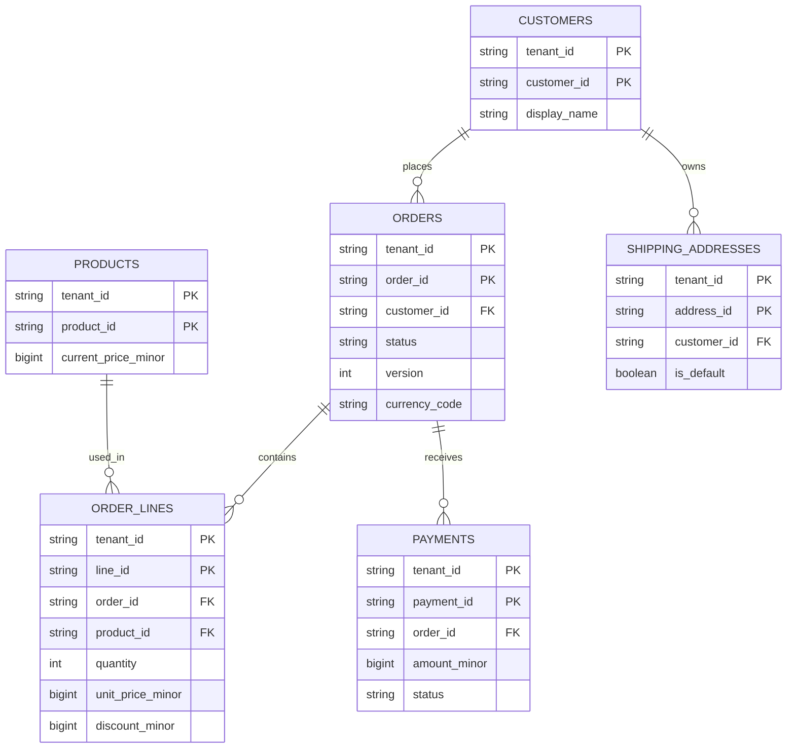
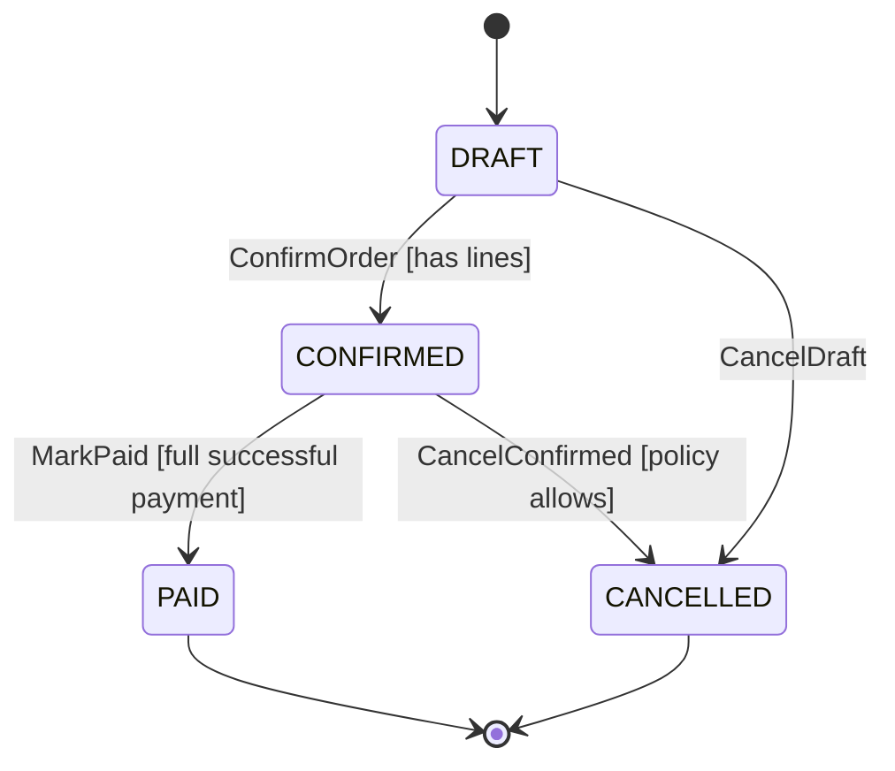
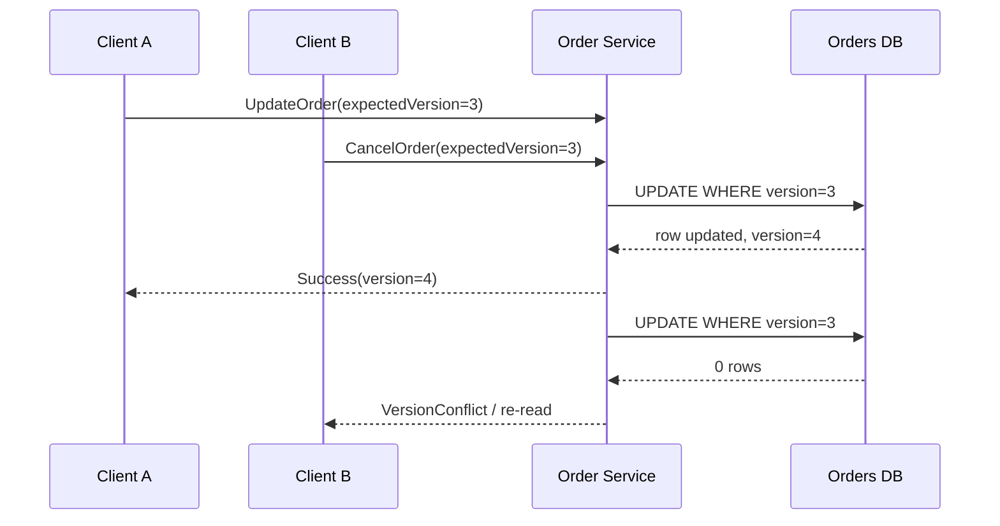

# Lưu ví dụ hợp lệ, phản ví dụ và quy tắc không thể hiện hết trên sơ đồ

Một sơ đồ ER mô tả `Customer 1 — N Order`, `Order 1 — N OrderLine` và `Product 1 — N OrderLine`. Người đọc thường hiểu được **thực thể và quan hệ**, nhưng vẫn chưa biết: đơn chưa xác nhận có được để trống dòng hàng không; một đơn đã thanh toán có được sửa giá cũ không; hai khách ở hai tenant có thể cùng mã `C-01` không; một lần retry tạo đơn mới hay trả kết quả cũ; hoặc giá trị `NULL` biểu thị “chưa biết” hay “không áp dụng”.

Nếu những quy tắc này chỉ nằm trong đầu người thiết kế, đội backend, DBA, phân tích dữ liệu và kiểm thử dễ xây **những phiên bản khác nhau của cùng mô hình**. Một tài liệu mô hình tốt cần lưu đồng thời:

1. **Sơ đồ**: giúp hình dung cấu trúc, khóa, quan hệ và bội số.
2. **Ví dụ hợp lệ**: cho thấy một trạng thái dữ liệu và một chuỗi thao tác **được phép** theo hợp đồng nghiệp vụ.
3. **Phản ví dụ**: cho thấy dữ liệu hoặc thao tác **không được phép**, lý do và nơi hệ thống phải từ chối.
4. **Quy tắc ngoài sơ đồ**: định nghĩa bất biến, điều kiện theo trạng thái/thời gian, phép tính, quyền, trường hợp ngoại lệ, mức nhất quán và trách nhiệm thực thi.
5. **Kiểm chứng có thể tái lập**: test, câu truy vấn đối soát, mã lỗi mong đợi, phiên bản và người chịu trách nhiệm.

Bài học thuộc chương **Tài liệu mô hình** trong học phần **DATABASE_DATA_MODELING**. Mục tiêu của học phần là chuyển yêu cầu nghiệp vụ thành thực thể, quan hệ, ràng buộc, khóa, chỉ mục và lược đồ vật lý rõ ràng; so sánh mô hình quan hệ, document, đồ thị và phân tích để tạo mô hình dễ tiến hóa và kiểm chứng. Chủ đề này kết nối **tài liệu thiết kế** với **hành vi thực tế của hệ thống**.

Sau bài học, bạn có thể:

- Viết ví dụ và phản ví dụ đủ nhỏ, có **dữ liệu, điều kiện ban đầu, thao tác và kết quả mong đợi**.
- Lập **rule catalog** với mã quy tắc, phạm vi, lý do, mức cưỡng chế, bằng chứng và test đi kèm.
- Phân biệt quy tắc thể hiện được bằng `PRIMARY KEY`, `FOREIGN KEY`, `CHECK`, `UNIQUE` với quy tắc phải dùng transaction, workflow, authorization hoặc kiểm tra dữ liệu.
- Tài liệu hóa **trạng thái, điều kiện theo thời gian, tính bất biến lịch sử, cùng lúc cập nhật, idempotency và multi-tenant boundaries**.
- Liên kết sơ đồ ER, SQL schema, API contract, event, document, graph, fact table và testcase mà không làm chúng mâu thuẫn.
- Duy trì tài liệu khi nghiệp vụ và lược đồ thay đổi, tránh tình trạng **sơ đồ đúng nhưng quy tắc ngoài sơ đồ đã cũ**.

## 1. Sơ đồ diễn đạt được gì, và thường bỏ sót điều gì?

Một sơ đồ ER mô tả thực thể, các thuộc tính chính, khóa, quan hệ và thường cả **bội số/optional participation**. UML class diagram có thể diễn đạt cấu trúc và một số ràng buộc, state diagram mô tả chuyển trạng thái, còn sequence diagram thể hiện thông điệp theo thời gian. Nhưng **không có một hình duy nhất tự động mô tả hết mọi luật nghiệp vụ**.

| Nội dung | Sơ đồ cấu trúc có thể cho thấy | Cần bổ sung bằng văn bản, ví dụ hoặc test |
| --- | --- | --- |
| Khóa đơn hàng | `order_id` và bảng `orders` | Khóa duy nhất **toàn cục hay theo tenant**; ID có được tái sử dụng không |
| Quan hệ đơn–dòng | Một đơn có nhiều dòng | `DRAFT` được 0 dòng; `CONFIRMED` bắt buộc ≥1 |
| Quan hệ khách–đơn | Đơn thuộc một khách | Có cấm nối khách **khác tenant** không |
| Trạng thái đơn | Cột `status` | Các chuyển trạng thái được phép, điều kiện trước và hiệu ứng sau |
| Giá dòng hàng | Cột `unit_price_minor` | Giá **chụp lúc mua** hay đọc từ catalog hiện tại |
| Giảm giá | Cột `discount_minor` | Giảm giá cấp dòng hay cấp đơn; có được lớn hơn gross không |
| Thanh toán | Quan hệ `orders–payments` | `PAID` cần tiền thành công bao nhiêu, xử lý hoàn tiền ra sao |
| Địa chỉ mặc định | Thuộc tính `is_default` | “Tối đa một” hay “chính xác một”; phạm vi theo khách/tenant |
| Thời gian | `valid_from`, `valid_to` | Khoảng nửa mở, ràng buộc **không chồng lấn**, ngày hiệu lực |
| Cập nhật đồng thời | Không rõ | Ai được ghi, dùng khóa/version nào để tránh lost update |
| Dữ liệu nhạy cảm | Có thể đánh dấu cột | Ai đọc, mục đích, thời hạn, bản sao và cách xóa |
| Phân tán | Một thực thể có nhiều bản sao | Bản nguồn, độ trễ, event ordering, idempotency, reconciliation |
| Phân tích | Fact nối dimension | **Grain**, tính cộng được của measure và lịch sử dimension |

**Kết luận thiết kế:** sơ đồ là **một góc nhìn** của mô hình, không phải toàn bộ hợp đồng dữ liệu.

### 1.1. Bội số trên sơ đồ không đủ cho điều kiện theo trạng thái

Ví dụ, vẽ `Order ||--|{ OrderLine` thường khiến người đọc hiểu **mọi đơn luôn có ít nhất một dòng**. Nhưng thao tác tạo đơn nháp có thể được phép khi chưa thêm sản phẩm. Nếu vẽ `Order ||--o{ OrderLine` thì cấu trúc cho phép 0 dòng, nhưng sơ đồ lại **không cho biết điều kiện “trạng thái CONFIRMED phải có ≥1 dòng”**.

Phương pháp rõ ràng hơn:

- Sơ đồ dùng bội số **không trái với dữ liệu có thể tồn tại**: đơn có 0..N dòng.
- Rule riêng: “`BR-03`: chỉ được chuyển `DRAFT → CONFIRMED` khi có tối thiểu một dòng hợp lệ”.
- Ví dụ hợp lệ: đơn `DRAFT` chưa có dòng.
- Phản ví dụ: gọi `ConfirmOrder` trên đơn trống phải bị từ chối.
- Test: assert API trả mã lỗi nghiệp vụ; state/version và audit không bị thay đổi.

### 1.2. Một bản ghi hợp lệ chưa chứng minh cả vòng đời hợp lệ

Một hàng `orders.status = 'PAID'` nhìn riêng có thể qua được `CHECK (status IN (...))`. Nhưng nó có thể được đưa vào bảng bằng lệnh `UPDATE` từ `CANCELLED` mà không qua thanh toán. **Tính hợp lệ của trạng thái hiện tại** và **tính hợp lệ của đường đi đến trạng thái đó** là hai điều khác nhau.

Đối với quy trình cần kiểm toán, phải lưu **quy tắc chuyển trạng thái** và có thể cả **event/audit history**. Nếu hệ chỉ giữ snapshot hiện tại, không nên khẳng định có thể chứng minh toàn bộ thứ tự chuyển trạng thái trong quá khứ.

## 2. Bộ tài liệu mô hình tối thiểu có thể kiểm chứng

Một mô hình được bàn giao có thể gồm các phần sau, dù chúng được lưu chung một Markdown hay chia thành các artifact liên kết:

| Artifact | Nội dung cốt lõi | Người dùng chính |
| --- | --- | --- |
| **Business glossary** | Ý nghĩa `Order`, `Paid`, `Quantity`, `NetAmount` | BA, domain expert, BI |
| **ER/UML/graph schema** | Thực thể, quan hệ, bội số, khóa | Architect, dev, DBA |
| **Data dictionary** | Kiểu, NULL, đơn vị, nguồn, nhạy cảm, default | Dev, data engineer |
| **Rule catalog** | Mã luật, điều kiện, ngoại lệ, nơi thực thi | Dev, QA, architect |
| **Valid examples** | Trạng thái/sự kiện được chấp nhận, số liệu kỳ vọng | QA, dev, BA |
| **Invalid examples** | Điều bị từ chối, nguyên nhân, mã lỗi, bất biến còn đúng | QA, dev, reviewer |
| **Transition/temporal contract** | Trạng thái, thời gian hiệu lực, concurrency | Dev, vận hành |
| **Physical DDL** | `PK`, `FK`, `UNIQUE`, `CHECK`, index, partition | DBA, dev |
| **Verification** | SQL integrity queries, API tests, reconciliation | QA, data engineer |
| **Decision record** | Lựa chọn thiết kế, đánh đổi, giả định, cách thay đổi | Team bảo trì |
| **Ownership/version** | Owner, phiên bản, ngày hiệu lực, lịch sử thay đổi | Toàn nhóm |

Mỗi artifact **giải quyết một câu hỏi khác nhau**. Không cần lặp toàn bộ nội dung nhiều nơi, nhưng phải có **ID và liên kết rõ ràng** để người đọc từ sơ đồ tìm được quy tắc và test liên quan.

### 2.1. Một ví dụ tốt có “định danh riêng”

Một ví dụ có tên như `EX-VALID-03: DRAFT_WITHOUT_LINES` tốt hơn lời nói mơ hồ “đơn nháp được phép trống”. Nó có thể được tham chiếu trong review, ticket, test và tài liệu migration.

Một phản ví dụ `EX-INVALID-04: CROSS_TENANT_CUSTOMER` cũng nên ghi:

- Điều kiện ban đầu.
- Dữ liệu hoặc command gây lỗi.
- **Rule ID** bị vi phạm.
- Nơi dự kiến từ chối: database constraint, service API, workflow hoặc pipeline.
- Kết quả mong đợi: **không có thay đổi trạng thái**, không phát event thành công và có lỗi đúng loại.
- Ngoại lệ được phép, nếu có.

### 2.2. Quy ước tên và phiên bản

Một cách đặt tên có thể là:

```text
BR-001 ... BR-999         Business rule
EX-V-001 ...              Valid example
EX-X-001 ...              Invalid/counterexample
T-API-001 ...             API/behavior test
T-DB-001 ...              Database constraint test
T-DQ-001 ...              Data quality/reconciliation test
ADR-001 ...               Architecture/design decision
DOC-MODEL-1.0             Documentation revision
```

Mã chỉ là ví dụ, không phải tiêu chuẩn bắt buộc. Điều quan trọng là **ID ổn định**, có thể tra ngược khi đổi rule. Không nên đổi tên rule cũ thành một nội dung khác mà giữ nguyên ID khiến những testcase lịch sử trỏ sai.

## 3. Bài toán xuyên suốt: quản lý đơn hàng nhiều tenant

Một hệ bán hàng có những yêu cầu:

1. Khách tạo đơn ở trạng thái `DRAFT`, lúc này có thể chưa chọn sản phẩm.
2. Mỗi dòng hàng có sản phẩm, số lượng, **đơn giá tại lúc mua** và giảm giá dòng.
3. Mỗi đơn thuộc **một tenant**; mã `order_id` hoặc `customer_id` chỉ cần duy nhất **trong tenant**.
4. Khi xác nhận, đơn phải có ít nhất một dòng hợp lệ.
5. Khi thanh toán đầy đủ, đơn có thể vào `PAID`.
6. Một khách có thể lưu nhiều địa chỉ giao hàng, nhưng tối đa một địa chỉ được đánh dấu mặc định.
7. Trạng thái đã xác nhận không được thay đổi giá dòng đơn cũ bằng giá catalog hiện tại.
8. Lệnh từ client có thể gửi lại; cùng một yêu cầu logic không được tạo hai đơn hoặc hai khoản thanh toán.
9. Từng thay đổi cần được truy vết theo quy tắc bảo vệ dữ liệu.

Để tập trung vào ý nghĩa mô hình, ví dụ chỉ xử lý **VND nguyên**, giảm giá ở **cấp dòng**, một đơn có thể thanh toán một hoặc nhiều lần nhưng tổng các khoản thanh toán **thành công** phải bằng số tiền cần thu mới được chuyển sang `PAID`. Chưa xét thuế, phí vận chuyển, hoàn hàng, chiết khấu cấp đơn hoặc thanh toán khác đơn vị tiền. Đây là **ràng buộc của ví dụ**, không phải quy luật cho mọi hệ bán hàng.

### 3.1. Định nghĩa hạt dữ liệu (*grain*)

| Thực thể | Một dòng có ý nghĩa gì? | Business key |
| --- | --- | --- |
| `customers` | Một khách trong một tenant | `(tenant_id, customer_id)` |
| `products` | Một sản phẩm hiện hành trong tenant | `(tenant_id, product_id)` |
| `orders` | Một đơn hiện hành trong tenant | `(tenant_id, order_id)` |
| `order_lines` | Một dòng hàng của một đơn | `(tenant_id, line_id)` |
| `payments` | Một lần thanh toán được ghi nhận | `(tenant_id, payment_id)` |
| `shipping_addresses` | Một địa chỉ lưu cho khách | `(tenant_id, address_id)` |

**Grain quyết định cả cách đếm.** Nếu O-101 có hai dòng, `COUNT(*)` trên `order_lines` trả **2 dòng hàng**, không phải **2 đơn**. Tài liệu phải diễn đạt sự khác biệt này trước khi nói về báo cáo.

### 3.2. Sơ đồ ER minh họa



Trong Mermaid, nhiều cột cùng nhãn `PK` thể hiện **ý định khóa tổ hợp**; chi tiết thứ tự, `UNIQUE`, `FK` theo tenant và chỉ mục nằm trong DDL. Sơ đồ trên **không** tự biểu đạt:

- `CONFIRMED` phải có ít nhất một dòng.
- `PAID` chỉ sau khi thanh toán đủ.
- Giá dòng đã xác nhận là snapshot bất biến.
- Tối đa một địa chỉ mặc định cho mỗi khách.
- Những chuyển trạng thái hợp lệ.
- Các hạn chế quyền ghi, lịch sử và thời điểm.
- Điều kiện concurrency và idempotency khi hai request đến cùng lúc.

Vì vậy, dưới sơ đồ cần có **rule catalog** và ví dụ có thể kiểm chứng.

## 4. Danh mục quy tắc nghiệp vụ: từ câu văn sang bất biến

Đừng ghi “đơn phải hợp lệ” rồi kỳ vọng tất cả hiểu giống nhau. Mỗi rule cần **tên, phạm vi, tiền điều kiện, bất biến, ngoại lệ, cách thực thi và test**.

### 4.1. Rule catalog của ví dụ

| ID | Quy tắc | Phạm vi | Cơ chế chính | Ví dụ/test |
| --- | --- | --- | --- | --- |
| **BR-001** | Mỗi ID khách, đơn, sản phẩm chỉ duy nhất trong tenant | Khóa | PK/UNIQUE tổ hợp | EX-V-01, EX-X-01 |
| **BR-002** | Đơn/dòng không được FK sang dữ liệu tenant khác | Quan hệ | FK tổ hợp + auth scope | EX-X-02 |
| **BR-003** | `DRAFT` có thể 0 dòng; `CONFIRMED/PAID` phải có ≥1 | Trạng thái + quan hệ | Transaction/service | EX-V-02, EX-X-03 |
| **BR-004** | `quantity > 0`, `unit_price_minor ≥0`, `0 ≤ discount ≤ gross` | Theo dòng | CHECK + kiểm tra tiền | EX-X-04, EX-X-05 |
| **BR-005** | Tiền của dòng giữ đơn giá chốt, không lấy `current_price` để tính lại | Lịch sử | Service/contract + tests | EX-V-03, EX-X-06 |
| **BR-006** | Chỉ cho những chuyển trạng thái đã định nghĩa | Workflow | Transaction/service | EX-X-07 |
| **BR-007** | `PAID` yêu cầu tổng payment thành công bằng tổng thuần của đơn | Liên bảng | Transaction/service + DQ | EX-V-04, EX-X-08 |
| **BR-008** | Tối đa một địa chỉ `is_default = true` của một khách trong tenant | Liên hàng | Partial unique index | EX-X-09 |
| **BR-009** | Không sửa/xóa dòng hàng sau `CONFIRMED`, trừ workflow điều chỉnh riêng | Trạng thái | Service/DB guard | EX-X-10 |
| **BR-010** | Retry cùng command không tạo hiệu ứng nghiệp vụ lần hai | Lệnh/hệ thống | Idempotency key + transaction | EX-X-11 |
| **BR-011** | Cập nhật đồng thời không làm mất version/trạng thái | Concurrency | Optimistic version/locking | EX-X-12 |
| **BR-012** | Mỗi thay đổi đã commit có audit metadata hợp lệ | Truy vết | Transaction/outbox + DQ | EX-X-13 |
| **BR-013** | Chỉ đọc/ghi dữ liệu đúng tenant và purpose được phép | Bảo vệ | Authorization/RLS policy | EX-X-14 |
| **BR-014** | Báo cáo không được cộng tiền khác currency hoặc nhân dòng do JOIN | Phân tích | Semantic contract + DQ | EX-X-15 |

**Phân biệt “nơi thực thi chính” với “bằng chứng thứ cấp”.** Một constraint `CHECK` trên dòng hàng cưỡng chế bất biến cục bộ, nhưng không thể tự chứng minh service đã thực hiện workflow đúng. Một unit test của service cũng không thay thế ràng buộc trong database nếu các đường ghi khác có thể bypass service.

### 4.2. Mẫu quy tắc chi tiết để sao chép

```yaml
ruleId: BR-003
name: "Đơn xác nhận phải có ít nhất một dòng"
scope: "Order aggregate trong một tenant"
statement: >
  Trạng thái DRAFT cho phép không có dòng hàng.
  Khi chuyển DRAFT sang CONFIRMED, đơn phải có
  ít nhất một dòng hợp lệ và tất cả line constraints đạt.
preconditions:
  - "Caller đã xác thực, có quyền ConfirmOrder"
  - "Đơn tồn tại và đang là DRAFT"
  - "Client cung cấp expected_version hợp lệ"
invariant:
  - "status IN (CONFIRMED, PAID) => line_count >= 1"
exceptions:
  - "Đơn nháp chưa có sản phẩm"
enforcement:
  - "OrderService.ConfirmOrder trong transaction"
  - "Integrity reconciliation phát hiện drift"
errors:
  - "ORDER_HAS_NO_LINES"
  - "INVALID_ORDER_TRANSITION"
positiveExamples: [EX-V-02, EX-V-04]
negativeExamples: [EX-X-03]
tests: [T-API-003, T-DQ-003]
owner: "Order domain owner"
status: "ACTIVE"
```

Cấu trúc YAML chỉ là **hình thức thể hiện quy tắc**, không phải một engine tự kiểm chứng. Khi viết vào tài liệu thật, liên kết `tests` tới các test được duy trì trong code để tránh tình trạng mã test chỉ tồn tại trên giấy.

### 4.3. Ràng buộc cần được viết có lượng từ và điều kiện rõ

So sánh ba câu:

- “Địa chỉ khách phải hợp lệ.” — quá mơ hồ.
- “Khách có địa chỉ mặc định.” — chưa rõ **ít nhất một** hay **tối đa một**, áp dụng khi nào.
- “Trong mỗi `(tenant_id, customer_id)`, số địa chỉ có `is_default = true` **không vượt quá 1**; không bắt buộc có địa chỉ mặc định nếu khách chưa chọn.” — có thể kiểm thử.

Tương tự, “đơn có các sản phẩm” không bằng “mọi đơn phải có ít nhất một dòng **kể cả DRAFT**”. Một lỗi phổ biến là sơ đồ, code và QA cùng dùng từ “phải” nhưng đang giả định **những thời điểm khác nhau**.

## 5. Lược đồ SQL minh họa và phạm vi ràng buộc của database

Đoạn sau dùng cú pháp **PostgreSQL** để minh họa cơ chế. Những hệ SQL/warehouse khác có thể có khả năng thực thi `CHECK`, `FK` hoặc partial index khác nhau; không mặc định syntax và enforcement giống nhau.

### 5.1. Khóa và quan hệ theo tenant

```sql
CREATE TABLE customers (
    tenant_id TEXT NOT NULL,
    customer_id TEXT NOT NULL,
    display_name TEXT NOT NULL,
    PRIMARY KEY (tenant_id, customer_id)
);

CREATE TABLE products (
    tenant_id TEXT NOT NULL,
    product_id TEXT NOT NULL,
    title TEXT NOT NULL,
    current_price_minor NUMERIC(20,0) NOT NULL,
    PRIMARY KEY (tenant_id, product_id),
    CHECK (current_price_minor >= 0)
);

CREATE TABLE orders (
    tenant_id TEXT NOT NULL,
    order_id TEXT NOT NULL,
    customer_id TEXT NOT NULL,
    status TEXT NOT NULL DEFAULT 'DRAFT',
    version BIGINT NOT NULL DEFAULT 1,
    currency_code CHAR(3) NOT NULL DEFAULT 'VND',
    placed_at TIMESTAMPTZ NOT NULL,
    PRIMARY KEY (tenant_id, order_id),
    FOREIGN KEY (tenant_id, customer_id)
        REFERENCES customers(tenant_id, customer_id),
    CHECK (status IN ('DRAFT', 'CONFIRMED', 'PAID', 'CANCELLED')),
    CHECK (version > 0),
    CHECK (currency_code = 'VND')
);

CREATE TABLE order_lines (
    tenant_id TEXT NOT NULL,
    line_id TEXT NOT NULL,
    order_id TEXT NOT NULL,
    product_id TEXT NOT NULL,
    quantity INTEGER NOT NULL,
    unit_price_minor NUMERIC(20,0) NOT NULL,
    discount_minor NUMERIC(30,0) NOT NULL DEFAULT 0,
    PRIMARY KEY (tenant_id, line_id),
    FOREIGN KEY (tenant_id, order_id)
        REFERENCES orders(tenant_id, order_id),
    FOREIGN KEY (tenant_id, product_id)
        REFERENCES products(tenant_id, product_id),
    CHECK (quantity > 0),
    CHECK (unit_price_minor >= 0),
    CHECK (discount_minor >= 0),
    CHECK (discount_minor <= quantity * unit_price_minor)
);

CREATE TABLE payments (
    tenant_id TEXT NOT NULL,
    payment_id TEXT NOT NULL,
    order_id TEXT NOT NULL,
    external_payment_ref TEXT NOT NULL,
    amount_minor NUMERIC(30,0) NOT NULL,
    status TEXT NOT NULL,
    PRIMARY KEY (tenant_id, payment_id),
    UNIQUE (tenant_id, external_payment_ref),
    FOREIGN KEY (tenant_id, order_id)
        REFERENCES orders(tenant_id, order_id),
    CHECK (amount_minor > 0),
    CHECK (status IN ('PENDING', 'SUCCEEDED', 'FAILED'))
);
```

Một số chi tiết quan trọng:

- Khóa chính `(tenant_id, order_id)` và FK tương ứng bảo vệ **quan hệ trong phạm vi tenant**. Nếu chỉ dùng `FOREIGN KEY(customer_id)` mà ID trùng giữa tenant, dữ liệu có thể nối nhầm.
- `quantity` là số nguyên dương; `unit_price_minor` là số tiền VND nguyên cho ví dụ. Kiểu `NUMERIC` giúp tránh dùng floating-point cho tiền cần đối soát.
- Giá mua ở `order_lines.unit_price_minor` khác `products.current_price_minor`. Khi catalog đổi giá, dòng đơn cũ không đổi.
- `CHECK (status IN (...))` chỉ xác minh giá trị thuộc enum dạng text, **không xác minh chuyển trạng thái hợp lệ**.
- Cột `version` hỗ trợ optimistic concurrency nhưng **chỉ hữu ích nếu mọi đường ghi tuân thủ việc so và tăng version**.
- Bảng `payments` chứa nhiều lần thanh toán của một đơn; nó không tự chứng minh tổng thanh toán đã đủ hoặc trạng thái `PAID` được đặt đúng.

### 5.2. Một default address mỗi khách: quy tắc liên hàng

```sql
CREATE TABLE shipping_addresses (
    tenant_id TEXT NOT NULL,
    address_id TEXT NOT NULL,
    customer_id TEXT NOT NULL,
    label TEXT NOT NULL,
    is_default BOOLEAN NOT NULL DEFAULT FALSE,
    PRIMARY KEY (tenant_id, address_id),
    FOREIGN KEY (tenant_id, customer_id)
        REFERENCES customers(tenant_id, customer_id)
);

CREATE UNIQUE INDEX one_default_address_per_customer
    ON shipping_addresses (tenant_id, customer_id)
    WHERE is_default = TRUE;
```

Partial unique index trên PostgreSQL thực thi **tối đa một** địa chỉ mặc định theo khách–tenant. Nó **không buộc mỗi khách phải có một**. Nếu nghiệp vụ đổi thành “mỗi khách đã kích hoạt phải có đúng một địa chỉ mặc định”, cần bổ sung điều kiện ở workflow/transaction hoặc cơ chế ràng buộc phù hợp.

**Quy tắc tinh tế:** trong cùng một transaction muốn đổi default từ địa chỉ A sang B, hãy **bỏ cờ A trước, rồi đặt cờ B**, hoặc thiết kế một command có tính nguyên tử tương đương. Nếu đặt B trước, partial unique index có thể từ chối ngay cả khi mục tiêu cuối cùng chỉ có một default. Hai request đổi default đồng thời cần xử lý concurrency và retry, không dựa vào thứ tự dòng SQL ngẫu nhiên.

### 5.3. Điều database không thể hiện đầy đủ chỉ với DDL trên

Những trường hợp dưới đây **không được bảo đảm chỉ bởi schema**:

1. `CONFIRMED` phải có ≥1 dòng.
2. `PAID` yêu cầu số tiền thanh toán thành công đúng bằng tiền phải thu.
3. Không sửa giá/dòng sau khi xác nhận.
4. Chỉ được `DRAFT → CONFIRMED → PAID` và các chuyển trạng thái được khai báo.
5. Retry cùng `command_id` chỉ tạo một hiệu ứng.
6. Có quyền xem hoặc sửa đơn trong tenant.
7. Audit event có sau transaction commit và không chứa dữ liệu cấm.
8. Giá trị `order_lines.unit_price_minor` là snapshot đúng **lúc chấp nhận đơn**, không phải giá mới nhất.

Một số rule có thể được thực thi bằng trigger, stored procedure, constraint phức tạp hoặc giao thức transaction tùy hệ. Nhưng **việc thực thi phải được thiết kế và kiểm thử cụ thể**, không thể kết luận từ vài mũi tên trên ER diagram.

## 6. Lưu ví dụ hợp lệ: trạng thái dữ liệu có đáp án rõ

Một bộ ví dụ hợp lệ nên dùng **mã giả, số liệu nhỏ, thời gian cố định**, có thể tạo lại từ đầu. Tránh dùng thông tin khách thật hoặc copy production vì việc tạo test fixture không biện minh cho lưu dữ liệu cá nhân ngoài mục đích.

### 6.1. Fixture hợp lệ có thể nạp

Giả sử chỉ có tenant `T-01` và tiền VND. Lưu ý các bản ghi ở trạng thái `CONFIRMED/PAID` bên dưới là **ảnh chụp trạng thái hợp lệ**, được giả định đã đi qua workflow và audit thích hợp; việc INSERT fixture trực tiếp **không phải bằng chứng** rằng hệ thống thực thi chuyển trạng thái đúng.

```sql
INSERT INTO customers (tenant_id, customer_id, display_name)
VALUES
('T-01', 'C-01', 'Customer One'),
('T-01', 'C-02', 'Customer Two');

INSERT INTO products (
    tenant_id, product_id, title, current_price_minor
) VALUES
('T-01', 'P-BOOK', 'Book', 180000),
('T-01', 'P-PEN', 'Pen pack', 25000);

INSERT INTO orders (
    tenant_id, order_id, customer_id,
    status, version, currency_code, placed_at
) VALUES
('T-01', 'O-101', 'C-01',
 'CONFIRMED', 2, 'VND', '2026-10-01 09:00:00+07'),
('T-01', 'O-102', 'C-01',
 'DRAFT', 1, 'VND', '2026-10-01 09:30:00+07'),
('T-01', 'O-103', 'C-02',
 'PAID', 3, 'VND', '2026-10-02 10:00:00+07');

INSERT INTO order_lines (
    tenant_id, line_id, order_id, product_id,
    quantity, unit_price_minor, discount_minor
) VALUES
('T-01', 'L-001', 'O-101', 'P-BOOK',
 1, 150000, 0),
('T-01', 'L-002', 'O-101', 'P-PEN',
 2, 20000, 5000),
('T-01', 'L-003', 'O-103', 'P-BOOK',
 1, 150000, 0);

INSERT INTO payments (
    tenant_id, payment_id, order_id, external_payment_ref,
    amount_minor, status
) VALUES
('T-01', 'PAY-001', 'O-103', 'PROVIDER-TRANS-001',
 150000, 'SUCCEEDED');

INSERT INTO shipping_addresses (
    tenant_id, address_id, customer_id, label, is_default
) VALUES
('T-01', 'ADDR-01', 'C-01', 'Home', TRUE),
('T-01', 'ADDR-02', 'C-01', 'Office', FALSE);
```

### 6.2. Bộ đáp án đối chứng (*oracle*)

| Đối tượng | Trạng thái | Dòng | Gross VND | Discount VND | Net VND | Hợp lệ vì |
| --- | --- | ---: | ---: | ---: | ---: | --- |
| O-101 | CONFIRMED | 2 | 190.000 | 5.000 | **185.000** | Có dòng, giá snapshot và discount hợp lệ |
| O-102 | DRAFT | 0 | 0 | 0 | **0** | Đơn nháp chưa có sản phẩm được phép |
| O-103 | PAID | 1 | 150.000 | 0 | **150.000** | Payment thành công = 150.000 |
| **Tổng dòng nguồn** | — | **3** | **340.000** | **5.000** | **335.000** | Không nhân dòng |

Những phép đối chiếu quan trọng:

- Số **đơn** trong `orders` là **3**; số **dòng hàng** trong `order_lines` là **3** — lần này trùng về số học **nhưng không đồng nghĩa cùng grain**.
- Số đơn **có ít nhất một dòng** là **2**; O-102 là `DRAFT` rỗng.
- O-101 có **hai dòng**, nhưng chỉ là **một đơn**.
- Tổng doanh số dòng hàng của ví dụ là **335.000 VND** nếu tạm cộng mọi dòng, nhưng một KPI “doanh số đơn đã thanh toán” chỉ tính **150.000 VND** từ O-103. **Không đồng nhất tổng dòng với metric đã thanh toán.**
- `P-BOOK.current_price_minor = 180.000` nhưng giá lịch sử trong hai dòng là **150.000**. Nếu dùng giá catalog hiện tại để tính lại lịch sử, tổng sẽ sai.
- C-01 có **hai địa chỉ** nhưng chỉ một default: `ADDR-01`.

### 6.3. Ví dụ hợp lệ không nên chỉ là ảnh chụp bảng

Với mỗi hành vi, nên lưu chuỗi:

```text
EX-V-02 — ConfirmOrder có dòng
Given:
  Order O-101 đang DRAFT, version 1
  Có hai dòng hợp lệ L-001 và L-002
  Caller có quyền trong T-01
When:
  ConfirmOrder(orderId=O-101, expectedVersion=1)
Then:
  Order.status = CONFIRMED
  Order.version = 2
  Các dòng giữ nguyên quantity/price/discount
  Có một business audit event cho v2
  Có thể phát outbox event tương ứng
  Không có dữ liệu nhạy cảm trong event payload phổ thông
```

Bộ fixture ở phần 6.1 mô tả **trạng thái sau thao tác** này. Để kiểm tra workflow, test cần tạo `DRAFT` và gọi API thực, thay vì tự INSERT `CONFIRMED` rồi tuyên bố hệ đã bảo vệ trạng thái.

### 6.4. Danh sách ví dụ hợp lệ theo ID ổn định

| ID | Điều kiện và kết quả hợp lệ | Rule chứng minh | Cách kiểm tra |
| --- | --- | --- | --- |
| **EX-V-01** | Hai tenant có cùng `customer_id = C-01` nhưng khóa `(tenant_id, customer_id)` khác nhau; không nối chéo | BR-001, BR-002 | PK/FK tenant-scoped và API isolation |
| **EX-V-02** | `O-102` ở trạng thái DRAFT với 0 dòng; `O-101` chuyển từ DRAFT có 2 dòng sang CONFIRMED | BR-003, BR-006 | Fixture + behavior test với status/version |
| **EX-V-03** | `P-BOOK.current_price_minor = 180000` nhưng line lịch sử có giá chốt `150000`; tổng O-101 vẫn 185000 | BR-004, BR-005, BR-009 | Test đổi catalog rồi đối soát line snapshot |
| **EX-V-04** | `O-103` có net 150000 và một payment SUCCEEDED 150000 nên được chuyển PAID | BR-003, BR-007 | Payment workflow test + DQ sum |
| **EX-V-05** | C-01 có hai địa chỉ, chỉ ADDR-01 mặc định | BR-008 | Partial unique index và query kiểm tra |
| **EX-V-06** | Gửi lại cùng một command với cùng fingerprint trả về kết quả cũ, không tạo sự kiện nghiệp vụ lần hai | BR-010 | API retry/idempotency test |

Các ID là **tên testcase/hợp đồng minh họa**, không tuyên bố toàn bộ trường hợp đều đã chạy trong môi trường thật. Đặc biệt EX-V-01 và EX-V-06 cần fixture hoặc integration test riêng; bộ INSERT hiện có chỉ bao phủ T-01 và không triển khai bảng idempotency ở cùng phần.

## 7. Lưu phản ví dụ: quy tắc phải từ chối ở đâu và theo nghĩa nào?

Một phản ví dụ tốt là **phản chứng nhỏ nhất** khiến một rule bị vi phạm, đồng thời nêu rõ **cơ chế dự kiến phát hiện**. Nếu không phân biệt nơi cưỡng chế, người đọc có thể tưởng schema đã bảo vệ một luật vốn chỉ tồn tại ở tầng ứng dụng.

### 7.1. Những phản ví dụ database phải từ chối

| ID | Thao tác hoặc dữ liệu sai | Rule | Phần nào phát hiện |
| --- | --- | --- | --- |
| EX-X-01 | Hai khách cùng `(tenant_id, customer_id)` | BR-001 | PK |
| EX-X-02 | Order tenant T-02 tham chiếu `C-01` chỉ tồn tại ở T-01 | BR-002 | FK tổ hợp |
| EX-X-04 | Dòng có `quantity = 0` | BR-004 | CHECK |
| EX-X-05 | Dòng có discount lớn hơn gross | BR-004 | CHECK |
| EX-X-09 | C-01 có hai địa chỉ mặc định | BR-008 | Partial unique index |
| EX-X-16 | Payment cùng `external_payment_ref` được nạp hai lần trong tenant | Mã thanh toán duy nhất | UNIQUE |

Các đoạn sau là **minh họa phản ví dụ**. Chúng được thiết kế để **thất bại**, không phải migration SQL cần chạy liên tục trên production. Khi thử thủ công trên PostgreSQL, chạy từng trường hợp độc lập trong môi trường kiểm thử và `ROLLBACK` sau khi lỗi; một transaction gặp lỗi SQL có thể ở trạng thái aborted tới khi rollback.

```sql
-- EX-X-02: chỉ có C-01 thuộc T-01, không có C-01 thuộc T-02.
-- Kỳ vọng: foreign key violation.
INSERT INTO orders (
    tenant_id, order_id, customer_id,
    status, version, currency_code, placed_at
) VALUES (
    'T-02', 'O-X', 'C-01',
    'DRAFT', 1, 'VND', '2026-10-03 00:00:00+07'
);
```

```sql
-- EX-X-04: quantity phải > 0.
-- Kỳ vọng: check constraint violation.
INSERT INTO order_lines (
    tenant_id, line_id, order_id, product_id,
    quantity, unit_price_minor, discount_minor
) VALUES (
    'T-01', 'L-BAD-QTY', 'O-101', 'P-PEN',
    0, 20000, 0
);
```

```sql
-- EX-X-05: gross = 2*20000 = 40000,
-- discount=50000 > gross. Kỳ vọng: CHECK failure.
INSERT INTO order_lines (
    tenant_id, line_id, order_id, product_id,
    quantity, unit_price_minor, discount_minor
) VALUES (
    'T-01', 'L-BAD-DISCOUNT', 'O-101', 'P-PEN',
    2, 20000, 50000
);
```

```sql
-- EX-X-09: ADDR-01 đã là default của C-01.
-- Kỳ vọng: partial unique index violation.
UPDATE shipping_addresses
SET is_default = TRUE
WHERE tenant_id = 'T-01'
  AND address_id = 'ADDR-02';
```

**Mục đích của phản ví dụ:** khẳng định database phải từ chối và giữ bất biến, không phải bắt người học ghi nhớ mã lỗi SQLSTATE của một engine. Nếu test cần kiểm tra mã lỗi, hãy nêu rõ **engine/version** và mapping sang **domain error** mà API cam kết.

### 7.2. Những phản ví dụ có thể lọt qua DDL nhưng phải bị API từ chối

| ID | Tình huống | Kỳ vọng nghiệp vụ |
| --- | --- | --- |
| EX-X-03 | `ConfirmOrder` trên `DRAFT` không có dòng | `ORDER_HAS_NO_LINES`; không đổi state/version |
| EX-X-06 | Reprice dòng của `CONFIRMED` bằng giá catalog mới | `ORDER_LINES_LOCKED` |
| EX-X-07 | Chuyển `PAID → DRAFT` | `INVALID_ORDER_TRANSITION` |
| EX-X-08 | Chuyển `CONFIRMED → PAID` khi chỉ thanh toán 100.000 cho đơn 185.000 | `PAYMENT_NOT_SETTLED_FULLY` |
| EX-X-10 | Xóa dòng từ đơn đã xác nhận khiến trống | Không cho thao tác, trừ workflow điều chỉnh hợp lệ |
| EX-X-11 | Gửi lại cùng `CreateOrder(commandId)` | Trả kết quả cũ hoặc trạng thái idempotent, không tạo thêm đơn |
| EX-X-12 | Hai client cùng sửa version 3 | Một cập nhật thắng; request còn lại gặp version conflict/retry đúng luật |
| EX-X-13 | Cập nhật thành công nhưng thiếu audit event đã commit | Reconciliation phát hiện và khắc phục theo runbook |
| EX-X-14 | Client T-02 đọc đơn T-01 dù biết order ID | Từ chối theo authorization, không lộ dữ liệu |
| EX-X-15 | Join order lines với payments rồi SUM tiền | Test BI phát hiện fan-out, không công bố KPI sai |

Những phản ví dụ này quan trọng vì **database hiện tại không tự từ chối chúng**. Nếu một kênh nội bộ được phép update SQL trực tiếp, cần **giới hạn đường ghi** hoặc triển khai cơ chế cưỡng chế tương đương ở DB; chỉ viết tài liệu không thể ngăn trạng thái sai.

### 7.3. Nêu cả trạng thái sau khi bị từ chối

Một test tốt không chỉ assert có HTTP `409` hoặc `422`. Nó còn kiểm tra:

```text
Before:
  O-102: DRAFT, version 1, 0 lines
Action:
  ConfirmOrder(O-102, expectedVersion=1)
Expected:
  response.code = ORDER_HAS_NO_LINES
  orders.status = DRAFT
  orders.version = 1
  no OrderConfirmed event
  no payment created
  audit of denied attempt only if policy requires,
  never audit as a committed business change
```

Mã HTTP có thể được quyết định theo API contract; **mã lỗi nghiệp vụ ổn định** thường hữu ích hơn để liên kết tài liệu, backend và QA.

## 8. Trạng thái và chuyển trạng thái không nằm hết trên ER diagram

### 8.1. Một state machine đơn giản



Sơ đồ này **có điều kiện đi kèm**, nhưng vẫn cần văn bản làm rõ:

- **`[has lines]`** kiểm tra tại thời điểm transaction nào?
- Khi `MarkPaid`, các payment đã được xác minh **thành công** từ nguồn nào?
- Sau `CONFIRMED` có được thêm/xóa/sửa dòng trước khi thanh toán không?
- Việc `CANCELLED` ở `CONFIRMED` có cần hủy reservation hay bồi hoàn một hoạt động ngoài DB không?
- Hoàn tiền sau `PAID` có tạo trạng thái `REFUNDED` hoặc fact riêng không? **Ví dụ hiện tại chưa mô hình hóa hoàn tiền**.

### 8.2. Bảng điều kiện chuyển trạng thái

| From | Command | To | Tiền điều kiện | Điều kiện sau |
| --- | --- | --- | --- | --- |
| Chưa có | `CreateOrder` | DRAFT | Khách tồn tại trong tenant, caller hợp lệ | Order mới, version 1 |
| DRAFT | `AddLine` | DRAFT | Product hợp lệ; qty và discount hợp lệ | Line mới; version/aggregate policy rõ |
| DRAFT | `ConfirmOrder` | CONFIRMED | ≥1 dòng, version khớp | Line snapshot bị khóa, audit vN |
| DRAFT | `CancelDraft` | CANCELLED | Đơn tồn tại và caller có quyền | Không thêm dòng mới |
| CONFIRMED | `MarkPaid` | PAID | Các payment `SUCCEEDED` khớp đúng số tiền phải thu | Audit, version tăng |
| CONFIRMED | `CancelConfirmed` | CANCELLED | Chính sách cho phép, xử lý reservation nếu có | Ghi lý do và hệ quả |
| PAID | `SetDraft` | — | Không được phép | Trả `INVALID_ORDER_TRANSITION` |

Nếu một lệnh `AddLine` làm thay đổi aggregate version, phải ghi rõ version tăng lúc nào và các test/mã kết quả phụ thuộc vào đó; **không tự lấy version 2 trong fixture làm chân lý cho mọi đường đi khác**.

### 8.3. Bất biến liên bảng phải kiểm trong cùng ngữ cảnh nhất quán

Quy tắc:

\[
\operatorname{status}(o)=\text{CONFIRMED}
\Rightarrow
\operatorname{lineCount}(o)\ge 1
\]

và:

\[
\operatorname{status}(o)=\text{PAID}
\Rightarrow
\sum\nolimits_{\text{successful payments}} amount
=
\sum\nolimits_{\text{order lines}} (quantity\cdot unitPrice-discount)
\]

hai biểu thức thể hiện chính xác hơn câu “đơn hợp lệ”. Nhưng chỉ viết toán chưa đủ:

- Tính **theo cùng tenant và order**.
- Dùng đúng đơn vị tiền và cùng version/snapshot.
- Quy định khi nào payment được coi là `SUCCEEDED`.
- Định nghĩa làm tròn, thuế, vận chuyển, hoàn hàng nếu hệ thực có.
- Xác định transaction isolation hoặc khóa khi hai request cùng thêm dòng/thanh toán.
- Nêu điều kiện ngoại lệ và cách xử lý bất thường.

Đây là ví dụ điển hình về **quy tắc không thể suy hết từ mũi tên của sơ đồ**.

## 9. Tính toán, số liệu và đơn vị cũng cần ví dụ đối chứng

### 9.1. Tại sao cần đóng đinh công thức?

Với O-101:

```text
L-001: 1 × 150.000 - 0     = 150.000 VND
L-002: 2 × 20.000 - 5.000  =  35.000 VND
ORDER NET                       185.000 VND
```

Nếu một developer dùng `products.current_price_minor` (180.000 và 25.000), đơn cũ có thể bị tính thành `230.000 VND` trước khi áp discount hoặc thành **225.000 VND** sau discount. Đó là lỗi **ngữ nghĩa giá lịch sử**, dù FK và kiểu dữ liệu đều đúng.

Tài liệu nên khẳng định:

> `OrderLine.unit_price_minor` là **đơn giá snapshot chốt tại lúc xác nhận/đặt** theo hợp đồng; `Product.current_price_minor` chỉ dùng cho báo giá/các giao dịch tương lai. Những điều chỉnh hợp lệ sau đó phải có sự kiện/phiên bản riêng, không ghi đè âm thầm.

Lưu ý các mốc “lúc tạo đơn”, “lúc xác nhận” và “lúc thanh toán” **khác nhau**; phải chọn đúng thời điểm chốt giá trong hệ thực tế. Trong bài này, giá dòng ở trạng thái `CONFIRMED` được xem là đã chốt.

### 9.2. Tiền và số lượng phải có đơn vị

Ví dụ chỉ dùng VND nguyên nhưng một hệ đa tiền tệ cần giữ cả `currency_code` và tỷ giá/policy nếu tổng hợp sang đồng tiền báo cáo. Không thể `SUM(100 USD, 100 EUR)` rồi đặt tên `200 VND`.

Tương tự, quantity `2 hộp` khác `2 chiếc` nếu có quy cách đóng gói; mô hình nên có đơn vị đo và factor theo sản phẩm/phiên bản khi cần. Một ER diagram có các cột `amount` và `quantity` chưa đủ để xác định phép cộng hợp lệ.

### 9.3. Grain của metric phải được viết thành một câu

Ví dụ:

- `order_lines`: **một dòng** đại diện cho một line item, không phải một order.
- `payments`: **một lần thanh toán**, một order có thể nhiều payment.
- `fact_sales_line`: **một dòng bán hợp lệ theo policy phân tích**.
- `fact_payment`: **một sự kiện thanh toán**, không được join với fact line ở grain không tương thích rồi cộng tiền.

Một câu query chạy thành công có thể trả số rất lớn vì **fan-out**. Tài liệu cần lưu phản ví dụ “join hai fact 2×3 thành 6 dòng” để người dùng hiểu tại sao phải tổng hợp từng fact về **grain chung** trước khi join.

## 10. Concurrency và idempotency: cùng dữ liệu, thao tác khác thứ tự

### 10.1. Lost update mà sơ đồ không thể thấy

Giả sử hai client đọc `orders.version = 3`:

```text
Client A đọc v3: muốn đổi contact_ref
Client B đọc v3: muốn CancelOrder

A cập nhật thành công → version 4
B dùng dữ liệu v3 ghi đè toàn bộ row không kiểm tra
Kết quả: có thể mất thay đổi A hoặc ghi trạng thái không hợp lệ
```

Một **optimistic concurrency contract** có thể yêu cầu:

```sql
UPDATE orders
SET
    status = :next_status,
    version = version + 1
WHERE tenant_id = :tenant_id
  AND order_id = :order_id
  AND version = :expected_version
  AND status = :expected_status
RETURNING version, status;
```

Nếu không có row được cập nhật, backend phải phân biệt **không tìm thấy**, **version conflict**, **transition invalid** và **không đủ quyền** theo API contract, tránh tiết lộ sự tồn tại của đơn ngoài tenant. Khi có rule cần đọc `order_lines` hoặc `payments`, phải bảo đảm mọi đường ghi liên quan **phối hợp khóa/isolation**; chỉ CAS trên hàng `orders` chưa tự chặn transaction khác thêm/xóa line đúng lúc kiểm tra.

### 10.2. “Cùng request” cần định nghĩa ID ổn định

Để CreateOrder không tạo hai đơn khi client retry, có thể dùng `command_id` riêng trong phạm vi `tenant_id` và tác nhân/loại lệnh theo chính sách.

```sql
CREATE TABLE processed_commands (
    tenant_id TEXT NOT NULL,
    command_id TEXT NOT NULL,
    command_type TEXT NOT NULL,
    request_fingerprint TEXT NOT NULL,
    result_ref TEXT,
    processed_at TIMESTAMPTZ NOT NULL,
    PRIMARY KEY (tenant_id, command_id)
);
```

Chỉ có PK trên command ID **chưa đủ**: cần xử lý khi cùng `command_id` được gửi lại nhưng **payload khác**, xác nhận kết quả nào có thể được replay, khi nào ghi transaction cùng nghiệp vụ, và thời hạn giữ idempotency key. Nếu key bị dọn quá sớm, một retry rất muộn có thể tạo hiệu ứng mới.

### 10.3. Ghi phản ví dụ bằng sơ đồ thứ tự



Tài liệu phải ghi rõ **hành vi của client B** sau lỗi: báo conflict, đọc lại rồi yêu cầu người dùng quyết định, hay retry có điều kiện. Không retry tự động một lệnh hủy có tác động lớn mà bỏ qua trạng thái mới vừa được tạo.

## 11. Quy tắc thời gian cần cả ví dụ hợp lệ lẫn phản ví dụ

### 11.1. Từ ngày có hiệu lực tới khoảng nửa mở

Một khách có thể đổi địa chỉ mặc định theo thời gian hoặc sản phẩm chuyển danh mục. Nếu cần lịch sử, có thể lưu các phiên bản:

```text
(address_id=A-01, valid_from=2026-10-01, valid_to=2026-11-01)
(address_id=A-02, valid_from=2026-11-01, valid_to=NULL)
```

Dùng quy ước **[valid_from, valid_to)**:

- Mốc đầu **được tính**.
- Mốc cuối **không được tính**.
- Hai khoảng kề nhau có thể gặp ở 01/11 mà **không chồng lấn**.
- Với cùng một đối tượng và cùng vai trò, nếu luật cho phép đúng một bản đang hiệu lực, các khoảng không được overlap.

**Phản ví dụ:** A-01 có hiệu lực `[01/10, 10/11)` và A-02 có hiệu lực `[05/11, +∞)` với cùng quy tắc “một địa chỉ mặc định tại một thời điểm” ⇒ khoảng `[05/11,10/11)` chồng lấn.

### 11.2. Kiểm tra overlap không chỉ bằng `UNIQUE(start_date)`

Một bảng `UNIQUE(customer_id, valid_from)` chỉ ngăn hai dòng **cùng ngày bắt đầu**, không ngăn overlap giữa hai khoảng khác ngày bắt đầu. Tùy hệ có thể dùng **exclusion constraint** cho range hoặc transaction/validation phù hợp.

Ví dụ truy vấn phát hiện overlap trên một bảng lịch sử **giả định** `default_address_history` với `valid_from` và `valid_to`:

```sql
SELECT
    a.tenant_id,
    a.customer_id,
    a.address_id AS first_address,
    b.address_id AS second_address
FROM default_address_history AS a
JOIN default_address_history AS b
  ON a.tenant_id = b.tenant_id
 AND a.customer_id = b.customer_id
 AND a.history_id < b.history_id
 AND a.valid_from < COALESCE(
       b.valid_to, TIMESTAMPTZ 'infinity'
     )
 AND b.valid_from < COALESCE(
       a.valid_to, TIMESTAMPTZ 'infinity'
     )
WHERE a.is_default = TRUE
  AND b.is_default = TRUE;
```

Bảng này **không thuộc DDL fixture đã tạo**; câu query là khuôn mẫu cho mô hình thời gian khi hệ thực sự yêu cầu. Cần bảo đảm `valid_to > valid_from` và không nhập các giá trị thời gian lỗi trước khi chạy đối soát. Nếu quy tắc “chính xác một default” thay vì “tối đa một”, còn phải phát hiện **khoảng trống** trong lịch.

### 11.3. Valid time khác thời gian ghi nhận

Một sửa đổi có thể được ghi ngày 05/11 nhưng có hiệu lực hồi tố từ 15/10. Nếu cần trả lời cả:

- “Giá trị nào **thực tế có hiệu lực** ngày 20/10?”
- “Hệ thống **đã biết/đã ghi** giá trị nào vào ngày 20/10?”

thì một trường `valid_from` là chưa đủ; có thể cần **record/transaction time**, snapshot, event log hoặc mô hình bitemporal. Tài liệu phải nói rõ muốn tái hiện **lịch sử nghiệp vụ**, **lịch sử nhận biết**, hay cả hai. Nếu không, các truy vấn “as of” có thể trả hai đáp án khác nhau mà đều trông hợp lệ.

### 11.4. Dữ liệu đến muộn và chỉnh sửa hồi tố

Ví dụ event xác nhận đơn xảy ra lúc 09:00 nhưng warehouse nhận lúc 09:30. Không được dùng `ingested_at` làm ngày đặt đơn nếu metric yêu cầu **business event time**. Phải giữ event time, nhận biết ingestion lag và chính sách **watermark/restate**. Đây cũng là quy tắc thường nằm ngoài ER diagram, cần được ghi vào data contract và test.

## 12. Kiểm tra dữ liệu bằng SQL để phát hiện rule bị vi phạm

Một mô hình có rule ở tầng ứng dụng vẫn nên có **truy vấn đối soát** để phát hiện dữ liệu cũ, bypass, migration lỗi hoặc logic không còn đồng nhất.

### 12.1. Phát hiện đơn đã xác nhận nhưng trống

```sql
SELECT
    o.tenant_id,
    o.order_id,
    o.status
FROM orders AS o
LEFT JOIN order_lines AS l
  ON l.tenant_id = o.tenant_id
 AND l.order_id = o.order_id
WHERE o.status IN ('CONFIRMED', 'PAID')
GROUP BY o.tenant_id, o.order_id, o.status
HAVING COUNT(l.line_id) = 0;
```

Kỳ vọng trên fixture: **0 dòng lỗi**. O-102 có 0 line nhưng `DRAFT`, nên không được báo lỗi. Đây là bằng chứng cho việc **rule theo trạng thái** khác rule số lượng dòng tuyệt đối.

### 12.2. Phát hiện đơn PAID nhưng thiếu/khác tiền thanh toán

```sql
WITH line_totals AS (
    SELECT
        tenant_id,
        order_id,
        SUM(quantity * unit_price_minor - discount_minor)
            AS due_minor
    FROM order_lines
    GROUP BY tenant_id, order_id
),
paid_totals AS (
    SELECT
        tenant_id,
        order_id,
        SUM(amount_minor) AS paid_minor
    FROM payments
    WHERE status = 'SUCCEEDED'
    GROUP BY tenant_id, order_id
)
SELECT
    o.tenant_id,
    o.order_id,
    lt.due_minor,
    COALESCE(pt.paid_minor, 0) AS paid_minor
FROM orders AS o
LEFT JOIN line_totals AS lt
  ON lt.tenant_id = o.tenant_id
 AND lt.order_id = o.order_id
LEFT JOIN paid_totals AS pt
  ON pt.tenant_id = o.tenant_id
 AND pt.order_id = o.order_id
WHERE o.status = 'PAID'
  AND (
      lt.due_minor IS NULL
      OR COALESCE(pt.paid_minor, 0) <> lt.due_minor
  );
```

Kỳ vọng: **0 dòng lỗi** vì O-103 có `due_minor = paid_minor = 150.000`. Với một hệ có refund/partial capture/thuế/phí, phải sửa công thức và các trạng thái hợp lệ; **không copy câu query này sang production mà bỏ qua hợp đồng nghiệp vụ**.

### 12.3. Đối soát số tiền dòng theo đơn

```sql
SELECT
    l.tenant_id,
    l.order_id,
    COUNT(*) AS line_count,
    SUM(l.quantity * l.unit_price_minor) AS gross_minor,
    SUM(l.discount_minor) AS discount_minor,
    SUM(
        l.quantity * l.unit_price_minor - l.discount_minor
    ) AS net_minor
FROM order_lines AS l
WHERE l.tenant_id = 'T-01'
GROUP BY l.tenant_id, l.order_id
ORDER BY l.order_id;
```

Kết quả mong đợi:

| order_id | line_count | gross_minor | discount_minor | net_minor |
| --- | ---: | ---: | ---: | ---: |
| O-101 | 2 | 190000 | 5000 | 185000 |
| O-103 | 1 | 150000 | 0 | 150000 |

**O-102 không xuất hiện** vì không có dòng; đó là hành vi hợp lệ cho query xuất phát từ `order_lines`. Nếu cần liệt kê **cả đơn rỗng**, phải bắt đầu từ `orders` và `LEFT JOIN` có xử lý `COALESCE` đúng measure.

### 12.4. Kiểm tra ngoại lệ không thể suy ra từ một câu SQL

`BR-005` nói **giá snapshot phải đúng lúc xác nhận**, không thể chứng minh bằng `unit_price_minor <> current_price_minor`: hai giá **khác nhau vẫn có thể hợp lệ**, còn trùng nhau không chứng minh đã chốt đúng thời điểm.

Cần bằng chứng như:

- Price quote/version dùng lúc chốt đơn.
- Thời điểm và currency/unit.
- Sự kiện `OrderConfirmed` và snapshot line.
- Test đảm bảo update `products.current_price_minor` không đổi fact cũ.
- Audit hoặc reconciliation khi cần.

**Bài học:** mỗi rule cần được gắn với **đúng loại kiểm chứng**, không cố ép mọi việc thành `SELECT ... WHERE value <> ...`.

## 13. Từ rule catalog sang kiểm thử tự động

### 13.1. Ví dụ Gherkin: trường hợp hợp lệ

```gherkin
Feature: Confirm Order

  Scenario: Confirm a draft order with valid lines
    Given tenant "T-01" has draft order "O-101" at version 1
    And the order has line "L-001" with quantity 1
    And the caller is authorized to confirm the order
    When the caller confirms the order with expected version 1
    Then the order status is "CONFIRMED"
    And the order version is 2
    And exactly one committed audit event exists for version 2
```

### 13.2. Phản ví dụ phải assert không có side effect

```gherkin
  Scenario: Reject confirmation of an empty draft
    Given tenant "T-01" has draft order "O-102" at version 1
    And the order has no lines
    When the caller confirms order "O-102" with expected version 1
    Then the command fails with "ORDER_HAS_NO_LINES"
    And the order status remains "DRAFT"
    And the order version remains 1
    And no "OrderConfirmed" event is emitted

  Scenario: Reject cross-tenant order access
    Given order "O-101" exists only in tenant "T-01"
    And the caller belongs only to tenant "T-02"
    When the caller requests order "O-101"
    Then the request is denied without returning order data
```

Một bộ test tốt xác minh **giá trị trả về, trạng thái sau thao tác, audit, outbox và quyền truy cập**, không chỉ có câu “assert HTTP 400”.

### 13.3. Từ Gherkin sang kiểm tra nhiều tầng

| Quy tắc | Unit test | Database test | API/integration test | Data-quality job |
| --- | --- | --- | --- | --- |
| Quantity dương | Hàm tính tiền | CHECK từ chối 0 | CreateLine trả lỗi | Không có line invalid |
| Confirm cần dòng | Validator | Không có constraint đơn giản | Reject confirm empty | Tìm CONFIRMED rỗng |
| Paid đủ tiền | Policy/aggregate | Check/trigger nếu có | Payment/MarkPaid concurrency | Tìm PAID thiếu tiền |
| One default address | Domain function | Partial unique index | Two requests race | Tìm >1 default |
| Giá snapshot | Price policy | Có cột riêng | Đổi catalog không sửa order cũ | So source event/snapshot |
| Multi-tenant isolation | Authorization function | FK/PK scope | Cross-tenant denial | Không có orphan/cross-scope |
| Retry command | Idempotency function | Command key unique | Retry trong timeout/crash | Không tạo business event trùng |

Cùng một rule có thể cần **nhiều lớp kiểm thử** vì có đường ghi, lỗi mạng và migration khác nhau. Nhưng không lặp lại mọi kiểm tra bằng mọi công cụ nếu không mang lại giá trị; cần chỉ rõ **lớp authoritative enforcement** và **lớp phát hiện drift**.

## 14. Tài liệu hóa ngoại lệ và điều chưa quyết định

### 14.1. Ngoại lệ được chấp nhận phải có ranh giới

Ví dụ `BR-009` nói “không được sửa line sau khi confirmed”. Nếu nghiệp vụ cho phép **điều chỉnh sau bán**, không nên chỉ ghi “trừ trường hợp đặc biệt”. Hãy ghi:

```text
Exception: POST_CONFIRMATION_ADJUSTMENT
Applies to: confirmed/paid orders
Authorized by: approved adjustment workflow
Allowed changes: create adjustment record, not silent overwrite
Required evidence: reason_code, actor_ref, adjustment_id
Accounting effect: explicit delta with date and currency
Audit: source order version + adjustment event
Tests: T-API-ADJ-01, T-DQ-ADJ-02
```

Cách này làm rõ **trường hợp ngoại lệ** không phá hỏng ý nghĩa bất biến: dòng gốc được giữ, còn điều chỉnh có thể là **một sự kiện khác** với grain riêng.

### 14.2. Phân biệt quyết định đã chốt với câu hỏi mở

Tài liệu nên có mục “Open decisions”:

| ID | Vấn đề | Tác động | Chủ sở hữu | Trạng thái |
| --- | --- | --- | --- | --- |
| Q-01 | Giá chốt lúc tạo draft hay lúc confirm? | Snapshot, khuyến mại, audit | Pricing owner | Đã chọn: lúc confirm |
| Q-02 | Cho phép thanh toán từng phần? | BR-007, payment fact, trạng thái | Payments owner | Chưa quyết |
| Q-03 | Đơn PAID có thể refund không? | State machine, event history | Order/Finance | Ngoài phạm vi ví dụ |
| Q-04 | Khách được có 0 hay 1 default khi active? | BR-008, UI và migration | Customer owner | Đã chọn: tối đa 1 |
| Q-05 | Dữ liệu cần lưu bao lâu? | Retention, audit, deletion | Data protection owner | Theo policy phê duyệt |

Một quy tắc đang **chưa quyết** không được âm thầm viết thành `CHECK` như thể đã chốt. Ngược lại, khi một quyết định được phê duyệt, phải cập nhật **diagram, catalog, examples, tests và migration** liên quan.

### 14.3. Decision record (ADR) ngắn nhưng có lý do

```text
ADR-021 — Giá dòng là snapshot tại lúc ConfirmOrder

Context:
  Catalog price thay đổi theo thời gian; cần tái hiện tiền đơn cũ.

Decision:
  Lưu unit_price_minor trên order_lines.
  Khi xác nhận, giá dòng bị khóa theo BR-005/BR-009.

Alternatives:
  Join current product price mỗi lần tính đơn.
  Lưu lịch sử catalog và tính lại theo thời điểm.

Rationale:
  Giao dịch cần số tiền chốt bất biến, dễ đối soát.

Consequences:
  Dữ liệu giá bị lặp có chủ đích.
  Cần điều chỉnh riêng khi sửa giá sau xác nhận.

Evidence:
  EX-V-03, EX-X-06, T-API-PRICE-HISTORY.
```

ADR không thay thế rule catalog. Nó trả lời **tại sao chọn thiết kế**, còn rule catalog trả lời **hệ thống phải tuân thủ điều gì hiện nay**.

## 15. Kiểu dữ liệu, NULL, default và định danh cũng cần phản ví dụ

### 15.1. NULL không đồng nghĩa với 0 hoặc chuỗi rỗng

Ví dụ `contact_verified_at = NULL` có thể nghĩa là **chưa được xác minh**, **không cần xác minh** hoặc **thiếu dữ liệu lịch sử**. Nếu ba tình huống ảnh hưởng nghiệp vụ khác nhau, cần **status/code riêng**, không dùng một NULL cho nhiều nghĩa mà không có quy tắc.

Tương tự:

```text
discount_minor = 0     -- xác định là không giảm giá
discount_minor = NULL  -- chưa biết/không áp dụng, tùy contract
không có row discount -- chưa có sự kiện discount, có thể khác
```

Trong DDL mẫu, `discount_minor NOT NULL DEFAULT 0` là một quyết định nghiệp vụ: mọi dòng luôn có số giảm giá xác định, mặc định 0. Nếu hệ thực cho phép voucher đang chờ xác nhận, cần mô hình hóa **pending discount** riêng thay vì gán 0 rồi hiểu sai.

### 15.2. UNIQUE và NULL cần được xác định theo engine

Một cột `external_reference` cho phép NULL, nếu dùng `UNIQUE(external_reference)` thì nhiều hệ SQL (trong đó có PostgreSQL ở cấu hình phổ biến) **cho phép nhiều NULL** theo ngữ nghĩa distinct. Nhưng nếu nghiệp vụ cần duy nhất kể cả “chưa có reference”, phải quyết định có thật sự muốn **tối đa một row chưa có reference** hay không, và triển khai ràng buộc phù hợp.

Đừng suy từ tên constraint `UNIQUE` ra hành vi **với NULL** mà không xem engine và phiên bản. Trong PostgreSQL có lựa chọn `NULLS NOT DISTINCT` ở phiên bản hỗ trợ, hoặc có thể thiết kế partial indexes theo yêu cầu.

### 15.3. ID không được trùng không có nghĩa không được liên kết sai

Một hệ có global UUID có thể tránh trùng `order_id` nhưng vẫn cho phép **tham chiếu tới customer của tenant khác** nếu FK chỉ kiểm tra ID không có scope. Vì vậy cần phân biệt:

- **Identity uniqueness:** hai đối tượng có cùng khóa hay không?
- **Relationship integrity:** foreign key có trỏ tới đối tượng tồn tại không?
- **Scope integrity:** đối tượng trỏ tới có thuộc đúng tenant/owner không?
- **Authorization:** người yêu cầu có được thao tác đối tượng ấy không?

Các khái niệm bổ trợ nhau, **không thay thế nhau**.

## 16. Ví dụ/phản ví dụ cho document, graph và analytical model

Tài liệu mô hình không chỉ có ER cho relational. Cùng phương pháp **positive / negative / rule / verification** áp dụng được cho nhiều kiểu cấu trúc.

### 16.1. Document: ranh giới aggregate và dữ liệu nhúng

Một document đơn có thể dùng:

```json
{
  "tenantId": "T-01",
  "orderId": "O-101",
  "status": "CONFIRMED",
  "version": 2,
  "currencyCode": "VND",
  "lines": [
    {
      "lineId": "L-001",
      "productId": "P-BOOK",
      "quantity": 1,
      "unitPriceMinor": 150000,
      "discountMinor": 0
    },
    {
      "lineId": "L-002",
      "productId": "P-PEN",
      "quantity": 2,
      "unitPriceMinor": 20000,
      "discountMinor": 5000
    }
  ]
}
```

**Hợp lệ:** một `CONFIRMED` document có ít nhất một line, không trùng `lineId`, tiền tính đúng và mọi product reference thuộc scope hợp lệ.

**Phản ví dụ:** document có `status = CONFIRMED` nhưng `lines = []`, hoặc có hai phần tử cùng `lineId` mà ứng dụng coi là một. Nếu document database chỉ kiểm tra kiểu mảng mà không có schema validation/custom rule, nó có thể lưu document “trông đúng cấu trúc” nhưng sai nghiệp vụ.

Cần ghi rõ quy tắc cập nhật nguyên tử đối với **một aggregate document**, trùng line trong array, giới hạn kích thước, history và quan hệ tới product ở ngoài document. Việc nhúng không làm biến mất yêu cầu tham chiếu và quyền tenant.

### 16.2. Graph: bội số và vai trò của đầu liên kết

Ví dụ quan hệ:

```cypher
(:Customer {tenantId: 'T-01', customerId: 'C-01'})
  -[:PLACED]->
(:Order {tenantId: 'T-01', orderId: 'O-101'})
  -[:CONTAINS]->
(:OrderLine {lineId: 'L-001'})
```

**Hợp lệ:** mọi cạnh `PLACED` nối Customer và Order cùng tenant; mỗi Order có đúng một **người đặt** trong quy tắc ví dụ.

**Phản ví dụ:** Order có hai cạnh `PLACED` tới hai Customer khác nhau dù nghiệp vụ chỉ cho một; hoặc cạnh `CONTAINS` tới line thuộc order khác.

Một graph cho phép nhiều cạnh về mặt cấu trúc **không tự bảo đảm cardinality nghiệp vụ**. Cần query kiểm tra, write contract và transactional strategy khi thêm/xóa cạnh. Đồng thời phải phân biệt quan hệ “người đặt” với “người nhận hàng”; không gộp hai vai trò vào một cạnh vô nghĩa.

### 16.3. Analytics: fact grain và tính cộng được

Giả sử `fact_order_line` đại diện cho **một dòng hàng**; `fact_payment` đại diện cho **một lần thanh toán**. Nếu O-101 có hai dòng và ba payment, join hai fact trực tiếp bằng `order_id` sẽ cho **2 × 3 = 6 hàng**, làm nhân số tiền.

**Ví dụ hợp lệ:** tổng hợp từng fact về `(tenant_id, order_id)` sau khi thống nhất currency và grain, rồi ghép hai kết quả. **Phản ví dụ:** join raw facts rồi `SUM(payment_amount)` và gọi đó là doanh thu. Tài liệu phải ghi rõ measure nào additive, semi-additive, non-additive; `COUNT(DISTINCT order_id)` thường không cộng được qua nhóm sản phẩm nếu một đơn chứa nhiều danh mục.

### 16.4. Time-series: “không có row” khác “giá trị bằng 0”

Một thiết bị có lịch đo mỗi 5 phút: mốc `09:10` không có sample. Đó có thể là **missing observation**. Một sample `value=0` là **observed zero** và có thể là kết quả hợp lệ.

**Phản ví dụ:** tự dùng `COALESCE(value,0)` cho nhiệt độ hoặc lưu lượng khi missing mà không có rule. **Rule cần ghi:** expected cadence, config validity, watermark, quality status, allowed interpolation, max gap và ngưỡng coverage của metric.

Đây là ví dụ khác cho thấy sơ đồ `(device_id, observed_at, value)` **không đủ để định nghĩa trung bình đúng**.

### 16.5. Bảo vệ dữ liệu: không sao chép mọi field vào tài liệu test

Ví dụ tốt nên dùng **dữ liệu giả/synthetic**, nhưng ngay cả với mã giả danh, test vẫn nên kiểm tra đường truy cập và nơi sao chép thông tin. Rule như “search projection không được chứa số điện thoại raw” phải có:

- Field allowlist/event schema.
- Negative example với payload chứa trường cấm.
- Test chặn schema không hợp lệ hoặc redaction.
- Verification trên consumer/log collector.
- Chính sách xóa/rebuild để tránh dữ liệu cũ sống lại.

Một sơ đồ có khóa và mũi tên không tự chứng minh quyền riêng tư hoặc giới hạn retention.

## 17. Truy xuất nguồn gốc: nối yêu cầu, quy tắc, ví dụ và mã kiểm thử

### 17.1. Traceability matrix

| Yêu cầu | Rule | Tài liệu | Ví dụ/phản ví dụ | Verification | Owner |
| --- | --- | --- | --- | --- | --- |
| Confirm chỉ khi có dòng | BR-003 | State machine + glossary | EX-V-02, EX-X-03 | T-API-003, T-DQ-003 | Order |
| Đơn giá lịch sử bất biến | BR-005, BR-009 | Data dictionary + ADR-021 | EX-V-03, EX-X-06 | T-API-PRICE | Pricing/Order |
| PAID cần đủ tiền | BR-007 | Payment contract | EX-V-04, EX-X-08 | T-API-PAY, T-DQ-PAY | Payments |
| Một default address | BR-008 | ER + DDL | EX-X-09 | T-DB-ADDR | Customer |
| Chống retry | BR-010 | Command API | EX-X-11 | T-INT-IDEMPOTENCY | Platform/Order |
| Giới hạn tenant | BR-002, BR-013 | Data contract + IAM | EX-X-02, EX-X-14 | T-DB-FK, T-API-AUTH | Security/Order |

Matrix giúp trả lời khi thay `BR-007`: **test nào phải sửa, màn hình nào bị tác động và model/DDL nào cần xem lại**. Chỉ có một câu trong wiki không giúp kiểm soát tác động xuyên nhiều repository hoặc dịch vụ.

### 17.2. Quy tắc machine-readable và test drift

Một số rule có thể được biểu diễn machine-readable, ví dụ:

```yaml
field: order_lines.quantity
type: integer
nullable: false
minExclusive: 0
dbConstraint: "CHECK (quantity > 0)"
ruleId: BR-004
validExamples: [1, 2, 100]
invalidExamples: [0, -1, null]
```

Đây là **tập con dễ kiểm tự động**. Các rule như `PAID cần payment thành công` hoặc `cấm sửa line sau CONFIRMED` không thể được mô tả đầy đủ chỉ bằng `minExclusive` hay `nullable`. Nếu dùng generator tạo JSON Schema/OpenAPI từ metadata, phải chỉ rõ **những luật không được generator bao phủ**.

### 17.3. Một rule cần một điểm chịu trách nhiệm

Tài liệu nên ghi **owner của định nghĩa** khác với **owner của triển khai** nếu cần. Ví dụ Payments domain định nghĩa thế nào là successful settlement, Order Service thực thi chuyển `PAID`, còn Data team đối soát KPI. Nếu không có một đầu mối phê duyệt quy tắc, các team có thể duy trì ba định nghĩa khác nhau mà vẫn nghĩ mình làm đúng.

## 18. Thay đổi mô hình: ví dụ cũ có thể trở thành phản ví dụ mới

### 18.1. Schema migration không chỉ là đổi DDL

Giả sử quy tắc ban đầu cho phép nhiều địa chỉ mặc định do dữ liệu lịch sử, sau đó đổi sang **tối đa một default**. Việc thêm unique index có thể thất bại vì dữ liệu cũ vi phạm. Một kế hoạch migration cần:

1. Kiểm kê dữ liệu hiện tại, đếm các khách có >1 default.
2. Định nghĩa chính sách chọn default hợp lệ hoặc yêu cầu xác nhận.
3. Tạo migration/backfill có dấu vết.
4. Chạy integrity query trước và sau.
5. Thêm constraint để ngăn vi phạm mới.
6. Cập nhật data dictionary, rule ID/version, ví dụ, phản ví dụ và test.
7. Ghi rõ dữ liệu nào được xử lý bằng **ngoại lệ tạm thời**.

Không xóa bản ghi âm thầm để index “tạo được”. Dữ liệu giao dịch, quyền và lịch sử của khách có thể chịu tác động khi cleanup.

### 18.2. Cập nhật quy tắc chuyển trạng thái cần replay test

Nếu bổ sung `PAID → REFUNDED`, phải thiết kế:

- Có cho refund một phần không?
- Refund là trạng thái đơn hay một fact sự kiện riêng?
- Payment/refund có currency và event time nào?
- Có cần reversal, invoice hoặc accounting adjustment?
- Event cũ có phải được replay sang projection mới không?
- Dashboard “doanh số đã thanh toán” có định nghĩa mới không?

Tất cả thay đổi ấy tác động tới **sơ đồ trạng thái, rule catalog, fixtures, negative tests, analytics và event schema**. Chỉ thêm giá trị `REFUNDED` vào `CHECK(status IN (...))` là chưa đủ.

### 18.3. Khả năng tương thích và phiên bản tài liệu

Một bảng nhỏ theo dõi revision:

| Revision | Thay đổi | Tác động | Hành động |
| --- | --- | --- | --- |
| 1.0 | DRAFT/CONFIRMED/PAID/CANCELLED | Hợp đồng ban đầu | Baseline fixtures |
| 1.1 | Thêm chống retry `command_id` | API, outbox, audit | Idempotency tests |
| 1.2 | Cho phép refund riêng | Payment/refund facts, KPI | Mở rộng rule và migration |
| 2.0 | Đổi phạm vi khóa sản phẩm | PK/FK, tenant routing | Migration và compatibility plan |

Các mốc chỉ minh họa, không phải lịch sử thật của một hệ thống. Mỗi revision nên nêu **ngày có hiệu lực, owner phê duyệt, migration và test pass/fail**. Nếu schema được version hóa, nên giữ quan hệ giữa phiên bản schema và phiên bản rule để biết dữ liệu lịch sử được tạo dưới hợp đồng nào.

## 19. Checklist viết một ví dụ/phản ví dụ có chất lượng

### 19.1. Checklist cho mọi ví dụ

- Có **ID ổn định** và liên kết tới ít nhất một rule.
- Nêu **grain/đối tượng** và phạm vi tenant.
- Dùng dữ liệu **giả, tối thiểu, dễ đọc**.
- Có điều kiện trước và thời điểm/trạng thái hợp lệ.
- Có thao tác hoặc bản ghi minh họa rõ.
- Có kết quả mong đợi, bao gồm số tiền/đếm/đơn vị nếu cần.
- Nêu engine/API version khi phụ thuộc syntax hoặc error behavior.
- Có khả năng **tạo lại, reset và lặp kiểm thử**.
- Không lộ secret hoặc dữ liệu cá nhân thực.
- Không gộp nhiều rule vào một phản ví dụ khiến khó biết vì sao thất bại.
- Có owner và trạng thái kiểm thử: automated/manual/pending.

### 19.2. Checklist riêng cho phản ví dụ

- Chỉ **một nguyên nhân vi phạm chính** khi có thể.
- Nêu **expected rejection point**: DB, API, workflow, pipeline hoặc BI publication.
- Nêu **error code/domain outcome** thay vì chỉ “thất bại”.
- Kiểm tra **không có side effect ngoài ý muốn**: state, payment, audit, outbox, cache.
- Nêu xử lý duplicate/race nếu tình huống liên quan concurrency.
- Đối với dữ liệu phân tích, ghi **kết quả sai điển hình** và kết quả đúng.
- Nếu DDL hiện tại **không thể chặn lỗi**, phải ghi rõ đó là lỗ hổng được bảo vệ ở tầng khác.

### 19.3. Cách phát hiện tài liệu chỉ đẹp trên giấy

Một tài liệu đáng ngờ nếu:

- Có ER diagram rất đẹp nhưng **không có rule ID hoặc testcase**.
- Tất cả ràng buộc đều ghi “backend kiểm tra” mà không nêu endpoint/transaction.
- Mọi field tiền chỉ là `amount DECIMAL`, không có currency, đơn vị, rounding.
- Tất cả ví dụ đều là bản ghi hợp lệ, **không có phản ví dụ**.
- Các negative examples bị từ chối bởi DB nhưng **không kiểm thử service side effects**.
- Không có ownership hoặc định nghĩa thuật ngữ `PAID`/`ACTIVE`.
- Mỗi thay đổi schema không làm đổi ví dụ và test.
- Tài liệu dùng mã thật hoặc dữ liệu production để “minh họa cho dễ hiểu”.

## 20. Những sai lầm phổ biến

1. **“Sơ đồ đã nói hết luật nghiệp vụ.”** State transitions, concurrency, thời gian, quyền và metric cần contract khác.
2. **“Vẽ Order có 1..N dòng là đủ.”** `DRAFT` có thể 0 dòng trong khi `CONFIRMED` bắt buộc ≥1.
3. **“Ví dụ hợp lệ chỉ cần INSERT được.”** DB có thể không enforce invariant liên bảng/workflow.
4. **“Phản ví dụ chỉ cần một câu dữ liệu sai.”** Cần nêu vì sao sai và ở đâu phải từ chối.
5. **“CHECK status trong danh sách bảo đảm luồng trạng thái đúng.”** Nó chỉ kiểm tra giá trị hiện tại thuộc danh sách.
6. **“FK tồn tại thì không thể sai tenant.”** FK không scope tenant vẫn có thể nối nhầm.
7. **“UNIQUE bảo đảm đúng với mọi NULL trong mọi SQL engine.”** Ngữ nghĩa và cấu hình engine phải được nêu.
8. **“Số 0 và NULL chỉ là cách biểu diễn.”** Chúng có thể mang nghĩa nghiệp vụ khác nhau.
9. **“Giá catalog là giá đơn lịch sử.”** Cần snapshot hoặc cơ chế lịch sử có quy tắc.
10. **“Một SQL chạy đúng cú pháp là metric đúng.”** Join fan-out, sai grain, sai currency hoặc trạng thái có thể làm KPI sai.
11. **“Sơ đồ có một actor nên không cần kiểm tra quyền.”** Authorization cần chính sách và negative tests riêng.
12. **“Chỉ cần unit test.”** Một số rule cần integration test, DB constraint và DQ reconciliation.
13. **“Có version column nghĩa là chống lost update.”** Mọi đường ghi phải so và tăng version đúng.
14. **“Idempotent nghĩa là broker không gửi trùng.”** Retry là bình thường; consumer và command cần hợp đồng.
15. **“Có audit event là đã commit.”** Cần gắn nguồn có thẩm quyền và transaction đúng.
16. **“UNIQUE(valid_from) ngăn overlap thời gian.”** Không ngăn các khoảng khác đầu nhưng chồng lấn.
17. **“Cùng dữ liệu nhưng đổi thứ tự thao tác không ảnh hưởng.”** Concurrency và workflow cần test race.
18. **“Có một vài phản ví dụ là đủ vĩnh viễn.”** Khi thêm state/feature/tenant mới phải mở rộng bộ ví dụ.
19. **“Chỉ cập nhật ER khi schema đổi.”** Rule catalog, tests, event và data dictionary cũng phải đổi.
20. **“Không cần ghi lý do thiết kế.”** Không có ADR, team sau có thể đảo quyết định nhằm tối ưu cục bộ.
21. **“Document hay graph tự bảo đảm cardinality như SQL FK.”** Phụ thuộc engine và mô hình ghi, cần kiểm chứng.
22. **“Test dùng dữ liệu thật sẽ đáng tin hơn.”** Có thể dùng dữ liệu tổng hợp giả có trường hợp biên mà không lộ PII.
23. **“Trạng thái cũ không cần tài liệu sau migration.”** Dữ liệu lịch sử vẫn phải được giải thích theo version chính sách tương ứng.
24. **“Một bảng kiểm tra quan hệ là đủ cho bảo vệ dữ liệu.”** Purpose, phân quyền, retention và bản sao cần rule riêng.

## 21. Bài tập thực hành và gợi ý đáp án

### Bài tập 1 — Sơ đồ nói chưa đủ

Một sơ đồ thể hiện `Order 1 — N OrderLine`. Nghiệp vụ cho phép tạo đơn nháp trống.

**Yêu cầu:** có nên bắt database cấm tất cả đơn có 0 dòng không? Viết rule rõ hơn.

**Gợi ý:** **không** nếu `DRAFT` được phép trống. Dùng sơ đồ cho 0..N, thêm BR-003: chuyển `DRAFT → CONFIRMED` chỉ khi có ≥1 dòng hợp lệ. Kiểm thử cả draft trống **hợp lệ** và confirm draft trống **bị từ chối**.

### Bài tập 2 — Phản ví dụ phải có kết quả mong đợi

Một tester viết “đơn không có sản phẩm là sai”.

**Yêu cầu:** sửa thành một phản ví dụ có thể kiểm thử.

**Gợi ý:** “`EX-X-03`: Given `O-102` là `DRAFT`, version 1, 0 lines; When `ConfirmOrder`; Then trả `ORDER_HAS_NO_LINES`, status/version không đổi, không có `OrderConfirmed` event.” Đây mới là tình huống sai **đúng thời điểm nghiệp vụ**.

### Bài tập 3 — Khóa theo tenant

T-01 và T-02 có khách cùng `customer_id = C-01`. Một order thuộc T-02 trỏ tới C-01 của T-01.

**Yêu cầu:** PK/FK nào giải quyết?

**Gợi ý:** PK `(tenant_id, customer_id)`; order FK `(tenant_id, customer_id)` tới customers. API còn phải xác minh quyền tenant, không chỉ dựa vào FK.

### Bài tập 4 — Giá lịch sử

P-BOOK hiện tại giá 180.000 VND, nhưng L-001 ghi giá chốt 150.000 VND.

**Yêu cầu:** có nên báo rằng L-001 bị lỗi vì giá khác catalog? Test nào phù hợp?

**Gợi ý:** không. Hai giá khác nhau là **hợp lệ** nếu `unit_price_minor` là snapshot lúc chốt. Test sửa `products.current_price_minor` và xác minh tổng tiền của đơn cũ **không đổi**.

### Bài tập 5 — UNIQUE chưa giải quyết điều kiện theo thời gian

Hai phiên bản default address bắt đầu 01/10 và 05/10, nhưng cả hai hiệu lực đến sau 10/10.

**Yêu cầu:** `UNIQUE(customer_id, valid_from)` có chặn không?

**Gợi ý:** không vì `valid_from` khác nhau. Cần kiểm tra overlap theo **khoảng hiệu lực** và rule “tối đa một địa chỉ mặc định tại mỗi thời điểm”, bằng constraint khoảng nếu engine hỗ trợ hoặc transaction/validation tương đương.

### Bài tập 6 — PAID không chứng minh đã thu đủ tiền

Một đơn có line net 185.000 VND nhưng payment thành công mới 100.000 VND, còn trạng thái bị đặt `PAID`.

**Yêu cầu:** `CHECK(status IN (...))` có chặn không? Rule và verification nào cần?

**Gợi ý:** không. BR-007 cần kiểm trong transaction/workflow; DQ query so `SUM(SUCCEEDED payments)` với `SUM(line net)` trên cùng order/currency phải phát hiện khoản thiếu 85.000 VND.

### Bài tập 7 — COUNT và grain

O-101 có hai dòng, O-102 là draft trống, O-103 có một dòng.

**Yêu cầu:** `COUNT(*)` trên `orders` và `order_lines` đều bằng 3. Vì sao không thể nói chúng cùng đo một thứ?

**Gợi ý:** `orders` đếm **đơn**, `order_lines` đếm **dòng hàng**. Số bằng nhau là ngẫu nhiên. Số đơn có ít nhất một dòng là **2**; `O-102` không xuất hiện trong INNER JOIN.

### Bài tập 8 — Đồng thời hai lệnh

Hai client đọc version 3, cùng muốn sửa một đơn.

**Yêu cầu:** cần ghi gì trong tài liệu ngoài `version BIGINT`?

**Gợi ý:** mọi cập nhật phải có `expected_version`, dùng CAS/locking; một lệnh thành công và tăng version, lệnh còn lại trả version conflict. Kiểm thử đảm bảo không lost update, không ghi hai audit thành công cùng version.

### Bài tập 9 — Retry tạo đơn

Client gửi `CreateOrder(commandId=REQ-7)` hai lần vì timeout.

**Yêu cầu:** mô hình chỉ có unique `order_id` đã bảo đảm idempotency chưa?

**Gợi ý:** chưa nếu mỗi lần service sinh order ID khác. Cần khóa idempotency theo scope, request fingerprint, kết quả xử lý và transaction; cùng request trả cùng kết quả hoặc cơ chế tương đương.

### Bài tập 10 — Data dictionary và NULL

Một cột `verified_at` có thể NULL khi chưa xác minh hoặc không phải xác minh.

**Yêu cầu:** cần viết thêm gì?

**Gợi ý:** định nghĩa NULL rõ hoặc thêm `verification_status` để phân biệt `PENDING`, `NOT_REQUIRED` và `VERIFIED`. Có ví dụ cho từng trạng thái và test không cho `VERIFIED` thiếu bằng chứng theo policy.

### Bài tập 11 — Document validation

Document `Order` có `status = CONFIRMED` nhưng mảng `lines = []`.

**Yêu cầu:** document đúng cú pháp JSON có đồng nghĩa hợp lệ không?

**Gợi ý:** không. Schema JSON có thể kiểm tra type, nhưng điều kiện trạng thái–số dòng cần rule/validation thích hợp. Ghi phản ví dụ và test command đã commit, không chỉ test parse JSON.

### Bài tập 12 — Graph nhiều vai trò

Một `Order` có cạnh `PLACED` tới hai customer, trong khi nghiệp vụ chỉ cho một người đặt.

**Yêu cầu:** tài liệu cần có gì ngoài sơ đồ?

**Gợi ý:** quy tắc bội số **chính xác một người đặt** trong phạm vi tenant, hướng cạnh và semantic role; negative test thêm cạnh thứ hai; check query/transaction policy để tránh duplicate.

### Bài tập 13 — Tài liệu thay đổi theo nghiệp vụ

Nhóm sản phẩm muốn cho phép `PAID → REFUNDED`.

**Yêu cầu:** những artifact nào phải xem lại?

**Gợi ý:** state diagram, transition table, rule catalog, API errors, fixture, valid/invalid examples, payment/refund model, event contracts, analytics KPI, security/audit, migration và test. Không chỉ thêm `REFUNDED` vào enum.

### Bài tập 14 — Cải thiện một rule mơ hồ

Quy tắc hiện tại: “Đơn phải có số tiền hợp lý”.

**Yêu cầu:** viết lại thành các rule có thể kiểm chứng.

**Gợi ý:** quantity dương; unit price không âm; discount từ 0 đến gross dòng; net dòng = quantity×price−discount; cùng currency; tổng đơn là tổng dòng theo policy; `PAID` chỉ khi payment thành công khớp số tiền cần thu của ví dụ. Mỗi rule cần ví dụ đúng/sai và nơi cưỡng chế.

### Bài tập 15 — Tiêu chí bàn giao

Một tài liệu có ER diagram, DDL và lời chú thích nhưng không có ví dụ hoặc testcase.

**Yêu cầu:** đã đủ để nhiều team triển khai nhất quán chưa?

**Gợi ý:** chưa chắc. Cần glossary, rule catalog có owner, ví dụ/ phản ví dụ, test/SQL đối soát, các quyết định chưa chốt, lịch sử version và quy trình cập nhật khi schema/ nghiệp vụ đổi. Đặc biệt, cần ghi rõ **những invariant DB không enforce**.

## Tổng kết

**Sơ đồ mô hình dữ liệu là bản đồ cấu trúc, không phải toàn bộ hợp đồng nghiệp vụ.** Một tài liệu đáng tin phải lưu **ví dụ hợp lệ** cho những trạng thái và thao tác được phép, **phản ví dụ** cho những hành vi phải bị từ chối, và **các quy tắc không thể hiện hết trên sơ đồ** như điều kiện theo trạng thái, thời gian, lịch sử, giá trị tính toán, quyền truy cập, concurrency, idempotency và phạm vi tenant. Mỗi rule cần có **ID, định nghĩa rõ, nơi thực thi, ngoại lệ, người chịu trách nhiệm và bằng chứng kiểm chứng**. SQL schema bảo vệ được nhiều bất biến cục bộ, nhưng những luật xuyên hàng, xuyên trạng thái và xuyên dịch vụ cần workflow/transaction và đối soát phù hợp. Khi cập nhật mô hình, phải cập nhật đồng bộ **sơ đồ, rule catalog, fixtures, API/event contract, migration và tests**. Mục tiêu cuối cùng không phải một tài liệu đẹp, mà là để **người khác có thể triển khai, phản biện và chứng minh mô hình hoạt động đúng mà không phải đoán ý người thiết kế**.
