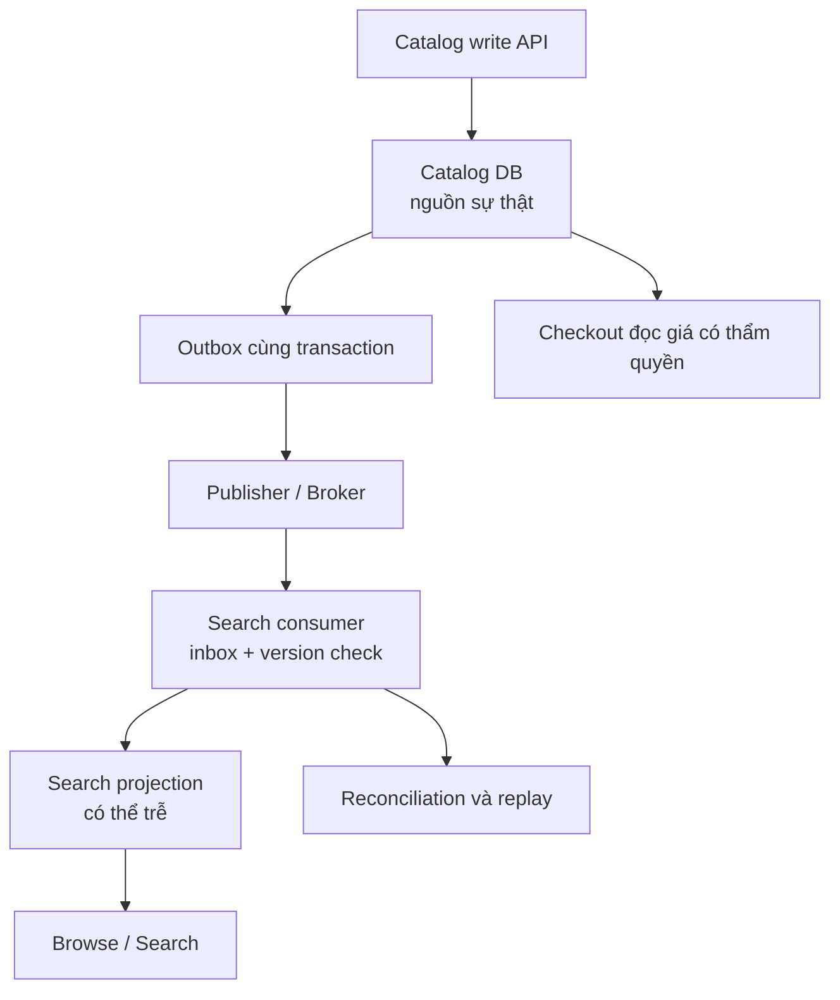
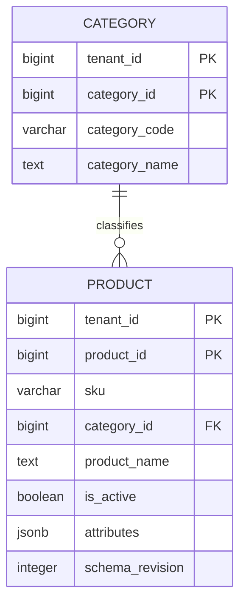
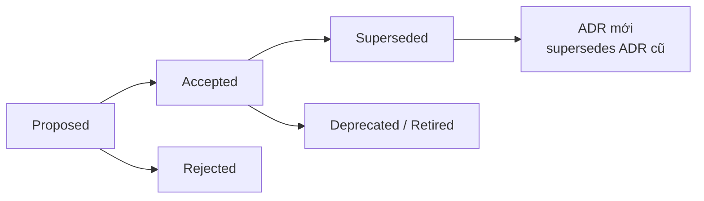

# Ghi quyết định kiến trúc, phương án đã cân nhắc và lý do đánh đổi

## 1. Một mô hình dữ liệu không chỉ cần “đúng”, mà còn cần giải thích được vì sao

Trong module `DATABASE_DATA_MODELING`, người học rèn kỹ năng chuyển yêu cầu nghiệp vụ thành mô hình dữ liệu rõ ràng: từ thực thể, quan hệ, ràng buộc, chuẩn hóa, khóa, chỉ mục và lược đồ vật lý đến so sánh các cách mô hình hóa quan hệ, document, đồ thị và phân tích. Ở chương **Tài liệu mô hình**, sản phẩm bàn giao không chỉ là sơ đồ ERD hoặc tập lệnh `CREATE TABLE`. Một mô hình có thể chạy tốt hôm nay nhưng trở nên khó bảo trì nếu không ai hiểu **vì sao nó được thiết kế như vậy, phương án khác đã bị loại vì lý do gì và điều kiện nào làm quyết định không còn phù hợp**.

Ví dụ, một đội chọn lưu thuộc tính sản phẩm bằng `JSONB` thay vì tạo hàng chục bảng quan hệ. Sáu tháng sau, một thành viên mới nhìn thấy một query JSON chậm và đề xuất chuẩn hóa toàn bộ. Cả hai đề xuất có thể hợp lý trong bối cảnh khác nhau. Nếu quyết định cũ không ghi lại:

- Tần suất thêm loại thuộc tính mới;
- Những trường nào cần `UNIQUE` hoặc `FOREIGN KEY`;
- Các truy vấn đọc thường xuyên;
- Mức độ ràng buộc nghiệp vụ và lưu lượng ghi;
- Chi phí migration của dữ liệu đã có;
- Kết quả kiểm thử đã thực hiện;

thì cuộc thảo luận rất dễ quay lại từ đầu, hoặc thay đổi mô hình theo trực giác cá nhân thay vì yêu cầu đã kiểm chứng.

**Architecture Decision Record (ADR)** là một bản ghi có cấu trúc lưu *một quyết định kiến trúc quan trọng* cùng bối cảnh, các lựa chọn, lập luận, hệ quả và điều kiện xem xét lại. Trong mô hình dữ liệu, ADR bổ sung cho ERD, data dictionary, migration scripts, API contracts và tài liệu vận hành; nó **không thay thế** những tài liệu đó.

### Kết quả học tập

Sau bài này, người học có thể:

1. Phân biệt **sự thật, giả định, ràng buộc, phương án, quyết định và bằng chứng** trong tài liệu mô hình.
2. Viết ADR theo cấu trúc dễ truy vết: bối cảnh, drivers, lựa chọn, đánh đổi, kết luận, hệ quả và tiêu chí kiểm chứng.
3. So sánh mô hình quan hệ, JSON/document, graph và phân tích mà không biến ADR thành bài quảng bá công nghệ.
4. Gắn mỗi quyết định với **grain, khóa, bất biến, thời gian, truy vấn, quyền sở hữu và yêu cầu phi chức năng**.
5. Ghi rõ những gì chưa biết, mức độ tin cậy của số liệu và trigger buộc phải xem xét lại.
6. Dùng ADR trong review thiết kế, thay đổi schema, migration, cutover, rollback và xử lý sự cố.
7. Phân biệt tài liệu **đang đề xuất** với tài liệu **đã được chấp nhận và kiểm chứng bằng dữ liệu thực**.

## 2. Quyết định kiến trúc khác với mô tả hiện trạng

Một tài liệu “database có bảng `product` gồm các cột sau” là **mô tả cấu trúc**. Một tài liệu “chọn khóa kỹ thuật ổn định `product_id` và unique theo (`tenant_id`, `sku`), thay vì dùng `sku` làm PK, vì SKU có thể đổi và được tái sử dụng theo chính sách nhập liệu” mới là **ghi nhận quyết định**.

| Loại thông tin | Câu hỏi trả lời | Nơi thường nên lưu |
|---|---|---|
| **Yêu cầu nghiệp vụ** | Hệ thống phải làm gì? | Requirements, acceptance criteria, ví dụ nghiệp vụ |
| **Hiện trạng** | Đang có bảng, dữ liệu và luồng nào? | Data catalog, ERD, schema registry, runbook |
| **Quyết định** | Chúng ta chọn cấu trúc nào và vì sao? | ADR có owner, trạng thái, lựa chọn và rationale |
| **Bất biến** | Điều gì phải luôn đúng với dữ liệu? | ADR để giải thích, constraint/test để cưỡng chế |
| **Quy trình triển khai** | Migrate/cutover/rollback như thế nào? | Migration plan, scripts, operational checklist |
| **Kết quả đo** | Giải pháp đạt yêu cầu không? | Benchmark, test reports, monitoring dashboard |
| **Lịch sử thay đổi** | Quyết định đã bị thay thế khi nào? | ADR mới và quan hệ `supersedes`/`superseded by` |

Một ADR tốt liên kết các nguồn này bằng **định danh có thể truy vết**, thay vì sao chép toàn bộ SQL, số liệu và tài liệu thử nghiệm vào một tệp dài đến mức dễ lỗi thời.

**Quy tắc thực dụng:** những điều quan trọng để người sau hiểu *vì sao* nên có trong ADR; những điều cần phản ánh *trạng thái chính xác hiện tại* nên lấy từ schema/tool kiểm chứng và được dẫn chiếu.

## 3. Đặt câu hỏi: quyết định nào đáng ghi ADR?

Không phải mỗi câu `ALTER TABLE` hay thay tên cột đều cần ADR riêng. Ưu tiên ghi khi một lựa chọn:

- Ảnh hưởng **ngữ nghĩa dữ liệu** và khó đảo ngược, ví dụ đổi grain fact hoặc cách xác định danh tính.
- Tạo **ràng buộc xuyên team/service**, ví dụ shared schema, contract, ownership.
- Có nhiều phương án thật sự hợp lý, mỗi phương án tối ưu một nhóm tiêu chí khác nhau.
- Tác động lớn tới **hiệu năng, tính nhất quán, bảo mật, khả năng mở rộng hoặc chi phí**.
- Tạo **nợ kiến trúc có chủ đích**, ví dụ tạm giữ một cột JSON hoặc dual-write trong 90 ngày.
- Buộc thay đổi migration dữ liệu đang chạy, có dữ liệu legacy và consumer cũ.
- Liên quan khả năng tái lập lịch sử, thuế, giá, quyền riêng tư hoặc lưu trữ dài hạn.

Ví dụ thường đáng ghi:

| Quyết định | Vì sao cần ADR |
|---|---|
| Dùng surrogate key thay natural key cho customer | Quy tắc đổi mã, lịch sử FK, dữ liệu trùng từ nguồn |
| Chọn SCD Type 2 cho phân loại sản phẩm | Ngữ nghĩa báo cáo quá khứ, cập nhật hồi tố và chi phí version |
| Dùng `JSONB` cho thuộc tính biến thể | Đánh đổi schema flexibility với FK, query và validation |
| Partition bảng sự kiện theo ngày/tháng | Truy vấn, retention, unique và vận hành partition |
| Tách dữ liệu đơn hàng sang bounded context | Ownership, contract, nhất quán cuối cùng và migration |
| Chọn bảng cầu cho dimension nhiều giá trị | Grain, fanout, trọng số phân bổ và kiểm tra tổng |
| Chọn snapshot fact thay cho always-join-current | Tái lập chứng từ, double storage và hậu quả sửa hồi tố |

Ví dụ có thể không cần ADR mới: thêm index nhỏ đã được quy định rõ trong một ADR hiện hành và không đổi ngữ nghĩa, sửa mô tả cột, hoặc refactor nội bộ có rủi ro thấp. Tuy nhiên, tổ chức có thể đặt ngưỡng ghi riêng dựa trên mức độ rủi ro.

## 4. Cấu trúc ADR tối thiểu để một người khác hiểu và kiểm chứng

Một mẫu phổ biến gồm các trường:

| Trường | Nội dung nên có | Điều cần tránh |
|---|---|---|
| **ID và tiêu đề** | `ADR-DATA-027: Thuộc tính mở rộng sản phẩm` | Tiêu đề “Thiết kế DB” quá rộng |
| **Trạng thái** | `Proposed`, `Accepted`, `Superseded`, `Rejected`... | Đánh dấu Accepted khi mới là ý tưởng |
| **Ngày/owner/đối tượng review** | Ai chịu trách nhiệm quyết định và khi nào | Chỉ có tên người viết mà không có owner |
| **Phạm vi** | Bounded context, bảng, nguồn và consumer liên quan | “Áp dụng cho toàn hệ thống” mà không chứng minh |
| **Bối cảnh** | Vấn đề, hiện trạng, mối đau, thay đổi dự kiến | Chỉ mô tả giải pháp muốn chọn |
| **Decision drivers** | Mẫu đọc/ghi, bất biến, SLA, compliance, cost | Các tính từ “nhanh”, “linh hoạt” không đo được |
| **Phương án** | Tối thiểu một số lựa chọn thực tế, kể cả giữ nguyên | Phương án rơm cố tình yếu để lựa chọn ưa thích thắng |
| **Đánh đổi** | Tác động tích cực/tiêu cực và ai chịu chi phí | Chỉ liệt kê ưu điểm của phương án thắng |
| **Quyết định** | Chọn gì, không chọn gì, phạm vi nào | “Sẽ xem xét” nhưng ghi trạng thái Accepted |
| **Bằng chứng** | Query workload, số liệu, PoC, nguồn và độ tin cậy | Số benchmark tưởng tượng trình bày như kết quả thực |
| **Hệ quả** | Migration, code, test, vận hành, bảo mật | Bỏ qua chi phí duy trì sau go-live |
| **Tiêu chí kiểm chứng** | Test bất biến, đo workload, mức giới hạn chấp nhận | “Test kỹ” không có định nghĩa |
| **Điều kiện xem xét lại** | Những thay đổi dẫn đến lựa chọn khác | Không có cơ chế cập nhật quyết định |
| **Liên kết** | ERD, DDL, migration, ticket, benchmark, ADR liên quan | Sao chép quá nhiều nội dung dễ lỗi thời |

**ADR là một biên bản lập luận có tính lịch sử.** Khi hệ thống thay đổi bối cảnh, thường nên tạo ADR mới ghi lý do thay thế ADR cũ, thay vì sửa lặng quá khứ để làm như một lựa chọn hiện tại luôn là lựa chọn duy nhất.

## 5. Phân biệt fact, assumption, constraint, preference và open question

Một câu có vẻ cụ thể chưa chắc là sự thật.

| Nhãn | Ví dụ | Cách xử lý trong ADR |
|---|---|---|
| **Fact đã đo** | “Trong trace 7 ngày, 82% lượt đọc lọc theo tenant và SKU.” | Ghi nguồn, ngày đo, tập dữ liệu, độ tin cậy |
| **Assumption** | “Số kiểu thuộc tính tùy biến sẽ tăng 2 lần/năm.” | Ghi ai xác nhận và trigger kiểm chứng |
| **Hard constraint** | “Dữ liệu tenant A không được đọc bởi tenant B.” | Thiết kế cơ chế bắt buộc, test cross-tenant |
| **Soft objective** | “Ưu tiên giảm thời gian triển khai loại sản phẩm mới.” | Đặt KPI/chi phí đánh đổi với objective khác |
| **Preference** | “Đội quen dùng PostgreSQL.” | Xem là lợi thế năng lực, không là chứng minh phù hợp tuyệt đối |
| **Open question** | “Có cần unique tuyệt đối cho mã thuộc tính trong JSON?” | Chỉ rõ người trả lời, hạn và ảnh hưởng lựa chọn |
| **Decision** | “Chọn B-tree trên (`tenant_id`, `sku`).” | Ghi vì sao, tradeoff index ghi và scope |

Nếu dữ liệu workload chưa có, hãy ghi “**Chưa đo; giả định để thiết kế PoC**”, thay vì viết “p95 = 50ms” như thể đã benchmark. Một ADR được chấp nhận có thể còn giả định, nhưng phải **công khai rủi ro và kế hoạch kiểm chứng**.

### Một cách trình bày chứng cứ

```text
Evidence E-04
  Loại: phân tích query log
  Phạm vi: tenant đang hoạt động, 7 ngày liên tục
  Chỉ số: tỷ lệ request filter theo (tenant_id, sku)
  Giá trị: TBD — chưa chạy đo
  Người chịu trách nhiệm: Data Platform
  Cách tái lập: chạy script phân loại query trên log ẩn danh
  Giới hạn: workload test có thể khác đợt campaign
```

Điều quan trọng là **truy vết được bằng chứng**, không nhất thiết mọi ADR đều phải đính kèm hàng trăm trang số liệu.

## 6. Ghi các quyết định gắn chặt với mô hình dữ liệu

Một ADR về schema cần trả lời được các câu hỏi mà người đọc ERD khó suy ra:

1. **Grain:** một hàng là một sản phẩm, biến thể, dòng bán, snapshot ngày hay sự kiện thay đổi?
2. **Danh tính:** khóa nào không đổi khi mã/nhãn biến đổi? Namespace tenant/source là gì?
3. **Cardinality:** quan hệ 1–n hay n–n; có cần bridge hoặc group bridge?
4. **Tính bắt buộc:** cột nào `NOT NULL`, `CHECK`, `UNIQUE`, FK và giới hạn phạm vi?
5. **Thời gian:** trạng thái hiện tại, valid-time, recorded-time, SCD2 hay snapshot giao dịch?
6. **Consistency:** transaction nào phải atomic, sự kiện nào có thể đồng bộ cuối cùng?
7. **Đường đọc:** truy vấn nào bắt đầu từ tenant, từ device, từ product, từ time range?
8. **Dữ liệu tăng trưởng:** số hàng, kích thước row, skew, retention và partition key?
9. **Quyền sở hữu:** ai được ghi? Ai chỉ tiêu thụ qua contract?
10. **Migration:** dữ liệu cũ có chuyển không mất nghĩa không? Cutover/rollback nào hợp lệ?

**Không trả lời một mục bằng việc “có index” hay “đã chuẩn hóa 3NF”.** Ví dụ 3NF giải quyết một loại phụ thuộc và bất thường cập nhật, nhưng không quyết định mọi ngữ nghĩa thời gian, bảo mật hay thực tế rằng người dùng thường truy vấn một cây quan hệ dài.

## 7. Ghi quyết định theo workload, không theo cảm giác hiệu năng

Hai lược đồ có thể đều hợp lệ về quan hệ nhưng khác nhau mạnh về cách đọc.

Giả sử catalog có các đường truy cập:

| Truy vấn | Tần suất/độ quan trọng giả định | Điều kiện chọn |
|---|---|---|
| Q1: tìm sản phẩm bằng SKU | Cao, đường checkout | `tenant_id` + `sku` |
| Q2: danh sách sản phẩm trong category | Cao, trang catalog | `tenant_id` + `category_id` + trạng thái |
| Q3: tìm theo màu, chất liệu, thuộc tính mở rộng | Trung bình, filter | `tenant_id` + thuộc tính tùy biến |
| Q4: báo cáo nhóm thuộc tính 12 tháng | Thấp trên OLTP, nặng theo tập | Theo thời gian, category và giá trị thuộc tính |
| Q5: thêm loại thuộc tính mới | Không thường xuyên nhưng cần nhanh | Schema validation và UI admin |

Các tần suất ở bảng chỉ là **giả định để minh họa**. Nếu tổ chức thực tế chưa có thống kê truy vấn thì ADR phải ghi “chưa xác minh”; kế hoạch đo là một phần quyết định.

Một quyết định về index cần gắn trực tiếp Q1–Q5. Chỉ nói “đã thêm `GIN` cho JSONB nên truy vấn nhanh” là không đủ: phải đo predicate thực tế, selectivity, số trang đọc, latency, tác động insert/update và kế hoạch index khi dữ liệu lớn.

## 8. Các lựa chọn phải được mô tả một cách công bằng

Tình huống minh họa: mỗi loại sản phẩm có một số thuộc tính cốt lõi ổn định (SKU, tên, category, trạng thái) và một tập thuộc tính mở rộng (màu, chất liệu, tính năng) thay đổi theo loại hàng. Có ba phương án chính:

### A. Hoàn toàn quan hệ: typed columns và bảng thuộc tính chuẩn hóa

```text
product(product_id, tenant_id, sku, name, category_id, ...)
attribute_definition(attribute_id, tenant_id, code, data_type, ...)
product_attribute_value(product_id, attribute_id, value_*, ...)
```

**Ưu:** dễ quản lý danh mục thuộc tính tập trung, FK/unique rõ hơn, có thể xây nhiều kiểu ràng buộc. **Nhược:** EAV có thể cần nhiều join, khó bảo đảm type nhất quán nếu thiết kế cột giá trị chung tùy tiện, chi phí đọc/pivot tăng. Cần phân biệt một bảng thuộc tính có kiểu hợp lệ với một EAV “mọi thứ là string”.

### B. Hybrid quan hệ + `JSONB`

```text
product(tenant_id, product_id, sku, category_id,
        name, active, attributes_jsonb, ...)
```

**Ưu:** khóa và trường lõi có constraint rõ, thêm thuộc tính mở rộng linh hoạt, đọc document sản phẩm tương đối thuận tiện. **Nhược:** JSONB không tự có FK cho từng field lồng nhau; schema validation phải được thiết kế, GIN/index có chi phí; nhiều truy vấn phân tích phức tạp hơn.

### C. Document-oriented product aggregate

```text
product_document:
  id, tenant, sku, category, variants[], attributes{}, ...
```

**Ưu:** biểu diễn aggregate linh hoạt, thay đổi shape theo loại sản phẩm nhanh, read theo ID thuận tiện. **Nhược:** duy nhất cross-document, transaction, index, quan hệ tới category và báo cáo tùy DBMS; migration/đối soát giữa OLTP và analytics cần làm rõ.

**Không có một phương án thắng mọi chiều.** Nếu Q3 rất quan trọng và thuộc tính cần FK/unique mạnh, B có thể kém A; nếu Q1 là đường chính và phần mở rộng ít khi lọc, B có thể đơn giản; nếu document aggregate phù hợp và có cơ chế validation/index/transaction đáp ứng, C là một lựa chọn hợp lệ.

## 9. Bảng đánh đổi gắn với tiêu chí, không chỉ bảng điểm đẹp

Mẫu so sánh:

| Tiêu chí | Phương án A: quan hệ thuộc tính | B: Hybrid JSONB | C: document |
|---|---|---|---|
| Bảo vệ khóa lõi SKU/category | Thuận lợi với FK/UNIQUE | Thuận lợi với typed core + FK | Phụ thuộc cơ chế index/constraint của engine |
| Đổi cấu trúc thuộc tính | Cập nhật definition/type và mapping | Bổ sung key, cập nhật validator | Linh hoạt document schema |
| Truy vấn filter thuộc tính | Join và index theo loại | GIN/expression index phù hợp workload | Index/path query theo sản phẩm |
| Đọc trọn hồ sơ sản phẩm | Nhiều join có thể cần cache/projection | Một hàng + JSONB | Document aggregate tự nhiên |
| Unique/FK của field mở rộng | Có thể thiết kế có kiểm soát | Không tự cưỡng chế field lồng nhau | Tùy engine và thiết kế |
| Quản lý lịch sử thuộc tính | Thêm version/valid-time | Version cả document hoặc thay đổi cụ thể | Version/document history |
| Ghi nhiều lần một field nhỏ | Có thể cập nhật hàng value | Có thể phải ghi lại phần JSONB | Có thể sửa field document; chi phí tùy engine |
| Báo cáo lớn nhiều thuộc tính | Có thể chuẩn hóa/pivot | ETL flatten sang mart | ETL sang mart/schema đọc |
| Migration khỏi hệ quan hệ hiện tại | Ít thay hạ tầng, đổi bảng | Ít thay hạ tầng | Có thêm công nghệ và đồng bộ |

Bảng trên mô tả **khả năng và rủi ro**, chưa phải kết quả benchmark. Trước khi chấm điểm, phải xác nhận các tiêu chí nào là **ràng buộc bắt buộc** (ví dụ không được mất FK category, tenant isolation) và tiêu chí nào là **tối ưu mềm** (ví dụ giảm DDL khi thêm một màu).

### Tại sao điểm có trọng số không tự là kết luận?

Giả sử nhóm đặt trọng số độ linh hoạt 40%, truy vấn 30%, toàn vẹn 20%, vận hành 10%. Nếu những số đó do một nhóm tự gán để lựa chọn ưa thích thắng, tổng điểm chỉ làm **định kiến có vẻ định lượng**.

Một cách an toàn hơn:

1. Dùng tiêu chí **go/no-go** trước: phương án vi phạm bắt buộc thì loại.
2. Cho các tiêu chí còn lại một thang đánh giá và **nguồn bằng chứng**.
3. Làm **sensitivity analysis**: nếu tần suất Q3 tăng gấp 10 hoặc chi phí migration tăng 3 lần, thứ tự lựa chọn có đổi không?
4. Đưa quyết định, tradeoff và **điều kiện xem xét lại** vào ADR, không chỉ chép bảng điểm.

## 10. Ví dụ ADR đầy đủ: thuộc tính mở rộng trong catalog nhiều tenant

Đây là **ví dụ học tập**, không phải quyết định đã được một hệ thống production chấp thuận. Trạng thái được để **Proposed**, chưa có kết quả benchmark; số liệu hiệu năng sẽ chỉ xuất hiện khi có đo thực tế.

### ADR-DATA-027 — Lưu thuộc tính mở rộng sản phẩm

| Thuộc tính | Giá trị minh họa |
|---|---|
| ID | `ADR-DATA-027` |
| Trạng thái | **Proposed** |
| Ngày soạn | 22/11/2026 |
| Owner | Nhóm Catalog |
| Reviewer bắt buộc | Data Platform, Security, Analytics, nhóm nghiệp vụ Catalog |
| Phạm vi | Catalog OLTP đa tenant; không thay schema fact bán hàng |
| Nhu cầu | Thêm loại thuộc tính mà vẫn giữ khóa/constraint của sản phẩm lõi |
| Quyết định đề xuất | **B: Hybrid typed core + JSONB cho thuộc tính mở rộng** |
| Bằng chứng | Q1–Q5 là workload giả định; benchmark và kiểm tra data quality còn pending |
| Điều kiện chấp nhận | Thỏa ràng buộc lõi, test tenant, validator, query benchmark và migration |

### 10.1. Bối cảnh

Sản phẩm có danh tính ổn định theo `product_id`; SKU chỉ duy nhất trong tenant và được quản lý riêng khi đổi mã. Mỗi sản phẩm thuộc một category hiện tại. Những thuộc tính như `color`, `material` hoặc `battery_capacity_wh` khác nhau giữa các loại sản phẩm; tần suất thêm mới chưa được đo.

Ứng dụng giao dịch cần Q1/Q2 với độ trễ nhỏ, thỉnh thoảng Q3 theo thuộc tính. Báo cáo lịch sử và tổng hợp dài hạn được xử lý ở data mart riêng. Nhóm muốn tránh một migration DDL cho mọi thuộc tính hiếm, nhưng không chấp nhận để các thuộc tính **quyết định giá/thuế/quyền bán** nằm trong JSON mà không có validation và owner.

### 10.2. Lựa chọn đã cân nhắc

- **A – Quan hệ/EAV có kiểu:** cho phép quản lý thuộc tính và ràng buộc chi tiết, nhưng cần nhiều bảng/join và cơ chế kiểm tra kiểu/phạm vi.
- **B – Hybrid JSONB:** cột lõi có type/constraint, thuộc tính mở rộng trong document có validator và index chọn lọc; rủi ro lớn nhất là semantics/type/FK trong JSON.
- **C – Document DB:** thuận lợi khi phát triển aggregate thay đổi nhanh, nhưng thêm hạ tầng, đồng bộ danh tính category và migration dữ liệu cũ trong bối cảnh chưa có yêu cầu đủ mạnh.
- **D – Giữ nguyên schema cột cố định:** chi phí ngắn hạn thấp nhưng DDL và cột sparse có thể tăng nếu số thuộc tính mở rộng đúng như dự đoán.

Không loại C vì “NoSQL không có transaction” hay loại A vì “SQL không mở rộng được”; những nhận định khái quát đó không chính xác. Việc lựa chọn phải dựa trên khả năng **cụ thể** của công nghệ, workload và năng lực vận hành của đội.

### 10.3. Quyết định đề xuất và giới hạn

Chọn **B** cho giai đoạn đầu **nếu** thử nghiệm đạt yêu cầu. Các thuộc tính lõi về danh tính, category, giá niêm yết, trạng thái bán và các mã có ràng buộc mạnh nằm ở cột có kiểu rõ. `attributes JSONB` chỉ chứa thuộc tính mở rộng đã được đăng ký trong một registry/validator có owner. Không dùng JSONB để thay thế FK tenant/category hoặc để giấu quyền truy cập.

**Đánh đổi chấp nhận:**

- Truy vấn filter một số thuộc tính khó kiểm chứng hơn so với cột typed.
- Cần schema validator, migration rule và version quản trị thuộc tính.
- Index GIN/expression có chi phí write/storage; Q3 phải benchmark.
- Consumer phân tích nên flatten các thuộc tính quan trọng vào mart thay vì phụ thuộc JSON path tùy ý.

**Các điều kiện khiến ADR phải xem lại:**

- Một thuộc tính JSON trở thành field dùng thường xuyên trong checkout, giá/thuế hoặc ràng buộc `UNIQUE`/`FK`.
- Q3 vượt latency/SLA hoặc ghi JSONB tạo chi phí write amplification vượt ngân sách đã được đo.
- Tỷ lệ payload không hợp lệ tăng hoặc data lineage bị mất.
- Nhu cầu version/hồi tố từng thuộc tính tăng tới mức version cả document gây khó kiểm soát.

### 10.4. Hệ quả

Catalog phải triển khai schema validation với version, rule chuyển key, hợp đồng null/missing, kiểm tra tenant, index theo workload, migration từ các cột legacy và regression tests. Analytics phải sở hữu ETL flatten có test grain/semantics. Quyết định không áp dụng cho entity invoice, ledger, hàng tồn có yêu cầu quan hệ/transaction khác.

**Chưa chấp nhận ADR này chỉ dựa trên nội dung ví dụ.** Một ADR thật cần kết quả PoC, reviewer chấp thuận và bằng chứng đáp ứng tiêu chí chất lượng trước khi đổi trạng thái từ Proposed sang Accepted.

## 11. Đưa quyết định thành DDL có thể kiểm chứng

Minh họa PostgreSQL 16 cho phương án B, với schema tối giản và độc lập:

```sql
CREATE TABLE category (
    tenant_id BIGINT NOT NULL,
    category_id BIGINT GENERATED ALWAYS AS IDENTITY,
    category_code VARCHAR(60) NOT NULL,
    category_name TEXT NOT NULL,
    CONSTRAINT pk_category PRIMARY KEY (tenant_id, category_id),
    CONSTRAINT uq_category_code
        UNIQUE (tenant_id, category_code)
);

CREATE TABLE product (
    tenant_id BIGINT NOT NULL,
    product_id BIGINT GENERATED ALWAYS AS IDENTITY,
    sku VARCHAR(80) NOT NULL,
    category_id BIGINT NOT NULL,
    product_name TEXT NOT NULL,
    is_active BOOLEAN NOT NULL DEFAULT TRUE,
    attributes JSONB NOT NULL DEFAULT '{}'::jsonb,
    schema_revision INTEGER NOT NULL DEFAULT 1,
    created_at TIMESTAMPTZ NOT NULL DEFAULT clock_timestamp(),
    CONSTRAINT pk_product PRIMARY KEY (tenant_id, product_id),
    CONSTRAINT uq_product_sku UNIQUE (tenant_id, sku),
    CONSTRAINT fk_product_category_tenant
        FOREIGN KEY (tenant_id, category_id)
        REFERENCES category (tenant_id, category_id),
    CONSTRAINT ck_product_sku_nonblank
        CHECK (char_length(btrim(sku)) > 0),
    CONSTRAINT ck_product_attributes_object
        CHECK (jsonb_typeof(attributes) = 'object'),
    CONSTRAINT ck_product_schema_revision
        CHECK (schema_revision > 0)
);

-- Ứng viên cho Q2: lọc category và trạng thái trong tenant.
CREATE INDEX idx_product_tenant_category_active
    ON product (tenant_id, category_id, is_active);

-- Ứng viên cho Q3: containment predicate trên attributes.
CREATE INDEX idx_product_attributes_gin
    ON product USING GIN (attributes jsonb_path_ops);
```

**Đọc các bất biến thật sự được DBMS bảo vệ:**

1. `PRIMARY KEY(tenant_id, product_id)` định danh hàng trong tenant. Một sequence ID có thể là toàn cục ở cột identity, nhưng FK/PK ghép vẫn giúp mô hình thể hiện phạm vi tenant.
2. `UNIQUE(tenant_id, sku)` ngăn SKU trùng **trong tenant**; nếu SKU có thể đổi hoặc được tái sử dụng sau khi ngừng bán, cần chính sách alias/lịch sử hoặc soft-delete riêng. Không suy ra bất biến qua mọi thời điểm chỉ từ unique hiện trạng.
3. FK ghép (`tenant_id`, `category_id`) ngăn product của tenant 42 tham chiếu category của tenant 43. Nó không tự bảo đảm thời gian hiệu lực nếu category/version có lịch sử.
4. `jsonb_typeof(attributes) = 'object'` bảo vệ **hình dạng cấp cao**. Nó **không** bảo đảm giá trị `color` là chuỗi hợp lệ, `battery_capacity_wh` là số dương, hoặc mọi khóa đã được phê duyệt.
5. `schema_revision` là phiên bản của **quy tắc cấu trúc thuộc tính** trong ví dụ; không phải DB migration version hay bằng chứng giá trị dữ liệu đã được xác thực.
6. `jsonb_path_ops` phù hợp một số phép lọc containment `@>`; không tự tối ưu mọi toán tử JSON. Nếu workload dùng `?` hay truy vấn path khác, phải so với `jsonb_ops` hoặc expression index và xác minh hỗ trợ operator.

### Query Q1 và Q2

```sql
-- Q1: tìm theo SKU trong tenant.
SELECT product_id, product_name, category_id, attributes
FROM product
WHERE tenant_id = 42
  AND sku = 'SKU-1001';

-- Q2: liệt kê sản phẩm đang bán trong một category.
SELECT product_id, sku, product_name
FROM product
WHERE tenant_id = 42
  AND category_id = 7
  AND is_active = TRUE
ORDER BY product_id
LIMIT 100;
```

Q1 có thể dùng index được tạo bởi `uq_product_sku`. Q2 có thể hưởng lợi từ index category–active tùy số hàng, tính chọn lọc, pagination và thống kê. `ORDER BY product_id` có thể cần sort hoặc index khác cho đường đọc nặng; phải đo, không suy đoán từ DDL.

### Query Q3 và giới hạn phạm vi tenant

```sql
-- Containment query: tìm sản phẩm màu đỏ.
SELECT product_id, sku, product_name
FROM product
WHERE tenant_id = 42
  AND attributes @> '{"color": "red"}'::jsonb;
```

Với PostgreSQL, GIN của `attributes` có thể hỗ trợ `@>`, trong khi điều kiện tenant dùng lọc/index khác theo plan. Nếu nhiều tenant và workload cực lớn, cần đánh giá cách kết hợp index/partition hoặc biểu diễn typed field. **Index JSON toàn cục không tự chứng minh query cách ly tenant hiệu quả**; bảo mật còn cần policy truy cập hoặc RLS phù hợp, không chỉ điều kiện SQL do developer nhớ viết.

### Đừng giấu các ràng buộc quan trọng trong JSONB

Nếu `serial_number` phải unique theo tenant, `supplier_id` phải FK, hoặc `tax_category` ảnh hưởng hóa đơn, cách đặt các giá trị đó trong JSONB mà không có cơ chế DB/validation bổ sung dễ tạo lỗi. ADR phải nêu **quy tắc thăng cấp** thuộc tính từ JSON sang typed column hoặc bảng riêng, và kế hoạch migration dữ liệu cũ.

## 12. Định nghĩa ranh giới đúng của validator

Một bản ghi JSON có thể đúng cú pháp nhưng sai miền:

```json
{
  "color": 123,
  "battery_capacity_wh": -20,
  "supplier_id": "unknown"
}
```

Để bảo vệ dữ liệu, ADR cần chỉ rõ:

- **Schema registry/definition:** danh mục key, kiểu, unit, phạm vi theo category/version, field bắt buộc và tùy chọn.
- **Validation ở API/ingestion:** type, business rules, đơn vị, enum và quyền cập nhật.
- **Validation ở DB:** những bất biến có thể biểu diễn bằng `CHECK`, FK, unique, index hoặc trigger; phân biệt điều gì DB thật sự kiểm soát.
- **Quy tắc dữ liệu legacy:** khi một key không còn dùng, đổi key, thay unit hoặc có giá trị không hợp lệ thì xử lý bằng migration/quarantine.
- **Telemetry:** tỷ lệ payload không hợp lệ, số key hiếm, thuộc tính quan trọng không có index, thời gian validate và số lần schema thay đổi.

**Không viết “JSONB được validate ở application” như một lời hứa không thể kiểm chứng.** Phải nói ai sở hữu validator, endpoint/batch nào đi qua nó, các đường ghi SQL trực tiếp có bị khóa không và test nào chứng minh không thể bypass.

## 13. ADR về chuẩn hóa: lý do tách bảng, lý do giữ denormalization

Trong mô hình quan hệ, **chuẩn hóa** nhằm kiểm soát phụ thuộc dữ liệu và giảm bất thường cập nhật. Tuy nhiên, một quyết định hợp lý có thể cố ý lưu bản sao:

- `order_line.product_name_at_sale` để bảo vệ nội dung chứng từ dù tên product đổi.
- `fact_sales_line.reporting_group_at_sale` để báo cáo nguyên trạng.
- `customer_summary.total_paid` như read model phục vụ UI.

Những lựa chọn này **không giống nhau về mục đích**, dù đều là một dạng denormalization.

| Tình huống | Giữ trùng dữ liệu vì sao? | Cần ADR ghi |
|---|---|---|
| Snapshot giao dịch | Bảo vệ lịch sử nghiệp vụ/pháp lý | Giá trị nào chốt, thời điểm chốt, ai được sửa, correction |
| Cache/materialized projection | Tăng tốc đọc, chấp nhận staleness | Nguồn sự thật, refresh/CDC, lag, reconcile/rebuild |
| Denormalized reporting fact | Tránh join nặng, đơn giản BI | Grain, nguồn dimension, as-of policy, backfill |

Khi nhiều data mart cần so sánh số liệu, một **conformed dimension** (chiều có định nghĩa thống nhất giữa các fact/mart) có thể là quyết định đáng ghi ADR riêng: ai sở hữu khóa và lịch sử phiên bản, buyer có thực sự trùng billing party không, và chính sách phân loại theo hiện trạng hay tại thời điểm sự kiện. Conformed dimension phục vụ phân tích không có nghĩa mọi miền OLTP phải dùng chung một bảng ghi.
| JSON document aggregate | Đọc nhiều thuộc tính cùng một lần | Boundary, schema version, validation và index |

Một tài liệu chỉ nói “denormalize để nhanh” là thiếu. Người đọc cần biết **dữ liệu có được phép lệch và lệch trong bao lâu**; cách sửa khi mất đồng bộ; giá trị nào là canonical; và chi phí ghi bổ sung có chấp nhận không.

## 14. ADR về khóa: danh tính, namespace và khả năng tiến hóa

Lựa chọn giữa natural key và surrogate key không được giản lược thành “UUID luôn tốt” hay “BIGINT luôn nhanh”.

### Các phương án cần cân nhắc

- **Natural key:** `(tenant_id, sku)` làm PK; thuận lợi khi mã ổn định tuyệt đối, nhưng mọi FK có thể phải đổi nếu SKU đổi.
- **Surrogate key:** `(tenant_id, product_id)` làm PK; SKU có unique riêng, hỗ trợ đổi mã mà không làm mất danh tính.
- **Distributed ID/UUID:** thuận tiện tạo ID ở nhiều nguồn, nhưng ảnh hưởng index width, locality, thứ tự ghi, cách debug và nguy cơ expose identifier.
- **Composite source identity:** `(tenant_id, source_system, external_ref)` là định danh giao tiếp; có thể cần bảng mapping để tránh lẫn hai namespace.

### Những câu phải ghi trong ADR khóa

1. SKU có thể sửa, xóa, cấp lại, gộp, tách hoặc tái sử dụng không?
2. ID có cần sinh offline/multi-region không? Quy tắc xử lý collision?
3. Tenant ID là thành phần của FK/unique hay chỉ là thuộc tính filter?
4. Kiểu khóa rộng có ảnh hưởng index của các bảng con lớn thế nào?
5. Khóa có mang nghĩa lịch sử hay chỉ định danh hàng hiện tại?
6. Khi migration sang nguồn mới, bảng ánh xạ ID cũ → mới được kiểm chứng ra sao?

**Không coi khóa kỹ thuật và mã nghiệp vụ là hai tên gọi của một khái niệm.** Một khóa có thể hợp lệ ở hiện tại nhưng sai ngữ nghĩa nếu bị tái sử dụng theo thời gian.

## 15. ADR về thời gian và lịch sử: một quyết định khó phục hồi khi đã mất dữ liệu

Giả sử người dùng hỏi “khách hàng thuộc phân khúc nào tại thời điểm mua hàng?”. Ba cách lưu có hậu quả khác nhau:

| Phương án | Trả lời được | Không trả lời được nếu thiếu bổ sung |
|---|---|---|
| Chỉ lưu `customer.segment` hiện tại | Trạng thái hiện tại | Phân khúc đã có hiệu lực khi mua |
| SCD Type 2 với `valid_from/valid_to` | Phân khúc theo lịch sử hiệu lực hiện được chấp nhận | Hệ thống đã **từng tin** gì trước sửa hồi tố |
| Snapshot `segment_at_sale` trên fact | Phân khúc đã chốt ở giao dịch | Lịch sử mọi thay đổi của customer ngoài giao dịch |
| Bitemporal | Valid time và recorded/system time | Vẫn cần định nghĩa semantic, giao thức ghi và retention |

ADR phải nêu **câu hỏi lịch sử** cần được trả lời, không chỉ tên “SCD2”. Các yếu tố bắt buộc:

- Sự kiện nào xác định `event_time`/`valid_from`? Có hiệu lực hồi tố không?
- Có yêu cầu giữ **as booked** và **restated** cùng lúc không?
- Bản ghi đến muộn có được gán đúng phiên bản lịch sử không?
- Có chấp nhận khoảng trống trong version hay phải phủ kín toàn kỳ?
- Ai có quyền sửa lịch sử và quy trình duyệt thế nào?
- Retention và quyền riêng tư giới hạn dữ liệu lưu đến khi nào?

**Dữ liệu lịch sử bị ghi đè trước khi áp mô hình mới không thể tự khôi phục chỉ bằng một migration DDL.** Nếu không có nguồn gốc đáng tin, ADR phải ghi rõ giới hạn thay vì tạo các phiên bản quá khứ tưởng tượng.

## 16. ADR về chỉ mục và partition: quyết định định lượng theo workload

Một index có lợi cho SELECT nhưng có chi phí duy trì khi INSERT/UPDATE/DELETE. Một partition giảm phạm vi quét theo time range nhưng cũng thêm overhead vận hành và tác động unique/FK.

### Mẫu ghi quyết định index

```text
Candidate I-03
  Đối tượng: product
  Index: (tenant_id, category_id, is_active)
  Query: Q2 — sản phẩm trong một danh mục và đang bán
  Lợi ích kỳ vọng: giảm số trang quét so với scan nhiều product
  Chi phí: tăng kích thước index và chi phí ghi trạng thái
  Bằng chứng: EXPLAIN (ANALYZE, BUFFERS) trên dataset đại diện — TBD
  Guardrail: đo p95 Q2 và tốc độ ghi dưới tải đồng thời
  Revisit: nếu Q2 bị thay bởi search engine/read model
```

### Một truy vấn benchmark minh họa

```sql
EXPLAIN (ANALYZE, BUFFERS)
SELECT product_id, sku, product_name
FROM product
WHERE tenant_id = 42
  AND category_id = 7
  AND is_active = TRUE
ORDER BY product_id
LIMIT 100;
```

`EXPLAIN (ANALYZE, BUFFERS)` **thực thi** câu SELECT. Không chỉ đọc tổng thời gian, mà còn quan sát row count thực/ước lượng, buffers, sort, scan, index access và phân bố tenant. Benchmark cần cùng bản schema, thống kê `ANALYZE`, dữ liệu đại diện và điều kiện cache phù hợp.

### Khi quyết định partition

ADR phải ghi:

- Partition key dựa trên query/retention nào?
- Kích thước và số lượng partition mục tiêu?
- Late-arriving data cần partition cũ bao lâu?
- Có ràng buộc unique toàn cục nào phải bảo vệ không?
- Plan tạo partition trước, archive/detach/drop và rollback?
- Chỉ mục từng partition, tốc độ ingest và query pruning?

**PostgreSQL 16:** bảng partition theo thời gian không cho `UNIQUE`/PK cấp parent tùy ý thiếu partition key. Đừng thêm thời gian vào source unique key chỉ để lệnh DDL chạy nếu như vậy khiến cùng một event có thể lọt qua ở hai partition. Một ADR tốt phải ghi phương án bảo vệ uniqueness riêng (ledger, thay grain, công nghệ khác) và lý do.

## 17. ADR về nhất quán và tích hợp: ai sở hữu nguồn sự thật?

Giả sử Catalog lưu giá và Search hiển thị giá ở trang kết quả. Hai phương án:

1. API đồng thời ghi vào database Catalog và index Search.
2. Catalog ghi một lần, phát thay đổi qua outbox/CDC, Search dựng projection idempotent.

Nếu chọn phương án 2, ADR phải nêu:

- Catalog là **write owner**, Search là **read projection**.
- Mức độ trễ cho phép giữa Catalog và Search; UI nào cần đọc trực tiếp Catalog để tránh giá cũ khi checkout.
- Cách đảm bảo event không bị mất: outbox cùng transaction cục bộ, publisher retry, inbox/dedup.
- Thứ tự theo product/tenant, cập nhật hồi tố và xử lý delete/tombstone.
- Cách dựng lại toàn bộ index sau sự cố; so sánh số sản phẩm và checksum nội dung.
- Trách nhiệm vận hành khi backlog lớn hoặc consumer hỏng.

Không được viết “eventual consistency sẽ tự ổn” hay “outbox là exactly-once end-to-end”. Outbox giúp không mất sự kiện do commit DB và gửi broker không đồng bộ, nhưng consumer vẫn cần idempotency, retry, ordering và reconciliation.

### Sơ đồ trách nhiệm



**Quyết định không phải “dùng Kafka hay không” trước tiên**. Câu hỏi chính là ai có quyền ghi, consumer cần consistency nào và quy trình khôi phục khi mất đồng bộ ra sao. Công nghệ cụ thể được đánh giá trong bối cảnh đó.

## 18. ADR về bảo mật, multi-tenancy và tính riêng tư

Một thiết kế dữ liệu có thể đáp ứng tốc độ đọc nhưng không đáp ứng cách ly tenant:

- Mọi unique và FK có ngữ nghĩa theo tenant đã chứa `tenant_id` ở phạm vi thích hợp chưa?
- Các truy vấn có cơ chế kiểm tra quyền ngoài việc “lập trình viên nhớ thêm WHERE tenant_id” không?
- Có RLS, quyền DB, service owner và test cross-tenant nào?
- Field nhạy cảm có nằm trong JSON, event, log, DLQ hoặc snapshot không?
- Có yêu cầu che/xóa PII trong khi vẫn giữ lịch sử giao dịch theo luật không?
- Bản backup và read replica có cùng chính sách truy cập/retention không?

Ví dụ, một `GIN` index trên `attributes` không tạo lỗ hổng bảo mật tự thân, nhưng nếu ứng dụng cho phép lọc toàn bảng mà không cưỡng chế tenant scope, một truy vấn có thể tiết lộ thông tin. ADR phải ghi bảo mật ở mức **hệ thống**, không đánh giá schema SQL trong chân không.

**Data minimization là một yếu tố đánh đổi thật.** Gộp mọi thông tin khách vào một canonical document có thể đơn giản cho consumer nhưng làm tăng nguy cơ phát tán dữ liệu không cần thiết. Tách contract theo mục đích có thể tăng số mapping, đổi lại giảm phạm vi dữ liệu nhạy cảm.

## 19. Tài liệu phụ trợ: ERD, data dictionary và lineage hỗ trợ ADR

ADR là “lý do”; những tài liệu khác mô tả cụ thể cấu trúc và dòng chảy.

### ERD rút gọn cho ví dụ catalog



Sơ đồ Mermaid chỉ mô tả cấu trúc khái quát. **Constraint ghép theo tenant** và chính sách version/validation nằm trong DDL và ADR. Người đọc không nên suy từ sơ đồ rằng JSONB có ràng buộc FK cho mọi key bên trong.

### Data dictionary ví dụ

| Trường | Định nghĩa | Chủ sở hữu | Constraint/nguồn |
|---|---|---|---|
| `product.product_id` | Danh tính kỹ thuật sản phẩm | Catalog | PK ghép với tenant |
| `product.sku` | Mã nghiệp vụ duy nhất hiện tại trong tenant | Catalog | `UNIQUE(tenant_id, sku)` |
| `product.category_id` | Category hiện tại được Catalog sử dụng | Catalog | FK ghép tới category |
| `product.attributes` | Thuộc tính mở rộng, theo schema revision | Catalog | JSON object + validator |
| `product.is_active` | Sản phẩm có được hiển thị đang bán không | Catalog | `BOOLEAN NOT NULL`, quy tắc lifecycle ở domain |
| `product.schema_revision` | Phiên bản cấu trúc của attributes | Catalog | Số dương, validator/version |

### Lineage

```text
Catalog API / Import
   -> Schema validation + tenant authorization
   -> product (OLTP canonical)
   -> outbox / CDC
       -> Search projection (phục vụ tìm kiếm)
       -> Analytics flatten (phục vụ báo cáo)
       -> Data quality metrics
```

Đối với một truy vấn sai trong data mart, lineage cho phép truy ngược từ biểu đồ, transform, event đến nguồn ghi. ADR cần liên kết tới sơ đồ lineage và contract liên quan, không chỉ bản ERD.

## 20. Quy trình review: kiểm tra lời giải lẫn quy trình suy nghĩ

Một review có giá trị không nên chỉ hỏi “có dùng đúng chuẩn team không?”. Có thể dùng các câu hỏi:

1. Vấn đề đã đủ cụ thể để đánh giá hay chưa?
2. Có ít nhất một phương án thực tế khác và phương án giữ nguyên được phân tích công bằng không?
3. Các yêu cầu nào là bắt buộc, yêu cầu nào có thể đánh đổi?
4. Grain, identity, FK, constraint, thời gian và query workload đã được chốt chưa?
5. Có chứng cứ thật hay mới là giả định? Những đo lường nào chưa chạy?
6. Kết quả xấu nhất và miền chịu trách nhiệm khi xảy ra lỗi là gì?
7. Có test chứng minh những bất biến quan trọng, kể cả concurrency/late data không?
8. Nếu cần rollback/migration, dữ liệu cũ có thể chuyển ngược không mất thông tin không?
9. Có tiêu chí quan sát nào làm quyết định cần được thay thế?
10. Khi một người mới nhận hệ thống, họ có thể tái tạo lập luận và kiểm tra trạng thái hiện tại không?

### Ai nên review?

| Thay đổi | Reviewer cần thiết theo mức rủi ro |
|---|---|
| Khóa/FK và danh tính | Domain owner, DBA/Data Platform, consumer chính |
| Fact grain hoặc chính sách lịch sử | Domain, Analytics, Finance nếu liên quan, Data Quality |
| Phân vùng/index lớn | DBA/SRE, đội vận hành, owner truy vấn |
| Shared contract/cross-service | Producer, consumer, Security/Compliance khi có PII |
| Retention/audit | Pháp chế/Compliance và quản trị dữ liệu khi áp dụng |
| Migration phá compatibility | Owner hệ thống, release management, hỗ trợ vận hành |

Không cần làm mọi ADR qua hội đồng toàn công ty. Review càng tập trung vào **owner và người chịu hệ quả trực tiếp** càng có cơ hội nhanh và sâu. Chỉ thêm reviewer khi thực sự có trách nhiệm/rủi ro liên quan.

## 21. Status lifecycle: Accepted không phải là “đúng mãi mãi”

Một vòng đời ADR thường có:



- **Proposed:** có bài toán, lựa chọn và đề xuất; còn chờ review/đo.
- **Accepted:** owner/reviewer chấp thuận trong bối cảnh cụ thể; các điều kiện chấp nhận đã được ghi.
- **Rejected:** đã cân nhắc nhưng chưa chọn; vẫn đáng lưu để tránh tranh luận lặp.
- **Superseded:** một ADR mới thay thế vì yêu cầu/bằng chứng đã đổi; ADR cũ giữ nguyên ý nghĩa lịch sử.
- **Deprecated/Retired:** quyết định/cấu trúc không còn được sử dụng; cần giải thích trạng thái hệ thống đã chuyển.

**Không sửa âm thầm ADR Accepted để thay đổi lựa chọn “hồi xưa”**. Có thể sửa lỗi chính tả, bổ sung liên kết nhưng quyết định kiến trúc mới nên có ADR mới và liên kết `supersedes`/`superseded_by`. Nếu hoàn cảnh thay đổi làm lựa chọn cũ không còn tốt, việc lưu quá khứ giúp tổ chức học được vì sao.

### Có thể dùng decision log?

Một bảng chỉ mục ADR hỗ trợ tìm kiếm:

| ID | Chủ đề | Trạng thái | Owner | Thay thế/bị thay thế |
|---|---|---|---|---|
| ADR-DATA-009 | Khóa sản phẩm trong tenant | Accepted | Catalog | — |
| ADR-DATA-027 | Thuộc tính mở rộng JSONB | Proposed | Catalog | — |
| ADR-DATA-041 | Phiên bản thuộc tính sản phẩm | Proposed | Catalog | Có thể phụ thuộc ADR-DATA-027 |

Những ID và trạng thái trong bảng này là **ví dụ minh họa**; không ám chỉ tồn tại các tài liệu đó trong repository. Mục tiêu là chỉ ra cơ chế điều hướng và phụ thuộc giữa quyết định.

## 22. Migration, cutover và rollback phải xuất hiện trong hệ quả ADR

Một quyết định thay đổi khóa, JSON format hoặc lịch sử dữ liệu thường không thể thực hiện như một thay tên cột. ADR nên liên kết tới kế hoạch triển khai **expand → migrate → contract**.

### Ví dụ chuyển một thuộc tính JSON sang typed column

Giả sử `battery_capacity_wh` đang nằm trong `attributes` nhưng bắt đầu ảnh hưởng tới kiểm tra an toàn và các query lọc. ADR mới quyết định đưa trường này thành cột có kiểu rõ.

```sql
-- EXPAND: cột mới nullable để reader/writer cũ không hỏng ngay.
ALTER TABLE product
    ADD COLUMN battery_capacity_wh NUMERIC(12,2);

-- Khi đã kiểm tra các JSON value có dạng numeric và không âm,
-- có thể backfill từ giá trị cũ. Đây chỉ là ví dụ cho dữ liệu sạch.
UPDATE product
SET battery_capacity_wh =
    (attributes ->> 'battery_capacity_wh')::numeric(12,2)
WHERE battery_capacity_wh IS NULL
  AND jsonb_typeof(attributes -> 'battery_capacity_wh') = 'number';
```

**Đoạn ví dụ không đủ an toàn để chạy tự động trên mọi dữ liệu production.** Phải xử lý `JSON null`, missing key, số ngoài miền `NUMERIC(12,2)`, giá trị âm, payload cũ không chuẩn, writer đồng thời và quy tắc làm tròn. Khi chuyển từ JSON sang typed field:

1. **Expand:** thêm cột, index/constraint nếu cần; reader cũ còn chạy.
2. **Dual-read có quan sát:** ưu tiên field mới nếu đã được đồng bộ, fallback từ JSON cũ theo rule; đo tỷ lệ fallback và drift.
3. **Write coordination:** chọn field nguồn sự thật, bảo vệ cả writer cũ và mới bằng một cơ chế được kiểm chứng; không coi hai cột là hai nguồn ghi tùy ý.
4. **Backfill từng lô:** kiểm tra khóa, transaction/lock và điều kiện không ghi đè thay đổi mới.
5. **Validate:** kiểm tra coverage, equality theo đơn vị/rounding, tất cả consumer và access control.
6. **Cutover:** app mới chỉ đọc cột typed khi có chứng cứ; tiếp tục hỗ trợ rollback trong cửa sổ đã định.
7. **Contract:** chỉ xóa JSON key/compatibility code sau khi mọi đường ghi/đọc cũ đã ngừng và lưu trữ/replay được giải quyết.

**Hệ quả ADR:** thêm một cột làm giá trị critical có type/constraint mạnh hơn, đổi lại tốn migration, thêm chỉ mục, tăng các bước tương thích và có nguy cơ downtime/lock nếu vận hành sai.

### Điều kiện rollback

Nếu typed field có quy tắc mới **không thể biểu diễn** trong JSON legacy (hoặc dữ liệu đã sửa với độ chính xác/ý nghĩa khác), rollback code cũ đơn thuần có thể làm mất thông tin. ADR phải phân biệt:

- **Rollback code** còn tương thích với dữ liệu mới không?
- **Rollback schema** có làm mất các field mới được ghi không?
- **Rollback dữ liệu** có phép chuyển ngược không mất nghĩa không?
- **Roll-forward** có an toàn hơn khi đã vượt điểm không thể đảo?

Không ghi “có thể rollback bằng revert commit” nếu không xét tác động lên dữ liệu thực.

## 23. Decision log gắn với kiểm thử và cơ chế giám sát

Một ADR có thể được tăng độ tin cậy bằng những kiểm tra lặp:

| Quyết định | Bất biến cần kiểm tra | Loại kiểm thử |
|---|---|---|
| SKU unique theo tenant | Không có hai sản phẩm cùng SKU trong tenant | DB `UNIQUE`, unit/integration, import duplicate |
| Category FK theo tenant | Product không trỏ sang category tenant khác | FK ghép, test cross-tenant |
| JSONB thuộc tính mở rộng | JSON object, key/type/unit theo schema revision | Schema validator, property-based tests, quarantine |
| SCD Type 2 | Không overlap phiên bản; event map đúng thời gian | Temporal constraints, as-of tests và gap scans |
| Snapshot giao dịch | Giá và tên chứng từ không đổi khi catalog đổi | Integration tests, audit/reversal policy |
| Outbox/inbox | Retry không nhân business effect | Concurrency, crash/recovery, replay tests |
| Partition lịch sử | Unique source identity không bị phá bởi partition key | Integration tests cross-partition |
| Rollup time-series | Late sample được phản ánh đúng và không double-count | Replay/idempotency, compare raw vs rollup |

**Không có test nào tự trả lời thay owner về lựa chọn kiến trúc.** Test chứng minh một bất biến, còn ADR lưu **vì sao bất biến đó được chọn và khi nào nó cần thay đổi**.

### Tránh tài liệu và thực tế drift

Khi schema thay đổi:

- Kiểm tra có ADR đã Accepted liên quan và thay đổi có mâu thuẫn không.
- Nếu mâu thuẫn, tạo ADR mới hoặc ghi lý do/phiên bản thay thế, không sửa lặng.
- DDL/migration mới được review cùng ADR và tests.
- Data catalog/schema extraction cập nhật từ trạng thái thực của database.
- CI có thể kiểm tra link, syntax, trạng thái ID, migration và các bất biến tự động đo được.

Một ADR với câu “cột `sku` luôn unique” trong khi migration đã bỏ unique index là **nợ tài liệu** có khả năng gây sự cố. Ngược lại, chỉ tự động sinh lại DDL không giải thích được *vì sao* uniqueness bị thay.

## 24. Thiết kế thí nghiệm để kiểm chứng phương án

Một PoC có giá trị phải phản ánh **điểm khác nhau giữa các lựa chọn**, không chỉ chứng minh tất cả đều chạy được ví dụ “hello world”.

### Checklist benchmark catalog

1. **Dữ liệu:** số tenant, product/tenant, tỷ lệ active, độ dài JSON, tần suất key, cardinality category và tenant cực lớn.
2. **Đọc:** Q1/Q2/Q3, lọc thuộc tính phổ biến/hiếm, pagination, đọc đồng thời, latency p50/p95/p99.
3. **Ghi:** tạo product, sửa một key JSON, cập nhật category, upsert cùng SKU, import hàng loạt.
4. **Tính đúng:** tenant isolation, FK, unique, JSON validator, null/missing, sản phẩm không có một số thuộc tính.
5. **Lưu trữ:** heap/table size, index size, WAL/redo, memory/cache và số hàng cập nhật.
6. **Phục hồi:** tạo lại index, backfill, rollback/forward migration, bảo toàn provenance.
7. **Vận hành:** kỹ năng team, backup/restore, monitoring, schema rollout và chi phí hạ tầng.

### Ghi kết quả đo để người khác tái lập

```text
Benchmark record B-12
  Environment: TODO — mô tả DB/version/CPU/RAM/storage
  Dataset: TODO — số tenant, dữ liệu phân bố, skew, JSON size
  Workload: Q1/Q2/Q3 với phần trăm mix và concurrency
  Baseline: phương án A
  Candidate: phương án B
  Metrics: p50/p95/p99, throughput, write latency, index disk
  Result: CHƯA ĐO — không khẳng định phương án nào nhanh hơn
  Repeatability: script/seed/hash dữ liệu và ngày chạy
  Owner: Data Platform
  Decision impact: nếu vượt SLA, thiết kế lại index hoặc đổi model
```

**Không benchmark trên mười hàng dữ liệu rồi kết luận một lựa chọn tối ưu cho hàng trăm triệu hàng.** Kết quả cũng phụ thuộc cache warm/cold, cấu hình PostgreSQL, độ lệch tenant, số writer và sự kiện phát sinh cùng lúc; ADR cần lưu giới hạn.

## 25. Những lỗi ghi ADR làm tài liệu mất giá trị

| Cách ghi kém | Vấn đề | Cách cải thiện |
|---|---|---|
| “Chọn PostgreSQL vì tốt nhất.” | Không có bối cảnh hay tiêu chí | Chỉ rõ workload, constraints, phương án và dữ liệu đo |
| “Dùng JSON để linh hoạt.” | Không nêu FK/validation và query | Phân định field lõi/extension, guardrail và chỉ mục |
| “NoSQL không có transaction.” | Khái quát sai cho nhiều DBMS | Đánh giá tính năng của engine/version cụ thể |
| “Đã chuẩn hóa 3NF nên không có vấn đề.” | Bỏ qua temporal, tenant, performance, integration | Ghi bất biến, thời gian, ownership và query |
| “Kết quả benchmark: nhanh 10x” nhưng không nguồn | Không thể tái lập, có thể bịa số | Ghi môi trường, dataset, script và phép đo |
| Chỉ viết ưu điểm của lựa chọn thắng | Che chi phí/rủi ro | Mô tả phương án bị loại công bằng và nợ chấp nhận |
| Mọi thứ ghi là Accepted ngay khi soạn | Lẫn đề xuất với quyết định được duyệt | Trạng thái Proposed/Accepted/Rejected rõ |
| “Rollback bằng revert code.” | Có thể mất dữ liệu đã migrate | Xác định dữ liệu v2-only và điểm không đảo được |
| Copy toàn bộ DDL và query logs vào ADR | Khó tìm rationale, dễ lỗi thời | Tóm bất biến và dẫn liên kết nguồn kiểm chứng |
| Một ADR ghi 20 quyết định độc lập | Một phần thay đổi khó supersede | Chia theo đơn vị quyết định có owner/lifecycle |
| Mỗi sửa tên cột đều tạo ADR | Chi phí review không đáng | Dùng migration/change log cho thay đổi nhỏ |
| Chỉ ghi kết quả, không ghi điều kiện xem xét lại | “Quyết định vĩnh viễn”, không học được từ thực tế | Thêm metrics/trigger/owner và ngày review |
| Dùng thuật ngữ “customer” mơ hồ xuyên miền | Buyer, payer, recipient khác nghĩa | Ghi bounded context và contract cụ thể |
| Giấu giả định chưa đo như fact | Lập luận trở nên vô căn cứ | Gắn nhãn giả định, rủi ro và kế hoạch xác thực |

## 26. Mẫu ADR có thể áp dụng cho mọi quyết định mô hình dữ liệu

Khung sau là **mẫu tài liệu**, các phần trong ngoặc cần điền cho quyết định thật. Không cần tất cả mục dài như nhau; quan trọng là câu trả lời đủ để review và tái lập.

```markdown
# ADR-DATA-[ID]: [Một quyết định cụ thể]

- Trạng thái: Proposed | Accepted | Rejected | Superseded
- Ngày: YYYY-MM-DD
- Owner: [Team/Role]
- Reviewer: [Người/đội có trách nhiệm]
- Phạm vi: [Bounded context, bảng, API, tenant, consumer]
- Liên quan: [ERD, DDL, migration, test, incident, ADR khác]

## 1. Vấn đề và bối cảnh
- Chúng ta phải giải quyết câu hỏi nghiệp vụ nào?
- Mô hình hiện tại và hạn chế có chứng cứ là gì?
- Điều gì sẽ xảy ra nếu giữ nguyên?

## 2. Yêu cầu và decision drivers
- Bắt buộc: [Grain, FK, tenant isolation, privacy, audit...]
- Mục tiêu: [Query Q1..Qn, SLA, write rate, cost...]
- Giả định/chưa biết: [Với owner và hạn kiểm chứng]

## 3. Các lựa chọn
- A: [Cấu trúc và ưu/nhược]
- B: [Cấu trúc và ưu/nhược]
- C: [Giữ nguyên hoặc phương án khác]
- Lý do loại từng phương án và giới hạn bằng chứng

## 4. Quyết định đề xuất/được chấp nhận
- Chọn: [Một phương án trong phạm vi rõ]
- Không chọn: [Những lựa chọn bị loại]
- Bất biến: [PK/FK/UNIQUE/CHECK, valid time, grain...]
- Các ngoại lệ được chấp nhận: [...]

## 5. Tradeoffs và hệ quả
- Tích cực: [...]
- Tiêu cực/nợ chấp nhận: [...]
- Ảnh hưởng privacy/security, analytics, consumers: [...]
- Chi phí migration, vận hành, monitoring: [...]

## 6. Bằng chứng và tiêu chí kiểm chứng
- Fact đã đo + nguồn: [...]
- Benchmark/test còn cần: [...]
- Go/no-go và lỗi phải chặn: [...]

## 7. Triển khai và rollback
- Expand/migrate/contract: [...]
- Dual-read/write, backfill, consistency: [...]
- Điều kiện cutover và điểm khó đảo ngược: [...]

## 8. Khi nào xem lại?
- Trigger về quy mô, SLA, semantics, chi phí: [...]
- Owner và cách đo: [...]

## 9. Lịch sử
- Proposed/Accepted/Superseded khi nào, bởi ai?
- ADR thay thế hoặc bị thay thế: [...]
```

**Không biến mẫu thành checklist hình thức.** Nếu không có lựa chọn khả thi thứ hai, cần giải thích tại sao những phương án khác bị giới hạn bởi constraints; nếu chưa có số liệu, ghi trạng thái Proposed và action cần kiểm chứng.

## 27. Bài thực hành: quyết định mô hình cho đơn hàng và thuộc tính sản phẩm

**Bối cảnh:** một nền tảng thương mại có 15 triệu sản phẩm nhiều tenant, 120 triệu dòng đơn hàng. Catalog hỗ trợ các loại hàng với thuộc tính mở rộng; đơn hàng phải giữ đúng giá, tên hàng tại lúc bán. Khoảng 70% lượt đọc của Catalog là lookup theo SKU (đây là **giả định cho bài tập**, không phải kết quả đo). Nhóm Finance yêu cầu truy vết giá trên hóa đơn; Analytics muốn báo cáo doanh thu theo category **tại thời điểm bán** và theo category **hiện tại**. Có hai hệ nhập hàng từ đối tác, mỗi hệ có namespace mã sản phẩm khác nhau.

Ba đề xuất đang tranh luận:

- **Phương án A:** mọi thuộc tính sản phẩm vào EAV; đơn hàng join trực tiếp Product hiện tại.
- **Phương án B:** product typed core + JSONB; `order_line` có snapshot tên/giá và khóa sản phẩm ổn định; category version để báo cáo lịch sử.
- **Phương án C:** document product aggregate; phát sự kiện đầy đủ sang Analytics và Search, order lưu snapshot riêng.

### Bài tập

1. Viết **hai ADR tách biệt**: một về cấu trúc Catalog, một về cách giữ lịch sử thuộc tính/giá trên `order_line`. Giải thích vì sao không gộp thành một quyết định.
2. Với ADR Catalog, ghi rõ Q1–Q5 và ít nhất một hard constraint. Đề xuất cách **đo** thay vì mặc định con số 70% là fact.
3. Xác định grain của `product`, `product_variant`, `order` và `order_line`; chỉ ra lỗi nếu gộp chúng vào một document hoặc bảng mà không xác định cardinality.
4. Lập bảng so sánh A/B/C theo FK/unique, linh hoạt schema, query filter, chi phí ghi, transaction, migration, năng lực team và quyền riêng tư.
5. Xác định những thuộc tính không được phép lưu tùy tiện trong JSONB vì cần ràng buộc nghiệp vụ mạnh.
6. Chọn chính sách khóa: surrogate `product_id` và external references có namespace; giải thích cách đổi SKU không làm mất danh tính lịch sử.
7. Thiết kế as-of category và snapshot giá/tên lúc bán; nêu khác biệt “báo cáo nguyên trạng” so với “báo cáo tái phân loại”.
8. Viết một bộ `CHECK`/FK/unique/temporal tests cho các bất biến quan trọng, kể cả cross-tenant.
9. Đề xuất kịch bản benchmark cụ thể: số tenant, skew, kích thước JSON, Q1–Q5 và metrics đọc/ghi.
10. Viết kế hoạch expand–migrate–contract khi chuyển một key JSON thành typed column, xử lý concurrent updates và rollback.
11. Liệt kê ít nhất ba **tiêu chí xem xét lại ADR** sau khi chạy production (ví dụ query mix, latency, tỷ lệ invalid JSON).
12. Diễn tập sự cố: một báo cáo doanh thu tháng 03 bị chuyển category do join hiện tại. Xác định ADR và test nào đáng lẽ phải cảnh báo rủi ro.

### Checklist chất lượng bản ghi quyết định

- [ ] Tiêu đề diễn tả một quyết định kiến trúc cụ thể; có owner, trạng thái, ngày, phạm vi.
- [ ] Bối cảnh/đau điểm không bị nhầm với phương án muốn chọn.
- [ ] Grain, danh tính, namespace, cardinality, ràng buộc và chính sách thời gian được ghi rõ.
- [ ] Hard constraints, tradeable objectives, assumptions và open questions được tách biệt.
- [ ] Các phương án thực tế được so sánh công bằng, có tính tới “giữ nguyên”.
- [ ] Lý do chọn và những bất lợi **được chấp nhận** nêu cụ thể, không chỉ “nhanh hơn”.
- [ ] Bằng chứng có nguồn/tập dữ liệu; chưa đo thì ghi chưa đo.
- [ ] Có test chứng minh bất biến và quy trình đo workload đại diện.
- [ ] Hệ quả với security/privacy, analytics, consumer, migration và vận hành được bao phủ.
- [ ] Cutover, rollback, deprecation và dữ liệu không thể đảo ngược được phân tích.
- [ ] Điều kiện thay đổi quyết định và người theo dõi đã được chỉ định.
- [ ] Liên kết tới ERD, data dictionary, DDL/migration, contract và các ADR liên quan còn kiểm chứng được.

**Tài liệu mô hình tốt không chỉ trả lời “chúng ta đã xây cái gì”, mà còn trả lời “tại sao lại chọn nó, lựa chọn nào khác vẫn hợp lý, chi phí nào đã được chấp nhận và bằng chứng nào khiến ta đổi ý”.** ADR tạo một đường dây trách nhiệm giữa yêu cầu nghiệp vụ, mô hình logic/vật lý, truy vấn, ràng buộc, vận hành và quá trình tiến hóa. Khi mỗi quyết định có bối cảnh, phương án, đánh đổi, tiêu chí kiểm chứng và lịch sử rõ ràng, mô hình dữ liệu có thể được thay đổi có chủ đích thay vì phải đoán lại từ những cột bảng đã tồn tại.
