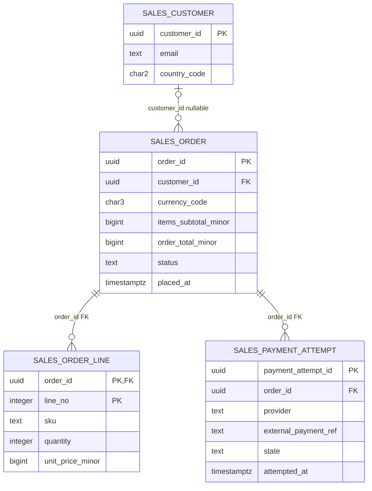
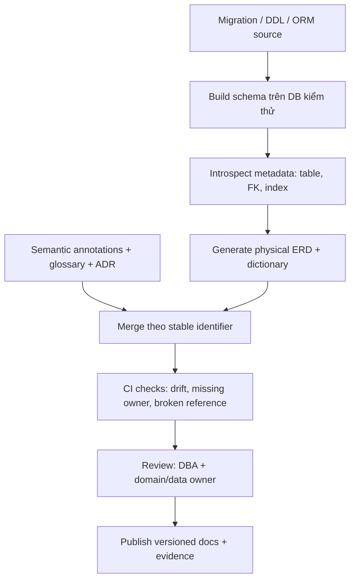

# Sơ đồ được sinh từ triển khai và giới hạn khi thiếu ý nghĩa nghiệp vụ

Một nhóm phát triển sử dụng công cụ để **sinh sơ đồ thực thể–quan hệ (ERD)** từ cơ sở dữ liệu PostgreSQL. Sơ đồ hiển thị đầy đủ các bảng, cột, khóa chính và đường nối khóa ngoại. Nhóm kết luận: “Đã có tài liệu mô hình dữ liệu, người mới chỉ cần mở sơ đồ là hiểu hệ thống”. Tuy nhiên, khi được hỏi **“đơn hàng có được phép không có dòng hàng?”**, **“trạng thái PAID nghĩa là đã thu tiền hay mới được cấp phép?”** và **“trường customer_id NULL biểu thị khách vãng lai hay dữ liệu nguồn bị thiếu?”**, bản ERD không trả lời được.

Sơ đồ tạo từ mã nguồn, ORM hay metadata database có giá trị lớn: nó phản ánh **những cấu trúc kỹ thuật đang được khai báo hoặc triển khai**. Nhưng phần lớn ý nghĩa nghiệp vụ nằm ở **quy tắc vận hành, ngôn ngữ miền, hợp đồng dữ liệu, chính sách thời gian và các ràng buộc không được mã hóa thành constraint**. Một sơ đồ đúng về cấu trúc vẫn có thể khiến người đọc hiểu sai về mô hình.

Bài thuộc chương **Tài liệu mô hình** của module **DATABASE_DATA_MODELING**. Mục tiêu của module là rèn kỹ năng chuyển yêu cầu nghiệp vụ thành thực thể, quan hệ, khóa, ràng buộc, chỉ mục và lược đồ vật lý rõ ràng; so sánh mô hình quan hệ, document, đồ thị và phân tích để hệ thống dễ tiến hóa và kiểm chứng. Ta sẽ học cách **tạo sơ đồ từ hiện trạng**, nhận diện chính xác **những gì công cụ có thể hoặc không thể suy ra**, và bổ sung lớp tài liệu ngữ nghĩa có thể duy trì cùng thay đổi triển khai.

## 1. Sơ đồ sinh tự động trả lời câu hỏi gì?

Một công cụ reverse engineering có thể đọc thông tin từ:

- **DDL/migration:** câu lệnh `CREATE TABLE`, `ALTER TABLE`, chỉ mục, khóa ngoại, `CHECK`, kiểu dữ liệu và cấu trúc phân vùng đã được khai báo.
- **Database catalog:** bảng, cột, constraint, index, view, partition và một số metadata của database **hiện tại**.
- **ORM mapping:** entity, field, annotation, association, inheritance và naming strategy mà **mã ứng dụng** mô tả.
- **Schema-as-code:** tài liệu DBML, Prisma schema, schema registry, Avro/JSON Schema, GraphQL schema... tùy hệ sinh thái.
- **Kho phân tích hoặc catalog:** bảng fact/dimension, cột, mô tả đã khai báo, lineage kỹ thuật và quan hệ được cấu hình.

Kết quả có thể là ERD, UML class diagram, đồ thị phụ thuộc bảng, mô hình chỉ mục, sơ đồ lineage hoặc tài liệu HTML. Tuy nhiên, **các nguồn tạo sơ đồ không nhất thiết đồng nhất**: ORM có thể mô tả quan hệ không được database thực thi bằng FK; migration mới nhất chưa chắc đã triển khai; view có thể không có FK dù kết quả biểu diễn quan hệ nghiệp vụ.

### 1.1. Ba mức mô hình cần phân biệt

| Mức | Câu hỏi chính | Thể hiện điển hình | Có thể tự suy hoàn chỉnh từ DDL? |
| --- | --- | --- | --- |
| **Khái niệm (*conceptual*)** | Doanh nghiệp có những khái niệm gì, ranh giới nào, quy tắc nào? | Khách hàng, đơn hàng, thanh toán, quyền sở hữu, thuật ngữ | **Không** |
| **Logic (*logical*)** | Thực thể, thuộc tính, khóa, quan hệ và invariant được mô hình hóa thế nào? | ERD có cardinality, business keys, loại quan hệ, quy tắc | **Một phần** |
| **Vật lý (*physical*)** | Database lưu trữ và truy cập dữ liệu bằng cấu trúc nào? | Bảng, kiểu, PK/FK, index, partition, constraint | **Có thể trích xuất đáng kể**, trong phạm vi metadata được cấp quyền |

Một công cụ vẽ lại schema vật lý **không tự biến nó thành mô hình khái niệm đã được chuyên gia nghiệp vụ xác nhận**. Chiều ngược lại cũng vậy: sơ đồ khái niệm đẹp không chứng minh rằng PK/FK/index ở database đang bảo vệ các ràng buộc đó.

## 2. Từ schema tới ERD: ví dụ một hệ bán hàng

Giả sử một dịch vụ bán hàng lưu khách, đơn hàng, dòng hàng và các lần thử thanh toán. Để nhìn rõ giới hạn của auto-generated diagram, bắt đầu bằng DDL **PostgreSQL minh họa**:

```sql
CREATE TABLE sales_customer (
    customer_id UUID PRIMARY KEY,
    email TEXT,
    country_code CHAR(2)
);

CREATE TABLE sales_order (
    order_id UUID PRIMARY KEY,
    customer_id UUID REFERENCES sales_customer(customer_id),
    currency_code CHAR(3) NOT NULL,
    items_subtotal_minor BIGINT NOT NULL
        CHECK (items_subtotal_minor >= 0),
    order_total_minor BIGINT NOT NULL
        CHECK (order_total_minor >= 0),
    status TEXT NOT NULL CHECK (
        status IN ('CREATED', 'PAID', 'SHIPPED')
    ),
    placed_at TIMESTAMPTZ NOT NULL
);

CREATE TABLE sales_order_line (
    order_id UUID NOT NULL
        REFERENCES sales_order(order_id),
    line_no INTEGER NOT NULL CHECK (line_no > 0),
    sku TEXT NOT NULL,
    quantity INTEGER NOT NULL CHECK (quantity > 0),
    unit_price_minor BIGINT NOT NULL
        CHECK (unit_price_minor >= 0),
    PRIMARY KEY (order_id, line_no)
);

CREATE TABLE sales_payment_attempt (
    payment_attempt_id UUID PRIMARY KEY,
    order_id UUID NOT NULL
        REFERENCES sales_order(order_id),
    provider TEXT NOT NULL,
    external_payment_ref TEXT NOT NULL,
    state TEXT NOT NULL CHECK (
        state IN ('AUTHORIZED', 'CAPTURED', 'DECLINED')
    ),
    attempted_at TIMESTAMPTZ NOT NULL,
    UNIQUE (provider, external_payment_ref)
);
```

### 2.1. Phần mà công cụ có thể vẽ

Sơ đồ dưới đây là **minh họa kết quả reverse engineering** từ các khóa và cột trong DDL; không phải ảnh xuất trực tiếp từ một công cụ cụ thể:



Sơ đồ và DDL cho biết những điều có thể kiểm chứng:

1. `sales_order.order_id` định danh một hàng trong bảng đơn hàng.
2. `sales_order.customer_id` cho phép `NULL` và, nếu không NULL, tham chiếu một khách hàng có thật.
3. Mỗi `sales_order_line` tham chiếu một đơn hàng; khóa ghép `(order_id,line_no)` ngăn hai dòng cùng số thứ tự trong một đơn.
4. Một `sales_payment_attempt` tham chiếu một đơn hàng; `(provider,external_payment_ref)` là duy nhất theo phạm vi của bảng.
5. Những giá trị `status` và `state` nằm ngoài tập liệt kê bị `CHECK` từ chối khi constraint đang được thực thi.
6. Một số giá trị tiền phải không âm, và có các trường thời gian được khai báo `TIMESTAMPTZ`.

**Giới hạn của ký hiệu cardinality:** Nhìn từ `NOT NULL FK`, mỗi dòng hàng có đúng **một đơn cha đang tồn tại**; nhưng từ phía đơn, database **không yêu cầu ít nhất một dòng hàng**. Vì thế đường nối theo FK cho biết **0..n** dòng hàng/đơn, dù nghiệp vụ có thể đòi 1..n sau khi đơn được xác nhận.

### 2.2. Những điều sơ đồ chưa khẳng định

| Câu hỏi nghiệp vụ | DDL/ERD có chứng minh không? | Vì sao? |
| --- | --- | --- |
| Một đơn hàng đã xác nhận phải có ít nhất một dòng? | **Không** | FK không bắt buộc phải có row con |
| `customer_id NULL` nghĩa là khách vãng lai? | **Không** | Có thể là chưa đồng bộ, ẩn danh, dữ liệu cũ lỗi hoặc không áp dụng |
| `PAID` nghĩa là đã capture, settlement hay chỉ authorization? | **Không** | `CHECK` chỉ biết chuỗi hợp lệ, không biết định nghĩa kinh doanh |
| `order_total_minor` bằng tổng các dòng? | **Không** | Có thể có giảm giá, thuế, phí vận chuyển, làm tròn |
| Một đơn có nhiều payment attempt vì retry hợp lệ? | **Một phần** | Quan hệ 1–n cho phép, nhưng không cho biết logic retry/capture |
| Email là danh tính khách duy nhất? | **Không** | Không có UNIQUE; ngay cả UNIQUE cũng không tự chứng minh ý nghĩa danh tính |
| `sku` có tham chiếu một sản phẩm hợp lệ không? | **Không** | DDL không khai báo FK tới sản phẩm |
| Một đơn có thể ở trạng thái `SHIPPED` trước `PAID`? | **Không** | CHECK giá trị không kiểm tra **chuyển trạng thái** |
| Số tiền dùng đơn vị cent hay đơn vị nhỏ nhất theo tiền tệ? | **Không hoàn toàn** | Tên `_minor` là gợi ý, nhưng policy currency/exponent ngoài database |
| Dữ liệu được giữ bao lâu, ai được xem? | **Không** | Retention/authorization có thể ở ứng dụng, policy hoặc hệ khác |

**Bài học:** Sơ đồ thể hiện *cấu trúc có tồn tại*, không tự kể được *tại sao cấu trúc ấy được chọn* và *những phép diễn giải nào được phép*.

## 3. Một quan hệ kỹ thuật không tự đồng nghĩa quan hệ nghiệp vụ

Công cụ thường biểu diễn **FK** bằng đường nối. Người đọc có thể suy diễn sai:

- `sales_order.customer_id` nullable → “Đơn không có khách hàng” hoặc “khách vãng lai”. Thực tế có thể là **khách được biết qua external ID nhưng hồ sơ chưa đến**.
- `sales_order_line.order_id` NOT NULL → “Đơn luôn có một dòng hàng”. Database chỉ bảo đảm **một dòng hàng không mồ côi**, không bảo đảm **mỗi đơn có dòng hàng**.
- Không có FK từ `sku` → “Sản phẩm không liên quan tới đơn hàng”. Có thể quan hệ nằm ở dịch vụ catalog bên ngoài, dùng business key thay vì FK cục bộ.
- `sales_payment_attempt` nhiều dòng → “Đơn hàng được thanh toán nhiều lần”. Có thể là các **lần thử** bị từ chối, một authorization chưa capture, hoặc retry cùng yêu cầu.

### 3.1. Phân biệt cardinality khả dĩ và cardinality được yêu cầu

| Cấu trúc vật lý | Điều DB thực thi | Quy tắc nghiệp vụ có thể cần thêm |
| --- | --- | --- |
| FK nullable ở bảng con | 0 hoặc 1 bản ghi cha cho mỗi hàng con | Vì sao được phép NULL, khi nào phải được bổ sung |
| FK NOT NULL ở bảng con | Hàng con phải có một hàng cha | Khi nào tạo, đóng/mở vòng đời cha |
| Nhiều hàng con cùng FK | Cha có thể có 0..n con | Ngưỡng ít nhất/tối đa, thứ tự, tính độc nhất ngữ nghĩa |
| UNIQUE trên một cột | Không cho hai hàng có cùng giá trị theo ngữ nghĩa unique/NULL của DB | Liệu cột ấy có thực sự là business identity? |
| Không có FK | Không có ràng buộc FK tại nơi đang xem | Quan hệ có thể do service khác, code hoặc ETL quản lý |
| CHECK trên enum | Giới hạn tập giá trị hợp lệ ở mỗi row | Luật chuyển trạng thái và quyền thực hiện chuyển đổi |

Trong môi trường nhiều database hoặc microservice, **FK xuyên dịch vụ** thường không được thực thi bởi một DB duy nhất. Sơ đồ lấy riêng từ từng database sẽ thiếu liên kết; nhưng vẽ thêm đường nối giả như một FK có thật cũng gây hiểu nhầm. Hãy phân biệt đường **tham chiếu logic có hợp đồng** với đường **FK được database bảo vệ**.

## 4. Thuật ngữ: tên bảng/cột không đủ để hiểu chính xác

Các cặp sau dễ đánh đồng:

| Tên cột có vẻ rõ | Các nghĩa có thể khác nhau |
| --- | --- |
| `status = 'ACTIVE'` | Tài khoản đăng nhập được, hợp đồng còn hiệu lực hay đơn hàng đang xử lý? |
| `amount` | Số trước thuế, sau thuế, gross, net, đã capture, đã settlement? |
| `balance` | Số dư cuối ngày, số dư khả dụng, số dư sổ cái hay biến động trong kỳ? |
| `created_at` | Lúc sự kiện xảy ra, lúc hệ thống nhận, hay lúc hàng được ghi DB? |
| `customer_id` | Customer của CRM, user đăng nhập, người trả tiền hay người nhận hàng? |
| `rate` | Phần trăm, tỉ lệ 0..1, lãi suất năm, quy đổi tiền, đơn vị trên giờ? |
| `deleted_at` | Soft delete, hết hiệu lực nghiệp vụ hay ẩn khỏi giao diện? |
| `version` | Optimistic locking, contract version, SCD version hay migration version? |

Một data dictionary cần có **định nghĩa, đơn vị, tính null, nguồn sự thật, vòng đời, tính hợp lệ và ví dụ**. Ví dụ:

| Trường | Mô tả kỹ thuật | Ngữ nghĩa phải ghi thêm |
| --- | --- | --- |
| `order_total_minor` | `BIGINT NOT NULL` | Tổng tiền theo đơn vị nhỏ nhất của `currency_code`, gồm/không gồm phí, thuế và voucher theo policy |
| `sales_order.status` | `CREATED/PAID/SHIPPED` | Điều kiện được chuyển trạng thái, ai sở hữu quyết định, có đảo trạng thái không |
| `placed_at` | `TIMESTAMPTZ` | Thời điểm khách chốt yêu cầu mua hay thời điểm OMS nhận? |
| `customer_id` | UUID FK nullable | NULL do vãng lai, chưa xác định, withheld hay lỗi nguồn được phân loại thế nào? |
| `payment_attempt.state` | `AUTHORIZED/CAPTURED/DECLINED` | Authorization không đồng nghĩa tiền đã thu; nguồn và thời điểm xác nhận |

**Tên cột `amount_cents` hoặc `_minor` là tín hiệu tài liệu**, nhưng hệ thống vẫn cần quy định rõ currency, precision và cách làm tròn. Từ vựng nhất quán giúp người đọc tránh “đúng SQL, sai KPI”.

## 5. Đọc metadata PostgreSQL để sinh sơ đồ có căn cứ

Một workflow sinh ERD từ database đang chạy có thể dùng các system catalog. Ví dụ sau **chỉ đọc**, phù hợp khi tài khoản được phép xem schema mục tiêu.

### 5.1. Liệt kê bảng, cột, kiểu, nullability và comment

```sql
SELECT
    ns.nspname AS schema_name,
    tbl.relname AS table_name,
    attr.attnum AS ordinal_position,
    attr.attname AS column_name,
    format_type(attr.atttypid, attr.atttypmod) AS data_type,
    NOT attr.attnotnull AS is_nullable,
    pg_get_expr(def.adbin, def.adrelid) AS default_expression,
    col_description(attr.attrelid, attr.attnum) AS column_comment
FROM pg_catalog.pg_class AS tbl
JOIN pg_catalog.pg_namespace AS ns
  ON ns.oid = tbl.relnamespace
JOIN pg_catalog.pg_attribute AS attr
  ON attr.attrelid = tbl.oid
LEFT JOIN pg_catalog.pg_attrdef AS def
  ON def.adrelid = tbl.oid
 AND def.adnum = attr.attnum
WHERE ns.nspname = 'public'
  AND tbl.relkind IN ('r', 'p')
  AND attr.attnum > 0
  AND NOT attr.attisdropped
ORDER BY ns.nspname, tbl.relname, attr.attnum;
```

Các điểm cần hiểu:

- `relkind='r'` thường là bảng thông thường; `'p'` là bảng phân vùng cấp cha trong PostgreSQL. Tùy câu hỏi cần loại bớt các **partition con** để không vẽ cả cha lẫn con như những thực thể nghiệp vụ riêng.
- `pg_get_expr` giúp hiện default expression; generated column, identity, storage details hoặc constraints phức tạp còn cần metadata khác.
- `col_description` lấy comment đã khai báo bằng `COMMENT ON COLUMN`, **không bảo đảm** comment tồn tại hoặc còn đúng với nghiệp vụ.
- Quyền truy cập, phiên bản PostgreSQL và object type có thể ảnh hưởng dữ liệu trả về. Query minh họa không phải một catalog extractor bao quát toàn bộ đối tượng của mọi phiên bản.

### 5.2. Liệt kê PK, FK, UNIQUE và CHECK

```sql
SELECT
    ns.nspname AS schema_name,
    tbl.relname AS table_name,
    con.conname AS constraint_name,
    con.contype AS constraint_type,
    pg_get_constraintdef(con.oid, true) AS definition
FROM pg_catalog.pg_constraint AS con
JOIN pg_catalog.pg_class AS tbl
  ON tbl.oid = con.conrelid
JOIN pg_catalog.pg_namespace AS ns
  ON ns.oid = tbl.relnamespace
WHERE ns.nspname = 'public'
  AND con.contype IN ('p', 'f', 'u', 'c')
ORDER BY ns.nspname, tbl.relname, con.conname;
```

Những mã phổ biến: `p` là primary key, `f` foreign key, `u` unique, `c` check. Query xuất **định nghĩa constraint dạng văn bản** để dễ kiểm tra. Công cụ dựng đồ thị chuyên dụng nên trích **mapping cột nguồn–đích từ metadata OID/attnum**, không chỉ parse bằng regular expression trên SQL hiển thị, vì identifier có quote, schema, cột ghép và cú pháp đa dạng.

Đối với index, có thể truy vấn `pg_indexes`/catalog index; đối với view, partition hierarchy và trigger, dùng metadata thích hợp. Nhưng **việc thấy trigger/function tồn tại không chứng minh mọi quy tắc trong mã đều được hiểu đúng**. Một điều kiện phức tạp trong PL/pgSQL hoặc trong service vẫn cần tài liệu và kiểm thử riêng.

### 5.3. Đọc những gì thực sự đã triển khai

Một file migration trong Git có thể khác database hiện tại do:

- Migration chưa chạy hoặc chạy lỗi trên một môi trường.
- Hotfix thủ công chưa được ghi lại thành migration.
- Một tenant/database có schema khác trong giai đoạn rolling deployment.
- Quyền catalog chỉ cho thấy một phần đối tượng.
- DDL mới đã chạy nhưng view, ORM entity hoặc consumer chưa được cập nhật.

Vì thế tài liệu cần ghi **nguồn trích xuất, môi trường, thời điểm, phiên bản ứng dụng/schema và phạm vi các đối tượng**. “ERD từ production ngày X” là một snapshot hiện trạng, không tự động là mô hình chuẩn tắc cho tất cả môi trường.

## 6. ORM class diagram không bằng sơ đồ database

Ví dụ ứng dụng Java dùng JPA/Hibernate:

```java
import jakarta.persistence.*;
import java.util.ArrayList;
import java.util.List;
import java.util.UUID;

@Entity
@Table(name = "sales_order")
class SalesOrderEntity {
    @Id
    @Column(name = "order_id", nullable = false)
    private UUID id;

    @ManyToOne(fetch = FetchType.LAZY, optional = true)
    @JoinColumn(name = "customer_id")
    private CustomerEntity customer;

    @OneToMany(mappedBy = "order", fetch = FetchType.LAZY)
    private List<SalesOrderLineEntity> lines = new ArrayList<>();
}
```

Đây là **trích đoạn minh họa quan hệ**: `CustomerEntity` và `SalesOrderLineEntity` không được định nghĩa trong snippet, nên không phải một chương trình hoàn chỉnh. Trong mô hình JPA, `@ManyToOne` và `@OneToMany` cho công cụ biết ý định ánh xạ association; tuy vậy:

- `lines` rỗng lúc tạo entity có thể là tình huống hợp lệ trong quá trình build aggregate, dù nghiệp vụ yêu cầu ít nhất một dòng khi xác nhận đơn.
- `FetchType.LAZY` là chiến lược tải dữ liệu, **không phải cardinality nghiệp vụ**.
- `optional=true` trong ORM không chứng minh database đang có cùng quy tắc `NULL`.
- Mapping có thể bị lệch so với DDL triển khai, đặc biệt khi schema được quản lý bằng migration riêng thay vì ORM tự sinh.
- Một quan hệ trong object graph có thể không có FK vật lý (khi join qua service khác); chiều ngược lại, bảng có thể chứa FK không được biểu diễn thành object reference trong code.

**Không trộn các mức sơ đồ:** Có thể công bố một class/association diagram cho aggregate code và một physical ERD cho DB. Khi hai cái khác nhau, phải giải thích khác biệt chứ không vẽ chúng đè lên nhau rồi gọi là một nguồn chân lý.

## 7. “Không có trong sơ đồ” không có nghĩa “không tồn tại”

Đồ thị được sinh từ một nguồn **chỉ biết những đối tượng hiện diện và được khai báo trong nguồn đó**. Những mối quan hệ sau rất dễ bị bỏ sót:

| Quan hệ/quy tắc | Vì sao có thể vắng mặt? | Cần bổ sung gì? |
| --- | --- | --- |
| Liên kết qua **business key** nhưng không FK | FK nằm ở service khác hoặc dữ liệu ngoại vi | Hợp đồng định danh, namespace, ownership và test |
| Chính sách **một đơn phải có dòng trước khi xác nhận** | Cần kiểm tra tập row, không có CHECK dòng đơn giản | Invariant aggregate, command state, test |
| **Trạng thái và transition** | DB chỉ CHECK giá trị enum | State machine, guard, tác nhân được phép |
| **SCD Type 2** | PK/FK không nói ý nghĩa thời gian hiệu lực | Valid-from/to, overlap rule, as-of join |
| **Soft delete và retention** | Có thể nằm ở job, policy hoặc service | Chính sách dữ liệu và timeline xóa |
| **Dữ liệu đa tenant** | tenant_id có thể không đi qua FK ghép | Ranh giới quyền, cross-tenant test, routing |
| **Danh tính từ hệ ngoài** | Không có FK xuyên database/service | Mapping table, event contract, resolver |
| **Measure bán cộng được** | DB biết `NUMERIC` nhưng không biết stock vs flow | Grain, aggregation rule, time dimension |
| **PII, phân loại bảo mật** | DDL không gắn nhãn sensitivity bắt buộc | Data classification, quyền truy cập, data owner |
| **Nguồn sự thật** | Nhiều hệ có trường giống nhau | Owner, source of truth, pipeline và SLA freshness |

Sự vắng mặt của đường nối FK trên ERD còn có thể do công cụ **không được quyền đọc FK**, đang lọc schema, hoặc hình vẽ đã đơn giản hóa. Khi tài liệu được dùng cho quyết định quan trọng, hãy ghi rõ **điều không nằm trong phạm vi**.

## 8. Bổ sung lớp ý nghĩa nghiệp vụ (*semantic overlay*)

Thay vì sửa thủ công mọi đường nét của sơ đồ sinh tự động, duy trì hai lớp độc lập nhưng liên kết:

1. **Structural snapshot:** sinh từ DDL/catalog/schema-as-code, có phiên bản; phản ánh cột, kiểu, PK/FK, index.
2. **Semantic overlay:** do người sở hữu miền phê duyệt, mô tả thực thể, grain, trạng thái, hợp đồng đo lường, nguồn sự thật, lý do quan hệ và các ràng buộc ngoài DDL.

Ví dụ metadata **minh họa**, không phải cú pháp của một sản phẩm catalog cụ thể:

```yaml
model: sales_order
model_version: 3
owner_team: order-domain
source_of_truth: order-service
grain: "Một yêu cầu mua hàng có danh tính order_id"
business_key: [order_id]
description: >
  Một đơn hàng chứa dòng hàng; trạng thái PAID chỉ được ghi
  sau khi có bằng chứng capture hợp lệ theo chính sách sản phẩm.
fields:
  customer_id:
    nullable_reason:
      - guest_checkout
      - unresolved_customer_identity
    note: "Nguồn dữ liệu phải phân biệt lý do; DB hiện chưa ép được."
  items_subtotal_minor:
    unit: "Đơn vị nhỏ nhất theo currency_code"
    definition: >
      Tổng dòng hàng theo quy tắc giá và giảm giá được phê duyệt.
  status:
    owner: order-domain
    values:
      PAID: "Đã đáp ứng điều kiện ghi nhận thanh toán của domain"
invariants:
  - "Đơn xác nhận phải có ít nhất một dòng hợp lệ"
  - "SHIPPED chỉ hợp lệ theo workflow của order-domain"
evidence:
  - "Domain rule: ConfirmOrder"
  - "Integration test: order-without-lines-is-rejected"
reviewed_by: "order-domain + data-owner"
```

Overlay phải liên kết được với **bảng/field thật**, có review khi đổi schema hoặc thay nghĩa trường. Nếu tên bảng `sales_order` đổi thành `orders`, metadata cũ cần được báo drift và cập nhật; không để comment nghiệp vụ trôi nổi không còn map được.

### 8.1. Những thuộc tính nên có cho từng entity

| Thuộc tính tài liệu | Ví dụ với `sales_order` | Mục đích |
| --- | --- | --- |
| **Business definition** | Một yêu cầu mua hàng được chấp nhận xử lý | Tránh đồng nhất order với shipment/invoice |
| **Grain** | Một row cho một order ID | Biết count, dedup và join |
| **Business key** | `order_id` được hệ OMS quản lý | Phân biệt SK/PK và external ID |
| **Owner** | Đội order-domain | Ai quyết định thay đổi ngữ nghĩa? |
| **Source of truth** | Order service, không phải BI export | Giải quyết xung đột dữ liệu |
| **Lifecycle** | Created → confirmed → paid/shipped theo workflow | Kiểm tra transition không thể hiện bằng FK |
| **Optionality meaning** | `customer_id` nullable vì nhiều lý do được phân loại | Không đánh đồng NULL với N/A |
| **Time semantics** | `placed_at` là thời điểm chốt yêu cầu mua, UTC | Đúng kỳ báo cáo và late events |
| **Security** | Customer ID là dữ liệu có thể liên kết định danh | Phân quyền và minimization |
| **Retention** | Theo chính sách đã phê duyệt cho từng trường | Quản trị xóa/backup |

### 8.2. Tài liệu phải phân biệt fact đã kiểm chứng và giả thuyết

Chẳng hạn, đội phân tích nghi ngờ `PAID` chỉ xuất hiện khi payment capture. Nếu chưa xác minh code và policy, không ghi “PAID = CAPTURED” như sự thật đã chốt. Hãy ghi **“cần xác nhận với order-domain; chưa có kiểm chứng end-to-end”**, tạo một việc theo dõi, rồi cập nhật sau khi có bằng chứng.

Một sơ đồ có nhãn “đã kiểm tra” khi chỉ mới parse thành công DDL là **một mức tin cậy quá cao**. Có thể đặt provenance theo từng phát biểu: **“DB enforced”**, **“application validated”**, **“source contract”**, **“business approved”**, **“assumed/not verified”**.

## 9. Khác biệt giữa ràng buộc được ép và quy tắc được kỳ vọng

Các ràng buộc chia thành nhiều lớp:

| Lớp | Ví dụ | Chỗ triển khai | Cách kiểm chứng |
| --- | --- | --- | --- |
| **Database enforced** | PK, NOT NULL, FK, CHECK | DDL trên DB | Query catalog, thử insert/update vi phạm |
| **Application invariant** | Confirmed order có ≥1 line | Aggregate/service | Unit + integration tests, command rejection |
| **Inter-service contract** | Payment capture thành công mới ra `Paid` | Event/API + ACL | Contract test, E2E, event replay |
| **Data quality rule** | 100% đơn đã giao có tracking trong 24 giờ | ETL/warehouse | SQL kiểm tra, alert và SLA |
| **Analytical semantic rule** | Conversion rate = conversions/eligible sessions | Metric definition | Reconciliation và golden fixtures |
| **Governance policy** | PII chỉ một nhóm được đọc | IAM/RLS/audit | Kiểm thử phân quyền và review chính sách |

Không tô đường nối application contract thành FK vật lý. Cũng không viết “DB bảo đảm” nếu quy tắc chỉ được check ở web form nhưng các batch/CDC/API khác có thể bỏ qua.

### 9.1. Các quy tắc khó thể hiện trên ERD

Một sơ đồ thường không đủ để diễn tả:

- **Cross-row/cross-table invariant:** đơn đã xác nhận phải có dòng; tổng hàng không vượt ngân sách.
- **Workflow/time:** đơn phải được thanh toán trước khi xuất kho (có ngoại lệ được duyệt); sự kiện xảy ra trước/sau thời điểm hiệu lực.
- **Multi-source agreement:** nhận diện khách từ CRM/OMS cần mapping và xử lý dữ liệu đến trễ.
- **Concurrency:** không tạo hai khoản capture cho cùng một idempotency key khi nhiều worker xử lý.
- **Retention/PII:** phải xóa khỏi bản sao và projection, không chỉ bỏ row trong bảng chính.
- **Dimensional aggregation:** `closing_balance` không cộng qua ngày; `conversion_rate` không SUM.

Nếu chỉ có ERD, người triển khai có thể tạo SQL **hợp lệ** nhưng vẫn làm sai **ngữ nghĩa**.

## 10. SQL giúp bổ sung bằng chứng cho quy tắc nghiệp vụ

Sơ đồ không tự chứng minh constraint phi cấu trúc, nhưng có thể đi cùng các **data-quality queries** và tests. Với DDL ví dụ:

### 10.1. Tìm đơn không có dòng

```sql
SELECT o.order_id, o.status
FROM sales_order AS o
LEFT JOIN sales_order_line AS l
  ON l.order_id = o.order_id
WHERE o.status IN ('PAID', 'SHIPPED')
GROUP BY o.order_id, o.status
HAVING COUNT(l.line_no) = 0;
```

Nếu nghiệp vụ quy định mọi đơn ở `PAID` hoặc `SHIPPED` phải có ít nhất một dòng, kết quả query này cần rỗng. Nếu domain có đơn phí dịch vụ không có dòng SKU, quy tắc phải được viết lại; **không tự suy từ hình vẽ**.

### 10.2. So khớp subtotal đã ghi với dòng hàng

```sql
SELECT
    o.order_id,
    o.items_subtotal_minor,
    COALESCE(
        SUM(l.quantity * l.unit_price_minor), 0
    ) AS computed_items_subtotal
FROM sales_order AS o
LEFT JOIN sales_order_line AS l
  ON l.order_id = o.order_id
GROUP BY o.order_id, o.items_subtotal_minor
HAVING o.items_subtotal_minor IS DISTINCT FROM COALESCE(
    SUM(l.quantity * l.unit_price_minor), 0
);
```

Query chỉ là một **ứng viên kiểm tra** nếu định nghĩa `items_subtotal_minor` đúng bằng `SUM(quantity × unit_price_minor)`. Nó có thể báo sai nếu hệ thống có **chiết khấu cấp dòng, hoàn trả, thuế trên dòng, tính lại giá hoặc chính sách làm tròn khác**. Trước khi bật alert, owner nghiệp vụ phải công bố công thức và bộ ví dụ kiểm chứng. Không đồng nhất `order_total_minor` với subtotal vì total có thể chứa thuế, phí và giảm giá cấp đơn.

### 10.3. Định danh thanh toán và trạng thái đơn

`sales_payment_attempt.state = 'CAPTURED'` không tự bắt buộc `sales_order.status = 'PAID'`. Một đơn có thể có nhiều attempt, partial capture, hoàn tiền hoặc capture liên quan các shipment khác nhau. Nếu nghiệp vụ yêu cầu quan hệ chặt hơn, bổ sung:

- ID của payment/capture được domain công nhận;
- trạng thái settlement/refund độc lập khi cần;
- mapping external payment ID và nguồn xác minh;
- invariant transition và cách xử lý event đến trễ;
- test xác định khi nào status của order được phép đổi.

**Không viết query** “hễ có một payment attempt CAPTURED thì order phải PAID” nếu chưa xác định partial capture, timeout, workflow và cancellation. Một diagram có mũi tên FK không giải quyết những điều ấy.

## 11. Ghi mô tả trong database: hữu ích nhưng chưa đủ

PostgreSQL cho phép đặt comment trên đối tượng:

```sql
COMMENT ON TABLE sales_order IS
    'Một dòng cho một order_id; owner: order-domain.';

COMMENT ON COLUMN sales_order.items_subtotal_minor IS
    'Tổng dòng hàng theo đơn vị nhỏ nhất của currency_code; '
    'đối soát theo policy tính giá của order-domain.';

COMMENT ON COLUMN sales_order.customer_id IS
    'Nullable theo nhiều lý do; xem quy tắc phân loại khách '
    'vãng lai/chưa giải quyết danh tính trong semantic contract.';
```

Comment có lợi vì:

1. Nằm gần schema đang được triển khai; một số công cụ có thể trích ra.
2. Dễ tìm khi khám phá bảng/cột và review migration.
3. Có thể tự động phát hiện thiếu comment cho cột nhạy cảm hoặc KPI trọng yếu.

Nhưng comment không ép invariant và có thể **cũ, mơ hồ hoặc trái với thực tế**. Những giải thích dài về workflow, state machine, data lineage, privacy và ví dụ query nên ở tài liệu chuyên biệt có phiên bản, liên kết từ comment/ERD sang vị trí chuẩn.

Một quy tắc tốt là **đặt mô tả ngắn gần nguồn, đặt quyết định và bằng chứng chi tiết ở tài liệu chuẩn tắc**, rồi có kiểm tra liên kết/owner. Không cố nhét mọi quy tắc domain vào một comment dài hàng nghìn ký tự.

## 12. ADR và quyết định mô hình mà ERD không thể biểu diễn

**Architecture Decision Record (ADR)** ghi **vì sao** mô hình được chọn, các phương án bị loại, đánh đổi và điều kiện xem xét lại. Ví dụ:

```text
ADR-017: Không khai báo FK từ sales_order_line.sku sang
catalog_product ở database Order.

Context:
- Catalog và Order do hai bounded context quản lý.
- Product ID được cấp và kiểm tra bởi Catalog API.
- SKU có thể ngừng bán nhưng vẫn cần hiện trên đơn lịch sử.

Decision:
- Lưu SKU và snapshot mô tả/giá phục vụ lịch sử đơn.
- Validate nguồn và namespace tại thời điểm tạo dòng.
- Không giả vờ có distributed FK giữa hai database.

Consequences:
- Order service chịu trách nhiệm kiểm tra dữ liệu ngoài.
- Có thể phát hiện mapping lỗi bằng audit/reconciliation.
- Đổi SKU contract cần migration hoặc ACL.

Review trigger:
- Khi Catalog/Order có cùng DB hoặc tỷ lệ mapping lỗi
  vượt ngưỡng vận hành đã được phê duyệt.
```

ERD chỉ có thể cho thấy **thiếu FK**, không cho biết đó là **chủ ý kiến trúc** hay **nợ kỹ thuật chưa xử lý**. ADR nối quyết định nghiệp vụ/kiến trúc với lược đồ, giúp người sau không “sửa thiếu FK” theo cách vô tình phá ranh giới dịch vụ.

### 12.1. Tài liệu tối thiểu cho một quyết định

- Vấn đề/câu hỏi cần giải quyết.
- Các ràng buộc nghiệp vụ và phi chức năng (độ trễ, transaction, độc lập triển khai, retention).
- Phương án được chọn và lý do.
- Phương án không chọn và đánh đổi.
- Hậu quả đối với khóa, quan hệ, index, migration, phân quyền.
- Owner phê duyệt, ngày quyết định, version và điều kiện xem xét lại.

ADR không cần dài dòng, nhưng cần **giữ được lý do của mô hình** khi DDL hoặc người phụ trách thay đổi.

## 13. Cách công bố sơ đồ không đánh lừa người xem

Một bộ tài liệu rõ ràng nên có:

| Tầng tài liệu | Nguồn | Có gì? | Người dùng chính |
| --- | --- | --- | --- |
| **Physical ERD** | Catalog/DDL thực tế | Bảng, cột, PK/FK, kiểu, constraint, index | DBA, backend, data engineer |
| **Logical/conceptual view** | Phân tích domain, use case, semantic contract | Khái niệm, grain, cardinality kỳ vọng, vòng đời | Product, domain expert, kiến trúc sư |
| **Business glossary** | Chủ sở hữu nghiệp vụ | Định nghĩa thuật ngữ, KPI, đơn vị, quy tắc tính | BI, analytics, product |
| **Data dictionary** | Metadata + annotation | Mô tả field, nguồn, null, sensitivity, owner | Người sử dụng dữ liệu |
| **Lineage** | Pipeline metadata + xác minh | Dữ liệu được tạo/chuyển từ nguồn nào tới đâu | Vận hành, compliance, BI |
| **ADR và contract** | Quyết định/phiên bản được review | Vì sao mô hình như vậy, tương thích và trade-off | Nhóm phát triển/owner |
| **Validation evidence** | Test, quality query, migration CI | Những phát biểu đã được kiểm chứng | Reviewer, SRE, data steward |

Sơ đồ cần **chú giải**:

- **Đường liền:** FK vật lý được khai báo và đang được database thực thi (nếu đã xác minh).
- **Đường nét đứt:** quan hệ logic/contract qua service hoặc ETL, **không phải FK**.
- **Màu/nhãn loại bảng:** operational, fact, dimension, lookup, audit, projection.
- **Nhãn grain và owner:** một dòng có ý nghĩa gì, ai xác nhận?
- **Metadata snapshot:** môi trường, schema revision, thời điểm sinh, quyền/phạm vi, generator version.

Không dùng màu sắc hoặc đường liền/nét đứt tùy ý mà không có legend; người đọc rất dễ hiểu quan hệ “mong muốn” là ràng buộc đã tồn tại.

### 13.1. Hai sơ đồ cạnh nhau tốt hơn một sơ đồ bị trộn

Sơ đồ vật lý cho thấy:

```text
sales_order (0..n) ----> sales_payment_attempt
  FK payment_attempt.order_id
```

Sơ đồ miền có thể diễn đạt:

```text
Order ----> PaymentAuthorization / Capture
  "Order chỉ chuyển sang Paid khi đáp ứng payment policy
   và bằng chứng capture được xác minh"
```

Hai mô tả **bổ sung** cho nhau. Chỉ cần người đọc biết hình nào đại diện **cấu trúc triển khai** và hình nào đại diện **ngữ nghĩa/luật nghiệp vụ**.

## 14. Tự động hóa nhưng vẫn giữ người phê duyệt ngữ nghĩa

Một quy trình *docs-as-code* thực dụng:



**Quan trọng:** Sơ đồ sinh từ **migration áp lên database tạm** cho biết schema mà migration dự định tạo; sơ đồ sinh từ **database đang chạy** cho biết schema mà môi trường ấy đang có. Nếu cần biết cả hai, phải so sánh **expected vs observed** và công bố drift, không tự chọn một bên rồi gọi là nguồn sự thật duy nhất.

### 14.1. Những kiểm tra có thể tự động hóa

1. Mọi table/entity trọng yếu phải có business definition và owner.
2. Mọi cột KPI/tiền/tỷ lệ/thời gian phải có unit, grain hoặc temporal semantics liên quan.
3. Tất cả FK/PK/UNIQUE mới xuất hiện trên ERD và data dictionary đúng.
4. Mọi field được dùng trong semantic overlay vẫn tồn tại ở schema mới.
5. Khi thêm enum value mới, contract/transition document và test phải được xem lại.
6. Khi bỏ cột, các consumers, views, BI models và ADR liên quan phải được kiểm tra.
7. Metadata sinh không được publish nếu công cụ thiếu quyền trích xuất những schema cần thiết.
8. Sơ đồ không thay thế quality gate cho business invariant hoặc authorization.

Các kiểm tra này có thể làm bằng CI hoặc data catalog phù hợp, nhưng **không nên chặn mọi thay đổi chỉ vì text comment chưa được biên tập hoàn mỹ**. Mục tiêu là giữ các thuộc tính quan trọng không bị mất khi mô hình tiến hóa.

## 15. Schema drift: sơ đồ còn đẹp nhưng đã lỗi thời

Drift là chênh lệch giữa **mô hình mong đợi, triển khai thực tế và tài liệu đang công bố**. Có ít nhất ba loại:

| Loại drift | Ví dụ | Cách phát hiện |
| --- | --- | --- |
| **Structural drift** | Production có thêm cột không trong migration repo | So catalog/DDL normalized theo revision |
| **Mapping drift** | JPA annotation ghi `optional=false` nhưng DB FK nullable | So mapping ORM và schema đã deploy |
| **Semantic drift** | `status='PAID'` đổi nghĩa từ captured sang authorized nhưng comment không đổi | Contract review, test, diff chính sách nghiệp vụ |

Một tool reverse engineering có thể phát hiện structural drift tốt, nhưng **không tự biết semantic drift**. Khi tên cột không đổi nhưng định nghĩa KPI hoặc trạng thái đã thay đổi, chỉ review domain và test ngữ nghĩa mới phát hiện được.

### 15.1. Quy trình thay đổi được khuyến nghị

- **Trước migration:** ghi rõ mục đích nghiệp vụ và phạm vi thay đổi.
- **Khi code review:** cập nhật DDL/ORM, glossary, test, ADR nếu đổi ý nghĩa.
- **Khi CI:** áp migration trên DB thử nghiệm, sinh sơ đồ, so structural diff, bắt field/owner thiếu.
- **Khi deploy:** trích catalog thực tế, gắn môi trường/revision, kiểm tra schema drift.
- **Sau deploy:** xác minh invariant, lineage, query hiệu năng và metric freshness.
- **Khi deprecate:** đánh dấu consumer, tiến hành expand–migrate–contract, lưu lịch sử các phiên bản tài liệu.

**Một snapshot ERD không phải nhật ký tiến hóa.** Cần diff có ngữ cảnh và mốc áp dụng để giải thích sự thay đổi cho người vận hành.

## 16. Sơ đồ quan hệ chưa phải sơ đồ lineage

ERD trả lời “bảng nào có khóa ngoại đến bảng nào?”. Data lineage trả lời “**giá trị từ nguồn nào được biến đổi qua job nào để thành cột nào trong báo cáo?**”. Hai câu hỏi khác nhau.

Giả sử:

```text
sales_order.order_total_minor
  --> ETL currency conversion (rate version R3)
  --> warehouse.fact_order.amount_vnd
  --> mart.daily_revenue_by_region
  --> BI card "Doanh thu ngày"
```

ERD của `sales_order` không cho biết:

- Báo cáo có loại trừ đơn hủy/hoàn hàng hay không.
- Tỷ giá chuyển đổi theo ngày giao dịch hay ngày chốt.
- Dữ liệu cập nhật trễ bao lâu.
- Khi source sửa đơn cũ, bảng mart có restatement hay không.
- Chỉ số “doanh thu” đang đếm **gross order total** hay **net revenue**.

Vì vậy nên ghép **ERD + lineage + metric definition** khi tài liệu phục vụ BI và quyết định tài chính. Nếu thiếu một trong ba, người dùng có thể tính đúng theo schema nhưng kết luận sai về doanh nghiệp.

## 17. Điều chỉnh theo mô hình document, đồ thị, wide-column và phân tích

Không phải mọi hệ dữ liệu đều có DDL/FK để sinh ERD như PostgreSQL.

| Mô hình | Thông tin có thể tự lấy | Điều có nguy cơ bị thiếu |
| --- | --- | --- |
| **RDBMS** | Bảng, kiểu, PK/FK, index, CHECK, view | Invariant ứng dụng, semantic của trạng thái, nguồn liên dịch vụ |
| **Document** | JSON Schema/validator, cấu trúc document mẫu, collection/index | Field có thể thiếu hoặc thay đổi theo version, quan hệ không được ép, nghĩa null vs omitted |
| **Graph** | Node/edge labels, types, property keys, constraints | Ý nghĩa cạnh, chiều quan hệ, độ tin cậy và thời điểm hiệu lực |
| **Wide-column/KV** | Partition/clustering keys, column families, key patterns | Truy vấn được dự kiến, boundary tenant, eventual consistency, TTL, semantic của row |
| **Analytics/warehouse** | Fact/dim physical schema, partition/clustering, column metadata | **Grain**, additive/semi/non-additive measure, KPI denominator, SCD semantics |

### 17.1. Document: schema lấy từ dữ liệu quan sát có thể đánh lừa

Nếu công cụ lấy 1.000 document mẫu và thấy trường `phone` hiện diện ở 95%, nó **không chứng minh** trường `phone` là optional theo hợp đồng; 5% còn lại có thể là dữ liệu hỏng, document version cũ hoặc payload chưa bổ sung. Ngược lại, JSON Schema chỉ nói cấu trúc được phép, không chứng minh dữ liệu cũ tuân thủ validator hiện tại.

Tài liệu cần ghi rõ **schema version, phạm vi collection, mức độ đầy đủ của mẫu, validator thực thi, null/omitted** và cách migration các document cũ.

### 17.2. Graph: có cạnh không có nghĩa mọi bước duyệt đều hợp lệ

Sơ đồ node `CUSTOMER — PURCHASED → PRODUCT` có thể không cho biết:

- Cạnh được tạo từ đơn đã thanh toán hay chỉ đặt hàng?
- Quan hệ có hiệu lực tại thời điểm nào?
- Cùng một khách mua sản phẩm ba lần là một cạnh có count hay ba cạnh sự kiện?
- Đường traversal nhiều hop có được phép dùng để suy quyền hay không?

Nếu gom nhiều giao dịch thành một cạnh `PURCHASED`, có thể đã **mất sự kiện chi tiết**; sơ đồ chỉ thể hiện loại cạnh chứ không giải thích grain.

### 17.3. Wide-column: khóa phân vùng tiết lộ đường truy cập, chưa tiết lộ luật

Một bảng Cassandra dùng `PRIMARY KEY ((tenant_id, device_id, event_day), event_time, event_id)` cho phép người đọc suy ra đường lookup theo tenant–device–ngày. Nhưng sơ đồ **không tự cho biết** event đến trễ được bucket theo event time hay ingestion time, TTL được tính theo ngày ghi, hoặc retry cùng event ID được bảo vệ thế nào.

### 17.4. Warehouse: đặc biệt cần semantic overlay

Bảng fact có `closing_balance` và `conversion_rate` dạng số, nhưng một ERD không tự chỉ ra:

- Số dư cuối ngày là **semi-additive**, không `SUM` qua thời gian để lấy số dư cuối tháng.
- Tỷ lệ chuyển đổi là **non-additive**; phải tính từ tổng tử số/tổng mẫu số với cùng định nghĩa.
- SCD Type 2 cần join theo **phiên bản có hiệu lực tại event time**, không chỉ dimension current.
- Một dòng fact đại diện **một giao dịch**, **một dòng giao dịch** hay **một snapshot/ngày**.

Với data warehouse, bổ sung **fact grain, tính cộng được của measure, degenerate dimensions, surrogate/business key, SCD policy, source freshness** bên cạnh sơ đồ kỹ thuật.

## 18. Tránh biến sơ đồ thành một nguồn rủi ro bảo mật

Sơ đồ trích tự động có thể lộ **tên bảng thanh toán, thông tin khách, trường định danh, cấu trúc phân quyền và quan hệ nhạy cảm**. Một tài liệu công khai vô tình có thể giúp người không được phép hiểu các điểm tích hợp hoặc đường dữ liệu.

Nên:

- Phân loại môi trường và đối tượng được xem sơ đồ.
- Giới hạn quyền trích catalog; không dùng quyền admin chỉ để vẽ hình khi không cần.
- Ẩn tên trường nhạy cảm ở bản công bố rộng theo chính sách; giữ bản chi tiết cho người được phép.
- Không gắn **giá trị dữ liệu thật**, token, connection string, PII hoặc nội dung sample production vào sơ đồ.
- Chia rõ sơ đồ của hệ public, nội bộ và dữ liệu đặc biệt nhạy cảm.
- Có retention và quy trình gỡ tài liệu cũ, nhất là khi schema chứa đối tượng đã được loại bỏ.

**Metadata cũng là dữ liệu cần quản trị.** Một ERD không chứa row khách hàng vẫn có thể tiết lộ thiết kế nhận diện và liên kết dữ liệu.

## 19. Một bộ tiêu chí chất lượng tài liệu mô hình

| Tiêu chí | Dấu hiệu đạt yêu cầu | Dấu hiệu cảnh báo |
| --- | --- | --- |
| **Đúng triển khai** | Có environment, revision, timestamp, phạm vi trích catalog | Sơ đồ không rõ từ DB hay ORM |
| **Đúng ngữ nghĩa** | Grain, status, unit, owner và contract được review | Chỉ có tên cột |
| **Khác biệt kỳ vọng/thực tế rõ** | Đường FK và đường logic có legend | Vẽ mọi quan hệ như FK đã được ép |
| **Tái sinh được** | Có hướng dẫn/cấu hình generator trong repo | Ảnh vẽ tay bị thất lạc nguồn |
| **Theo dõi thay đổi** | Có diff và version tài liệu | ERD được cập nhật thủ công mỗi vài tháng |
| **Có kiểm thử** | PK/FK + business invariant + quality query | Tin rằng `CHECK` bao trùm toàn nghiệp vụ |
| **Tra cứu thuận tiện** | Từ bảng/cột mở được glossary, ADR, contract | Một hình khổng lồ không tìm được metadata |
| **Dễ bảo trì** | Semantic overlay có owner và review trigger | Comment/mô tả không ai chịu trách nhiệm |
| **An toàn** | Quyền xem và redaction metadata hợp lý | Public mọi schema nhạy cảm |
| **Không phóng đại** | Công bố giới hạn nguồn, giả định và dữ liệu chưa kiểm chứng | Nhãn “single source of truth” cho một ảnh chụp |

### Đánh giá mức trưởng thành

1. **Mức 0 — Không rõ nguồn:** hình vẽ tự do, thiếu revision và owner.
2. **Mức 1 — Structural snapshot:** có thể sinh lại từ catalog/DDL và biết phiên bản.
3. **Mức 2 — Semantic overlay:** mô tả grain, policy, owner và nguồn sự thật.
4. **Mức 3 — Liên kết bằng chứng:** contract tests, quality queries, ADR và lineage liên quan.
5. **Mức 4 — Duy trì liên tục:** CI phát hiện drift, người sở hữu miền review semantic change, công bố versioned documentation.

Không cần triển khai một nền tảng catalog lớn mới đạt mức tốt. Với module nhỏ, sơ đồ Mermaid/DBML tự sinh, file từ điển dữ liệu được review và bộ kiểm thử trong CI có thể đã rất hiệu quả.

## 20. Bài tập vận dụng

### Bài tập A — Từ DDL tới ERD có giới hạn

Cho schema bốn bảng ở mục 2. Hãy vẽ ERD vật lý thể hiện PK, FK, nullable và các quan hệ. Liệt kê **ít nhất năm phát biểu** mà ERD chưa thể xác nhận, ví dụ “đơn đã giao phải có dòng”, nghĩa của PAID, lý do `customer_id NULL` và ý nghĩa tổng tiền.

**Gợi ý:** Tách hai cột “DB enforced” và “Business desired”. Một phát biểu thiếu từ DDL không có nghĩa nó sai; chỉ có nghĩa **chưa được chứng minh bằng nguồn đó**.

### Bài tập B — ERD và dữ liệu warehouse

Một fact table có `snapshot_date`, `account_id`, `closing_balance`. ERD được sinh có PK/FK đầy đủ; đội BI viết `SUM(closing_balance)` cho toàn bộ 30 ngày để báo số dư tháng.

Hãy giải thích vì sao đúng SQL nhưng sai ngữ nghĩa. Bổ sung vào semantic overlay các trường `grain`, `measure_type`, `valid_aggregations`, `closing_time_zone`, `missing_snapshot_policy`.

**Gợi ý:** closing balance là stock **semi-additive**; tổng cuối kỳ chọn snapshot ngày chốt/as-of rồi cộng các tài khoản phù hợp cùng currency, không cộng các ngày.

### Bài tập C — ORM nói khác DB

Một entity JPA khai `@ManyToOne(optional=false)`, nhưng cột FK tương ứng ở production vẫn nullable vì migration chưa hoàn tất. Sơ đồ sinh từ ORM nói quan hệ bắt buộc; sơ đồ từ catalog nói optional.

Hãy đề xuất cách xử lý drift, thứ tự rollout theo expand–migrate–contract, test đọc/ghi cũ và cách công bố tài liệu trước khi hoàn tất migration.

**Gợi ý:** Không tự chọn ORM là đúng. Dựa trên schema thực tế, hợp đồng nghiệp vụ, dữ liệu NULL hiện có và kế hoạch áp constraint an toàn; ghi nhận cả trạng thái hiện tại lẫn target.

### Bài tập D — Quan hệ xuyên service

Order service lưu `sku` dạng TEXT, không FK tới Catalog service. Một người reviewer thấy ERD thiếu quan hệ nên đề nghị tạo FK qua database Catalog.

Hãy viết ADR ngắn: context, decision, consequences, quy tắc xác minh SKU và cách tài liệu hóa **logical reference** khác **physical FK**.

**Gợi ý:** Một quan hệ miền vẫn có thể tồn tại khi DB không bảo vệ bằng FK; dùng API/event contract, namespace và kiểm thử phù hợp.

### Bài tập E — Sơ đồ trong CI

Thiết kế pipeline nhận migration mới, tạo schema tạm, sinh ERD, so drift với database đang chạy và kiểm tra semantic overlay. Chọn tối thiểu bốn quality gates, cách xử lý khi bảng mới thiếu owner, và kế hoạch công bố version.

**Gợi ý:** Generator có thể kiểm cấu trúc và link; owner miền phải xác minh ý nghĩa. Phân biệt bản dự kiến từ migration và hiện trạng production.

### Bài tập F — Document và schema quan sát

Một công cụ lấy 1.000 document mẫu và suy ra trường `phone` là optional. Trong 10 triệu document thật, có các phiên bản schema v1/v2/v3 và một số nguồn thiếu phone vì lỗi ingestion.

Hãy thiết kế tài liệu nào cho biết sự khác nhau giữa **optional hợp lệ**, **missing do lỗi**, **unknown**, **not applicable** và **redacted**, cùng kiểm thử chất lượng cho từng nguồn.

**Gợi ý:** Sample không đủ để chứng minh business contract; cần schema version, nguồn dữ liệu, reason code và dữ liệu thực tế để đo tỷ lệ thiếu.

### Bài tập G — Ngữ nghĩa payment và KPI

Bảng `sales_payment_attempt` có enum `AUTHORIZED/CAPTURED/DECLINED`, trong khi `sales_order.status` có `PAID`. Một dashboard đếm tất cả attempt AUTHORIZED là “đơn đã thanh toán”.

Hãy đưa ra hai KPI riêng (đã được ủy quyền, đã xác nhận capture), xác định grain và mẫu số, cách xử lý nhiều attempt cùng order, và đề xuất quy tắc kiểm chứng nguồn sự thật.

**Gợi ý:** Không gộp authorization thành capture; tránh nhân đơn do join nhiều payment attempt, dùng business ID, dedup và contract thanh toán.

## 21. Checklist trước khi công bố sơ đồ sinh tự động

- [ ] Đã nói rõ sơ đồ thuộc **conceptual**, **logical** hay **physical**; không dùng một nhãn cho cả ba.
- [ ] Nguồn sinh được ghi rõ: catalog hiện trạng, migration, ORM mapping hay metadata từ hệ khác.
- [ ] Có môi trường, schema revision, thời điểm trích, tool/version, phạm vi quyền và các đối tượng bị loại.
- [ ] Có thể tái tạo sơ đồ từ nguồn, không phụ thuộc duy nhất vào ảnh tĩnh vẽ thủ công.
- [ ] PK/FK, nullability, kiểu, index, partition và các constraint trọng yếu được trích đúng theo engine.
- [ ] Đường nối **FK vật lý** khác **quan hệ logic/hợp đồng** và có chú giải.
- [ ] Các quan hệ không được ép bằng FK nhưng quan trọng với nghiệp vụ được tài liệu hóa riêng.
- [ ] Mỗi entity quan trọng có **grain**, business definition, owner và source of truth.
- [ ] Từng cột nhạy cảm/metric có đơn vị, ý nghĩa NULL, thời gian, phân loại dữ liệu và cách dùng.
- [ ] Workflow, state transitions, invariants xuyên hàng/bảng và tính cộng được được ghi ngoài hình vẽ.
- [ ] Các giả định chưa kiểm chứng được đánh dấu; không công bố thành “đã được DB bảo đảm”.
- [ ] Có glossary, ADR, lineage, hợp đồng API/event và data-quality rules khi phù hợp.
- [ ] Có owner và quy trình review semantic khi thay cột, enum, source, metric hoặc grain.
- [ ] Có kiểm tra drift giữa expected schema, deployed schema và tài liệu đã công bố.
- [ ] Có contract/integration tests và query kiểm chứng những quy tắc ngoài FK/CHECK.
- [ ] Không để sơ đồ công bố lộ PII, secret, quyền truy cập hoặc chi tiết nhạy cảm vượt chính sách.
- [ ] Tài liệu được version cùng thay đổi triển khai; người đọc tìm được “đúng tại thời điểm nào?”.

**Ghi nhớ:** **Sơ đồ sinh từ triển khai là ảnh chụp cấu trúc, không phải bản giải nghĩa nghiệp vụ.** Hãy tận dụng reverse engineering để giảm việc chép tay và phát hiện drift, nhưng bổ sung **grain, định nghĩa khái niệm, tính hợp lệ của quan hệ, nguồn sự thật, chính sách thời gian, đơn vị và bằng chứng kiểm thử**. Khi phần kỹ thuật được tự động sinh và phần ý nghĩa có người sở hữu, tài liệu mô hình mới thực sự giúp các nhóm hiểu đúng dữ liệu và thay đổi hệ thống an toàn.
