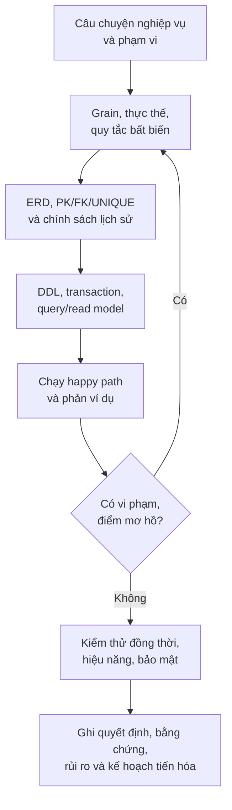
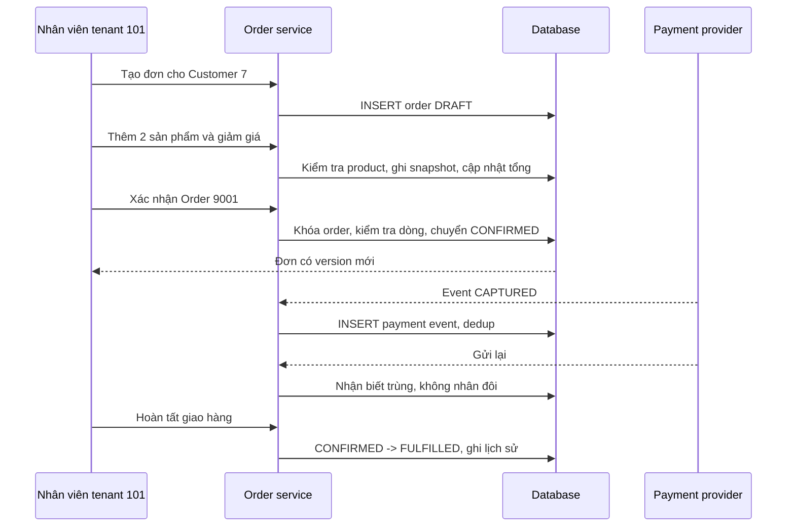
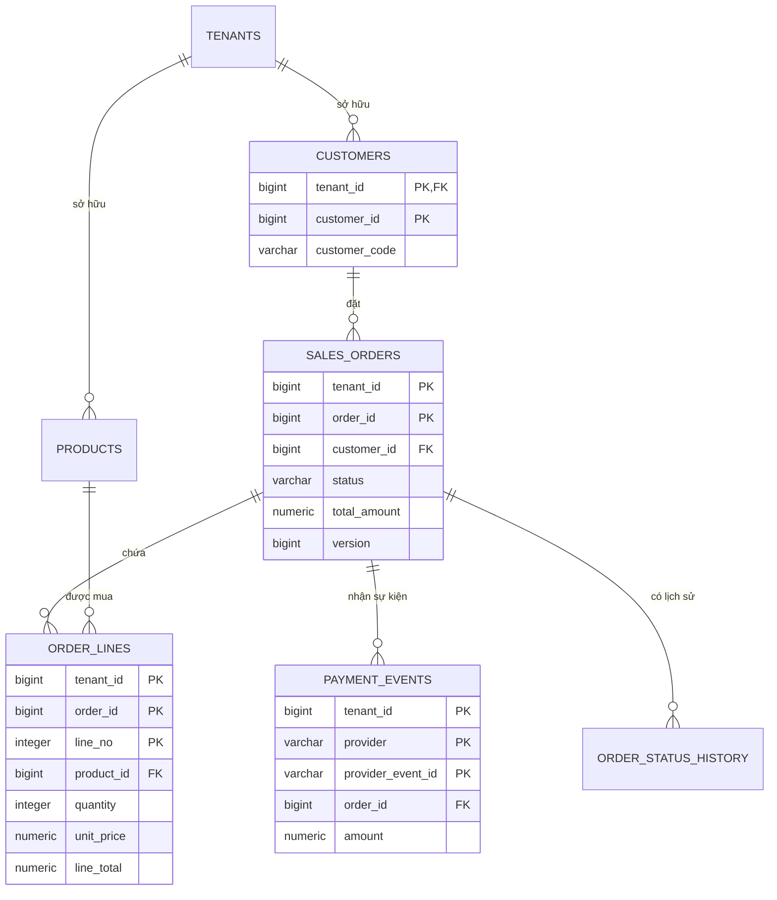
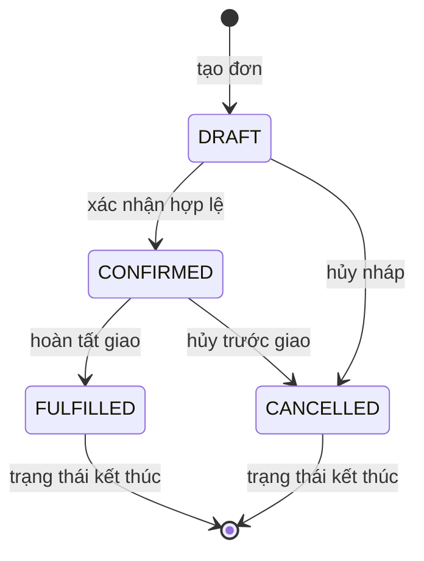

# Rà soát mô hình bằng tình huống nghiệp vụ từ đầu đến cuối

Một sơ đồ ER có các bảng `customers`, `sales_orders` và `order_lines` trông hợp lý chưa chứng minh rằng mô hình đúng. Khi hai nhân viên cùng sửa đơn, một webhook thanh toán bị gửi lại, một khách hàng đổi tên sản phẩm đã mua, hay một tenant cố truy cập dữ liệu của tenant khác, những thiếu sót về **grain, khóa, quan hệ, trạng thái, giao dịch và ranh giới dữ liệu** mới lộ ra.

**Kiểm chứng thiết kế dữ liệu** (*design validation*) vì vậy không chỉ là đọc DDL hoặc đếm bảng. Ta phải đi qua một chuỗi tình huống từ yêu cầu nghiệp vụ tới thao tác ghi, dữ liệu tồn tại sau commit, truy vấn đọc, báo cáo, lỗi, phục hồi và thay đổi trong tương lai. Một mô hình đạt yêu cầu khi có thể giải thích **nó bảo vệ điều gì, bằng cơ chế nào và bằng chứng kiểm tra nào**.

Bài thuộc chương **Kiểm chứng thiết kế** trong module **DATABASE_DATA_MODELING**. Mục tiêu là thực hành chuyển yêu cầu thành mô hình thực thể–quan hệ và ràng buộc, đưa xuống schema vật lý SQL, đánh giá chỉ mục, giao dịch, phân vùng khi cần, đồng thời nhận biết những điểm mà document/graph/analytical model có thể phục vụ tốt hơn. Tình huống xuyên suốt là một ứng dụng SaaS quản lý đơn hàng cho nhiều doanh nghiệp.

> **Phạm vi ví dụ:** DDL và truy vấn minh họa dùng PostgreSQL; mọi số tiền được biểu diễn bằng USD với hai chữ số thập phân để tập trung vào kỹ thuật kiểm chứng. Hệ thống đa tiền tệ, thuế, tồn kho thực tế và nghiệp vụ tài chính pháp lý cần hợp đồng mở rộng riêng, không được suy từ ví dụ này.

## 1. “Đúng mô hình” nghĩa là đúng ở những tầng nào?

Một bài review tốt phải phân biệt ít nhất năm tầng:

| Tầng | Câu hỏi kiểm chứng | Bằng chứng |
|---|---|---|
| **Nghiệp vụ** | Dữ liệu diễn đạt đúng điều đang xảy ra và các ngoại lệ không? | User story, ví dụ, phản ví dụ, glossary |
| **Logic** | Grain, định danh, cardinality, quan hệ, nullability và phụ thuộc có đúng không? | ERD, bảng invariant, normalization review |
| **Vật lý** | PK, FK, `UNIQUE`, `CHECK`, chỉ mục, kiểu dữ liệu có cưỡng chế được hợp đồng không? | DDL, negative SQL tests, query plan |
| **Hành vi** | Các lệnh ghi đồng thời, retry, lỗi và chuyển trạng thái có giữ invariant không? | Transaction tests, idempotency, state-machine tests |
| **Vận hành** | Query đủ nhanh, tenant cô lập, schema tiến hóa và dữ liệu khôi phục được không? | Load tests, permission tests, migration/restore rehearsal |

Không tầng nào thay thế tầng nào. Ví dụ `FOREIGN KEY(customer_id)` có thể bảo đảm customer tồn tại nhưng **không** bảo đảm customer thuộc cùng tenant; `CHECK(total_amount >= 0)` không bảo đảm tổng đơn bằng tổng dòng; một query chạy nhanh trên mười bản ghi chưa chứng minh đủ nhanh khi có triệu dòng.

### 1.1. Vòng kiểm chứng theo tình huống



**Điểm quan trọng:** một review là quá trình tạo ra **quyết định có thể kiểm tra**, không phải buổi họp mọi người nói “sơ đồ có vẻ ổn”.

## 2. Bài toán xuyên suốt: SaaS quản lý đơn hàng

Hệ thống phục vụ nhiều doanh nghiệp (**tenant**). Mỗi tenant có danh sách khách hàng, danh mục sản phẩm và đơn hàng riêng. Một nhân viên tạo đơn nháp, thêm dòng hàng, xác nhận đơn, nhận sự kiện thanh toán từ cổng thanh toán và hoàn tất giao hàng. Khi phát hiện lỗi, hệ thống cần lịch sử để giải thích ai làm gì.

### 2.1. Yêu cầu cụ thể được đánh số

| Mã | Yêu cầu nghiệp vụ | Điều phải kiểm chứng |
|---|---|---|
| R01 | Mỗi doanh nghiệp quản lý dữ liệu riêng | Không đọc/ghi/FK chéo tenant |
| R02 | Mã khách và mã sản phẩm có thể trùng ở hai tenant | Unique chỉ trong tenant |
| R03 | Một đơn thuộc một khách; đơn có nhiều dòng | Cardinality và FK đúng |
| R04 | Một dòng lưu sản phẩm, số lượng, giá lúc bán và tiền giảm giá | Snapshot giá, ràng buộc số |
| R05 | Tổng đơn bằng tổng tiền dòng | Tính lại và đối soát tại thời điểm ghi phù hợp |
| R06 | Đơn đi qua `DRAFT → CONFIRMED → FULFILLED`; có đường hủy hợp lệ | State machine, transaction |
| R07 | Sau khi xác nhận không được lặng lẽ sửa các dòng của đơn | Cơ chế khóa và giới hạn thao tác |
| R08 | Cùng webhook thanh toán gửi nhiều lần không được đếm tiền hai lần | Khóa idempotency + kiểm tra payload |
| R09 | Xem đơn cũ phải tái hiện giá/tên sản phẩm lúc bán | Không join giá catalog hiện tại thay snapshot |
| R10 | Có báo cáo doanh thu theo ngày và khách | Query theo grain, thời gian, trạng thái |
| R11 | Hai nhân viên cập nhật một đơn không được ghi đè im lặng | Lock/version, kiểm thử race |
| R12 | Có thể thay schema, backup/restore và xóa/ẩn danh thông tin theo chính sách | Migration, lineage, retention |

### 2.2. Những gì **chưa** thuộc phạm vi

Trong phiên bản bài học, hệ thống chưa mô hình hóa thuế, phí vận chuyển, nhiều loại tiền, các đơn vị lượng khác nhau, đặt trước tồn kho, hoàn hàng hay kế toán chính thức. **Thanh toán được ghi nhận thành các sự kiện**; quy tắc đối soát tiền và trạng thái hoàn tiền được nêu riêng, không đánh đồng “đơn đã xác nhận” với “tiền đã nhận”.

Đây là kỹ năng review quan trọng: một thiếu sót ngoài phạm vi phải được **ghi thành giả định/đề bài tiếp theo**, không âm thầm tự gắn công thức vào dữ liệu.

### 2.3. Câu hỏi làm rõ trước khi vẽ bảng

1. `order_code` duy nhất toàn nền tảng hay trong một tenant? Có được tái sử dụng sau hủy không?
2. Khách hàng bị đóng tài khoản có được xuất hiện trong đơn lịch sử không?
3. Giá sản phẩm sau khi đổi có làm thay đổi đơn đã xác nhận không?
4. Có cho phép đơn nháp không có dòng? Có cho phép **xác nhận** đơn rỗng không?
5. Ai được xác nhận/hủy và từ trạng thái nào?
6. Payment provider có gửi trùng, đến trễ hoặc đổi nội dung cùng ID không?
7. “Doanh thu” là tổng đơn xác nhận, tiền đã nhận, hay doanh thu được ghi nhận sau giao hàng?
8. Dữ liệu được lưu theo múi giờ nào? Ngày báo cáo được tính theo timezone nào?
9. Một tenant có thể có hàng triệu đơn trong khi tenant khác chỉ có vài trăm không?
10. Mức độ khôi phục riêng một tenant và yêu cầu dữ liệu nhạy cảm là gì?

Review chưa thể kết luận mô hình “đúng” khi những câu hỏi này ảnh hưởng tới khóa, tính toán và quyền mà vẫn chưa có đáp án.

## 3. Chạy câu chuyện nghiệp vụ theo thời gian

Thay vì duyệt sơ đồ từ bảng này sang bảng kia, hãy lần theo **một đơn hàng cụ thể**:



Trong chuỗi này, mỗi thao tác phải có câu trả lời:

- **Đầu vào nào tin cậy?** Tenant context có được xác thực không? Giá do khách gửi hay lấy từ catalog?
- **Những hàng nào thay đổi?** Có ghi dòng, tổng đơn, version và lịch sử cùng transaction không?
- **Điều gì bị từ chối?** Đơn rỗng, sản phẩm tenant khác, version cũ, trạng thái không hợp lệ?
- **Lỗi giữa chừng ra sao?** Rollback được không? Retry có ghi trùng không?
- **Kết quả quan sát được?** Sau commit, query nào chứng minh dữ liệu đúng?

### 3.1. Happy path chưa đủ

Một thử nghiệm chỉ tạo đơn, thêm một dòng và đọc lại sẽ bỏ qua nhiều lỗi. Hãy cố ý tạo **phản ví dụ**:

| Phản ví dụ | Rủi ro muốn phát hiện |
|---|---|
| Customer chỉ thuộc tenant 202 nhưng order ở 101 | FK không có tenant scope |
| Hai đơn cùng `order_code` trong một tenant | Unique key sai |
| Product đổi giá sau khi đặt hàng | Giá lịch sử trôi theo catalog |
| Xác nhận đơn không có dòng | Thiếu invariant tại transition |
| Hai người thêm dòng và xác nhận cùng lúc | Race giữa collection và status |
| Webhook `evt-abc` đến hai lần | Ghi trùng, báo cáo sai |
| Webhook cùng ID nhưng amount khác | Mâu thuẫn nguồn bị âm thầm bỏ qua |
| Xóa customer đã có đơn | Mất chứng cứ lịch sử hoặc vi phạm FK |
| Report ngày chạy ở timezone khác | Chỉ số ngày bị lệch |
| Tenant lớn và 100 tenant nhỏ chạy cùng lúc | Query/Index/noisy-neighbor |

Đối với từng phản ví dụ cần viết **expected result** trước khi chạy. Một test “không ném exception” chưa chứng minh invariant giữ đúng.

## 4. Từ câu chuyện tới thực thể, grain và quan hệ

### 4.1. Danh mục thực thể

| Thực thể | Grain (một hàng) | Định danh trong mô hình |
|---|---|---|
| `Tenant` | Một tổ chức sử dụng hệ thống | `tenant_id` |
| `Customer` | Một khách của một tenant | `(tenant_id, customer_id)` |
| `Product` | Một sản phẩm catalog của một tenant | `(tenant_id, product_id)` |
| `SalesOrder` | Một đơn của một tenant | `(tenant_id, order_id)` |
| `OrderLine` | Một dòng của một đơn | `(tenant_id, order_id, line_no)` |
| `PaymentEvent` | Một thông điệp có mã nguồn riêng từ provider | `(tenant_id, provider, provider_event_id)` |
| `OrderStatusHistory` | Một lần thay đổi trạng thái có thời điểm | `history_id` + FK order |

Tại sao `PaymentEvent` không có grain “một thanh toán thành công”? Vì một provider có thể phát thông điệp `FAILED`, `CAPTURED` hoặc `REFUNDED`; grain **thông điệp sự kiện** giúp phân biệt số lần nhận với giá trị nghiệp vụ. Để tính tiền thực nhận, cần xác định loại event và liên kết payment/transaction có thẩm quyền, tránh lấy `SUM(amount)` trên mọi event.

### 4.2. ERD mức logic



### 4.3. Cardinality và vòng đời cần hỏi thêm

- Một tenant có **0..n** customers/products/orders; một order thuộc **chính xác một** customer cùng tenant.
- Một order nháp có **0..n** lines; một order được xác nhận phải có **ít nhất một** line theo R07/R05.
- Một line thuộc chính xác một order và trỏ tới một product; line không tồn tại độc lập sau khi order bị hủy? **Hủy trạng thái không đồng nghĩa xóa line.**
- Payment event thuộc một order đã có; event có thể đến muộn khi order đã thay trạng thái.
- Status history là dữ liệu kiểm toán; xóa cascade tùy tiện cùng order có thể phá vỡ yêu cầu lịch sử.

Không thể chỉ vẽ ký hiệu 1–N rồi coi là đã định nghĩa đầy đủ. “Có ít nhất một line lúc confirm” là **ràng buộc có điều kiện theo trạng thái**, khác với FK và cardinality lưu trữ thông thường.

## 5. Viết invariant trước khi chọn constraint

**Invariant** là phát biểu phải giữ đúng trong tất cả trạng thái dữ liệu được coi là hợp lệ. Nên có mã và nơi thực thi rõ ràng:

| Mã | Bất biến | Bảo vệ tại DB? | Cơ chế bổ sung |
|---|---|---|---|
| I01 | Customer, product, order, line không tham chiếu chéo tenant | Có | FK ghép chứa `tenant_id` |
| I02 | Mã customer, product, order duy nhất trong tenant | Có | `UNIQUE(tenant_id, code)` |
| I03 | `quantity > 0`, giá và giảm giá không âm | Có | `CHECK` |
| I04 | `discount_amount <= quantity × unit_price` | Có | `CHECK` |
| I05 | `line_total` đúng công thức dòng | Có với DB mẫu | Generated column |
| I06 | `order.total_amount = SUM(lines.line_total)` | Không bằng `CHECK` đơn giản | Ghi trong transaction, đối soát |
| I07 | Order `CONFIRMED` phải có ít nhất một line | Không bằng FK thông thường | Transition service/trigger |
| I08 | Không sửa line sau khi order hết `DRAFT` | Không bằng `CHECK` hàng line đơn giản | Cơ chế lệnh ghi, lock/trigger |
| I09 | State transition thuộc tập cho phép | Cần logic chuyển trạng thái | Lệnh update có điều kiện, history |
| I10 | Một provider event ID chỉ được ghi một lần mỗi tenant/provider | Có | PK/unique, kiểm tra payload trùng |
| I11 | Hai lần sửa cùng version không cùng âm thầm thành công | Có qua update có điều kiện | Version CAS/lock |
| I12 | Người không có quyền tenant không đọc/ghi được | Không chỉ bằng PK/FK | Authorization, role/RLS và kiểm thử |

Điều quan trọng là **không ép mọi invariant vào một `CHECK`**. SQL `CHECK` thông thường kiểm tra giá trị **của cùng hàng**, không đáng tin cậy để kiểm tra một truy vấn tổng hợp sang nhiều hàng liên quan. Những invariant đa bảng có thể cần transaction, trigger, stored procedure hoặc thiết kế aggregate phù hợp.

### 5.1. Chốt quy tắc tiền và phiên bản công thức

Với bài tập:

```text
line_total = quantity * unit_price - discount_amount
order_total = SUM(line_total)  // cùng tenant, cùng order
currency = USD; decimal scale = 2
```

`unit_price` là **snapshot giá tại lúc thêm dòng** hoặc khi chốt đơn theo hợp đồng giá. Trong ví dụ này, lúc thêm dòng, service lấy từ catalog do server quản lý và ghi snapshot; không tin giá do client tự gửi. Khi confirm, service giữ các giá snapshot ấy, không tự cập nhật thành giá catalog mới.

Nếu doanh nghiệp yêu cầu báo giá phải được cập nhật tại lúc xác nhận, đó là một quy tắc khác và cần đổi tình huống test. Mô hình được kiểm chứng theo **một hợp đồng đã chọn**, không theo mọi cách hiểu có thể.

## 6. Chuẩn hóa và snapshot lịch sử: tránh hai cực đoan

Mô hình nên tách `customers`, `products` và `sales_orders` để tránh lặp thông tin đang quản lý. Nhưng `OrderLine` vẫn có thể giữ `unit_price` và `product_name_snapshot` — đây là **dư thừa có chủ đích** để bảo toàn lịch sử giao dịch.

### 6.1. Phụ thuộc hàm và khóa

Trong phạm vi tenant:

```text
(tenant_id, customer_id) -> customer_code, display_name, status
(tenant_id, product_id)  -> sku, display_name, current_price
(tenant_id, order_id)    -> order_code, customer_id, status, total, version
(tenant_id, order_id, line_no)
    -> product_id, quantity, unit_price, discount, line_total
```

`customer_code` và `sku` cũng có thể là candidate key trong tenant theo quy tắc `UNIQUE`. Trước khi chọn unique, phải hỏi có mã nào được tái sử dụng khi bản ghi đã soft-delete không; nếu có, cần định nghĩa partial unique hoặc mã không được dùng lại, thay vì chọn tùy tiện.

### 6.2. Tại sao giữ snapshot giá?

Giả sử Product 17 được bán ở `120.00` hôm thứ Hai và catalog tăng lên `135.00` hôm thứ Ba. Nếu báo cáo đơn thứ Hai lấy `products.current_price` rồi nhân số lượng, doanh thu lịch sử bị thay đổi dù không có giao dịch mới.

Giải pháp:

- FK tới Product cho biết dòng mua sản phẩm nào.
- `unit_price` và `product_name_snapshot` giữ giá/tên theo thời điểm giao dịch.
- `line_total` được tính từ snapshot của dòng, không dùng giá catalog hiện tại.

Không cần sao chép **mọi cột** của Product sang dòng. Chỉ giữ thuộc tính có ý nghĩa lịch sử và cần truy vết. Nếu chính sách đổi tên/giá vốn phức tạp, có thể cần bảng lịch sử giá hoặc revision sản phẩm thay vì một snapshot đơn giản.

### 6.3. Vì sao tổng đơn là dữ liệu suy ra được lưu?

`total_amount` bằng tổng line đã được lưu ở order để hỗ trợ danh sách/kiểm tra trạng thái nhanh. Đây là denormalization có lý do, nhưng tạo invariant I06: mỗi thay đổi dòng phải làm tổng order nhất quán trước commit.

Đối với đơn có hàng triệu dòng hoặc tần suất cập nhật rất cao, cách tính và lưu tổng có thể thay đổi; bài học là **nếu lưu dữ liệu suy ra thì phải có cơ chế đồng bộ và kiểm chứng**, không phải lúc nào cũng lưu tổng.

## 7. Chuyển mô hình logic thành DDL có thể kiểm tra

Dưới đây là lược đồ PostgreSQL minh họa cho các bảng cốt lõi:

```sql
CREATE TABLE tenants (
    tenant_id BIGINT PRIMARY KEY,
    tenant_code VARCHAR(80) NOT NULL UNIQUE
);

CREATE TABLE customers (
    tenant_id BIGINT NOT NULL REFERENCES tenants(tenant_id),
    customer_id BIGINT NOT NULL,
    customer_code VARCHAR(64) NOT NULL,
    display_name VARCHAR(200) NOT NULL,
    customer_status VARCHAR(16) NOT NULL
        CHECK (customer_status IN ('ACTIVE', 'ANONYMIZED')),
    PRIMARY KEY (tenant_id, customer_id),
    CONSTRAINT uq_customer_code_tenant
        UNIQUE (tenant_id, customer_code)
);

CREATE TABLE products (
    tenant_id BIGINT NOT NULL REFERENCES tenants(tenant_id),
    product_id BIGINT NOT NULL,
    sku VARCHAR(80) NOT NULL,
    display_name VARCHAR(200) NOT NULL,
    current_price NUMERIC(19, 2) NOT NULL
        CHECK (current_price >= 0),
    is_active BOOLEAN NOT NULL DEFAULT TRUE,
    PRIMARY KEY (tenant_id, product_id),
    CONSTRAINT uq_product_sku_tenant
        UNIQUE (tenant_id, sku)
);

CREATE TABLE sales_orders (
    tenant_id BIGINT NOT NULL REFERENCES tenants(tenant_id),
    order_id BIGINT NOT NULL,
    order_code VARCHAR(64) NOT NULL,
    customer_id BIGINT NOT NULL,
    status VARCHAR(16) NOT NULL
        CHECK (status IN ('DRAFT', 'CONFIRMED',
                         'FULFILLED', 'CANCELLED')),
    currency_code CHAR(3) NOT NULL DEFAULT 'USD'
        CHECK (currency_code = 'USD'),
    total_amount NUMERIC(19, 2) NOT NULL DEFAULT 0
        CHECK (total_amount >= 0),
    version BIGINT NOT NULL DEFAULT 0 CHECK (version >= 0),
    created_at TIMESTAMPTZ NOT NULL DEFAULT CURRENT_TIMESTAMP,
    confirmed_at TIMESTAMPTZ,
    fulfilled_at TIMESTAMPTZ,
    cancelled_at TIMESTAMPTZ,
    PRIMARY KEY (tenant_id, order_id),
    CONSTRAINT uq_order_code_tenant UNIQUE (tenant_id, order_code),
    CONSTRAINT fk_order_customer_tenant
        FOREIGN KEY (tenant_id, customer_id)
        REFERENCES customers(tenant_id, customer_id),
    CONSTRAINT ck_order_confirmed_time
        CHECK (
            status NOT IN ('CONFIRMED', 'FULFILLED')
            OR confirmed_at IS NOT NULL
        ),
    CONSTRAINT ck_order_fulfilled_time
        CHECK (status <> 'FULFILLED' OR fulfilled_at IS NOT NULL),
    CONSTRAINT ck_order_cancelled_time
        CHECK (status <> 'CANCELLED' OR cancelled_at IS NOT NULL)
);

CREATE TABLE order_lines (
    tenant_id BIGINT NOT NULL,
    order_id BIGINT NOT NULL,
    line_no INTEGER NOT NULL CHECK (line_no > 0),
    product_id BIGINT NOT NULL,
    quantity INTEGER NOT NULL CHECK (quantity > 0),
    unit_price NUMERIC(19, 2) NOT NULL
        CHECK (unit_price >= 0),
    discount_amount NUMERIC(19, 2) NOT NULL DEFAULT 0
        CHECK (discount_amount >= 0),
    product_name_snapshot VARCHAR(200) NOT NULL,
    line_total NUMERIC(19, 2)
        GENERATED ALWAYS AS (
            quantity * unit_price - discount_amount
        ) STORED,
    PRIMARY KEY (tenant_id, order_id, line_no),
    CONSTRAINT fk_line_order_tenant
        FOREIGN KEY (tenant_id, order_id)
        REFERENCES sales_orders(tenant_id, order_id),
    CONSTRAINT fk_line_product_tenant
        FOREIGN KEY (tenant_id, product_id)
        REFERENCES products(tenant_id, product_id),
    CONSTRAINT ck_line_discount_cap
        CHECK (discount_amount <= quantity * unit_price)
);

CREATE TABLE payment_events (
    tenant_id BIGINT NOT NULL,
    provider VARCHAR(40) NOT NULL,
    provider_event_id VARCHAR(120) NOT NULL,
    order_id BIGINT NOT NULL,
    event_type VARCHAR(20) NOT NULL
        CHECK (event_type IN ('CAPTURED', 'FAILED', 'REFUNDED')),
    amount NUMERIC(19, 2) NOT NULL CHECK (amount > 0),
    occurred_at TIMESTAMPTZ NOT NULL,
    received_at TIMESTAMPTZ NOT NULL DEFAULT CURRENT_TIMESTAMP,
    PRIMARY KEY (tenant_id, provider, provider_event_id),
    CONSTRAINT fk_payment_order_tenant
        FOREIGN KEY (tenant_id, order_id)
        REFERENCES sales_orders(tenant_id, order_id)
);

CREATE TABLE order_status_history (
    history_id BIGINT GENERATED ALWAYS AS IDENTITY PRIMARY KEY,
    tenant_id BIGINT NOT NULL,
    order_id BIGINT NOT NULL,
    from_status VARCHAR(16) NOT NULL,
    to_status VARCHAR(16) NOT NULL,
    order_version BIGINT NOT NULL CHECK (order_version >= 0),
    changed_at TIMESTAMPTZ NOT NULL DEFAULT CURRENT_TIMESTAMP,
    reason VARCHAR(240),
    CONSTRAINT fk_history_order_tenant
        FOREIGN KEY (tenant_id, order_id)
        REFERENCES sales_orders(tenant_id, order_id),
    CONSTRAINT uq_history_order_version
        UNIQUE (tenant_id, order_id, order_version)
);

CREATE INDEX idx_orders_tenant_created
    ON sales_orders(tenant_id, created_at DESC, order_id DESC);
CREATE INDEX idx_orders_tenant_status_created
    ON sales_orders(tenant_id, status, created_at DESC, order_id DESC);
CREATE INDEX idx_lines_tenant_product
    ON order_lines(tenant_id, product_id);
CREATE INDEX idx_payment_order
    ON payment_events(tenant_id, order_id, occurred_at);
CREATE INDEX idx_history_order_time
    ON order_status_history(tenant_id, order_id, changed_at DESC);
```

### 7.1. Các giả định vật lý phải ghi rõ

- DDL không tự sinh `tenant_id`, `customer_id`, `product_id` hay `order_id`. Ví dụ giả định ứng dụng hoặc dịch vụ cấp ID an toàn **trong phạm vi tenant**; khi triển khai phải có bộ cấp ID không gây trùng dưới concurrent writes.
- `currency_code` chỉ chấp nhận `USD` để tránh trộn tiền tệ và độ chính xác đơn vị trong bài này. Hệ thống thật đa tiền tệ cần thêm quy tắc tỷ giá, số chữ số phần lẻ và cách cộng gộp.
- `product_name_snapshot` không null dù Product đổi tên. Không dùng cascade delete xóa Product/Customer đã được các đơn lịch sử tham chiếu.
- `order_status_history` là lịch sử **các lần đổi trạng thái**; số version có thể không liên tục trong history vì sửa dòng nháp cũng tăng version order.
- `payment_events` có khóa provider event để chống ingest trùng. **Đây chưa là sổ cái tiền đã nhận**: một event `CAPTURED` có thể bị bù bởi `REFUNDED` và logic xác định tiền thực phải xét các event/transaction nguồn.
- Các chỉ mục bên ngoài PK/UNIQUE là **giả thuyết theo workload**; cần kiểm tra bằng `EXPLAIN` trước khi coi chúng là tối ưu.
- Khi gọi ví dụ là một “script độc lập”, cần hiểu nó chỉ tạo **schema**: chưa bao gồm seed dữ liệu, DB roles, RLS, job, stored procedures, trigger hoặc cấu hình migration production.

### 7.2. Điều gì DB đã đảm bảo và chưa đảm bảo?

| Kiểm tra | Trạng thái với DDL |
|---|---|
| Đơn tenant A trỏ Customer tenant B | DB từ chối bằng FK ghép |
| Hai customer cùng mã trong tenant A | DB từ chối |
| Hai tenant khác nhau có cùng customer code | Hợp lệ |
| Line có quantity = 0 | DB từ chối |
| Discount lớn hơn giá trị dòng | DB từ chối |
| `line_total` không bằng công thức | DB duy trì generated column |
| Confirm đơn không có dòng | **Chưa bảo vệ chỉ bằng DDL** |
| Sửa line sau CONFIRMED | **Chưa bảo vệ chỉ bằng DDL** |
| Tổng order khác tổng line | **Chưa bảo vệ bằng `CHECK` đơn hàng** |
| Payment event ID bị ghi lại | DB chặn bản ghi trùng khóa |
| Webhook trùng ID nhưng amount khác | **Cần kiểm tra payload**, không chỉ unique |
| Actor không có quyền tenant | **Cần authorization/RLS**, không chỉ FK |

Việc đánh dấu rõ “chưa bảo vệ” là một **kết quả review có ích**, không phải thất bại. Thiết kế trở nên nguy hiểm khi mọi người nghĩ DDL đã cưỡng chế điều mà thực tế chỉ có service quy ước.

## 8. Kiểm chứng khóa, ràng buộc bằng dữ liệu rất nhỏ

Một seed đơn giản, giả định các bảng đang rỗng:

```sql
INSERT INTO tenants(tenant_id, tenant_code)
VALUES (101, 'ACME'), (202, 'BETA');

INSERT INTO customers(
    tenant_id, customer_id, customer_code,
    display_name, customer_status
)
VALUES
    (101, 7, 'CUS-001', 'Khách ACME', 'ACTIVE'),
    (202, 7, 'CUS-001', 'Khách BETA', 'ACTIVE'),
    (202, 9, 'CUS-009', 'Khách chỉ thuộc BETA', 'ACTIVE');

INSERT INTO products(
    tenant_id, product_id, sku,
    display_name, current_price
)
VALUES
    (101, 17, 'SKU-17', 'Tai nghe mẫu A', 120.00),
    (202, 17, 'SKU-17', 'Tai nghe mẫu B', 135.00);
```

### 8.1. Kiểm tra phạm vi unique

Hai hàng `(101, 'CUS-001')` và `(202, 'CUS-001')` là hợp lệ. Nhưng thử thêm lần nữa trong tenant 101:

```sql
INSERT INTO customers(
    tenant_id, customer_id, customer_code,
    display_name, customer_status
)
VALUES (101, 8, 'CUS-001', 'Trùng mã trong ACME', 'ACTIVE');
-- Kỳ vọng: lỗi UNIQUE(tenant_id, customer_code).
```

Chạy những test **dự kiến lỗi** trong transaction riêng hoặc test harness biết rollback; PostgreSQL sẽ đánh dấu transaction lỗi nếu một statement thất bại.

### 8.2. Kiểm tra FK cùng tenant

```sql
INSERT INTO sales_orders(
    tenant_id, order_id, order_code, customer_id, status
)
VALUES (101, 9001, 'O-9001', 9, 'DRAFT');
-- Kỳ vọng: lỗi FK vì chỉ có Customer (202, 9),
-- không có Customer (101, 9).
```

Một FK chỉ theo `customer_id` có thể vô tình tìm được khách `9` ở tenant khác nếu ID không unique toàn cục. FK ghép theo `(tenant_id, customer_id)` là bằng chứng schema từ chối trường hợp nguy hiểm đó.

### 8.3. Test đột biến dữ liệu (mutation tests)

Đừng chỉ thử dữ liệu hợp lệ. Hãy thử thay một biến mỗi lần:

- `quantity = 0` hoặc `-1` → lỗi `CHECK`.
- `unit_price = -0.01` → lỗi `CHECK`.
- `discount_amount` lớn hơn tổng dòng → lỗi `CHECK`.
- `line_no = 0` → lỗi `CHECK`.
- `product_id` chỉ tồn tại ở tenant 202 nhưng line ở 101 → lỗi FK.
- `order_code` trùng trong tenant 101 → lỗi unique.
- `currency_code = 'EUR'` → lỗi `CHECK` **theo giả định USD của bài**, không phải vì EUR không hợp pháp ngoài thực tế.

Một test chất lượng phải nêu **lý do được từ chối**, không chỉ khẳng định “SQL thất bại”.

## 9. Đi hết happy path: tạo đơn và thêm dòng

Sau seed, tạo đơn hợp lệ:

```sql
BEGIN;

INSERT INTO sales_orders (
    tenant_id, order_id, order_code,
    customer_id, status, total_amount, version
)
VALUES (101, 9001, 'O-9001', 7, 'DRAFT', 0, 0);

COMMIT;
```

### 9.1. Tại sao thêm dòng phải cùng transaction cập nhật tổng?

Đối với mọi lệnh sửa dòng nháp, giao thức ghi của bài là:

1. Bắt đầu transaction.
2. Khóa **hàng order cha** bằng `SELECT ... FOR UPDATE`.
3. Kiểm tra order còn `DRAFT` và user có quyền theo tenant.
4. Lấy tên/giá sản phẩm từ catalog **cùng tenant**; ghi snapshot vào line.
5. Thêm/sửa/xóa line theo yêu cầu.
6. Tính lại `total_amount` bằng `SUM(line_total)` và tăng `version`.
7. Commit **cả dòng và tổng** cùng nhau.

Ví dụ thêm một dòng, giá được lấy từ bảng catalog thay vì client:

```sql
BEGIN;

SELECT status, version
FROM sales_orders
WHERE tenant_id = 101 AND order_id = 9001
FOR UPDATE;
-- Service bắt buộc kiểm tra status = DRAFT trước khi tiếp tục.

INSERT INTO order_lines (
    tenant_id, order_id, line_no, product_id,
    quantity, unit_price, discount_amount,
    product_name_snapshot
)
SELECT
    101, 9001, 1, p.product_id,
    2, p.current_price, 10.00,
    p.display_name
FROM products AS p
WHERE p.tenant_id = 101
  AND p.product_id = 17
  AND p.is_active = TRUE;
-- Service kiểm tra đã insert đúng 1 hàng; nếu 0 thì rollback.

UPDATE sales_orders AS o
SET total_amount = (
        SELECT COALESCE(SUM(l.line_total), 0)
        FROM order_lines AS l
        WHERE l.tenant_id = o.tenant_id
          AND l.order_id = o.order_id
    ),
    version = version + 1
WHERE tenant_id = 101
  AND order_id = 9001
  AND status = 'DRAFT'
RETURNING total_amount, version;

COMMIT;
```

Với hai sản phẩm ở giá `120.00` và giảm `10.00` cho **một dòng số lượng 2**, ta có `line_total = 2 × 120.00 − 10.00 = 230.00`. Tổng order sau transaction là `230.00` và version tăng từ 0 lên 1.

### 9.2. Điểm không thể suy ra từ SQL mẫu

`SELECT ... FOR UPDATE` chỉ có tác dụng nếu **mọi đường sửa line và confirm cùng tuân giao thức khóa hàng order cha**. Nếu một batch job có quyền `INSERT INTO order_lines` trực tiếp mà không khóa, nó có thể thêm line sau khi đơn đã xác nhận. Muốn **DB cưỡng chế mạnh** kể cả trước SQL tùy ý, cần trigger/stored procedure và giới hạn quyền ghi bảng, hoặc một kiến trúc đảm bảo các lệnh ghi chỉ đi qua API đã kiểm chứng.

Cũng cần kiểm tra số hàng thực sự chèn trong `INSERT ... SELECT`. Nếu sản phẩm không tồn tại hoặc bị vô hiệu, câu SELECT trả 0 hàng và transaction không được đánh dấu thành công chỉ vì không ném lỗi.

### 9.3. Product đổi giá đồng thời

Transaction trên khóa order **không khóa Product**. Nếu giá product có thể đổi cùng lúc, đọc `current_price` cho snapshot có thể phản ánh một phiên bản catalog đã commit tùy thời điểm và isolation; cần định nghĩa đó là hợp đồng chấp nhận được hay phải khóa/version bảng giá, dùng quote ID hoặc chính sách hiệu lực theo thời gian. Review không được lặng lẽ coi “giá lúc thêm” là một instant tuyệt đối đã chứng minh khi có update đồng thời.

## 10. Kiểm chứng state machine tại thời điểm xác nhận

State hợp lệ trong phạm vi ví dụ:



Một đơn `FULFILLED` không tự chuyển sang `DRAFT` để sửa giá. Đổi trả hoặc hoàn tiền sau giao là **sự kiện/luồng nghiệp vụ khác**, cần mô hình riêng khi mở rộng phạm vi.

### 10.1. Xác nhận là một transaction

Giả định phiên bản order được client đọc là 1:

```sql
BEGIN;

SELECT status, version, total_amount
FROM sales_orders
WHERE tenant_id = 101 AND order_id = 9001
FOR UPDATE;
-- Service kiểm tra status=DRAFT, version=1
-- và actor có quyền confirm tenant 101.

SELECT COUNT(*) AS line_count,
       COALESCE(SUM(line_total), 0) AS calculated_total
FROM order_lines
WHERE tenant_id = 101 AND order_id = 9001;
-- Phải có >= 1 line, mọi số đo hợp lệ;
-- kết quả calculated_total = 230.00.

UPDATE sales_orders
SET status = 'CONFIRMED',
    confirmed_at = CURRENT_TIMESTAMP,
    total_amount = 230.00,
    version = version + 1
WHERE tenant_id = 101 AND order_id = 9001
  AND status = 'DRAFT' AND version = 1
RETURNING version;
-- Service yêu cầu đúng một hàng, version mới = 2.

INSERT INTO order_status_history(
    tenant_id, order_id, from_status,
    to_status, order_version, reason
)
VALUES (101, 9001, 'DRAFT', 'CONFIRMED', 2, 'Customer approved');

COMMIT;
```

Giá trị `230.00` trong lệnh `UPDATE` là **kết quả vừa được kiểm chứng trong transaction**, được ghi cố định chỉ để minh họa một case cụ thể; ứng dụng thật phải **bind** `:calculated_total` từ câu truy vấn sau khi đã giữ khóa, không dùng hằng số trong logic sản phẩm.

Nếu count = 0, status không phù hợp, version đã đổi hoặc một bước ghi history thất bại, service phải rollback toàn bộ. Không được commit status CONFIRMED khi không ghi được lịch sử nếu audit là yêu cầu bắt buộc.

### 10.2. Tại sao không chỉ dùng `CHECK(status IN ...)`?

`CHECK(status IN (...))` chặn **giá trị ngoài tập**, nhưng không chặn chuyển trực tiếp `DRAFT → FULFILLED` vì cả hai giá trị đều hợp lệ. Muốn cưỡng chế chuyển trạng thái ở DB cần thêm trigger/stored procedure hoặc cập nhật có điều kiện từ trạng thái hiện tại, kèm giới hạn các đường ghi.

### 10.3. Đối thủ là một lệnh thêm dòng đồng thời

Giả sử transaction T1 đang confirm, còn T2 thêm line:

```text
T1: lock order 9001       ------ giữ khóa ------
T1: kiểm tra lines và tổng
T2: yêu cầu lock order 9001 -> đợi
T1: status -> CONFIRMED, commit
T2: lấy lock, thấy CONFIRMED -> rollback
```

Nếu cả T1 và T2 cùng tuân `FOR UPDATE` trên hàng order cha, giao thức này tuần tự hóa những thao tác ảnh hưởng invariant. Nếu T2 được phép chèn thẳng vào line mà không khóa cha, T1 không được bảo vệ chỉ bằng khóa order. Đây là tình huống cần **transaction integration test**, không chỉ unit test dịch vụ.

### 10.4. Ghi lịch sử có đúng nguyên tắc không?

`order_status_history` lưu from/to status và version sau transition. Unique `(tenant_id, order_id, order_version)` chặn hai history record cùng version. Tuy nhiên nó **không tự bảo đảm** mỗi thay đổi status đều có history nếu ai đó update trực tiếp bảng `sales_orders`. Audit bắt buộc cần được viết cùng transaction qua một đường lệnh được kiểm soát, hoặc trigger tại DB.

## 11. Webhook thanh toán: kiểm chứng retry và mâu thuẫn dữ liệu nguồn

Một provider có thể gửi event `CAPTURED` cho order 9001 với `provider_event_id = 'evt-abc'`, amount `230.00`. Vì delivery có thể retry, cùng event có thể tới nhiều lần. Một dòng ở `payment_events` biểu diễn **một event có ID nguồn duy nhất**, không phải “một lần HTTP request đến server”.

### 11.1. Ghi idempotent dưới constraint

```sql
INSERT INTO payment_events (
    tenant_id, provider, provider_event_id,
    order_id, event_type, amount, occurred_at
)
VALUES (
    101, 'PAYMENT_X', 'evt-abc',
    9001, 'CAPTURED', 230.00,
    TIMESTAMPTZ '2026-11-22 03:00:00+00'
)
ON CONFLICT (
    tenant_id, provider, provider_event_id
) DO NOTHING
RETURNING provider_event_id;
```

Với event mới, câu lệnh trả một hàng; nếu trùng khóa, trả 0 hàng. **Không kết luận ngay “retry giống hệt, thành công”** khi 0 hàng: query lại event hiện có và so sánh các trường có ý nghĩa (`order_id`, `event_type`, `amount`, `occurred_at`/payload hash theo hợp đồng provider). Nếu payload khác, ghi nhận xung đột và điều tra.

Lưu ý: một provider có thể dùng scope uniqueness của event ID khác (ví dụ toàn cục provider hay trong merchant account). `PRIMARY KEY(tenant_id, provider, provider_event_id)` đúng **theo giả định bài học**; khi tích hợp thật phải khảo sát hợp đồng ID của nguồn.

### 11.2. “Số event” không đồng nghĩa “tiền đã nhận”

Một order có thể có event `CAPTURED`, `FAILED`, `REFUNDED`; có thể có nhiều lần thanh toán, partial capture hoặc refund. Vì vậy:

```sql
-- KHÔNG PHẢI phép tính tiền thực nhận hợp lệ:
SELECT SUM(amount)
FROM payment_events
WHERE tenant_id = 101 AND order_id = 9001;
```

Câu trên cộng cả FAILED/REFUNDED như tiền dương. Trong mô hình kế toán thật, nên có định danh **payment/charge/refund** và quy tắc state/ledger riêng; event là nguồn để tái hiện, còn tiền thực nhận cần định nghĩa phép đối soát đúng.

Trong bài này có thể kiểm chứng mục tiêu nhỏ hơn: mỗi event ID xuất hiện đúng **một** lần, và một event `CAPTURED` hợp lệ có amount khớp thông tin provider; không tự suy ra rằng order lập tức phải chuyển `FULFILLED`.

### 11.3. Event đến muộn hoặc đảo thứ tự

`occurred_at` là thời điểm sự kiện theo provider; `received_at` là lúc hệ thống nhận. Nếu `REFUNDED` đến trước `CAPTURED` vì mạng hoặc cách truyền, không được dùng thứ tự nhận để suy trạng thái tài chính. Cần có payment reference, sequence/version hoặc quy tắc hòa giải với provider để dựng trạng thái chính xác.

Nếu phải phát một tác vụ downstream sau khi ghi payment event, cân nhắc **transactional outbox** hoặc idempotent consumer. Commit event vào DB rồi phát message một cách không nguyên tử có thể để lại trường hợp đã ghi event nhưng không có công việc downstream; retry phải xử lý được.

## 12. Rà soát truy vấn đọc và báo cáo theo câu hỏi thật

Thiết kế vật lý chưa đủ nếu truy vấn cần thiết **không lấy đúng hàng hoặc không đáp ứng tải thực tế**. Dùng ba màn hình để kiểm chứng đường đọc.

### 12.1. Danh sách 50 đơn mới nhất trong một tenant

```sql
SELECT o.order_id, o.order_code,
       o.status, o.total_amount,
       o.created_at, c.display_name AS customer_name
FROM sales_orders AS o
JOIN customers AS c
  ON c.tenant_id = o.tenant_id
 AND c.customer_id = o.customer_id
WHERE o.tenant_id = :tenant_id
ORDER BY o.created_at DESC, o.order_id DESC
LIMIT 50;
```

Query join theo **cả tenant và customer ID**, tránh trả khách hàng sai nếu ID local trùng giữa các tenant. Trang danh sách không cần nạp toàn bộ dòng, thanh toán và lịch sử. Nếu dùng ORM, một projection/DTO cho cột hiển thị thường phù hợp hơn dựng một object graph lớn.

Chỉ mục `(tenant_id, created_at DESC, order_id DESC)` có thể hỗ trợ lọc và thứ tự; query vẫn cần lookup customer theo PK. Đo query plan thực tế, không suy tốc độ từ tên chỉ mục.

### 12.2. Chi tiết đơn và dòng hàng

```sql
SELECT o.order_code, o.status, o.total_amount,
       l.line_no, l.quantity, l.unit_price,
       l.discount_amount, l.line_total,
       l.product_name_snapshot
FROM sales_orders AS o
LEFT JOIN order_lines AS l
  ON l.tenant_id = o.tenant_id
 AND l.order_id = o.order_id
WHERE o.tenant_id = :tenant_id
  AND o.order_id = :order_id
ORDER BY l.line_no;
```

Vì DRAFT có thể chưa có dòng nên `LEFT JOIN` giữ order rỗng. Với hàng nghìn line, trả tất cả line trong một response có thể gây áp lực memory; phải có giới hạn hoặc phân trang child theo yêu cầu thực tế.

**Không dùng kết quả join nhiều collection `lines × payments × history` trong cùng một query lớn** nếu không kiểm tra bội số hàng. Nếu mỗi order có 20 line, 5 payment event và 10 history record, join ba tập độc lập có thể tạo tới `20×5×10 = 1.000` hàng trung gian cho một order.

### 12.3. Báo cáo doanh thu: phải chốt định nghĩa metric

Nếu doanh nghiệp hỏi “tổng giá trị các đơn đã xác nhận hoặc đã hoàn tất theo **ngày xác nhận**”, có thể viết:

```sql
SELECT
    (o.confirmed_at AT TIME ZONE 'Asia/Ho_Chi_Minh')::DATE
        AS business_date,
    COUNT(*) AS order_count,
    SUM(o.total_amount) AS confirmed_order_value
FROM sales_orders AS o
WHERE o.tenant_id = :tenant_id
  AND o.status IN ('CONFIRMED', 'FULFILLED')
  AND o.confirmed_at >= :from_instant
  AND o.confirmed_at < :to_instant
GROUP BY business_date
ORDER BY business_date;
```

Đây là chỉ số **giá trị đơn ở trạng thái hiện tại đang được xác nhận/hoàn tất, nhóm theo ngày xác nhận**, không mặc định là doanh thu kế toán, cũng không bao gồm đơn đã hủy sau xác nhận. Cần ghi rõ định nghĩa đó.

Nếu muốn **giá trị tại thời điểm xác nhận lịch sử**, cột `orders.total_amount` hiện tại có thể không đủ nếu được điều chỉnh sau đó hoặc trạng thái đã chuyển CANCELLED. Cần snapshot/ledger/event tại thời điểm xác nhận, cùng xử lý điều chỉnh. Review phải phát hiện sự khác biệt giữa **query trên trạng thái hiện tại** và **báo cáo lịch sử bất biến**.

### 12.4. Số đo không cộng được tùy tiện

`total_amount` cộng được trong ví dụ vì mọi đơn USD cùng định nghĩa. Nếu tương lai thêm EUR hoặc VND, `SUM(total_amount)` toàn bộ tenant sẽ mất ý nghĩa trừ khi nhóm theo `currency_code` hoặc quy đổi theo tỷ giá được định nghĩa. Một thay đổi yêu cầu **đa tiền tệ** vì vậy là thay đổi thiết kế dữ liệu và metric, không chỉ đổi `CHECK(currency_code='USD')`.

### 12.5. Dùng keyset khi trang sâu

Với thứ tự giảm theo `created_at`, `order_id`, có thể lấy trang kế tiếp bằng:

```sql
SELECT order_id, order_code, created_at, status
FROM sales_orders
WHERE tenant_id = :tenant_id
  AND (created_at, order_id) < (:last_created_at, :last_order_id)
ORDER BY created_at DESC, order_id DESC
LIMIT 50;
```

Đây là cú pháp so sánh tuple của PostgreSQL, sử dụng **mốc cuối của trang trước**. Nó phù hợp khi danh sách rất lớn và truy vấn thường xuyên tới trang sâu, nhưng phải giữ cùng bộ lọc và định nghĩa thứ tự ổn định. Keyset không tự giải quyết mọi thay đổi dữ liệu giữa các trang.

## 13. Kiểm tra khả năng bảo vệ dữ liệu qua mọi đường truy cập

### 13.1. Tenant ID là phạm vi, không phải chứng chỉ truy cập

Một request:

```text
GET /tenants/202/orders/9001
Authorization: bearer token of user only in tenant 101
```

phải bị từ chối trước khi đọc dữ liệu tenant 202, dù API route có tenant ID hợp lệ. Luồng đúng:

```text
Authenticate principal
  -> authorize active membership + action in requested tenant
  -> resolve trusted tenant context
  -> execute tenant-scoped query/command
  -> return only authorized fields
```

Mọi query search, export, pagination, cache và background job phải giữ phạm vi ấy. Khi ID được cấp trong tenant, cache key chỉ có `order_id` là thiếu; cần ít nhất tenant + object ID, cộng quyền/phiên bản thích hợp nếu cache chứa dữ liệu nhạy cảm.

### 13.2. DB RLS là lớp bổ sung, không thay authorization

Một thiết kế PostgreSQL có thể dùng Row-Level Security theo tenant cho `sales_orders` và các bảng con:

```sql
ALTER TABLE sales_orders ENABLE ROW LEVEL SECURITY;
ALTER TABLE sales_orders FORCE ROW LEVEL SECURITY;

CREATE POLICY orders_tenant_access
ON sales_orders
FOR ALL TO app_runtime
USING (
    tenant_id =
    NULLIF(current_setting('app.tenant_id', true), '')::BIGINT
)
WITH CHECK (
    tenant_id =
    NULLIF(current_setting('app.tenant_id', true), '')::BIGINT
);
```

Đây là **ví dụ bổ sung**, không tự áp cho `customers`, `products`, `order_lines` hay `payment_events`. Muốn không có đường lộ qua các bảng ấy, phải bảo vệ chúng tương ứng và giới hạn quyền DB role.

Giả định `app_runtime` đã được DBA tạo và cấp quyền cần thiết, **không** là superuser, table owner có quyền bypass hoặc role `BYPASSRLS`. Server xác minh tenant, rồi đặt `app.tenant_id` trong đúng transaction/connection. Custom setting **không phải credential chống giả mạo** nếu một actor được quyền thực thi SQL tùy ý trên cùng runtime role. Do đó RLS theo GUC không thay kiểm soát SQL injection, auth và DB privileges.

### 13.3. Dữ liệu nhạy cảm và lịch sử

Nếu Customer bị yêu cầu ẩn danh theo chính sách áp dụng, có thể giữ surrogate customer ID và quan hệ order nhưng thay các trường định danh cá nhân phù hợp với retention. **Không xóa cascade customer → order → payment history** chỉ vì một người muốn ngừng dùng ứng dụng.

Ngược lại, lưu PII vô hạn “để đối soát” cũng không mặc nhiên hợp lệ. Cần phân loại dữ liệu phải giữ, có thể xóa/ẩn danh, quyền xem audit và thời hạn giữ theo yêu cầu pháp lý/hợp đồng cụ thể. SQL FK giúp toàn vẹn, không tự giải quyết chính sách bảo vệ dữ liệu.

### 13.4. Quyền hệ thống phải được thử theo tình huống

| Actor | Tenant | Thao tác | Kỳ vọng |
|---|---|---|---|
| Nhân viên A | 101 | Xem order 101/9001 | Theo role hợp lệ |
| Nhân viên A | 101 | Xem order 202/9001 | DENY |
| Nhân viên B | 202 | Sửa line của order 101 | DENY |
| Job báo cáo tenant 101 | 101 | Tổng hợp order của 101 | Chỉ tenant 101 |
| Admin support | Nhiều tenant khi được cấp | Điều tra một case | Quyền riêng, giới hạn và audit |

Không chạy unit test DB role bằng superuser rồi kết luận RLS đúng. Trong integration test, dùng **vai trò DB của ứng dụng thực tế**, kể cả trường hợp không đặt tenant context và connection pool tái sử dụng sau rollback.

## 14. Lịch sử, thời gian và nguồn dữ liệu đáng tin

### 14.1. `created_at`, `confirmed_at`, `occurred_at` không thay thế nhau

- `created_at`: đơn được tạo trong hệ thống.
- `confirmed_at`: thời điểm chuyển sang trạng thái xác nhận.
- `payment_events.occurred_at`: provider cho biết sự kiện xảy ra khi nào.
- `payment_events.received_at`: hệ thống nhận event lúc nào.
- `order_status_history.changed_at`: hệ thống ghi nhận thay đổi trạng thái khi nào.

Một event tới trễ không nên được xếp vào ngày nhận nếu báo cáo hỏi ngày sự kiện. Với báo cáo theo ngày địa phương, phải xác định timezone nghiệp vụ; `TIMESTAMPTZ` lưu instant, còn chia ngày là phép diễn giải theo vùng giờ.

### 14.2. Trạng thái hiện tại và sự kiện lịch sử khác nhau

Một order đang `FULFILLED` chỉ cho biết trạng thái **hiện tại**; nó không nói đã bị xác nhận rồi hủy/khôi phục mấy lần, ai thao tác, hay đã nhận bao nhiêu webhook. History/event giúp giải thích đường đi, nhưng muốn tái dựng hoàn toàn từ event phải có stream đầy đủ, thứ tự và quy tắc replay rõ.

Tránh dùng bảng `order_status_history` như “sổ cái mọi thay đổi thuộc tính” khi nó chỉ ghi transition. Nếu cần audit thay giá, sửa dòng, quyền truy cập, đó là các event/audit khác phải được thiết kế có chủ đích.

### 14.3. Quy tắc xóa và quan hệ tồn tại lịch sử

Những câu hỏi review cần trả lời:

- Xóa nháp có dòng có được hard-delete không, hay cần soft-delete?
- Đơn đã xác nhận có thể bị xóa không? Ai được làm và vì sao?
- Payment/audit có nghĩa vụ giữ khác bảng catalog không?
- Customer sau ẩn danh có còn hiển thị trên hóa đơn cũ dưới snapshot hợp lệ không?
- Có cần khả năng khôi phục một đơn sau lỗi thao tác không?

Chỉ dùng `ON DELETE CASCADE` khi **vòng đời nghiệp vụ** thực sự cho phép mọi bản ghi con bị xóa cùng cha. Đây là quyết định giữ hay mất lịch sử, không đơn thuần tối ưu lệnh delete.

## 15. Query plan, tải thực tế và thiết kế vật lý

### 15.1. Đo đúng workload, không đo một câu SELECT tùy ý

Tạo dataset giả định:

```text
Tenant 101: 1.000.000 orders, trung bình 5 lines/order
Tenant 202:       500 orders, trung bình 2 lines/order
Tenant 303:    10.000 orders, nhiều webhook/payment
90% request: xem danh sách 50 đơn mới nhất
7% request: xem chi tiết một đơn
3% request: tổng hợp theo ngày và trạng thái
```

Số liệu chỉ là **kịch bản kiểm thử**, không phải thống kê thực tế. Khi đo, quan sát:

- p50/p95/p99 latency, throughput và error rate theo endpoint/tenant.
- Kế hoạch query, số hàng được đọc/trả, buffer, sort, lock wait.
- CPU, I/O, RAM của DB; query count và heap ở ứng dụng.
- Thời gian transaction, số connection, chờ connection pool.
- Noisy-neighbor khi tenant lớn chạy báo cáo cùng lúc tenant nhỏ đọc danh sách.

### 15.2. Dùng `EXPLAIN` theo truy vấn nghiệp vụ

```sql
EXPLAIN (ANALYZE, BUFFERS)
SELECT order_id, order_code, total_amount, created_at
FROM sales_orders
WHERE tenant_id = 101
  AND status = 'CONFIRMED'
ORDER BY created_at DESC, order_id DESC
LIMIT 50;
```

PostgreSQL có thể chọn index scan, bitmap scan hoặc sequential scan tùy cardinality và thống kê. Một sequential scan trên bảng test rất nhỏ không chứng minh index sai; hãy đo trên dữ liệu và phân bố đại diện.

### 15.3. Index có đánh đổi

Chỉ mục tenant/time giúp nhiều truy vấn đọc nhưng thêm chi phí `INSERT`/`UPDATE`, storage và bảo trì. `idx_orders_tenant_created` và `idx_orders_tenant_status_created` có thể cùng tồn tại nếu workload cần cả list mọi status và list lọc status; phải đo lợi ích và chi phí, không coi “càng nhiều index càng tốt”.

### 15.4. Phân vùng không phải giải pháp mặc định

Nếu bảng tăng tới hàng tỷ dòng với retention theo ngày, có thể cân nhắc partition theo thời gian; nếu query chủ yếu theo tenant, có thể cân nhắc partition/hash theo tenant hoặc sharding khi một instance không đủ.

Khi dùng PostgreSQL partitioned table, PK/UNIQUE phải thỏa các điều kiện liên quan đến partition key, nên không thể mặc nhiên lấy nguyên `UNIQUE(tenant_id, order_code)` rồi đổi partition key mà không kiểm tra. Một mô hình mới phải được kiểm chứng lại **khóa, FK, uniqueness, query pruning, migration và khả năng di chuyển tenant**.

Đừng thêm partition chỉ vì có nhiều tenant; `tenant_id` trong bảng chung và chỉ mục tốt có thể đủ cho giai đoạn hiện tại.

## 16. Bản đồ truy xuất nguồn gốc: từ yêu cầu đến test

Một ma trận **traceability** giúp review không bỏ sót chức năng hoặc test:

| Yêu cầu | Thành phần mô hình | Cơ chế cưỡng chế | Scenario/Test |
|---|---|---|---|
| R01 cô lập tenant | Tenant ID mọi bảng tenant-owned | FK ghép + auth/RLS | Cross-tenant insert/read |
| R02 mã chỉ unique trong tenant | Customer/Product/Order code | Composite unique | Trùng trong tenant / giống giữa tenant |
| R03 quan hệ order–customer–line | FK quan hệ | Composite FK | Orphan và wrong-tenant |
| R04 giá snapshot | OrderLine.unit_price/name | Đường ghi từ catalog + NOT NULL/CHECK | Thay giá product sau bán |
| R05 tổng đơn | `line_total`, `total_amount` | Generated + transaction + reconcile | Sửa/thêm line, compare SUM |
| R06 state machine | `status`, timestamp, history | Transition command + condition | DRAFT→FULFILLED bị từ chối |
| R07 freeze lines | Order/Line | Parent lock + giới hạn ghi/trigger | Confirm vs add line |
| R08 webhook idempotent | `payment_events` | PK provider event + payload compare | Retry giống/khác payload |
| R09 lịch sử chính xác | Price/name snapshot, history | Bất biến sau confirm | Catalog đổi tên/giá |
| R10 báo cáo | Timestamp, total và trạng thái | Query đúng định nghĩa metric | So sánh với seed kỳ |
| R11 concurrent update | `version` và state | Compare-and-swap, row lock | Hai editor cùng version |
| R12 vận hành | Schema migration, backup, PII policy | Migration/rehearsal | Backfill, restore, audit |

Ma trận này nên là **living artifact**: mỗi khi yêu cầu đổi, phải xem thành phần dữ liệu, đường đọc/ghi và test nào bị ảnh hưởng. Không cần một công cụ quản lý đắt tiền; một bảng có owner/phiên bản và liên kết test đã giúp thảo luận có căn cứ.

## 17. Kiểm thử invariant bằng SQL đối soát

Ngoài positive/negative tests trong từng lệnh, hãy dùng **truy vấn phát hiện dữ liệu vi phạm** trên một bộ dữ liệu lớn, nhất là sau migration/import hoặc sửa lỗi pipeline.

### 17.1. Tổng order khác tổng dòng

```sql
SELECT o.tenant_id, o.order_id, o.status,
       o.total_amount AS stored_total,
       COALESCE(SUM(l.line_total), 0) AS calculated_total
FROM sales_orders AS o
LEFT JOIN order_lines AS l
  ON l.tenant_id = o.tenant_id
 AND l.order_id = o.order_id
GROUP BY o.tenant_id, o.order_id, o.status, o.total_amount
HAVING o.total_amount <> COALESCE(SUM(l.line_total), 0);
```

Kỳ vọng rỗng **nếu** thiết kế yêu cầu tổng order luôn khớp dòng ở mọi trạng thái (như bài này). Nếu một hệ thống cố ý giữ tổng cũ ở DRAFT trong quá trình chỉnh sửa chưa commit, query từ transaction khác vẫn chỉ quan sát committed data theo isolation; việc cho phép chênh lệch lâu dài phải được ghi thành hợp đồng khác.

### 17.2. Order đã xác nhận nhưng không có dòng

```sql
SELECT o.tenant_id, o.order_id, o.status
FROM sales_orders AS o
WHERE o.status IN ('CONFIRMED', 'FULFILLED')
  AND NOT EXISTS (
      SELECT 1
      FROM order_lines AS l
      WHERE l.tenant_id = o.tenant_id
        AND l.order_id = o.order_id
  );
```

Kỳ vọng rỗng. `NOT EXISTS` diễn đạt invariant "phải có ít nhất một" rõ hơn việc đếm collection ở Java sau khi đã nạp quá nhiều entity.

### 17.3. Event thanh toán trùng từ nguồn

```sql
SELECT tenant_id, provider, provider_event_id,
       COUNT(*) AS copies
FROM payment_events
GROUP BY tenant_id, provider, provider_event_id
HAVING COUNT(*) > 1;
```

Với PK đã khai báo và cưỡng chế bởi PostgreSQL, query phải rỗng. Trong kho phân tích không enforce uniqueness, test có ý nghĩa trực tiếp. Query này **không phát hiện** cùng ID nguồn với payload khác khi lệnh ingest đã dùng `DO NOTHING`: phải có log xung đột hoặc kiểm tra payload ở ingestion.

### 17.4. Ngày trạng thái không khớp quy tắc tối thiểu

```sql
SELECT tenant_id, order_id, status,
       confirmed_at, fulfilled_at, cancelled_at
FROM sales_orders
WHERE (status IN ('CONFIRMED','FULFILLED')
       AND confirmed_at IS NULL)
   OR (status = 'FULFILLED' AND fulfilled_at IS NULL)
   OR (status = 'CANCELLED' AND cancelled_at IS NULL);
```

DDL `CHECK` hiện đã chặn những trường hợp này; test thêm có giá trị khi dữ liệu được đưa từ hệ thống không cưỡng chế constraint, sau thay schema hoặc để kiểm tra trước migration. Nó **chưa** kiểm tra mọi thứ tự thời gian hợp lệ (ví dụ fulfilled trước confirmed), nên phải có test/cơ chế khác nếu nghiệp vụ yêu cầu.

### 17.5. So khớp lịch sử với trạng thái hiện tại

Lấy transition cuối theo thứ tự hiệu lực của version order:

```sql
WITH last_transition AS (
    SELECT DISTINCT ON (tenant_id, order_id)
        tenant_id, order_id, to_status, order_version
    FROM order_status_history
    ORDER BY tenant_id, order_id, order_version DESC
)
SELECT o.tenant_id, o.order_id, o.status, h.to_status
FROM sales_orders AS o
JOIN last_transition AS h
  ON h.tenant_id = o.tenant_id
 AND h.order_id = o.order_id
WHERE o.status <> h.to_status;
```

`DISTINCT ON` là đặc trưng PostgreSQL. Query giả định lịch sử ghi đủ mọi **transition** và version tăng đơn điệu. Nó không phát hiện order thiếu hẳn lịch sử nếu dùng `JOIN`; để kiểm tra trường hợp thiếu, dùng `LEFT JOIN` và điều kiện trạng thái hoặc sự kiện mong đợi.

Không tự cập nhật order theo lịch sử hoặc ngược lại khi phát hiện lệch. Cần điều tra nguồn có thẩm quyền, transaction bị lỗi, data repair và yêu cầu audit trước khi backfill.

### 17.6. SQL test là bằng chứng một thời điểm

Một query trả rỗng ở thời điểm T **không chứng minh** mọi transaction tương lai sẽ giữ invariant. Phải kết hợp:

1. **Cơ chế cưỡng chế** bằng PK/FK/CHECK/unique và đường ghi.
2. **Kiểm thử hành vi** cho mỗi lệnh và race.
3. **Đối soát định kỳ** trên dữ liệu đã commit.
4. **Telemetry/cảnh báo** khi phát hiện vi phạm.

Đó là lý do cần cả *preventive* và *detective controls*, không chỉ viết một truy vấn audit đẹp.

## 18. Kiểm thử đồng thời, idempotency và thuộc tính tổng quát

### 18.1. Hai editor cùng version

Giả sử hai người cùng đọc Order version 1:

```text
T1: đọc version=1
T2: đọc version=1
T1: cập nhật status/fields với WHERE version=1 -> 1 hàng
T1: commit, order version=2
T2: UPDATE ... WHERE version=1 -> 0 hàng
T2: báo conflict; KHÔNG tự overwrite
```

Một update chuẩn:

```sql
UPDATE sales_orders
SET version = version + 1
WHERE tenant_id = :tenant_id
  AND order_id = :order_id
  AND status = 'DRAFT'
  AND version = :expected_version
RETURNING version;
```

Câu này chỉ minh họa **compare-and-swap của version**; các trường cần sửa thực tế phải được cập nhật trong cùng lệnh/transaction theo hành động nghiệp vụ. Nếu có collection lines, chỉ tăng version order khi các thao tác ảnh hưởng tới aggregate được điều phối qua khóa parent.

### 18.2. Hai giao dịch đồng thời thêm dòng

Nếu cả hai chọn `line_no = MAX(line_no) + 1` mà không phối hợp, chúng có thể chọn cùng một số. `PRIMARY KEY(tenant_id, order_id, line_no)` chặn ghi trùng, nhưng không tự biến một trong hai thao tác thành “thêm thành công”.

Giải pháp:

- Giữ `SELECT ... FOR UPDATE` trên order trước khi cấp line_no.
- Hoặc cấp ID/line sequence bằng cơ chế concurrency-safe, không dựa trên `MAX+1` không khóa.
- Retry có kiểm soát khi bị conflict.

Điểm kiểm chứng: sau hai yêu cầu hợp lệ, cả hai dòng tồn tại với khóa khác nhau **nếu** nghiệp vụ cam kết cả hai được xử lý thành công; nếu một request bị conflict, API phải báo rõ thay vì âm thầm mất dòng.

### 18.3. Test chuyển trạng thái bất hợp lệ

Tạo bảng test:

| From | To | Kỳ vọng |
|---|---|---|
| DRAFT | CONFIRMED (có line hợp lệ) | ALLOW |
| DRAFT | CONFIRMED (không có line) | DENY |
| DRAFT | FULFILLED | DENY |
| CONFIRMED | FULFILLED | ALLOW |
| CONFIRMED | CANCELLED (trước giao) | Theo hợp đồng, ALLOW ở bài này |
| FULFILLED | DRAFT | DENY |
| CANCELLED | CONFIRMED | DENY |
| CONFIRMED | CONFIRMED lần hai | Idempotent response hoặc conflict theo hợp đồng, không tạo hai history transitions |

Không chỉ kiểm tra code path transition; sau mỗi thao tác, đọc lại **status, timestamps, version, history, lines** và đối chiếu.

### 18.4. Property-based tests cho invariant

Ngoài vài test với ID cố định, sinh ngẫu nhiên chuỗi hành động:

```text
createDraft
addLine(qty>0, price>=0)
changeDiscount(valid/invalid)
removeLine
confirm
cancel
fulfill
retryPaymentEvent(same/different payload)
```

Sau **mỗi transaction commit thành công**, kiểm tra:

```text
I01: all FK references stay within tenant
I03: quantity > 0 and discounts within range
I05: line_total = qty * unit_price - discount
I06: order_total = SUM(line_total)
I07: confirmed/fulfilled order has at least one line
I08: lines do not change after confirmation
I09: transitions obey allowed-state graph
I10: payment event source key occurs at most once
```

Một test property-based tốt phải **thu nhỏ ca lỗi** để chỉ ra chuỗi tối thiểu gây vi phạm, ví dụ: “createDraft → addLine → confirm cùng lúc removeLine”. Đây là cách phát hiện trường hợp ngoài các happy path do con người nghĩ ra.

### 18.5. Test failure injection

Chủ động làm thất bại tại các điểm:

- Sau khi insert line nhưng trước khi update total.
- Sau khi update order status nhưng trước khi insert history.
- Sau khi ghi payment event nhưng trước khi phát tác vụ downstream.
- Sau khi ghi vào DB nhưng trước khi API trả response cho client.
- Trong lúc migration/backfill khi hệ thống vẫn có traffic.

Yêu cầu: dữ liệu không bị committed **nửa chừng** khi nằm trong một transaction; retry không tạo trùng; tác vụ ngoài transaction có cơ chế phục hồi. Một response timeout không chứng minh transaction rollback: client có thể cần tra cứu theo idempotency key trước khi retry tạo đơn.

## 19. Kiểm chứng thay đổi schema và dữ liệu cũ

Sau phiên bản đầu, doanh nghiệp yêu cầu thêm `sales_orders.approved_by` hoặc cho phép số tiền giảm giá ở cấp order. Một thiết kế có thể đúng hôm nay nhưng khó tiến hóa nếu mọi thay đổi đều đòi downtime hoặc khiến dữ liệu cũ không hợp lệ.

### 19.1. Expand–backfill–contract

Ví dụ bổ sung thuộc tính `sales_channel`:

```sql
ALTER TABLE sales_orders
ADD COLUMN sales_channel VARCHAR(20);
```

Các bước:

1. **Expand:** thêm cột nullable hoặc cấu trúc mới tương thích với code cũ.
2. **Deploy code** biết đọc/ghi cột mới, vẫn xử lý dữ liệu cũ thiếu giá trị.
3. **Backfill theo batch** dựa trên nguồn đáng tin; không đoán channel từ mã order nếu thiếu cơ sở.
4. **Validate** tỷ lệ null, giá trị ngoài tập và chênh lệch dữ liệu.
5. **Contract:** khi dữ liệu và mọi writer đã đáp ứng, thêm NOT NULL/CHECK và loại logic cũ.

```sql
-- Ví dụ validation trước khi chốt NOT NULL:
SELECT COUNT(*) AS missing_channel
FROM sales_orders
WHERE sales_channel IS NULL;
```

Không tự chạy `UPDATE sales_orders SET sales_channel = 'WEB'` cho mọi order chỉ để có 0 NULL nếu lịch sử thực tế gồm nhiều channel.

### 19.2. Thêm unique sau khi đã có dữ liệu

Nếu mới yêu cầu `UNIQUE(tenant_id, customer_code)` trong một hệ thống cũ, trước khi tạo constraint phải tìm trùng:

```sql
SELECT tenant_id, customer_code, COUNT(*) AS copies
FROM customers
GROUP BY tenant_id, customer_code
HAVING COUNT(*) > 1;
```

Nếu có trùng, không thể chỉ thêm unique rồi hy vọng migration chạy. Cần quy trình merge/đổi mã có người chịu trách nhiệm và xử lý các FK/đường tích hợp liên quan.

### 19.3. Backfill số đo phải theo quy tắc lúc phát sinh

Nếu năm sau thay cách làm tròn hoặc bổ sung thuế, không nên cập nhật `unit_price` hay `line_total` của đơn lịch sử bằng công thức hôm nay mà không có quyết định hồi tố. Giá đã chốt là bằng chứng; mọi correction cần có nguồn và audit.

### 19.4. Rollback không phải luôn là chạy migration ngược

Thêm cột thường dễ rollback application hơn xóa cột chứa dữ liệu mới. Nếu đã bắt đầu ghi dữ liệu bằng schema mới, rollback migration có thể mất dữ liệu; cần backup, feature flag, chiến lược tương thích và kế hoạch restore. Một migration an toàn cần được thử trên **bản sao dữ liệu đại diện** trước production.

### 19.5. Restore drill và tenant boundary

Trong shared database, backup vật lý có thể phục hồi **cả DB**, không tự phục hồi riêng tenant. Nếu cần restore tenant 101 mà không ghi đè tenant 202, phải restore backup ở môi trường riêng, trích đúng các bảng/khóa tenant, đối chiếu và merge có kiểm soát. Thử trên dữ liệu giả lập có ID trùng giữa tenant; đừng coi bản backup tồn tại là bằng chứng khôi phục theo yêu cầu.

## 20. Rà soát lựa chọn mô hình quan hệ, document, graph và analytical

Ví dụ đơn hàng có giao dịch nhiều bảng với FK, unique, transaction và các invariant thay đổi trạng thái. **Relational database** thường là lựa chọn xuất phát hợp lý cho OLTP của ví dụ. Nhưng bài review cần hiểu các lựa chọn khác, không biến mọi vấn đề thành một bảng quan hệ.

| Nhu cầu | Mô hình đáng cân nhắc | Điểm phải kiểm chứng |
|---|---|---|
| Đơn hàng với transaction, FK, unique và state | Relational OLTP | Cùng tenant, lock, history, write paths |
| Payload webhook khác nhau theo provider | Event envelope + JSON có validation hoặc document | Source ID, version schema, payload conflict |
| Quan hệ nhiều tầng về quyền, nhóm, tài liệu | Graph/ReBAC hoặc bảng edges quan hệ | Cycle, traversal, revoke, tenant isolation |
| Báo cáo doanh thu hàng trăm triệu dòng | Fact table/columnar warehouse | Grain, reconciliation, late events, freshness |
| Danh mục sản phẩm có thuộc tính biến thiên | Relational core + JSON/document hợp lý | Index, data validation và giới hạn schema |

### 20.1. Document model không loại bỏ nhu cầu định danh

Nếu lưu một đơn thành một document có mảng dòng, cần trả lời:

- Lưu customer/Product snapshot ở đâu và dữ liệu tham chiếu có thể đổi thế nào?
- Có giới hạn kích thước document/order lines không?
- Concurrent update hai dòng khác nhau có ghi đè cả document không?
- Unique `order_code` theo tenant được cưỡng chế như thế nào?
- Cần transaction với payment/idempotency/event khác document không?

Một document aggregate có thể làm đơn giản việc cập nhật dòng trong một đơn nếu hệ thống hỗ trợ cập nhật nguyên tử phù hợp, nhưng **không tự giải quyết payment và tenant authorization**.

### 20.2. Graph model không thay thế audit

Một đồ thị `user → memberOf → project → contains → document` thuận tiện cho truy vấn quyền nhiều bậc. Nhưng việc gán quyền phải có thời gian hiệu lực, nguyên tắc tenant scope, thay đổi theo version và kiểm chứng đường truy cập sau revoke. Graph traversal nhanh không tự chứng minh policy đúng.

### 20.3. Analytical fact có grain khác order OLTP

Một `fact_order_line` phục vụ báo cáo có thể được nạp từ order lines đã chốt, với dimension ngày, sản phẩm, tenant và số đo tiền. Nó **không phải** nơi chính để tiếp nhận lệnh confirm order; ngữ nghĩa freshness và correction cũng khác transaction OLTP. Review phải kiểm tra đối chiếu giữa fact và nguồn theo ngày, tenant, tiền tệ, không chỉ nhìn dashboard đẹp.

## 21. Tổ chức buổi design review có đầu ra kiểm chứng được

### 21.1. Những vai trò nên tham gia

| Vai trò | Điều cần hỏi |
|---|---|
| Chủ nghiệp vụ/product | Tình huống, ngoại lệ, ý nghĩa trạng thái và chỉ số đúng chưa? |
| Backend/domain engineer | Lệnh ghi, giao dịch, idempotency, state machine có rõ? |
| Data modeler/DB engineer | Grain, PK/FK/UNIQUE, normalization, schema migration và query plan? |
| Security/privacy | Tenant scope, role/RLS, dữ liệu nhạy cảm, retention, audit? |
| Data/analytics | Định nghĩa metric, thời gian ghi nhận, reconciliation và freshness? |
| SRE/operations | Backup, restore, monitoring, failure injection, p95 latency? |
| QA/test engineer | Positive, negative, concurrency, property-based và migration tests? |

Không nhất thiết mọi dự án phải có bảy người khác nhau; cùng một người có thể đảm nhiệm nhiều vai trò. Điều quan trọng là **đủ góc nhìn** và biết ai chịu trách nhiệm cho mỗi giả định/chưa giải quyết.

### 21.2. Bộ hồ sơ đầu vào tối thiểu

1. **Bản mô tả nghiệp vụ** và phạm vi (bao gồm điều không hỗ trợ).
2. **Danh sách invariant** với mã I01..I12 và nơi cưỡng chế.
3. **ERD và data dictionary**: grain, cardinality, nullability, đơn vị, định danh, lịch sử.
4. **DDL hoặc migration dự thảo** và chính sách tenant/role.
5. **Các lệnh nghiệp vụ điển hình** với transaction boundaries.
6. **Query/report mẫu** và khối lượng dữ liệu dự kiến.
7. **Test cases** đủ positive, negative, concurrency và failure modes.
8. **Danh sách giả định/rủi ro mở**, owner và quyết định cần chốt.

Một ERD không có định nghĩa các cột `status`, `version`, `confirmed_at` hoặc metric `revenue` chưa phải đầu vào đủ để review sâu.

### 21.3. Kịch bản walkthrough 45–60 phút

Thời lượng dưới đây chỉ là **gợi ý tổ chức**, không phải điều kiện kỹ thuật:

| Hoạt động | Trọng tâm | Đầu ra |
|---|---|---|
| 0–10 phút | Chốt phạm vi, glossary, user story | Những từ đang mơ hồ |
| 10–20 phút | Đi từ tạo order tới confirm và payment | Bất biến/giao dịch bị thiếu |
| 20–30 phút | Thử tenant chéo, duplicate, stale version, cancel | Phản ví dụ và expected result |
| 30–40 phút | Xem query list/detail/report, index, data protection | Vấn đề đọc/bảo mật/hiệu năng |
| 40–50 phút | Migration, dữ liệu lịch sử, backup/retry | Rủi ro vận hành |
| 50–60 phút | Chốt quyết định, owner, test bằng chứng | Kế hoạch sửa và tiêu chí sign-off |

Không để thời gian họp thành mục tiêu thay cho chất lượng. Nếu phát hiện câu hỏi trọng yếu chưa được trả lời, review nên đánh dấu **open** và chưa sign-off thay vì đoán.

### 21.4. Dùng câu hỏi “nếu… thì sao?”

Với mỗi thao tác chính, hỏi lần lượt:

```text
Nếu tài nguyên không tồn tại?
Nếu thuộc tenant khác?
Nếu dữ liệu bị gửi trùng?
Nếu có hai người sửa cùng lúc?
Nếu thông tin tới muộn hoặc sai thứ tự?
Nếu cập nhật một bảng thành công, bảng khác thất bại?
Nếu dữ liệu nguồn thay đổi sau giao dịch?
Nếu query đọc 1.000.000 thay vì 10 hàng?
Nếu cần xóa hoặc khôi phục một tenant?
Nếu phiên bản schema mới cùng chạy với code cũ?
```

Những câu hỏi này giúp review tìm ra **đường đi ít gặp nhưng làm dữ liệu sai**, thay vì chỉ hỏi “bảng này có PK chưa?”.

## 22. Phân loại phát hiện và quyết định sign-off

Review cần một cơ chế ghi nhận có thể hành động:

| Mức | Ví dụ | Điều kiện xử lý |
|---|---|---|
| **Blocker** | FK cho phép cross-tenant, confirm và sửa line race tạo dữ liệu sai | Phải sửa hoặc thay đổi thiết kế trước khi chấp nhận |
| **High** | Webhook trùng làm tăng tiền, mất audit khi commit | Cần cơ chế idempotency/transaction và test |
| **Medium** | Index chưa phù hợp workload, export thiếu pagination | Đo/sửa theo mục tiêu hiệu năng và phạm vi phát hành |
| **Low** | Tên cột thiếu nhất quán, data dictionary chưa rõ | Bổ sung trước bàn giao |
| **Assumption** | Quy tắc đổi giá lúc confirm chưa chốt | Có owner và hạn quyết định, không giả định đã đúng |

### 22.1. Bản ghi quyết định thiết kế (ADR) ngắn

```text
ADR-007: Dùng PK ghép (tenant_id, order_id)
Context: Order ID được cấp trong tenant, trùng ID giữa tenant là hợp lệ.
Decision: PK ghép trên Order và Line; FK bắt buộc chứa tenant_id.
Alternatives: UUID PK toàn cục + UNIQUE(tenant_id, id).
Why: Dễ cưỡng chế ranh giới tenant tại DB cho use case này.
Consequences: FK/index dài hơn; ORM mapping phức tạp hơn một chút.
Validation: Negative FK test, uniqueness test, tenant query tests.
Owner: Data platform & order service.
Status: Accepted sau khi test tích hợp pass.
```

Đây là ví dụ ADR, không phải chuẩn bắt buộc. Mục tiêu là sau sáu tháng, team hiểu **vì sao** chọn một hướng và điều gì phải kiểm tra khi thay đổi.

### 22.2. “Đạt” phải dựa trên bằng chứng

Một tiêu chí sign-off hữu ích:

- Các câu hỏi làm thay đổi invariant đã được quyết định và ghi lại.
- Bất biến trọng yếu có **cơ chế phòng ngừa** hoặc một rủi ro được chấp thuận rõ.
- Các phản ví dụ cross-tenant, trạng thái, duplicate và concurrent update có test với kết quả mong đợi.
- Query chính có kế hoạch kiểm tra hiệu năng trên dữ liệu đại diện.
- Đường audit, backup/restore và migration có owner.
- Không còn **blocker** chưa giải quyết.

Không coi việc build thành công hoặc DDL chạy được là bằng chứng đủ cho sign-off. Mỗi loại bằng chứng trả lời một câu hỏi riêng.

## 23. Những lỗi thiết kế mà walkthrough dễ phát hiện

**Lỗi 1 — Bắt đầu từ danh sách bảng chứ không từ tình huống.** Mô hình đẹp nhưng không trả lời được ai tạo/hủy/xác nhận và hậu quả transaction.

**Lỗi 2 — Grain mơ hồ.** Một hàng “thanh toán” vừa được dùng cho webhook, charge và refund khiến đếm trùng.

**Lỗi 3 — Dùng khóa nghiệp vụ không xác định phạm vi.** `order_code` bị unique toàn cục dù hai tenant được dùng cùng mã.

**Lỗi 4 — FK chỉ chứa ID local.** Đơn tenant A có thể tham chiếu khách tenant B, hoặc database không thể cưỡng chế ý nghĩa cùng tenant.

**Lỗi 5 — Không tách trạng thái khỏi sự kiện.** Chỉ lưu status hiện tại rồi muốn tính lịch sử chuyển trạng thái chính xác.

**Lỗi 6 — Dùng giá catalog hiện tại để đọc đơn cũ.** Giá lịch sử thay đổi sau khi bán.

**Lỗi 7 — Lưu tổng suy ra nhưng không có cơ chế đồng bộ.** Order total lệch dòng sau một lệnh bulk edit.

**Lỗi 8 — Nghĩ `CHECK` đủ cho invariant nhiều hàng.** Không thể chỉ một `CHECK` của order xác minh “có line” và “SUM(line)”.

**Lỗi 9 — Xác nhận order không khóa cùng thứ tự với writer của line.** Race làm phát sinh dòng sau confirm.

**Lỗi 10 — Dùng `MAX(line_no)+1` không khóa.** Hai writer cấp cùng line number, một request mất kết quả mong muốn.

**Lỗi 11 — Chỉ dùng `ON CONFLICT DO NOTHING` cho webhook.** Cùng provider event ID với payload khác bị âm thầm bỏ qua.

**Lỗi 12 — Cộng mọi payment event thành doanh thu.** FAILED/REFUNDED hoặc retry có nghĩa khác số tiền thực nhận.

**Lỗi 13 — Dùng trạng thái hiện tại để báo cáo lịch sử bất biến.** Đơn từng confirmed rồi cancelled làm báo cáo quá khứ thay đổi.

**Lỗi 14 — Đếm đúng ở dataset nhỏ nhưng query N+1 tại production.** Mỗi order lại tải riêng lines/payments.

**Lỗi 15 — Join nhiều collection một lúc.** Số hàng SQL tăng theo tích bội số relation, tạo tải lớn.

**Lỗi 16 — Không kiểm tra quyền ở batch/export/cache.** API detail đúng nhưng đường khác lộ dữ liệu cross-tenant.

**Lỗi 17 — Chạy test RLS bằng superuser.** Kết quả không chứng minh role ứng dụng thực sự bị chặn.

**Lỗi 18 — Dùng `FLOAT` cho tiền.** Làm tròn và đối soát không ổn định so với nghiệp vụ decimal.

**Lỗi 19 — Không phân biệt thời gian sự kiện với thời gian nhận.** Webhook đến muộn làm báo cáo sai kỳ.

**Lỗi 20 — Migration chỉ thêm cột và deploy đồng thời.** Code cũ còn chạy có thể không tương thích với schema mới.

**Lỗi 21 — Có backup nhưng chưa thử restore theo tenant.** Khôi phục nhầm toàn database và ghi đè dữ liệu tenant khác.

**Lỗi 22 — Review không ghi owner/rủi ro còn mở.** Mọi người nghĩ người khác sẽ xử lý invariant chưa được bảo vệ.

## 24. Bài tập thực hành: review phiên bản thiết kế bị lỗi

**Đề bài:** Một team gửi thiết kế đầu tiên cho cùng ứng dụng:

```sql
-- ĐÂY LÀ THIẾT KẾ CỐ Ý SAI ĐỂ REVIEW, KHÔNG TRIỂN KHAI.
CREATE TABLE customers_bad (
    customer_id BIGINT PRIMARY KEY,
    tenant_id BIGINT NOT NULL,
    customer_code VARCHAR(64) NOT NULL UNIQUE
);

CREATE TABLE orders_bad (
    order_id BIGINT PRIMARY KEY,
    tenant_id BIGINT NOT NULL,
    customer_id BIGINT NOT NULL
        REFERENCES customers_bad(customer_id),
    status VARCHAR(16) NOT NULL,
    total_amount DOUBLE PRECISION NOT NULL
);

CREATE TABLE order_lines_bad (
    order_id BIGINT NOT NULL REFERENCES orders_bad(order_id),
    product_id BIGINT NOT NULL,
    quantity INTEGER NOT NULL,
    line_total DOUBLE PRECISION NOT NULL
);

CREATE TABLE payment_webhooks_bad (
    provider_event_id VARCHAR(120),
    order_id BIGINT,
    amount DOUBLE PRECISION
);
```

Team nói: “Chúng tôi đã có PK, FK và bảng webhook. Khi cần kiểm tra quyền sẽ thêm `WHERE tenant_id`. Báo cáo tháng cộng `orders_bad.total_amount`. Cứ như vậy có thể phát hành.”

### 24.1. Yêu cầu người học

1. Chỉ ra **ít nhất 12** lỗi hoặc giả định thiếu trong DDL; phân loại theo tầng nghiệp vụ, logic, vật lý, hành vi và vận hành.
2. Với mỗi lỗi, viết **một tình huống phản ví dụ**, dữ liệu đầu vào và kết quả mong đợi.
3. Viết lại PK/UNIQUE/FK để tenant A không tham chiếu nhầm customer của B.
4. Đề xuất cấu trúc OrderLine giữ giá snapshot, quantity, discount và line total.
5. Viết invariant cho tổng order và giải thích vì sao `CHECK(total = SUM(lines))` không phải cách triển khai đúng trong DDL thông thường.
6. Vẽ state machine và thử các transition hợp lệ/không hợp lệ.
7. Trình bày transaction **confirm vs addLine** và cách khóa parent.
8. Đặt idempotency key cho provider event; xử lý sự kiện trùng ID nhưng payload khác.
9. Viết truy vấn report “giá trị đơn confirmed theo ngày xác nhận” và giải thích khác “tiền đã nhận”.
10. Thiết kế kiểm thử cross-tenant qua API, SQL, cache, export và job.
11. Đề xuất chỉ mục theo hai query quan trọng và bộ dữ liệu để đo hiệu năng.
12. Lập kế hoạch migration từ schema sai sang schema có tenant-scoped FK, không bỏ qua dữ liệu trùng/sai cũ.

### 24.2. Một số câu trả lời gợi ý

**Vấn đề khóa:** `customer_code UNIQUE` toàn cục cấm hai tenant dùng cùng mã; `orders_bad.customer_id` chỉ tham chiếu ID global và không cưỡng chế cùng tenant; bảng order/line thiếu khóa theo tenant ở đường FK. Chọn composite keys hoặc surrogate PK với unique/FK ghép đúng ranh giới.

**Vấn đề tính toán:** `DOUBLE PRECISION` không phù hợp cho khoản tiền cần decimal chính xác; `quantity` không có `CHECK > 0`, line thiếu `unit_price` và `discount_amount` nên không thể giải thích tổng. `orders_bad.total_amount` không có cơ chế đồng bộ với các dòng.

**Vấn đề trạng thái:** `status` không có tập giá trị hợp lệ, transition không được kiểm soát, thiếu history, version, timestamps và ràng buộc “confirm phải có line”.

**Vấn đề webhook:** không có PK/unique của `(provider, provider_event_id)` ở scope nguồn thích hợp; retry sẽ tạo nhiều hàng, thiếu event type, thời gian, kiểm tra payload và liên kết FK tenant.

**Vấn đề bảo mật:** không có tenant-scoped FK, chưa xác định authorization tenant, role DB, RLS, cache key hay export; một câu `WHERE tenant_id` không bảo vệ mọi đường ghi.

**Vấn đề vận hành:** thiếu chỉ mục cho list theo tenant/time và query payment/order; không có thiết kế migration/backfill/rollback/restore, retention hoặc cơ chế theo dõi invariant.

### 24.3. Phản ví dụ bắt buộc phải chạy

Tạo dữ liệu:

```text
Tenant A (101): Customer ID 7, Code CUS-001
Tenant B (202): Customer ID 7, Code CUS-001
Tenant B (202): Customer ID 9, Code CUS-009

Order 101 / 9001: chỉ hợp lệ nếu Customer thuộc 101
Order 202 / 9001: độc lập với Order 101 / 9001
```

Với schema “bad”, không thể dùng cùng ID 7 ở hai tenant và `customer_code` cũng bị unique toàn cục. Đây là **bằng chứng** nó không đáp ứng yêu cầu multi-tenant; không chỉ là vấn đề thẩm mỹ.

Tiếp tục thử:

- Hai người cùng thêm line và confirm; yêu cầu không thể có line mới sau confirm.
- Product đổi giá từ `120.00` lên `135.00`; order đã confirm phải giữ snapshot `120.00`.
- Một webhook `evt-abc` gửi hai lần; event có nghĩa chỉ được ghi một lần.
- Client tenant 101 cố xem Order 202/9001; phải DENY dù mã đơn trùng.
- Đơn đã confirmed được chuyển `CANCELLED`; cần biết báo cáo nào theo trạng thái hiện tại, báo cáo nào theo lịch sử.
- Chèn sai line_total so với quantity/price; schema phải chặn hoặc quy trình đối soát phát hiện.

### 24.4. Mẫu tiêu chí chấm lời giải

| Tiêu chí | Đạt khi |
|---|---|
| Yêu cầu và grain | Diễn đạt rõ mỗi hàng, owner và trạng thái |
| PK/FK/UNIQUE | Same-tenant và scoped uniqueness có negative test |
| Số đo/historical snapshot | Giá, giảm giá, tổng có nguồn và công thức rõ |
| Transaction | Test confirm/addLine, version conflict, rollback |
| Idempotency | Cùng event ID không nhân đôi; payload khác bị phát hiện |
| Query/báo cáo | Đúng tenant, thời gian, định nghĩa metric, index đo được |
| Bảo mật | Không có đường vượt qua qua API/job/cache/export |
| Vận hành | Migration và restore có thử nghiệm, có kế hoạch backfill |
| Giải thích | Mỗi quyết định nêu giả định, đánh đổi và bằng chứng |

## 25. Ghi nhớ

**Kiểm chứng thiết kế từ đầu đến cuối** nghĩa là đi theo một tình huống cụ thể: yêu cầu → grain và invariant → thực thể/quan hệ → PK/FK/CHECK và schema → thao tác ghi trong transaction → dữ liệu sau commit → truy vấn đọc/báo cáo → lỗi, đồng thời, bảo mật và thay đổi về sau. Một mô hình có thể hợp lệ về cú pháp SQL nhưng vẫn sai về lịch sử giá, tenant scope, quy tắc trạng thái hay cách cộng số.

Hãy dùng **happy path để hiểu luồng**, **phản ví dụ để thử ranh giới**, **SQL constraints để ngăn dữ liệu sai**, **transaction tests để phát hiện race**, và **đối soát/load tests để có bằng chứng ở quy mô lớn**. Những invariant chưa được DB cưỡng chế phải có owner, đường lệnh rõ và test phù hợp, không được ghi “đã xử lý” chỉ vì một service hiện tại có điều kiện `if`.

Kết quả một buổi design review tốt không phải là “đã duyệt ERD”, mà là **danh sách quyết định, giả định, rủi ro, cơ chế bảo vệ và bằng chứng kiểm chứng** đủ rõ để người khác triển khai, vận hành, mở rộng hoặc điều chỉnh mô hình mà không làm mất tính toàn vẹn dữ liệu.
