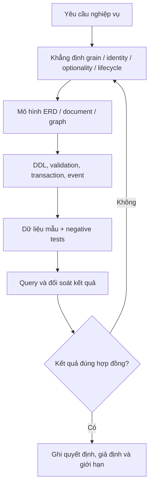
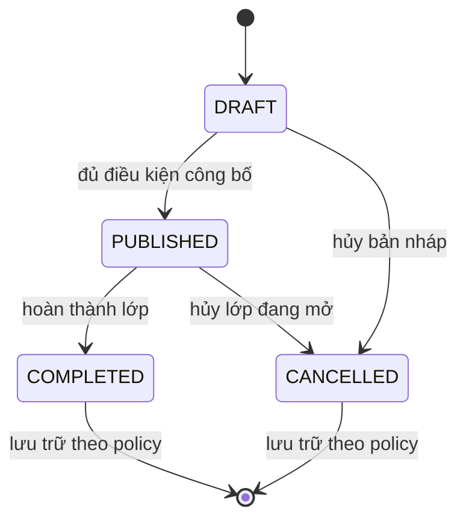
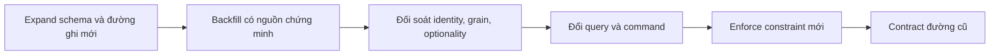

# Kiểm tra độ hạt, định danh, tính tùy chọn và vòng đời

## 1. Vì sao cần kiểm chứng thiết kế trước khi triển khai?

Một lược đồ dữ liệu có thể tạo bảng thành công, có đủ khóa ngoại, truy vấn được và vẫn **mô hình hóa sai nghiệp vụ**. Những lỗi nền tảng thường không nằm ở cú pháp SQL mà ở bốn câu hỏi chưa được trả lời nhất quán:

1. **Độ hạt (grain):** Mỗi dòng, tài liệu hoặc nút/cạnh biểu diễn chính xác một điều gì?
2. **Định danh (identity):** Khi nào hai bản ghi là cùng một thực thể, khi nào là hai thực thể khác nhau?
3. **Tính tùy chọn (optionality):** Thực thể có thể tồn tại khi chưa có thuộc tính hoặc quan hệ này không? “Không có” có nghĩa gì?
4. **Vòng đời (lifecycle):** Thực thể sinh ra, thay đổi trạng thái, hết hiệu lực, bị hủy, lưu giữ và xóa thế nào?

Ví dụ một hệ thống học trực tuyến bán khóa học cho doanh nghiệp. Người thiết kế lập bảng `enrollments(learner_id, course_id, status, ...)` và đặt `UNIQUE(learner_id, course_id)`. Sau đó nghiệp vụ phát sinh:

- Một học viên được học lại **cùng khóa** ở một **đợt/lớp khác**.
- Một học viên bị hủy đăng ký rồi được ghi danh lại đúng lớp, tùy chính sách.
- Một lớp được tạo khi chưa có giảng viên.
- Một đơn hàng đã chốt không được sửa giá dù khóa học đổi giá.
- Hai doanh nghiệp có học viên mang cùng mã nội bộ.
- Một lần ghi danh đang xử lý bị retry vì client timeout.

Nếu không kiểm chứng bốn câu hỏi, hệ thống có thể chặn nhầm việc hợp lệ, cho phép ghi trùng, liên kết sai doanh nghiệp hoặc đánh mất lịch sử.

Bài thuộc chương **Kiểm chứng thiết kế** của mô-đun **DATABASE_DATA_MODELING**. Mô-đun rèn kỹ năng chuyển yêu cầu nghiệp vụ thành mô hình dữ liệu từ thực thể, quan hệ và ràng buộc đến khóa, chỉ mục và lược đồ vật lý; so sánh cấu trúc quan hệ, document, đồ thị và phân tích để chọn thiết kế phù hợp, dễ tiến hóa và kiểm chứng.

**Kết quả học tập:** bạn sẽ biết xây ma trận giả định–bất biến–bằng chứng, kiểm chứng grain, identity, optionality, lifecycle bằng dữ liệu và câu truy vấn, rồi chuyển những quy tắc đúng vào DDL, transaction, API, sự kiện và bộ test.

## 2. Phân biệt “thiết kế có vẻ hợp lý” và “thiết kế được kiểm chứng”

Một biểu đồ ERD đẹp chưa phải bằng chứng rằng lược đồ đúng. Bằng chứng cần chỉ ra mỗi quyết định mô hình **bắt nguồn từ câu hỏi nghiệp vụ** và **được kiểm tra bằng tình huống cụ thể**.

| Thành phần | Câu hỏi phải trả lời | Bằng chứng cần có |
| --- | --- | --- |
| Grain | Một row biểu diễn một thực thể, phiên bản, lần thử hay giao dịch? | Câu phát biểu grain, dữ liệu biên, phép đếm |
| Identity | Cái gì làm hai row là cùng đối tượng? | Business key, phạm vi duy nhất, chính sách đổi/gộp ID |
| Optionality | Trường/quan hệ nào bắt buộc và ở giai đoạn nào? | Bảng quy tắc theo trạng thái, tình huống thiếu và SQL constraint |
| Lifecycle | Trạng thái nào tồn tại và chuyển thế nào? | State machine, transition table, transaction tests |
| Time | “Tại lúc nào” có nghĩa gì? | Mốc hiệu lực, sự kiện, UTC/zone, biên khoảng |
| Scope | Thuộc tổ chức hoặc quyền nào? | Khóa có namespace, policy, negative tests |
| Evolution | Khi yêu cầu đổi có giữ dữ liệu cũ đúng nghĩa không? | Kịch bản migration, backward compatibility |
| Query | Có trả đúng số dòng, đúng ý nghĩa và không đếm đôi? | Query samples, EXPLAIN, invariant checks |

Cách kiểm chứng nên kết hợp **kiểm chứng ngữ nghĩa**, **kiểm chứng ràng buộc vật lý** và **kiểm chứng hành vi**:



Một bài kiểm chứng tốt thử cả **dữ liệu hợp lệ** và **dữ liệu phải bị từ chối**; chỉ INSERT vài dòng “đẹp” là chưa đủ.

## 3. Độ hạt là gì và vì sao phải nói bằng một câu?

**Grain** mô tả **đơn vị chính xác của mỗi bản ghi**. Nếu không thể nói “một dòng là một ...” bằng một câu không mơ hồ, mô hình chưa đủ rõ để kiểm chứng.

Ví dụ:

- `Learner`: một hồ sơ học viên trong một tổ chức.
- `CourseTemplate`: một định nghĩa nội dung khóa học được sở hữu bởi một chủ thể.
- `ClassOffering`: một lần tổ chức/đợt mở lớp của một khóa học.
- `Enrollment`: một lượt đăng ký của một học viên vào một đợt mở lớp.
- `EnrollmentAttempt`: một lần gửi yêu cầu đăng ký, **không nhất thiết tạo một enrollment**.
- `LessonCompletion`: một sự kiện hoàn thành bài học hoặc một trạng thái hoàn thành, tùy định nghĩa.
- `OrderLine`: một dòng hàng trong một đơn có giá/số lượng được chốt.
- `DailyEnrollmentSnapshot`: một ảnh chụp số ghi danh ở một thời điểm/cấp nhóm xác định.

### 3.1. Cùng các trường, nhưng grain khác nhau

So sánh:

```text
enrollments:
  tenant_id, learner_id, offering_id, status

enrollment_attempts:
  tenant_id, attempt_id, learner_id, offering_id,
  request_time, outcome

enrollment_events:
  tenant_id, event_id, enrollment_id, event_type,
  occurred_at
```

Ba bảng có thể cùng chứa learner/offering ID nhưng trả lời ba câu hỏi khác nhau:

- **Hiện có một enrollment nào?**
- **Đã có bao nhiêu lần thử đăng ký?**
- **Những sự kiện nào đã xảy ra trong vòng đời enrollment?**

Nếu một người bấm “Đăng ký” hai lần vì mạng chậm, có thể có **hai HTTP attempts**, **một command đã commit**, **một enrollment** và **một event nghiệp vụ**. Không được gộp mọi đối tượng đó vào một grain chỉ vì chúng có chung learner và offering.

### 3.2. Các grain phổ biến trong mô hình phân tích

| Loại | Một dòng là gì? | Ví dụ |
| --- | --- | --- |
| **Entity state** | Một thực thể đang được quản lý | Một Learner hiện hành |
| **Entity version / SCD2** | Một phiên bản có hiệu lực của thực thể | Địa chỉ học viên từ T1 đến T2 |
| **Transaction fact** | Một sự kiện hoặc dòng giao dịch | Một order line đã chốt |
| **Periodic snapshot fact** | Một ảnh chụp theo chu kỳ | Số học viên đang học cuối mỗi ngày |
| **Accumulating snapshot fact** | Một quy trình có nhiều mốc tiến triển | Một hồ sơ ghi danh với thời điểm đăng ký, duyệt, kết thúc |
| **Event log** | Một sự kiện với ID riêng | EnrollmentCancelled |
| **Relationship** | Một quan hệ theo phạm vi/hiệu lực | Học viên được phân công lớp ở kỳ X |

Tên bảng không quyết định grain. `payments` có thể là **một yêu cầu thanh toán**, **một lần thử gateway**, **một giao dịch đã ghi nhận** hoặc **một bút toán sổ cái**; mỗi cách đặt grain sẽ cho khóa và quy tắc đếm khác nhau.

## 4. Kiểm chứng grain qua phép đếm và trường hợp biên

### 4.1. Lập một bảng “khi nào tạo dòng mới?”

| Thay đổi trong nghiệp vụ | Tạo Learner mới? | Tạo Enrollment mới? | Tạo Attempt/Event mới? |
| --- | --- | --- | --- |
| Sửa tên hiển thị học viên | Không | Không | Có thể tạo audit event |
| Học viên thử đăng ký nhưng hết chỗ | Không | Không | Có attempt thất bại |
| Học viên đăng ký thành công lớp L1 | Không | Có nếu chưa có theo quy tắc | Có event và attempt |
| Client retry cùng command đã commit | Không | Không | Có thể ghi technical attempt, không ghi lại nghiệp vụ |
| Học viên được phép học lại khóa ở lớp L2 | Không | Có | Có |
| Học viên hủy L1 | Không | Không nếu chỉ đổi trạng thái | Có cancellation event |
| Học viên tái đăng ký L1 sau khi hủy | Không | Tùy mô hình “một enrollment trọn đời” hay “nhiều lần ghi danh” | Có command/event |

Hàng cuối không có một đáp án toàn cầu. Nhóm thiết kế phải chọn:

- **Phương án A:** một Enrollment duy nhất cho cặp learner–offering, tái đăng ký cập nhật vòng đời của chính row đó.
- **Phương án B:** mỗi lần đăng ký được chấp nhận là một Enrollment mới, với `enrollment_id` riêng và khóa chống hai enrollment **đang hiệu lực** cùng lúc.

Hai phương án khác nhau về grain, lịch sử, unique constraint và báo cáo. Nếu nghiệp vụ chưa phân biệt, phải ghi giả định và đưa câu hỏi vào buổi xác nhận nghiệp vụ.

### 4.2. Kiểm tra fan-out do trộn grain

Giả sử `orders` có một dòng/đơn, `order_lines` có nhiều dòng/đơn và `payments` có nhiều lần thử/đơn:

```text
Order O-1: total = 200
  2 order lines
  3 payment attempts
```

Truy vấn:

```sql
SELECT SUM(o.total_minor)
FROM orders AS o
JOIN order_lines AS l ON l.order_id = o.order_id
JOIN payment_attempts AS p ON p.order_id = o.order_id;
```

có thể tính tổng của đơn O-1 **6 lần** vì `2 × 3` tổ hợp join. Đây là lỗi **không tương thích grain**, không phải đơn giản thiếu `DISTINCT`.

Cách sửa phụ thuộc câu hỏi:

- Cần tổng tiền đơn: cộng từ grain order, không join các bảng 1–n không cần.
- Cần tổng tiền của dòng hàng: cộng từ grain order line.
- Cần số lần thử thanh toán: đếm ở grain attempt.
- Cần kết hợp số đo từ hai bảng 1–n: tổng hợp riêng mỗi nguồn về cùng grain, rồi mới JOIN kết quả đã tổng hợp.

### 4.3. Dấu hiệu grain có vấn đề

- Một dòng phải chứa mảng không giới hạn chỉ để ghi mọi lần thay đổi.
- Có nhiều cột `date1/date2/date3` chỉ để chứa “lần thứ nhất, lần thứ hai”.
- Một khóa duy nhất ngăn nghiệp vụ “học lại” dù nó hợp lệ.
- Tổng số giao dịch tăng sau khi JOIN bảng mô tả.
- Một phép xóa phải đoán có xóa bản ghi lịch sử hay chỉ trạng thái hiện hành.
- “Đơn đã thanh toán” và “lần thử thanh toán thành công” bị dùng như cùng metric.

**Kiểm chứng grain phải diễn ra trước tối ưu index**. Index không sửa được semantics của đơn vị dữ liệu.

## 5. Định danh: business identity, record identity và version identity

**Identity** cần trả lời: hai dòng nào cùng một thực thể xuyên thay đổi, và điều gì làm chúng là hai bản ghi nghiệp vụ khác nhau?

### 5.1. Những loại khóa cần phân biệt

- **Business key:** giá trị có nghĩa nghiệp vụ hoặc do nguồn thẩm quyền cấp để nhận diện thực thể.
- **Surrogate key:** khóa kỹ thuật nhận diện một row hoặc phiên bản, ví dụ ID sinh từ sequence.
- **Durable key:** định danh ổn định xuyên nhiều phiên bản/nguồn khi mô hình cần.
- **Composite key:** nhiều trường tạo thành identity đúng phạm vi, ví dụ `(tenant_id, learner_code)`.
- **Event ID:** nhận diện một sự kiện, khác với ID aggregate hoặc ID của HTTP request.
- **Idempotency key:** nhận diện một ý định xử lý lặp lại trong một phạm vi/quy tắc thời hạn nhất định.

Ví dụ:

```text
Learner identity:
  (tenant_id = ORG-A, learner_code = U-100)

Enrollment identity:
  (tenant_id = ORG-A, enrollment_id = E-501)

CourseOffering identity:
  (tenant_id = ORG-A, offering_id = L-2026-11)

Event identity:
  event_id = 88f5...

Request idempotency scope:
  (tenant_id, command_type, idempotency_key)
```

Hai tổ chức có thể cùng dùng mã `U-100` nhưng không có nghĩa đó là cùng người. UUID globally unique giảm xác suất trùng ID nhưng không thay thế chính sách sở hữu, phân quyền hay đối soát danh tính.

### 5.2. Các câu hỏi buộc phải hỏi về identity

1. Ai cấp khóa? Có bảo đảm duy nhất toàn hệ thống hay chỉ trong một tenant/source?
2. Khóa có thể thay đổi, bị thu hồi hoặc tái sử dụng không?
3. Một người có thể sở hữu nhiều hồ sơ trong hai tổ chức không?
4. Nếu hai hồ sơ bị xác nhận là trùng, có merge không? Dữ liệu lịch sử sẽ trỏ vào đâu?
5. Nếu một hồ sơ bị tách thành hai thực thể vì nhập sai, có tách link lịch sử được không?
6. Một command retry có tạo thêm cùng thực thể không?
7. Khi import từ CRM khác, mã nguồn có namespace không?
8. Nếu xóa bản ghi, có được tái sử dụng business key cũ cho người mới không?

**Tên, email và số điện thoại thường không phù hợp làm định danh bền vững** khi chúng có thể đổi, trùng, tái sử dụng hoặc chứa dữ liệu cá nhân. Có thể dùng để tìm kiếm hoặc làm tín hiệu đối soát với chính sách rõ, không mặc định là same-as identity.

### 5.3. Chính sách không tái sử dụng ID

Ví dụ, Enrollment `E-501` bị hủy. Nếu sau đó ID này được cấp cho một Enrollment khác, các event cũ, chứng từ và báo cáo sẽ mơ hồ.

Một quy tắc đơn giản:

```text
Identity của một Enrollment không được tái sử dụng
cho một lần ghi danh có identity khác, kể cả sau hủy.
```

Nếu có yêu cầu xóa dữ liệu cá nhân, hệ thống vẫn phải tuân theo chính sách xóa và lưu giữ. Điều đó không tự buộc giữ toàn bộ payload mãi mãi; có thể cần một registry/tombstone tối thiểu trong thời hạn được phép để chống tái sử dụng theo hợp đồng.

## 6. Kiểm chứng định danh bằng khóa, ràng buộc và tình huống merge/split

### 6.1. Khóa chính và unique là hai quyết định khác nhau

Một bảng có thể dùng surrogate PK:

```sql
CREATE TABLE learners (
    learner_sk bigint GENERATED ALWAYS AS IDENTITY PRIMARY KEY,
    tenant_id text NOT NULL,
    learner_code text NOT NULL,
    display_name text NOT NULL,
    UNIQUE (tenant_id, learner_code)
);
```

Trong ví dụ:

- `learner_sk` là khóa row kỹ thuật.
- `(tenant_id, learner_code)` là identity nghiệp vụ cần duy nhất.
- `display_name` không phải key.
- FK từ Enrollment có thể trỏ `learner_sk`, nhưng nếu giữ `tenant_id` riêng ở Enrollment thì phải kiểm chứng **FK không làm tham chiếu chéo tenant**.

Surrogate PK không thay thế unique business key nếu nghiệp vụ thực sự cấm hai hồ sơ cùng mã trong một tenant.

### 6.2. Composite FK bảo vệ phạm vi

Một thiết kế khác dùng composite PK:

```sql
CREATE TABLE learners_by_tenant (
    tenant_id text NOT NULL,
    learner_code text NOT NULL,
    display_name text NOT NULL,
    PRIMARY KEY (tenant_id, learner_code)
);

CREATE TABLE offerings_by_tenant (
    tenant_id text NOT NULL,
    offering_code text NOT NULL,
    title text NOT NULL,
    PRIMARY KEY (tenant_id, offering_code)
);

CREATE TABLE enrollments_by_tenant (
    tenant_id text NOT NULL,
    enrollment_id text NOT NULL,
    learner_code text NOT NULL,
    offering_code text NOT NULL,
    status text NOT NULL,
    PRIMARY KEY (tenant_id, enrollment_id),
    FOREIGN KEY (tenant_id, learner_code)
       REFERENCES learners_by_tenant (tenant_id, learner_code),
    FOREIGN KEY (tenant_id, offering_code)
       REFERENCES offerings_by_tenant (tenant_id, offering_code)
);
```

Một Enrollment của tenant A không được trỏ tới Learner tenant B chỉ vì cùng mã `learner_code`. Việc thêm `tenant_id` vào cả hai FK là một **bằng chứng vật lý** cho ranh giới tham chiếu nội tenant.

Nếu nghiệp vụ cho phép enrollment xuyên tenant, cần một mô hình cấp quyền riêng. Không nên xóa điều kiện tenant khỏi FK mà chưa mô tả quyền và ownership.

### 6.3. Kiểm chứng identity với dữ liệu cố ý trùng

Tập test phải chứa:

```text
(ORG-A, U-100) -> An
(ORG-B, U-100) -> Bình
(ORG-A, U-101) -> Chi
```

Kỳ vọng:

- Ba hồ sơ hợp lệ, không được gộp A/U-100 và B/U-100.
- Tạo thêm A/U-100 phải bị unique constraint hoặc logic nghiệp vụ từ chối.
- Một Enrollment của A không được tham chiếu hồ sơ của B.
- Query/read model/cache phải dùng đủ scope.

### 6.4. Merge/split identity không được xử lý bằng đổi chuỗi ID tùy ý

Nếu nguồn phát hiện hai mã trong tenant cùng là một học viên, cần:

- Quy trình xác minh, audit và nguồn phê duyệt.
- Quy tắc chọn durable identity/canonical profile.
- Mapping alias cũ → identity mới có hiệu lực và provenance.
- Phương án xử lý quan hệ và fact lịch sử.
- Khả năng đảo hoặc điều chỉnh nếu merge sai.

Nếu tách một hồ sơ sai gộp, việc cập nhật mọi FK bằng một câu UPDATE không thể khôi phục nguồn chứng cứ đã mất. Vì vậy identity resolution là một **quyết định nghiệp vụ có lịch sử**, không chỉ thao tác làm sạch dữ liệu.

## 7. Tính tùy chọn: thiếu giá trị khác thiếu quan hệ

Một thuộc tính hoặc quan hệ có thể:

- **Bắt buộc từ khi tạo:** mỗi Enrollment phải có người học và lớp.
- **Tùy chọn khi tạo, bắt buộc trước một mốc:** lớp có thể chưa có giảng viên ở DRAFT nhưng phải có trước PUBLISHED.
- **Tùy chọn vĩnh viễn:** một học viên có thể không có avatar.
- **Không áp dụng:** một loại khóa học không cần phòng học vật lý.
- **Chưa biết hoặc chưa được xác minh:** nơi cư trú chưa được cung cấp.
- **Tạm thời chưa có vì xử lý bất đồng bộ:** payment reference chưa tới.
- **Được xóa/ẩn theo chính sách dữ liệu:** không còn hiển thị dù từng có giá trị.

Những tình huống này **không cùng nghĩa**. Một cột nullable có thể biểu diễn nhiều lý do khác nhau, nhưng nếu nghiệp vụ phải phân biệt thì cần trạng thái hoặc cấu trúc rõ.

### 7.1. Optionality và cardinality ở hai phía quan hệ

Với quan hệ Learner–Enrollment–Offering:

```text
Một Enrollment:
  phải trỏ tới đúng một Learner
  phải trỏ tới đúng một Offering

Một Learner:
  có thể có 0..n Enrollment

Một Offering:
  có thể có 0..n Enrollment
```

Với một lớp và giảng viên:

```text
Một Offering ở DRAFT:
  có thể có 0..n InstructorAssignment

Một Offering ở PUBLISHED:
  phải có >= 1 InstructorAssignment đang hiệu lực

Một Instructor:
  có thể phụ trách 0..n Offering
```

Cardinality cần mô tả cả **min** và **max** ở từng phía. Chỉ viết “one-to-many” mà không ghi `0..n` hay `1..n` có thể làm mất điều kiện bắt buộc.

### 7.2. Kiểm chứng bằng bảng trạng thái

| Thuộc tính/quan hệ | DRAFT | PUBLISHED | COMPLETED | Giải thích |
| --- | --- | --- | --- | --- |
| `offering.title` | Bắt buộc | Bắt buộc | Bắt buộc | Danh tính hiển thị tối thiểu |
| `offering.instructor` | Có thể thiếu | Ít nhất một người hợp lệ | Giữ lịch sử phân công | Điều kiện xuất bản |
| `offering.start_at` | Có thể thiếu | Bắt buộc | Bắt buộc, không xóa lịch sử | Mốc vận hành |
| `offering.room` | Không áp dụng nếu online | Có thể tùy loại | Lưu snapshot nếu cần | Phụ thuộc modality |
| `offering.cancel_reason` | Chưa áp dụng | Chưa áp dụng | Không bắt buộc trừ khi bị CANCELLED | Điều kiện trạng thái |
| `learner.avatar` | Tùy chọn | Tùy chọn | Tùy chọn | Không phải dữ kiện nghiệp vụ bắt buộc |

Đôi khi có nhiều trạng thái liên quan hơn (ví dụ `CANCELLED`); bảng trên chỉ minh họa nguyên tắc **bắt buộc theo giai đoạn**, không phải vòng đời duy nhất cho mọi lớp.

### 7.3. Quy tắc phải nói rõ “đến khi nào”

Câu “lớp cần giảng viên” chưa đủ. Hãy sửa thành:

> “Lớp ở trạng thái PUBLISHED phải có ít nhất một phân công giảng viên hợp lệ ở thời điểm công bố.”

Câu này cho phép kiểm chứng command `PublishOffering` một cách chính xác và tránh cấm tạo bản nháp chưa đủ thông tin.

## 8. NULL, absent và unknown: đừng gộp mọi trạng thái thiếu thành một

Trong SQL, `NULL` biểu thị giá trị không có theo ngữ nghĩa của mô hình; trong logic ba giá trị, phép so sánh `column = NULL` không trả TRUE. Phải dùng `IS NULL` / `IS NOT NULL` khi kiểm tra.

```sql
-- Tìm lớp chưa có giảng viên trong cột minh họa.
SELECT offering_id
FROM offerings
WHERE instructor_id IS NULL;
```

Tuy nhiên, điều kiện này **không nói vì sao thiếu**. Nếu cần phân biệt:

```text
instructor_state:
  UNASSIGNED
  ASSIGNING
  ASSIGNED
  NOT_REQUIRED
```

thì có thể dùng trạng thái và ràng buộc tương ứng hoặc mô hình bảng phân công riêng. Đừng đưa mã giả như `instructor_id = 'UNKNOWN'` vào FK thật chỉ để tránh NULL nếu “UNKNOWN” không phải một giảng viên nghiệp vụ.

### 8.1. Khác biệt giữa các kiểu lưu

| Hệ/mô hình | Cách biểu diễn | Rủi ro kiểm chứng |
| --- | --- | --- |
| SQL quan hệ | `NULL`, bảng con 0 row, state column | NULL và không tồn tại quan hệ dễ bị nhầm |
| JSON/document | Trường vắng mặt, JSON `null`, mảng rỗng | Ba trạng thái có thể có nghĩa khác nhau; schema validator phải định nghĩa |
| Graph | Không có cạnh, cạnh tồn tại, thuộc tính cạnh vắng mặt | Vắng cạnh có thể là chưa biết hoặc không liên hệ |
| Event | Chưa có event, event tạo, event xóa/cancel | “Chưa thấy event” không chứng minh nghiệp vụ chưa xảy ra |
| Analytics | Unknown member, `NULL` dimension FK, “Not applicable” | Trộn unknown/N/A có thể làm sai báo cáo |

### 8.2. Quy tắc ba giá trị và uniqueness

```sql
SELECT *
FROM learners
WHERE phone_number = NULL; -- sai nếu muốn tìm giá trị NULL
```

Trong SQL, phép so sánh với NULL cho kết quả UNKNOWN, nên dùng:

```sql
SELECT *
FROM learners
WHERE phone_number IS NULL;
```

Ở PostgreSQL, một UNIQUE constraint thông thường có thể chấp nhận **nhiều giá trị NULL**, vì NULL không được coi bằng nhau theo semantics mặc định. Nếu nghiệp vụ yêu cầu tối đa một hồ sơ có giá trị NULL (ít gặp), phải chọn constraint phù hợp với phiên bản/engine; không suy từ chữ UNIQUE rằng NULL chỉ xuất hiện một lần.

### 8.3. Tạo điều kiện có cấu trúc thay vì đoán

Ví dụ `room_id` chỉ áp dụng cho lớp trực tiếp:

```sql
CHECK (
  (delivery_mode = 'ONLINE' AND room_id IS NULL)
  OR
  (delivery_mode = 'ONSITE' AND room_id IS NOT NULL)
)
```

Đây là một **quy tắc minh họa**; nếu lớp hybrid cho phép phòng học tùy chọn, constraint phải đổi theo nghiệp vụ. Đừng nâng một giả định thành quy tắc bắt buộc cho mọi sản phẩm.

## 9. Kiểm chứng tính tùy chọn bằng ràng buộc có điều kiện

### 9.1. NOT NULL không thể biểu diễn mọi điều kiện theo trạng thái

Nếu `learner_id` bắt buộc ở mọi Enrollment, dùng `NOT NULL`. Nhưng nếu lớp DRAFT được phép thiếu `start_at`, đặt `start_at NOT NULL` ngay từ lúc tạo sẽ **cấm một tình huống hợp lệ**.

Có thể dùng một `CHECK` điều kiện trên **cùng một row**:

```sql
CREATE TABLE offering_drafts (
    tenant_id text NOT NULL,
    offering_id text NOT NULL,
    status text NOT NULL,
    title text NOT NULL,
    start_at timestamptz,
    delivery_mode text NOT NULL,
    room_id text,
    PRIMARY KEY (tenant_id, offering_id),
    CHECK (status IN ('DRAFT','PUBLISHED','COMPLETED','CANCELLED')),
    CHECK (delivery_mode IN ('ONLINE','ONSITE')),
    CHECK (status <> 'PUBLISHED' OR start_at IS NOT NULL),
    CHECK (delivery_mode <> 'ONLINE' OR room_id IS NULL)
);
```

Đây là quy tắc minh họa: nếu `COMPLETED` cũng bắt buộc phải có `start_at` hoặc một lớp hybrid được phép có phòng, phải sửa CHECK. Không sao chép constraint khi chưa chốt semantics.

### 9.2. “Có ít nhất một bản ghi con” không phải CHECK đơn giản

Yêu cầu “lớp PUBLISHED có ít nhất một giảng viên” liên quan nhiều row:

```text
course_offerings(tenant_id, offering_id, status)
instructor_assignments(tenant_id, offering_id, instructor_id)
```

Một CHECK chỉ đọc row của chính bảng không bảo vệ được sự tồn tại của row ở bảng khác. Command `PublishOffering` phải kiểm tra phân công trong **ranh giới transaction phù hợp**, đồng thời bảo vệ khỏi transaction khác gỡ giảng viên cuối cùng ngay trước/sau lúc publish.

Một giải pháp là quy định mọi thao tác publish/gỡ phân công đều khóa cùng row Offering như điểm điều phối, dùng isolation/retry thích hợp, và có test ghi đồng thời. Trigger hoặc deferred constraint có thể là lựa chọn ở engine hỗ trợ, nhưng vẫn phải kiểm chứng thứ tự và giao dịch.

### 9.3. FK ghép có cột NULL cần được xem xét

Trong PostgreSQL với composite FK theo semantics mặc định `MATCH SIMPLE`, nếu một thành phần của khóa tham chiếu là NULL thì việc kiểm tra có thể không diễn ra như người thiết kế mong đợi. Đối với quan hệ **bắt buộc**, nên đặt NOT NULL cho các cột liên quan:

```sql
tenant_id text NOT NULL,
learner_id text NOT NULL,
FOREIGN KEY (tenant_id, learner_id)
  REFERENCES learners_by_tenant(tenant_id, learner_id)
```

Bản thân FK không chứng minh “luôn có một Learner” nếu cột tham chiếu cho phép không có giá trị theo một quy tắc khác.

### 9.4. Cardinality lớn nhất cũng có thể là bất biến

“Offering có 0..n Enrollment” chưa phản ánh ràng buộc sức chứa 30 chỗ. Số Enrollment **chiếm chỗ** không được vượt capacity; điều đó có thể yêu cầu atomic conditional update, reservation ledger, transaction và kiểm tra số liệu. Một mũi tên one-to-many trên ERD không bảo vệ điều kiện số lượng.

## 10. Vòng đời cần state machine, không chỉ cột status

Một vòng đời lớp học ứng viên:



Đây **không phải sơ đồ chung cho mọi sản phẩm**. Có nơi cần SUSPENDED, REOPENED hoặc chỉ cho hủy trước giờ bắt đầu. Thiết kế phải dựa vào quy tắc thật.

### 10.1. Ma trận chuyển trạng thái

| Từ | Sang | Điều kiện | Hệ quả |
| --- | --- | --- | --- |
| DRAFT | PUBLISHED | Có lịch, giảng viên, quyền công bố | Cho phép ghi danh |
| DRAFT | CANCELLED | Có lý do/quyền hủy theo policy | Không thể publish tiếp nếu policy cấm |
| PUBLISHED | COMPLETED | Đáp ứng điều kiện đóng lớp | Chốt kết quả/tiến độ |
| PUBLISHED | CANCELLED | Có quyền, áp dụng chính sách người đã đăng ký | Hoàn/chuyển lớp nếu cần |
| COMPLETED | PUBLISHED | Bị cấm trong ví dụ | Mở đợt khác nếu muốn học lại |
| CANCELLED | PUBLISHED | Bị cấm trong ví dụ | Không tự hồi sinh lớp |

**State transition phải bảo vệ quyền, điều kiện trước và hậu quả**, không chỉ `UPDATE status='PUBLISHED'`.

### 10.2. Một trạng thái thường kéo theo optionality khác

- DRAFT: `start_at` và giảng viên có thể thiếu.
- PUBLISHED: bắt buộc có `start_at` và phân công hợp lệ.
- COMPLETED: cần thời điểm hoàn thành theo hợp đồng nghiệp vụ.
- CANCELLED: nếu cần phân tích nguyên nhân, phải ghi lý do và thời điểm hủy.
- ARCHIVED: có thể là metadata lưu trữ riêng, không nhất thiết thay status nghiệp vụ.

Một thiết kế có `is_active`, `is_deleted`, `status` cùng lúc cần định nghĩa tổ hợp hợp lệ. Nếu không, `status='COMPLETED'` và `is_active=true` có thể không rõ là đúng hay sai.

### 10.3. Status hiện hành không cho biết mọi lần chuyển

Nếu chỉ còn `status=COMPLETED` thì không suy được chính xác lúc publish, ai duyệt, lần thử thất bại hoặc lịch sử hủy rồi mở lại. Nếu cần lịch sử, hãy lưu state-transition log hoặc event history với identity, version, actor và thời gian.

## 11. Kiểm chứng concurrency, version và idempotency

### 11.1. Một chuyển trạng thái có điều kiện

Giả sử Offering đang DRAFT, version 7. Sau khi kiểm tra các điều kiện trong transaction:

```sql
UPDATE course_offerings
SET status = 'PUBLISHED',
    version = version + 1,
    published_at = now()
WHERE tenant_id = :tenant_id
  AND offering_id = :offering_id
  AND status = 'DRAFT'
  AND version = 7
RETURNING offering_id, status, version;
```

Nếu trả 0 dòng, command không được báo thành công. Có thể bản ghi đã đổi trạng thái hoặc ghi cạnh tranh. Ứng dụng phải phân loại lỗi an toàn.

**Giới hạn:** UPDATE trên chưa tự kiểm chứng “có giảng viên” nếu bảng phân công được cập nhật đồng thời bởi luồng khác. Phải điều phối các thao tác liên quan cùng invariant.

### 11.2. Phân biệt request, command, enrollment và event

```text
request_id:
  một lần gọi kỹ thuật, retry có thể có request_id mới

idempotency_key:
  nhận diện cùng ý định được retry trong phạm vi
  (tenant_id, command_type, key)

enrollment_id:
  danh tính một bản ghi ghi danh được chấp nhận

event_id:
  danh tính một sự kiện nghiệp vụ đã công bố
```

Nếu client timeout sau khi command commit, lần retry với cùng idempotency key phải không tạo Enrollment thứ hai. Mặt khác, **hai idempotency key khác nhau** vẫn có thể yêu cầu cùng cặp learner–offering; business uniqueness phải chặn theo chính sách.

### 11.3. Capacity phải được bảo vệ tại commit

Một lớp còn một chỗ. Hai học viên cùng đọc dashboard thấy còn một chỗ — đây là read model có thể trễ.

```sql
UPDATE course_offerings
SET reserved_count = reserved_count + 1,
    version = version + 1
WHERE tenant_id = :tenant_id
  AND offering_id = :offering_id
  AND status = 'PUBLISHED'
  AND reserved_count < capacity
RETURNING offering_id, reserved_count;
```

Chỉ nếu UPDATE thành công và tạo Enrollment trong **cùng transaction/ranh giới consistency**, mới chấp nhận ghi danh. Nếu INSERT Enrollment lỗi, rollback giữ chỗ. Quy trình hủy/hoàn chỗ phải có đối soát để counter không lệch thực tế.

### 11.4. Test ghi đồng thời

```text
Ban đầu:
  capacity=1, reserved_count=0

Hai lệnh đồng thời:
  Enroll(learner A)
  Enroll(learner B)

Kỳ vọng:
  đúng 1 Enrollment chiếm chỗ
  reserved_count=1
  lệnh còn lại trả kết quả hết chỗ hoặc chờ theo policy
```

Nếu chỉ chạy hai lệnh **tuần tự**, không chứng minh được an toàn với race condition.

## 12. Vòng đời và thời gian: khi nào một trạng thái có hiệu lực?

Một thực thể có thể có nhiều mốc:

| Trường | Ý nghĩa |
| --- | --- |
| `created_at` | Hệ thống tạo bản ghi |
| `occurred_at` | Sự kiện nghiệp vụ xảy ra |
| `effective_from` | Mốc bắt đầu hiệu lực |
| `effective_to` | Mốc kết thúc hiệu lực |
| `recorded_at` | Kho nhận/ghi nhận thông tin |
| `updated_at` | Lần sửa kỹ thuật gần nhất |
| `cancelled_at` | Mốc hủy theo nghiệp vụ |
| `deleted_at` | Mốc xóa/ẩn theo chính sách |

Các mốc này không tự đồng nghĩa. Ghi danh xảy ra ngày 01/11, được nhập ngày 03/11 và có hiệu lực từ ngày 10/11 là ba sự kiện thời gian khác nhau.

### 12.1. Khoảng nửa mở chống chồng biên

Dùng `[effective_from, effective_to)` với điều kiện:

```text
effective_from <= t
AND (effective_to IS NULL OR t < effective_to)
```

Ví dụ:

```text
Giảng viên A: [2026-10-01, 2026-11-01)
Giảng viên B: [2026-11-01, 2026-12-01)
```

Tại đúng đầu tháng 11, A đã hết hiệu lực, B mới bắt đầu. Cần thống nhất timezone và độ chính xác timestamp.

### 12.2. Overlap khác gap

Nếu một lớp chỉ có **một giảng viên chính** ở mỗi thời điểm:

- **No overlap:** không có hai assignment PRIMARY cùng hiệu lực.
- **No gap:** ở giai đoạn PUBLISHED phải luôn có ít nhất một PRIMARY nếu nghiệp vụ yêu cầu.

PostgreSQL có thể dùng exclusion constraint trên khoảng để chặn overlap, nếu dữ liệu và extension phù hợp. **No gap** có thể cần quy trình transaction/kiểm thử riêng; cấm overlap không chứng minh phủ liên tục.

### 12.3. Phân biệt lịch sử nghiệp vụ với lịch sử hệ thống biết

- **Business valid time:** thuộc tính có hiệu lực khi nào.
- **System recorded time:** hệ thống biết/sửa thông tin khi nào.

Một thay đổi thực xảy ra 01/10 nhưng được gửi vào 15/11 làm hai trục khác nhau. Nếu phải trả lời “báo cáo ngày 20/10 đã biết gì?”, chỉ `effective_from/effective_to` theo nghiệp vụ chưa đủ; có thể cần lịch sử hệ thống hoặc mô hình bitemporal.

### 12.4. Xóa có nhiều nghĩa

- **Cancel:** dừng hiệu lực nghiệp vụ, có thể phải lưu lịch sử.
- **Archive/soft delete:** ẩn khỏi hoạt động thường ngày, cần xác định ai còn được đọc.
- **Erasure/physical delete:** xử lý dữ liệu theo chính sách áp dụng ở nguồn và bản sao.

Không coi `is_deleted=true` là đủ cho mọi yêu cầu bảo vệ dữ liệu, và không tự xóa lịch sử tài chính/học tập chỉ vì người dùng hủy một Enrollment.

## 13. Lược đồ quan hệ kiểm chứng cả bốn trục

Ví dụ PostgreSQL dưới đây chọn rõ **một Enrollment trọn vòng đời cho mỗi cặp (tenant, learner, offering)**. Nếu nghiệp vụ cho phép tạo các enrollment mới khi tái ghi danh cùng lớp, phải đổi grain và khóa.

```sql
CREATE TABLE dv_learners (
    tenant_id text NOT NULL,
    learner_id text NOT NULL,
    display_name text NOT NULL,
    PRIMARY KEY (tenant_id, learner_id)
);

CREATE TABLE dv_offerings (
    tenant_id text NOT NULL,
    offering_id text NOT NULL,
    title text NOT NULL,
    status text NOT NULL DEFAULT 'DRAFT',
    start_at timestamptz,
    capacity integer NOT NULL,
    reserved_count integer NOT NULL DEFAULT 0,
    version bigint NOT NULL DEFAULT 1,
    published_at timestamptz,
    cancelled_at timestamptz,
    PRIMARY KEY (tenant_id, offering_id),
    CHECK (status IN ('DRAFT','PUBLISHED','COMPLETED','CANCELLED')),
    CHECK (capacity >= 0),
    CHECK (reserved_count >= 0 AND reserved_count <= capacity),
    CHECK (version > 0),
    CHECK (
        status <> 'PUBLISHED'
        OR (start_at IS NOT NULL AND published_at IS NOT NULL)
    ),
    CHECK (status <> 'CANCELLED' OR cancelled_at IS NOT NULL)
);

CREATE TABLE dv_enrollments (
    tenant_id text NOT NULL,
    enrollment_id text NOT NULL,
    learner_id text NOT NULL,
    offering_id text NOT NULL,
    status text NOT NULL,
    enrolled_at timestamptz NOT NULL,
    cancelled_at timestamptz,
    version bigint NOT NULL DEFAULT 1,
    PRIMARY KEY (tenant_id, enrollment_id),
    UNIQUE (tenant_id, learner_id, offering_id),
    FOREIGN KEY (tenant_id, learner_id)
       REFERENCES dv_learners(tenant_id, learner_id),
    FOREIGN KEY (tenant_id, offering_id)
       REFERENCES dv_offerings(tenant_id, offering_id),
    CHECK (status IN ('ACTIVE','COMPLETED','CANCELLED')),
    CHECK (version > 0),
    CHECK (status <> 'CANCELLED' OR cancelled_at IS NOT NULL)
);

CREATE INDEX dv_enrollments_by_offering
ON dv_enrollments(tenant_id, offering_id, status);
```

### 13.1. DDL này bảo vệ điều gì?

- **Grain:** một row Enrollment cho một cặp learner–offering trong suốt vòng đời theo giả định.
- **Identity:** PK `(tenant_id, enrollment_id)` và UNIQUE `(tenant_id, learner_id, offering_id)`.
- **Scope:** composite FK giữ Learner và Offering cùng tenant.
- **Optionality:** `start_at` được thiếu ở DRAFT, nhưng không thiếu ở PUBLISHED.
- **Lifecycle:** status nằm trong tập giá trị và một số điều kiện theo trạng thái.
- **Capacity row:** counter không âm và không lớn hơn capacity ở mỗi row.

### 13.2. Những gì DDL chưa chứng minh?

- Chuyển trạng thái có đúng thứ tự không.
- Lớp PUBLISHED có người giảng dạy hợp lệ không.
- Quyền publish/cancel của người dùng.
- `reserved_count` có khớp các Enrollment thực sự chiếm chỗ không.
- Một lệnh retry có gây side effect lần hai không.
- Thời gian hiệu lực từ nguồn đến trễ có được xử lý đúng không.
- Xóa/thu hồi có lan tới cache và read projection không.

### 13.3. Nếu cho phép học lại cùng Offering

Khi cần nhiều lần đăng ký riêng cho cùng cặp, UNIQUE toàn đời trên là **quá chặt**. Có thể chuyển sang grain “một Enrollment cho một lần được nhận”, dùng `enrollment_id` riêng và kiểm soát **chỉ một Enrollment ACTIVE cho cùng cặp**:

```sql
-- Chỉ dùng sau khi bỏ UNIQUE toàn đời của DDL phía trên
-- và điều chỉnh chính sách chuyển trạng thái.
CREATE UNIQUE INDEX one_active_enrollment_per_pair
ON dv_enrollments(tenant_id, learner_id, offering_id)
WHERE status = 'ACTIVE';
```

Không thể vừa giữ UNIQUE toàn đời cũ vừa kỳ vọng partial unique cho phép tái đăng ký. Đây là **thay đổi grain**, phải migration cả dữ liệu, API và báo cáo.

## 14. SQL đối soát dữ liệu hiện có

### 14.1. Tìm trùng identity theo grain đã chọn

```sql
SELECT tenant_id, learner_id, offering_id, COUNT(*) AS n
FROM dv_enrollments
GROUP BY tenant_id, learner_id, offering_id
HAVING COUNT(*) > 1;
```

Kết quả phải rỗng trong mô hình một enrollment toàn đời. Nếu mô hình mới cho phép nhiều lần ghi danh, truy vấn này không còn là lỗi; cần kiểm tra các Enrollment ACTIVE hoặc khoảng hiệu lực chồng nhau.

### 14.2. Kiểm tra FK theo đúng tenant

```sql
SELECT e.tenant_id, e.enrollment_id,
       e.learner_id, e.offering_id
FROM dv_enrollments AS e
LEFT JOIN dv_learners AS l
  ON l.tenant_id = e.tenant_id
 AND l.learner_id = e.learner_id
LEFT JOIN dv_offerings AS o
  ON o.tenant_id = e.tenant_id
 AND o.offering_id = e.offering_id
WHERE l.learner_id IS NULL
   OR o.offering_id IS NULL;
```

Nếu FK được bật và dữ liệu hợp lệ, query trả 0. Nó hữu ích với staging/backfill khi constraint chưa sẵn có.

### 14.3. Kiểm tra thuộc tính bắt buộc theo trạng thái

```sql
SELECT tenant_id, offering_id, status, start_at, published_at
FROM dv_offerings
WHERE status = 'PUBLISHED'
  AND (start_at IS NULL OR published_at IS NULL);
```

### 14.4. Kiểm tra counter khác số Enrollment thực tế

Nếu `reserved_count` được định nghĩa đúng là số Enrollment ở trạng thái ACTIVE:

```sql
SELECT o.tenant_id, o.offering_id,
       o.reserved_count,
       COUNT(e.enrollment_id) AS active_enrollments
FROM dv_offerings AS o
LEFT JOIN dv_enrollments AS e
  ON e.tenant_id = o.tenant_id
 AND e.offering_id = o.offering_id
 AND e.status = 'ACTIVE'
GROUP BY o.tenant_id, o.offering_id, o.reserved_count
HAVING o.reserved_count <> COUNT(e.enrollment_id);
```

Nếu COMPLETED vẫn chiếm chỗ hoặc có reservation đang chờ, phép so sánh phải được sửa. **Không sửa dữ liệu cho khớp một công thức chưa được nghiệp vụ phê duyệt.**

## 15. Giao bất biến cho đúng tầng

| Bất biến | Bảo vệ chính | Bổ sung |
| --- | --- | --- |
| Learner code không trùng trong tenant | PK/UNIQUE | Kiểm thử migration |
| Enrollment tham chiếu đúng tenant | Composite FK | Authorization khi ghi |
| Số lượng > 0 | CHECK | Validation nhập liệu |
| PUBLISHED cần ít nhất một giảng viên | Command transaction/locking | Reconciliation |
| Capacity không âm/không vượt | Conditional write + transaction | Counter check |
| Chỉ role được phép publish | Authorization | Audit |
| Retry không tạo Enrollment mới | Idempotency + business UNIQUE | Logging |
| Projection không lộ tenant | Scoped key, RLS/ACL, query policy | Negative tests |
| Đúng metric cuối ngày | Nguồn sự thật + reconciliation | Cutoff/version |
| Không giữ dữ liệu nhạy cảm trái policy | Lifecycle workflow/retention | Audit và kiểm tra bản sao |

Không nên kỳ vọng một CHECK bảo vệ quy tắc liên quan tới nhiều bảng và người dùng. Cũng không nên chỉ tin frontend để bảo vệ invariant. **Các lớp phòng vệ bổ sung nhau.**

### 15.1. Một đường ghi được kiểm chứng

1. Xác thực người dùng và tenant.
2. Kiểm tra quyền và trạng thái Offering.
3. Kiểm tra capacity/điều kiện nghiệp vụ trong transaction.
4. Thực hiện ghi có điều kiện, xử lý version và idempotency.
5. Để PK/FK/UNIQUE/CHECK chặn sai sót còn lại.
6. Ghi outbox nếu cần projection đọc.
7. Đối soát kết quả nguồn với bản sao ở thời điểm phù hợp.

Nếu chỉ bảo vệ ở service, một batch import sai vẫn có thể bỏ qua. Nếu chỉ bảo vệ bằng DB, các quy tắc quyền và workflow phức tạp vẫn có thể sai.

## 16. Kiểm chứng trong document, graph và analytics

### 16.1. Document: một tài liệu đại diện cho gì?

```json
{
  "tenantId": "ORG-A",
  "offeringId": "L-2026-11",
  "status": "PUBLISHED",
  "instructors": [
    {"instructorId": "I-20", "assignedAt": "2026-10-01T00:00:00Z"}
  ]
}
```

Câu hỏi kiểm chứng:

- Document biểu diễn **một Offering hiện hành** hay **lịch sử mọi lần phân công**?
- `instructors` chứa người đang dạy hay cả người đã hết hiệu lực?
- Các instructor có cùng tenant hoặc được chia sẻ hợp lệ?
- Nếu mảng tăng theo năm, có nên tách collection Assignment không?
- Thao tác đồng thời ghi danh/cập nhật Offering có gây lost update không?
- JSON field absent, `null`, `[]` có semantics khác nhau không?

Schema validation có thể kiểm tra kiểu/trường, nhưng không tự thực thi mọi constraint liên document và quyền nghiệp vụ.

### 16.2. Graph: grain của cạnh là gì?

```text
(Learner)-[:ENROLLED_IN]->(Offering)
(Instructor)-[:TEACHES]->(Offering)
```

Cần xác định:

- Cạnh ENROLLED_IN là **trạng thái hiện hành** hay **một lần ghi danh lịch sử**?
- Có thể có hai cạnh giữa cùng cặp nút không? Nếu có, chúng khác identity bằng gì?
- Cạnh có thời gian hiệu lực không; có cấm overlap không?
- Các nút/cạnh có thuộc cùng tenant hoặc có grant hợp lệ không?
- Khi xóa cạnh, có mất dữ liệu cần audit không?

Nếu muốn lưu nhiều lần đăng ký mà chỉ dùng một cạnh duy nhất, cần một nút `Enrollment` có identity riêng hoặc một relationship model lưu sự kiện phù hợp.

### 16.3. Analytics: phép cộng phải phù hợp grain

```text
fact_enrollment_daily:
  snapshot_date, tenant_id, offering_id, active_count

Hỏi: số active cuối tháng?
  lấy snapshot tại ngày chốt và tổng theo offering.

Không đúng:
  SUM(active_count) qua 30 ngày
  nếu metric định nghĩa là số người đang active cuối tháng.
```

Một chỉ số snapshot có thể cộng theo offering trong cùng ngày nhưng **không cộng dồn theo ngày**. Kiểm chứng grain không chỉ là thiết kế khóa mà còn là phép tổng hợp được phép.

## 17. Từ yêu cầu sang bộ kiểm thử chấp nhận thiết kế

Một thiết kế được kiểm chứng khi có **testable assertions**: phát biểu cụ thể, cách tạo dữ liệu đầu vào, hành động, kết quả mong đợi và tầng chịu trách nhiệm.

### 17.1. Ma trận kiểm thử tối thiểu

| Trục | Tình huống | Kết quả mong đợi |
| --- | --- | --- |
| Grain | Một learner học cùng course ở hai offerings | Hai enrollment hợp lệ nếu khác offering |
| Grain | Client retry cùng lệnh ghi danh | Không tạo thêm Enrollment nghiệp vụ |
| Grain | JOIN order × line × payment attempt | Không nhân số tiền order |
| Identity | A/U-100 và B/U-100 | Hai Learner khác nhau |
| Identity | Hai row A/U-100 | Bị từ chối nếu BK unique trong tenant |
| Identity | Merge hai hồ sơ đã xác minh | Mapping có nguồn/lineage, FK không bị mất nghĩa |
| Optionality | Tạo Offering DRAFT chưa có giảng viên | Được phép nếu nghiệp vụ cho phép |
| Optionality | PUBLISH lớp không giảng viên | Bị từ chối |
| Optionality | ONLINE có room theo policy cấm | Bị từ chối |
| Optionality | Missing contact ≠ NOT_APPLICABLE | Được biểu diễn/phân tích đúng |
| Lifecycle | DRAFT → PUBLISHED khi đủ điều kiện | Thành công, lưu version |
| Lifecycle | CANCELLED → PUBLISHED trong policy cấm | Bị từ chối |
| Lifecycle | Hai lệnh chiếm chỗ cuối chạy đồng thời | Tối đa một lệnh thành công |
| Lifecycle | Hủy enrollment rồi retry cancel | Không tạo hai lần hoàn/side effect |
| Temporal | Event ở đúng `effective_to` | Thuộc phiên bản tiếp theo, không hai phiên bản |
| Temporal | Hai phiên bản hiệu lực chồng nhau trái policy | Bị chặn hoặc phát hiện |
| Temporal | Hiệu chỉnh đến trễ từ tháng trước | Được áp dụng theo ngày hiệu lực, đối soát fact |
| Scope | Query Join A và B có ID cục bộ trùng | Không trả nhầm kết quả |
| Evolution | Dữ liệu cũ thiếu trường mới | Backfill/quarantine theo chính sách |
| Deletion | Xóa/ẩn nguồn | Read model, cache, search tuân thủ vòng đời |

### 17.2. Test phải cố tình tạo dữ liệu “khó”

Những bộ test chỉ có ID không trùng, dữ liệu luôn đủ và trạng thái luôn hợp lệ sẽ bỏ sót lỗi. Nên tạo:

```text
ORG-A / learner U-100
ORG-B / learner U-100   (cùng mã, khác người)

Course C-01
  Offering L1: DRAFT, chưa có instructor
  Offering L2: PUBLISHED, đã đủ instructor

Learner A/U-100:
  Enroll L2 lần đầu
  Retry đúng request
  Cancel
  Thử enroll lại L2
  Enroll vào L3 của cùng Course C-01
```

Ở dòng “enroll lại L2”, phải có kết quả mong đợi rõ theo quyết định grain: cập nhật Enrollment cũ, tạo Enrollment mới hoặc từ chối. **Nếu không có câu trả lời, bộ test đang phơi bày một lỗ hổng yêu cầu**, không phải lỗi test.

### 17.3. Property-based tests

Thay vì chỉ viết một ví dụ, có thể sinh dữ liệu ngẫu nhiên với các bất biến:

```text
For every Enrollment E:
  exists exactly one Learner L with
    (L.tenant, L.id) == (E.tenant, E.learner)

  exists exactly one Offering O with
    (O.tenant, O.id) == (E.tenant, E.offering)

For each (tenant, learner, offering):
  active_enrollment_count <= 1
  -- chỉ đúng nếu đã chọn rule này

For every Offering O:
  0 <= O.reserved_count <= O.capacity

For every legal transition:
  next_status belongs to allowedTransitions(previous_status)

For every effective timestamp t:
  at most one primary instructor interval contains t
  -- chỉ đúng nếu yêu cầu một primary instructor
```

Property-based tests cần chạy trên **nguồn có thẩm quyền** với giao dịch và trường hợp cạnh tranh; chỉ kiểm tra DTO sau khi đọc không bảo vệ đầy đủ race condition.

### 17.4. Một test phải giải thích nguyên nhân thất bại

Nếu test “hai người ghi danh một chỗ” thất bại, cần xác định:

- Counter có vượt capacity không?
- Có hai Enrollment ACTIVE không?
- Có duplicate do retry không?
- Có transaction đã commit rồi projection lag không?
- Có ảnh hưởng do read model chỉ trả trạng thái cũ không?

Phân biệt lỗi **write consistency** với **read freshness**. Một UI chậm hiển thị không nhất thiết có nghĩa dữ liệu nguồn bị ghi sai, nhưng vẫn có thể là vi phạm hợp đồng sản phẩm.

## 18. Kiểm chứng bằng lịch sử thay đổi và dữ liệu đến muộn

Trong hệ phân tán, một row hiện hành hợp lệ không chứng minh lịch sử luôn đúng. Thiết kế cần nói rõ liệu **chỉ trạng thái hiện tại** là đủ hay phải tái dựng các mốc đã xảy ra.

### 18.1. Event log minh họa

```text
Enrollment E-501
  v1 EnrollmentCreated  at 2026-11-01T10:00Z
  v2 EnrollmentActivated at 2026-11-02T08:00Z
  v3 EnrollmentCancelled at 2026-11-05T12:00Z
```

Các điểm kiểm tra:

- `event_id` duy nhất theo phạm vi lưu trữ.
- `aggregate_version` tăng đơn điệu trong một Enrollment.
- `occurred_at` khác `recorded_at` nếu sự kiện đến muộn.
- Retry cùng event không tạo thêm sự kiện nghiệp vụ mới.
- Một event hợp lệ không được làm state machine đi theo đường bị cấm.
- Khi xử lý event sai thứ tự, projection cần quy tắc version/gap hoặc full snapshot phù hợp.

### 18.2. Dữ liệu đến muộn có thể đổi diễn giải quá khứ

Giả sử cuối tháng 11 mới nhận được thông tin Enrollment có hiệu lực từ ngày 15/10. Nếu báo cáo tháng 10 cần “số ghi danh có hiệu lực tại tháng 10”, chỉ dùng `recorded_at` sẽ bỏ sót.

Cần quyết định:

1. Ưu tiên **ngày nghiệp vụ** nào khi báo cáo?
2. Có cho phép điều chỉnh báo cáo đã xuất bản không?
3. Nếu fact đã gán khóa chiều lịch sử, có phải restate FK không?
4. Có cần lưu “báo cáo tại thời điểm xuất bản đã biết gì” bên cạnh số đã hiệu chỉnh không?
5. Có trường hợp sự kiện nguồn đến trễ nhưng không đủ chứng cứ ngày hiệu lực không?

Đây là sự kết hợp giữa **grain**, **identity/version** và **vòng đời thời gian**. Không tự coi `recorded_at` là `effective_at` chỉ vì cả hai đều là timestamp.

### 18.3. Soft delete không phải một trạng thái event đầy đủ

Một row `deleted_at` có thể làm bản ghi bị lọc khỏi query hiện tại, nhưng audit vẫn cần biết:

- Ai yêu cầu?
- Vì lý do gì?
- Đây là hủy nghiệp vụ hay xóa dữ liệu cá nhân?
- Có phải chuyển trạng thái các quan hệ hay từ chối command mới không?
- Bản sao search/cache có nhận event thu hồi không?
- Có quy định lưu giữ hoặc khôi phục nào áp dụng?

Chỉ thêm trường `is_deleted` mà không định nghĩa vòng đời và quyền truy cập có thể tạo một “trạng thái nửa tồn tại” khó kiểm chứng.

## 19. Khi sửa mô hình: migration phải bảo vệ ý nghĩa bản ghi

Mô hình dữ liệu thường thay đổi khi nghiệp vụ rõ hơn. Một thiết kế tốt phải **di chuyển dữ liệu mà không biến một row cũ thành ý nghĩa mới sai**.

### 19.1. Ví dụ đổi grain Enrollment

**Trước:** một Enrollment duy nhất cho `(tenant, learner, course)`.

**Sau:** một Enrollment cho `(tenant, learner, offering)` để hỗ trợ học lại cùng course ở các lớp khác nhau.

Một lộ trình:

1. Xác nhận `CourseTemplate` và `ClassOffering` là hai thực thể khác grain.
2. Tạo bảng Offering và ánh xạ Enrollment cũ tới Offering đúng nếu có dữ liệu chứng minh.
3. Những Enrollment không xác định được lớp cũ cần phân loại/quarantine, không tự đặt Offering tùy ý.
4. Thêm khóa mới và composite FK.
5. Sửa query/read model/report để phân biệt course-level và offering-level counts.
6. Backfill theo batch có checkpoint và đối soát.
7. Chuyển đường ghi/đọc có kiểm soát.
8. Bỏ unique key cũ khi đã chắc đường cũ không còn nhận ghi và dữ liệu hợp lệ.

Không đổi đơn giản `course_id` thành `offering_id` rồi giả định mọi giá trị cũ mang cùng ý nghĩa.

### 19.2. Expand–migrate–contract



Trong giai đoạn chuyển tiếp, hệ thống có thể có hai biểu diễn. Cần xác định **nguồn có thẩm quyền**, tránh dual-write không nhất quán và giữ khả năng rollback.

### 19.3. Khi thêm một cột bắt buộc

Không nên thêm `NOT NULL` ngay nếu dữ liệu cũ không có giá trị thực:

- Thêm cột nullable hoặc một trạng thái chuyển tiếp nếu phù hợp.
- Xác định nguồn dữ liệu backfill có thẩm quyền.
- Dùng UNKNOWN/NOT_APPLICABLE chỉ khi đó là **giá trị nghiệp vụ được định nghĩa**, không phải chuỗi để qua constraint.
- Kiểm tra phạm vi, tỷ lệ thiếu, trường hợp không thể phục hồi.
- Chỉ enforce NOT NULL khi dữ liệu và đường ghi đều đáp ứng.

Một migration “thành công về kỹ thuật” nhưng tự điền mặc định sai là **một lỗi mô hình dữ liệu**.

### 19.4. Thay đổi identity gây ảnh hưởng lan rộng

Nếu đổi business key hoặc tách một thực thể thành nhiều thực thể, cần xét:

- FK trong OLTP và các bảng lịch sử.
- Event/outbox key, CDC, deduplication.
- Cache/search/vector index.
- Dimension surrogate key và fact FK.
- API URL, external references, import/export.
- Dữ liệu đã công bố và audit.

Cần kế hoạch mapping/alias, thời gian hiệu lực và đối soát, không chỉ sửa PK.

## 20. Case study hoàn chỉnh: hệ thống đào tạo doanh nghiệp

### 20.1. Bối cảnh và yêu cầu

Một SaaS cung cấp khóa học cho các doanh nghiệp:

- Tenant có học viên riêng, mã học viên có thể trùng giữa tenant.
- Một CourseTemplate được dùng cho nhiều ClassOfferings.
- Mỗi lớp được tạo ở DRAFT, sau đó PUBLISHED và có thể COMPLETED/CANCELLED.
- DRAFT chưa cần giảng viên; PUBLISHED cần ít nhất một giảng viên hợp lệ.
- Một học viên có thể học lại cùng template ở offering khác.
- Với một offering, không được có hai enrollment ACTIVE của cùng học viên.
- Enrollment CANCELLED có thể được giữ lịch sử. Nếu cho phép đăng ký lại đúng offering, lần ghi danh mới có ID mới.
- Số chỗ lớp không được vượt capacity, kể cả ghi đồng thời.
- Dashboard có danh sách lớp và số người học hiện hành, được phép trễ vài giây; quyết định ghi danh không được dùng dữ liệu stale.
- Báo cáo cần biết enrollment diễn ra lúc nào và có thể được hiệu chỉnh khi sự kiện đến muộn.

### 20.2. Chọn grain

| Thực thể | Grain | Identity đề xuất |
| --- | --- | --- |
| Tenant | Một tổ chức thuê dịch vụ | `tenant_id` |
| Learner | Một hồ sơ học viên trong tenant | `(tenant_id, learner_id)` |
| CourseTemplate | Một template nội dung được sở hữu | `(owner_id, template_id)` |
| ClassOffering | Một lần tổ chức khóa/lớp | `(tenant_id, offering_id)` |
| Enrollment | Một **lần ghi danh được chấp nhận** | `(tenant_id, enrollment_id)` |
| EnrollmentAttempt | Một attempt gửi command | `(tenant_id, request_id)` hoặc ID kỹ thuật có scope |
| EnrollmentEvent | Một thay đổi nghiệp vụ được ghi | `event_id` và aggregate version |
| DailyClassSnapshot | Một offering tại ngày snapshot | `(tenant_id, offering_id, snapshot_date)` |

Vì đã chọn **một Enrollment trên một lần ghi danh**, cần tránh cùng lúc hai enrollment ACTIVE cho một learner/offering, thay vì cấm mọi row lịch sử cùng cặp.

### 20.3. Các quan hệ và tính tùy chọn

```text
Tenant 1 -- 0..n Learner
Tenant 1 -- 0..n ClassOffering

CourseTemplate 1 -- 0..n ClassOffering
  (nếu template được chia sẻ, phải có grant/visibility policy)

Learner 1 -- 0..n Enrollment
ClassOffering 1 -- 0..n Enrollment
Enrollment 1 -- 0..n EnrollmentEvent

ClassOffering DRAFT:
  0..n instructor assignments được phép

ClassOffering PUBLISHED:
  >= 1 instructor assignment còn hiệu lực

Enrollment ACTIVE:
  có learner + offering hợp lệ, đang chiếm chỗ
```

Phải kiểm tra ownership và tenant ở mỗi quan hệ, không chỉ trên cột gốc.

### 20.4. Thiết kế constraint theo grain mới

Nếu muốn cho phép nhiều Enrollment đã hủy cùng cặp nhưng tối đa một ACTIVE:

```sql
-- Bảng minh họa tách khỏi ví dụ dv_enrollments phần 13:
CREATE TABLE cs_enrollments (
    tenant_id text NOT NULL,
    enrollment_id text NOT NULL,
    learner_id text NOT NULL,
    offering_id text NOT NULL,
    status text NOT NULL,
    enrolled_at timestamptz NOT NULL,
    cancelled_at timestamptz,
    PRIMARY KEY (tenant_id, enrollment_id),
    FOREIGN KEY (tenant_id, learner_id)
       REFERENCES dv_learners(tenant_id, learner_id),
    FOREIGN KEY (tenant_id, offering_id)
       REFERENCES dv_offerings(tenant_id, offering_id),
    CHECK (status IN ('ACTIVE','COMPLETED','CANCELLED')),
    CHECK (status <> 'CANCELLED' OR cancelled_at IS NOT NULL)
);

CREATE UNIQUE INDEX cs_one_active_enrollment
ON cs_enrollments(tenant_id, learner_id, offering_id)
WHERE status = 'ACTIVE';
```

**Giới hạn:** nếu một Enrollment COMPLETED vẫn được xem là “đang chiếm quyền ghi danh” thì index chỉ trên ACTIVE chưa đúng. Phải chốt trạng thái nào chặn đăng ký mới và có cần interval overlap theo thời gian không.

### 20.5. Kịch bản nghiệp vụ và kết quả dự kiến

| Hành động | Kỳ vọng |
| --- | --- |
| Tạo lớp L1 DRAFT chưa có giảng viên | Thành công |
| Publish L1 chưa có giảng viên | Thất bại, giữ DRAFT |
| Phân công giảng viên rồi publish L1 | Thành công trong transaction hợp lệ |
| An đăng ký L1 | Tạo E1 ACTIVE, giữ một chỗ |
| Retry cùng command của An | Trả lại E1/đúng kết quả, không E2 |
| Bình đăng ký khi còn một chỗ | Một lệnh cuối có thể thành công, không overbook |
| An đăng ký L1 lần nữa với command mới | Bị chặn nếu E1 còn ACTIVE |
| An hủy E1 | E1 CANCELLED, xử lý chỗ/hoàn theo policy |
| An đăng ký lại L1 nếu policy cho phép | Tạo E2 ACTIVE với ID khác E1 |
| An đăng ký lớp L2 cùng template | Hợp lệ, không bị unique theo course cản |
| ORG-B có Learner U-100 | Không bị ghép với ORG-A/U-100 |
| Event hủy E1 đến read model trễ | Read có thể stale theo SLO; command dùng write side |
| Event lịch sử đến muộn | Tái đánh giá report theo effective time, ghi lineage |

### 20.6. Đối soát trước nghiệm thu

Kiểm tra các bằng chứng tối thiểu:

- Mỗi Enrollment tham chiếu đúng Learner/Offering trong tenant.
- Không có hai ACTIVE cùng `(tenant, learner, offering)`.
- Số enrollment ACTIVE khớp counter nếu đó là metric được chọn.
- Một Offering PUBLISHED có assignment đang hiệu lực.
- State transitions không chứa cạnh bị cấm.
- Retry command không tạo side effects hai lần.
- JOIN các bảng 1–n không làm tăng doanh thu/số học viên.
- Report dùng đúng grain và mốc thời gian.
- Dashboard freshness được kiểm soát, đặc biệt khi ghi danh chỗ cuối.
- Migration/lưu trữ/xóa không bỏ qua bản sao.

Đây là một **bản thiết kế có giả định được công bố**, chưa phải lược đồ production toàn diện. Để triển khai thật phải bổ sung authentication, authorization, payment workflow, thời gian đồng bộ, chỉ mục, sizing và lỗi hệ thống phù hợp.

## 21. Bài tập tự kiểm tra

### Bài tập A — Giao hàng nhiều lần

Một đơn hàng có năm dòng sản phẩm. Một dòng có thể được giao thành hai kiện; một kiện có thể chứa nhiều dòng.

**Hỏi:** grain của Order, OrderLine, Shipment và ShipmentLine là gì? Unique key của ShipmentLine nên dựa trên điều gì? Nếu một kiện giao thất bại rồi thử giao lại, đó là cùng Shipment hay một DeliveryAttempt mới?

**Gợi ý:** không trộn “một kiện” với “một lần thử vận chuyển”. Tính số lượng giao cần grain của lượng hàng giao theo từng dòng/kiện.

### Bài tập B — Địa chỉ giao hàng tùy chọn?

Một đơn kỹ thuật số không có địa chỉ giao hàng; đơn vật lý bắt buộc có địa chỉ trước khi CONFIRMED.

**Hỏi:** `shipping_address_id` nên NOT NULL toàn bảng không? Viết một quy tắc điều kiện theo `order_type` và `status`. Khi địa chỉ nguồn đổi, đơn cũ hiển thị địa chỉ mới hay snapshot lúc đặt?

### Bài tập C — Định danh bên thứ ba

Hai nhà cung cấp thanh toán gửi cùng `transaction_id = 12345`. Mỗi nhà cung cấp chỉ bảo đảm duy nhất trong account riêng.

**Hỏi:** business key đủ phạm vi là gì? Nếu lưu chỉ `transaction_id` làm unique key, lỗi nào có thể xảy ra? Một payment attempt và một settled payment có cùng grain không?

### Bài tập D — Báo cáo tích lũy

Một bảng snapshot lưu `active_learners` mỗi ngày. Người viết báo cáo SUM tất cả ngày trong tháng rồi gọi là “tổng học viên hoạt động cuối tháng”.

**Hỏi:** lỗi grain/aggregation nằm ở đâu? Viết cách lấy ảnh chụp ngày chốt hoặc metric “learner-days” nếu thực sự muốn SUM theo ngày.

### Bài tập E — Chuyển trạng thái trái phép

Một hệ thống cho `CANCELLED → ACTIVE` bằng UPDATE trực tiếp, trong khi policy yêu cầu tạo Enrollment mới để lưu lịch sử.

**Hỏi:** sửa grain/identity/lifecycle như thế nào? Kiểm thử nào phải thất bại? Cần migration dữ liệu cũ đã từng “hồi sinh” không?

### Bài tập F — Dữ liệu đến muộn

Kho nhận ngày 15/11 rằng một học viên đã hoàn thành ngày 30/10. Báo cáo cuối tháng 10 đã chốt.

**Hỏi:** dùng effective time hay recorded time? Có restate báo cáo không? Làm sao lưu cả số đã xuất bản và số đã sửa nếu nghiệp vụ cần?

## 22. Những sai lầm thường gặp

**“Một bảng có PK nghĩa là đã chọn đúng grain.”**  
PK chỉ phân biệt row kỹ thuật; grain phải phù hợp đơn vị nghiệp vụ. Một ID tự tăng có thể che việc nhét nhiều loại thực thể vào cùng bảng.

**“Tên trường giống nhau nghĩa là cùng identity.”**  
`course_id` trong CourseTemplate khác `offering_id` của lớp; `learner_code` của hai tenant không tự chỉ cùng người.

**“Email unique là business identity tốt.”**  
Email có thể đổi, trùng, tái sử dụng hoặc là dữ liệu cá nhân. Dùng làm khóa bền vững cần chứng minh bằng hợp đồng nguồn, không giả định.

**“Optional nghĩa là cột NULL được phép trong mọi trạng thái.”**  
Một trường có thể tùy chọn ở DRAFT và bắt buộc ở PUBLISHED.

**“Không có hàng con nghĩa là giá trị bằng 0.”**  
Có thể là chưa nạp, không áp dụng, chưa biết hoặc thực sự không có; cần định nghĩa và test.

**“FK đảm bảo có ít nhất một hàng con.”**  
FK từ child tới parent không bảo đảm parent có child; ràng buộc tối thiểu ở phía ngược cần thiết kế riêng.

**“CHECK bảo vệ mọi bất biến.”**  
Không bảo vệ quyền người dùng, chuỗi chuyển trạng thái và các quan hệ đa row dưới concurrency nếu chưa có cơ chế bổ sung.

**“Cộng số dòng của mọi bảng sau JOIN là cùng grain.”**  
JOIN giữa nhiều quan hệ 1–n có thể nhân số tiền và lượt ghi danh.

**“Chỉ cần SELECT kiểm tra còn chỗ rồi INSERT.”**  
Hai transaction có thể cùng nhìn thấy một chỗ; cần atomic conditional write/locking và transaction.

**“Retry tạo row mới là chấp nhận được vì người dùng bấm hai lần.”**  
Retry kỹ thuật khác ý định ghi danh mới; cần idempotency và business uniqueness.

**“Xóa mềm là đủ để thực hiện mọi yêu cầu xóa.”**  
Dữ liệu có thể còn trong cache, export, event và backup; chính sách phải bao phủ cả vòng đời.

**“updated_at là ngày sự kiện xảy ra.”**  
Updated time không đồng nghĩa valid time. Truy vấn lịch sử cần mốc phù hợp.

**“Chỉ cần sửa schema, không cần sửa báo cáo.”**  
Thay grain hoặc identity làm đổi phép COUNT, SUM, JOIN, unique và ngữ nghĩa lịch sử.

## 23. Bộ hồ sơ thiết kế cần bàn giao

Thay vì chỉ giao ERD và DDL, một bộ hồ sơ đủ để nghiệm thu nên có:

| Tài liệu | Thành phần |
| --- | --- |
| **Grain catalog** | Mỗi bảng/collection/fact/node/edge có câu “một bản ghi là một ...” |
| **Identity policy** | BK, SK, namespace, cấp ID, không tái sử dụng, merge/split |
| **Optionality matrix** | Thuộc tính/quan hệ, min/max và quy tắc theo trạng thái |
| **Lifecycle spec** | State machine, transition table, quyền, điều kiện và side effects |
| **Temporal conventions** | Valid/system time, timezone, khoảng nửa mở, late arrival |
| **Constraint map** | Rule → PK/FK/UNIQUE/CHECK/index/transaction/policy |
| **Sample datasets** | Trường hợp hợp lệ, biên, cố ý trùng ID, thiếu dữ kiện |
| **Acceptance tests** | Cả positive và negative tests, concurrency, retry |
| **Query contracts** | Kỳ vọng COUNT/SUM/JOIN, snapshot, phân trang và SLA |
| **Migration plan** | Backfill, reconciliation, cutover, rollback có điều kiện |
| **Ownership & audit** | Ai phê duyệt quy tắc, nơi lưu lineage, vòng đời dữ liệu |

### 23.1. Mẫu ghi một quyết định

```yaml
decisionId: DV-ENROLLMENT-GRAIN
entity: Enrollment
grain: "Một lần ghi danh được chấp nhận của học viên vào một đợt mở lớp"
identity:
  surrogate: [tenant_id, enrollment_id]
  businessRule: "Tối đa một ACTIVE cho tenant + learner + offering"
optionality:
  learner: required
  offering: required
  cancelled_at: required_if_status_cancelled
lifecycle:
  allowed: [ACTIVE, COMPLETED, CANCELLED]
  reEnrollmentAfterCancel: "Tạo enrollment_id mới khi policy cho phép"
tests:
  - duplicate_active_rejected
  - same_course_different_offering_allowed
  - retry_does_not_create_duplicate
  - cross_tenant_reference_rejected
owner: "Enrollment domain team"
```

Đây là **định dạng minh họa tài liệu quyết định**, không phải một cấu hình hệ thống hoặc schema validator mặc định. Giá trị thật cần được nghiệp vụ và các nhóm liên quan xác nhận.

### 23.2. Tiêu chí nghiệm thu mẫu

Một quyết định được xem là **đã kiểm chứng về mặt thiết kế** khi:

- Có phát biểu grain và identity không mơ hồ.
- Có minh họa ít nhất một trường hợp biên.
- Có constraint hoặc cơ chế thực thi phù hợp.
- Có test chứng minh dữ liệu sai bị từ chối, dữ liệu đúng được chấp nhận.
- Có query minh họa không làm sai số do JOIN/aggregation.
- Có chính sách trạng thái, thời gian, dữ liệu đến muộn và xóa.
- Có người chịu trách nhiệm và giả định còn mở được ghi rõ.

Không nên viết “PASS” chỉ vì database tạo bảng được. Một số quy tắc không thể chứng minh bằng constraint đơn lẻ và cần kiểm thử hành vi thật.

## 24. Quy trình thực hiện và checklist cuối bài

### 24.1. Quy trình mười hai bước

1. **Đọc yêu cầu:** xác định các thực thể, lệnh, truy vấn và quyền truy cập.
2. **Viết câu grain:** “một row/document/event/fact là một ...”.
3. **Thử các ca lặp lại và thay đổi:** retry, học lại, đổi lớp, hoàn tiền, gộp dữ liệu.
4. **Xác định identity:** business key, namespace, surrogate key, version, event ID.
5. **Ghi quy tắc unique và tham chiếu:** trong tenant, theo thời gian, hay toàn hệ thống.
6. **Lập optionality/cardinality matrix:** min/max và điều kiện theo trạng thái.
7. **Vẽ lifecycle:** trạng thái, transition, điều kiện, quyền và tác động.
8. **Định nghĩa thời gian:** valid/recorded/created, khoảng hiệu lực, late arrival.
9. **Thiết kế vật lý:** DDL, FK, CHECK, index và các giới hạn của DB.
10. **Chọn cơ chế transaction/integration:** concurrency, idempotency, event và projection.
11. **Kiểm thử/đối soát:** positive, negative, race, orphan, aggregate, historical queries.
12. **Ghi quyết định và migration:** người phê duyệt, giả định, giới hạn, kế hoạch tiến hóa.

### 24.2. Checklist kiểm chứng

- [ ] Mỗi bảng, tài liệu, nút/cạnh, event và fact có câu grain cụ thể.
- [ ] Đã phân biệt entity, phiên bản, lần thử, giao dịch và snapshot.
- [ ] Không có JOIN nhiều quan hệ 1–n gây fan-out số liệu ngoài ý muốn.
- [ ] Business key có nguồn và phạm vi duy nhất đáng tin.
- [ ] Surrogate key, durable key, event ID, idempotency key không bị lẫn vai trò.
- [ ] Các định danh từ nhiều tenant/source có namespace phù hợp.
- [ ] Có quy tắc merge/split, không tái sử dụng và cách xử lý trùng.
- [ ] Mọi quan hệ có min/max cardinality, không chỉ “1:n”.
- [ ] Optionality phân biệt unknown, not-applicable, absent và pending.
- [ ] Các trường bắt buộc theo trạng thái được kiểm tra ở đúng thời điểm.
- [ ] Cột bắt buộc và FK có NOT NULL/constraint phù hợp.
- [ ] Có state machine và bảng chuyển trạng thái được duyệt.
- [ ] Command kiểm tra quyền, điều kiện và concurrency tại commit.
- [ ] Retry được xử lý idempotent, không tạo side effect thừa.
- [ ] Thời gian nghiệp vụ không bị đánh đồng với thời gian ghi nhận.
- [ ] Khoảng hiệu lực có quy ước biên và xử lý overlap/gap.
- [ ] Dữ liệu đến muộn/hiệu chỉnh lịch sử có kế hoạch restatement nếu cần.
- [ ] Cancel, archive, soft delete và erasure có ý nghĩa riêng.
- [ ] Có test dùng dữ liệu trùng ID giữa tenant và dữ liệu thiếu có chủ đích.
- [ ] Có negative tests cho unique, FK, state transition, quyền và capacity.
- [ ] Có concurrency tests cho các invariant đa row.
- [ ] Query COUNT/SUM dùng đúng grain, không cộng snapshot sai chiều thời gian.
- [ ] Document và graph được kiểm tra identity/scope/lifecycle như quan hệ.
- [ ] Migration có backfill, đối soát và cách xử lý dữ liệu không thể xác minh.
- [ ] Có người sở hữu quy tắc và bộ hồ sơ quyết định trước khi nghiệm thu.

**Điểm cần nhớ:** **Grain** quyết định một bản ghi đại diện cho điều gì; **identity** quyết định khi nào hai bản ghi là cùng thực thể; **optionality** quyết định dữ kiện/quan hệ được phép thiếu ở lúc nào; **lifecycle** quyết định thực thể có thể thay đổi và kết thúc ra sao. Bốn trục này phải được kiểm chứng cùng nhau bằng **câu hỏi nghiệp vụ, dữ liệu biên, constraint, transaction, truy vấn và negative tests**. Nếu chỉ có ERD và DDL hợp lệ nhưng chưa chứng minh đúng grain, đúng định danh, đúng điều kiện bắt buộc và đúng vòng đời, thiết kế vẫn chưa được nghiệm thu về mặt ngữ nghĩa.
