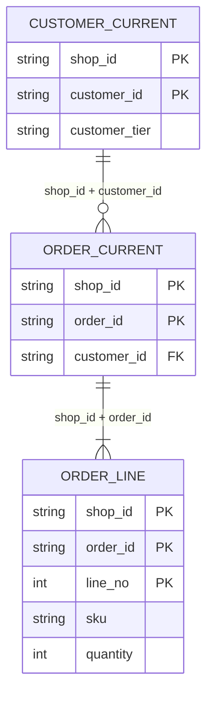
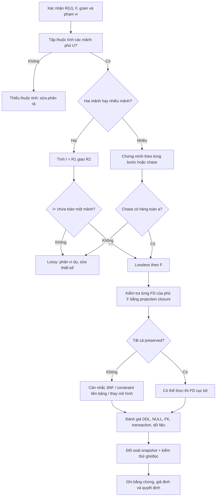

# Chứng minh phân rã không mất mát và kiểm tra phụ thuộc cần bảo toàn

## Mục tiêu học tập

Sau bài học, bạn có thể:

- Phát biểu chính xác **phân rã không mất mát thông tin** (*lossless-join decomposition*) đối với lược đồ quan hệ và tập phụ thuộc hàm đã biết.
- Phân biệt **không mất mát khi nối** với **bảo toàn phụ thuộc hàm** (*dependency preservation*): đó là hai thuộc tính độc lập cần kiểm chứng.
- Tính **bao đóng thuộc tính** \(X^+\), nhận diện siêu khóa/khóa ứng viên và dùng điều kiện **giao hai lược đồ xác định toàn bộ một phía** để chứng minh phân rã nhị phân không mất mát.
- Tự xây **phản ví dụ sinh bộ giả** (*spurious tuples*) khi phân rã không mất mát thất bại.
- Tính/tận dụng **phép chiếu của phụ thuộc hàm** lên từng lược đồ con, kiểm tra các phụ thuộc ban đầu còn được suy ra từ tập ràng buộc cục bộ hay không.
- Sử dụng **thuật toán chase** để kiểm chứng phân rã nhiều hơn hai lược đồ khi phép thử nhị phân không còn đủ trực tiếp.
- Giải thích đánh đổi giữa **3NF** (có thể tổng hợp phân rã không mất mát và bảo toàn FD) với **BCNF** (phân rã không mất mát nhưng có thể mất khả năng kiểm tra FD cục bộ).
- Từ yêu cầu nghiệp vụ, xây **bảng bằng chứng thiết kế** gồm tập FD, phân rã, chứng minh, ràng buộc SQL, phản ví dụ, kiểm thử và những giới hạn thực tế.
- Phân biệt kết luận toán học trong mô hình quan hệ với điều kiện triển khai thực tế như **NULL**, khóa ghép có tenant, dữ liệu nạp không đồng bộ và hành vi đa tập của SQL.

Trong module **DATABASE_DATA_MODELING**, ta học cách chuyển yêu cầu nghiệp vụ thành thực thể, quan hệ, ràng buộc, chuẩn hóa, khóa, chỉ mục và lược đồ vật lý phù hợp. Chương **Kiểm chứng thiết kế** yêu cầu bước tiếp theo: không chỉ nói “tách bảng sẽ ít lặp hơn”, mà phải **chứng minh sau khi tách không tự sinh/mất các bộ hợp lệ và các quy tắc phụ thuộc cần thiết vẫn được cưỡng chế một cách đáng tin cậy**.

Hai yêu cầu chính của bài là:

1. **Lossless join:** nối các mảnh được chiếu từ cùng một quan hệ hợp lệ phải khôi phục đúng quan hệ ban đầu.
2. **Dependency preservation:** các phụ thuộc hàm nguồn phải được suy ra từ những phụ thuộc có thể kiểm tra riêng trên từng mảnh, không buộc phải join mọi bảng mỗi lần ghi.

Điều thứ nhất bảo vệ **ý nghĩa của dữ liệu sau khi phân rã**; điều thứ hai bảo vệ **khả năng thực thi ràng buộc và vận hành cập nhật**.

---

## 1. Bắt đầu từ định nghĩa quan hệ, khóa và phụ thuộc hàm

Cho lược đồ quan hệ \(R(U)\), với \(U\) là tập thuộc tính. Ví dụ:

\[
U=\{A,B,C\}
\]

Một **thể hiện quan hệ** \(r\) là tập các bộ (tuple) trên \(U\). Trong mô hình quan hệ lý thuyết, dữ liệu được xét theo **ngữ nghĩa tập hợp**: cùng một bộ không xuất hiện lặp hai lần.

**Phụ thuộc hàm** (functional dependency, FD) \(X\to Y\) nghĩa là: trong mọi thể hiện quan hệ hợp lệ theo quy tắc nghiệp vụ, **hai bộ có cùng giá trị trên \(X\) phải có cùng giá trị trên \(Y\)**.

\[
r\models X\to Y
\iff
\forall t_1,t_2\in r:
t_1[X]=t_2[X]\Rightarrow t_1[Y]=t_2[Y].
\]

Ví dụ:

\[
F=\{A\to B,\ B\to C\}
\]

thì \(A\to C\) cũng đúng bởi **tính bắc cầu** của phụ thuộc hàm.

### 1.1. Phụ thuộc hàm đến từ hợp đồng nghiệp vụ, không phải từ dữ liệu tình cờ

Giả sử bảng `order_lines` có các trường:

| shop_id | order_id | line_id | customer_id | sku | quantity |
| --- | --- | --- | --- | --- | ---: |
| shop_17 | ord_908 | 1 | user_42 | A17 | 2 |
| shop_17 | ord_908 | 2 | user_42 | B03 | 1 |

Hai hàng hiện tại phù hợp với quy tắc:

\[
(shopId,orderId)\to customerId
\]

nhưng việc chỉ quan sát hai hàng **không chứng minh** quy tắc luôn đúng. Cần xác nhận hợp đồng: một đơn thuộc một shop có đúng một customer theo phiên bản nghiệp vụ được mô hình hóa? Có đơn chuyển chủ không? Nếu có lịch sử, khóa có cần thêm thời gian/phiên bản không?

Ngược lại, không thể suy ra \(orderId\to customerId\) trên toàn hệ nếu `orderId` chỉ duy nhất **trong một shop**. Trước mọi chứng minh, phải xác định **phạm vi duy nhất của khóa**.

### 1.2. Bao đóng thuộc tính và siêu khóa

**Bao đóng** \(X_F^+\) là mọi thuộc tính suy ra được từ \(X\) theo tập FD \(F\).

Thuật toán tính bao đóng:

```text
closure(X, F):
    result = copy(X)
    repeat:
        changed = false
        for each dependency L -> R in F:
            if L subset-of result:
                add all attributes of R to result
                if result changed: changed = true
    until not changed
    return result
```

Với \(F=\{A\to B,\ B\to C\}\):

```text
Bắt đầu: A+ = {A}
A -> B:   A+ = {A,B}
B -> C:   A+ = {A,B,C}
Dừng:     A+ = {A,B,C}
```

Vì \(A_F^+=U\), \(A\) là **siêu khóa** của \(R(A,B,C)\), và trong ví dụ này là **khóa ứng viên** vì không có tập con thực sự của \(A\) còn xác định được toàn \(U\).

**Siêu khóa:** \(X_F^+\supseteq U\).

**Khóa ứng viên:** là siêu khóa tối thiểu theo bao hàm; không thể bỏ bất cứ thuộc tính nào mà vẫn xác định toàn \(U\).

### 1.3. Ký hiệu dùng trong bài

| Ký hiệu | Ý nghĩa |
| --- | --- |
| \(U\) | Tập tất cả thuộc tính của quan hệ ban đầu |
| \(F\) | Tập FD được xác nhận cho \(R(U)\) |
| \(F^+\) | Tất cả FD suy ra được từ \(F\) |
| \(X_F^+\) | Bao đóng thuộc tính \(X\) theo \(F\) |
| \(\pi_V(r)\) | Chiếu dữ liệu của quan hệ \(r\) lên thuộc tính \(V\) |
| \(\pi_V(F)\) | Tập mọi FD trong \(F^+\) chỉ liên quan đến thuộc tính thuộc \(V\) |
| \(\bowtie\) | Phép nối tự nhiên (*natural join*) trên thuộc tính chung |
| \(\rho=\{R_1,\ldots,R_n\}\) | Một phân rã lược đồ, hợp các tập thuộc tính bằng \(U\) |

Không nên nhầm **chiếu một thể hiện dữ liệu** \(\pi_V(r)\) với **chiếu một tập ràng buộc** \(\pi_V(F)\). Chúng có tên phép chiếu giống nhau, nhưng là hai đối tượng khác nhau.

## 2. Chính xác thế nào là phân rã không mất mát?

Ta phân rã \(R(U)\) thành các lược đồ con:

\[
\rho=\{R_1(U_1),R_2(U_2),\ldots,R_n(U_n)\},
\qquad
\bigcup_{i=1}^n U_i=U.
\]

Phân rã được gọi là **không mất mát (lossless)** đối với \(F\) nếu:

\[
\boxed{
\forall r\text{ trên }U,\quad
r\models F
\Rightarrow
r=\bowtie_{i=1}^{n}\pi_{U_i}(r)
}
\]

Điều kiện **“với mọi quan hệ hợp lệ theo \(F\)”** là điểm cốt lõi. Không chỉ kiểm tra tập dữ liệu hiện tại. Một mẫu dữ liệu nhỏ có thể nối lại đúng hôm nay nhưng phân rã vẫn sai khi hệ thống xuất hiện những bộ hợp lệ khác.

### 2.1. Vì sao phép nối các phép chiếu có thể sinh bộ giả?

Khi chiếu một hàng sang nhiều bảng, ta bỏ những cột không có trong từng mảnh. Nếu các thuộc tính dùng để nối **không phân biệt đủ các nhóm gốc**, phép nối có thể kết hợp nửa trái của hàng này với nửa phải của hàng kia và sinh ra **spurious tuple**.

Trong ngữ nghĩa tập hợp, với các phép chiếu và natural join chính xác:

\[
r\subseteq\bowtie_{i}\pi_{U_i}(r)
\]

vì mọi hàng gốc xuất hiện trong mọi phép chiếu tương ứng, nên có thể nối lại thành chính nó. Vấn đề của phân rã mất mát thường là **sinh thêm hàng giả**, không phải mất hàng gốc trong phép chiếu/nối lý tưởng.

Khi triển khai SQL với `NULL`, filter, dữ liệu nạp không đồng bộ hoặc thiếu ràng buộc tham chiếu, phép `INNER JOIN` thực tế **vẫn có thể làm mất hàng**. Phải phân biệt trường hợp vận hành đó với định nghĩa toán học vừa nêu.

### 2.2. Phản ví dụ: tách bảng sai sinh ra hai hàng không tồn tại

Cho:

\[
R(A,B,C),\quad F=\{A\to B\},\quad
R_1(A,B),\ R_2(B,C).
\]

Thể hiện ban đầu hợp lệ:

| A | B | C |
| --- | --- | --- |
| a1 | b1 | c1 |
| a2 | b1 | c2 |

FD \(A\to B\) đúng, vì mỗi giá trị A chỉ xác định một B.

Chiếu sang \(R_1(A,B)\):

| A | B |
| --- | --- |
| a1 | b1 |
| a2 | b1 |

Và \(R_2(B,C)\):

| B | C |
| --- | --- |
| b1 | c1 |
| b1 | c2 |

Nối lại theo B:

| A | B | C | Đánh giá |
| --- | --- | --- | --- |
| a1 | b1 | c1 | Bộ gốc |
| a1 | b1 | c2 | **Bộ giả** |
| a2 | b1 | c1 | **Bộ giả** |
| a2 | b1 | c2 | Bộ gốc |

Phép nối sinh **4 bộ thay vì 2**. Đây là **phản ví dụ đủ để bác bỏ** tính lossless. Trái lại, thử một vài dữ liệu không sinh bộ giả **chưa đủ để chứng minh** một phân rã lossless cho mọi dữ liệu hợp lệ.

```sql
-- SQL minh họa phản ví dụ; dữ liệu đã được chiếu.
WITH r1(a,b) AS (
    VALUES ('a1','b1'), ('a2','b1')
),
r2(b,c) AS (
    VALUES ('b1','c1'), ('b1','c2')
)
SELECT r1.a, r1.b, r2.c
FROM r1
JOIN r2 ON r1.b = r2.b
ORDER BY r1.a, r2.c;
```

Câu SQL dùng cú pháp `VALUES` và CTE phổ biến; kết quả là bốn tổ hợp. Mục đích là làm rõ **thông tin tương quan giữa A và C đã bị mất khi chỉ giữ B để nối**.

## 3. Định lý lossless cho phân rã hai quan hệ

Cho \(R(U)\) phân rã thành \(R_1(U_1)\) và \(R_2(U_2)\), với \(U_1\cup U_2=U\). Đặt:

\[
I=U_1\cap U_2.
\]

**Tiêu chuẩn chính xác dưới tập phụ thuộc hàm \(F\):**

\[
\boxed{
\rho\text{ lossless theo }F
\iff
(I\to U_1)\in F^+
\quad\text{hoặc}\quad
(I\to U_2)\in F^+
}
\]

Có thể kiểm tra bằng bao đóng:

\[
U_1\subseteq I_F^+
\quad\text{hoặc}\quad
U_2\subseteq I_F^+.
\]

Diễn giải: **các thuộc tính chung của hai mảnh phải xác định tất cả thuộc tính của ít nhất một mảnh**. Khi đó join không thể gán một phần của mảnh đó vào một nhóm bản ghi không tương thích.

Định lý áp dụng khi tập ràng buộc đang xét là **FD** theo mô hình quan hệ; nếu nghiệp vụ còn có các loại ràng buộc khác, cần nêu rõ cơ sở logic dùng để kết luận.

### 3.1. Ví dụ lossless: A→B, B→C và tách AB | BC

Cho:

\[
U=\{A,B,C\},\quad F=\{A\to B,\ B\to C\}
\]

và:

\[
U_1=\{A,B\},\quad U_2=\{B,C\}.
\]

Ta có:

\[
I=U_1\cap U_2=\{B\}
\]

và từ \(B\to C\):

\[
B_F^+=\{B,C\}.
\]

Vì \(U_2=\{B,C\}\subseteq B_F^+\), **phân rã không mất mát**.

Nói theo nghiệp vụ: mỗi giá trị B xác định đúng một C; do đó khi một hàng AB nối với bảng BC qua B, không thể chọn lẫn hai C khác nhau cho cùng B nếu dữ liệu tuân \(B\to C\).

### 3.2. Chứng minh đủ: tại sao giao xác định một phía thì không sinh bộ giả?

Giả sử \(I\to U_2\in F^+\).

Lấy một bộ \(t\) bất kỳ trong \(\pi_{U_1}(r)\bowtie\pi_{U_2}(r)\). Vì được nối lại, tồn tại bộ gốc \(t_1,t_2\in r\) sao cho:

- \(t\) lấy thuộc tính \(U_1\) từ \(t_1\).
- \(t\) lấy thuộc tính \(U_2\) từ \(t_2\).
- \(t_1\) và \(t_2\) bằng nhau trên giao \(I\).

Do \(I\to U_2\), từ \(t_1[I]=t_2[I]\) suy ra \(t_1[U_2]=t_2[U_2]\). Vậy \(t\) bằng chính bộ gốc \(t_1\) trên toàn \(U_1\cup U_2=U\). Không có bộ giả. Chiều bao hàm còn lại hiển nhiên từ phép chiếu nên kết quả nối bằng \(r\).

**Đây là chứng minh cho mọi \(r\models F\)**, không phụ thuộc số hàng thử nghiệm.

### 3.3. Cách chứng minh “không lossless”

Với phản ví dụ phần 2:

\[
U_1=\{A,B\},\quad U_2=\{B,C\},\quad I=\{B\}.
\]

Tập \(F=\{A\to B\}\) chỉ cho:

\[
B_F^+=\{B\}.
\]

Do \(B_F^+\) không chứa \(A\) hay \(C\), giao không xác định trọn một phía; **phân rã không lossless theo tập FD đó**. Bảng bốn bộ ở phần 2 cung cấp witness cụ thể.

Lưu ý: phép thử phải dùng **bao đóng \(F^+\)**, không chỉ nhìn trực tiếp các FD được ghi thành danh sách. Đôi khi giao xác định một phía **qua nhiều bước suy luận**.

### 3.4. Ví dụ suy diễn nhiều bước

Cho:

\[
R(A,B,C,D),\quad
F=\{A\to B,\ B\to C,\ C\to D\}
\]

và phân rã:

\[
R_1(A,B,C),\quad R_2(A,D).
\]

Giao hai phía là \(\{A\}\). Bao đóng:

```text
A+ ban đầu     = {A}
A -> B          = {A,B}
B -> C          = {A,B,C}
C -> D          = {A,B,C,D}
```

Vì \(A_F^+\) chứa toàn \(R_2(A,D)\), phân rã **lossless** dù không có dòng FD gốc nào viết thẳng `A -> D`.

## 4. Không mất mát và bảo toàn phụ thuộc là hai câu hỏi khác nhau

Một thiết kế có thể **nối lại đúng** nhưng vẫn **không thể kiểm tra một FD quan trọng trong một bảng đơn lẻ**.

### 4.1. Định nghĩa bảo toàn phụ thuộc hàm

Với phân rã \(\rho=\{R_1(U_1),\ldots,R_n(U_n)\}\) và \(F\) trên \(U\), đặt:

\[
F_i=\pi_{U_i}(F)
=\{X\to Y\in F^+\mid X\cup Y\subseteq U_i\}.
\]

Và:

\[
G=\bigcup_{i=1}^{n} F_i.
\]

**Phân rã bảo toàn phụ thuộc** nếu:

\[
\boxed{G^+=F^+}.
\]

Do mọi \(F_i\) được suy từ \(F\), luôn có \(G^+\subseteq F^+\). Bởi vậy chỉ cần kiểm tra **mỗi FD của \(F\), hoặc một phủ tương đương của \(F\), có suy ra từ \(G\) không**:

\[
\forall X\to Y\in F:\quad Y\subseteq X_G^+.
\]

**Điểm tinh tế:** \(F_i\) là **toàn bộ các FD suy ra từ \(F\) có thuộc tính nằm trong \(U_i\)**, không chỉ những FD gốc tình cờ có hai vế cùng nằm ở \(U_i\). Ví dụ từ \(A\to B\) và \(B\to C\), phép chiếu lên \(AC\) chứa \(A\to C\).

### 4.2. Vì sao cần bảo toàn phụ thuộc?

Nếu mỗi ràng buộc được thể hiện trong một bảng hoặc suy ra từ các ràng buộc cục bộ, hệ có thể kiểm tra khi insert/update từng bảng thích hợp.

Nếu một FD **không bảo toàn**, có thể tồn tại các trạng thái của các bảng con đều hợp lệ theo những FD cục bộ nhưng khi join lại **vi phạm FD nguồn**. Muốn chặn việc đó, hệ phải:

- Join hoặc truy vấn xuyên các bảng mỗi lần ghi liên quan.
- Dùng trigger/transaction phức tạp hoặc một lớp ghi có kiểm soát.
- Duy trì thêm bảng/ràng buộc hỗ trợ.
- Hoặc chấp nhận sửa phân rã để bảo toàn FD.

Bảo toàn FD không tự đồng nghĩa với mọi ràng buộc SQL đã được khai báo; nhưng nó cho biết **kiểm tra theo từng lược đồ con về mặt logic có đủ sức bảo vệ các FD gốc hay không**.

### 4.3. Ví dụ vừa lossless vừa bảo toàn

Vẫn dùng:

\[
R(A,B,C),\quad F=\{A\to B,\ B\to C\},
\quad \rho=\{AB,BC\}.
\]

- **Lossless:** giao \(B\) xác định toàn mảnh \(BC\).
- **Bảo toàn:** \(A\to B\) nằm trong `AB`; \(B\to C\) nằm trong `BC`.

Vì cả hai FD ban đầu hiện diện trong các bảng con, \(G^+\) chứa \(F\), và các FD suy ra như \(A\to C\) cũng được bảo vệ qua chúng.

```sql
-- Một biểu diễn SQL, khi các cột định danh là NOT NULL.
CREATE TABLE r_bc (
    b VARCHAR(40) PRIMARY KEY,
    c VARCHAR(40) NOT NULL
);

CREATE TABLE r_ab (
    a VARCHAR(40) PRIMARY KEY,
    b VARCHAR(40) NOT NULL,
    FOREIGN KEY (b) REFERENCES r_bc(b)
);
```

`PRIMARY KEY(b)` của `r_bc` cưỡng chế một giá trị C cho mỗi B; `PRIMARY KEY(a)` của `r_ab` cưỡng chế một B cho mỗi A. FK còn hỗ trợ tính toàn vẹn tham chiếu khi vận hành. Tuy nhiên, xem thêm phần về **các bảng được nạp độc lập**: có FD và FK chưa đủ để bảo đảm mọi hàng `r_bc` có nguồn `r_ab` nếu ứng dụng yêu cầu chính xác ảnh chiếu của một R gốc.

## 5. Phân rã lossless nhưng không bảo toàn FD

Cho lại:

\[
R(A,B,C),\quad F=\{A\to B,\ B\to C\}
\]

nhưng phân rã theo:

\[
R_1(A,B),\qquad R_2(A,C).
\]

Giao:

\[
I=\{A\},\quad A_F^+=\{A,B,C\}.
\]

Vì \(I\to AB\) và \(I\to AC\) theo \(F^+\), phân rã **lossless**.

**Tuy nhiên**, phép chiếu FD theo từng mảnh gồm:

- Trên `AB`: \(A\to B\).
- Trên `AC`: \(A\to C\).

Từ hai FD đó **không suy ra được** \(B\to C\). Như vậy phân rã **không bảo toàn phụ thuộc**.

### 5.1. Phản ví dụ trạng thái các bảng con đều hợp lệ nhưng join vi phạm FD

`R1(A,B)`:

| A | B |
| --- | --- |
| a1 | b1 |
| a2 | b1 |

`R2(A,C)`:

| A | C |
| --- | --- |
| a1 | c1 |
| a2 | c2 |

Từng bảng con hợp lệ:

- Trong R1, mỗi A chỉ tương ứng một B: \(A\to B\) đúng.
- Trong R2, mỗi A chỉ tương ứng một C: \(A\to C\) đúng.

Nối theo A:

| A | B | C |
| --- | --- | --- |
| a1 | b1 | c1 |
| a2 | b1 | c2 |

Bản nối **vi phạm \(B\to C\)**, vì cùng B = b1 nhưng có hai C khác nhau.

Không có mâu thuẫn với kết luận lossless: định lý lossless nói về việc **phân rã một quan hệ gốc đã thỏa \(F\)** rồi nối lại. Hai bảng con ví dụ vừa dựng tuy hợp lệ theo FD cục bộ nhưng **không phải là ảnh chiếu của một quan hệ gốc hợp lệ theo \(F\)**. Chính khoảng trống đó thể hiện việc không bảo toàn FD.

### 5.2. Bài học từ phản ví dụ

Hai câu hỏi phải kiểm tra riêng:

1. Nếu dữ liệu gốc vốn hợp lệ, phân rã rồi nối có sinh bộ giả không?
2. Nếu các bảng con được cập nhật và chỉ kiểm tra FD cục bộ, có thể tạo trạng thái mà khi nối sẽ vi phạm ràng buộc gốc không?

Thành công ở câu 1 **không đảm bảo** thành công ở câu 2.

### 5.3. So sánh các phân rã của cùng một lược đồ

Với \(R(A,B,C)\), \(F=\{A\to B,B\to C\}\):

| Phân rã | Lossless? | Bảo toàn FD? | Lý do chính |
| --- | --- | --- | --- |
| `AB, BC` | Có | Có | Giao B xác định BC; hai FD đều cục bộ |
| `AB, AC` | Có | Không | Giao A xác định cả hai; không suy ra B→C từ A→B, A→C |
| `AB, BC` nhưng **chỉ biết** \(A\to B\) | Không | Có đối với FD A→B | Giao B không xác định mảnh nào, sinh bộ giả |
| `ABC` (không tách) | Có (hiển nhiên) | Có (hiển nhiên) | Không thay đổi quan hệ |

Hàng thứ ba **đổi tập FD giả định**. Một phân rã có thể lossless dưới tập ràng buộc mạnh hơn nhưng lossy dưới tập ràng buộc yếu hơn; vì vậy luôn ghi cả \(R\), \(F\), và \(\rho\) trong hồ sơ chứng minh.

## 6. Kiểm tra bảo toàn phụ thuộc mà không cần liệt kê toàn bộ \(F^+\)

Về mặt định nghĩa, ta dùng:

\[
G=\bigcup_i\pi_{U_i}(F).
\]

Nhưng \(F^+\) có thể có rất nhiều phụ thuộc suy ra. Việc liệt kê mọi FD trên mọi tập thuộc tính con thường không cần thiết.

**Đối với FD, có thể kiểm tra một phụ thuộc \(X\to Y\) bằng thuật toán bao đóng luân phiên theo các mảnh**, chỉ dùng phép tính \(X_F^+\) trên tập FD nguồn.

### 6.1. Thuật toán kiểm tra một FD

```text
preserved(X -> Y, F, decomposition):
    Z = copy(X)

    repeat:
        changed = false

        for each relation schema Ri:
            localKnown = Z ∩ Ri

            # Những thuộc tính trong Ri suy ra được
            # từ các thuộc tính đã biết nằm ở Ri.
            localImplied = closure(localKnown, F) ∩ Ri

            if Z union localImplied differs from Z:
                Z = Z union localImplied
                changed = true

    until not changed

    return Y subset-of Z
```

Lý do thuật toán hợp lệ:

- \(Z\cap U_i\) là những thuộc tính đã biết trong mảnh \(R_i\).
- Mọi thuộc tính thuộc \((Z\cap U_i)_F^+\cap U_i\) được suy ra qua **FD chỉ dùng thuộc tính của \(U_i\)**, vì đó chính là thông tin trong phép chiếu \(\pi_{U_i}(F)\).
- Mỗi vòng dùng kết quả từ một mảnh làm dữ kiện cho các mảnh khác, tương ứng phép suy luận từ hợp các ràng buộc cục bộ.
- Khi không còn thêm thuộc tính, \(Z\) đạt bao đóng theo tập FD suy ra được từ **toàn bộ các mảnh**. Nếu có \(Y\subseteq Z\), FD cần kiểm tra được bảo toàn.

**Không được nhầm thuật toán trên với việc tính trực tiếp \(X_F^+\) một lần.** Tính \(X_F^+\) trực tiếp sẽ luôn xác nhận mọi \(X\to Y\) trong \(F\), bất kể phân rã có làm mất khả năng thực thi cục bộ hay không. Phép **giao với từng \(R_i\)** mới là chỗ mô hình hóa giới hạn của từng bảng.

### 6.2. Chạy từng bước với phân rã bảo toàn

Cho:

\[
F=\{A\to B,\ B\to C,\ C\to D\},
\quad
\rho=\{AB,BC,CD\}.
\]

Kiểm tra FD suy ra \(A\to D\):

| Bước | Mảnh | \(Z\) trước | Thuộc tính cục bộ có thể suy ra | \(Z\) sau |
| --- | --- | --- | --- | --- |
| Khởi tạo | — | \(\{A\}\) | — | \(\{A\}\) |
| 1 | \(AB\) | \(\{A\}\) | \(A\to B\) | \(\{A,B\}\) |
| 2 | \(BC\) | \(\{A,B\}\) | \(B\to C\) | \(\{A,B,C\}\) |
| 3 | \(CD\) | \(\{A,B,C\}\) | \(C\to D\) | \(\{A,B,C,D\}\) |

Vậy \(D\in Z\), phụ thuộc \(A\to D\) được suy ra từ các bảng con dù nó **không được viết thành một ràng buộc vật lý đơn lẻ**.

### 6.3. Chạy với phân rã không bảo toàn

Cho:

\[
F=\{A\to B,B\to C\},
\quad
\rho=\{AB,AC\}.
\]

Kiểm tra \(B\to C\), khởi tạo \(Z=\{B\}\):

- Tại `AB`, \(Z\cap AB=\{B\}\). Theo \(F\), \(B_F^+=\{B,C\}\), nhưng giao với `AB` chỉ còn \(\{B\}\). Không thêm gì.
- Tại `AC`, \(Z\cap AC=\varnothing\). Nếu \(F\) không có FD từ tập rỗng tới thuộc tính khác, không thêm gì.
- Vòng lặp dừng, \(Z=\{B\}\), không có C.

Kết luận **\(B\to C\) không được bảo toàn**.

### 6.4. Tại sao chỉ rà xem FD gốc “nằm trong bảng nào” chưa đủ?

Xét:

\[
F=\{A\to B,\ B\to C,\ A\to C\},
\quad
\rho=\{AB,BC\}.
\]

FD \(A\to C\) không có đủ hai vế trong **một** bảng, nhưng được suy ra từ \(A\to B\) ở `AB` và \(B\to C\) ở `BC`. Vì vậy vẫn được bảo toàn.

Tương tự, một FD chứa thuộc tính từ nhiều bảng **có thể** được suy ra bằng chuỗi FD cục bộ. Mục tiêu kiểm tra là **khả năng suy diễn**, không phải kiểm tra chuỗi ký tự của phụ thuộc xuất hiện ở lược đồ con nào.

### 6.5. Dùng phủ tối thiểu để giảm công kiểm tra

Một **phủ tương đương** \(F_c\) có \(F_c^+=F^+\). Thường ta chuẩn bị **phủ tối thiểu/canonical cover**:

1. Tách vế phải của mỗi FD thành một thuộc tính, nếu cần cho thuật toán.
2. Loại thuộc tính thừa ở vế trái mà không đổi bao đóng.
3. Loại FD dư thừa mà vẫn giữ bao đóng tương đương.
4. Nếu tiện để tổng hợp 3NF, nhóm các FD có cùng vế trái trở lại.

Khi \(F_c^+=F^+\), chỉ cần kiểm tra **mỗi FD thuộc \(F_c\)** có nằm trong \(G^+\). Không cần kiểm tra hàng nghìn FD suy ra khác.

Lưu ý: nếu các quy tắc nghiệp vụ chưa chính xác, một phủ tối thiểu tính đúng toán học trên tập FD sai vẫn cho một thiết kế sai nghiệp vụ. **Xác nhận FD phải xảy ra trước tối ưu hóa biểu diễn FD**.

## 7. Trường hợp BCNF: lossless nhưng có thể không bảo toàn

### 7.1. Ví dụ kinh điển có một phụ thuộc bị mất

Cho:

\[
R(A,B,C),\qquad F=\{AB\to C,\ C\to B\}.
\]

Tính khóa:

- \((AB)^+=\{A,B,C\}\), nên AB là khóa ứng viên.
- \((AC)^+=\{A,C,B\}\) do \(C\to B\), nên AC cũng là khóa ứng viên.
- \(C^+=\{C,B\}\), nên C **không phải siêu khóa**.

FD \(C\to B\) vi phạm **BCNF** vì C không phải siêu khóa của \(R\). Chọn tách theo phụ thuộc này:

\[
R_1(C,B),\qquad R_2(A,C).
\]

Giao hai bảng là C; \(C\to CB\) nên **phân rã lossless**.

### 7.2. Phụ thuộc nào mất?

Trong \(R_1(C,B)\), FD \(C\to B\) có thể cưỡng chế cục bộ. Trong \(R_2(A,C)\), không có FD phi tầm thường nào từ \(F\) bắt buộc hai cột theo một chiều.

Đặc biệt \(AB\to C\) **không nằm ở một bảng** và không được suy ra bởi \(C\to B\).

Thử thuật toán bảo toàn với \(X=AB\):

- `CB` nhận đầu vào B, nhưng \(B_F^+=\{B\}\), không suy ra C.
- `AC` nhận đầu vào A, nhưng \(A_F^+=\{A\}\), không suy ra C.
- Không thể thêm C; \(AB\to C\) **bị mất tính bảo toàn**.

### 7.3. Witness cho việc mất phụ thuộc

`R1(C,B)`:

| C | B |
| --- | --- |
| c1 | b1 |
| c2 | b1 |

`R2(A,C)`:

| A | C |
| --- | --- |
| a1 | c1 |
| a1 | c2 |

Mỗi bảng vẫn thỏa \(C\to B\); khi join theo C, ta được:

| A | B | C |
| --- | --- | --- |
| a1 | b1 | c1 |
| a1 | b1 | c2 |

Hai bộ có cùng AB nhưng khác C, nên **vi phạm \(AB\to C\)**.

### 7.4. Tại sao 3NF có thể là lựa chọn phù hợp hơn?

Trong ví dụ trên, cả A, B và C đều là **thuộc tính nguyên tố (prime attribute)** vì mỗi thuộc tính xuất hiện trong một khóa ứng viên. FD \(C\to B\) có vế phải B là prime, nên quan hệ ban đầu **đạt 3NF nhưng không đạt BCNF**.

Nếu mục tiêu là giữ \(AB\to C\) và \(C\to B\) dễ kiểm tra cục bộ, **giữ R(A,B,C) ở 3NF** có thể là lựa chọn hợp lý hơn việc ép BCNF.

Đánh đổi:

| Mục tiêu | 3NF | BCNF |
| --- | --- | --- |
| Tránh nhiều dạng dư thừa do FD | Tốt, nhưng còn một số trường hợp | Chặt hơn theo determinant |
| Có quy trình tổng hợp bảo toàn mọi FD | Có đối với FD | Không bảo đảm |
| Có quy trình phân rã lossless | Có | Có |
| Chi phí cưỡng chế FD sau phân rã | Có thể duy trì cục bộ nhờ synthesis | Có thể cần join/transaction/triggers bổ sung |
| Được chọn “tốt hơn” tuyệt đối? | Không | Không |

**Đạt chuẩn cao hơn không đồng nghĩa hệ thống tổng thể tốt hơn** nếu các bất biến quan trọng bị đẩy sang cơ chế kiểm tra phức tạp mà ứng dụng chưa đáp ứng.

## 8. Thuật toán tổng hợp lược đồ 3NF có bảo toàn FD

Một kỹ thuật thực hành là **3NF synthesis** dựa trên phủ tối thiểu.

### 8.1. Các bước

Cho \(R(U)\) và \(F\):

1. Xây một **phủ tối thiểu** \(F_c\) tương đương với \(F\).
2. Với mỗi nhóm FD có cùng vế trái \(X\to Y_1,\ldots,X\to Y_k\), tạo lược đồ con chứa \(X\cup Y_1\cup\cdots\cup Y_k\). Các biến thể thuật toán có thể tách/nhóm khác nhau nhưng phải giữ các bảo đảm.
3. Bỏ lược đồ con nếu toàn bộ thuộc tính của nó đã nằm trong một lược đồ con khác, miễn là áp dụng đúng biến thể tổng hợp.
4. Nếu chưa có lược đồ con nào **chứa một khóa ứng viên của R**, thêm một lược đồ gồm một khóa ứng viên của R.
5. Xác nhận các thuộc tính của U được bao phủ, sau đó kiểm tra lại các mục tiêu kỹ thuật của schema.

Khi thực hiện đúng thuật toán 3NF synthesis, ta nhận được **phân rã 3NF, bảo toàn FD và lossless**.

**Cảnh báo:** câu “chỉ cần trong một bảng có khóa ứng viên thì mọi phân rã đều lossless” là **sai** nếu rút khỏi ngữ cảnh thuật toán. Bảo đảm lossless là kết quả của **cấu trúc tổng hợp đầy đủ**, không phải phép thử độc lập chỉ nhìn thấy khóa.

### 8.2. Ví dụ cần thêm bảng chứa khóa

Cho:

\[
R(A,B,C,D),\quad F=\{A\to B,\ B\to C\}.
\]

D không được xác định bởi A, B, C qua FD nào. Khóa ứng viên là **AD**:

\[
(AD)^+=\{A,B,C,D\}.
\]

Từ \(F_c\), tạo:

- \(R_1(A,B)\) cho \(A\to B\).
- \(R_2(B,C)\) cho \(B\to C\).

Chưa có mảnh nào chứa khóa AD và thuộc tính D chưa được bao phủ. Thêm:

- \(R_3(A,D)\).

Kết quả:

\[
\rho=\{AB,BC,AD\}.
\]

**Bảo toàn:** \(A\to B\) ở AB, \(B\to C\) ở BC.

**Lossless:** nối `AB` với `BC` theo B, là bước lossless do \(B\to BC\). Quan hệ trung gian ABC nối với `AD` theo A; \(A\to ABC\) nên bước nối này cũng lossless. Khi bắt đầu bằng các phép chiếu từ cùng R hợp lệ, phép nối cuối khôi phục đúng R.

Chỉ chọn AB và BC rồi quên D sẽ không phải một phân rã đầy đủ của R; cũng không thể suy ra kết quả cho các thuộc tính đã biến mất khỏi lược đồ.

### 8.3. Ví dụ đơn giản hơn: chuỗi phụ thuộc

Với \(R(A,B,C,D)\), \(F=\{A\to B,B\to C,C\to D\}\), các mảnh:

\[
AB,\ BC,\ CD
\]

vừa giữ đủ FD gốc vừa tạo các bước nối lossless. Khóa A xuất hiện trong AB. Đây là cấu trúc được dùng ở phần chase tiếp theo.

### 8.4. Lựa chọn triển khai ngoài chuẩn hóa

Các bảng 3NF không nhất thiết là **read model trực tiếp** cho dashboard có đường truy cập phức tạp. Có thể giữ:

- **Mô hình ghi/conformed** bảo vệ FD, khóa và ràng buộc.
- **Chỉ mục, materialized view hoặc projection** để đọc nhanh theo API.
- **Fact/dimension** cho phân tích, kèm định nghĩa grain/lineage.

Dữ liệu dẫn xuất có thể được denormalize có chủ đích. Nhưng không được coi việc có một bản đọc lặp dữ liệu là lý do bỏ kiểm tra FD tại **nguồn ghi có thẩm quyền**.

## 9. Chase: kiểm tra lossless khi phân rã nhiều hơn hai mảnh

Với hai mảnh, tiêu chuẩn giao \(I\) là rất tiện. Với **nhiều mảnh** và hệ phụ thuộc phức tạp, có thể dùng **chase/tableau** để kiểm tra lossless theo tập FD.

Chase dựa vào việc giả định mỗi mảnh là một hàng mẫu và áp tất cả các FD để biết dữ kiện nào **bắt buộc phải đồng nhất**.

### 9.1. Tạo tableau khởi đầu

Giả sử \(U=\{A,B,C,D\}\) và phân rã thành ba mảnh:

\[
R_1(A,B),\quad R_2(B,C),\quad R_3(C,D).
\]

Tạo một hàng cho mỗi mảnh, một cột cho mỗi thuộc tính trong U:

- Nếu thuộc tính \(A_j\) **nằm trong mảnh đó**, đặt ký hiệu phân biệt \(a_j\), là cùng một biểu tượng cho cột ấy ở mọi hàng.
- Nếu \(A_j\) **không nằm trong mảnh**, đặt ký hiệu riêng \(b_{ij}\), khác nhau theo hàng/cột.

Tableau ban đầu:

| Hàng | A | B | C | D |
| --- | --- | --- | --- | --- |
| \(R_1(AB)\) | \(a_A\) | \(a_B\) | \(b_{1C}\) | \(b_{1D}\) |
| \(R_2(BC)\) | \(b_{2A}\) | \(a_B\) | \(a_C\) | \(b_{2D}\) |
| \(R_3(CD)\) | \(b_{3A}\) | \(b_{3B}\) | \(a_C\) | \(a_D\) |

**Chú ý:** mọi ô trong cột A có thể là \(a_A\) hoặc các \(b\) dành riêng, nhưng không có chuyện \(b_{2A}=b_{3A}\) từ đầu. Các ký hiệu chỉ được đồng nhất khi quy tắc FD bắt buộc.

### 9.2. Quy tắc chase theo FD

Với FD \(X\to Y\):

1. Tìm hai hàng tableau có cùng ký hiệu trên **mọi thuộc tính của X**.
2. Hai hàng đó phải có cùng ký hiệu trên Y. Nếu khác, đồng nhất những ký hiệu tương ứng.
3. Khi đồng nhất một ký hiệu \(b\) với \(a_j\), **ưu tiên \(a_j\)** và thay đồng nhất toàn bảng theo cột đó.
4. Nếu là hai ký hiệu \(b\), chọn một đại diện nhất quán; lan truyền mọi thay đổi.
5. Lặp mọi FD cho đến khi không còn thay đổi.

**Điều kiện thành công:** sau khi chase đến điểm cố định, **có ít nhất một hàng trở thành toàn bộ các ký hiệu \(a_A,a_B,a_C,a_D\)**. Khi đó phân rã lossless theo FD đang xét.

Nếu không có hàng toàn \(a_j\) khi chase bão hòa, phân rã **không lossless theo các FD đó**. Đây là phép thử chuẩn cho phân rã quan hệ theo FD; đừng thay bằng nhận xét cảm tính về việc “các mảnh có vài cột chung”.

### 9.3. Chase từng bước với chuỗi FD

Cho:

\[
F=\{A\to B,\ B\to C,\ C\to D\}.
\]

Bước 1: hai hàng \(R_1\) và \(R_2\) cùng B = \(a_B\). Theo \(B\to C\), chúng phải cùng C, vì ở \(R_2\) có \(a_C\), nên thay \(b_{1C}\) bằng \(a_C\):

| Hàng | A | B | C | D |
| --- | --- | --- | --- | --- |
| \(R_1\) | \(a_A\) | \(a_B\) | \(a_C\) | \(b_{1D}\) |
| \(R_2\) | \(b_{2A}\) | \(a_B\) | \(a_C\) | \(b_{2D}\) |
| \(R_3\) | \(b_{3A}\) | \(b_{3B}\) | \(a_C\) | \(a_D\) |

Bước 2: \(R_1\) và \(R_3\) cùng C = \(a_C\). Theo \(C\to D\), chúng cùng D; thay \(b_{1D}\) bằng \(a_D\):

| Hàng | A | B | C | D |
| --- | --- | --- | --- | --- |
| \(R_1\) | \(a_A\) | \(a_B\) | \(a_C\) | \(a_D\) |
| \(R_2\) | \(b_{2A}\) | \(a_B\) | \(a_C\) | \(b_{2D}\) |
| \(R_3\) | \(b_{3A}\) | \(b_{3B}\) | \(a_C\) | \(a_D\) |

Hàng \(R_1\) đã trở thành **toàn \(a\)**. Vì vậy phân rã \(\{AB,BC,CD\}\) **lossless**.

Ngoài ra, FD gốc đều nằm trong các bảng thích hợp (AB, BC, CD), nên **dependency-preserving**.

### 9.4. Chase một trường hợp lossy

Cho \(R(A,B,C)\), \(F=\{A\to B\}\), \(\rho=\{AB,BC\}\).

Tableau:

| Hàng | A | B | C |
| --- | --- | --- | --- |
| \(AB\) | \(a_A\) | \(a_B\) | \(b_{1C}\) |
| \(BC\) | \(b_{2A}\) | \(a_B\) | \(a_C\) |

FD \(A\to B\) chỉ áp khi hai hàng cùng A. Ở đây \(a_A\) khác \(b_{2A}\), nên không đồng nhất thêm gì. Sau khi dừng, **không có hàng toàn \(a_A,a_B,a_C\)**. Phân rã **lossy**, phù hợp phản ví dụ spurious tuples phần 2.

### 9.5. Có thể tránh chase trong trường hợp nhiều mảnh không?

Có, nếu ta trình bày được **một trình tự ghép/phân rã** mà mỗi bước được chứng minh lossless trên tập thuộc tính và FD áp dụng thích hợp. Với chuỗi `AB → ABC → ABCD` ở ví dụ này, ta đã chứng minh từng bước.

Nhưng **không thể tùy ý chọn hai trong n mảnh, kiểm tra một lần rồi kết luận tất cả lossless**. Với cấu trúc nhiều mảnh không có trình tự hiển nhiên, chase là phương pháp tổng quát đáng tin cậy hơn.

## 10. Ca thực tế: phân rã dữ liệu đơn hàng theo bất biến nghiệp vụ

Ta xét một ứng dụng bán hàng đa shop, với biểu diễn ban đầu:

```text
ORDER_LINE_SNAPSHOT(
    shop_id, order_id, line_no,
    customer_id, customer_tier,
    sku, quantity
)
```

Giả định nghiệp vụ tại **một thời điểm chụp dữ liệu nhất quán**:

1. Một đơn thuộc một shop có đúng một khách.
2. Một khách trong một shop có đúng một phân hạng **hiện hành** ở thời điểm snapshot.
3. Mỗi dòng của một đơn xác định SKU và số lượng.
4. `order_id` và `customer_id` chỉ duy nhất trong phạm vi `shop_id`, không duy nhất toàn nền tảng.

Từ đó:

\[
\begin{aligned}
F_1:&\quad(shopId,orderId)\to customerId\\
F_2:&\quad(shopId,customerId)\to customerTier\\
F_3:&\quad(shopId,orderId,lineNo)\to (sku,quantity).
\end{aligned}
\]

**Chú ý:** các FD trên diễn tả snapshot của **trạng thái hiện hành**. Nếu cần lưu toàn bộ lịch sử tier theo thời gian, FD \(F_2\) không còn đúng khi mọi phiên bản nằm trong một bảng mà không có cột thời gian/phiên bản. Khi đó phải tái định nghĩa \(R\) và \(F\) trước khi dùng chứng minh này.

### 10.1. Khóa ứng viên

Khởi đầu với:

\[
K=\{shopId,orderId,lineNo\}.
\]

- Từ \(F_1\), suy ra customerId.
- Từ \(F_2\) và shopId, suy ra customerTier.
- Từ \(F_3\), suy ra sku và quantity.

Vậy:

\[
K_F^+=U.
\]

Trong các FD đã cho, không phụ thuộc nào sinh ra shopId, orderId hoặc lineNo từ những thuộc tính khác; do đó ba thuộc tính này là bắt buộc trong khóa. K là **khóa ứng viên** cho quan hệ snapshot theo những giả định đã nêu.

### 10.2. Phân rã đề xuất

| Bảng | Thuộc tính | Grain |
| --- | --- | --- |
| `order_current` | `shop_id, order_id, customer_id` | Một đơn trong một shop |
| `customer_current` | `shop_id, customer_id, customer_tier` | Một khách trong một shop, ở trạng thái hiện hành |
| `order_line` | `shop_id, order_id, line_no, sku, quantity` | Một dòng hàng của một đơn |

Tập thuộc tính của ba bảng phủ toàn bộ U:

\[
U_{\text{order}}\cup U_{\text{customer}}\cup U_{\text{line}}=U.
\]

Một sơ đồ quan hệ:



Đường nối theo **đầy đủ khóa ghép** là điều quan trọng. Nối chỉ theo `customer_id` khi ID này chỉ duy nhất trong một shop có thể gắn nhầm tier của khách thuộc shop khác.

### 10.3. Chứng minh lossless từng bước

Gọi \(R_L=\text{order\_line}\), \(R_O=\text{order\_current}\), \(R_C=\text{customer\_current}\).

**Bước 1: nối dòng đơn với header đơn.**

Giao:

\[
U_L\cap U_O=\{shopId,orderId\}.
\]

Theo \(F_1\):

\[
(shopId,orderId)\to customerId.
\]

Vậy giao xác định toàn \(R_O\) và phép nối \(R_L\bowtie R_O\) **lossless** trên phần thuộc tính đã ghép.

**Bước 2: nối kết quả bước 1 với khách hiện hành.**

Giao với \(R_C\):

\[
I=\{shopId,customerId\}.
\]

Theo \(F_2\), \(I\to customerTier\), nên giao xác định toàn \(R_C\). Phép nối thứ hai **lossless**.

Kết luận: với mọi snapshot r thỏa \(F\), việc chiếu r thành ba bảng trên rồi nối lại bằng đầy đủ thuộc tính chung sẽ khôi phục đúng r.

### 10.4. Kiểm tra dependency preservation

- \(F_1\) được thực thi cục bộ trong `order_current`.
- \(F_2\) được thực thi cục bộ trong `customer_current`.
- \(F_3\) được thực thi cục bộ trong `order_line`.

Tập FD gốc đều có nơi cưỡng chế, nên phân rã **bảo toàn các FD nguồn**. Không cần join ba bảng mỗi khi kiểm tra mỗi lệnh `INSERT`/`UPDATE` có vi phạm một trong ba FD này hay không, nếu engine và schema đã khai báo ràng buộc phù hợp.

### 10.5. DDL minh họa trong SQL quan hệ

```sql
CREATE TABLE customer_current (
    shop_id        VARCHAR(50) NOT NULL,
    customer_id    VARCHAR(50) NOT NULL,
    customer_tier  VARCHAR(30) NOT NULL,
    PRIMARY KEY (shop_id, customer_id)
);

CREATE TABLE order_current (
    shop_id      VARCHAR(50) NOT NULL,
    order_id     VARCHAR(50) NOT NULL,
    customer_id  VARCHAR(50) NOT NULL,
    PRIMARY KEY (shop_id, order_id),
    FOREIGN KEY (shop_id, customer_id)
        REFERENCES customer_current(shop_id, customer_id)
);

CREATE TABLE order_line (
    shop_id   VARCHAR(50) NOT NULL,
    order_id  VARCHAR(50) NOT NULL,
    line_no   INTEGER NOT NULL,
    sku       VARCHAR(80) NOT NULL,
    quantity  INTEGER NOT NULL,
    PRIMARY KEY (shop_id, order_id, line_no),
    FOREIGN KEY (shop_id, order_id)
        REFERENCES order_current(shop_id, order_id),
    CHECK (quantity > 0)
);
```

Các ràng buộc trên hỗ trợ:

- **FD:** khóa chính cưỡng chế một giá trị của phần còn lại trên mỗi determinant tương ứng.
- **FK:** tránh tạo order line không có order, order không có customer theo hợp đồng ví dụ.
- **Domain constraint:** số lượng phải dương nếu loại dòng hàng này không có nghiệp vụ ghi số lượng âm.

**Không đồng nhất FD với FK.** Phụ thuộc \(X\to Y\) nói rằng một determinant xác định duy nhất Y trong cùng quan hệ; FK nói về **sự tồn tại của hàng tham chiếu ở bảng khác**. Hai loại constraint có trách nhiệm khác nhau.

### 10.6. Phân biệt chứng minh logic với dữ liệu các bảng được nạp độc lập

Định lý lossless áp dụng cho **các phép chiếu của một thể hiện gốc hợp lệ**. Trong production, ba bảng có thể còn dữ liệu độc lập:

- `customer_current` chứa khách chưa từng đặt hàng.
- Order đã được tạo nhưng chưa có dòng hàng.
- Một job nạp `order_line` chạy xong trước job nạp `order_current`.
- Read replica của các bảng ở version khác nhau.

Một hàng customer không có đơn là **hợp lệ với mô hình nghiệp vụ riêng**, dù nó không xuất hiện trong phép chiếu của `ORDER_LINE_SNAPSHOT`. Ngược lại, khi lấy **tập order-line snapshots** bằng join, một order chưa có dòng không góp hàng nào. Các khác biệt này **không phủ định** định lý lossless; chúng nhắc rằng **các bảng sống độc lập có ngữ nghĩa nhiều hơn tập phép chiếu của quan hệ gốc**.

Muốn API đọc kết quả nhất quán, cần cân nhắc transaction, khóa ngoại được thực thi, checkpoint/snapshot chung, isolation level, chính sách đối tượng chưa hoàn thành và xử lý nạp lỗi.

### 10.7. Thay đổi yêu cầu sẽ thay đổi FD

Giả sử customer tier thay đổi theo thời gian và báo cáo muốn “tier tại thời điểm đơn được tạo”. Khi ấy một hàng `customer_current` không còn đủ. Cần thêm chiều lịch sử:

```text
customer_tier_history(
    shop_id, customer_id, tier_version,
    valid_from, valid_to, customer_tier
)
```

Có thể có:

\[
(shopId,customerId,tierVersion)\to(customerTier,validFrom,validTo)
\]

và một ràng buộc **không overlap khoảng hiệu lực** cho cùng khách. Ràng buộc không overlap là **ràng buộc thời gian**, không thể biểu diễn đầy đủ chỉ bằng một FD đơn giản.

Khi nối đơn với lịch sử tier bằng `order_created_at` nằm trong khoảng `[valid_from,valid_to)`, phải kiểm chứng **mỗi đơn khớp tối đa một phiên bản**. Nếu hai khoảng overlap, join có thể nhân số dòng doanh số. Điều này cần bài kiểm tra **cardinality/temporal constraints** bổ sung ngoài chứng minh FD.

## 11. Tự kiểm chứng bằng mã Java

Trong hệ học Java, có thể biến định lý thành các hàm thuần dùng tập thuộc tính. Ví dụ sau tập trung vào FD, không truy vấn database và không tự suy ra FD từ dữ liệu.

### 11.1. Bao đóng, lossless nhị phân và kiểm tra FD preservation

```java
import java.util.ArrayList;
import java.util.HashSet;
import java.util.List;
import java.util.Set;

public final class DecompositionChecks {

    record FD(Set<String> lhs, Set<String> rhs) {}

    static Set<String> closure(Set<String> initial, List<FD> fds) {
        Set<String> result = new HashSet<>(initial);
        boolean changed;

        do {
            changed = false;
            for (FD fd : fds) {
                if (result.containsAll(fd.lhs())) {
                    changed |= result.addAll(fd.rhs());
                }
            }
        } while (changed);

        return result;
    }

    // Đúng với decomposition gồm hai lược đồ phủ U.
    static boolean losslessBinary(
            Set<String> r1,
            Set<String> r2,
            List<FD> fds
    ) {
        Set<String> intersection = new HashSet<>(r1);
        intersection.retainAll(r2);

        Set<String> implied = closure(intersection, fds);
        return implied.containsAll(r1) || implied.containsAll(r2);
    }

    // Kiểm tra FD X -> Y dựa trên FD projection của các mảnh.
    static boolean preservesOne(
            FD required,
            List<Set<String>> schemas,
            List<FD> fds
    ) {
        Set<String> known = new HashSet<>(required.lhs());
        boolean changed;

        do {
            changed = false;

            for (Set<String> schema : schemas) {
                Set<String> localKnown = new HashSet<>(known);
                localKnown.retainAll(schema);

                Set<String> localImplied =
                        closure(localKnown, fds);
                localImplied.retainAll(schema);

                changed |= known.addAll(localImplied);
            }
        } while (changed);

        return known.containsAll(required.rhs());
    }

    public static void main(String[] args) {
        List<FD> fds = List.of(
            new FD(Set.of("A"), Set.of("B")),
            new FD(Set.of("B"), Set.of("C"))
        );

        Set<String> ab = Set.of("A", "B");
        Set<String> bc = Set.of("B", "C");
        Set<String> ac = Set.of("A", "C");

        System.out.println(closure(Set.of("A"), fds));
        // Chứa A, B, C; thứ tự in của Set không bảo đảm.

        System.out.println(losslessBinary(ab, bc, fds));
        // true

        System.out.println(losslessBinary(ab, ac, fds));
        // true

        FD bToC = fds.get(1);
        System.out.println(preservesOne(
            bToC, List.of(ab, ac), fds
        ));
        // false

        System.out.println(preservesOne(
            bToC, List.of(ab, bc), fds
        ));
        // true
    }
}
```

Hàm `losslessBinary` dựa trên giả định **`r1∪r2` đúng bằng tập thuộc tính U** và danh sách FD đúng hợp đồng. Trước khi dùng trong công cụ tự động, nên thêm validation rằng:

- Các thuộc tính trong FD và mảnh đều thuộc U.
- Các mảnh phủ đủ U.
- Danh sách FD đã được xác minh theo đúng phạm vi nghiệp vụ.
- Với các ràng buộc không thuộc FD, cần bộ kiểm tra khác.
- Đầu vào không chứa hai tên khác nhau chỉ vì đổi cách viết hoa/thường hoặc alias.

Hàm `preservesOne` kiểm tra **một FD**. Muốn kết luận toàn bộ phân rã bảo toàn, phải kiểm tra tất cả FD của một **phủ tương đương**. Độ phức tạp còn tùy số thuộc tính, số mảnh và số FD, nhưng thử bao đóng cục bộ như trên tránh liệt kê \(F^+\) đầy đủ.

### 11.2. Không dùng mã này như “validator dữ liệu thực” hoàn chỉnh

Chương trình trên xác minh **tính chất lược đồ theo giả định logic**. Nó không chứng minh dữ liệu hiện tại thực sự tuân F, rằng trigger đã được cài hoặc rằng replication không cho đọc snapshot lệch nhau.

Một công cụ thiết kế nên xuất kết quả hai tầng:

1. **Chứng minh logic:** lossless/dependency preservation theo R, F, decomposition.
2. **Kiểm chứng triển khai:** DDL constraint, truy vấn dữ liệu, kiểm thử luồng ghi, khả năng khôi phục và đồng bộ.

## 12. Đối chiếu lý thuyết với SQL thực tế

### 12.1. NULL làm thay đổi ngữ nghĩa so sánh

Định nghĩa FD trong lý thuyết dùng các giá trị có thể so sánh xác định. SQL thường cho phép `NULL` biểu diễn thiếu/không biết; so sánh `NULL = NULL` không hoạt động như equality trên giá trị thông thường.

Những điều cần xác định:

- Thuộc tính của determinant có cho phép `NULL` không?
- `UNIQUE` trên cột nullable có coi nhiều NULL là vi phạm không? Quy tắc phụ thuộc sản phẩm/cấu hình.
- `JOIN ... ON a.key = b.key` có bỏ các hàng chứa NULL không?
- `GROUP BY` và `DISTINCT` có semantics khác toán tử equality thông thường ở điểm nào?

**Không lấy một khóa có thể NULL rồi áp định lý FD như thể nó là giá trị định danh thông thường** nếu chưa làm rõ mô hình.

Với các khóa quan trọng, dùng `NOT NULL`, `PRIMARY KEY`/`UNIQUE` và quy tắc trạng thái “chưa biết” có chủ đích. Nếu không thể loại NULL, cần giải thích lossless theo mô hình mở rộng và kiểm thử join cụ thể, không tuyên bố định lý chứng minh đã xử lý SQL NULL.

### 12.2. SQL dùng đa tập (bag), lý thuyết dùng tập

SQL thường giữ các hàng lặp trừ khi dùng `DISTINCT` hoặc phép toán tập. Hai bảng con thiếu uniqueness có thể làm `JOIN` nhân nhiều hàng dù các giá trị thuộc tính của bộ kết quả trùng nhau.

Ví dụ:

```text
R1:
  (a1,b1)
  (a1,b1)  # Hàng lặp do ingest lỗi

R2:
  (b1,c1)
  (b1,c1)  # Hàng lặp

JOIN -> 4 hàng cùng giá trị (a1,b1,c1)
```

Trong mô hình tập, chỉ có một bộ \((a1,b1,c1)\). **Phân rã lossless theo nghĩa tập không phải bảo đảm không nhân hàng SQL khi có bản ghi trùng**. Cần kiểm tra khóa/unique constraints, grain nguồn và cách xử lý sự kiện gửi lại.

### 12.3. Ghi theo hai bước có thể tạo trạng thái trung gian lệch

Giả sử `order_current` và `order_line` được ghi bởi hai worker không dùng transaction chung. Một API chạy query giữa hai bước có thể không thấy order lines, hoặc chỉ thấy một phần.

Điều này không chứng minh lý thuyết phân rã lossy. Nó là **vấn đề nhất quán cập nhật**:

- Transaction bao phủ các bảng nếu DB hỗ trợ và nghiệp vụ yêu cầu.
- Write ordering với foreign key/constraint.
- Trạng thái `DRAFT/READY` để không công bố aggregate chưa đủ.
- Version/checkpoint hoặc snapshot isolation cho đường đọc.
- Outbox/CDC và read-model lag nếu nguồn phân tán.

**Lossless join, dependency preservation, transactional consistency và referential integrity là bốn chiều kiểm chứng khác nhau.**

### 12.4. Phụ thuộc phi hàm và ràng buộc liên bảng

FD không thể biểu diễn toàn bộ yêu cầu nghiệp vụ:

- Một order **phải có ít nhất một** order line.
- Mọi item SKU **phải tồn tại** trong catalog.
- Một khách **không có hai mức tier cùng hiệu lực** trong lịch sử.
- Tổng giá trị dòng hàng **bằng** tổng đơn theo công thức được phê duyệt.
- Một booking không được **overlap** thời gian/tài nguyên.
- Một giao dịch phải được cân đối các bút toán theo quy tắc kế toán.

Các điều kiện đó có thể cần **foreign key, check, exclusion constraint, trigger, aggregate invariant, transaction hoặc application logic**. Định lý lossless đối với FD không tự bảo vệ chúng.

### 12.5. Tên cột giống nhau chưa chắc cùng ngữ nghĩa

Natural join trong chứng minh toán học nối **các thuộc tính chung được định nghĩa là cùng một thuộc tính**. Trong SQL thực tế, `NATURAL JOIN` nối mọi cột trùng tên — có thể vô tình trùng `status`, `created_at` hoặc `id` dù các cột có nghĩa khác.

Khuyến nghị viết **`JOIN ... ON` với khóa ghép tường minh** và đặt alias có nghĩa. Không suy từ tên giống nhau rằng có một FD hoặc khóa chung.

## 13. Kiểm thử dữ liệu: cần nhưng không thay chứng minh

Một bản thiết kế nên có **bằng chứng toán học** và **bộ kiểm thử thực tế**. Hai loại bổ sung nhau.

### 13.1. Kiểm tra bản tái dựng so với bản gốc

Nếu còn bảng gốc `original_r` để đối chiếu và đã nạp các mảnh `r_ab`, `r_bc` từ một snapshot nhất quán:

```sql
-- Các cột A,B,C cần cùng kiểu, cùng nghĩa và khóa đủ.
WITH rebuilt AS (
    SELECT ab.a, ab.b, bc.c
    FROM r_ab AS ab
    JOIN r_bc AS bc ON bc.b = ab.b
)
SELECT a,b,c FROM rebuilt
EXCEPT
SELECT a,b,c FROM original_r;
```

Đây là một phía: tìm **bộ giả** trong bản tái dựng. Cần chạy chiều còn lại:

```sql
WITH rebuilt AS (
    SELECT ab.a, ab.b, bc.c
    FROM r_ab AS ab
    JOIN r_bc AS bc ON bc.b = ab.b
)
SELECT a,b,c FROM original_r
EXCEPT
SELECT a,b,c FROM rebuilt;
```

Nếu cả hai phía rỗng trong cùng snapshot phù hợp, kết quả **tương đương tập hợp trên dữ liệu đã thử**. Nhưng đó vẫn **không chứng minh lossless với mọi thể hiện hợp lệ**; định lý hoặc chase mới làm việc ấy.

`EXCEPT` thường dùng ngữ nghĩa tập và có hành vi với NULL theo quy tắc toán tử tập của DBMS. Nếu cần kiểm tra **số bản sao của cùng tuple**, phải dùng cách đối chiếu bag-aware (ví dụ tổng hợp count trên bộ giá trị hoặc `EXCEPT ALL` ở engine hỗ trợ). Không nên che duplicate bằng `DISTINCT` rồi khẳng định dữ liệu vận hành không có lỗi.

### 13.2. Kiểm tra một FD thực tế

Ví dụ kiểm tra \(B\to C\) trên bảng `r_bc`:

```sql
SELECT b, COUNT(DISTINCT c) AS distinct_c
FROM r_bc
GROUP BY b
HAVING COUNT(DISTINCT c) > 1;
```

Truy vấn phát hiện một số vi phạm của \(B\to C\), nhưng **`COUNT(DISTINCT c)` thường bỏ qua NULL** nên không đủ nếu C có thể NULL. Tùy hệ, nên dùng `NOT NULL`/ràng buộc khóa và test NULL riêng.

Nếu ràng buộc đã được xác minh, cưỡng chế bằng `PRIMARY KEY`/`UNIQUE` trên determinant phù hợp thường tốt hơn chỉ chạy cảnh báo sau khi ghi. Tuy nhiên khi determinant không là khóa của bảng hoặc FD có điều kiện nghiệp vụ, có thể cần thiết kế bảng khác hoặc logic cưỡng chế riêng.

### 13.3. Kiểm thử cardinality của join

Với mô hình đơn hàng, mỗi dòng đơn phải tham chiếu **tối đa một** order header và tối đa một customer current record theo khóa ghép.

Kiểm thử:

- Số dòng `order_line` trước/sau join với `order_current` có thay đổi không?
- Một khóa `(shopId,orderId)` có nhiều hơn một header không?
- Một khóa `(shopId,customerId)` có nhiều hơn một customer current row không?
- Có order line mồ côi không?
- Có order thuộc tenant A bị nối với customer thuộc tenant B không?
- Có chênh tổng `quantity` hoặc `amount` sau join không?

Dữ liệu cùng count sau join chưa bảo đảm đúng: có thể **mất một dòng và nhân một dòng khác**, tổng count vẫn bằng nhau. Đối chiếu theo **khóa dòng và giá trị thuộc tính**, không chỉ các tổng thô.

### 13.4. Một bộ kiểm thử phản ví dụ tự động

Đối với mỗi kế hoạch phân rã nhị phân, nên chạy các case có chủ đích:

| Case | Tập FD và phân rã | Kỳ vọng |
| --- | --- | --- |
| Lossless dương | \(F=\{A\to B,B\to C\}\), `AB + BC` | Bộ kiểm tra trả true |
| Lossy âm | \(F=\{A\to B\}\), `AB + BC` | Bộ kiểm tra trả false; dữ liệu 2 hàng sinh 4 |
| Bảo toàn dương | \(F=\{A\to B,B\to C\}\), `AB + BC` | Tất cả FD nguồn preserved |
| Bảo toàn âm | \(F=\{A\to B,B\to C\}\), `AB + AC` | Lossless true, B→C not preserved |
| BCNF đánh đổi | \(F=\{AB\to C,C\to B\}\), `AC + BC` | Lossless true, AB→C not preserved |
| Nhiều mảnh | \(F=\{A\to B,B\to C,C\to D\}\), `AB + BC + CD` | Chase có hàng toàn a |
| Tenant scope | \((shopId,orderId)\to customerId\) | Chỉ join orderId là lỗi |
| Nullability | Khóa join NULL | Có test theo semantics engine, không chỉ định lý |
| Retry ingest | Một business key bị ghi trùng | Khóa unique/test duplicate chặn |
| Partial update | Các mảnh lệch phiên bản | Không công bố bản join chưa nhất quán |

Nên giữ test fixtures như một phần của **design decision record** cùng kết luận toán học, DDL và những giả định nguồn.

## 14. Kiểm chứng thiết kế phải ghi rõ giả định và bằng chứng

Một tài liệu thẩm định phân rã không nên chỉ ghi “3NF pass” hoặc “BCNF pass”. Nên xuất được **bảng bằng chứng** mà người khác kiểm tra lại được mà không phải đoán tập FD hay điều kiện dữ liệu.

### 14.1. Mẫu biên bản kiểm chứng

```text
Thiết kế: ORDER_LINE_SNAPSHOT v1
Phạm vi: trạng thái hiện hành, một bản chụp nhất quán
U:
  shop_id, order_id, line_no,
  customer_id, customer_tier, sku, quantity

FD đã được chủ nghiệp vụ xác nhận:
  (shop_id, order_id) -> customer_id
  (shop_id, customer_id) -> customer_tier
  (shop_id, order_id, line_no) -> (sku, quantity)

Khóa ứng viên:
  (shop_id, order_id, line_no)

Phân rã:
  ORDER_CURRENT(shop_id,order_id,customer_id)
  CUSTOMER_CURRENT(shop_id,customer_id,customer_tier)
  ORDER_LINE(shop_id,order_id,line_no,sku,quantity)

Bằng chứng lossless:
  ORDER_LINE ⋈ ORDER_CURRENT:
    intersection = (shop_id, order_id)
    intersection -> ORDER_CURRENT (theo F1)
  JOIN result ⋈ CUSTOMER_CURRENT:
    intersection = (shop_id, customer_id)
    intersection -> CUSTOMER_CURRENT (theo F2)

Bằng chứng dependency preservation:
  F1: được cưỡng chế tại ORDER_CURRENT
  F2: được cưỡng chế tại CUSTOMER_CURRENT
  F3: được cưỡng chế tại ORDER_LINE

DDL cần có:
  PRIMARY KEY ghép, FOREIGN KEY ghép, NOT NULL,
  các domain CHECK theo nghiệp vụ

Các yêu cầu không được suy ra chỉ từ FD:
  ORDER phải có ít nhất 1 LINE?
  Không trùng SKU trong cùng một order?
  Tier lịch sử không overlap?
  Quyền truy cập tenant?
  Transaction nhất quán khi ghi/nạp?

Kết luận:
  Lossless theo F = PASS
  Dependency preservation theo F = PASS
  Data constraints/transactional checks = CẦN TEST RIÊNG
```

Một kết luận **PASS theo F** chỉ có nghĩa trong phạm vi **F đã được xác nhận**. Nếu phát hiện thêm FD hoặc nghiệp vụ thay đổi, phải đánh giá lại phân rã.

### 14.2. Chứng minh không thay kiểm chứng về độ hoàn chỉnh của F

Cách thu thập phụ thuộc hàm:

1. Hỏi chủ nghiệp vụ “một X có bao giờ có hai Y hợp lệ cùng lúc không?”.
2. Xác định **thời điểm áp dụng**: hiện hành, lịch sử, trong một kỳ hay toàn bộ đời thực thể.
3. Xác định **phạm vi duy nhất**: tenant/shop, quốc gia, hệ nguồn, phiên bản.
4. Xác định có **nghiệp vụ ngoại lệ**: đổi chủ, hoàn tiền, nhiều người nhận, cấp lại mã hay không.
5. Kiểm tra dữ liệu để **tìm phản ví dụ**, không dùng một tập hữu hạn không có lỗi làm bằng chứng tuyệt đối.
6. Ghi lại người phê duyệt, phiên bản hợp đồng và test case.

Phát hiện một bộ dữ liệu vi phạm có thể chứng minh **dữ liệu đang sai** hoặc **FD giả định sai**. Cần điều tra nghiệp vụ trước khi tự sửa dữ liệu hay hủy ràng buộc.

### 14.3. Một sơ đồ quyết định khi đánh giá đề xuất phân rã



Sơ đồ chỉ mô tả kiểm tra **FD và lossless join** ở mức bài học. Một hệ thống thực còn có yêu cầu hiệu năng, quyền, bảo mật, retention, partitioning, cũng như các ràng buộc nghiệp vụ không thuộc FD.

## 15. Các hiểu lầm và lỗi chứng minh phổ biến

| Sai lầm | Vì sao sai | Cách kiểm chứng đúng |
| --- | --- | --- |
| Nối thử dữ liệu hiện tại ra đúng nên kết luận lossless | Chỉ thử một thể hiện; thiếu tổ hợp phản ví dụ | Dùng định lý với \(F^+\) hoặc chase |
| Hai bảng có cùng cột là lossless | Giao có thể không xác định phía nào | Tính bao đóng giao |
| Cột chung là FK nên lossless | FK là ràng buộc tồn tại, không tự tạo FD cần thiết | Chứng minh một mảnh có unique theo giao |
| Bỏ qua phạm vi tenant | `orderId` có thể trùng giữa shop | Dùng khóa ghép thực |
| Thấy R1 chứa khóa của R nên kết luận mọi phân rã lossless | Không đúng cho phân rã tùy ý | Chứng minh từng bước/chase |
| Nhầm \(X_F^+\) với \(X_G^+\) | F gốc luôn suy được chính nó; G mới đại diện FD cục bộ | Thuật toán giao theo mảnh |
| Chỉ kiểm tra mỗi FD gốc có nằm nguyên văn ở một bảng | FD có thể suy ra qua chuỗi FD cục bộ | Kiểm tra bao đóng từ phép chiếu |
| Dùng một join để kiểm tra dependency preservation | Bảng con có thể hợp lệ cục bộ nhưng join sai FD gốc | Tính \(G^+\), dựng witness nếu thất bại |
| BCNF tự động bảo toàn mọi FD | Phân rã BCNF có thể mất FD | Ví dụ \(AB\to C,C\to B\) |
| 3NF luôn là “không tách” | 3NF synthesis có thể sinh nhiều mảnh | Dùng phủ tối thiểu và thêm khóa nếu cần |
| Lẫn 3NF/BCNF với quyền truy cập và performance | Chuẩn hóa logic không quyết định mọi index, partition | Đánh giá workload/vật lý riêng |
| SQL `UNIQUE` nullable đủ bảo vệ mọi FD | NULL semantics tùy DBMS | NOT NULL và test engine |
| SQL JOIN thực tế nhân/làm mất hàng nên định lý lossless sai | Dirty/partial snapshots, bag semantics, NULL khác mô hình tập | Tách chứng minh logic và kiểm thử pipeline |
| Mọi quan hệ 1:N đều phải tách mới đúng | Grain, FD và mục tiêu cập nhật khác nhau | Chứng minh theo mô hình cụ thể |
| Dùng `SUM(DISTINCT amount)` để sửa join fan-out | Hai dòng hợp lệ có cùng giá trị bị mất | Chứng minh join cardinality theo khóa |
| Chỉ quan tâm FD mà quên FK, kiểm tra thời gian | Nhiều bất biến không phải FD | Danh sách kiểm thử riêng |
| Dùng FD suy từ dữ liệu có ít hàng | Ít hàng dễ “thỏa” phụ thuộc tình cờ | Xác nhận nghiệp vụ và tìm phản ví dụ |
| Sửa dữ liệu nguồn để “phù hợp” FD chưa được duyệt | Có thể xóa nghiệp vụ hợp lệ | Điều tra hợp đồng trước |
| Các bảng được nạp độc lập nhưng vẫn coi là các phép chiếu của cùng snapshot | Có thể có hàng thiếu hoặc version khác | Transaction, checkpoint, reconciliation |
| Chọn decomposition một lần rồi quên khi schema thay đổi | FD và khóa có thể đổi | Version hóa design proof và regression tests |

### 15.1. Bảo toàn FD không có nghĩa lược đồ đã tối ưu vật lý

Một phân rã chứng minh lossless, preservation và đạt 3NF có thể vẫn:

- Yêu cầu join quá nhiều trong truy vấn nóng.
- Có chỉ mục không phù hợp.
- Làm tăng số round-trip trong hệ phân tán.
- Gây bottleneck ở một bảng dimension tham chiếu chung.
- Không phục vụ tốt truy vấn tổng hợp OLAP.

Những vấn đề đó cần **đánh giá đường đọc, transaction, workload, chỉ mục, partition và read model**. Nhưng không vì yêu cầu hiệu năng mà bỏ chứng minh sự đúng đắn của **nguồn dữ liệu có thẩm quyền**. Nếu denormalize, phải ghi rõ các FD/bất biến được thực thi ở đâu.

### 15.2. Bảo toàn FD không tự bảo toàn mọi loại phụ thuộc

Ngoài FD còn có:

- **Multivalued dependency (MVD):** một thuộc tính có thể xác định nhiều tập giá trị độc lập.
- **Join dependency (JD):** quan hệ bị ràng buộc bởi phép nối nhiều phép chiếu.
- **Inclusion dependency/FK:** tham chiếu giữa bảng.
- **Check và aggregate constraint:** miền giá trị, tổng hoặc ràng buộc theo tập dòng.
- **Temporal constraint:** không có hai khoảng hiệu lực giao nhau.

Điều kiện lossless nhị phân theo FD và thuật toán projection ở bài này **không tự chứng minh** việc bảo toàn mọi loại phụ thuộc đó. Với yêu cầu vượt phạm vi FD, phải mở rộng mô hình ràng buộc và phương pháp kiểm tra.

## 16. Bài tập vận dụng và hướng dẫn lập luận

### Bài tập A — Lossless và preserving cùng lúc

Cho:

\[
R(A,B,C),\quad F=\{A\to B,B\to C\}
\]
\[
\rho=\{AB,BC\}.
\]

**Yêu cầu:**
1. Tính \(B_F^+\).
2. Áp tiêu chuẩn lossless nhị phân.
3. Kiểm tra từng FD trong F có thể thực thi cục bộ ở đâu.
4. Cho biết khóa ứng viên của R.

**Đáp án định hướng:** \(B_F^+=\{B,C\}\), giao B xác định BC nên lossless. \(A\to B\) ở AB, \(B\to C\) ở BC nên preserving. \(A^+=ABC\), A là khóa ứng viên.

### Bài tập B — Lossless nhưng không preserving

Vẫn dùng F trên, nhưng \(\rho=\{AB,AC\}\).

**Yêu cầu:**
1. Tính bao đóng giao.
2. Chỉ ra phụ thuộc bị mất.
3. Dựng hai bảng con có dữ liệu hợp lệ cục bộ nhưng join vi phạm FD nguồn.

**Đáp án định hướng:** giao A, \(A_F^+=ABC\) nên lossless. \(B\to C\) không được bảo toàn. Witness:

```text
AB: (a1,b), (a2,b)
AC: (a1,c1), (a2,c2)

Join:
(a1,b,c1), (a2,b,c2)

Cùng B nhưng C khác -> vi phạm B -> C
```

### Bài tập C — Một bộ dữ liệu nối sai

Cho \(F=\{A\to B\}\) và \(\rho=\{AB,BC\}\).

**Yêu cầu:** chứng minh phân rã lossy và tạo quan hệ r có hai hàng nhưng join phép chiếu sinh bốn hàng.

**Đáp án định hướng:** giao B có bao đóng chỉ B nên không xác định AB hoặc BC. Lấy r = \(\{(a1,b,c1),(a2,b,c2)\}\). Join AB và BC có bốn kết hợp, thêm hai bộ giả. FD \(A\to B\) vẫn đúng trên r.

### Bài tập D — BCNF và ràng buộc bị mất

Cho:

\[
R(A,B,C),\quad F=\{AB\to C,C\to B\}.
\]

**Yêu cầu:**
1. Tìm khóa ứng viên.
2. Tại sao \(C\to B\) vi phạm BCNF?
3. Tách thành `CB`, `AC`, chứng minh lossless.
4. Kiểm tra \(AB\to C\) có preserved không.

**Đáp án định hướng:** AB và AC là hai khóa ứng viên. C không là siêu khóa nên vi phạm BCNF. Giao C xác định CB nên lossless. Không có cách suy \(AB\to C\) từ FD cục bộ \(C\to B\), nên không preserved; xem witness ở phần 7.

### Bài tập E — Chase ba mảnh

Cho:

\[
R(A,B,C,D),\quad
F=\{A\to B,B\to C,C\to D\}
\]
\[
\rho=\{AB,BC,CD\}.
\]

**Yêu cầu:** tạo tableau ba hàng, đánh dấu \(a\) và \(b\), chase từng FD đến khi có hàng toàn \(a\) hoặc không còn thay đổi.

**Đáp án định hướng:** hàng AB khởi đầu \((a_A,a_B,b_{1C},b_{1D})\). B→C biến \(b_{1C}\) thành \(a_C\). C→D biến \(b_{1D}\) thành \(a_D\). Có hàng toàn a, phân rã lossless.

### Bài tập F — Phân rã hai bảng lặp lại phụ thuộc suy ra

Cho \(R(A,B,C,D)\), \(F=\{A\to B,B\to C,C\to D\}\), và:

\[
\rho=\{ABC,AD\}.
\]

**Câu hỏi:** lossless không? Có preserving không?

**Gợi ý:** giao A xác định cả AD nên **lossless**. Trên ABC có \(A\to B,B\to C\). Trên AD có \(A\to D\) (FD suy ra), nhưng không thể từ các FD đó suy ra \(C\to D\); vì thế **không preserving**.

### Bài tập G — Thuộc tính không xuất hiện ở vế phải

Cho:

\[
R(A,B,C,D),\quad F=\{A\to B,B\to C\}.
\]

**Yêu cầu:** tìm khóa ứng viên và thực hiện tổng hợp 3NF, giải thích vì sao cần thêm một mảnh.

**Đáp án định hướng:** AD là khóa ứng viên, vì D không suy ra từ A,B,C. Hai mảnh AB,BC chưa bao phủ D; thêm AD tạo `AB,BC,AD`, vừa lossless vừa preserving theo chứng minh phần 8.

### Bài tập H — Kiểm thử dữ liệu chưa phải chứng minh

Một nhóm kiểm tra 100.000 hàng hiện tại, nối hai bảng sau phân rã ra đúng số hàng và đúng checksum; nhóm kết luận “đã chứng minh phân rã lossless”.

**Câu hỏi:** kết luận có hợp lệ không? Còn phải cung cấp bằng chứng nào?

**Gợi ý:** chưa. Dữ liệu có thể không bao phủ trạng thái phản ví dụ. Cần R, F, khóa, phân rã, bao đóng giao hoặc chase, và kiểm tra preservation. Sau đó vẫn cần đối soát dữ liệu thực/SQL semantics riêng.

### Bài tập I — FD với tenant

Trong mỗi shop, `order_id` duy nhất, nhưng hai shop có thể có cùng `order_id=908`. Một decomposition cho `orders` và `order_items` được join chỉ qua `order_id`.

**Câu hỏi:** sai ở đâu? Sửa khóa và chứng minh ra sao?

**Gợi ý:** thiếu phạm vi `shop_id`; không có FD toàn cục \(orderId\to...\) khi nguồn không bảo đảm. Dùng determinant `(shop_id,order_id)`, PK/FK ghép và phép nối theo cả hai trường; chứng minh lại theo F đã cập nhật.

### Bài tập J — Lịch sử khách và ràng buộc thời gian

FD hiện hành:

\[
(customerId)\to tier.
\]

Sản phẩm yêu cầu lưu tier mỗi khi khách được nâng hạng, rồi join theo ngày tạo đơn.

**Câu hỏi:** FD trên có còn đúng trên toàn bảng lịch sử không? Chỉ kiểm tra lossless theo FD có đủ không?

**Gợi ý:** không. Cần thêm thời gian/phiên bản vào grain, định nghĩa khoảng hiệu lực và ràng buộc không overlap; join as-of cần đúng một phiên bản. Đây là các kiểm tra bổ sung so với FD đơn giản.

### Bài tập K — Quy trình review một đề xuất mới

Một thiết kế mới có 6 bảng sau chuẩn hóa và 12 FD nguồn. Nhóm thiết kế cung cấp DDL và câu nói “đã lên BCNF”.

**Yêu cầu:** soạn checklist thẩm định trước khi merge schema.

**Gợi ý:**
- Ghi tập \(U,F\) và phạm vi từng FD.
- Tìm khóa ứng viên, phủ tối thiểu.
- Xác nhận mọi thuộc tính được bao phủ.
- Chứng minh lossless bằng trình tự hợp lệ hoặc chase.
- Kiểm tra preservation theo \(\pi_{U_i}(F)\), không chỉ nhìn tên cột.
- Ghi các FD mất tính bảo toàn và cơ chế cưỡng chế thay thế.
- Đối chiếu SQL PK/FK/UNIQUE/NOT NULL, quyền/tenant, NULL semantics.
- Test dữ liệu nạp, lịch sử/timezone, join cardinality và cập nhật đồng thời.
- Lưu bản quyết định kèm chủ sở hữu, test fixtures và giả định.

## 17. Quy trình kiểm chứng từng bước để đưa vào dự án

Có thể sử dụng quy trình sau cho mọi bài toán phân rã quan hệ:

1. **Chốt grain, tập thuộc tính và ngữ nghĩa.** Một hàng biểu diễn gì, theo thời điểm nào, trong phạm vi tenant nào?
2. **Liệt kê phụ thuộc hàm được xác nhận.** Tách FD do nghiệp vụ bắt buộc với tương quan tình cờ trong dữ liệu.
3. **Tính bao đóng và khóa ứng viên.** Xác định determinant mạnh/yếu, không bỏ khóa ghép.
4. **Rút gọn phủ FD nếu cần.** Giữ \(F_c^+=F^+\).
5. **Ghi phân rã \(\rho\).** Mỗi mảnh có tập thuộc tính, grain, khóa và mục đích.
6. **Kiểm tra phủ thuộc tính.** Hợp mọi \(U_i\) phải bằng U; không được biến mất một cột không có chính sách xử lý.
7. **Chứng minh lossless.** Hai mảnh dùng giao và bao đóng; nhiều mảnh dùng chuỗi chứng minh hoặc chase.
8. **Kiểm tra bảo toàn FD.** Tính logic từ phép chiếu FD, chạy closure iteration cho từng FD của phủ tương đương.
9. **Đánh giá 3NF/BCNF.** Nếu BCNF mất FD quan trọng, cân nhắc 3NF hoặc cơ chế cưỡng chế giao dịch thay thế.
10. **Đối chiếu SQL constraints.** PK, unique, not null, FK, check, trigger/transaction khi cần.
11. **Kiểm thử runtime.** Dữ liệu NULL/trùng, tenant key, join cardinality, partial write, snapshot và migrations.
12. **Đối soát nạp dữ liệu.** So các tập khóa, dữ liệu gốc/tái dựng, checksum theo phân vùng và các metric quan trọng.
13. **Quyết định đường đọc.** Nếu phải denormalize/index để phục vụ hiệu năng, ghi rõ bản ghi nào có thẩm quyền và cách đồng bộ.
14. **Lưu bằng chứng phiên bản hóa.** Khi yêu cầu đổi, cập nhật F, chứng minh và regression tests.

**Điều kiện chấp nhận thiết kế** nên phân biệt:

| Thành phần | Cần có |
| --- | --- |
| **Logic hợp lệ** | Lossless PASS theo F đã duyệt, hoặc giải thích chính xác nếu không |
| **Phụ thuộc** | Preserving PASS; nếu FAIL phải có cơ chế kiểm soát FD còn thiếu |
| **Lược đồ** | Khóa, miền giá trị, FK và phạm vi tenant phù hợp |
| **Dữ liệu hiện hành** | Đối soát key/tuple/metric, không chỉ tổng count |
| **Vận hành** | Không ghi partial state sai, xử lý migration/replay/transaction |
| **Tài liệu** | Bộ FD, khóa, bằng chứng, test fixtures, chủ sở hữu và phiên bản |

## Tổng kết kiến thức

Một phân rã được gọi là **không mất mát** khi **với mọi quan hệ gốc hợp lệ theo tập FD đã xác nhận**, nối các phép chiếu của nó trả lại đúng quan hệ gốc, không tạo những tổ hợp giả. Với hai mảnh \(R_1,R_2\), đặt \(I=R_1\cap R_2\); điều kiện cần và đủ theo FD là:

\[
\boxed{I\to R_1\ \text{hoặc}\ I\to R_2\ \text{thuộc}\ F^+.}
\]

Với nhiều mảnh, có thể chứng minh từng bước hoặc dùng **chase**, tìm một hàng tableau trở thành toàn ký hiệu phân biệt \(a_j\).

Một phân rã **bảo toàn phụ thuộc hàm** nếu hợp các FD suy ra cục bộ ở từng mảnh đủ để suy lại các FD gốc:

\[
\boxed{
\left(\bigcup_i\pi_{R_i}(F)\right)^+=F^+.
}
\]

**Lossless và dependency preservation không tương đương.** Ví dụ `AB,AC` có thể lossless theo \(F=\{A\to B,B\to C\}\) nhưng không bảo toàn \(B\to C\); phân rã BCNF có thể gặp đánh đổi tương tự. **3NF synthesis** là một công cụ quan trọng để thiết kế vừa lossless vừa bảo toàn FD.

Cuối cùng, kết quả toán học chỉ đáng tin khi **tập FD phản ánh đúng nghiệp vụ và phạm vi khóa**. SQL còn có NULL, bản ghi lặp, FK, dữ liệu nạp lệch phiên bản, transaction và ràng buộc không thuộc FD. Vì vậy mỗi đề xuất phân rã cần **bằng chứng logic, constraints có thể thực thi và kiểm thử vận hành**.

Trước khi thông qua một lược đồ, hãy hỏi: **“Tập FD đã được xác nhận theo đúng grain và tenant chưa? Nối các phép chiếu có chắc chắn không sinh bộ giả trong mọi trạng thái hợp lệ không? Những phụ thuộc nào còn được cưỡng chế cục bộ, và nếu không còn thì cơ chế nào thực sự bảo vệ chúng? Khi dữ liệu thay đổi đồng thời hoặc nạp lại, bản dựng có giữ đúng ngữ nghĩa đã chứng minh không?”**
