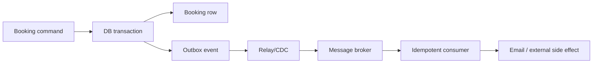

# Kiểm tra ràng buộc khi có thao tác đồng thời hoặc dữ liệu đến trễ

Một lược đồ có khóa chính, khóa ngoại và các điều kiện `CHECK` có thể vượt qua mọi bài kiểm thử đơn luồng nhưng vẫn sai khi đưa vào vận hành. Hai khách cùng đặt một phòng họp cho cùng khung giờ có thể đều nhìn thấy “còn trống”. Hai request đặt hàng có thể cùng đọc tồn kho 1 và cùng kết luận đủ hàng. Một consumer nhận trạng thái `PAID` muộn hơn trạng thái `REFUNDED` có thể ghi lùi đơn hàng về “đã thanh toán”. Dữ liệu từ cảm biến, đối tác hay hệ thống khác cũng có thể tới sau thời điểm nghiệp vụ, làm bảng tổng hợp hoặc lịch sử phiên bản trở nên không nhất quán.

Những trường hợp này không nhất thiết do câu SQL sai cú pháp. Chúng xuất phát từ **sự khác nhau giữa một ràng buộc đúng khi xem từng hàng và một bất biến phải luôn đúng trong mọi lịch thực thi**, kể cả khi nhiều transaction chạy đồng thời, thông điệp bị phát lại hoặc bản ghi đến không theo thứ tự sự kiện.

Bài thuộc chương **Kiểm chứng thiết kế** trong module **DATABASE_DATA_MODELING**. Theo mục tiêu module, ta sẽ chuyển yêu cầu thành mô hình thực thể, quan hệ, khóa, chỉ mục, lược đồ vật lý và quy tắc có thể kiểm chứng; đối chiếu mô hình quan hệ, document, graph và phân tích khi dữ liệu được cập nhật hoặc tích hợp. Trọng tâm là tạo **bằng chứng thử nghiệm** cho những bất biến về tính duy nhất, số lượng, lịch đặt, trạng thái, thời gian hiệu lực, idempotency và tính đầy đủ của dữ liệu dẫn xuất.

Ví dụ sử dụng **PostgreSQL 15+** và một số pseudocode Java 17+. Những bảo đảm thực tế phụ thuộc mức cô lập, constraint, phiên bản DBMS và giao thức ghi của ứng dụng; không nên xem việc chạy đúng một lần là chứng cứ an toàn cho mọi tình huống.

## 1. Bất biến là gì và tại sao thử tuần tự chưa đủ?

**Bất biến nghiệp vụ** (*business invariant*) là một điều kiện phải đúng tại các thời điểm quan sát mà hệ thống cam kết, thường là **sau mỗi transaction đã commit** hoặc sau một quy trình bù trừ có trạng thái được mô tả rõ.

Ví dụ:

- Mỗi tenant không có hai tài khoản có cùng email chuẩn hóa.
- Một tài nguyên không có hai lịch đặt **đang hiệu lực** trùng thời gian.
- Số lượng khả dụng của một SKU trong kho không bị trừ xuống âm khi xác nhận đặt chỗ.
- Một yêu cầu có cùng khóa idempotency không được tạo hai đơn độc lập.
- Một trạng thái hiện tại không được ghi đè bằng một snapshot **cũ hơn** từ cùng nguồn có phiên bản đơn điệu.
- Một lượt thanh toán không được áp dụng hai lần chỉ vì webhook được gửi lại.
- Hai bản ghi lịch sử hiệu lực của cùng thực thể không chồng khoảng thời gian.
- Dữ liệu tổng hợp đã công bố phải phản ánh **đúng phạm vi sự kiện và chính sách late data**.

Mỗi bất biến cần có **phạm vi** (tenant, phòng, SKU, account, source system), **thời điểm** (event time, thời gian hiệu lực, thời điểm commit) và **điểm cưỡng chế** (database, transaction/application, hệ thống phân tán hoặc pipeline).

### Tính đúng dữ liệu không chỉ là “mọi `INSERT` thành công”

Một thiết kế có thể thất bại theo ít nhất bốn cách:

1. **Chấp nhận trạng thái trái bất biến:** hai lịch đặt trùng đều commit.
2. **Làm mất cập nhật hợp lệ:** một writer ghi đè dữ liệu writer khác.
3. **Nhân bản hoặc áp lại tác động:** cùng thanh toán hoặc sự kiện được xử lý hai lần.
4. **Ghi dữ liệu cũ lên dữ liệu mới hoặc báo cáo sai lịch sử:** thông điệp tới muộn làm lùi trạng thái hay làm sai bucket.

Điều kiện `CHECK(quantity >= 0)` kiểm tra một hàng; nó không tự giải quyết việc cùng một hàng bị hai transaction tính từ **một bản đọc cũ**. Một `UNIQUE` chỉ kiểm tra các cột và phạm vi mà nó thực sự được khai báo. Một `FOREIGN KEY` không tự bảo đảm rằng sự kiện tham chiếu tới dòng cha **đã đến đúng thứ tự**.

## 2. Viết hợp đồng kiểm chứng cho mỗi ràng buộc

Thay vì ghi chung chung “không được đặt trùng phòng”, hãy mô tả:

| Thuộc tính hợp đồng | Ví dụ đặt lịch | Ví dụ tồn kho |
|---|---|---|
| **Thực thể và grain** | Một yêu cầu giữ/đặt một phòng trong một khoảng | Một SKU × kho × tenant là một số dư |
| **Khóa phạm vi** | `(tenant_id, room_id)` | `(tenant_id, warehouse_id, sku_id)` |
| **Điều kiện bất biến** | Hai lịch `HELD/CONFIRMED` không được giao nhau | `available_qty >= 0` |
| **Trạng thái được tính** | Không tính `CANCELLED` | Chỉ các khoản đã được reserve/commit theo quy trình |
| **Thời gian** | Khoảng `[start_at,end_at)` bằng thời điểm tuyệt đối | Thời điểm transaction commit và thời điểm nghiệp vụ |
| **Điểm bảo vệ** | Exclusion constraint hoặc serialization/locking được chứng minh | UPDATE có điều kiện nguyên tử trên cùng row |
| **Lịch thực thi cần thử** | Hai transaction insert khoảng trùng | Hai transaction trừ một số dư |
| **Kết quả kỳ vọng** | Tối đa một booking hợp lệ được commit | Tối đa một trừ tồn khi chỉ còn 1 đơn vị |
| **Xử lý thất bại** | Trả “khung giờ đã có người đặt” | Trả “không đủ hàng” |
| **Quan sát/audit** | Constraint conflict và lịch đặt đã commit | Số dư, reservation, retry, idempotency |

Một bảng thiết kế không có cột “**lịch thực thi đối nghịch phải thử**” dễ tạo cảm giác an toàn giả: nhiều bug cạnh tranh không thể thấy khi chạy request tuần tự.

### Phân biệt các điểm bảo vệ

- **PK/UNIQUE:** ràng buộc danh tính, chống hai hàng cùng bộ khóa được kiểm soát trong phạm vi DB.
- **CHECK/NOT NULL:** ràng buộc trên một hàng, không kiểm tra tổng hoặc hàng khác.
- **FK:** ràng buộc tham chiếu khi dữ liệu cùng phạm vi được DB cưỡng chế; có chính sách thời điểm kiểm tra.
- **EXCLUDE/constraint khoảng:** chống các cặp hàng thỏa quan hệ xung đột, ví dụ cùng phòng và khoảng giao nhau.
- **UPDATE có điều kiện:** biến việc đọc điều kiện và sửa một hàng thành một hành động được DB phối hợp.
- **Transaction + khóa/cô lập:** bảo vệ bất biến liên quan nhiều hàng hoặc nhiều bảng nếu mọi writer cùng giao thức.
- **Message idempotency, ordering, watermark:** bảo vệ các bất biến xuyên thời gian hoặc hệ thống; SQL constraint đơn dòng thường chưa đủ.

## 3. Hiểu ba dạng race condition thường gặp

### 3.1. Lost update — mất cập nhật

Hai giao dịch đọc `stock = 10`. T1 tính trừ 3 thành 7; T2 tính trừ 4 thành 6. Nếu cả hai dùng `UPDATE stock SET quantity = :stale_calculated_value`, có thể dòng cuối cùng là 6 hoặc 7 thay vì 3, tùy mức cô lập và cách ghi.

**Điểm mấu chốt:** công thức tính ở application dựa trên snapshot cũ, không phải một phép trừ nguyên tử lên giá trị đang được bảo vệ.

### 3.2. Check-then-act — kiểm tra rồi hành động

T1 và T2 đều chạy:

```text
SELECT COUNT(*) FROM bookings WHERE room=7 AND overlaps(requested_slot);
→ 0
```

Cả hai cùng thực hiện `INSERT` khác booking ID. Nếu không có constraint/locking thích hợp, cả hai có thể commit lịch trùng. Việc gọi `SELECT` ngay trước `INSERT` **không làm hai lệnh trở thành một phép kiểm tra nguyên tử**.

### 3.3. Write skew — mỗi transaction sửa hàng khác nhau

T1 kiểm tra “còn ít nhất một bác sĩ trực” rồi đánh dấu bác sĩ A nghỉ. T2 đồng thời kiểm tra như vậy rồi đánh dấu bác sĩ B nghỉ. Hai transaction sửa **hai hàng khác nhau**, nên khóa trên một hàng không nhất thiết tạo conflict; cả hai có thể commit và không còn bác sĩ nào trực.

Write skew minh họa vì sao “mỗi hàng đều có `CHECK` tốt” chưa đủ cho **bất biến liên hàng**. Dưới một số mức cô lập kiểu snapshot, hai transaction vẫn có thể cùng đọc snapshot hợp lệ và commit những thay đổi không đụng cùng row.

## 4. Mức cô lập transaction: hiểu điều đảm bảo và điều không đảm bảo

| Khái niệm | Ý nghĩa thực tế | Lỗi còn phải phòng |
|---|---|---|
| **READ COMMITTED** | Mỗi statement thấy dữ liệu đã commit theo quy tắc DB; PostgreSQL dùng snapshot theo statement | Check-then-insert, non-repeatable read, logic liên hàng |
| **REPEATABLE READ** | Đọc nhất quán theo snapshot transaction ở PostgreSQL | Write skew/serialization anomaly khi điều kiện liên hàng |
| **SERIALIZABLE** | Kết quả các transaction commit tương đương một thứ tự tuần tự hợp lệ, nếu **tất cả thao tác liên quan** tham gia đúng giao thức | Transaction có thể bị hủy với serialization failure; cần retry **toàn transaction** |
| **Row lock** | Một transaction giữ khóa trên những hàng được chọn/sửa | Không bảo vệ “không có hàng nào khớp” nếu hàng chưa tồn tại; không tự bảo vệ mọi predicate |
| **Advisory lock** | Khóa logic do ứng dụng phối hợp qua DB | Writer bỏ qua khóa vẫn có thể vi phạm; phải quản lý key/scope và giao thức |
| **Constraint thực thi** | DB kiểm tra một invariant được biểu diễn thành PK/UNIQUE/FK/EXCLUDE/CHECK | Không bảo vệ các điều kiện chưa được khai báo hoặc nằm ngoài phạm vi |

**Trong PostgreSQL**, `READ UNCOMMITTED` hoạt động về bản chất như `READ COMMITTED`; `REPEATABLE READ` dựa trên snapshot và có thể ngăn một số bất thường nhưng **không tương đương `SERIALIZABLE`**. Những DBMS khác có thể triển khai các mức cô lập cùng tên khác nhau; cần kiểm tra tài liệu và chạy thử trên engine/phiên bản mục tiêu.

### Serializable không phải lựa chọn “bật lên là xong”

PostgreSQL có thể báo **SQLSTATE `40001`** khi phát hiện một lịch thực thi không thể được coi là tuần tự. Ứng dụng phải:

1. Rollback transaction thất bại.
2. Retry **toàn bộ công việc đọc–tính–ghi**, không chỉ câu `UPDATE` cuối.
3. Giữ side effect ngoài DB idempotent hoặc chỉ phát sau commit thành công qua outbox.
4. Giới hạn retry, backoff, báo lỗi khi hết ngân sách.
5. Đảm bảo mọi writer có liên quan cùng tham gia cơ chế cần thiết.

Ngoài `40001` có thể gặp **deadlock detected `40P01`**. Retry phải có chính sách cụ thể, không lặp vô hạn mọi loại lỗi SQL.

**Serializable là thuộc tính lịch giao dịch**, không thay thế việc định nghĩa đúng khóa nghiệp vụ, timezone, idempotency hoặc ý nghĩa của sự kiện đến muộn.

## 5. Ví dụ 1 — Đặt lịch bị trùng dù hai lần SELECT đều trả 0

Một nền tảng đặt phòng có yêu cầu:

> Với cùng tenant và room, không có hai booking ở trạng thái `HELD` hoặc `CONFIRMED` có khoảng thời gian giao nhau. Booking `CANCELLED` không giữ phòng.

Cho hai giao dịch đồng thời:

```text
T1 (10:00)                              T2 (10:00)
BEGIN                                   BEGIN
SELECT overlapping bookings -> 0        SELECT overlapping bookings -> 0
INSERT booking A [13:00,14:00)          INSERT booking B [13:30,14:30)
COMMIT                                  COMMIT
```

Nếu chỉ có PK trên `booking_id`, cả hai insert có ID khác nhau, nên **PK không phát hiện** xung đột. Phép `SELECT COUNT(*)` chỉ cho biết điều đã commit/tồn tại trong snapshot tại thời điểm query, không giữ quyền độc chiếm đối với cả tập khoảng thời gian tương lai.

### Phản ví dụ khi thêm UNIQUE start time

`UNIQUE(tenant_id,room_id,start_at)` không đủ: hai khung `[13:00,14:00)` và `[13:30,14:30)` có start khác nhau nhưng giao nhau.

Tương tự, `UNIQUE(room_id,DATE(start_at))` vừa không bảo vệ overlap trong một ngày vừa có thể từ chối hai ca không trùng trong cùng ngày. Cần mô hình hóa **quan hệ giao nhau giữa khoảng**, không ép nó thành so bằng nhau.

## 6. PostgreSQL: dùng exclusion constraint cho bất biến khoảng

PostgreSQL hỗ trợ kiểu `tstzrange` (khoảng thời gian có timezone) cùng toán tử `&&` để kiểm tra giao nhau. Với `btree_gist` hỗ trợ equality cho các khóa scalar trong GiST, có thể tạo constraint như sau:

```sql
-- Chạy bằng role có quyền tạo extension trên database thử nghiệm.
CREATE EXTENSION IF NOT EXISTS btree_gist;

CREATE TABLE room_bookings (
    tenant_id BIGINT NOT NULL,
    booking_id BIGINT NOT NULL,
    room_id BIGINT NOT NULL,
    slot TSTZRANGE NOT NULL,
    status_code TEXT NOT NULL,

    CONSTRAINT pk_room_bookings
        PRIMARY KEY (tenant_id, booking_id),

    CONSTRAINT ck_booking_status
        CHECK (status_code IN ('HELD', 'CONFIRMED', 'CANCELLED')),

    CONSTRAINT ck_booking_slot
        CHECK (
            NOT isempty(slot)
            AND NOT lower_inf(slot)
            AND NOT upper_inf(slot)
            AND lower_inc(slot)
            AND NOT upper_inc(slot)
        ),

    CONSTRAINT ex_no_overlapping_active_bookings
        EXCLUDE USING gist (
            tenant_id WITH =,
            room_id WITH =,
            slot WITH &&
        )
        WHERE (status_code IN ('HELD', 'CONFIRMED'))
        DEFERRABLE INITIALLY IMMEDIATE
);
```

**Grain:** một dòng là một booking định danh bởi `(tenant_id,booking_id)`. Hai dòng xung đột nếu **cùng tenant + cùng room + hai khoảng giao nhau**, và cả hai đang giữ chỗ.

- `[start,end)` cho phép hai booking liền nhau: `[13:00,14:00)` và `[14:00,15:00)` **không giao nhau**.
- `TSTZRANGE` dùng mốc thời gian tuyệt đối; client phải xác định múi giờ khi nhập, đặc biệt qua giờ mùa hè ở những khu vực có DST.
- `CHECK` chỉ bảo vệ khoảng hữu hạn/không rỗng theo cách biểu diễn đã chọn, không tự bảo vệ chồng lắp.
- `EXCLUDE` mới là constraint chống **cặp hàng** có cùng room và slot giao nhau.
- `WHERE` khiến `CANCELLED` không giữ chỗ; thay trạng thái từ `CANCELLED` trở lại `CONFIRMED` sẽ bị kiểm tra như một thao tác giữ chỗ mới.
- `DEFERRABLE INITIALLY IMMEDIATE` kiểm tra mặc định ở thời điểm statement; một transaction có thể chủ ý defer trong use case được phép, nhưng phải đạt bất biến trước commit.

### Hai transaction để kiểm chứng

**Session A:**

```sql
BEGIN;

INSERT INTO room_bookings
    (tenant_id, booking_id, room_id, slot, status_code)
VALUES (
    42, 1001, 7,
    tstzrange(
        TIMESTAMPTZ '2026-11-22 13:00:00+07',
        TIMESTAMPTZ '2026-11-22 14:00:00+07',
        '[)'
    ),
    'CONFIRMED'
);

-- Giữ transaction mở ở đây để Session B thử insert.
-- Sau khi kiểm tra hiện tượng chờ, COMMIT.
```

**Session B, trong lúc A chưa commit:**

```sql
BEGIN;

INSERT INTO room_bookings
    (tenant_id, booking_id, room_id, slot, status_code)
VALUES (
    42, 1002, 7,
    tstzrange(
        TIMESTAMPTZ '2026-11-22 13:30:00+07',
        TIMESTAMPTZ '2026-11-22 14:30:00+07',
        '[)'
    ),
    'HELD'
);
```

Session B có thể **chờ** quyết định commit/rollback của A. Nếu A commit, B phải nhận **exclusion violation `23P01`** (hoặc thất bại tương ứng khi constraint được kiểm tra), rồi rollback; nếu A rollback, B có thể tiếp tục hợp lệ.

**Kết luận có thể kiểm chứng:** sau khi hai transaction kết thúc, không có hai booking `HELD/CONFIRMED` cùng tenant/phòng và khoảng giao nhau.

Không nên kỳ vọng cùng một thứ tự dòng log/timing mỗi lần chạy; hệ điều hành và lịch chạy transaction có thể khác. Điều cần xác nhận là **bất biến ở trạng thái đã commit** và cách hệ thống xử lý lỗi.

### Giới hạn cần ghi rõ

Nếu đặt lịch trải trên **hai database độc lập**, exclusion constraint của mỗi database không nhìn thấy lịch tại database còn lại. Cần xác định một nơi sở hữu room/slot, điều phối phân tán hoặc mô hình consistency khác được nghiệp vụ chấp nhận.

## 7. Khi không có exclusion constraint: các lựa chọn và rủi ro

Không phải engine nào cũng có ràng buộc khoảng tương đương. Có thể cân nhắc:

1. **SERIALIZABLE transaction** đọc điều kiện overlap rồi insert, đảm bảo tất cả writer cùng dùng giao thức và retry serialization failure.
2. **Khóa một hàng cha `room`:** khóa `SELECT ... FOR UPDATE` theo `(tenant_id,room_id)`, kiểm tra overlap trong lúc giữ khóa rồi insert. Mọi writer booking room ấy phải khóa **cùng hàng cha**.
3. **Materialize các slot rời rạc** rồi `UNIQUE(room,slot)` nếu bài toán thật sự dùng các ô thời gian cố định; không áp đặt discretization tùy tiện cho thời gian liên tục.
4. **Advisory lock theo room** trong PostgreSQL, với hash key ổn định và giao thức bao phủ mọi writer; cần kiểm tra collision/lock scope, không tự coi advisory lock là constraint.
5. **Dịch vụ sở hữu lịch đặt** trong kiến trúc phân tán, với routing để một room chỉ có một chủ ghi được cấp quyền.

### Một sai lầm quen thuộc với `FOR UPDATE`

```sql
SELECT *
FROM room_bookings
WHERE room_id = 7
  AND slot && tstzrange(:start, :end, '[)')
FOR UPDATE;
```

Nếu hiện **không có booking khớp**, query không khóa hàng nào của `room_bookings`. Một transaction khác vẫn có thể insert booking giao nhau. Khóa hàng cha `rooms` có thật và được mọi writer khóa là một cơ chế khác với “khóa những hàng overlap đang tồn tại”.

**Ràng buộc liên hàng phải được chứng minh dưới lịch đồng thời**, không chỉ đọc thấy “đúng” khi một session duy nhất đang chạy.

## 8. Ví dụ 2 — Hai đơn cùng tranh một sản phẩm còn đúng một chiếc

Mô hình một số dư theo **tenant × kho × SKU**:

```sql
CREATE TABLE stock_balance (
    tenant_id BIGINT NOT NULL,
    warehouse_id BIGINT NOT NULL,
    sku_id BIGINT NOT NULL,
    available_qty BIGINT NOT NULL,
    reserved_qty BIGINT NOT NULL DEFAULT 0,
    version BIGINT NOT NULL DEFAULT 0,

    CONSTRAINT pk_stock_balance
        PRIMARY KEY (tenant_id, warehouse_id, sku_id),
    CONSTRAINT ck_stock_quantities
        CHECK (available_qty >= 0 AND reserved_qty >= 0),
    CONSTRAINT ck_stock_version CHECK (version >= 0)
);

INSERT INTO stock_balance (
    tenant_id, warehouse_id, sku_id,
    available_qty, reserved_qty
) VALUES (42, 1, 501, 1, 0);
```

Bất biến: khi xác nhận **giữ hàng**, không được reserve quá số lượng khả dụng đã ghi nhận. Một cách sai là:

```text
T1: đọc available_qty = 1
T2: đọc available_qty = 1
T1: ghi available_qty = 0 và chấp nhận đơn A
T2: ghi available_qty = 0 và chấp nhận đơn B
```

Kết quả balance có thể vẫn là 0 và `CHECK >= 0` vẫn đúng, nhưng hệ thống đã chấp nhận **hai đơn** cho một sản phẩm. Đây là lỗi mô hình **giao thức ghi** và mối quan hệ giữa số dư–reservation, không nhất thiết là âm số dư.

### Dùng UPDATE có điều kiện nguyên tử

```sql
UPDATE stock_balance
SET
    available_qty = available_qty - 1,
    reserved_qty = reserved_qty + 1,
    version = version + 1
WHERE tenant_id = 42
  AND warehouse_id = 1
  AND sku_id = 501
  AND available_qty >= 1
RETURNING available_qty, reserved_qty, version;
```

Trong PostgreSQL `READ COMMITTED`, hai transaction cùng sửa **một hàng** phải phối hợp qua row lock. Khi transaction trước commit, transaction còn lại đánh giá lại điều kiện trên phiên bản phù hợp của hàng; nếu không còn `available_qty >= 1`, lệnh thứ hai trả **0 dòng**. Từ đó ứng dụng biết giữ hàng thất bại.

**Không được chỉ chạy `UPDATE` rồi bỏ qua `row count/RETURNING`.** Nếu 0 dòng, có thể là thiếu SKU, khác tenant/kho hoặc không đủ hàng; cần phân loại lỗi đúng cách.

### Kiểm chứng bằng hai session

**Session A:**

```sql
BEGIN;

UPDATE stock_balance
SET available_qty = available_qty - 1,
    reserved_qty = reserved_qty + 1,
    version = version + 1
WHERE tenant_id = 42
  AND warehouse_id = 1
  AND sku_id = 501
  AND available_qty >= 1
RETURNING available_qty, reserved_qty;

-- Giữ transaction mở.
```

**Session B:**

```sql
BEGIN;

UPDATE stock_balance
SET available_qty = available_qty - 1,
    reserved_qty = reserved_qty + 1,
    version = version + 1
WHERE tenant_id = 42
  AND warehouse_id = 1
  AND sku_id = 501
  AND available_qty >= 1
RETURNING available_qty, reserved_qty;
```

Sau khi A commit, B không được trừ thêm vì không còn số dư khả dụng. Nếu A rollback, B có thể thành công. Cuối thử nghiệm, chạy:

```sql
SELECT available_qty, reserved_qty, version
FROM stock_balance
WHERE tenant_id = 42
  AND warehouse_id = 1
  AND sku_id = 501;
```

**Chỉ kiểm tra `available_qty >= 0` chưa đủ:** còn phải kiểm tra **mỗi reservation được tạo đúng một lần** và tổng chuyển trạng thái tương ứng với ledger/chứng từ. Nếu hai request retry cùng đơn nhưng cùng chạy phép trừ trên, stock có thể bị trừ hai lần dù không âm.

## 9. Idempotency phải được phối hợp với thay đổi số dư

Một đơn có thể gửi lại request reserve vì client timeout, queue retry hoặc worker khởi động lại. Hãy tách:

- **Lệnh nghiệp vụ:** reserve 1 SKU cho `(tenant, order_id, line_no)`.
- **Tác động lên số dư:** trừ available và cộng reserved.
- **Khóa idempotency:** một order line chỉ được reserve một lần theo contract.

### DDL minh họa

```sql
CREATE TABLE stock_reservations (
    tenant_id BIGINT NOT NULL,
    order_id BIGINT NOT NULL,
    line_no INTEGER NOT NULL,
    warehouse_id BIGINT NOT NULL,
    sku_id BIGINT NOT NULL,
    quantity BIGINT NOT NULL,
    status_code TEXT NOT NULL DEFAULT 'ACTIVE',

    CONSTRAINT pk_stock_reservations
        PRIMARY KEY (tenant_id, order_id, line_no),

    CONSTRAINT fk_reservation_balance
        FOREIGN KEY (tenant_id, warehouse_id, sku_id)
        REFERENCES stock_balance (tenant_id, warehouse_id, sku_id),

    CONSTRAINT ck_reservation_qty CHECK (quantity > 0),
    CONSTRAINT ck_reservation_line CHECK (line_no > 0),
    CONSTRAINT ck_reservation_status
        CHECK (status_code IN ('ACTIVE', 'RELEASED', 'CONSUMED'))
);
```

Một use case hợp lý thực hiện **trong cùng transaction**:

1. `INSERT stock_reservations` với khóa `(tenant_id,order_id,line_no)`.
2. Nếu insert bị unique conflict, **không trừ tồn lần nữa**; tìm reservation đã có và xác minh payload/quantity/status theo chính sách idempotency.
3. Nếu insert mới thành công, chạy `UPDATE stock_balance ... WHERE available_qty >= quantity RETURNING`.
4. Nếu UPDATE trả 0 dòng, **rollback toàn transaction**, bao gồm reservation vừa insert.
5. Nếu đủ hàng, commit reservation và số dư cùng lúc; phát event sau commit qua outbox nếu cần.

Nếu chọn `INSERT ... ON CONFLICT DO NOTHING RETURNING ...` để phân biệt mới/trùng, phải kiểm tra kết quả thật sự được insert, **không** tiếp tục trừ hàng trên đường conflict. Cũng không được tự động cho rằng một request trùng khóa nhưng quantity/SKU khác là request hợp lệ đã được xử lý.

**Hai điều kiện phải cùng đúng:**

\[
\text{reservation identity unique}
\quad\land\quad
\text{available stock atomic}.
\]

Chỉ có một trong hai vẫn có thể tạo double reservation hoặc ghi sai số dư.

### Đặt chỗ nhiều SKU

Nếu một đơn có nhiều dòng, hãy dùng một transaction có thể rollback tất cả theo yêu cầu “all-or-nothing”, giữ thứ tự khóa tài nguyên nhất quán để giảm deadlock, và tính đến những dòng trùng SKU trong cùng đơn. Đừng trừ cùng SKU trên một dòng rồi quên các dòng còn lại hoặc bỏ qua transaction rollback.

## 10. Optimistic locking và `version` có vai trò khác `CHECK`

Một cách quản lý sửa đổi là **optimistic concurrency control**:

```sql
UPDATE stock_balance
SET available_qty = :new_available,
    version = version + 1
WHERE tenant_id = :tenant_id
  AND warehouse_id = :warehouse_id
  AND sku_id = :sku_id
  AND version = :expected_version
  AND :new_available >= 0
RETURNING version;
```

Nếu không trả dòng, phiên bản có thể đã đổi và request cần đọc lại/tính lại. Đây là một **compare-and-swap** theo phiên bản hàng.

Nhưng:

- Nó không tự làm rõ `:new_available` được tính từ những giá trị nào.
- Không bảo vệ một invariant trải **nhiều hàng** nếu chỉ update một phiên bản đơn.
- Nếu một writer không tăng `version`, giao thức bị phá.
- Không thay thế khóa idempotency: hai request cùng ý nghĩa nhưng dùng version mới khác nhau vẫn có thể trừ hai lần.

Với phép reserve một SKU, `UPDATE available_qty = available_qty - :qty WHERE available_qty >= :qty` thường đơn giản và đúng mục tiêu hơn việc đọc–tính–ghi bằng optimistic version. Với workflow có nhiều thuộc tính do người dùng sửa, version giúp phát hiện xung đột chỉnh sửa; chọn kỹ thuật theo **bất biến**.

## 11. Ràng buộc liên bảng và các giao dịch có nhiều bước

Một ví dụ khác: tổng tiền một đơn phải bằng **tổng dòng hàng và các điều chỉnh được chốt**. `CHECK(total_minor = ...)` trên bảng `orders` không thể tự truy vấn những dòng khác để tính.

Có thể chọn:

- **Một nguồn chân lý:** lưu các dòng và điều chỉnh là nguồn; aggregate được tính khi đọc hoặc tạo projection có thể rebuild.
- **Transaction đồng bộ:** thay dòng/điều chỉnh và cập nhật projection trong một transaction với locking/version phù hợp.
- **Ledger + projection bất đồng bộ:** ledger là nguồn; projection có watermark và kiểm tra tính đúng/độ tươi.
- **Constraint trigger hoặc cơ chế engine:** đánh giá kỹ thời điểm kiểm tra, transaction isolation và contention nếu cần cưỡng chế trong DB.

### Vì sao tổng hợp ngay khi nhận event là dễ sai?

Giả sử hệ thống nhận `OrderLineAdded` trước `OrderCreated`. Nếu consumer xem mọi thứ xảy ra theo một thứ tự “lý tưởng”, FK và phép tính tổng có thể thất bại. Nếu consumer tạm bỏ sự kiện vì không có parent, có nguy cơ **mất dòng hợp lệ**. Cần buffer/staging, retry hoặc thay đổi hợp đồng truyền dữ liệu.

Một hệ giao dịch có thể cần **bảo đảm mạnh tại commit**; một bảng phân tích bất đồng bộ chỉ có thể hứa **eventual consistency trong một giới hạn trễ**, kèm tình trạng incomplete/stale. Hai loại bảo đảm phải được phân biệt trong thiết kế và kiểm thử.

## 12. Dữ liệu đến trễ: định nghĩa thời gian trước khi kiểm tra tính đúng

Một sự kiện thường có ít nhất ba mốc:

- **`occurred_at` / event time:** hiện tượng thực sự diễn ra tại nguồn theo hợp đồng thời gian.
- **`received_at` / processing time:** hệ thống nhận được message/sự kiện.
- **`committed_at` / database time:** transaction đã ghi nhận thay đổi.

Với dữ liệu có hiệu lực lịch sử, có thể có thêm:

- **`valid_from`, `valid_to`:** khoảng thực tế nghiệp vụ mà một giá trị có hiệu lực.
- **`recorded_at` / system time:** thời điểm hệ thống biết/ghi một phiên bản của thông tin.

Hai trục “**đúng lúc nào trong nghiệp vụ**” và “**hệ thống biết lúc nào**” là cơ sở của mô hình bitemporal khi cần giải thích các correction lịch sử.

### Ví dụ thứ tự đến khác thứ tự xảy ra

| Event | `occurred_at` | `received_at` | `source_version` | Trạng thái đầy đủ |
|---|---|---|---:|---|
| E11 | 10:02 | 10:10 | 11 | PAID |
| E12 | 10:05 | 10:08 | 12 | REFUNDED |

Nếu hệ thống áp dụng message **theo thứ tự nhận**, nó thấy `REFUNDED` trước, rồi `PAID` sau và có thể ghi lùi từ trạng thái mới về cũ. Sai lầm ở đây là đồng nhất `received_at` với **thứ tự phiên bản nghiệp vụ**.

Đối với **snapshot đầy đủ, được version hóa đơn điệu bởi một nguồn có thẩm quyền**, có thể chỉ chấp nhận phiên bản lớn hơn. Đối với **delta/action event**, không thể tùy tiện bỏ phiên bản thấp hơn: mỗi tác động có thể vẫn cần được xử lý đúng một lần và đúng thứ tự nghiệp vụ.

## 13. Hai chiến lược xử lý sự kiện đến sai thứ tự

### 13.1. Latest-state projection: chỉ nhận snapshot phiên bản mới hơn

Định nghĩa bảng trạng thái hiện tại:

```sql
CREATE TABLE payment_state_projection (
    tenant_id BIGINT NOT NULL,
    payment_id TEXT NOT NULL,
    source_version BIGINT NOT NULL,
    state_code TEXT NOT NULL,
    occurred_at TIMESTAMPTZ NOT NULL,
    source_event_id TEXT NOT NULL,

    CONSTRAINT pk_payment_state_projection
        PRIMARY KEY (tenant_id, payment_id),
    CONSTRAINT ck_payment_version CHECK (source_version >= 0),
    CONSTRAINT ck_payment_state CHECK (
        state_code IN ('INITIATED','AUTHORIZED','PAID','REFUNDED')
    ),
    CONSTRAINT ck_payment_event_id
        CHECK (btrim(source_event_id) <> '')
);
```

Khi nhận một **full-state snapshot**:

```sql
INSERT INTO payment_state_projection (
    tenant_id, payment_id, source_version,
    state_code, occurred_at, source_event_id
)
VALUES (
    :tenant_id, :payment_id, :source_version,
    :state_code, :occurred_at, :source_event_id
)
ON CONFLICT (tenant_id, payment_id)
DO UPDATE SET
    source_version = EXCLUDED.source_version,
    state_code = EXCLUDED.state_code,
    occurred_at = EXCLUDED.occurred_at,
    source_event_id = EXCLUDED.source_event_id
WHERE payment_state_projection.source_version
    < EXCLUDED.source_version;
```

Nếu E12/version 12 đã được áp dụng, E11/version 11 đến sau không thể ghi lùi projection. Phép cập nhật có điều kiện được kiểm tra trong hành động ghi của database, không phải chỉ kiểm tra `version` trước bằng một `SELECT` tách rời.

**Giới hạn của mẫu này:**

- `source_version` phải **đơn điệu trong phạm vi payment và nguồn**; không được trộn version của hai nguồn độc lập.
- Message phải chứa **trạng thái đầy đủ** để version 12 tự biểu diễn đúng khi version 11 chưa đến.
- Không được dùng chiến lược này để làm mất **một khoản tiền delta** hoặc một business action ở version 11.
- Nếu version 12 và 12 có **payload khác nhau**, cần phát hiện xung đột/ký hiệu sửa đổi, không âm thầm coi mọi event cùng version là retry.
- Nếu nguồn có **delete/tombstone**, phải lưu phiên bản delete hoặc trạng thái đủ mạnh để message cũ không làm thực thể sống lại.
- Thứ tự source version không tự thay thế kiểm tra **state transition** được nghiệp vụ cho phép. Nếu nguồn phát phiên bản mới hơn nhưng trạng thái bất hợp lệ, cần quarantine/đối soát.

### 13.2. Event-delta processing: mỗi event phải được xử lý đúng một lần

Với sự kiện `PaymentCaptured(+100)` rồi `PaymentRefunded(-40)`, phép chiếu số dư cần áp từng business event hợp lệ, không thể chỉ giữ **max source_version** và bỏ những delta đến muộn chưa áp dụng.

Cần:

1. **Event identity** ổn định để chống replay.
2. Thứ tự hoặc quan hệ phụ thuộc khi transition yêu cầu xử lý theo chuỗi.
3. Một **ledger** hoặc bảng sự kiện nguồn đã chấp nhận.
4. Projection được xây từ các sự kiện hợp lệ và có thể rebuild.
5. Quy trình quản lý gap, thiếu event và compensation.

Một nguồn ghi theo sequence 10, 12 rồi 11 có thể:

- Buffer 12 cho tới khi 11 đến nếu cần các bước liên tục, hoặc
- Ghi cả 11 và 12 trong ledger, xây lại trạng thái theo thứ tự/logic đúng, nếu model cho phép, hoặc
- Dùng snapshot hoàn chỉnh có version 12 làm checkpoint **sau khi** chứng minh event trước đã được tích hợp theo hợp đồng nguồn.

Không sử dụng `source_version > current_version` như một quy tắc toàn năng cho cả snapshot và delta.

## 14. Inbox, event ID và tính đúng khi xử lý lại message

Các hệ thống message thường hứa ít nhất một lần giao (*at-least-once*). Consumer nên được thiết kế **idempotent**.

Một bảng inbox có thể có:

```sql
CREATE TABLE processed_events (
    consumer_name TEXT NOT NULL,
    source_system TEXT NOT NULL,
    source_event_id TEXT NOT NULL,
    payload_fingerprint BYTEA NOT NULL,
    processed_at TIMESTAMPTZ NOT NULL DEFAULT CURRENT_TIMESTAMP,

    CONSTRAINT pk_processed_events
        PRIMARY KEY (consumer_name, source_system, source_event_id),
    CONSTRAINT ck_event_consumer CHECK (btrim(consumer_name) <> ''),
    CONSTRAINT ck_event_source CHECK (btrim(source_system) <> ''),
    CONSTRAINT ck_source_event CHECK (btrim(source_event_id) <> '')
);
```

Bất biến: trong phạm vi **một consumer nghiệp vụ**, một `source_event_id` từ `source_system` được áp dụng **tối đa một lần** theo hợp đồng.

### Một transaction xử lý event

```text
BEGIN
  1. INSERT (consumer, source, event_id, fingerprint) vào inbox
  2. Nếu đã có ID:
     - kiểm tra payload fingerprint giống nhau
     - nếu giống: coi là retry, không áp side effect DB lần nữa
     - nếu khác: quarantine/conflict, không âm thầm bỏ
  3. Nếu insert mới: cập nhật ledger/aggregate/state theo sự kiện
  4. Ghi outbox nếu cần phát sự kiện cho hệ khác
COMMIT
ACK message sau khi commit được xác nhận
```

Chèn inbox phải nằm **cùng transaction DB** với việc áp dụng business mutation nếu muốn ngăn tình huống đã ghi dấu “processed” nhưng business update chưa commit. Nếu business side effect nằm ở **một dịch vụ ngoài DB**, cần outbox, idempotency key ở đích hoặc giao thức bù trừ; chỉ inbox nội bộ **không** làm hai hệ cùng commit nguyên tử.

### Retry sau kết quả commit không chắc chắn

Một client timeout sau khi gửi `COMMIT` có thể **không biết** transaction đã thành công chưa. Không được đơn giản gửi lại một nghiệp vụ “tạo tiền/giữ hàng” như một request mới với ID mới. Phải giữ **idempotency key** và tra kết quả hoặc retry an toàn theo cùng danh tính yêu cầu.

**Exactly-once ở mức nghiệp vụ** cần được chứng minh bằng danh tính, atomicity và cơ chế phục hồi. Một lựa chọn cấu hình delivery của broker chưa đủ đảm bảo mọi tác dụng phụ ngoài broker chỉ xảy ra một lần.

## 15. Đến trễ không đồng nghĩa cập nhật sai: chọn chính sách lịch sử

Một thay đổi giá có thể được nhập vào hệ thống ngày 22/11 nhưng được xác nhận có hiệu lực từ 01/11. Một sự kiện bán ngày 10/11 được nạp sau ngày 22/11 cần dùng **mức giá đã chốt tại giao dịch** hoặc quy tắc lịch sử có hiệu lực, tùy nghiệp vụ, chứ không được lấy giá niêm yết hiện tại.

Cần phân biệt:

- **Late-arriving event:** sự kiện phát sinh trước nhưng tới hệ sau.
- **Late-arriving dimension:** dữ liệu phân loại/thuộc tính của đối tượng tới sau fact.
- **Retroactive correction:** một thông tin đã biết bị sửa có hiệu lực ngược về quá khứ.
- **Out-of-order delivery:** các message từ cùng nguồn được nhận không theo thứ tự nghiệp vụ.
- **Duplicate/replay:** cùng một sự kiện được gửi lại, không phải một sự kiện mới.
- **Missing event:** sự kiện chưa đến hoặc đã mất; không được coi bằng 0 hay mặc định không xảy ra.

Mỗi loại gây tác động khác nhau lên **bảng trạng thái hiện tại**, **lịch sử hiệu lực**, **dòng sự kiện** và **báo cáo theo thời gian**.

### Hai trục bitemporal để đánh giá correction

| Trục thời gian | Câu hỏi |
|---|---|
| `valid_time` | Thông tin có hiệu lực trong nghiệp vụ từ khi nào tới khi nào? |
| `recorded/system time` | Hệ thống biết/ghi thông tin này khi nào? |

Nếu cần trả lời “ngày 15/11 hệ thống **tin** giá ngày 10/11 là gì?” và “bây giờ biết giá ngày 10/11 đúng là gì?”, một cột `updated_at` duy nhất thường không đủ. Cần lưu version/audit có thời điểm biết và khoảng hiệu lực, đồng thời nêu rõ cách xử lý correction.

## 16. Kiểm tra không chồng khoảng hiệu lực của dimension

Một bảng lịch sử phân loại sản phẩm có thể dùng:

```sql
CREATE EXTENSION IF NOT EXISTS btree_gist;

CREATE TABLE product_category_history (
    tenant_id BIGINT NOT NULL,
    sku_id BIGINT NOT NULL,
    valid_period TSTZRANGE NOT NULL,
    category_code TEXT NOT NULL,
    recorded_at TIMESTAMPTZ NOT NULL DEFAULT CURRENT_TIMESTAMP,

    CONSTRAINT ck_category_nonblank
        CHECK (btrim(category_code) <> ''),
    CONSTRAINT ck_valid_period
        CHECK (
            NOT isempty(valid_period)
            AND NOT lower_inf(valid_period)
            AND lower_inc(valid_period)
            AND NOT upper_inc(valid_period)
        ),

    CONSTRAINT ex_product_category_no_overlap
        EXCLUDE USING gist (
            tenant_id WITH =,
            sku_id WITH =,
            valid_period WITH &&
        )
);
```

Ở đây `valid_period` được phép có **upper bound không giới hạn** cho bản hiện hành, nhưng buộc có lower bound; `[)` giữ ranh giới không trùng. Constraint ngăn **hai bản lịch sử hiệu lực chồng nhau cho cùng tenant/SKU**.

### Một correction đến muộn ảnh hưởng ra sao?

Ban đầu:

```text
[2026-11-01, ∞) -> category A
```

Đối tác thông báo ngày 22/11 rằng từ 15/11 sản phẩm thuộc category B. Nếu insert ngay một row `[15/11,∞) -> B`, constraint từ chối vì chồng với row A. Cần **chỉnh khoảng A thành [01/11,15/11)** rồi insert B trong transaction có quy tắc locking phù hợp.

```sql
-- Mẫu thao tác: chỉ chạy khi đã xác định đúng hàng cần chỉnh.
BEGIN;

UPDATE product_category_history
SET valid_period = tstzrange(
    lower(valid_period),
    TIMESTAMPTZ '2026-11-15 00:00:00+07',
    '[)'
)
WHERE tenant_id = 42
  AND sku_id = 501
  AND valid_period @> TIMESTAMPTZ '2026-11-15 00:00:00+07';

INSERT INTO product_category_history (
    tenant_id, sku_id, valid_period, category_code
) VALUES (
    42, 501,
    tstzrange(
        TIMESTAMPTZ '2026-11-15 00:00:00+07',
        NULL,
        '[)'
    ),
    'B'
);

COMMIT;
```

Đoạn này là **mẫu ý tưởng**, không phải migration production tổng quát. Nếu đã có nhiều khoảng lịch sử, correction nằm giữa hai khoảng, hoặc có hai writer chỉnh lịch sử cùng lúc, phải kiểm tra số hàng update, các ranh giới, đồng bộ/khóa phù hợp và trường hợp overlap/gap. Với một dòng cũ `[01/11,∞)`, kết quả được mong đợi là hai khoảng không chồng nhau.

**Quan trọng:** bảng trên lưu trạng thái lịch sử **có hiệu lực hiện được công nhận**, không lưu đầy đủ các bản sửa từng được hệ thống biết. Muốn trả lời “tại thời điểm ghi X hệ thống từng biết gì”, cần thiết kế audit/bitemporal riêng; cập nhật trực tiếp khoảng cũ không đủ.

## 17. Dữ liệu lịch sử có hiệu lực phải được JOIN đúng thời điểm

Giả sử một fact bán hàng có `sale_time` và `sku_id`. Câu join đúng theo phân loại **tại thời điểm bán** có dạng:

```sql
-- sales_events là bảng fact minh họa, không tạo trong DDL trên.
SELECT
    f.tenant_id,
    f.sale_event_id,
    f.sale_time,
    h.category_code
FROM sales_events AS f
LEFT JOIN product_category_history AS h
  ON h.tenant_id = f.tenant_id
 AND h.sku_id = f.sku_id
 AND h.valid_period @> f.sale_time;
```

Nếu thay điều kiện thời gian bằng `h.sku_id = f.sku_id`, một fact có thể ghép với **mọi phiên bản** của sản phẩm và bị **nhân số đo**. Nếu dùng chỉ category hiện tại, báo cáo có thể là “phân loại hiện tại” chứ không còn “phân loại lúc bán”; hai hợp đồng khác nhau.

### Khi dimension đến trễ

Fact có thể đến trước row `product_category_history` bao phủ `sale_time`. Có một số lựa chọn:

- **Staging:** giữ fact chờ dimension trong khoảng trễ chấp nhận.
- **Unknown member:** nạp fact gắn trạng thái `UNKNOWN` rồi sửa surrogate key khi mapping đến, với audit và giới hạn thời gian.
- **Late-arriving resolution:** giữ business ID và event time để backfill mapping sau.
- **Reconciliation:** theo dõi số fact chưa gắn được dimension và rebuild aggregate vùng bị ảnh hưởng.

Không tự lấy dimension **hiện tại** cho mọi fact cũ nếu yêu cầu là as-of classification. Một fact chưa giải mã được dimension phải được biểu diễn là **unknown/chưa hoàn tất**, không bị âm thầm loại khỏi doanh thu vì `INNER JOIN`.

## 18. Watermark và cửa sổ thời gian trong báo cáo bất đồng bộ

Một dashboard đếm số đơn theo giờ có thể dùng event time:

```text
Bucket: [10:00, 11:00)
Event E1 xảy ra 10:50, nhận 10:51
Event E2 xảy ra 10:40, nhận 11:10
Event E3 xảy ra 10:55, nhận 11:45
```

Nếu batch chốt bucket lúc 11:00 và không xử lý sự kiện đến trễ, E2 và E3 bị mất khỏi thống kê giờ 10.

**Watermark** là mốc cho biết pipeline xem các event trước thời điểm nào là đã đủ trễ theo hợp đồng xử lý. Ví dụ một chính sách **allowed lateness 15 phút** có thể tạm xem bucket 10:00–11:00 là provisional, rồi đóng khi watermark vượt ranh giới kết thúc. Cách tính watermark cụ thể phụ thuộc framework, partition của nguồn, độ trễ và việc có nguồn tạm ngừng phát; không có một công thức đúng cho mọi hệ.

### Chốt kỳ không có nghĩa tương lai tuyệt đối không có event cũ

E3 nhận 11:45, quá trễ so chính sách 15 phút. Hệ thống phải chọn và công bố:

1. **Restate:** sửa lại số giờ 10, ghi version kết quả và thông báo downstream.
2. **Báo ngoại lệ/quarantine:** không tự sửa báo cáo đã chốt, tạo tác vụ xử lý theo chính sách.
3. **Correction ledger:** giữ sự kiện điều chỉnh/phiên bản thay vì âm thầm ghi đè tổng đã công bố.

Không được coi “không có event tới trong 15 phút” là bằng chứng vật lý rằng không còn event nào tồn tại. Watermark là **cam kết vận hành theo giả định**, không làm biến mất late data.

### Ranh giới bucket và múi giờ

Dùng khoảng nửa mở `[start,end)` để một event ở 11:00 thuộc bucket 11:00–12:00, không thuộc cả hai. Lưu mốc tuyệt đối bằng `TIMESTAMPTZ`; khi nhóm theo ngày doanh nghiệp, chọn timezone có tên, ví dụ `Asia/Ho_Chi_Minh`.

`received_at` dùng đo độ trễ ingest, **không** thay `occurred_at` để nhóm sự kiện theo thời điểm diễn ra, trừ khi báo cáo chủ đích hỏi “hệ thống nhận bao nhiêu event mỗi giờ”.

## 19. Bổ sung event muộn vào aggregate mà không nhân số đo

Giả sử `sales_event_inbox` chứa mỗi sự kiện bán hợp lệ theo `(source_system, source_event_id)`. Một aggregate theo `tenant, business_date, currency` có thể được tính lại từ các event hợp lệ:

```sql
-- sales_event_inbox minh họa:
-- tenant_id, source_system, source_event_id,
-- occurred_at, currency_code, amount_minor, accepted.
SELECT
    tenant_id,
    (occurred_at AT TIME ZONE 'Asia/Ho_Chi_Minh')::DATE
        AS business_date,
    currency_code,
    COUNT(*) AS event_count,
    SUM(amount_minor) AS total_minor
FROM sales_event_inbox
WHERE accepted = TRUE
GROUP BY
    tenant_id,
    (occurred_at AT TIME ZONE 'Asia/Ho_Chi_Minh')::DATE,
    currency_code;
```

Đây là **truy vấn ý tưởng** trên bảng nguồn chưa tạo trong bài. Nó chỉ đúng khi `sales_event_inbox` **đã dedupe** theo event identity, mỗi dòng biểu thị một sự kiện bán hợp lệ và metric `amount_minor` có cùng nghĩa/đơn vị.

### Hai kiểu cập nhật aggregate

- **Incremental:** mỗi event hợp lệ mới làm tăng aggregate một lần; cần idempotency, transaction/projection checkpoint và xử lý late bucket.
- **Rebuild theo partition/bucket:** tính lại toàn bộ từ nguồn deduped, thay kết quả một cách nguyên tử; tốn chi phí nhưng thường đơn giản để đối soát khi correction phức tạp.

Nếu replay cùng event mà pipeline chỉ chạy `UPDATE agg SET amount = amount + event.amount`, tổng sẽ tăng lại. Nếu dùng full rebuild nhưng đọc nguồn không nhất quán với stream đang tiếp tục, có thể ghi đè kết quả mới bằng snapshot cũ. Phải có **điểm cắt (cutoff)/generation**, watermark và cách bắt kịp các event mới sau rebuild.

### Correction âm/dương

Một sự kiện refund không nhất thiết là một dòng bán âm. Nếu yêu cầu báo cáo “doanh số phát sinh” và “tiền hoàn trong kỳ”, nên dùng hai fact có grain riêng, tổng hợp mỗi bên trước khi drill-across; không join thô hai fact theo `product_id` khiến tiền bị nhân. Nếu nghiệp vụ dùng ledger bút toán có dấu, phải định nghĩa sign và business event type rõ.

## 20. FK và thứ tự sự kiện từ hai hệ thống

Một producer có thể phát `OrderCreated` và `OrderLineAdded` qua hai luồng. Nếu consumer thấy dòng trước đơn, nó có thể gặp lỗi FK.

**Có ít nhất ba giải pháp hợp lệ tùy hợp đồng:**

1. **Chọn một nguồn/channels bảo đảm thứ tự theo aggregate key** nếu broker/producer hỗ trợ và cấu hình đúng.
2. **Staging + retry:** lưu row chưa có parent ở inbox/staging có quyền/retention, tạo parent khi tới, sau đó chuyển child vào bảng chính.
3. **Phát snapshot aggregate đủ dữ liệu** hoặc thay hợp đồng tích hợp để parent và lines được xử lý cùng một transaction hợp lệ.

### FK DEFERRABLE giải quyết bài toán nào?

Trong PostgreSQL, một FK khai báo `DEFERRABLE` có thể trì hoãn kiểm tra cho tới cuối **một transaction**. Nó hữu ích nếu parent và child được chèn **trong cùng transaction** nhưng thứ tự statement chưa thuận.

Nó **không** giải quyết tình huống parent message chưa đến **một phút sau từ transaction khác**. Một transaction không thể commit row child vi phạm FK và chỉ mong hệ thống tự cho phép sau khi parent đến, trừ khi thiết kế chọn staging hoặc chính sách khác.

### Không vô hiệu FK vì message đến không đều

Tắt FK để consumer “không bị lỗi” có thể tạo orphan không có hạn chót và khiến query JOIN mất các event hợp lệ. Nếu cần eventual referential integrity, hãy **mô tả rõ vùng staging**, SLA phục hồi, warning cho orphan và điều kiện chuyển sang bảng được bảo vệ.

## 21. Transaction, outbox và tác dụng phụ ngoài database

Một booking được commit vào DB rồi cần gửi email. Nếu gửi email **trước commit** mà transaction rollback, người dùng nhận thư xác nhận lịch không tồn tại. Nếu commit rồi process chết trước khi gửi, lịch tồn tại nhưng không có thư.

**Transactional outbox** có thể giảm tình huống bất nhất:



Booking row và outbox event được ghi **cùng transaction**. Relay có thể gửi lặp, nên consumer phải idempotent. Nếu bên gửi email không hỗ trợ idempotency, không thể hứa mạnh rằng người nhận **không bao giờ** nhận thư trùng chỉ bằng việc có outbox; cần chính sách retry, dedupe hoặc chấp nhận rủi ro có kiểm soát.

### Bất biến nào mạnh và bất biến nào eventual?

| Phạm vi | Guarantee có thể thiết kế |
|---|---|
| Hai dòng booking cùng DB | Không được trùng tại commit nhờ EXCLUDE |
| Tồn kho + reservation cùng DB | Thay đổi nguyên tử trong transaction |
| Booking + outbox cùng DB | Cùng commit hoặc cùng rollback |
| Outbox → broker | Có thể gửi lại; consumer cần idempotency |
| Broker → email provider | Cần idempotency/protocol phía đích hoặc chấp nhận retry |
| CDC → data mart | Eventual consistency với lag, replay, watermark và reconciliation |

Không gộp mọi thứ thành một tuyên bố “exactly once” khi các tầng có bảo đảm khác nhau.

## 22. Bảo vệ ràng buộc khi partitioning và sharding

Một `UNIQUE` có thể chỉ có hiệu lực trong một partition/shard. Nếu cần `UNIQUE(tenant_id,source_event_id)` trên toàn lịch sử nhưng partition theo ngày nhận, cùng event có thể bị replay ở tháng sau và không bị index local phát hiện.

Tương tự, booking cùng phòng có thể bị phân sang hai shard theo `booking_id`; mỗi shard tự có exclusion constraint nhưng không nhìn thấy booking ở shard kia.

### Kiểm chứng phạm vi định tuyến

- Cùng bộ khóa cần unique có **luôn tới cùng nơi có quyền ghi** không?
- Nếu chia theo tenant, khóa tenant có nằm trong PK/FK/query và luật uniqueness không?
- Khi chuyển shard, có cửa sổ hai nơi cùng accept write không?
- Một late event có thể được định tuyến sang partition khác vì `received_at` khác `occurred_at` không?
- Khi detach/drop partition cũ, có mất khả năng nhận biết event đã xử lý không?
- Có cơ chế global registry/central idempotency store hoặc DBMS support global unique thật không?

**Một bài test trên một partition không đủ chứng minh bất biến toàn hệ thống.** Cần test cùng event qua ranh giới ngày/tháng, hai tenant, hai shard, rebalancing và retry sau failover.

Nếu bài toán tồn kho chia theo kho, hãy đảm bảo **một số dư SKU–kho chỉ có một chủ ghi** tại một thời điểm hoặc giao thức cập nhật phân tán có bảo đảm tương đương. Hai bản replica được ghi độc lập mà không có quy tắc hợp nhất không tự bảo vệ giới hạn không bán quá tồn.

## 23. Thiết kế bộ test cho hai session PostgreSQL

Một test tốt cố tình làm **hai transaction cùng bước vào điểm cạnh tranh**, thay vì hy vọng CI tự tạo race.

### 23.1. Mẫu test gồm hai kết nối thật

```text
Connection A                         Connection B
BEGIN                                BEGIN
đọc/giữ bước cần đồng bộ             đọc/giữ bước cần đồng bộ
[barrier: cả hai đã tới mốc]         [barrier]
thực hiện ghi cạnh tranh             thực hiện ghi cạnh tranh
COMMIT/ROLLBACK                      COMMIT/ROLLBACK
          ↓
đọc trạng thái cuối bằng connection C
          ↓
assert invariant, event/ledger, row count, side effects
```

**Không** dùng cùng một JDBC Connection cho hai thread rồi gọi đó là kiểm thử concurrent transaction; một connection không đại diện cho hai transaction độc lập chạy song song.

### 23.2. Những kết quả hợp lệ tùy giao thức

| Test | Kết quả đúng |
|---|---|
| Hai booking overlap | Tối đa một booking active được commit; bên kia bị conflict/wait và lỗi hợp lệ |
| Hai booking liền nhau | Cả hai thành công vì `[a,b)` và `[b,c)` không overlap |
| Hai booking room khác nhau | Cả hai hợp lệ |
| Hai booking tenant khác nhau | Không tạo conflict nếu phạm vi là theo tenant |
| Hai reserve khi tồn còn 1 | Một thành công, một thất bại; không double debit |
| Reserve rồi transaction A rollback | B có thể tiếp tục reserve |
| Cùng order line request gửi lại | Không tạo reservation/tác dụng stock lần hai |
| Cùng idempotency key, payload khác | Conflict, không âm thầm ghi đè |
| Serializable write skew | Một transaction phải thất bại/retry hoặc lịch tuần tự không vi phạm |
| Hàng child đến trước parent | Staging/retry hợp lệ, không orphan ở bảng chính |
| Event version 12 trước version 11 | Latest-state projection giữ 12 |
| Delta event đến muộn | Không mất delta và không áp hai lần |
| Correction giá/category có hiệu lực quá khứ | Không overlap interval, fact liên quan được đánh giá lại |
| Late event sau watermark | Restate/quarantine theo policy, có metric phát hiện |
| Retry qua hai tháng/shard | Không nhân event identity trong phạm vi global yêu cầu |

### 23.3. Kiểm chứng giá trị, không chỉ mã lỗi

Một test thấy `23P01` là tín hiệu constraint đã làm việc, nhưng vẫn cần kiểm tra **trạng thái đã commit**:

```sql
-- Không còn hai booking active cùng tenant/room có slot giao nhau.
SELECT
    a.tenant_id,
    a.room_id,
    a.booking_id AS left_booking,
    b.booking_id AS right_booking
FROM room_bookings AS a
JOIN room_bookings AS b
  ON b.tenant_id = a.tenant_id
 AND b.room_id = a.room_id
 AND b.booking_id > a.booking_id
 AND b.slot && a.slot
WHERE a.status_code IN ('HELD', 'CONFIRMED')
  AND b.status_code IN ('HELD', 'CONFIRMED');
```

Query phải trả **0 dòng**. Constraint đã bảo vệ nhưng truy vấn kiểm tra độc lập vẫn hữu ích trong migration, backfill, ETL, và khi test được chạy trên hệ không có constraint tương đương.

Với stock, phải kiểm tra `available_qty`, `reserved_qty` và **số reservation ACTIVE**, không chỉ kiểm tra một trường balance.

## 24. Java: transaction retry, idempotency và không lặp side effect

Bản thân Java không bảo vệ race nếu mọi instance ứng dụng dùng chung DB. Điểm bảo vệ phải nằm ở transaction và dữ liệu chung.

Một cấu trúc phù hợp:

```java
// Pseudocode Java 17: các tên API dưới đây là minh họa,
// KHÔNG phải một framework có sẵn.
public ReservationResult reserveWithRetry(ReserveCommand cmd) {
    final int maxAttempts = 3;
    for (int attempt = 1; attempt <= maxAttempts; attempt++) {
        try {
            // Mỗi lần gọi tạo MỘT transaction mới.
            return transactionRunner.run(() -> {
                Reservation existing =
                    reservations.findByBusinessKey(
                        cmd.tenantId(), cmd.orderId(), cmd.lineNo());

                if (existing != null) {
                    return verifyIdempotentMatch(existing, cmd);
                }

                // Đây là đường insert có UNIQUE business key;
                // race sau SELECT vẫn được DB unique xử lý.
                Reservation created = reservations.insert(cmd);

                int updated = stock.atomicReserve(
                    cmd.tenantId(), cmd.warehouseId(),
                    cmd.skuId(), cmd.quantity());

                if (updated != 1) {
                    throw new InsufficientStockException();
                }

                outbox.insertReservationCreated(created);
                return ReservationResult.created(created.id());
            });
        } catch (DatabaseException ex) {
            if (isUniqueViolation(ex)) {
                // Không retry như một lệnh mới làm phát sinh double debit.
                // Xác minh request trùng với reservation đã commit;
                // nếu payload khác, trả business conflict.
                return inspectCommittedReservation(cmd);
            }
            if (!isRetryableTransactionFailure(ex)
                || attempt == maxAttempts) {
                throw ex;
            }
            boundedBackoffWithJitter(attempt);
        }
    }
    throw new IllegalStateException("unreachable");
}
```

**Các giả định quan trọng:**

- `transactionRunner.run` tạo transaction **mới** cho mỗi attempt; không retry chỉ một statement bên trong transaction đã lỗi.
- `reservations.insert` dựa vào unique trong DB; bước `findByBusinessKey` trước đó chỉ tối ưu xử lý request đã có, **không** là bảo đảm chống race.
- `stock.atomicReserve` dùng UPDATE có điều kiện và kiểm tra số row thay đổi.
- Nếu `InsufficientStockException` phải hủy transaction, framework/transaction runner phải cấu hình rollback đúng loại exception; không được commit reservation khi trừ tồn thất bại.
- `inspectCommittedReservation` chỉ được trả “đã xử lý” khi đủ điều kiện business key, payload và trạng thái; nếu transaction cạnh tranh chưa commit, cần xử lý chờ/retry theo chính sách.
- `isRetryableTransactionFailure` chỉ retry những lỗi transaction được xác định như serialization failure/deadlock, có giới hạn; **unique/exclusion conflict là xung đột nghiệp vụ**, không phải retry vô hạn.
- Không gửi email/charge payment trực tiếp **trong phần callback được retry**; dùng outbox hoặc API ngoài có idempotency.

### Nguy cơ self-invocation của transaction framework

Nếu ứng dụng dùng annotation quản lý transaction qua proxy, việc một method trong cùng class gọi method khác có annotation `@Transactional` có thể không kích hoạt proxy như dự tính (tùy framework/cách cấu hình). Bài học không phụ thuộc framework, nhưng test phải chứng minh transaction thật sự mở/rollback theo cấu trúc triển khai, không chỉ thấy annotation trong code.

## 25. Thiết kế kiểm thử dữ liệu muộn: timeline và expected state

Một bộ dữ liệu kiểm thử phải có **hai thứ tự khác nhau**: thứ tự xảy ra và thứ tự nhận. Ví dụ:

| Thứ tự nhận | Event ID | Thời gian xảy ra | Source version | Dạng dữ liệu | Giá trị |
|---:|---|---|---:|---|---|
| 1 | E12 | 10:05 | 12 | Full-state snapshot | REFUNDED |
| 2 | E11 | 10:02 | 11 | Full-state snapshot | PAID |
| 3 | E12 | 10:05 | 12 | Retry cùng payload | REFUNDED |
| 4 | E12-conflict | 10:05 | 12 | Khác payload cùng logical version | PAID |
| 5 | E13 | 10:06 | 13 | Tombstone/delete hợp lệ | DELETED |

### Expected outcomes

1. Sau E12: current state REFUNDED/version 12.
2. Sau E11: state **vẫn REFUNDED/version 12**, nhưng sự kiện E11 có thể cần được lưu audit theo mục đích.
3. Sau E12 retry: không nhân side effect, current state vẫn 12.
4. Sau một event cùng version nhưng payload khác: đưa vào conflict/quarantine, **không** âm thầm chọn event đến sau.
5. Sau E13 tombstone: current state ghi delete/version 13 hoặc có cơ chế chống phục sinh tương đương.
6. Một retry E11/E12 sau tombstone **không được hồi sinh đối tượng**.

Bảng `payment_state_projection` ở phần 13 chỉ minh họa full-state chưa có `DELETED`/tombstone. Để test bước 5/6, cần **mở rộng schema/giao thức** thêm trạng thái/tombstone phù hợp. Không chạy nguyên bộ test tombstone trên schema chưa hỗ trợ rồi kết luận model sai; hãy xác định contract trước.

### Test event khác nhau có cùng giá trị tiền

Một event `PaymentCaptured(+100)` và event khác cũng `+100` phải được ghi **hai lần nếu là hai giao dịch thật**. `SUM(DISTINCT amount)` sẽ sai; dedupe phải theo **event identity**, không theo amount hoặc timestamp.

## 26. Data quality và đối soát sau cạnh tranh/dữ liệu muộn

Một hệ thống cần các kiểm soát vận hành liên tục vì không thể thử mọi interleaving trong CI.

| Chỉ số | Cách hiểu | Hành động khi tăng bất thường |
|---|---|---|
| `unique_conflict_rate` | Tần suất trùng business key | Kiểm tra retry, duplicate request và client |
| `exclusion_conflict_rate` | Tần suất đặt lịch overlap | Kiểm tra tải, UX và room hot-spot |
| `serialization_retry_rate` | Số `40001`/retry | Kiểm tra contention và transaction dài |
| `deadlock_rate` | Lỗi `40P01` | Đánh giá thứ tự lock và giao dịch |
| `stock_reservation_mismatch` | Reservation/ledger không khớp balance | Dừng chấp nhận đơn nếu invariant bị đe dọa |
| `duplicate_event_id` | Replay/ID trùng | Phân biệt retry và payload conflict |
| `out_of_order_event_count` | Event nhận khác thứ tự phiên bản | Theo dõi nguồn/consumer behavior |
| `late_event_count` | Event vượt độ trễ được cho phép | Quyết định restate/quarantine |
| `watermark_lag` | Khoảng cách xử lý và event time | Phát hiện pipeline chậm/partition đứng |
| `unresolved_dimension_rate` | Fact chưa gắn dimension as-of | Backfill mapping/unknown member |
| `overlapping_validity_count` | Version lịch sử giao nhau | Chặn publish lịch sử |
| `projection_stale_rate` | Derived version thấp hơn nguồn | Rebuild/repair |
| `orphan_reference_count` | Child staging chưa có parent quá SLA | Điều tra mất message |
| `reconciliation_amount_delta` | Chênh tổng tiền nguồn–derived cùng scope | Phân tích theo tenant/currency/date |

### Đối soát cần đúng grain và phạm vi

- So **danh tính business key**, không chỉ `COUNT(*)`.
- So theo **tenant/source/version**, tránh trộn nhiều hệ.
- So tiền **cùng currency**, status và event-time window.
- So snapshot stock với các movement/reservation theo một mốc kiểm kê đã chốt; không tự cộng nhiều ngày snapshot.
- So số event inbox đã accept với số tác động được áp dụng.
- So materialized/read projection và source version, không chỉ số hàng.
- Gắn quality status cho **unknown, gap, stale**; không biến dữ liệu chưa đến thành số 0.

Một tổng toàn hệ thống có thể bằng nhau do nhóm A lệch +100 và nhóm B lệch −100. Vì vậy kiểm soát theo nhóm có ý nghĩa nghiệp vụ thường quan trọng hơn một số “delta tổng” duy nhất.

## 27. Mô hình khác nhau, nguyên tắc kiểm chứng vẫn giống nhau

### 27.1. Cơ sở dữ liệu quan hệ

PK/UNIQUE/FK/CHECK/EXCLUDE giúp diễn đạt một phần bất biến ở DB. Dùng transaction, locking, isolation và readback để chứng minh các bất biến liên hàng. Với dữ liệu đến trễ, cần event identity, sequence/version, valid-time và cách xử lý correction, vì SQL constraint không tự biết thông điệp nào “mới” theo nghiệp vụ.

### 27.2. Document database

Một document có thể chứa `currentStock`, danh sách reservation hoặc lịch đặt. **Atomic update một document** có thể phù hợp nếu toàn bộ invariant nằm trong đúng document đó và engine bảo đảm tính nguyên tử tương ứng. Nhưng nếu một tài nguyên được biểu diễn qua nhiều document/partition, cần transaction hoặc điểm sở hữu ràng buộc.

Unique index phải được kiểm tra theo **phạm vi sharding thực tế**. Một bản sửa document mới tới không đồng nghĩa có event-time mới nhất. Cần version, conditional update, idempotency và readback tương tự mô hình quan hệ.

### 27.3. Graph database

Một graph có thể có cạnh `Room → Booking` hoặc `Customer → Payment`. Truy vấn không thấy cạnh overlap rồi tạo cạnh mới vẫn có race nếu hai transaction song song. Việc graph có edge ID duy nhất không tự ngăn **hai cạnh cùng quan hệ nghiệp vụ bị cấm**.

Khi merge node/edge đến muộn, cần identity, valid-time và cách xử lý trùng. Nếu một cạnh có hiệu lực từ ngày cũ được thêm sau, các kết quả phân tích đường đi lịch sử có thể thay đổi; downstream phải được đánh giá lại.

### 27.4. Warehouse/stream analytics

Warehouse có thể chấp nhận event theo chế độ append-only rồi xây fact theo event time. Bất biến “một event chỉ tính một lần” cần **dedupe theo source ID**, watermark và correction policy. Khi dimension đến trễ, fact cần mapping as-of và rebuild những aggregate liên quan.

Một warehouse không thực thi FK/UNIQUE dù có khai báo metadata thì **assertion và reconciliation** phải bù đắp. Không dùng “SQL chạy thành công” làm bằng chứng số đo đúng.

## 28. Quy trình review ràng buộc trước khi phát hành

Một nhóm có thể thực hiện review theo trình tự:

1. **Nêu mục đích:** nghiệp vụ nào phải hoạt động khi nhiều request hoặc event trễ?
2. **Xác định grain/identity:** một row là một booking, một reservation, một payment snapshot hay một event?
3. **Viết bất biến:** scope tenant/resource, status được tính, điều kiện thời gian và trạng thái cuối.
4. **Phân loại nguồn race:** same-row lost update, check-then-insert, write skew, duplicate delivery, out-of-order, retroactive correction.
5. **Chọn điểm cưỡng chế:** PK/UNIQUE/EXCLUDE, atomic UPDATE, SERIALIZABLE, parent lock, inbox/outbox hay điểm sở hữu phân tán.
6. **Vẽ timeline đối nghịch:** hai session cùng check, event version cao tới trước, late dimension/historical correction.
7. **Tạo dataset tối thiểu:** đủ để test cả thành công, conflict, rollback, missing và late.
8. **Viết expected outcome:** số hàng, số tiền, state/version, response và side effect sau commit.
9. **Thử trên DB thật:** đúng engine, mức cô lập, partition/shard và số connection production dùng.
10. **Kiểm tra rollback/retry:** lỗi được phân loại, transaction được làm lại đúng cách, không duplicate effect.
11. **Đối soát dữ liệu dẫn xuất:** CDC, search, cache, mart và event history có hội tụ đúng không?
12. **Chuẩn bị vận hành:** metric, alert, runbook, retention và chính sách sửa lịch sử.

### Gate chấp nhận minh họa

| Gate | Bằng chứng |
|---|---|
| Constraint | DDL thật đã chạy, test vi phạm bị từ chối |
| Concurrency | Hai connection độc lập tạo interleaving đối nghịch |
| No duplicate effects | Idempotency + reservation/ledger readback |
| Isolation/retry | Test `40001`/`40P01` có giới hạn retry |
| Out-of-order | State không lùi; delta không mất |
| Late dimension | As-of join và rebuild báo cáo đúng |
| Time semantics | UTC/local timezone, ranh giới `[)`, valid/recorded time |
| Partition/shard | Scope unique/room/stock giữ nguyên qua routing |
| Audit/lineage | Có thể biết nguồn, event ID, rule version, reason |
| Derived consistency | Aggregate/search/cache theo watermark/SLA được chốt |
| Security | Không chéo tenant và không mở rộng quyền khi staging/retry |
| Recovery | Lỗi mạng, rollback, replay, restore được kiểm chứng |

## 29. Những anti-pattern cần loại bỏ

| Anti-pattern | Vì sao không an toàn | Cách thay thế |
|---|---|---|
| `SELECT COUNT=0` rồi `INSERT` booking | Hai transaction cùng thấy trống | EXCLUDE hoặc serialization/lock điểm sở hữu |
| `UNIQUE(room_id,start_at)` chống overlap | Bỏ lọt hai khoảng khác giờ bắt đầu | Range overlap constraint |
| `SELECT ... FOR UPDATE` trên hàng chưa tồn tại | Không khóa được “khoảng trống” bằng row lock thông thường | Khóa room parent hoặc serializable/EXCLUDE |
| Đọc stock rồi `UPDATE SET stock=:old−qty` | Lost update và double acceptance | Atomic conditional UPDATE + reservation ID |
| Chỉ `CHECK(stock >= 0)` | Không bảo vệ số đơn cùng được chấp nhận | Unique reservation và transaction đồng bộ |
| Tạo reservation sau khi trừ stock ở transaction khác | Có thể mất/nhân hiệu ứng | Cùng transaction hoặc workflow bù trừ rõ |
| Retry mọi lỗi SQL vô hạn | Tăng tải, duplicate, không có đường thất bại | Phân loại conflict vs retryable, retry bounded |
| Gửi email/charge trong retry transaction | Side effect có thể xảy ra nhiều lần | Outbox + idempotency đích |
| Sắp event theo `received_at` để lấy state mới nhất | Message muộn ghi lùi state | Source version/event-time contract |
| Bỏ delta version cũ nếu max version cao hơn | Mất thay đổi hợp lệ chưa áp | Ledger/inbox + ordering/rebuild |
| Dedupe bằng amount, timestamp hoặc payload chung | Hai business event thật có thể giống nhau | Source event identity đúng scope |
| Coi missing event bằng zero | Che mất gap/late data | Unknown/coverage/watermark |
| FK deferrable để đợi message từ transaction sau | FK chỉ trì hoãn trong cùng transaction | Staging/retry hoặc đổi hợp đồng |
| Join fact với mọi phiên bản SCD | Nhân dòng số đo | Valid-time match và non-overlap |
| Chốt bucket vĩnh viễn khi hết 5 phút | Late event làm tổng sai | Chính sách restate/quarantine |
| Mỗi shard có UNIQUE là global | Bỏ lọt duplicate qua shard | Routing theo key hoặc global constraint |
| Chỉ unit test một thread | Không tái hiện race | Hai transaction/barrier/readback |
| Pass test vì cả hai request trả 200 | Có thể đang chấp nhận vi phạm | Assert final invariant và side effects |

Bất biến phải được diễn đạt bằng kết quả **sau commit và sau xử lý dữ liệu đến trễ**, không chỉ bằng mã HTTP hoặc thông điệp “thành công”.

## 30. Bài tập thực hành: đặt lịch kỹ thuật viên và ghi nhận thanh toán

Một nền tảng dịch vụ đa tenant có:

- `technician_bookings`: một kỹ thuật viên có thể có nhiều lịch; lịch `HELD` và `CONFIRMED` không được giao nhau trong cùng tenant.
- `service_slots`: nguồn phát slot khả dụng, nhưng nhiều request có thể tạo booking cùng thời điểm.
- `parts_stock`: một số dư SKU–kho, có reservation theo một dòng yêu cầu sửa chữa.
- `payments`: một thanh toán có nhiều trạng thái; webhook có thể gửi lại và đến sai thứ tự.
- `payment_events`: có những event **delta** refund/capture phải được áp đúng một lần.
- `service_category_history`: loại dịch vụ có hiệu lực theo thời gian; đôi khi category correction đến muộn.
- `fact_service_revenue_daily`: doanh thu tổng hợp theo ngày phát sinh dịch vụ, tenant, tiền tệ và category.
- Hệ thống đang dự kiến chia shard theo tenant và chuyển một tenant lớn sang shard khác.

Hãy thực hiện:

1. **Định nghĩa bất biến** cho booking, stock, reservation, payment state, event identity, category history và revenue aggregate.
2. Viết **grain, PK, FK, unique scope, thời gian và status** của từng thực thể; nêu rõ tenant nằm ở đâu.
3. Thiết kế PostgreSQL **exclusion constraint** cho lịch kỹ thuật viên bằng `TSTZRANGE` và `[)`; giải thích vì sao unique start time không đủ.
4. Tạo **hai session script** cho hai booking overlap; nêu expected commit/conflict khi A commit và khi A rollback.
5. Thiết kế **atomic conditional UPDATE** cho tồn kho có row count/RETURNING và business-key unique reservation.
6. Tạo test **hai request cùng reserve chiếc linh kiện cuối**, đồng thời một request bị retry; chứng minh stock và reservation cùng đúng.
7. Mô tả **write skew** nếu một invariant là “luôn có ít nhất một kỹ thuật viên trực” và hai transaction sửa hai hàng khác nhau; chọn serializable/locking.
8. Thiết kế consumer **full-state snapshot** với `source_version` không cho version cũ ghi đè bản mới.
9. Thiết kế inbox/ledger cho **delta refund/capture** với event ID, dedupe và xử lý gap/out-of-order.
10. Thiết kế **outbox** để phát booking confirmed mà không gửi thông báo cho một transaction bị rollback.
11. Lập timeline có **category correction hiệu lực ngược**; mô tả cách sửa khoảng, as-of join và rebuild doanh thu liên quan.
12. Lập chính sách **watermark** cho fact daily, cách xử lý event tới sau khi ngày đã chốt.
13. Kiểm thử việc **FK child đến trước parent**: staging/retry, không tắt toàn bộ FK.
14. Đánh giá tính duy nhất trong hai shard khi tenant migration; thiết kế nơi sở hữu khóa và cutover an toàn.
15. Viết ít nhất **15 case test** gồm concurrency, rollback, conflict, late, duplicate, tombstone, currency, timezone và restoration.
16. Đề xuất metrics và alert: `booking_overlap_count`, `stock_reservation_mismatch`, `late_event_count`, `inbox_duplicate_count`, `projection_lag` và `reconciliation_amount_delta`.
17. So sánh ít nhất hai cách cưỡng chế booking invariant (EXCLUDE và parent lock/SERIALIZABLE) theo khả năng kiểm chứng, contention, throughput và rủi ro writer bypass.

**Tiêu chí đạt:** không phụ thuộc một phép `SELECT` không khóa để bảo vệ bất biến; phân biệt full snapshot với delta event; có idempotency và thứ tự nguồn; kiểm thử bằng **hai transaction độc lập** và đối soát trạng thái cuối; công bố rõ điểm nào strong consistency và điểm nào eventual.

## 31. Checklist triển khai và kiểm chứng

- [ ] Invariant viết được thành câu ngắn, có scope tenant/đối tượng/trạng thái.
- [ ] Grain và identity của mỗi fact/event/reservation rõ ràng.
- [ ] DB constraint được đặt ở **đúng phạm vi**, không chỉ ở một shard ngẫu nhiên.
- [ ] Có test **hai transaction** với lịch thực thi cạnh tranh có chủ đích.
- [ ] Atomic UPDATE hoặc khóa/serialization bảo vệ thay đổi số dư.
- [ ] Unique business key bảo vệ idempotency khi retry.
- [ ] Không tạo side effect ngoài DB trong đoạn transaction có thể retry.
- [ ] Có cơ chế xử lý `40001`/`40P01` và business conflict khác nhau.
- [ ] Event identity, source sequence và semantic snapshot/delta được ghi rõ.
- [ ] Dùng event-time/valid-time thay vì lạm dụng received-time.
- [ ] Missing/gap/stale được biểu diễn trung thực, không ép thành 0.
- [ ] FK với parent late được xử lý qua staging/retry hoặc contract.
- [ ] Có kiểm tra non-overlap lịch sử và rebuild fact khi correction đến.
- [ ] Aggregate sau watermark có chính sách late correction rõ ràng.
- [ ] Kiểm thử qua ranh giới tenant/partition/shard và khi migration.
- [ ] Readback và reconciliation kiểm tra **giá trị cuối**, không chỉ response.
- [ ] Có metrics, runbook, owner và tiêu chí ngừng triển khai khi không đạt.

## 32. Tổng kết

- **Kiểm chứng ràng buộc phải bao gồm thao tác đồng thời và dữ liệu đến trễ**: thử tuần tự không phát hiện lost update, check-then-act, write skew, event replay hoặc out-of-order.
- **PK/UNIQUE/CHECK/FK** bảo vệ những điều đã được khai báo trong phạm vi thật; bất biến **khoảng thời gian**, **số dư** và **liên hàng** có thể cần EXCLUDE, atomic UPDATE, locking hoặc SERIALIZABLE.
- **Hai transaction cùng thấy “chưa có” không chứng minh cả hai được phép ghi.** Đặt điểm cưỡng chế nguyên tử tại DB hoặc nơi sở hữu khóa.
- **Tồn kho an toàn cần cả điều kiện số dư và unique reservation**, trong cùng transaction khi dùng một DB; không chỉ là `CHECK(stock >= 0)`.
- **Full-state snapshot** có thể dùng source version để bỏ bản cũ; **delta/action event** phải được xử lý theo identity và ordering/ledger phù hợp, không bỏ qua chỉ vì version thấp hơn.
- **Event time, received time, valid time và recorded time** mang ý nghĩa khác nhau. Correction đến muộn có thể thay đổi lịch sử hợp lệ và yêu cầu rebuild dẫn xuất.
- **Watermark là chính sách độ trễ**, không chứng minh tuyệt đối rằng không còn sự kiện cũ; cần định nghĩa restate/quarantine.
- **Inbox/outbox, idempotency, version và kiểm soát consumer** giúp xử lý replay, nhưng side effect ngoài database cần giao thức riêng.
- **Không đo thành công bằng số request 200 hoặc job không lỗi.** Hãy kiểm tra trạng thái đã commit, constraint violation, unique event, balance, lineage, coverage và số đo đối soát.
- Một thiết kế đáng tin cậy là thiết kế có **bất biến định nghĩa được, lịch thực thi phản ví dụ, cơ chế cưỡng chế rõ và bằng chứng kiểm thử lặp lại được** trên đúng công nghệ triển khai.
