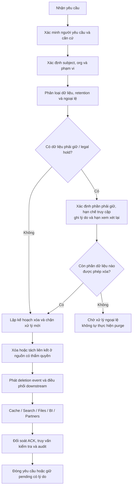
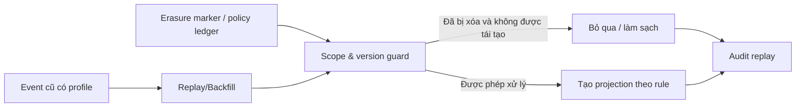

# Rà soát quyền truy cập, phạm vi tổ chức và yêu cầu xóa dữ liệu

Một nền tảng SaaS phục vụ nhiều doanh nghiệp. Nhân viên của **tổ chức A** tạo khách hàng `C-17` và xem lịch sử đơn hàng. Một nhân viên khác chỉ thuộc **tổ chức B** cố gọi API với mã khách hàng `C-17`. Đồng thời, khách hàng của tổ chức A yêu cầu xóa dữ liệu cá nhân; ứng dụng đã xóa hồ sơ khỏi bảng chính nhưng một index tìm kiếm và một bản đồng bộ phân tích vẫn còn tên và email.

Hai vấn đề dường như khác nhau — **rò rỉ dữ liệu xuyên tổ chức** và **xóa không triệt để** — thực ra đều bắt nguồn từ việc mô hình không mô tả đầy đủ: **ai sở hữu dữ liệu, mỗi quan hệ thuộc phạm vi nào, ai có quyền thực hiện thao tác nào, dữ liệu đi qua những bản sao nào, và các bản sao hết hiệu lực ra sao**.

Rà soát thiết kế không thể dừng ở ERD có đủ PK/FK hoặc endpoint có middleware xác thực. Cần kiểm tra từ yêu cầu nghiệp vụ đến **khóa và ràng buộc**, **lớp ủy quyền**, **đường truy vấn**, **luồng đồng bộ**, **retention** và **kiểm thử tình huống sai phạm**.

Bài thuộc chương **Kiểm chứng thiết kế** của module **DATABASE_DATA_MODELING**. Module rèn kỹ năng chuyển yêu cầu thành thực thể, quan hệ, ràng buộc, chuẩn hóa, khóa, chỉ mục và lược đồ vật lý; so sánh mô hình quan hệ, document, đồ thị và phân tích để thiết kế dễ tiến hóa, kiểm chứng. Ta sẽ dùng hệ SaaS quản lý khách hàng và đơn hàng làm ví dụ xuyên suốt; các nguyên tắc bảo vệ dữ liệu áp dụng rộng hơn nhưng việc xóa/giữ thực tế luôn phải dựa trên **vai trò pháp lý, chính sách và nghĩa vụ của tổ chức**, không được suy từ một công thức kỹ thuật.

## 1. Ba câu hỏi phải trả lời trước khi chọn schema

Một cuộc rà soát hiệu quả bắt đầu bằng ba hợp đồng rõ ràng:

1. **Ai được phép làm gì với bản ghi?** Chủ thể có thể là người dùng, dịch vụ, tác vụ nền hoặc đối tác. Quyền **đọc, tạo, sửa, xuất, chia sẻ, xóa và khôi phục** không mặc nhiên giống nhau.
2. **Bản ghi thuộc phạm vi nào?** Theo tổ chức (*organization/tenant*), dự án, chi nhánh, nhóm, chủ sở hữu hoặc quan hệ chia sẻ được phê duyệt; một người có thể tham gia nhiều tổ chức.
3. **Khi hết quyền giữ dữ liệu, điều gì phải biến mất hoặc không còn truy cập được?** Phạm vi gồm database gốc, bảng phụ, cache, index tìm kiếm, file, log, kho phân tích, bản sao, bên xử lý khác và cơ chế replay/restore.

Ví dụ yêu cầu “nhân viên chỉ thấy khách hàng của công ty mình” chưa đủ chi tiết. Cần xác định:

- Nhân viên có thể được **mời vào nhiều công ty** hay không?
- Tổ chức con có được xem dữ liệu của tổ chức mẹ, và chiều ngược lại thì sao?
- Nhân viên nghỉ việc có mất quyền với dữ liệu đã tạo không?
- Quản trị viên một tổ chức có được **xuất hàng loạt** hồ sơ khách?
- Một người là khách hàng của **hai tổ chức** thì yêu cầu xóa ở A có xóa dữ liệu B không?
- Có hồ sơ nào phải giữ một phần vì nghĩa vụ giao dịch/kế toán và chỉ cần tách khỏi thông tin nhận diện?

Nếu chưa trả lời, việc thêm cột `tenant_id` hay bật Row-Level Security (RLS) mới giải quyết được **một phần** của bài toán.

## 2. Phân biệt danh tính, vai trò, quyền và phạm vi

Các khái niệm sau không thay thế nhau:

| Khái niệm | Câu hỏi | Ví dụ |
| --- | --- | --- |
| **Identity / principal** | Ai đang yêu cầu? | `user_id` của nhân viên hoặc `service_id` của job |
| **Authentication** | Bằng chứng xác nhận principal là ai? | Phiên đăng nhập/token có chữ ký |
| **Authorization** | Principal được làm hành động này không? | `customer:read`, `customer:erase` |
| **Role (RBAC)** | Nhóm quyền nào được cấp? | Owner, operator, analyst, auditor |
| **Attribute / policy (ABAC)** | Điều kiện ngữ cảnh nào phải đúng? | Thành viên còn hiệu lực, mục đích xử lý, trạng thái bản ghi |
| **Scope** | Quyền có hiệu lực trên tập dữ liệu nào? | `org_id`, `project_id`, một chi nhánh |
| **Ownership** | Ai chịu trách nhiệm và quyết định về dữ liệu? | Tổ chức và domain/data owner |
| **Data subject** | Dữ liệu cá nhân liên quan đến ai? | Khách hàng được nhận diện |
| **Processor / downstream** | Ai lưu hoặc xử lý bản sao? | Search index, BI pipeline, nhà cung cấp tích hợp |

Một người dùng có vai trò `ADMIN` ở tổ chức A **không** vì thế là admin toàn hệ thống. Một kỹ thuật viên có thể được cấp quyền hỗ trợ có thời hạn, nhưng quyền ấy cần có căn cứ, phạm vi, audit và giới hạn mục đích.

### 2.1. RBAC và ABAC phải làm việc cùng nhau

**RBAC** hữu ích khi quyền nhóm rõ ràng: nhân viên chăm sóc khách có quyền đọc hồ sơ, nhân viên tài chính có quyền đọc chứng từ. **ABAC/policy** bổ sung điều kiện: người dùng còn là thành viên hoạt động của tổ chức, hồ sơ thuộc đúng tổ chức, đối tượng không bị khóa theo điều tra, và người dùng đang thực hiện đúng mục đích được cho phép.

Một quyết định ủy quyền có thể diễn đạt:

\[
\mathrm{Allow}(p,a,r,c)
= \mathrm{Authenticated}(p)
\land \mathrm{ActiveMember}(p,\mathrm{Org}(r))
\land \mathrm{HasPermission}(p,a,\mathrm{Org}(r))
\land \mathrm{ContextPolicy}(p,a,r,c)
\]

Trong đó `p` là principal, `a` là action, `r` là resource, `c` là ngữ cảnh. Đây là **hợp đồng logic**, không phải một biểu thức SQL áp dụng cho mọi hệ thống. Một số action có quy tắc khác: khách yêu cầu truy cập dữ liệu của chính mình có thể đi qua quy trình xác minh danh tính riêng, không qua vai trò nhân viên tổ chức.

**Nguyên tắc mặc định:** Không xác minh được danh tính, tổ chức, quyền hoặc context thì **từ chối**; không suy ra “cho phép” từ việc endpoint thiếu `org_id`.

## 3. Vẽ ma trận quyền trước khi vẽ quan hệ

| Principal trong ví dụ | Xem khách hàng trong tổ chức | Sửa hồ sơ | Xuất dữ liệu lớn | Yêu cầu xóa | Thi hành xóa đã duyệt |
| --- | --- | --- | --- | --- | --- |
| Nhân viên hỗ trợ, membership active | Theo dữ liệu được giao | Theo role và trạng thái | Không mặc định | Chuyển tiếp yêu cầu | Không |
| Quản trị viên của **tổ chức A** | Trong A | Trong A theo policy | Chỉ nếu được cấp quyền riêng | Tiếp nhận/phê duyệt phạm vi theo chính sách | Không mặc định |
| Nhân viên chỉ thuộc **tổ chức B** | Trong B, **không** thấy A | Trong B | Theo policy B | Chỉ theo quy trình hợp lệ | Không |
| Dịch vụ phân tích | Chỉ dữ liệu cần thiết đã được cấp | Không sửa hồ sơ nguồn | Không truy xuất PII ngoài mục đích | Không | Không |
| Job xóa dữ liệu | Không dùng làm API duyệt hồ sơ tùy ý | Không sửa tùy ý | Không | Không tự xác nhận yêu cầu | Chỉ scope được phê duyệt, có audit |
| Chủ thể dữ liệu đã xác minh | Theo quy trình truy cập riêng | Theo quy trình chỉnh sửa riêng | Nhận bản dữ liệu phù hợp theo policy | Có thể gửi yêu cầu | Không truy cập trực tiếp database |

Ma trận chỉ là ví dụ cách tổ chức quyền, **không phải nghĩa vụ pháp lý hay policy mặc định của mọi SaaS**. Mục đích là buộc thiết kế nói rõ **action + resource + scope + điều kiện**.

Một API `GET /customers/{id}` và `POST /customers/export` phải có kiểm tra khác nhau. Cho phép tra cứu một hồ sơ không mặc nhiên cho phép quét toàn bộ khách hàng của tổ chức.

## 4. Hạt dữ liệu và phạm vi tổ chức phải đi qua quan hệ

Grain của các bảng ví dụ:

| Bảng | Grain | Scope bắt buộc |
| --- | --- | --- |
| `organization` | Một tổ chức đã đăng ký | `org_id` là định danh tổ chức |
| `organization_membership` | Một người dùng trong một tổ chức | `(org_id,user_id)` |
| `customer_profile` | Một hồ sơ khách do một tổ chức quản lý | `(org_id,customer_id)` |
| `sales_order` | Một đơn của một tổ chức | `(org_id,order_id)` |
| `sales_order_line` | Một dòng hàng trong đơn của tổ chức | `(org_id,order_id,line_no)` |

Không lấy `user_id` của nhân viên tạo hồ sơ làm **đơn vị sở hữu duy nhất**. Nhân viên có thể rời công ty; hồ sơ vẫn thuộc phạm vi tổ chức theo chính sách. Cũng không mặc định rằng `customer_id` có thể dùng chung giữa các hệ, vì ID ngoài có thể được cấp trong namespace riêng.

### 4.1. Tại sao chỉ thêm `org_id` chưa đủ?

Giả sử bảng đơn có `org_id = A` nhưng `customer_id` lại tham chiếu hồ sơ thuộc B. Nếu FK chỉ là `REFERENCES customer_profile(customer_id)` và `customer_id` duy nhất toàn cục, database có thể chấp nhận tham chiếu **xuyên tổ chức** dù `org_id` của đơn là A. Nếu lookup chỉ theo ID do client cung cấp, ứng dụng còn có nguy cơ tiết lộ thông tin B.

Một phương án mạnh hơn là đặt **scope trong khóa và FK**:

```text
customer_profile:
  PK (org_id, customer_id)

sales_order:
  PK (org_id, order_id)
  FK (org_id, customer_id)
       -> customer_profile(org_id, customer_id)

sales_order_line:
  PK (org_id, order_id, line_no)
  FK (org_id, order_id)
       -> sales_order(org_id, order_id)
```

FK ghép ngăn một đơn của A tham chiếu hồ sơ của B bằng cùng bộ giá trị khóa. Nó **không thay thế authorization**: người dùng B vẫn có thể đoán ID của A và cố gọi API. Cả **constraint ở dữ liệu** và **kiểm tra quyền ở request** đều cần thiết.

## 5. Lược đồ PostgreSQL mẫu: scope nằm trong PK/FK

Các câu lệnh dưới đây là ví dụ **PostgreSQL**, không giả định schema của dự án hiện có. Mục tiêu là đưa yêu cầu “không tham chiếu chéo tổ chức” thành các ràng buộc mà database có thể kiểm tra.

```sql
CREATE TABLE organization (
    org_id UUID PRIMARY KEY,
    display_name TEXT NOT NULL
);

CREATE TABLE app_principal (
    user_id UUID PRIMARY KEY
);

CREATE TABLE organization_membership (
    org_id UUID NOT NULL REFERENCES organization(org_id),
    user_id UUID NOT NULL REFERENCES app_principal(user_id),
    org_role VARCHAR(24) NOT NULL
        CHECK (org_role IN ('OWNER', 'MANAGER', 'STAFF', 'AUDITOR')),
    membership_state VARCHAR(16) NOT NULL
        CHECK (membership_state IN ('ACTIVE', 'SUSPENDED', 'REVOKED')),
    PRIMARY KEY (org_id, user_id)
);

CREATE TABLE customer_profile (
    org_id UUID NOT NULL REFERENCES organization(org_id),
    customer_id UUID NOT NULL,
    full_name TEXT,
    email TEXT,
    created_at TIMESTAMPTZ NOT NULL DEFAULT now(),
    PRIMARY KEY (org_id, customer_id)
);

CREATE TABLE sales_order (
    org_id UUID NOT NULL REFERENCES organization(org_id),
    order_id UUID NOT NULL,
    customer_id UUID,
    customer_ref_state VARCHAR(16) NOT NULL,
    ordered_at TIMESTAMPTZ NOT NULL,
    amount_minor BIGINT NOT NULL CHECK (amount_minor >= 0),
    currency_code CHAR(3) NOT NULL,
    PRIMARY KEY (org_id, order_id),
    FOREIGN KEY (org_id, customer_id)
        REFERENCES customer_profile(org_id, customer_id),
    CONSTRAINT ck_customer_ref_state CHECK (
        (
            customer_id IS NOT NULL
            AND customer_ref_state = 'KNOWN'
        )
        OR
        (
            customer_id IS NULL
            AND customer_ref_state IN ('GUEST', 'ERASED')
        )
    )
);

CREATE TABLE sales_order_line (
    org_id UUID NOT NULL,
    order_id UUID NOT NULL,
    line_no INTEGER NOT NULL CHECK (line_no > 0),
    sku TEXT NOT NULL,
    quantity INTEGER NOT NULL CHECK (quantity > 0),
    PRIMARY KEY (org_id, order_id, line_no),
    FOREIGN KEY (org_id, order_id)
        REFERENCES sales_order(org_id, order_id)
);
```

**Vì sao `customer_ref_state` quan trọng?** Một đơn khách vãng lai (`GUEST`) khác một đơn từng có liên kết khách nhưng sau đó đã được gỡ (`ERASED`). Cả hai đều có `customer_id IS NULL`, nhưng lý do và hành vi khi khôi phục dữ liệu không giống nhau. Mã `ERASED` chỉ có ý nghĩa nội bộ; nó **không tự chứng minh đã xóa mọi thông tin cá nhân** trong đơn hoặc hệ khác.

### 5.1. Một số giới hạn của ví dụ

- `org_id` trong PK/FK giữ ranh giới tham chiếu, nhưng chưa kiểm tra **người gọi có quyền** đọc/ghi tổ chức đó.
- Một khách có thể có hồ sơ khác nhau trong A và B, và không được suy chúng là cùng người chỉ từ tên/email.
- `amount_minor` được giữ để minh họa dữ liệu giao dịch; việc giữ/xóa chứng từ phải dựa trên chính sách phù hợp, không dựa trên việc có FK.
- Nếu đơn có địa chỉ giao hàng, ghi chú, email hoặc thông tin có thể nhận diện ở bảng khác, xóa `customer_profile` không đủ.
- Quan hệ tổ chức mẹ–con, quyền chia sẻ dự án và tenancy phân cấp **chưa được mô hình hóa**; không tự suy quyền kế thừa từ một FK.
- Bảng có PK ghép làm các index và đường truy cập phải được thiết kế theo workload; không nên tự thêm `org_id` vào mọi chỉ mục mà không có kế hoạch truy vấn.

### 5.2. Thử một tham chiếu xuyên tổ chức

Giả sử khách `C-17` chỉ tồn tại trong A. Nếu một câu lệnh INSERT tạo đơn mang `org_id=B` và `customer_id=C-17`, FK ghép chỉ kiểm tra `(B,C-17)`, nên sẽ từ chối **nếu B không có chính khách C-17**. Nếu B có một khách khác với cùng local ID C-17, đơn được liên kết với **khách B**, không bao giờ âm thầm trỏ tới khách A.

Đó là đặc tính ta muốn: **cùng chuỗi/UUID định danh phụ không thể vượt qua scope**. Khi một giao dịch thực sự chia sẻ giữa nhiều tổ chức, nên mô hình hóa một quan hệ chia sẻ riêng có căn cứ, thay vì lách FK bằng cách bỏ `org_id`.

## 6. Truy vấn phải áp scope ở mọi điểm có dữ liệu

Ví dụ API đọc đơn có thể viết:

```sql
SELECT
    o.org_id,
    o.order_id,
    o.customer_ref_state,
    o.amount_minor,
    o.currency_code
FROM sales_order AS o
WHERE o.org_id = $1
  AND o.order_id = $2;
```

Ứng dụng phải lấy `$1` từ **tổ chức đã được xác minh trong context quyền** của principal, không tin nguyên xi vào giá trị `org_id` mà client tự sửa trong URL/body. Nếu người dùng là thành viên nhiều tổ chức, hệ thống cần **chọn scope hiện hành rõ ràng**, rồi xác minh membership và role tại thời điểm thao tác.

Ví dụ truy vấn dòng hàng đúng scope:

```sql
SELECT
    o.order_id,
    l.line_no,
    l.sku,
    l.quantity
FROM sales_order AS o
JOIN sales_order_line AS l
  ON l.org_id = o.org_id
 AND l.order_id = o.order_id
WHERE o.org_id = $1
  AND o.order_id = $2
ORDER BY l.line_no;
```

**Sai lầm phổ biến:** chỉ join bằng `order_id` khi ID có thể trùng giữa các tổ chức. Query vẫn chạy nhưng có thể nhân dòng hoặc kéo dữ liệu sai tenant. Composite FK hỗ trợ bảo toàn toàn vẹn khi ghi, còn **join và filter** phải dùng đúng đầy đủ khóa.

### 6.1. Những đường truy cập thường bị quên scope

- `GET /customers/{id}` và trang chi tiết.
- Search/autocomplete theo tên, email hoặc số điện thoại.
- Export, CSV, batch report, thống kê dashboard.
- Job nền xử lý đơn hàng, sự kiện webhook và reprocessing.
- Cached response và cache keys (phải chứa scope đủ để không trả dữ liệu A cho B).
- Download URL, file đính kèm, object storage key.
- Metrics/log/observability lưu ID có thể liên kết tới người dùng.
- Websocket, notifications và subscription có thể phát sau khi membership bị thu hồi.
- Truy vấn quản trị xuyên tenant và công cụ hỗ trợ nội bộ.

Không chỉ test controller thông thường; quyền phải được thực thi nhất quán trên **mọi đường đọc/ghi**, kể cả các pipeline không đi qua HTTP middleware.

## 7. Row-Level Security: lớp phòng vệ, không phải toàn bộ hệ phân quyền

PostgreSQL có **Row-Level Security (RLS)** cho phép áp chính sách trên hàng của bảng. Khi được cấu hình đúng, RLS có thể giảm rủi ro một repository quên `WHERE org_id = ...`. Dù vậy, **RLS chỉ là một lớp phòng vệ**: nó không xác minh danh tính người dùng cuối, mục đích truy cập, quyền xuất dữ liệu hoặc toàn bộ chuỗi sao chép.

Ví dụ giả định database đã có role runtime `app_runtime`, **không phải superuser, không có `BYPASSRLS` và không sở hữu bảng**:

```sql
ALTER TABLE customer_profile ENABLE ROW LEVEL SECURITY;
ALTER TABLE customer_profile FORCE ROW LEVEL SECURITY;

CREATE POLICY customer_scope_select
ON customer_profile
FOR SELECT
TO app_runtime
USING (
    org_id = NULLIF(
        current_setting('app.org_id', true), ''
    )::UUID
);

CREATE POLICY customer_scope_insert
ON customer_profile
FOR INSERT
TO app_runtime
WITH CHECK (
    org_id = NULLIF(
        current_setting('app.org_id', true), ''
    )::UUID
);

CREATE POLICY customer_scope_update
ON customer_profile
FOR UPDATE
TO app_runtime
USING (
    org_id = NULLIF(
        current_setting('app.org_id', true), ''
    )::UUID
)
WITH CHECK (
    org_id = NULLIF(
        current_setting('app.org_id', true), ''
    )::UUID
);

GRANT SELECT, INSERT, UPDATE
ON customer_profile TO app_runtime;
```

**Giải nghĩa:**

- `USING` hạn chế các hàng có thể đọc/được xem xét khi update.
- `WITH CHECK` kiểm tra scope của hàng mới được insert hoặc giá trị sau update.
- Khi `app.org_id` vắng mặt, biểu thức so sánh trả không đúng và policy không cho thấy hàng; giá trị có định dạng UUID sai có thể gây lỗi query, nên context phải được kiểm tra trước.
- Trong ví dụ, không cấp quyền `DELETE` cho `app_runtime`; xóa đi qua **quy trình riêng đã xác minh**.
- `FORCE ROW LEVEL SECURITY` buộc cả **table owner** tuân theo RLS trong trường hợp thông thường, nhưng **superuser và role có `BYPASSRLS` vẫn có thể vượt chính sách**; cần quản trị DB role và kết nối đặc quyền riêng.
- Một policy RLS không tự cấp quyền SQL; `GRANT` vẫn cần thiết.

### 7.1. Tạo context trong transaction

Sau khi ứng dụng đã xác minh người dùng được thao tác trong tổ chức A, có thể đặt context cho đúng giao dịch:

```sql
BEGIN;
SET LOCAL app.org_id = '11111111-1111-4111-8111-111111111111';

SELECT customer_id, full_name
FROM customer_profile;

COMMIT;
```

`SET LOCAL` chỉ có hiệu lực trong transaction hiện tại, phù hợp hơn việc để tenant context vô tình tồn tại trên connection được pool tái sử dụng. Tuy nhiên:

1. **Bất kỳ role có khả năng chạy SQL tùy ý thường có thể đặt một custom GUC** như `app.org_id`. Biến này **không phải bằng chứng xác thực** và không được tin nếu client có SQL access.
2. Chỉ backend tin cậy, sau khi xác minh principal và membership, mới được quyết định context; không cho người dùng trực tiếp thay `app.org_id`.
3. Connection pooling, transaction boundaries và prepared statements phải được kiểm tra trên hệ thật.
4. Các bảng khác như `sales_order`, `sales_order_line`, bảng file, search index **cũng cần ranh giới tương ứng**; RLS trên một bảng không tự bảo vệ toàn hệ.
5. Các tác vụ quản trị/batch có thể dùng quyền cao hơn nhưng phải có scope rõ, giới hạn mục đích, audit và kiểm thử.

Nếu phần mềm đưa SQL tùy ý từ người dùng xuống kết nối `app_runtime`, RLS dựa vào một custom setting mà người dùng thay được **không đủ để bảo vệ tenant**. Phải cô lập quyền thực thi, dùng cơ chế xác minh đáng tin và kiểm soát khả năng thiết lập identity context.

## 8. Phạm vi tổ chức có thể là cây hoặc quan hệ chia sẻ

Không phải mọi SaaS chỉ có một cột `org_id`. Ví dụ:

```text
Tập đoàn P
  |-- Công ty con A
  |      |-- Chi nhánh A1
  |      +-- Chi nhánh A2
  +-- Công ty con B

Nhân viên X thuộc A1
Nhân viên Y được cấp quyền báo cáo tổng hợp của A và B
```

Các câu hỏi phải định nghĩa:

- Quyền có **kế thừa** từ tổ chức mẹ xuống tổ chức con không?
- Có được chia sẻ một khách hàng/đơn giữa hai tổ chức độc lập không?
- Scope của **báo cáo tổng hợp** có thể rộng hơn scope của **truy cập PII chi tiết** không?
- Việc chuyển một dự án từ A sang B thay ownership dữ liệu hay chỉ thay quyền xem?
- Thành viên nhiều tổ chức có thể chuyển context trong cùng phiên; cache và job async xử lý ra sao?

Một mô hình cây có thể dùng `parent_org_id` và bảng tổ tiên–hậu duệ (*closure table*) nếu truy vấn scope phân cấp phổ biến. Một mô hình chia sẻ linh hoạt có thể dùng `resource_grant(resource_id, grantee_org_id, permission, expires_at)`. Nhưng **không chọn trước mô hình vật lý** khi chưa biết quy tắc quyền và xung đột.

Đừng coi `parent_org_id` là bằng chứng mọi thành viên của P đều xem được mọi hồ sơ con. **Kế thừa quyền là chính sách, không phải hệ quả tự nhiên của khóa ngoại.**

## 9. Xóa dữ liệu: định nghĩa chính xác điều phải xảy ra

Từ “xóa khách hàng” có nhiều mục tiêu:

| Yêu cầu | Ý nghĩa có thể có | Không nên suy |
| --- | --- | --- |
| **Ẩn khỏi giao diện** | Chuyển record sang inactive/archived | Không có nghĩa đã xóa khỏi database |
| **Xóa mềm (soft delete)** | Gắn `deleted_at`, ngăn một số query | PII vẫn còn trong hàng và bản sao |
| **Xóa vật lý (hard delete)** | Loại row khỏi kho dữ liệu cụ thể | Không bảo đảm đã xóa index, backup, file, log |
| **Tách danh tính** | Bỏ liên kết đơn hàng với hồ sơ cá nhân | Không tự chứng minh dữ liệu còn lại không thể tái nhận diện |
| **Ẩn danh hóa thật sự** | Loại khả năng nhận diện theo mô hình đe dọa và ngữ cảnh | Hash/email mã hóa vẫn có thể còn là dữ liệu cá nhân |
| **Xóa theo yêu cầu hợp lệ** | Quy trình xác minh, đánh giá nghĩa vụ giữ, thực hiện và đối soát | Không phải “xóa mọi byte ngay lập tức” trong mọi tình huống |
| **Xóa do hết retention** | Hết thời hạn giữ theo policy đã xác định | Không áp chung một thời hạn cho tất cả loại dữ liệu |

Việc xử lý yêu cầu xóa phải phù hợp **nghĩa vụ giữ chứng từ, quyền của chủ thể dữ liệu, căn cứ xử lý, hợp đồng và quy định áp dụng**. Bài này không đặt một thời hạn pháp lý cố định; thiết kế kỹ thuật phải có chỗ để chủ sở hữu chính sách quyết định **xóa, giữ có hạn, hạn chế truy cập hoặc từ chối có căn cứ**.

### 9.1. Xóa khỏi phạm vi nào?

Một người có thể xuất hiện trong nhiều tư cách:

- Là **khách hàng của tổ chức A**.
- Đồng thời là **khách hàng của tổ chức B**.
- Là **người dùng đăng nhập** quản lý tài khoản của chính họ.
- Có **đơn hàng, chứng từ, log hỗ trợ** và file đính kèm ở nhiều hệ.

Yêu cầu xóa dữ liệu khách hàng do A quản lý **không mặc định** là quyền xóa mọi bản ghi mà B có căn cứ lưu trữ riêng. Ngược lại, một yêu cầu liên quan toàn bộ tài khoản người dùng có thể cần tìm dữ liệu trên nhiều scope. **Phạm vi và vai trò của từng bên phải được xác minh trước**.

## 10. Vòng đời một yêu cầu xóa có kiểm soát

Một pipeline có thể đi qua các bước:



Sơ đồ không có nghĩa **mọi dữ liệu bị legal hold đều vẫn bị xóa ở bước tiếp**. Trong nhánh có nghĩa vụ giữ, kế hoạch phải **phân loại từng loại dữ liệu**: phần nào có thể xóa, phần nào cần giữ, giới hạn truy cập/processing nào áp dụng và tiêu chí giải tỏa. Nếu tất cả dữ liệu liên quan đều phải giữ trong giai đoạn đó, yêu cầu có thể ở trạng thái chờ thay vì tới bước purge.

### 10.1. Một state machine cho yêu cầu

| Trạng thái | Ý nghĩa |
| --- | --- |
| `RECEIVED` | Đã ghi nhận yêu cầu, chưa xác minh đầy đủ |
| `VERIFIED` | Chủ thể/người yêu cầu và quyền xử lý đã được xác minh |
| `SCOPED` | Đã lập danh sách dữ liệu và hệ phải kiểm tra |
| `BLOCKED` | Có nguyên nhân cần giải quyết: legal hold, xung đột identity, thiếu bằng chứng |
| `APPROVED` | Có quyết định xóa/hạn chế/giữ cho từng nhóm dữ liệu |
| `PROPAGATING` | Các hệ và job đang thực hiện |
| `VERIFYING` | Đang kiểm tra từng đích và khả năng dữ liệu xuất hiện lại |
| `COMPLETED` | Đã đạt tiêu chí hoàn tất được định nghĩa, bao gồm ngoại lệ đã được xử lý theo policy |
| `REJECTED` | Yêu cầu không hợp lệ hoặc không thể thực hiện; có lý do được ghi nhận |

Không đặt `COMPLETED` chỉ vì `DELETE FROM customer_profile` trả về một hàng. Các bước async có thể còn thất bại, tìm kiếm còn giữ index hoặc bản sao phân tích chưa cập nhật.

## 11. Bản đồ dòng chảy dữ liệu là đầu vào của xóa

Trước khi hứa một SLA xóa, phải biết dữ liệu đã đi tới đâu:

| Bề mặt | Ví dụ dữ liệu | Hành động cần xem xét | Dấu hiệu kiểm chứng |
| --- | --- | --- | --- |
| Database operational | Hồ sơ, địa chỉ, tài khoản, quan hệ khóa | Delete, detach, restrict tùy policy | Không còn truy vấn được những trường phải xóa |
| Cache | Profile JSON, danh sách khách gần đây | Invalidate và bảo vệ key theo scope | Cache miss/không phục hồi từ cache cũ |
| Search index | Họ tên, email, số điện thoại | Delete/update document, refresh theo engine | Search không còn trả record |
| Object storage | Hóa đơn, ảnh chứng từ, tệp hỗ trợ | Delete hoặc giữ có căn cứ, xử lý versioned object | Danh sách object/version cần xử lý được đối soát |
| Event bus / CDC | Event chứa PII hoặc khóa liên kết | Chính sách retention, tombstone, filter replay | Replay không tái sinh profile đã xóa |
| Warehouse/BI | Fact, dimension, mart, export | Delete/rekey/anonymize có policy và rebuild aggregate | Query kiểm tra trên snapshot đã cập nhật |
| Log/monitoring | URL, email, request body, trace ID | Giảm thu thập, redaction, retention và xóa theo khả năng | Truy vấn kiểm tra các nơi có dữ liệu cần xóa |
| Backup/replica | Snapshot, WAL/archive và bản sao | Vòng đời backup, hạn truy cập, restore guard | Quy trình phục hồi không làm sống lại dữ liệu |
| Bên xử lý ngoài | CRM, email marketing, hỗ trợ | Thông báo và xác nhận theo hợp đồng | ACK có identity và thời điểm |
| Hệ phái sinh | Feature store, search embedding, training data | Đánh giá khả năng liên kết và chính sách tái tạo | Quy trình xóa/giảm thiểu đã được chứng minh |

Không phải mọi hệ giữ **cùng loại dữ liệu**. Một dashboard chỉ có tổng doanh thu theo ngày chưa chắc còn nhận diện cá nhân; ngược lại một fact lưu `customer_id` hoặc event ID liên kết vẫn có thể là dữ liệu cá nhân/pseudonymous. Cần phân loại theo **khả năng liên kết và ngữ cảnh** thay vì dựa vào tên “analytics”.

## 12. Giữ giao dịch khi xóa hồ sơ cá nhân: một quyết định nghiệp vụ

Trong nhiều hệ, có lý do hợp lệ để giữ **một số dữ liệu giao dịch** trong thời gian nhất định, đồng thời phải loại bỏ hoặc hạn chế **trường nhận diện cá nhân**. Nhưng không có công thức SQL nào tự quyết định dữ liệu nào được giữ. Thiết kế nên tách:

- `customer_profile`: tên/email và thuộc tính nhận diện;
- `sales_order`: dữ liệu nghiệp vụ cần phục vụ đối soát, nếu có căn cứ giữ;
- `shipping_address`/`support_notes`/`attachments`: có thể chứa PII riêng, phải kiểm tra riêng;
- mapping ID ngoài và bản sao downstream: khả năng tái liên kết danh tính cần được đánh giá.

Trong schema mục 5, một kế hoạch minh họa là **gỡ liên kết khách khỏi đơn được phép giữ**, đánh dấu `ERASED` rồi xóa `customer_profile`:

```sql
-- Tiền điều kiện:
-- 1) Đã xác minh đúng yêu cầu và scope.
-- 2) Đã được phê duyệt chính sách giữ đơn/xóa hồ sơ.
-- 3) Đã kiểm kê mọi nơi khác chứa PII.
-- 4) Đang dùng role/job được giới hạn và audit phù hợp.

BEGIN;

UPDATE sales_order
SET customer_id = NULL,
    customer_ref_state = 'ERASED'
WHERE org_id = $1
  AND customer_id = $2;

DELETE FROM customer_profile
WHERE org_id = $1
  AND customer_id = $2;

COMMIT;
```

Trong PostgreSQL, việc gỡ FK ở đơn **trước** khi xóa profile giúp tránh lỗi tham chiếu theo schema mẫu. Tuy nhiên:

- Nếu còn bảng khác tham chiếu `customer_profile`, DELETE có thể vẫn bị từ chối; phải liệt kê toàn bộ FK và policy.
- Nếu `sales_order` hay bảng liên quan còn email, địa chỉ, chứng từ, note chứa tên, đoạn SQL **không đủ để hoàn thành yêu cầu xóa**.
- Một `customer_id` không còn trong đơn chưa chắc khiến dữ liệu còn lại **không thể tái nhận diện**; tracking ID, địa chỉ, thời điểm và các bảng khác vẫn có thể liên kết.
- Một giao dịch cần giữ có thể vẫn phải được truy cập có giới hạn; không xem `ERASED` là quyền truy cập mở.
- Ví dụ này không triển khai outbox, retry hoặc xác nhận của downstream; phần đó cần orchestration bên ngoài transaction.

**Không sử dụng `ON DELETE CASCADE` bừa bãi** từ khách hàng sang đơn và dòng hàng: xóa profile có thể vô tình xóa dữ liệu giao dịch cần giữ. Ngược lại, `ON DELETE RESTRICT` có thể phù hợp để buộc quy trình quyết định rõ các phụ thuộc trước khi purge.

## 13. Ghi nhận yêu cầu, ACK và chống dữ liệu bị hồi sinh

Lớp dữ liệu điều phối xóa nên giữ đủ thông tin để **đối soát việc đã làm**, nhưng tránh lưu lại PII không cần thiết như một bản “hồ sơ ẩn” vĩnh viễn.

Một schema **minh họa** dùng các ID đã được quản trị và quyền truy cập hạn chế:

```sql
CREATE TABLE erasure_request (
    request_id UUID PRIMARY KEY,
    org_id UUID NOT NULL REFERENCES organization(org_id),
    subject_ref UUID NOT NULL,
    state VARCHAR(20) NOT NULL CHECK (
        state IN (
            'RECEIVED', 'VERIFIED', 'SCOPED', 'BLOCKED',
            'APPROVED', 'PROPAGATING', 'VERIFYING',
            'COMPLETED', 'REJECTED'
        )
    ),
    reason_code TEXT,
    received_at TIMESTAMPTZ NOT NULL DEFAULT now(),
    resolved_at TIMESTAMPTZ,
    UNIQUE (request_id, org_id, subject_ref)
);

CREATE TABLE erasure_target_status (
    request_id UUID NOT NULL REFERENCES erasure_request(request_id),
    target_name TEXT NOT NULL,
    status VARCHAR(16) NOT NULL CHECK (
        status IN ('PENDING', 'SENT', 'ACKED', 'FAILED', 'EXEMPT')
    ),
    attempt_count INTEGER NOT NULL DEFAULT 0
        CHECK (attempt_count >= 0),
    last_attempt_at TIMESTAMPTZ,
    acknowledged_at TIMESTAMPTZ,
    reason_code TEXT,
    PRIMARY KEY (request_id, target_name)
);

CREATE TABLE erasure_outbox (
    event_id UUID PRIMARY KEY,
    request_id UUID NOT NULL REFERENCES erasure_request(request_id),
    org_id UUID NOT NULL,
    subject_ref UUID NOT NULL,
    event_kind TEXT NOT NULL
        CHECK (event_kind = 'ERASE_SUBJECT_V1'),
    created_at TIMESTAMPTZ NOT NULL DEFAULT now(),
    published_at TIMESTAMPTZ,
    UNIQUE (request_id, event_kind),
    FOREIGN KEY (request_id, org_id, subject_ref)
        REFERENCES erasure_request(request_id, org_id, subject_ref)
);
```

Ở đây `subject_ref` được lưu để điều phối, **không có FK trực tiếp tới customer_profile** vì profile có thể bị xóa trước khi yêu cầu hoàn tất. Tuy nhiên `subject_ref` vẫn là dữ liệu có thể liên kết danh tính; phải được bảo vệ, có retention và phạm vi sử dụng riêng. Không tự đồng nhất “UUID không có email” với “dữ liệu đã ẩn danh”.

FK ghép ở `erasure_outbox` còn bảo đảm **bộ `(request_id, org_id, subject_ref)` khớp yêu cầu đã ghi nhận**: một producer không thể ghi outbox cùng `request_id` nhưng thay `org_id` hoặc `subject_ref` sang người khác. Điều này bảo vệ nhất quán khóa ở database; quyền phê duyệt yêu cầu vẫn do workflow/authorization xác minh, không thể chỉ suy từ FK.

### 13.1. Outbox không đồng nghĩa đã xóa downstream

Một transaction có thể thay đổi nguồn và tạo `erasure_outbox`. Worker gửi sự kiện xóa tới search/warehouse/object jobs, ghi ACK hoặc lỗi. Vì gửi và nhận có thể lặp, từng consumer phải **idempotent** trên `event_id`/`request_id` và scope phù hợp.

Nếu một consumer báo ACK trước khi index thực sự phản ánh xóa, hệ thống cần định nghĩa ACK là “đã nhận”, “đã áp dụng” hay “đã xác minh không còn truy vấn được”. **Không gộp tất cả ACK thành đã hoàn tất**.

### 13.2. Replay/backfill có thể tái sinh hồ sơ đã xóa

Một bản event cũ, file backfill hoặc snapshot backup còn chứa dữ liệu trước khi xóa. Khi tái chạy pipeline:



Cần một **cơ chế chống hồi sinh (*resurrection*)** đủ lâu và đủ scope: deletion marker/tombstone, version watermark hoặc policy ledger để reader và reprocessor biết dữ liệu trước một mốc đã bị loại. Nhưng tombstone bản thân có thể liên kết tới cá nhân, nên:

- Không giữ tùy tiện vô thời hạn.
- Không ghi thừa tên, email, token vào deletion marker.
- Xác định chính xác phạm vi `(org_id,subject_ref)` và version/giai đoạn có hiệu lực.
- Phân biệt **yêu cầu tạo dữ liệu mới có căn cứ sau thời điểm xóa** với replay lại dữ liệu cũ đã phải xóa.
- Đảm bảo restore/backfill dùng deletion ledger còn hợp lệ và thực thi **trước khi mở hệ thống trở lại cho người dùng**.

“Xóa xong” phải có nghĩa dữ liệu không **tự xuất hiện lại** chỉ vì một batch chạy muộn.

## 14. Backup, sao chép và thời hạn lưu giữ

Database backup, archive WAL, object versioning và bản sao dự phòng có thể chứa dữ liệu **trước khi có yêu cầu xóa**. Không nên hứa “DELETE một row là xóa ngay lập tức khỏi mọi backup”, cũng không nên dùng khó khăn của backup để bỏ qua trách nhiệm quản trị dữ liệu.

Thiết kế cần trả lời:

1. Backup nào chứa thông tin, giữ bao lâu, ai có quyền truy cập?
2. Chính sách có cho phép dữ liệu trong backup bất biến tiếp tục tồn tại đến hết vòng đời được phê duyệt không?
3. Khi phục hồi một backup cũ, **các yêu cầu xóa sau thời điểm backup** được áp lại trước khi mở quyền đọc như thế nào?
4. Dữ liệu nhạy cảm trong archive/log có được mã hóa, hạn chế truy cập, theo dõi và hủy theo policy không?
5. Có kiểm thử restoration và deletion-replay thực tế không?

Một kỹ thuật ở một số kiến trúc là **mã hóa theo phạm vi thích hợp** và quản lý khóa để giảm khả năng đọc dữ liệu sau khi hủy khóa (*cryptographic erasure*). Tuy nhiên không thể tuyên bố giải pháp này hoàn tất xóa nếu còn **bản plaintext, bản sao chưa được mã hóa, dữ liệu dẫn xuất hoặc khóa dùng chung**. Cần đánh giá triển khai và policy cụ thể.

### 14.1. Chính sách retention là theo loại dữ liệu

| Loại dữ liệu | Câu hỏi quyết định retention |
| --- | --- |
| Hồ sơ marketing | Căn cứ xử lý còn tồn tại không, có yêu cầu rút lại/xóa không? |
| Thông tin giao hàng | Cần bao lâu để xử lý giao, khiếu nại, đối soát? |
| Chứng từ giao dịch | Có nghĩa vụ lưu và giới hạn quyền truy cập nào? |
| Log truy cập | Cần cho bảo mật/điều tra bao lâu, có PII không? |
| Event thô | Có chứa định danh, có mục đích replay cần thiết không? |
| Backup | RPO/RTO, vòng đời snapshot, khả năng re-apply deletion |
| Audit của yêu cầu xóa | Bằng chứng tối thiểu nào cần giữ và trong bao lâu? |

Không nên ấn định “mọi thứ giữ 30 ngày” nếu nghĩa vụ và mục đích khác nhau. Policy phải có owner, version, căn cứ, cách thực thi, cơ chế ngoại lệ và lịch xem xét lại.

## 15. Race condition: xóa trong khi dữ liệu vẫn đang được tạo

Hình dung:

```text
09:00  CRM event chứa thông tin khách C-17 vào queue
09:01  Job xóa customer_profile(C-17) hoàn tất
09:02  Consumer đọc event CRM cũ -> INSERT lại profile C-17
09:03  Search index đồng bộ -> khách lại xuất hiện
```

Nếu quy trình xóa chỉ chạy một lệnh DELETE mà không kiểm soát writer, nó có thể “thành công” trong vài giây rồi thất bại về kết quả cuối cùng.

Các biện pháp tùy kiến trúc:

- Đưa subject vào trạng thái **pending erasure** để ngăn xử lý mới không có căn cứ.
- Tạm ngắt/cách ly producer hoặc đánh dấu policy trong hệ tiếp nhận.
- Phát marker/sự kiện xóa có **version/ordering** rõ để consumer không coi event cũ là thông tin mới nhất.
- Kiểm tra deletion ledger khi backfill, reindex, replay.
- Có checkpoint/watermark và theo dõi độ trễ của mọi pipeline.
- Sau purge, chạy query kiểm chứng, rồi lặp lại kiểm tra sau khi queue đã được xử lý.
- Chặn endpoint import hoặc job support có thể vô tình tạo lại record từ bản sao.

**Đừng đơn giản dùng timestamp lớn hơn thắng** nếu clock các nguồn không tin cậy hoặc dữ liệu có valid-time khác ingestion-time. Khi cần ordering, dùng event version/sequence được nguồn có thẩm quyền phát hành, hoặc một cơ chế so sánh được định nghĩa rõ.

## 16. Test phân quyền: phải thử người dùng không có quyền

Để chứng minh multi-tenancy an toàn, kiểm thử **negative cases** thường quan trọng ngang happy path.

| Ca kiểm thử | Tình huống | Kết quả mong muốn |
| --- | --- | --- |
| **Cross-tenant read** | Người B gọi ID khách chỉ thuộc A | Không trả thông tin khách A |
| **ID collision** | Hai tổ chức cùng có local ID C-17 | Trả đúng theo scope, không nối nhầm |
| **Cross-tenant write** | B gửi org_id=A trong body | Từ chối, không ghi vào A |
| **Join thiếu org_id** | Repo join order_line chỉ theo order_id | Test bắt sai row count/khác tenant |
| **List/search pagination** | B thêm filter/sort để thấy record A | Không leak kết quả, số đếm hoặc facet |
| **Export** | Staff chỉ có read từng bản ghi, gọi export lớn | Bị kiểm tra quyền riêng |
| **Membership revoked** | Nhân viên A mất membership sau khi đăng nhập | Request sau đó không còn quyền theo policy |
| **Multi-org principal** | Một người thuộc cả A và B, đổi scope | Kết quả/cache đúng scope đang chọn |
| **Parent/child org** | Nhân viên chi nhánh thử dữ liệu công ty mẹ | Chỉ được nếu policy kế thừa xác nhận |
| **Background job** | Worker đọc hồ sơ của nhiều org | Role, scope, audit và mục đích rõ |
| **Admin/bypass RLS** | Đường đặc quyền được dùng bởi job | Không trở thành endpoint truy vấn PII tùy ý |
| **Attachment URL** | Người B dùng URL file thuộc A | Từ chối hoặc URL đã giới hạn quyền/thời hạn |
| **Cache key** | Đổi từ A sang B nhưng cùng customer_id | Không tái sử dụng dữ liệu A |
| **Webhook** | Payload có org_id giả mạo | Scope lấy từ mapping nguồn đã xác minh |
| **Mass assignment** | Client thêm field `is_admin`/`org_id` khi update | Field không được phép không thay đổi |

**IDOR/BOLA** (*Insecure Direct Object Reference / Broken Object Level Authorization*) là nhóm lỗi khi hệ thống cho truy cập tài nguyên chỉ vì biết ID của nó. UUID khó đoán không thay thế kiểm tra quyền; test phải giả định attacker **biết** ID có thật.

### 16.1. Kiểm chứng scope ở hai tầng

Ví dụ test có thể:

1. Tạo tổ chức A và B, mỗi bên có một khách với local `customer_id` giống nhau nếu mô hình cho phép.
2. Gán nhân viên X chỉ thuộc A, nhân viên Y chỉ thuộc B.
3. Gọi API đọc và sửa bằng ID của B dưới phiên X; kỳ vọng bị từ chối/không tiết lộ dữ liệu theo contract.
4. Dùng kết nối database có role runtime và scope A để chạy query cố tình thiếu `WHERE org_id`; khi RLS đúng, kết quả không chứa hàng B.
5. Thử write một row `org_id=B` khi context A; `WITH CHECK` phải chặn.
6. Kiểm tra role/job privileged riêng, không nhầm hành vi của role admin với runtime.

Chỉ kiểm thử RLS bằng kết nối **superuser** có thể cho kết quả sai vì role đặc quyền bỏ qua policy. Chỉ kiểm thử API mà không có test database có thể bỏ sót đường batch/maintenance.

## 17. Test yêu cầu xóa: “không còn hiện trên UI” chưa đủ

| Ca kiểm thử | Kỳ vọng |
| --- | --- |
| Yêu cầu xóa chưa xác minh danh tính | Không xóa sai hồ sơ; trạng thái chờ/từ chối có lý do |
| Hai yêu cầu cùng subject và scope đến trùng | Idempotent; không tạo side effect mâu thuẫn |
| Một subject xuất hiện ở A và B | Scope được xác minh; không xóa nhầm dữ liệu của B |
| Có giao dịch cần giữ theo policy | Giữ đúng phần được phép và loại/hạn chế PII không cần |
| FK từ đơn tới profile | Không vi phạm FK hoặc cascade phá đơn ngoài ý muốn |
| Profile đã xóa, search chưa cập nhật | Chưa được đánh dấu toàn hệ hoàn tất |
| Downstream không nhận event | Retry + DLQ/alert, yêu cầu ở pending |
| Outbox gửi event hai lần | Consumer idempotent, không phát sinh lỗi hoặc bản ghi mới |
| Replay event cũ sau xóa | Dữ liệu cũ không tái sinh nếu policy vẫn yêu cầu xóa |
| Restore backup trước thời điểm xóa | Áp lại deletion ledger trước khi phục vụ truy cập |
| Object storage có version cũ | Các phiên bản cần xử lý được kiểm kê theo policy |
| Customer liên kết qua email hash | Kiểm tra khả năng tái nhận diện; không tự nhận đã ẩn danh |
| Xóa mềm nhưng BI vẫn đọc raw table | BI phải tôn trọng trạng thái và policy, hoặc thực hiện xóa thích hợp |
| Late correction đến sau xóa | Không lén tái tạo dữ liệu cá nhân từ bản nguồn |
| Legal hold được áp dụng | Hạn chế quyền/retention đúng quyết định, không xóa trái policy |
| Quyền thành viên bị thu hồi giữa job | Kiểm tra authority của job theo phạm vi phê duyệt, audit từng bước |
| Yêu cầu hoàn tất một phần | Trạng thái, lý do và hạn xử lý phần còn lại minh bạch |

### 17.1. Kiểm tra hai tính chất khác nhau

- **Safety:** không xóa nhầm dữ liệu khác tổ chức; không mất chứng từ bắt buộc; không gửi thông tin người A cho B.
- **Liveness:** yêu cầu hợp lệ không bị kẹt mãi trong queue; các đích được xử lý, retry và đối soát cho đến trạng thái cuối có căn cứ.

Một pipeline có thể **an toàn nhưng không hoàn tất** (giữ toàn bộ yêu cầu pending), hoặc **hoàn tất nhanh nhưng không an toàn** (xóa nhầm/để lại bản sao). Thiết kế cần cả hai.

## 18. Quan hệ, document, đồ thị và warehouse có rủi ro khác nhau

| Mô hình dữ liệu | Cách thể hiện scope | Rủi ro quyền | Rủi ro xóa |
| --- | --- | --- | --- |
| **Quan hệ** | PK/FK ghép `(org_id,id)`, RLS và service authorization | Join thiếu scope, role vượt RLS, FK không mang tenant | Cascade sai, FK cản purge, dữ liệu trong audit/CDC |
| **Document** | `org_id` trong document, partition/index theo org và quy tắc truy cập | Query quên filter, shared collection, nested PII | Field nested, document version cũ, search index/backup |
| **KV/Wide-column** | Key prefix/partition key theo org+thực thể, API keyspace policy | Lookup key đúng nhưng auth sai; shared cache | TTL/tombstone, replica, compaction/replay, delete qua nhiều projection |
| **Graph** | Chủ sở hữu đỉnh/cạnh, policy traversal qua quan hệ | Duyệt cạnh xuyên tenant hoặc gán nhầm quan hệ chia sẻ | Xóa đỉnh nhưng còn cạnh, property, index hoặc đường suy luận |
| **Warehouse/columnar** | Dataset/mart theo tenant hoặc row policy/authorized view | Export/BI query vượt scope, join facts từ tenant khác | SCD, materialized aggregate, partitions, snapshots và bản trích xuất |

### 18.1. Document: key phải mang scope

Một collection chung có document `{"org_id":"A","customer_id":"C-17",...}`. Nếu code gọi `findOne({customer_id:"C-17"})` thay vì lọc thêm org/ủy quyền, có thể trả bản ghi khác tenant. Một compound unique index trên `(org_id,customer_id)` bảo vệ uniqueness theo scope, nhưng **không thay thế query authorization**.

Nếu document chứa nhiều thành phần PII nested, xóa một field `email` ở cấp root không có nghĩa đã loại email trong `contacts[]` hoặc lịch sử snapshots.

### 18.2. Đồ thị: duyệt cạnh cần kiểm soát theo cả đường đi

Giả sử người dùng A được duyệt từ đỉnh `Customer(A)` tới `Order(A)`. Một cạnh `SHARED_WITH` sang đối tác B có thể làm traversal sang đỉnh thuộc B; engine có thể trả kết quả hai hop nếu query không lọc scope. Policy phải định nghĩa **đỉnh, cạnh, loại quan hệ và quyền trên mỗi bước**, nhất là khi chia sẻ liên tổ chức là một nghiệp vụ thật.

Xóa một node `Customer` không bảo đảm đã loại thuộc tính PII khỏi các cạnh, index tìm kiếm hoặc kết quả suy luận. Cần hiểu cách engine quản lý orphan edges và index.

### 18.3. Warehouse: số liệu tổng hợp và PII có vòng đời khác nhau

Một bảng doanh thu gộp theo ngày và cửa hàng có thể không còn định danh khách. Nhưng fact giao dịch chứa `customer_id`, IP hay thông tin địa chỉ vẫn có thể liên kết danh tính. Việc xóa cần đi từ **grain**, trường dữ liệu và khả năng liên kết, không từ nhãn “reporting” hay “chỉ để phân tích”.

Nếu xóa một cá nhân khỏi fact có ảnh hưởng tới aggregate, phải quyết định **cập nhật lại chỉ số** hoặc tiếp tục giữ tổng không thể nhận diện theo policy phù hợp. Không tự giả định tổng vô danh luôn an toàn: ở nhóm rất nhỏ, một aggregate có thể cho phép suy ra dữ liệu cá nhân.

## 19. Đo chất lượng kiểm chứng thay vì đếm số bảng đã có `tenant_id`

Các metric kỹ thuật nên theo dõi:

- **Tỷ lệ đường API/job có kiểm tra object-level authorization** và số ca test phủ định theo resource.
- **Số lỗi cross-tenant reference** hoặc join làm sai scope được phát hiện trong kiểm thử/data quality.
- **Số membership bị thu hồi nhưng token/cache vẫn cho phép truy cập** theo cửa sổ đo đã định nghĩa.
- **Số export/đường bulk-read** có owner, permission và audit đầy đủ.
- **Số yêu cầu xóa theo trạng thái**, tuổi yêu cầu lâu nhất và nguyên nhân chờ.
- **Phần trăm downstream target đã xác minh hoàn tất**, không chỉ đã nhận event.
- **Số dữ liệu bị hồi sinh sau replay/restore** trong các drill kiểm chứng.
- **Số nguồn dữ liệu có bản đồ lineage, retention và owner** được phê duyệt.
- **Thời gian thực tế để phản ánh xóa** trên search/cache/warehouse, so với SLA nội bộ.
- **Tỷ lệ ngoại lệ retention có căn cứ, ngày xem xét lại và kiểm tra quyền**.

Tránh đưa email, `customer_id` thô hoặc payload yêu cầu vào **nhãn metric**, vì cardinality cao và rủi ro rò rỉ; dùng counters tổng hợp, reason code và audit có phân quyền phù hợp.

### 19.1. Bảng review nên lưu bằng chứng

| Mục kiểm chứng | Bằng chứng mong đợi | Owner xác nhận |
| --- | --- | --- |
| Phạm vi resource | Contract của `org_id`, PK/FK ghép, schema diff | Domain + database |
| Quyền đọc/ghi | Ma trận role/action/scope, API negative tests | Product + security |
| Bảo vệ ở DB | RLS/GRANT/role test dưới user không đặc quyền | DBA + security |
| Quyền chia sẻ liên tổ chức | Policy và test inheritance/share | Domain owner |
| Xóa ở nguồn | Quy trình verified/approved + transaction/audit | Data steward + backend |
| Xóa downstream | Lineage, delivery status, ACK semantics, test search/BI | Data platform |
| Backup và replay | Runbook restore, guard chống hồi sinh, drill | SRE + security |
| Retention/ngoại lệ | Bản policy đang hiệu lực, review/hold workflow | Bộ phận có thẩm quyền |

**Một checkbox “security reviewed” không thay thế các bằng chứng trên**. Cũng không nên tuyên bố bảo đảm tuyệt đối chỉ vì có RLS, encrypted backup hoặc GDPR-style workflow; mức bảo đảm phải gắn với threat model và những đường dữ liệu thực tế.

## 20. Bài tập vận dụng

### Bài tập A — Cross-tenant FK

Hai tổ chức A và B đều có local customer ID bằng `C-17`. Thiết kế bảng `customer`, `order` và `order_line` để một order của A không thể tham chiếu customer của B. Viết PK/FK ghép, và một truy vấn join đúng tổ chức.

**Gợi ý:** FK `(org_id,customer_id)` và `(org_id,order_id)`, query join đủ toàn bộ key; membership/authorization kiểm tra riêng.

### Bài tập B — Nhân viên đa tổ chức

Người dùng U là `MANAGER` của A, `AUDITOR` của B; sau đó membership A bị thu hồi. U còn được đọc gì ở B? Có được xuất mọi dữ liệu của A vì trước đó từng quản lý không? Hãy mô tả RBAC/ABAC, cache invalidation và negative tests.

**Gợi ý:** Vai trò là **theo scope và thời điểm hiệu lực**, không phải nhãn toàn cục. Export/restore cần action permission riêng.

### Bài tập C — RLS và biến context giả mạo

Ứng dụng đặt `SET LOCAL app.org_id` trước truy vấn PostgreSQL RLS. Một endpoint khác cho người dùng gửi SQL tùy ý qua cùng role `app_runtime`. Hãy giải thích vì sao RLS đọc custom setting **không đủ để chống giả mạo scope**, rồi đề xuất cơ chế giảm quyền, bảo vệ đường thực thi và test với role thường lẫn role đặc quyền.

**Gợi ý:** Custom GUC không phải token đã xác thực; backend phải kiểm tra membership và không cho client chỉnh scope/SQL trực tiếp.

### Bài tập D — Xóa khách nhưng giữ đơn

Khách yêu cầu xóa hồ sơ; hệ thống có `customer_profile`, `sales_order`, `shipping_address`, `support_note` và `invoice`. Một phần chứng từ cần giữ theo policy. Hãy lập ma trận dữ liệu cần xóa/giữ/hạn chế, thứ tự thao tác để không vi phạm FK và cách giải thích `customer_ref_state='ERASED'` mà không nhận nhầm là đã ẩn danh hóa toàn bộ.

**Gợi ý:** Detach reference có thể là một bước, không phải toàn bộ quy trình; kiểm tra PII ở từng bảng và quyền trên chứng từ được giữ.

### Bài tập E — Search index và backfill

Job xóa đã xóa profile tại 10:00. Index tìm kiếm cập nhật sau 5 phút; lúc 10:03 job backfill đọc event cũ và ghi lại profile. Hãy thiết kế marker/version, outbox, retry, ACK theo nghĩa “đã áp dụng” và kiểm thử chứng minh dữ liệu không xuất hiện lại.

**Gợi ý:** Không chốt yêu cầu chỉ theo số row đã xóa ở database nguồn; phải kiểm chứng downstream và kiểm soát reprocessor.

### Bài tập F — Yêu cầu xuyên nhiều tổ chức

Một người là khách hàng của A và B và gửi yêu cầu “xóa mọi dữ liệu của tôi”. Hãy xác định bước xác minh danh tính và phạm vi, vai trò của A/B, quyết định retention độc lập, dữ liệu do nền tảng trực tiếp làm chủ, và cách trả kết quả có ngoại lệ minh bạch.

**Gợi ý:** Đừng tự xóa B chỉ vì đã xác minh yêu cầu ở A; cũng đừng quên dữ liệu người dùng do chính nền tảng vận hành.

### Bài tập G — Backup và phục hồi

Ngày 01 có backup; ngày 10 xử lý xóa khách C; ngày 15 cần restore bản sao ngày 01. Hãy thiết kế các bước để người dùng không thấy C xuất hiện lại sau restore, trong khi vẫn giữ các giao dịch hợp lệ và tuân thủ policy backup.

**Gợi ý:** Restore vào môi trường cô lập, áp deletion ledger/corrections và kiểm chứng trước mở quyền truy cập. Không coi PITR một mình là hoàn thành xóa.

### Bài tập H — Graph/analytics scope

Trong hệ đồ thị, khách của A có cạnh `SHARED_WITH` tới đối tác B. Warehouse chứa fact có `org_id` và một báo cáo tổng cross-org. Hãy phân biệt quyền duyệt cạnh, quyền đọc dữ liệu chi tiết, quyền xem tổng, cách ngăn suy ra thông tin cá nhân từ nhóm quá nhỏ và bài test truy vấn xuyên tổ chức.

**Gợi ý:** Phạm vi đọc không tự kế thừa từ việc có cạnh; aggregate có thể vẫn rò rỉ dữ liệu cá nhân khi ít người.

## 21. Checklist trước khi phê duyệt thiết kế

- [ ] Đã xác định **principal, action, resource, scope và điều kiện** cho từng đường đọc/ghi/xóa.
- [ ] Có ma trận RBAC/ABAC theo **tổ chức**, không dùng một vai trò global cho mọi tenant.
- [ ] Đã phân biệt người dùng, owner tổ chức, chủ thể dữ liệu, service account và job đặc quyền.
- [ ] Từng fact/entity có grain, ownership và **phạm vi tổ chức** rõ ràng.
- [ ] PK/FK/UNIQUE/index được đánh giá theo scope; cross-tenant reference bị ngăn khi nghiệp vụ không cho phép.
- [ ] Query, join, search, export, cache, attachment và background job không được bỏ điều kiện scope.
- [ ] Quyền ở API, DB RLS/GRANT và các lớp downstream được kiểm tra **độc lập**; không tin client-supplied org ID.
- [ ] Đã xác minh giới hạn RLS: table owner, BYPASSRLS, pool connection, custom GUC và role đặc quyền.
- [ ] Đã thiết kế quyền chia sẻ hoặc tổ chức mẹ–con theo **policy rõ ràng**, không suy từ FK.
- [ ] Có threat model cho IDOR/BOLA, bulk export, cross-tenant join, log, URL file và replay.
- [ ] Yêu cầu xóa có bước xác minh người yêu cầu, định danh subject, phạm vi và quyết định retention/ngoại lệ.
- [ ] Phân biệt soft delete, hard delete, detach, ẩn danh hóa, hạn chế truy cập và xóa theo policy.
- [ ] Không dùng CASCADE để xóa chứng từ/giao dịch khi nghiệp vụ chưa cho phép.
- [ ] Có bản đồ lineage của PII qua database, cache, search, file, event, warehouse, backup và bên xử lý.
- [ ] Có outbox/ACK/retry/idempotency cho xử lý xóa async; trạng thái COMPLETED có tiêu chí kiểm chứng.
- [ ] Có cơ chế chống **tái sinh dữ liệu** sau replay, backfill hoặc restore, với retention của marker được kiểm soát.
- [ ] Chính sách backup, archive, encryption, restore và RPO/RTO đã được kiểm tra trong phạm vi phù hợp.
- [ ] Có kiểm thử phủ định cross-tenant, cập nhật đồng thời, thiếu mapping, legal hold và deletion propagation.
- [ ] Mỗi ngoại lệ, dữ liệu được giữ, thời hạn và quyết định truy cập đều có owner/audit.
- [ ] Các metric và audit không vô tình tạo một bản sao PII thiếu kiểm soát.
- [ ] Chỉ công bố “đã kiểm chứng” khi có bằng chứng schema, authorization, integration và restore/replay tương ứng.

**Ghi nhớ:** **Bảo vệ dữ liệu không bắt đầu từ nút Delete hay middleware đăng nhập.** Nó bắt đầu từ việc mô hình nói đúng **bản ghi thuộc tổ chức nào, ai có quyền trên quan hệ nào, khóa và truy vấn giữ scope ra sao**, sau đó tiếp tục tới **mọi bản sao và vòng đời xóa**. Một thiết kế đáng tin phải chứng minh được hai chiều: người không có quyền **không thể thấy hoặc sửa dữ liệu**, còn yêu cầu xóa hợp lệ **được xử lý đúng phạm vi, không xóa nhầm và không tự hồi sinh dữ liệu sau đồng bộ hay phục hồi**.
