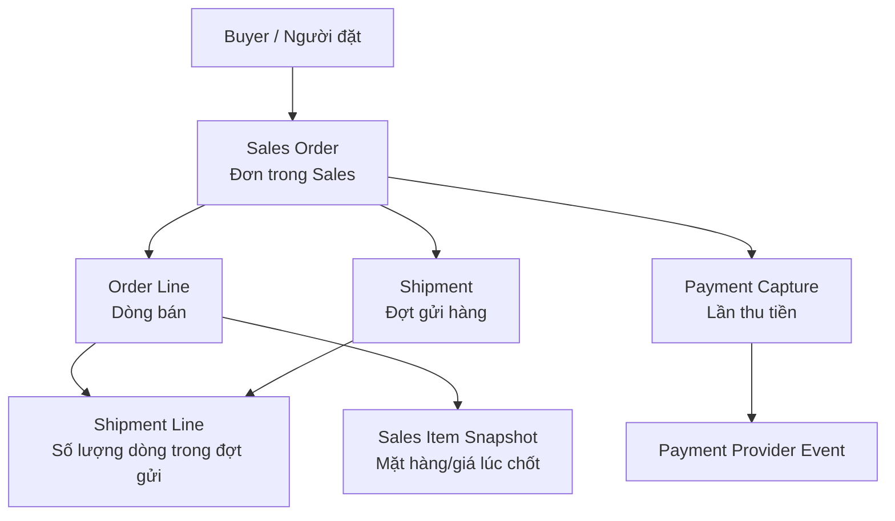
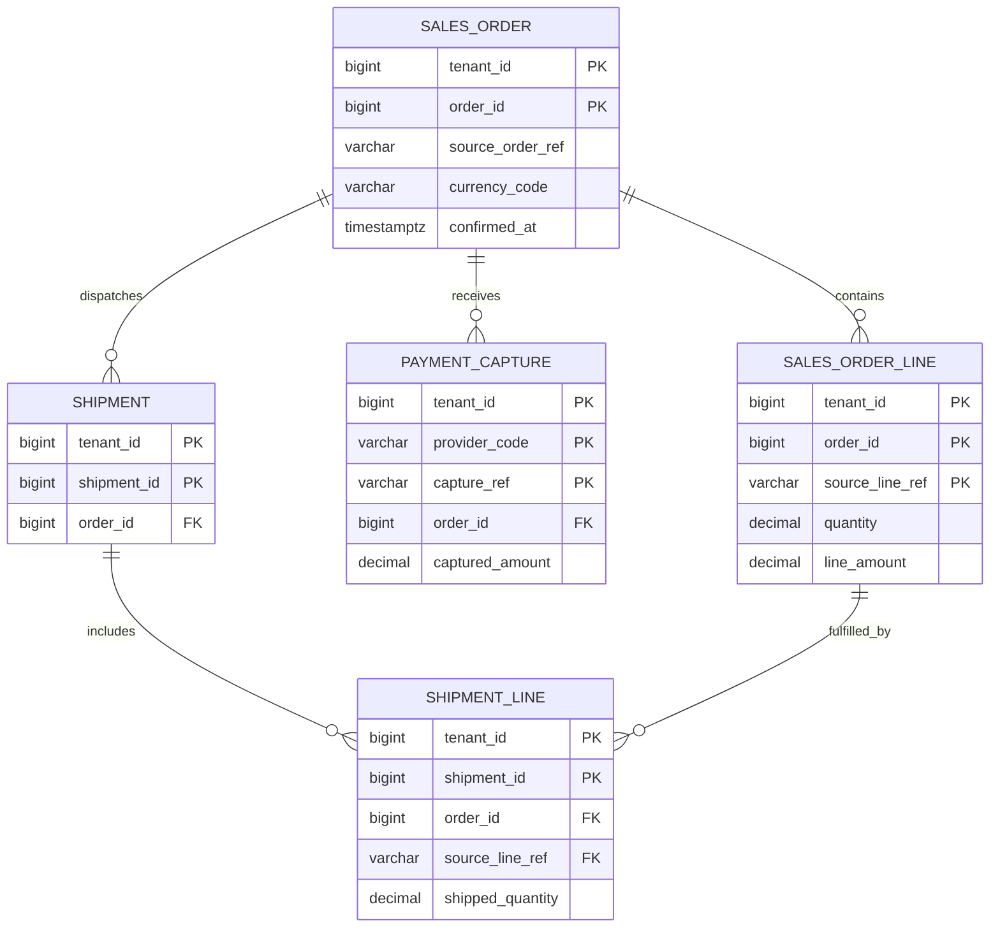
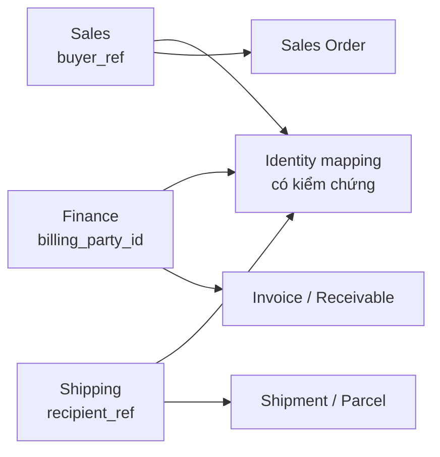
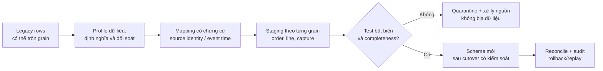

# Vẽ bảng trước khi thống nhất khái niệm và độ hạt

## 1. Lỗi xuất phát trước câu lệnh SQL đầu tiên

Trong module `DATABASE_DATA_MODELING`, người học rèn kỹ năng chuyển yêu cầu nghiệp vụ thành mô hình dữ liệu rõ ràng: xác định thực thể, quan hệ và ràng buộc; sau đó mới chọn chuẩn hóa, khóa, chỉ mục, lược đồ vật lý và cách biểu diễn phù hợp trong hệ quan hệ, document, graph hoặc phân tích. Ở chương **Lỗi thường gặp**, một sai lầm nền tảng là **bắt đầu vẽ bảng và cột khi các bên chưa thống nhất dữ liệu đang nói về điều gì và một hàng đại diện cho điều gì**.

Ví dụ, nhóm phát triển nghe yêu cầu:

> “Lưu đơn hàng, sản phẩm, tiền thanh toán và giao hàng để báo cáo doanh thu.”

Một thiết kế xuất hiện ngay:

```text
ORDER(
  order_id, customer_id, product_id, quantity,
  total_amount, paid_amount, shipping_status
)
```

Nó trông đơn giản, nhưng chưa trả lời được:

- Một đơn có **một hay nhiều dòng sản phẩm**?
- Một đơn có thể **thanh toán nhiều lần** hay thanh toán bởi nhiều bên?
- “Đã thanh toán” nghĩa là **đã ủy quyền, đã thu tiền, hay đã đối soát**?
- Một đơn có thể giao thành **nhiều kiện** hoặc giao một phần không?
- `customer_id` biểu diễn **người mua, người trả tiền hay người nhận**?
- `total_amount` là **trước hay sau thuế, chiết khấu, phí và hoàn tiền**?
- “Doanh thu” tính khi **đặt đơn, xác nhận, giao hàng, lập hóa đơn hay nhận tiền**?
- Một hàng của `ORDER` là **đơn hiện tại**, một **lần chuyển trạng thái**, hay **dòng sự kiện**?

Khi những câu hỏi này chưa được trả lời, việc thêm `PRIMARY KEY`, `FOREIGN KEY` hoặc index chỉ giúp hệ quản trị bảo vệ **một cách hiểu chưa chắc đã đúng**.

**Thông điệp chính:** đừng biến sự mơ hồ về nghiệp vụ thành sự chắc chắn giả tạo của một schema. Trước khi chọn bảng, phải chốt **từ vựng, ranh giới, danh tính, quan hệ, độ hạt, thời điểm và quy tắc tính toán**.

### Mục tiêu học tập

Sau bài này, người học có thể:

1. Nhận diện dấu hiệu nhóm đang “vẽ bảng thay vì làm rõ nghiệp vụ”.
2. Xây **glossary** và ví dụ phản chứng để thống nhất thuật ngữ xuyên các đội.
3. Viết phát biểu **grain** cho entity, transaction fact, event fact và snapshot.
4. Phân biệt danh tính nghiệp vụ với khóa kỹ thuật, namespace, version và trạng thái.
5. Chứng minh vì sao join sai cardinality làm **nhân số hàng và doanh thu**.
6. Đi từ yêu cầu → mô hình khái niệm → mô hình logic → schema vật lý có ràng buộc.
7. Kiểm tra mô hình bằng dữ liệu ví dụ, SQL, bất biến, ca biên và đối soát trước khi tối ưu hiệu năng.

## 2. Vì sao cách làm “vẽ bảng trước” hấp dẫn nhưng nguy hiểm?

Việc viết DDL sớm tạo cảm giác tiến độ: đã có bảng, entity Java, repository, API CRUD và migration. Công cụ vẽ ERD, ORM và code generator khiến thao tác này rất nhanh. Nhưng **tốc độ chuyển một giả định thành bảng không đo được chất lượng giả định**.

| Biểu hiện | Lý do thường gặp | Hệ quả về sau |
|---|---|---|
| Tạo bảng `orders` chỉ từ màn hình nhập đơn | Nhìn UI như cấu trúc domain | Không biểu diễn được nhiều dòng/đợt thanh toán |
| Dùng `customer_id` ở mọi bảng | Cùng từ “khách hàng” | Nhầm buyer, payer, recipient và chủ thể pháp lý |
| Chọn `status VARCHAR` trước khi định nghĩa workflow | Cho rằng trạng thái là một thuộc tính chung | Các miền đặt giá trị trùng tên nhưng nghĩa khác |
| Cho `amount` là một số duy nhất | Chưa hỏi đơn vị và thành phần tiền | Sai thuế, chiết khấu, refund, currency |
| Đặt một `created_at` và dùng cho mọi báo cáo | Chưa tách thời gian nghiệp vụ | Sự kiện đến muộn vào sai kỳ |
| Tạo `UNIQUE(order_id)` trong bảng dòng đơn | Chưa phát biểu grain của hàng | Chỉ lưu được một sản phẩm mỗi đơn |
| Join ba bảng một–nhiều rồi `SUM` | Tin rằng FK hợp lệ thì phép tính đúng | Nhân dòng, double counting |
| Thêm cột `json_payload` khi không rõ semantics | Né tranh luận domain | Ràng buộc khó kiểm chứng, trách nhiệm mơ hồ |
| Chọn partition trước khi biết đường đọc | Tối ưu theo cảm giác | Không hỗ trợ query chủ đạo, có thể phá unique identity |

Một hệ thống có thể **không có lỗi cú pháp SQL** mà vẫn sai hoàn toàn về doanh thu, thời gian hoặc quyền truy cập. Đây là lỗi mô hình, không phải lỗi cú pháp.

## 3. Thống nhất thuật ngữ: cùng tên không chắc cùng nghĩa

**Ubiquitous language** hoặc **glossary nghiệp vụ** là bộ từ vựng có định nghĩa, phạm vi, ví dụ và chủ sở hữu. Nó không đơn giản là dịch tên bảng sang tiếng Việt.

Đối với một marketplace, hãy ghi ít nhất:

| Thuật ngữ | Định nghĩa cần xác nhận | Không nên mặc định đồng nghĩa |
|---|---|---|
| **Đơn hàng (order)** | Yêu cầu mua được Sales quản lý; có mã, dòng, vòng đời | Hóa đơn, giao dịch thanh toán, shipment |
| **Dòng đơn (order line)** | Một mục bán cụ thể trong đơn, có số lượng và giá chốt | Một sản phẩm trong catalog hoặc một kiện hàng |
| **Xác nhận đơn** | Sales chấp nhận điều kiện bán theo một quy tắc | Đã thu tiền, đã ghi doanh thu kế toán |
| **Thanh toán (payment)** | Có thể là ý định, lần thử, ủy quyền, thu tiền, hoàn tiền | Một con số `paid_amount` luôn đúng |
| **Giao hàng** | Có thể là đợt giao, shipment, parcel và trạng thái giao | Một trạng thái duy nhất của toàn đơn |
| **Khách hàng** | Vai trò người mua trong Sales, hoặc một thực thể có danh tính | Người trả tiền, người nhận, pháp nhân trên hóa đơn |
| **Sản phẩm** | Biến thể bán trong Catalog theo chính sách ID/SKU | SKU tồn kho, lô hàng, sản phẩm pháp lý/hạch toán |
| **Doanh thu** | Measure theo quy tắc ghi nhận đã được phê duyệt | Tổng tiền đơn, số tiền thu, tiền còn nợ |
| **Ngày bán** | Mốc nghiệp vụ được định nghĩa cho báo cáo bán hàng | `created_at` hoặc thời gian ingest bất kỳ |

Glossary có ích khi mỗi thuật ngữ mang theo:

- **Định nghĩa và ranh giới**: áp dụng ở Sales, Finance, Shipping hay toàn doanh nghiệp?
- **Ví dụ đúng** và **ví dụ không thuộc khái niệm đó**.
- **Đơn vị và phạm vi**: VND, USD, chiếc, kilogram, tenant/source.
- **Cardinality**: một order có bao nhiêu line, capture, shipment?
- **Quy tắc chuyển trạng thái** và thời điểm hiệu lực.
- **Owner** chịu trách nhiệm quyết định nghĩa khi có bất đồng.
- **Tình huống chưa chốt** và hành động cần xác minh.

**Không cố xây một “siêu glossary” buộc mọi miền có một nghĩa duy nhất.** Finance có thể gọi “customer” là bên phải trả, Sales gọi “buyer” là người đặt. Khi nghĩa khác nhau có thật, hãy giữ các thuật ngữ khác nhau và mô tả phép ánh xạ giữa các miền.

## 4. Workshop đặt câu hỏi thay vì đặt tên cột

Trước buổi vẽ ERD, chọn **một giao dịch cụ thể** và đặt câu hỏi phản chứng:

> Đơn `SO-100` của tenant 42 có hai dòng: L01 gồm 2 sản phẩm A giá 50.000 VND/chiếc và L02 gồm 1 sản phẩm B giá 200.000 VND. Đơn được chấp nhận ngày 31/03. Khách thanh toán 200.000 VND ở lần thu P01 và 100.000 VND ở lần thu P02 ngày hôm sau. Dòng L01 giao ngay, L02 giao sau ba ngày.

Từ một ví dụ này, nhóm phải trả lời được:

1. `SO-100` là danh tính của **đơn**, không phải dòng L01 hay P01.
2. Đơn có **2 dòng**, số tiền hàng trước thuế/chiết khấu/phí là **300.000 VND**.
3. Có **2 lần thu tiền**, không phải một thuộc tính thanh toán duy nhất.
4. “Đã thanh toán đủ” phụ thuộc tổng các giao dịch thu hợp lệ, refund và quy tắc đối soát.
5. Đơn có thể **giao một phần**, nên một `shipping_status` duy nhất không đủ cho tất cả câu hỏi vận hành.
6. Ngày chấp nhận, ngày thu tiền và ngày giao hàng có thể rơi vào **những tháng báo cáo khác nhau**.
7. Nếu P01 được gửi lại do retry, đó không phải lần thu mới.

Đừng vội thay ví dụ bằng sơ đồ. Hãy thêm các **tình huống phản ví dụ**:

- Một đơn có **ba dòng cùng một SKU** nhưng giá, khuyến mãi hoặc địa điểm giao khác nhau.
- Một dòng có thể được **tách làm hai đợt giao**.
- Một lần thu tiền thất bại trước khi một lần khác thành công.
- Hai tenant có cùng mã `SO-100`; cùng tenant có mã đơn trùng ở hai nguồn.
- Mã SKU đổi sau khi khách mua; khách vẫn cần chứng từ lịch sử chính xác.
- Khách mua, chủ thẻ thanh toán và người nhận hàng là ba người khác nhau.
- Sản phẩm hết hàng một phần; có hủy/đổi số lượng sau xác nhận.

Nếu schema không diễn tả được các ca được nghiệp vụ chấp nhận, lỗi không nằm ở việc thiếu một cột `notes`.

## 5. Tách “khái niệm” khỏi “bảng” trong mô hình khái niệm

**Mô hình khái niệm** mô tả những đối tượng và sự kiện có ý nghĩa kinh doanh cùng mối quan hệ, chưa khóa thiết kế vào một DBMS.



Sơ đồ trên cố ý **không đồng nhất**:

- Order với capture, vì một đơn có thể thu nhiều lần.
- Order line với shipment line, vì một dòng có thể được giao từng phần.
- Buyer với payer hoặc recipient, vì đây là **vai trò** có thể khác nhau.
- Sales item snapshot với product hiện tại trong catalog.

Trong giai đoạn này, hỏi: “Shipment có thể chứa các dòng của nhiều đơn không?” Nếu có, quan hệ sẽ khác thiết kế chỉ cho phép một đơn mỗi shipment. Chưa có bằng chứng thì ghi **giả định**, không tự vẽ FK làm như yêu cầu đã chốt.

### Một cây câu hỏi quan hệ

Đối với mỗi cặp khái niệm A–B:

- Một A có **tối thiểu/tối đa** bao nhiêu B?
- Một B có thuộc nhiều A không?
- Mối quan hệ có **thuộc tính riêng** không, như `shipped_quantity` hoặc `effective_from`?
- Quan hệ có tồn tại độc lập không? Có cần lịch sử thay đổi không?
- Khi xóa/hủy A, B được giữ lại hay hủy theo? Ai chịu trách nhiệm dữ liệu?
- Có yêu cầu cross-tenant hoặc cross-system reference không?

Những câu hỏi này thường quan trọng hơn việc quyết định đặt tên bảng số ít hay số nhiều.

## 6. Độ hạt (grain): phát biểu một hàng biểu diễn điều gì

**Grain** là đơn vị sự thật nhỏ nhất mà một hàng biểu diễn theo thiết kế. Thuật ngữ này đặc biệt quan trọng với bảng dữ kiện phân tích, nhưng cũng hữu ích cho bảng giao dịch và bảng quan hệ trong OLTP.

Một phát biểu grain tốt bao gồm:

1. **Một đơn vị nghiệp vụ**: một đơn, một dòng, một lần thu tiền, một sự kiện, một ngày tồn kho...
2. **Phạm vi danh tính**: tenant, nguồn, mã dòng hoặc event ID.
3. **Thời điểm/trạng thái**: trạng thái hiện hành, lần xác nhận, hay snapshot cuối ngày?
4. **Quy tắc phiên bản**: một đối tượng có thể có nhiều hàng qua thời gian hay không?

| Tên ứng viên | Một hàng thực sự đại diện | Khóa duy nhất theo ý nghĩa | Có cộng tiền theo hàng được không? |
|---|---|---|---|
| `sales_order` | Một đơn Sales ở trạng thái hiện hành | (`tenant_id`, `source_system`, `source_order_ref`) | Không cộng `order_total` sau join một–nhiều |
| `sales_order_line` | Một dòng trong một đơn | (`tenant_id`, `order_id`, `source_line_ref`) | Có nếu measure đúng grain và currency |
| `payment_capture` | Một lần thu tiền thành công theo provider | (`tenant_id`, `provider`, `capture_ref`) nếu namespace đó đủ | Có theo sự kiện capture và quy tắc refund riêng |
| `payment_attempt` | Một lần thử gọi provider, kể cả thất bại | `attempt_id` bền vững | Không coi mọi attempt là tiền đã thu |
| `shipment_line` | Một lượng của dòng đơn thuộc một đợt giao | (`shipment_id`, `order_line_id`) nếu không lặp dòng trong một shipment | Cộng số lượng giao, không mặc định doanh thu |
| `fact_sales_line` | Một dòng bán đã được chấp nhận theo contract | Mã dòng nguồn trong đơn với namespace | Additive theo điều kiện tiền tệ/trạng thái |
| `fact_inventory_daily` | Tồn kho một SKU tại một kho cuối ngày | (`date_key`, `warehouse_key`, `sku_key`) | Số dư **không** cộng qua nhiều ngày |

**Không có một grain “đúng tuyệt đối” cho tất cả ứng dụng.** Bảng đơn hiện hành và log các sự kiện đơn có grain khác nhau nhưng có thể cùng tồn tại. Điều sai là đặt một bảng `orders` rồi thay đổi ý nghĩa một hàng tùy theo màn hình hoặc báo cáo.

### Mẫu câu giúp chốt grain

> Mỗi hàng của **[tên cấu trúc]** biểu diễn **[sự kiện/trạng thái/quan hệ]** của **[thực thể]** trong **[namespace]** tại **[mốc hoặc khoảng thời gian]**, được định danh duy nhất bởi **[business key]**; **[revision/điều chỉnh]** được xử lý bằng **[quy tắc]**.

Nếu không điền được đủ các ô, chưa nên chốt `PRIMARY KEY` vật lý.

## 7. Đếm hàng để kiểm tra grain trước khi bàn về index

Với ví dụ `SO-100`:

| Cấu trúc | Dữ liệu | Số hàng kỳ vọng |
|---|---|---:|
| Order | `SO-100` | 1 |
| Order line | `L01`, `L02` | 2 |
| Payment capture | `P01`, `P02` | 2 |
| Shipment | Giao trước/giao sau | 2 |
| Shipment line | Giao L01 trong S01; L02 trong S02 | 2 |

Tổng giá trị dòng bán là:

\[
2\times50\,000+1\times200\,000=300\,000\ \mathrm{VND}
\]

Tổng tiền thu thành công là:

\[
200\,000+100\,000=300\,000\ \mathrm{VND}
\]

Hai tổng bằng nhau trong dữ liệu **minh họa**, nhưng không có nghĩa mọi đơn thực tế luôn bằng nhau: có thể có thuế, phí, tip, chiết khấu, refund, thanh toán đang chờ hoặc chênh lệch tỷ giá. **Đối soát đòi cùng khái niệm tiền và điều kiện ghi nhận.**

Đặt câu hỏi: nếu hai capture P01/P02 được ghi trong bảng `sales_order` như hai hàng, số dòng order thành 2; nếu hai dòng L01/L02 cũng làm thành hai hàng, số hàng có thể bị nhân. Đây chính là lý do phải xác định grain cho **từng loại dữ kiện**.

## 8. Nhầm khái niệm là nhầm luôn khóa

Một sai lầm phổ biến là chọn khóa sớm vì trông có vẻ duy nhất:

- `order_ref` không chắc duy nhất **xuyên tenant hoặc hệ nguồn**.
- `sku` có thể thay đổi hoặc được tái sử dụng; không chắc là danh tính bất biến của sản phẩm.
- `payment_id` có thể định danh **ý định thanh toán** trong khi một payment có nhiều capture/refund/event.
- `created_at` gần như không phải ID: nhiều hàng có thể có timestamp giống nhau và retry có thời điểm nhận khác.
- `row_id BIGSERIAL` chỉ xác định hàng vật lý; không tự ngăn cùng một event nguồn được nạp hai lần.

Phân biệt:

| Khái niệm | Ví dụ | Vai trò |
|---|---|---|
| **Business key** | (`tenant_id`, `source_system`, `order_ref`) | Nhận diện đơn trong phạm vi nguồn |
| **Surrogate key** | `order_id BIGINT` | Join nội bộ, giữ ổn định khi mã nghiệp vụ thay |
| **Event identity** | `provider_capture_ref`, `source_event_id` | Phân biệt những sự kiện hợp lệ cùng order |
| **Idempotency key** | Khóa của một yêu cầu/event nguồn không được xử lý hai lần | Bảo vệ retry; phải có phạm vi và vòng đời |
| **Version/revision** | `source_order_version`, `event_sequence` | Phân biệt các phiên bản/sự kiện thay đổi |
| **Dimension version SK** | `customer_sk` của một hàng SCD2 | Tái hiện thuộc tính chiều theo một khoảng hiệu lực |

**Một surrogate PK không tự là bằng chứng đúng grain.** Nếu một dòng đơn được gửi lại hai lần và mỗi lần chèn có `line_id` mới, DB vẫn thấy hai hàng hợp lệ về PK nhưng báo cáo có thể tính tiền gấp đôi.

### Tenant/source là namespace thật, không phải cột trang trí

Hai hệ `WEB` và `POS` có thể cùng phát `order_ref='0001'` trong tenant 42; hai tenant cũng có thể dùng cùng mã đó. Unique phải phản ánh **phạm vi được hợp đồng nguồn bảo đảm**, ví dụ:

```text
(tenant_id, source_system, source_order_ref)
```

Nếu hệ POS còn chỉ bảo đảm mã đơn duy nhất trong một cửa hàng, khóa còn cần `store_ref` hoặc lớp chuẩn hóa nguồn. Không thêm một trường ngẫu nhiên vào unique chỉ để tránh lỗi duplicate, vì như vậy có thể cho phép cùng một giao dịch bị nạp trùng.

## 9. Thời gian và trạng thái là một phần ý nghĩa của hàng

“Ngày giao dịch” chưa phải định nghĩa đầy đủ. Một đơn có thể có:

| Mốc | Bản chất | Báo cáo có thể liên quan |
|---|---|---|
| `placed_at` | Người mua gửi yêu cầu đặt hàng | Số đơn đặt |
| `confirmed_at` | Sales chấp nhận đơn | Dòng bán được chấp nhận |
| `authorized_at` | Provider cho phép giữ số tiền | Khả năng thanh toán, chưa hẳn đã thu |
| `captured_at` | Provider ghi nhận lần thu | Dòng tiền thu thành công |
| `invoiced_at` | Billing phát hành hóa đơn | Báo cáo hóa đơn |
| `shipped_at` | Shipment được gửi | Vận hành giao nhận |
| `delivered_at` | Kiện được giao thành công | SLA giao hàng |
| `loaded_at` | Data pipeline nhận dữ liệu | Độ trễ ingestion, không tự là ngày bán |

Nếu Sales ghi nhận đơn lúc 23:50 ngày 31/03 theo giờ Việt Nam và Finance thu tiền ngày 01/04, báo cáo “số đơn được xác nhận theo tháng” và “tiền thu theo tháng” có thể **khác tháng một cách đúng đắn**.

### Thời gian hiệu lực khác thời gian ghi nhận

Nếu khách chuyển phân khúc có hiệu lực từ 15/03 nhưng hệ thống nhận cập nhật ngày 20/03:

- **Valid time**: phân khúc áp dụng từ 15/03 theo luật nghiệp vụ.
- **Recorded/transaction time**: hệ thống biết/ghi thay đổi ngày 20/03.
- Một báo cáo *as-of* hiện tại có thể dùng hiệu lực 15/03.
- Một báo cáo “ngày 17/03 hệ thống đã từng biết gì” còn cần lịch sử ghi nhận/bitemporal hoặc audit tương đương.

Không thể thay tất cả mốc này bằng một cột `updated_at` rồi tự nói báo cáo lịch sử luôn đúng.

## 10. Anti-pattern SQL: một bảng gánh ba grain

Xét DDL cố ý thiết kế sai:

```sql
-- ANTI-PATTERN MINH HỌA: KHÔNG TRIỂN KHAI CHO NGHIỆP VỤ THẬT.
CREATE TABLE orders_bad (
    order_ref VARCHAR(80) PRIMARY KEY,
    buyer_ref VARCHAR(80) NOT NULL,
    product_sku VARCHAR(80) NOT NULL,
    quantity INTEGER NOT NULL,
    unit_price NUMERIC(18,2) NOT NULL,
    payment_ref VARCHAR(80),
    captured_amount NUMERIC(18,2),
    shipment_ref VARCHAR(80),
    created_at TIMESTAMPTZ NOT NULL DEFAULT CURRENT_TIMESTAMP
);
```

Thiết kế này chỉ có một `order_ref` duy nhất trên toàn bảng, nghĩa là một order chỉ lưu được **một hàng**. Nhưng nghiệp vụ cho phép một đơn có hai dòng, hai capture và hai shipment:

- Thêm dòng L02 cho `SO-100` sẽ va PK.
- Chuyển PK sang (`order_ref`, `product_sku`) vẫn không giải quyết hai dòng cùng SKU và nhiều capture/shipment.
- Chuyển PK sang (`order_ref`, `product_sku`, `payment_ref`, `shipment_ref`) tạo nhiều **tổ hợp không phải sự kiện thật** và không phân biệt các capture/refund một cách đúng nghĩa.
- `NULL` ở `payment_ref` không biểu diễn rõ chưa thu, không có provider, hay trạng thái lỗi.
- `created_at` không định nghĩa được ngày Sales xác nhận, Finance thu hoặc Shipping giao.
- Không có tenant/source namespace, currency, ID dòng ổn định hoặc ràng buộc miền.

**Không thể sửa lỗi grain bằng cách thêm nhiều cột vào PK một cách cơ học.** Khi các quan hệ có cardinality khác nhau, chúng cần mô hình quan hệ khác nhau, với grain riêng.

## 11. Fanout: join hợp lệ vẫn có thể tạo báo cáo sai

Giả sử đã tách ba bảng `sales_order`, `sales_order_line` và `payment_capture`. Việc tách đúng **không có nghĩa mọi join đều có thể cộng trực tiếp**.

```text
Order SO-100
  Lines:
    L01 = 100.000 VND
    L02 = 200.000 VND
  Captures:
    P01 = 200.000 VND
    P02 = 100.000 VND

JOIN order -> line -> capture:
  (L01, P01)
  (L01, P02)
  (L02, P01)
  (L02, P02)
```

Số hàng từ join là \(2\times2=4\). Khi đó:

\[
\sum \mathrm{line\_amount\ after\ join}
=100\,000+100\,000+200\,000+200\,000
=600\,000
\]

và:

\[
\sum \mathrm{captured\_amount\ after\ join}
=200\,000+100\,000+200\,000+100\,000
=600\,000
\]

Cả hai đều **gấp đôi** giá trị thực của từng tập. Điều này không chứng minh dữ liệu bị duplicate ở bảng gốc, mà là **fanout do kết hợp hai quan hệ một–nhiều độc lập**.

```sql
-- CỐ Ý SAI VỀ NGỮ NGHĨA TỔNG HỢP:
SELECT
    o.source_order_ref,
    SUM(l.line_amount) AS wrong_merchandise_sum,
    SUM(p.captured_amount) AS wrong_capture_sum
FROM sales_order AS o
JOIN sales_order_line AS l
  ON l.tenant_id = o.tenant_id
 AND l.order_id = o.order_id
JOIN payment_capture AS p
  ON p.tenant_id = o.tenant_id
 AND p.order_id = o.order_id
WHERE o.tenant_id = 42
  AND o.source_system = 'WEB'
  AND o.source_order_ref = 'SO-100'
GROUP BY o.source_order_ref;
```

**Không dùng `SUM(DISTINCT l.line_amount)` để chữa fanout.** Nếu hai dòng hợp lệ cùng có giá trị 100.000 VND, `DISTINCT` sẽ làm mất một dòng. Phép sửa đúng là tổng hợp **độc lập theo grain gốc** trước khi kết hợp, hoặc đọc từng measure từ nguồn tương ứng.

## 12. Mô hình logic sau khi chốt khái niệm và grain

Khi các bên đã xác nhận một đơn có nhiều dòng và nhiều lần thu, mô hình có thể là:



Sơ đồ là **mô hình logic minh họa**, chưa phải migration production. Trong ví dụ, một shipment thuộc một order; nếu hệ thống thực tế gom nhiều order trong một chuyến xe, cần phân biệt **shipment** và **transport trip** thay vì dùng một bảng tùy tiện cho cả hai.

### Tách quan hệ nhiều–nhiều có thuộc tính

Một dòng đơn có thể được giao trong nhiều shipment; một shipment chứa nhiều dòng. `shipment_line` không chỉ là bảng ghép rỗng, vì nó có `shipped_quantity`, có thể có `picked_quantity`, lot/serial hoặc trạng thái hoàn trả. Grain của `shipment_line` phải được xác nhận:

> Một hàng là phần của một dòng đơn được đưa vào **một shipment**, với số lượng giao ở đợt đó.

Khi có nhiều lượt quét giao trong cùng shipment và cùng line, nếu cần giữ từng event thì phải thêm **event identity** hoặc tách bảng `shipment_scan_event`; đừng để PK ghép làm mất event thật.

## 13. DDL PostgreSQL 16: bảo vệ đúng grain đơn và dòng

Ví dụ triển khai độc lập sau dùng PostgreSQL 16. Nó **cố ý giới hạn phạm vi**:

- Một order thuộc một tenant/source, có nhiều dòng.
- Các dòng của một order có **cùng currency** được lưu ở header.
- Một dòng có một `source_line_ref` ổn định **trong phạm vi order**.
- Một capture được provider xác nhận là thu thành công; authorization/failed attempt/refund có mô hình riêng.
- Chưa có thuế, chiết khấu hoặc phí vận chuyển; `line_amount = quantity × unit_price` chỉ là **giá trị hàng hóa gốc**.

### 13.1. Header và dòng đơn

```sql
CREATE TABLE sales_order (
    tenant_id BIGINT NOT NULL,
    order_id BIGINT GENERATED ALWAYS AS IDENTITY,
    source_system VARCHAR(40) NOT NULL,
    source_order_ref VARCHAR(80) NOT NULL,
    buyer_ref VARCHAR(80) NOT NULL,
    placed_at TIMESTAMPTZ NOT NULL,
    confirmed_at TIMESTAMPTZ,
    order_state VARCHAR(20) NOT NULL DEFAULT 'DRAFT',
    currency_code VARCHAR(3) NOT NULL,

    CONSTRAINT pk_sales_order PRIMARY KEY (tenant_id, order_id),
    CONSTRAINT uq_sales_order_source
        UNIQUE (tenant_id, source_system, source_order_ref),
    -- Đích FK ghép bảo vệ capture có đúng currency của đơn.
    CONSTRAINT uq_sales_order_currency
        UNIQUE (tenant_id, order_id, currency_code),
    CONSTRAINT ck_order_state
        CHECK (order_state IN ('DRAFT', 'CONFIRMED', 'CANCELLED')),
    CONSTRAINT ck_confirmed_time
        CHECK (order_state <> 'CONFIRMED' OR confirmed_at IS NOT NULL),
    CONSTRAINT ck_order_currency
        CHECK (currency_code ~ '^[A-Z]{3}$'),
    CONSTRAINT ck_order_ref_nonblank
        CHECK (char_length(btrim(source_order_ref)) > 0)
);

CREATE TABLE sales_order_line (
    tenant_id BIGINT NOT NULL,
    order_id BIGINT NOT NULL,
    source_line_ref VARCHAR(80) NOT NULL,
    sales_item_ref VARCHAR(80) NOT NULL,
    quantity NUMERIC(14,3) NOT NULL,
    unit_price NUMERIC(18,2) NOT NULL,
    line_amount NUMERIC(20,2)
        GENERATED ALWAYS AS (ROUND(quantity * unit_price, 2)) STORED,

    CONSTRAINT pk_sales_order_line
        PRIMARY KEY (tenant_id, order_id, source_line_ref),
    CONSTRAINT fk_line_order_same_tenant
        FOREIGN KEY (tenant_id, order_id)
        REFERENCES sales_order (tenant_id, order_id),
    CONSTRAINT ck_line_quantity_positive CHECK (quantity > 0),
    CONSTRAINT ck_line_price_finite
        CHECK (unit_price BETWEEN 0 AND 999999999999),
    CONSTRAINT ck_line_ref_nonblank
        CHECK (char_length(btrim(source_line_ref)) > 0)
);
```

**Ý nghĩa cần đọc được từ DDL:**

1. `sales_order` có một PK nội bộ (`tenant_id`, `order_id`) và unique theo **business identity của đơn nguồn**; hai tenant được phép có mã đơn trùng nhau.
2. `sales_order_line` có PK (`tenant_id`, `order_id`, `source_line_ref`), nên một order có nhiều dòng. Hai dòng có cùng SKU vẫn được phép tồn tại nếu `source_line_ref` khác.
3. FK ghép bảo vệ dòng đơn thuộc tenant của header; một FK riêng chỉ theo `order_id` không tự thể hiện mọi bất biến tenant khi identity không toàn cục.
4. `line_amount` là cột generated từ quantity và unit_price **trong giả định không có chiết khấu/thuế**. Hệ thống thật cần measure phù hợp, chính sách làm tròn và xử lý điều chỉnh.
5. `CHECK` chỉ bảo vệ những bất biến khai báo tại một hàng. Nó chưa bảo đảm một order `CONFIRMED` có ít nhất một line, chưa bảo vệ chuyển trạng thái hợp lệ và chưa bảo đảm buyer thuộc một entity thực nếu không có bảng/bối cảnh đó.
6. `UNIQUE(tenant_id,order_id,currency_code)` dư thừa về duy nhất khi đã có PK ghép, nhưng được khai báo làm đích FK ba cột cho payment cùng currency; đó là **đánh đổi thêm index và chi phí ghi** cần được cân nhắc.

Đừng chép DDL này cho mọi hệ thống bán hàng mà không điều chỉnh grain, state machine, currency, thuế, quantity và danh tính theo nghiệp vụ thực.

### 13.2. Bảng lần thu tiền thành công

```sql
CREATE TABLE payment_capture (
    tenant_id BIGINT NOT NULL,
    provider_code VARCHAR(40) NOT NULL,
    capture_ref VARCHAR(100) NOT NULL,
    order_id BIGINT NOT NULL,
    currency_code VARCHAR(3) NOT NULL,
    captured_at TIMESTAMPTZ NOT NULL,
    captured_amount NUMERIC(18,2) NOT NULL,

    CONSTRAINT pk_payment_capture
        PRIMARY KEY (tenant_id, provider_code, capture_ref),
    CONSTRAINT fk_capture_order_currency
        FOREIGN KEY (tenant_id, order_id, currency_code)
        REFERENCES sales_order (tenant_id, order_id, currency_code),
    CONSTRAINT ck_capture_amount_positive
        CHECK (captured_amount > 0 AND captured_amount < 999999999999),
    CONSTRAINT ck_capture_ref_nonblank
        CHECK (char_length(btrim(capture_ref)) > 0)
);

-- Hỗ trợ truy vấn đối soát capture theo đơn.
CREATE INDEX idx_capture_by_order
    ON payment_capture (tenant_id, order_id, captured_at);
```

Ở đây `capture_ref` được giả định duy nhất **trong tenant và provider**. Nếu provider chỉ bảo đảm duy nhất trong merchant account, namespace của PK phải bổ sung `provider_account_ref`; điều đó phải được xác nhận qua hợp đồng nguồn.

`payment_capture` **không** lưu mọi `payment_attempt` thất bại, authorization hold hoặc refund. Chúng có sự kiện/ngữ nghĩa riêng; có thể cần bảng event khác. `FOREIGN KEY` bảo vệ existence và currency, **không** đảm bảo tổng capture ≤ tổng đơn vì đó là ràng buộc **liên hàng/liên bảng** cần quy trình nghiệp vụ có transaction và kiểm soát cạnh tranh. Thực tế có thể có phí, tip, điều chỉnh hoặc split tender nên bất biến tổng phải được định nghĩa trước.

## 14. Nạp dữ liệu ví dụ để kiểm tra DDL và grain

Đoạn sau chỉ chạy trên một schema thử sạch, sau khi tạo ba bảng ở mục 13. Nó không dựa vào `order_id` được sinh ra có giá trị 1 hay không.

```sql
WITH created_order AS (
    INSERT INTO sales_order (
        tenant_id, source_system, source_order_ref, buyer_ref,
        placed_at, confirmed_at, order_state, currency_code
    )
    VALUES (
        42, 'WEB', 'SO-100', 'BUYER-19',
        '2027-03-31 10:00:00+00'::timestamptz,
        '2027-03-31 10:01:00+00'::timestamptz,
        'CONFIRMED', 'VND'
    )
    RETURNING tenant_id, order_id
)
INSERT INTO sales_order_line (
    tenant_id, order_id, source_line_ref,
    sales_item_ref, quantity, unit_price
)
SELECT
    o.tenant_id, o.order_id,
    v.source_line_ref, v.sales_item_ref, v.quantity, v.unit_price
FROM created_order AS o
CROSS JOIN (
    VALUES
        ('L01'::varchar(80), 'SKU-A'::varchar(80),
         2.000::numeric(14,3), 50000.00::numeric(18,2)),
        ('L02'::varchar(80), 'SKU-B'::varchar(80),
         1.000::numeric(14,3), 200000.00::numeric(18,2))
) AS v(source_line_ref, sales_item_ref, quantity, unit_price);

INSERT INTO payment_capture (
    tenant_id, provider_code, capture_ref,
    order_id, currency_code, captured_at, captured_amount
)
SELECT
    o.tenant_id, 'PAYMENT-GW', v.capture_ref,
    o.order_id, o.currency_code, v.captured_at, v.captured_amount
FROM sales_order AS o
CROSS JOIN (
    VALUES
        ('P01'::varchar(100),
         '2027-03-31 10:05:00+00'::timestamptz,
         200000.00::numeric(18,2)),
        ('P02'::varchar(100),
         '2027-04-01 09:00:00+00'::timestamptz,
         100000.00::numeric(18,2))
) AS v(capture_ref, captured_at, captured_amount)
WHERE o.tenant_id = 42
  AND o.source_system = 'WEB'
  AND o.source_order_ref = 'SO-100';
```

**Vấn đề cần lưu ý khi kiểm thử:** đoạn ví dụ xác nhận đơn cùng lúc tạo header trước khi các dòng được thêm. Với ứng dụng thực, nên **bao cả bước tạo order và lines trong một transaction**, kiểm tra điều kiện chấp nhận rồi mới phát event/commit; không được để consumer coi order đã hoàn chỉnh trong khi transaction khác còn chưa ghi đủ lines. Ví dụ minh họa dữ liệu có thể chạy được nhưng không thay thế workflow đồng bộ trạng thái.

Đọc lại số liệu:

```sql
SELECT
    o.tenant_id, o.source_order_ref,
    l.source_line_ref, l.sales_item_ref,
    l.quantity, l.unit_price, l.line_amount
FROM sales_order AS o
JOIN sales_order_line AS l
  ON l.tenant_id = o.tenant_id
 AND l.order_id = o.order_id
WHERE o.tenant_id = 42
  AND o.source_order_ref = 'SO-100'
ORDER BY l.source_line_ref;
```

Kỳ vọng hai dòng: L01 = 100.000 VND, L02 = 200.000 VND. Capture P01 = 200.000 VND và P02 = 100.000 VND. **Hai capture không tạo thêm dòng bán**.

## 15. Viết báo cáo đúng grain bằng cách tổng hợp trước khi join

Thay vì join raw line với raw capture rồi cộng, tổng hợp độc lập từng tập:

```sql
WITH line_totals AS (
    SELECT
        tenant_id, order_id,
        COUNT(*) AS line_count,
        SUM(line_amount) AS merchandise_amount
    FROM sales_order_line
    GROUP BY tenant_id, order_id
),
capture_totals AS (
    SELECT
        tenant_id, order_id,
        COUNT(*) AS capture_count,
        SUM(captured_amount) AS captured_amount
    FROM payment_capture
    GROUP BY tenant_id, order_id
)
SELECT
    o.tenant_id,
    o.source_order_ref,
    o.currency_code,
    COALESCE(l.line_count, 0) AS line_count,
    COALESCE(l.merchandise_amount, 0) AS merchandise_amount,
    COALESCE(c.capture_count, 0) AS capture_count,
    COALESCE(c.captured_amount, 0) AS captured_amount
FROM sales_order AS o
LEFT JOIN line_totals AS l
  ON l.tenant_id = o.tenant_id
 AND l.order_id = o.order_id
LEFT JOIN capture_totals AS c
  ON c.tenant_id = o.tenant_id
 AND c.order_id = o.order_id
WHERE o.tenant_id = 42
  AND o.source_system = 'WEB'
  AND o.source_order_ref = 'SO-100';
```

Kỳ vọng:

| Order | Dòng bán | Tổng giá trị hàng | Capture | Tổng đã thu |
|---|---:|---:|---:|---:|
| SO-100 | 2 | 300.000 VND | 2 | 300.000 VND |

Hai `CTE` có grain **một hàng trên một order**; vì thế join các tổng lên một `sales_order` không nhân measure. Cách này bảo vệ về cardinality, nhưng **không tự chuyển `captured_amount` thành doanh thu ghi nhận**; báo cáo tài chính vẫn cần định nghĩa riêng và xử lý refund/điều chỉnh.

### Cách kiểm tra fanout trước khi cộng

```sql
SELECT
    o.tenant_id,
    o.order_id,
    COUNT(*) AS joined_rows,
    COUNT(DISTINCT l.source_line_ref) AS distinct_lines,
    COUNT(DISTINCT (p.provider_code, p.capture_ref))
        FILTER (WHERE p.capture_ref IS NOT NULL) AS distinct_captures
FROM sales_order AS o
LEFT JOIN sales_order_line AS l
  ON l.tenant_id = o.tenant_id
 AND l.order_id = o.order_id
LEFT JOIN payment_capture AS p
  ON p.tenant_id = o.tenant_id
 AND p.order_id = o.order_id
WHERE o.tenant_id = 42
  AND o.source_order_ref = 'SO-100'
GROUP BY o.tenant_id, o.order_id;
```

Với 2 lines × 2 captures, `joined_rows = 4`, `distinct_lines = 2`, `distinct_captures = 2`. `COUNT(DISTINCT ...)` hữu ích để **chẩn đoán/phép đếm tập**, nhưng vẫn không phải cách thay thế aggregate ở đúng grain của measure tiền.

## 16. Không ép mọi đối tượng vào một bảng theo danh từ

Sau khi thấy khái niệm “đơn hàng”, nhóm thường chỉ liệt kê các danh từ rồi tạo mỗi danh từ một bảng. Cách đó cũng chưa đủ:

- **Value object:** địa chỉ giao đã chốt có thể là value được snapshot trong shipment, không nhất thiết FK vào địa chỉ hiện tại của user.
- **Lifecycle event:** `OrderConfirmed` là một sự kiện có event identity/time, không phải chỉ thêm một cột boolean vào mọi bảng liên quan.
- **Business rule:** “không thu vượt số tiền đủ điều kiện” là bất biến liên quan nhiều hàng, không thể biểu diễn bằng tên bảng.
- **Relationship with attributes:** phân bổ lượng hàng cho shipment có `shipped_quantity`, không chỉ là nối hai ID.
- **Aggregate boundary:** Sales và Payment Provider có vòng đời giao dịch khác nhau; không nên gộp write ownership vì cùng liên quan một order.
- **Read model:** màn hình có thể cần `order_summary` chứa totals, nhưng đó là projection dẫn xuất, không phải nguồn sự thật mới.

Một yêu cầu có danh từ “trạng thái thanh toán” không nhất thiết tạo một bảng `payment_status`. Hãy xác định trước đó là thuộc tính hiện hành, sự kiện state change hay kết quả tổng hợp từ captures/refunds.

## 17. Chuẩn hóa không chữa được khái niệm sai

Chuẩn hóa 1NF/2NF/3NF/BCNF có ích khi đã xác định được ý nghĩa thuộc tính và phụ thuộc hàm. Nhưng nếu dữ liệu trộn ba grain trong một hàng, việc tách bảng “theo các cột lặp” mà không hỏi nghiệp vụ có thể vẫn sai.

Ví dụ:

```text
Order O100:
  line L01
  line L02
  payment P01
  payment P02
```

Một thiết kế sai có thể tạo bảng trung gian `order_line_payment` với bốn cặp (L01,P01), (L01,P02), (L02,P01), (L02,P02). Nhưng **không có bằng chứng rằng P01 thanh toán riêng cho L01 hay L02**. Hai quan hệ đúng có thể chỉ là:

```text
Order -> Lines
Order -> Captures
```

Nếu nghiệp vụ thật sự phân bổ một capture cho các dòng, phải có **quy tắc phân bổ** và một quan hệ có grain “một khoản tiền của một capture áp cho một line”, chẳng hạn `payment_allocation` với amount và total constraints. Không được tự tạo mọi cặp chỉ để thực hiện phân rã.

**Phụ thuộc hàm chỉ có giá trị khi được xác nhận từ nghiệp vụ.** Thấy tất cả dữ liệu mẫu có một địa chỉ giao cho một đơn không chứng minh `order_id -> recipient_address` là bất biến vĩnh viễn nếu đơn được phép tách giao theo nhiều địa chỉ.

## 18. Sự khác nhau giữa OLTP entity, event fact và analytical fact

Một cùng khái niệm “đơn” có thể xuất hiện trong nhiều mô hình nhưng có grain khác nhau:

| Mô hình | Grain | Được cập nhật? | Phục vụ |
|---|---|---|---|
| `sales_order` OLTP | Một order hiện hành | Có, theo state machine | Quy trình xử lý đơn |
| `order_status_event` | Một lần chuyển trạng thái có event ID | Thường append-only | Audit, replay, phân tích workflow |
| `fact_sales_line` | Một dòng bán đã được chấp nhận | Theo chính sách immutable/adjustment | Báo cáo doanh số |
| `fact_payment_capture` | Một capture thành công | Thường append-only | Dòng tiền thu |
| `fact_order_daily_snapshot` | Một order vào cuối một ngày chụp | Snapshot theo kỳ | Phân tích tuổi và tồn đọng đơn |
| `fact_inventory_daily` | Tồn kho một SKU/kho cuối ngày | Snapshot theo kỳ | Theo dõi stock; semi-additive |

Một bảng fact không trở nên đúng chỉ vì đặt tiền tố `fact_`. Phải ghi:

> Mỗi hàng của `fact_sales_line` biểu diễn **một dòng bán đã được chấp nhận**, duy nhất theo tenant, nguồn, mã đơn và mã dòng; điều chỉnh sau chấp nhận được ghi theo **quy tắc đã xác nhận**, không nạp lại thành dòng mới không có danh tính.

Nếu fact event thanh toán sử dụng một `payment_id` duy nhất nhưng provider phát capture, refund và chargeback nhiều lần, grain bị trộn. Cần `event_type` và event identity riêng, hoặc các fact phù hợp từng loại.

## 19. Sai grain có thể biến doanh thu thành số liệu không cộng được

Một measure chỉ có thể được tổng hợp đúng trong phạm vi grain và định nghĩa:

- **Additive:** `line_amount` có thể cộng theo nhiều dòng bán **cùng currency và cùng chính sách doanh thu**, không cộng qua mọi join n–n tùy tiện.
- **Semi-additive:** tồn kho cuối ngày cộng được qua SKU/kho tại một mốc, nhưng không cộng tồn kho nhiều ngày để gọi là tồn kho cuối tháng.
- **Non-additive:** tỷ lệ hoàn đơn, biên lợi nhuận %, tỷ lệ chuyển đổi; phải dùng numerator/denominator và scope phù hợp.

Ngay cả khi DDL đúng, truy vấn:

```sql
SELECT p.category_name, SUM(f.line_amount)
FROM fact_sales_line AS f
JOIN product AS p ON p.product_id = f.product_id
GROUP BY p.category_name;
```

có thể sai nếu `product` giữ category **hiện tại** nhưng báo cáo cần category **lúc bán**. Tên bảng/cột trong ví dụ này mang tính minh họa, **không thuộc DDL mục 13**. Để báo cáo lịch sử, cần product version SCD2, category snapshot lúc bán, hoặc hợp đồng as-of phù hợp.

**Grain và mốc thời gian phải đi cùng nhau.** Chỉ nói “mỗi dòng là một lần bán” mà không nêu **khi nào được xem là bán**, cách xử lý refund và thuộc tính nào được chốt lịch sử sẽ tạo các báo cáo khác nhau nhưng đều có vẻ hợp lý.

## 20. Bounded context: đừng đồng nhất buyer, payer và recipient

Một lỗi nữa của việc vẽ bảng trước là tạo `customer` và rải `customer_id` khắp các miền.



Đơn do một nhân viên đặt cho công ty:

- Buyer: nhân viên thao tác.
- Payer/bill-to: pháp nhân công ty.
- Recipient: người nhận tại kho.

Ba vai trò có thể khác nhau. Một `customer_id` toàn cục chỉ hữu ích nếu **danh tính thực sự được định nghĩa và xác minh**, không phải cách gộp mọi role để giảm số FK.

Trong thiết kế domain-oriented:

- Sales sở hữu đơn và luật chấp nhận đơn.
- Billing sở hữu hóa đơn, thuế và công nợ.
- Payment sở hữu các trạng thái giao dịch của provider.
- Shipping sở hữu shipment, parcel và các lần giao.

Sự kiện `OrderConfirmed` không tự đồng nghĩa `PaymentCaptured` hoặc `InvoiceIssued`. Các hệ có thể tích hợp bằng contract/ACL mà không chia sẻ cùng một bảng `order_status`.

## 21. Chuyển sang document, graph hay phân tích không xóa lỗi grain

| Cách biểu diễn | Dễ bị hiểu sai thế nào? | Câu hỏi bắt buộc |
|---|---|---|
| **Quan hệ** | Chọn PK/foreign key trước; join các mối quan hệ một–nhiều gây fanout | Một hàng biểu diễn gì? Quan hệ có cardinality nào? |
| **Document** | Nhét order, lines, captures và shipments vào một JSON, coi toàn bộ là một event | Một phần tử array có identity riêng không? Có version/transaction? |
| **Graph** | Mọi cạnh `Order–has–Payment` nhìn hợp lệ, nhưng traversal trả nhiều đường | Có bao nhiêu đường hợp lệ, measure có bị nhân khi tổng qua cạnh không? |
| **Time-series/event log** | Một dòng theo timestamp mà không có source event ID | Timestamp có thể trùng? Retry có event mới không? |
| **Analytics/star schema** | Trộn order-level và line-level measure trong cùng fact | Grain, measure additive/semi-additive, as-of dimension là gì? |

### Ví dụ document

```json
{
  "tenant_ref": "tenant-42",
  "order_ref": "SO-100",
  "lines": [
    {"line_ref": "L01", "quantity": 2, "unit_price": "50000.00"},
    {"line_ref": "L02", "quantity": 1, "unit_price": "200000.00"}
  ],
  "captures": [
    {"capture_ref": "P01", "amount": "200000.00"},
    {"capture_ref": "P02", "amount": "100000.00"}
  ]
}
```

Document này biểu diễn **một snapshot aggregate của order** có các tập con. Nó **không** có nghĩa mỗi phần tử `lines` gắn với mỗi phần tử `captures`. Khi flatten sang warehouse, phải giữ identity riêng từng phần tử và chỉ cộng measure theo grain tương ứng. Nếu document được cập nhật từ một capture thành hai, đó là sự thay đổi snapshot, không tự là hai event độc lập nếu thiếu event IDs/temporal semantics.

### Ví dụ graph

Một order liên kết hai captures và hai shipments; graph có bốn cạnh từ order đến các đối tượng đó. Truy vấn traversal `Order → Captures` và `Order → Shipments` kết hợp có thể tạo tổ hợp 2×2 tương tự SQL. Đổi từ join sang traversal **không làm phép nhân biến mất**.

## 22. Từ yêu cầu tới lược đồ: quy trình tám bước

Một quy trình thực dụng để tránh lỗi “vẽ bảng trước”:

1. **Gom câu hỏi cần trả lời.** Viết thành query nghiệp vụ và hành vi: ai có thể làm gì, cần báo cáo gì, tại mốc nào, với độ chính xác nào?

2. **Thống nhất glossary theo miền.** Định nghĩa buyer, payer, order, line, capture, refund, shipment, item, revenue; ghi owner và ca mơ hồ.

3. **Dựng ví dụ thật và phản ví dụ.** Ít nhất một đơn nhiều dòng, nhiều capture, giao một phần, retry, hai tenant, hủy và hoàn tiền; không chỉ dùng happy path một đơn–một sản phẩm.

4. **Chốt grain cho từng cấu trúc.** Viết một câu “mỗi hàng = ...”; phân biệt trạng thái hiện tại, sự kiện và snapshot.

5. **Chốt danh tính, cardinality, time và state.** Khóa nguồn có namespace, ID nội bộ, 1–n/n–n, optionality, event time, valid time, source versions.

6. **Vẽ mô hình khái niệm rồi logic.** Tách entities, value objects, events, associations, aggregate boundaries; kiểm tra cardinality bằng ca ví dụ.

7. **Chọn mô hình vật lý và ràng buộc.** PK/UNIQUE/FK/CHECK, transaction, index/partition theo truy vấn, schema migration và quyền ghi; ghi quyết định đánh đổi.

8. **Kiểm thử bằng dữ liệu và báo cáo.** Nhập bộ tình huống, chứng minh row counts, không double counting, tenant isolation, thời gian, idempotency, xử lý dữ liệu thiếu và migration.

**Thứ tự này không cấm prototype sớm.** Có thể phác nhanh bảng để tạo phản hồi, nhưng hãy gắn nhãn **giả định chưa chốt** và sẵn sàng thay đổi nó. Lỗi xuất hiện khi prototype được đối xử như sự thật bất biến mà không qua discovery.

## 23. Bộ câu hỏi review trước khi chấp nhận ERD

| Câu hỏi review | Ví dụ dấu hiệu cần làm rõ | Bằng chứng chấp nhận |
|---|---|---|
| “Một hàng nghĩa là gì?” | “Một order hay một line đều được” | Grain statement không mơ hồ |
| “Khóa nào đại diện sự kiện nguồn?” | Chỉ có auto-increment PK | Business/source identity và idempotency |
| “Cardinality tối đa là bao nhiêu?” | UI chỉ hiển thị một payment | Ví dụ nhiều capture, refund, shipment |
| “Có sự kiện đến muộn không?” | Dùng `created_at` cho báo cáo | Event time và load time tách rõ |
| “Khái niệm nào là state hiện tại?” | Ghi một hàng mỗi update vào bảng current | Current state vs append-only event rõ |
| “Mã này có namespace gì?” | `UNIQUE(order_ref)` toàn DB | Tenant/source/store scope rõ |
| “Null có nghĩa gì?” | NULL = 0 = chưa có | Missing, not applicable, unknown phân biệt |
| “Measure cộng được qua những chiều nào?” | `SUM(total)` sau join hai child tables | Test fanout và grain-aware aggregate |
| “Ai sở hữu dữ liệu?” | Sales và Finance cùng update `order` | Write owner và hợp đồng tích hợp |
| “Báo cáo lịch sử dựa vào bản nào?” | Join dimension hiện tại | SCD2/snapshot/as-of policy |
| “Ràng buộc nào DB thực thi?” | Mọi validation ghi trong API | Constraint/transaction/test/monitoring cụ thể |
| “Khi yêu cầu thay đổi thì làm sao?” | Đổi tên cột rồi deploy một lần | Migration expand/migrate/contract và rollback |

Một review tốt không nhất thiết cần mọi câu trả lời đã hoàn chỉnh. Nhưng câu chưa trả lời phải được **ghi thành assumption/open question với owner và cách kiểm chứng**, không biến thành constraint vội vàng.

## 24. Kiểm thử bất biến, không chỉ kiểm tra SQL chạy được

Các ca tối thiểu từ ví dụ:

| Mã test | Tình huống | Kỳ vọng |
|---|---|---|
| T01 | Một order có hai dòng L01/L02 | Lưu được hai hàng line, một order |
| T02 | Hai dòng cùng SKU nhưng `line_ref` khác | Cả hai hợp lệ nếu domain cho phép |
| T03 | Chèn lại cùng source line | PK/unique từ chối hoặc pipeline xử lý retry idempotent |
| T04 | Hai tenant có cùng `SO-100` | Không bị coi là cùng order |
| T05 | Hai nguồn cùng tenant có cùng order ref | Namespace nguồn không va nhau |
| T06 | Capture P01 và P02 cùng order | Lưu được hai capture; không tăng số dòng bán |
| T07 | Retry cùng capture ref | Không ghi thêm một lần thu |
| T08 | Cùng capture ref nhưng amount khác | Báo vi phạm contract/correction, không im lặng bỏ |
| T09 | Dòng order tenant A tham chiếu order tenant B | FK ghép từ chối |
| T10 | Capture currency khác order currency | FK ghép từ chối trong lược đồ ví dụ |
| T11 | Đơn chưa capture | Có thể giữ order và line, báo captured = 0 phù hợp scope |
| T12 | Đơn hai dòng × hai capture | Tổng riêng biệt = 300.000 mỗi tập; join thô thể hiện fanout |
| T13 | Đơn xác nhận ngày 31/03, capture ngày 01/04 | Hai báo cáo đúng kỳ nghiệp vụ khác nhau |
| T14 | Hoàn tiền một phần | Ghi sự kiện refund riêng, không xóa capture gốc tùy tiện |
| T15 | Buyer ≠ payer ≠ recipient | Mô hình role không cưỡng ép bằng cùng ID |
| T16 | SKU đổi sau bán | Chứng từ lịch sử giữ dữ liệu/snapshot đúng |
| T17 | Dimension phân loại đổi hồi tố | Kết quả as-booked/restated theo chính sách |
| T18 | Một shipment gồm nhiều line và một line giao nhiều đợt | Bridge/ship-line không làm mất số lượng |
| T19 | Nhiều writer cập nhật trạng thái order đồng thời | State transition tuân thủ transaction/optimistic version |
| T20 | Event trùng và event đến ngược thứ tự | Pipeline dùng event identity/revision và reconcile |

### Kiểm tra identity và row count

```sql
-- Mỗi order nguồn chỉ được có một hàng trong namespace.
SELECT tenant_id, source_system, source_order_ref, COUNT(*)
FROM sales_order
GROUP BY tenant_id, source_system, source_order_ref
HAVING COUNT(*) > 1;

-- Đếm dòng bán và capture của một order, không join hai bảng child.
SELECT
    o.source_order_ref,
    (SELECT COUNT(*)
     FROM sales_order_line AS l
     WHERE l.tenant_id = o.tenant_id
       AND l.order_id = o.order_id) AS line_count,
    (SELECT COUNT(*)
     FROM payment_capture AS p
     WHERE p.tenant_id = o.tenant_id
       AND p.order_id = o.order_id) AS capture_count
FROM sales_order AS o
WHERE o.tenant_id = 42
  AND o.source_system = 'WEB'
  AND o.source_order_ref = 'SO-100';
```

Kết quả kỳ vọng từ dữ liệu minh họa: `line_count = 2` và `capture_count = 2`. Truy vấn duplicate đầu tiên phải rỗng nếu constraint `UNIQUE` vẫn đang được thực thi; với hệ phân tích không enforce unique, nó còn là kiểm tra chất lượng dữ liệu bắt buộc.

### Kiểm tra trạng thái xác nhận

Ràng buộc trong DDL chỉ yêu cầu `confirmed_at` không null khi trạng thái `CONFIRMED`. Nó **không** chứng minh:

- Đơn có ít nhất một dòng.
- Tổng tiền đã được kiểm tra.
- Trạng thái chuyển từ DRAFT sang CONFIRMED theo workflow.
- Không có hai yêu cầu xác nhận/thu tiền cùng xử lý vượt giới hạn.

Các điều kiện liên bảng/luồng nghiệp vụ cần được kiểm tra trong **giao dịch có kiểm soát cạnh tranh**, thường qua owner của aggregate và có test concurrent updates; không thể dùng mỗi một `CHECK` trên hàng header để bảo vệ tất cả.

## 25. Khi dữ liệu cũ đã được tạo ở grain sai: đừng migration mù

Giả sử hệ thống legacy lưu một hàng với:

```text
order_ref, sku, quantity, order_total, paid_amount, shipped_at
```

Mục tiêu là chuyển sang `sales_order`, `sales_order_line`, `payment_capture`, `shipment`. Hãy hỏi:

1. `order_total` có chứa các khoản nào? Có tiền tệ và thuế không?
2. `paid_amount` là số đã thu **tích lũy** hay amount của một capture cụ thể?
3. Nếu có nhiều capture, dữ liệu cũ còn ID/timestamp từng lần không?
4. Nếu order có nhiều lines nhưng bảng legacy chỉ lưu một SKU, nguồn nào có phần còn thiếu?
5. `shipped_at` là thời điểm một đợt giao hay “ngày giao xong toàn bộ”?
6. Có log/CDC/event archive để tái dựng những gì không còn ở snapshot không?

**Một cột tổng tiền không thể tự tách chính xác thành nhiều giao dịch thanh toán quá khứ.** Không tạo các capture giả để hợp thức hóa schema mới; nếu thiếu nguồn, cần trạng thái legacy summary, bảng ngoại lệ hoặc thỏa thuận xử lý riêng.

### Lộ trình khả thi



Thực hành `expand → migrate → contract`: thêm schema mới trong khi consumer cũ vẫn sống, backfill có checkpoint và idempotency, dual-read/shadow-check để phát hiện lệch, chuyển owner ghi dần, và chỉ bỏ schema legacy sau khi chứng minh không còn reader/writer cần nó. Nếu thay đổi **grain**, không đòi số hàng cũ và mới phải bằng nhau; đối soát theo quan hệ đã định nghĩa và các measure nghiệp vụ.

## 26. Ra quyết định dựa trên ví dụ, constraints và truy vấn

Một quyết định kiến trúc được ghi tốt nên nêu:

| Thành phần | Ví dụ nội dung |
|---|---|
| **Bối cảnh** | Một order nhiều lines/captures; cần drill-down và báo cáo đúng theo tenant |
| **Hard constraints** | Chống source duplicate; tách capture/refund; không join xuyên tenant |
| **Phương án A** | Một bảng `orders` với array/JSON lines và captures |
| **Phương án B** | Bảng quan hệ order, line, capture, shipment riêng |
| **Phương án C** | Domain event log + projection riêng cho OLTP và analytics |
| **Lựa chọn** | Phụ thuộc chủ yếu vào transactional consistency, workload, event semantics và đội vận hành |
| **Đánh đổi** | B: nhiều bảng/join hơn nhưng ràng buộc rõ; A: aggregate tiện đọc nhưng phức tạp update từng phần; C: replay tốt nhưng vận hành phức tạp |
| **Kiểm chứng** | Bộ test 20 ca, truy vấn fanout, concurrency/idempotency, hiệu năng đọc/ghi |
| **Xem lại khi** | Phạm vi order/line/capture đổi, source schema khác, scale và query mix thay đổi |

Không chọn B “vì quan hệ là chuẩn” hay C “vì event sourcing hiện đại”. Những phương án này có thể được kết hợp: OLTP quan hệ làm nguồn sự thật, outbox phát event và warehouse dựng fact ở grain riêng.

Nếu nghiệp vụ và workload chưa rõ, **quyết định đúng lúc này có thể là chưa chốt mô hình vật lý**, đồng thời lên lịch discovery/PoC với người sở hữu nghiệp vụ. Đó là một quyết định có trách nhiệm, không phải trì hoãn vô cớ.

## 27. Bài tập thực hành: phát hiện lỗi grain trước khi tạo bảng

**Bối cảnh:** nền tảng đặt dịch vụ sửa chữa có 30.000 lịch hẹn mỗi ngày. Một lịch hẹn có thể chứa nhiều dịch vụ, nhiều kỹ thuật viên, thanh toán đặt cọc và thanh toán hoàn tất, một phần dịch vụ bị hủy, khách có thể đổi người nhận hóa đơn và hệ thống cần báo cáo số công việc hoàn thành theo ngày. Nguồn đối tác A cung cấp `booking_id` theo chi nhánh; nguồn đối tác B tái sử dụng `booking_id` sau sáu tháng. Một số sự kiện về muộn và có retry.

### Nhiệm vụ

1. **Glossary:** định nghĩa booking, booking item, service execution, appointment, payment attempt, capture, refund, technician assignment, buyer, bill-to. Chọn ít nhất ba cặp dễ nhầm và đưa phản ví dụ.
2. **Grain:** viết phát biểu một hàng cho `booking`, `booking_item`, `service_execution_event`, `payment_capture`, `technician_assignment` và fact báo cáo số công việc.
3. **Identity:** thiết kế namespace của mã booking ở hai đối tác, quyết định có cần surrogate key, external ID, event ID và revision.
4. **Cardinality:** vẽ quan hệ giữa booking–item, item–technician, booking–capture, execution–refund; nêu quan hệ nào có thuộc tính thời gian/số lượng riêng.
5. **Thời gian:** tách scheduled, started, completed, captured và loaded time; nêu mốc dùng cho chỉ số “việc hoàn thành theo ngày”.
6. **Measure:** phân biệt doanh thu được đặt, tiền đặt cọc đã thu, tiền đã hoàn và doanh thu theo chính sách kế toán; nêu phép cộng có thể/không thể làm.
7. **Schema:** sau khi chốt các mục trên, đề xuất DDL có PK/FK/UNIQUE/CHECK theo tenant/source; đừng bắt đầu từ một bảng `bookings` có 40 cột.
8. **Phát hiện fanout:** tạo một booking có 3 items, 2 technicians và 2 captures; chứng minh join thô tạo bao nhiêu hàng và đề xuất cách báo cáo đúng.
9. **Retry/correction:** cùng capture ID được gửi lại ba lần; một lần sửa amount có revision. Viết quy tắc idempotency và xử lý conflict.
10. **Tính lịch sử:** kỹ thuật viên chuyển đội, dịch vụ đổi bảng giá; báo cáo cũ cần snapshot hay as-of dimension?
11. **Migration:** phát hiện record legacy chỉ có `booking_total`, không có item details; nêu điều gì **không thể suy ngược**.
12. **Review:** viết một ADR ngắn giải thích mô hình được chọn và những điều kiện phải xem xét lại sau khi chạy thật.

### Bảng kiểm trước khi giao schema

- [ ] Mọi thuật ngữ dễ mơ hồ đều có định nghĩa, chủ sở hữu và ví dụ phản chứng.
- [ ] Mỗi bảng/fact có một câu grain rõ và không đổi nghĩa theo nhu cầu báo cáo.
- [ ] Đã phân biệt entity hiện trạng, event và snapshot.
- [ ] Business keys, surrogate keys, source namespaces, version và idempotency được tách đúng vai trò.
- [ ] Cardinality/optionality đã được thử với tình huống nhiều dòng, nhiều payment và tách giao.
- [ ] Mốc thời gian nghiệp vụ và thời gian hệ thống được ghi rõ; không dùng một `created_at` thay tất cả.
- [ ] Trạng thái, tiền tệ, đơn vị đo, refund, null/missing có hợp đồng.
- [ ] Measure có grain, tính cộng được và quy tắc as-of được chỉ rõ.
- [ ] Join nhiều quan hệ một–nhiều được test tránh fanout/double counting.
- [ ] Ranh giới Sales/Finance/Shipping hoặc các miền liên quan có owner và mapping đúng nghĩa.
- [ ] FK/UNIQUE/CHECK chỉ được coi là bằng chứng cho điều chúng thật sự cưỡng chế.
- [ ] Ví dụ dữ liệu, kiểm thử âm tính, concurrency, migration và đối soát đã được thực hiện hoặc lên kế hoạch.

**Vẽ bảng là bước biểu diễn một mô hình, không phải bước khám phá sự thật nghiệp vụ.** Khi những khái niệm quan trọng còn mơ hồ và grain chưa được phát biểu, một schema đẹp vẫn có thể làm mất sự kiện, gộp nhầm danh tính hoặc nhân doanh thu. Hãy chốt ngôn ngữ, ví dụ biên, danh tính, cardinality, mốc thời gian và bất biến trước; rồi mới dùng SQL, document, graph hay analytics để hiện thực mô hình có thể giải thích, kiểm chứng và tiến hóa.
