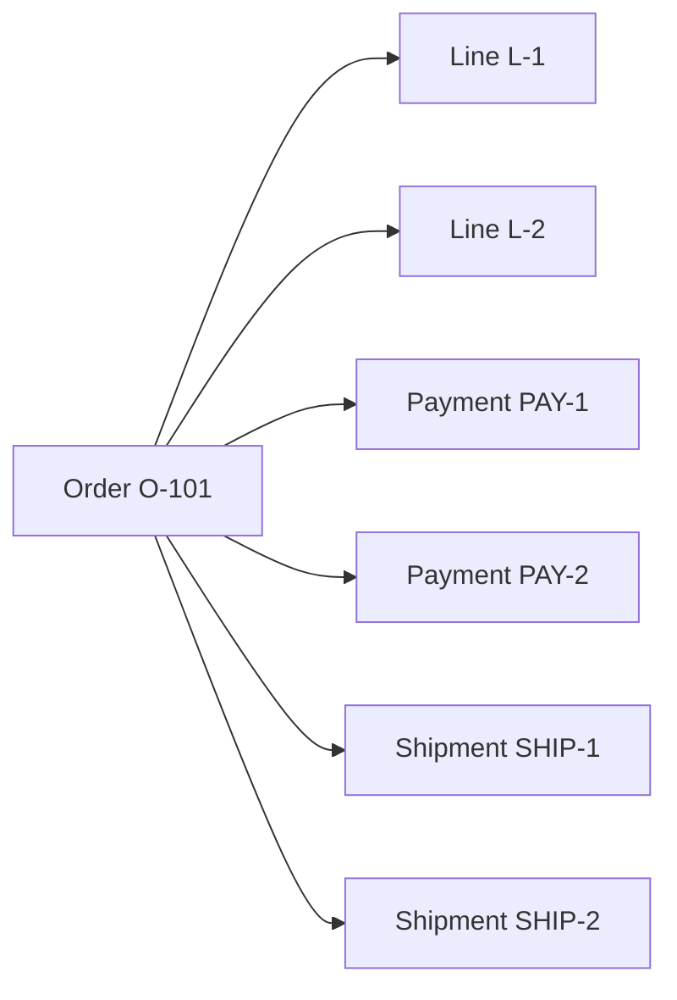
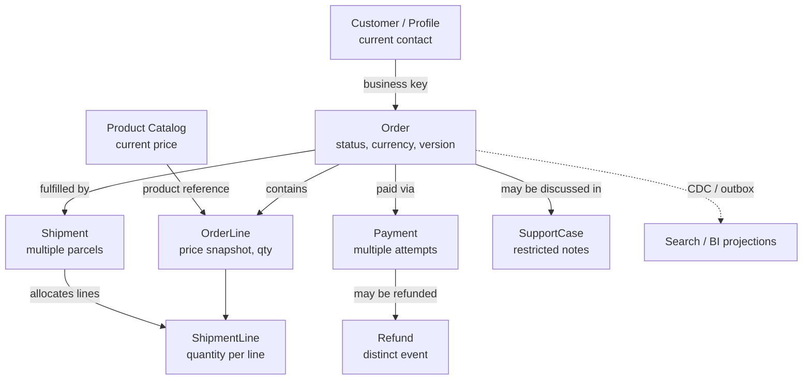
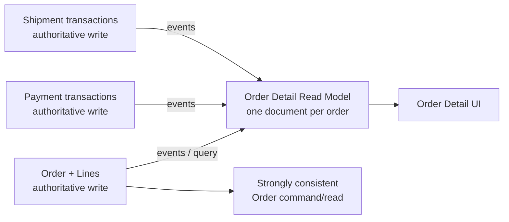
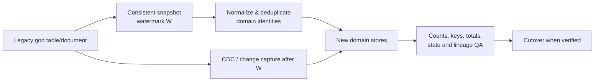
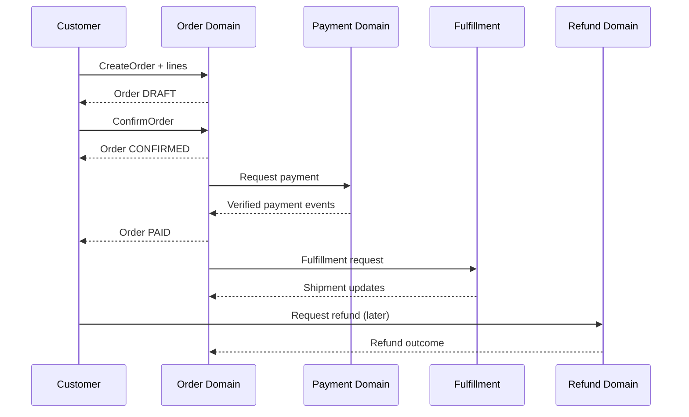

# Một bảng hoặc một tài liệu chứa quá nhiều khái niệm khác vòng đời

Một hệ thống bán hàng bắt đầu với một bảng `order_details` để hiển thị tất cả thông tin trên màn hình: người mua, dòng hàng, đơn giá, lần thanh toán, kiện giao, mã vận đơn, tiền hoàn và ghi chú hỗ trợ. Khi hệ thống nhỏ, một câu truy vấn có thể đủ. Vài tháng sau, một đơn có **nhiều lần thanh toán**, mỗi đơn được tách thành **nhiều kiện**, có **hoàn tiền sau giao hàng**, còn khách hàng lại đổi số điện thoại. Bảng ban đầu không còn rõ **một hàng đại diện cho điều gì**. Các phép `SUM` nhân tiền, cập nhật đồng thời ghi đè nhau, xóa dữ liệu cũ làm mất chứng cứ cần giữ, trong khi thông tin liên hệ bị sao chép khắp nơi.

Một phiên bản khác của cùng lỗi xuất hiện ở document database: document `customer_order_everything` nhúng hồ sơ khách hiện tại, mọi đơn, mọi payment, mọi lần giao, mọi ticket và feature phân tích. Document rất thuận tiện cho lần đọc đầu tiên nhưng lại trở thành **nút thắt vòng đời và quyền sở hữu**: chỉ cần thanh toán đổi trạng thái là phải sửa cả object lớn, một lần xóa dữ liệu liên hệ có thể chạm hàng trăm bản nhúng, và một mảng tăng không giới hạn làm truy vấn/ghi ngày càng khó.

Đây là **anti-pattern trộn nhiều khái niệm khác vòng đời vào một đơn vị lưu trữ hoặc một hợp đồng ghi** — thường gọi là *god table*, *wide catch-all table*, *god document* hoặc một aggregate quá lớn. Vấn đề **không phải cứ bảng rộng là sai**, cũng không phải “chuẩn hóa càng nhiều bảng càng tốt”. Vấn đề là **danh tính, cấp hạt, quyền sở hữu, thời điểm hình thành, điều kiện thay đổi, độ nhất quán và thời hạn lưu** của nhiều sự thật bị nhập nhằng.

Bài học thuộc chương **Lỗi thường gặp** của học phần **DATABASE_DATA_MODELING**. Mục tiêu là rèn kỹ năng chuyển yêu cầu nghiệp vụ thành mô hình dữ liệu rõ ràng — từ thực thể, quan hệ, ràng buộc, khóa, chỉ mục tới lược đồ vật lý — đồng thời so sánh mô hình quan hệ, document, đồ thị và phân tích để lựa chọn cấu trúc dễ tiến hóa và kiểm chứng. Bài này cung cấp cách **phát hiện**, **tách ranh giới** và **kiểm chứng** mô hình khi một nơi lưu dữ liệu đang gánh quá nhiều trách nhiệm.

Sau bài học, bạn có thể:

- Phân biệt **một object lớn để đọc** với **một aggregate cần cập nhật nguyên tử**, và **một bảng phân tích rộng** với **một nguồn nghiệp vụ có grain rõ**.
- Phát hiện lỗi thông qua **nhiều khóa ứng viên, các quan hệ 1–N độc lập, NULL có điều kiện, update/insert/delete anomalies, fan-out và xung đột quyền sở hữu**.
- Thiết kế lại miền bán hàng với **Customer, Order, OrderLine, Payment, Shipment, Refund và SupportCase** theo vòng đời riêng.
- Xác định khi nào nên **nhúng snapshot hoặc các phần phụ thuộc trong document**, khi nào nên **tham chiếu**, tạo projection hoặc tách event/fact.
- Viết ràng buộc `PK`, `FK`, `UNIQUE`, `CHECK`, version và kiểm tra liên bảng; nêu đúng giới hạn của từng cơ chế.
- Lập kế hoạch migration không làm mất dữ liệu, phân biệt dữ liệu nguồn với bản sao và xây **bộ số liệu đối chứng** cho phép kiểm thử sai lệch.

## 1. Định nghĩa “khác vòng đời” trước khi vẽ sơ đồ

Hai khái niệm có **vòng đời khác nhau** khi chúng không luôn được **tạo, thay đổi, xác nhận, hủy hoặc lưu giữ** cùng lúc và theo cùng một chủ thể chịu trách nhiệm.

Hãy so sánh:

| Khái niệm | Khi nào hình thành? | Khi nào thay đổi? | Ai chịu trách nhiệm? | Khi nào kết thúc hoặc giữ lịch sử? |
| --- | --- | --- | --- | --- |
| **Customer profile** | Khi đăng ký/nhập hồ sơ | Khách đổi liên hệ, xác minh, hạn chế dữ liệu | Customer/Profile domain | Theo mục đích hồ sơ và retention |
| **Order** | Khi khách tạo yêu cầu mua | Thêm dòng khi nháp, xác nhận, hủy theo trạng thái | Order domain | Đơn kết thúc nhưng cần giữ dấu giao dịch theo policy |
| **OrderLine** | Khi chọn hàng trong một đơn | Quantity/price được sửa khi còn nháp; giá được chốt | Order domain | Thường là snapshot lịch sử của đơn |
| **Payment attempt/transaction** | Khi bắt đầu thanh toán | Pending, success, failure, settlement | Payment domain | Có log và thời hạn lưu riêng |
| **Shipment** | Khi tạo kế hoạch giao/kiện | Packed, handed-over, delivered, failed | Fulfillment domain | Có thể giao từng phần, theo dõi riêng |
| **Refund** | Khi phát sinh yêu cầu hoàn | Requested, approved, succeeded, failed | Refund/Payment domain | Có thể xảy ra sau giao hàng nhiều ngày |
| **Support case** | Khi khách mở vụ việc | Trao đổi, phân công, giải quyết | Support domain | Retention và quyền truy cập riêng |
| **Analytics feature** | Khi pipeline tính toán | Tái tính theo phiên bản hoặc hết hạn | Analytics/ML domain | Hết hiệu lực có thể trước/sau đơn hàng |

**Khác vòng đời không bắt buộc khác database, schema hay microservice.** Một modular monolith có thể dùng cùng một PostgreSQL database nhưng vẫn tách bảng, khóa, transaction và quyền ghi hợp lý. Ngược lại, một document database vẫn có thể mô hình đúng nếu mỗi document có **ranh giới aggregate** và chính sách cập nhật nhất quán.

### 1.1. Bốn câu hỏi cần hỏi trước khi gộp

1. **Danh tính và grain:** một hàng/document đại diện cho một thực thể hoặc sự kiện nào? Có bao nhiêu bản cùng loại cho mỗi parent?
2. **Thời gian và trạng thái:** khi parent chuyển sang trạng thái mới, child có tiếp tục đổi độc lập không?
3. **Quyền sở hữu và transaction:** cùng một thành phần nghiệp vụ có thẩm quyền cập nhật tất cả trường không? Những trường nào buộc phải commit nguyên tử?
4. **Truy vấn, retention, quyền:** có thường đọc cùng nhau không? Có cần xóa/hạn chế từng phần hoặc giữ lịch sử trong những thời hạn khác nhau không?

Gộp có thể hợp lý nếu câu trả lời **thực sự cùng một ranh giới**. Gộp chỉ vì “màn hình cần xem cùng lúc” là chưa đủ: **read shape** và **write model** là hai quyết định khác nhau.

### 1.2. Cấu trúc, nhất quán và triển khai là ba quyết định

- **Logical model:** thực thể nào tồn tại, khóa và quan hệ của chúng là gì, invariant nào luôn đúng?
- **Consistency boundary/aggregate:** một command phải bảo vệ tập invariant nào trong cùng một giao dịch nhất quán?
- **Physical/read model:** lưu normalized tables, nested document, graph edges, index tìm kiếm hoặc projection phân tích như thế nào để đáp ứng workload?

Một aggregate không nhất thiết là **một bảng**, và một bảng có thể chứa nhiều hàng của cùng loại thực thể. Một document có thể biểu diễn một aggregate, nhưng không tự động chứng minh aggregate ấy được chọn đúng. Đừng coi “một bảng = một domain” hoặc “một document = một nghiệp vụ” là quy tắc cứng.

## 2. Phản ví dụ: bảng `order_everything` không có grain rõ

Giả sử có bảng:

```sql
-- PHẢN VÍ DỤ. Không dùng như mẫu triển khai.
CREATE TABLE order_everything (
    tenant_id TEXT,
    order_id TEXT,
    customer_id TEXT,
    customer_name TEXT,
    customer_phone TEXT,
    product_id TEXT,
    quantity INTEGER,
    unit_price_minor BIGINT,
    line_discount_minor BIGINT,
    payment_id TEXT,
    payment_status TEXT,
    payment_amount_minor BIGINT,
    shipment_id TEXT,
    tracking_code TEXT,
    shipment_status TEXT,
    refund_id TEXT,
    refund_amount_minor BIGINT,
    support_note TEXT,
    updated_at TIMESTAMPTZ
);
```

Câu hỏi lập tức xuất hiện: **khóa chính là gì?**

- `(tenant_id, order_id)` không duy nhất vì một đơn có nhiều dòng, payment, shipment.
- `(tenant_id, order_id, product_id)` không đủ nếu một sản phẩm xuất hiện nhiều dòng hoặc nhiều lần thanh toán.
- `(tenant_id, order_id, payment_id)` không đủ nếu payment liên quan nhiều dòng/kiện.
- `(tenant_id, order_id, product_id, payment_id, shipment_id)` tạo một tổ hợp liên kết **mà nghiệp vụ không định nghĩa** và có thể vẫn trùng.
- Thêm `row_id` ngẫu nhiên chỉ làm **mỗi bản ghi có ID kỹ thuật**; nó không giải quyết việc một hàng là “một cái gì”.

**Surrogate key không sửa được grain mơ hồ.** Nếu có nhiều quan hệ 1–N độc lập nằm trong cùng bảng, chúng có thể tạo **tổ hợp nhân bản**.

### 2.1. Tập dữ liệu đối chứng

Một tenant `T-01` có đơn `O-101`, thuộc khách `C-01`. Đơn có hai dòng:

| line_id | product_id | Quantity | Giá chốt VND/đơn vị | Discount VND | Net dòng VND |
| --- | --- | ---: | ---: | ---: | ---: |
| L-1 | P-BOOK | 2 | 100.000 | 10.000 | 190.000 |
| L-2 | P-PEN | 1 | 30.000 | 0 | 30.000 |

Có **hai lần thanh toán thành công**, tổng 220.000 VND:

| payment_id | Amount VND | Status |
| --- | ---: | --- |
| PAY-1 | 120.000 | SUCCEEDED |
| PAY-2 | 100.000 | SUCCEEDED |

Có **hai kiện giao** trong cùng đơn:

| shipment_id | Nội dung | Status |
| --- | --- | --- |
| SHIP-1 | Hai cuốn sách từ L-1 | DELIVERED |
| SHIP-2 | Một hộp bút từ L-2 | IN_TRANSIT |

Sau đó, một **refund 30.000 VND** có thể phát sinh do L-2 bị trả hàng; refund là **sự kiện khác ngày** với bán hàng và cần trạng thái/nguồn xác nhận riêng. Trước mắt, bộ đối chứng không cộng refund vào total của đơn nếu chưa xác định KPI **trước/sau hoàn**.

Các kết quả đúng:

- **1 đơn**, **2 dòng hàng**, **2 payment**, **2 shipment**.
- Gross = `2×100.000 + 1×30.000 = 230.000 VND`.
- Discount = `10.000 VND`.
- Net bán ban đầu = **220.000 VND**.
- Tổng payment thành công = **220.000 VND**.
- Hai kiện có thể thay đổi trạng thái **độc lập**, không tạo thêm hai đơn.

### 2.2. Nhân bản theo tích Descartes khi ghép dữ liệu

Nếu nguồn chỉ có quan hệ mỗi `Order → Lines`, `Order → Payments`, `Order → Shipments` và ba tập con là **độc lập**, một phép nối cùng order có thể sinh:

\[
2\ \text{lines} \times 2\ \text{payments} \times 2\ \text{shipments}
= 8\ \text{rows}
\]



Không có nghĩa một payment “thuộc” riêng một line hoặc một shipment nếu nghiệp vụ không định nghĩa quan hệ phân bổ. Bảng `order_everything` buộc người đọc tưởng mỗi tổ hợp có ý nghĩa, dù thực tế chỉ là kết quả JOIN.

Ví dụ câu query nguy hiểm:

```sql
-- PHẢN VÍ DỤ: ví dụ này dựa trên các bảng tách ở phần 7.
SELECT
    o.tenant_id,
    o.order_id,
    COUNT(*) AS joined_rows,
    SUM(l.quantity * l.unit_price_minor
        - l.discount_minor) AS false_sales_minor,
    SUM(p.amount_minor) AS false_payments_minor
FROM orders AS o
JOIN order_lines AS l
  ON l.tenant_id = o.tenant_id
 AND l.order_id = o.order_id
JOIN payments AS p
  ON p.tenant_id = o.tenant_id
 AND p.order_id = o.order_id
 AND p.status = 'SUCCEEDED'
JOIN shipments AS s
  ON s.tenant_id = o.tenant_id
 AND s.order_id = o.order_id
WHERE o.tenant_id = 'T-01'
  AND o.order_id = 'O-101'
GROUP BY o.tenant_id, o.order_id;
```

Nếu các bản ghi đúng như bộ đối chứng:

```text
joined_rows         = 8
false_sales_minor   = 880000   -- sai: 220000 × 4
false_payments_minor= 880000   -- sai: 220000 × 4
correct_sales_minor = 220000
correct_paid_minor  = 220000
```

Hai tổng sai **bằng nhau** không chứng minh kết quả đúng. Dữ liệu trùng có thể khiến đối soát sai kiểu “hai vế cùng bị nhân”. Giải pháp không phải `DISTINCT` tùy tiện: hai payment khác nhau có thể có **cùng amount**, hai line có thể cùng giá, và dùng `SUM(DISTINCT amount)` sẽ làm mất những giao dịch hợp lệ.

## 3. Sáu nhóm lỗi do trộn nhiều vòng đời trong một bảng

### 3.1. Update anomaly: sửa một thực thể phải sửa nhiều hàng

Khách C-01 đổi số điện thoại. Nếu bảng chứa 8 hàng tổ hợp cho một đơn, cùng `customer_phone` bị chép 8 lần; khách có 100 đơn, số bản sao tăng nhiều hơn.

Nếu chỉ cập nhật một phần:

```text
O-101 / L-1 / PAY-1 / SHIP-1: phone = NEW
O-101 / L-1 / PAY-2 / SHIP-1: phone = OLD
... các tổ hợp khác
```

Hệ giờ có **nhiều giá trị hiện hành** cho một thuộc tính được cho là có một owner. Việc sửa bằng `UPDATE ... WHERE customer_id` có thể đụng nhầm **snapshot lịch sử** mà nghiệp vụ phải giữ nguyên.

### 3.2. Insert anomaly: không thể tạo thực thể độc lập

Một khách chưa có đơn vẫn phải được đăng ký. Nếu mọi hàng của `order_everything` bắt buộc có `order_id`, cần thêm hàng giả với rất nhiều `NULL` hoặc trì hoãn tạo khách cho tới khi có giao dịch.

Tương tự, một lần thanh toán `PENDING` có thể xuất hiện **trước khi shipment tồn tại**. Nếu `shipment_id` bị yêu cầu không null, bảng buộc tạo “kiện giả” hoặc không lưu thanh toán. Đây là dấu hiệu hai thực thể **không chung vòng đời**.

### 3.3. Delete anomaly: xóa một phần làm mất dữ liệu khác

Nếu khách hủy một shipment chưa giao và ứng dụng xóa “dòng của shipment đó” trong bảng tổng hợp, rất có thể nó cũng xóa mất tổ hợp chứa thông tin line/payment cần giữ. Ngược lại, xóa dòng hàng cuối có thể vô tình làm mất toàn bộ thông tin order.

**Xóa shipment**, **xóa payment chưa dùng** và **hủy order** là ba hành vi nghiệp vụ khác nhau, có điều kiện, audit và retention riêng. Không nên biểu diễn bằng xóa một hàng tổ hợp rồi mặc định những khái niệm còn lại không bị ảnh hưởng.

### 3.4. NULL explosion và các cột chỉ có ý nghĩa theo điều kiện

Một bảng chung cho cả payment, shipment, refund và support ticket dễ chứa:

```text
payment_id, bank_ref, settlement_at
shipment_id, tracking_code, delivered_at
refund_id, refund_reason, refund_approved_at
ticket_id, support_note, ticket_closed_at
```

Nhiều trường sẽ `NULL` cho các hàng không thuộc loại sự kiện đó. Nguy cơ không nằm ở tỷ lệ NULL đơn thuần; một schema event chung có thể hợp lệ nếu **grain và event type** rõ. Nguy cơ là **NULL có nhiều nghĩa nhập nhằng**: không áp dụng, chưa đến giai đoạn, thất bại thu thập, đã xóa hay do phép JOIN thiếu.

Nếu muốn dùng bảng `events` với nhiều loại event, cần **discriminator, schema version, contract riêng theo event type, unique identity và validation**. Không nên dùng một bảng nullable cực rộng rồi để mỗi consumer tự suy đoán ý nghĩa.

### 3.5. Concurrency và hot rows

Payment callback, shipment tracking update và support case có thể cập nhật **đồng thời**. Nếu tất cả được lưu trong một document/order row lớn, hai luồng xử lý có thể:

1. Đọc version 10.
2. Payment cập nhật `paymentStatus=SUCCEEDED` và ghi version 11.
3. Shipment ghi lại document dựa trên version 10 với `shipmentStatus=DELIVERED`, vô tình thay payment về trạng thái cũ.

Một `version` và phép compare-and-set giúp **phát hiện xung đột**, nhưng nếu hai phần thực sự thay đổi độc lập với tần suất cao, một aggregate quá lớn tạo **tranh chấp ghi không cần thiết** và retry liên tục. Ngược lại, nếu hai thay đổi phải bảo vệ **cùng bất biến nghiệp vụ**, tách chúng vô điều kiện cũng có thể gây vi phạm consistency.

### 3.6. Không thể áp cùng quyền truy cập và retention

Nhân viên kho cần tracking code, không cần dữ liệu thanh toán chi tiết. Nhóm đối soát tài chính cần payment/refund, không cần nội dung ticket riêng tư. Người quản trị hồ sơ khách cần cập nhật liên hệ hiện tại, nhưng không nên sửa giá snapshot của đơn cũ.

Khi tất cả nằm trong một bảng/document, **cấp quyền đọc một object** có thể vô tình cấp cả trường nhạy cảm. Khi xử lý retention, xóa contact có thể phá vỡ chứng từ giao dịch; giữ payment lâu có thể khiến thông tin hỗ trợ bị lưu quá hạn. Cần **ranh giới mục đích, chủ sở hữu và vòng đời** rõ ngay từ mô hình.

## 4. Lỗi không nằm ở số cột, mà ở các phụ thuộc và quyền ghi

### 4.1. Phụ thuộc hàm chỉ là một tín hiệu

Trong một bảng dòng bán kiểu `(tenant_id, order_id, line_id, product_id, customer_name, payment_id, ...)` có thể có:

```text
(tenant_id, order_id) -> customer_id, placed_at, order_status
(tenant_id, line_id) -> order_id, product_id, quantity, unit_price
(tenant_id, payment_id) -> order_id, payment_amount, payment_status
(tenant_id, shipment_id) -> order_id, tracking_code, shipment_status
(tenant_id, customer_id) -> current_contact_record
```

Những phụ thuộc này gợi ý **khác determinant và khác thực thể**. Nếu bảng có grain mỗi line, thuộc tính chỉ phụ thuộc order bị lặp. Nếu có nhiều payment và shipment, hình thành **multivalued dependencies** và tổ hợp ghép không có nghĩa.

Chuẩn hóa quan hệ (1NF, 2NF, 3NF, BCNF, 4NF tùy phụ thuộc) giúp làm rõ nhiều lỗi. Nhưng **không phải mọi lỗi vòng đời đều có thể phát hiện bằng functional dependency**: quyền ghi, state machine, thời gian hiệu lực, retention và concurrency còn cần hợp đồng nghiệp vụ.

### 4.2. Phân biệt snapshot có chủ đích với bản sao mất kiểm soát

Không phải mọi dữ liệu trùng đều sai:

- `OrderLine.unit_price_minor` là **giá chốt lúc bán**, có thể khác `Product.current_price_minor`. Đây là **snapshot lịch sử có chủ đích**.
- `Order.shipping_address_snapshot` có thể là **địa chỉ được dùng tại thời điểm ký kết/giao**, nếu yêu cầu nghiệp vụ và retention cho phép.
- Search document có thể nhúng `customer_display_name` để đọc nhanh; đó là **projection** phải có nguồn, cách cập nhật và chính sách quyền/xóa.
- Warehouse fact có thể lặp surrogate dimension keys trong hàng triệu fact rows; grain và mục đích phân tích xác định.

Vấn đề phát sinh khi bản sao **không ghi rõ** nó là **current value**, **historical snapshot**, **cache** hay **derived feature**, ai chịu trách nhiệm cập nhật và thời hạn lưu. Một quyết định denormalization tốt phải chỉ rõ **nguồn có thẩm quyền** và **điều kiện chấp nhận stale**.

### 4.3. Một bảng rộng có thể đúng nếu chỉ chứa thuộc tính cùng grain

Bảng `fact_sales_line` có 80 cột mô tả **một dòng bán**, tất cả key/measure gắn với **cùng một giao dịch line** và cùng contract, có thể là thiết kế hợp lý trong warehouse sau khi đánh giá workload. Số cột **không đủ** để kết luận anti-pattern.

Ngược lại, một bảng chỉ có 12 cột nhưng trộn **payment và shipment** trong một row có thể đã sai. Cần xem **grain, phụ thuộc, tần suất, quy tắc cập nhật, nguồn và quyền**.

## 5. Dấu hiệu nhận biết qua câu hỏi và metric

### 5.1. Bảng chẩn đoán

| Dấu hiệu | Câu hỏi cần điều tra | Vì sao đáng lo |
| --- | --- | --- |
| Một order ID xuất hiện nhiều hàng không rõ lý do | Một hàng là line, payment hay shipment? | Grain mơ hồ, nhân tổng |
| Không xác định được PK ngoài `row_id` | Business identity và cardinality là gì? | Khóa kỹ thuật che tổ hợp không có nghĩa |
| Nhiều cột NULL có điều kiện | NULL là không áp dụng hay chưa phát sinh? | Schema trộn event types |
| Customer contact bị copy nhiều lần | Giá trị hiện tại hay snapshot lịch sử? | Update anomaly, retention |
| Mỗi service cùng sửa một document | Có cùng owner và invariant không? | Lost update, hot aggregate |
| Đổi trạng thái shipment làm tăng order version | Có cần toàn order transaction? | Concurrency scope quá rộng |
| Payment callback yêu cầu ghi lại danh sách line | Vì sao payment biết cấu trúc line? | Coupling vòng đời |
| Support ticket cần quyền đọc payment raw | Thực sự cần dữ liệu gì? | Over-permission |
| Xóa thông tin liên hệ cần sửa hàng nghìn đơn | Bao nhiêu bản sao có mục đích? | Khó bảo vệ dữ liệu |
| Một query BI phải dùng `SUM(DISTINCT)` để “sửa trùng” | Grain của từng phép JOIN? | Fan-out chưa giải quyết |
| DDL có nhiều `CHECK` phụ thuộc trạng thái cột khác | Có thực thể/sự kiện riêng không? | Schema đang gánh workflow |
| Document có array liên tục tăng | Có giới hạn kích thước và retention? | Hot document, payload lớn |
| Nhiều đội tranh nhau schema migration | Ai sở hữu từng nhóm field? | Owner mơ hồ |
| Một thay đổi nhỏ buộc deploy nhiều consumer | Có schema/event contract rõ không? | High coupling |

### 5.2. Một số số liệu để đo mức độ thay đổi

Các metric sau có ích **khi được diễn giải theo workload**, không nên đặt một ngưỡng chung rồi kết luận tự động:

- **Write amplification:** một thay đổi nguồn cần chạm bao nhiêu hàng/document/bản sao?
- **Duplicate factor:** trung bình một fact nghiệp vụ bị lặp bao nhiêu lần trong tập join/read model?
- **Sparse-field ratio:** tỷ lệ trường không có ý nghĩa trong mỗi loại row/event.
- **Update conflict rate:** tỷ lệ cập nhật bị từ chối do version conflict; phân biệt conflict cần thiết với conflict do aggregate quá lớn.
- **Projection lag:** bản copy phục vụ đọc chậm bao lâu so với source.
- **Copy inventory coverage:** bao nhiêu nơi có PII hoặc snapshot đã được kiểm kê và có deletion path.
- **Schema change blast radius:** bao nhiêu service/consumer phải sửa vì một trường thay đổi.
- **Rule ownership coverage:** quy tắc quan trọng có owner, test và cơ chế cưỡng chế hay chưa.

Độ rộng bảng, số lượng index hay số microservice **không tự** là thước đo chất lượng mô hình. Cần nhìn kết hợp **bất biến nghiệp vụ và triệu chứng vận hành**.

## 6. Chọn ranh giới: giữ gì cùng Order, tách gì ra?

### 6.1. Một ma trận quyết định theo vòng đời

| Khái niệm | Thuộc Order aggregate? | Dạng lưu thường cân nhắc | Giải thích |
| --- | --- | --- | --- |
| `Order.id, tenantId, state, version` | Có | Row/document Order | Danh tính và trạng thái đơn |
| `OrderLine` khi nháp/được chốt | Thường có | Child table/embedded array | Invariant xác nhận và tổng tiền dòng |
| `Customer.currentPhone` | Không | Profile/Contact riêng | Khách đổi độc lập; dữ liệu nhạy cảm |
| `Product.currentPrice` | Không | Catalog riêng | Đổi độc lập và không sửa đơn cũ |
| `OrderLine.priceSnapshot` | Có | Thuộc line | Bằng chứng giá chốt lịch sử |
| `PaymentAttempt` | Thường riêng | Payment table/document/event | Nhiều attempt, callback, settlement độc lập |
| `Shipment` | Thường riêng | Shipment table/document/event | Có thể nhiều kiện, nhiều update tracking |
| `Refund` | Thường riêng | Refund transaction/event | Xảy ra sau sale/payment, có chính sách riêng |
| `SupportCase` | Riêng | Case table/document | Nhiều người thao tác, retention/quyền khác |
| `SearchOrderView` | Dẫn xuất | Projection document/index | Phục vụ đọc; không là nguồn command |
| `FactOrderLine` | Dẫn xuất | Warehouse fact | Grain phân tích, lịch sử và chốt số liệu |

“Thường” không nghĩa bắt buộc. Một hệ đơn giản có thể gộp `Order` và một khoản thanh toán trong cùng transaction nếu **thực sự cùng quyền sở hữu, cardinality, lifecycle và invariant**. Điều cần tránh là gộp theo thói quen mà không viết lý do.

### 6.2. Aggregate boundary dựa trên invariant, không dựa vào hình màn hình

Một cách chọn:

1. Liệt kê những invariant **phải luôn đúng sau commit**.
2. Xác định những đối tượng cần được **đọc/ghi cùng transaction** để bảo vệ invariant.
3. Chọn root nhận command và phiên bản nhất quán.
4. Với những khái niệm có thể cập nhật độc lập, dùng **identity/reference/event** thay vì đưa mọi thứ vào aggregate.
5. Nếu invariant trải qua nhiều owner/service, thiết kế **reservation, workflow, saga/outbox, idempotency và reconciliation**; không giả định transaction cục bộ bao trùm toàn hệ.

Ví dụ `ConfirmOrder` cần nhìn thấy các `OrderLine` hợp lệ và số tiền chốt; thường hợp lý cho chúng cùng ranh giới logic. Trong khi `MarkDelivered` có thể nhận callback từ đối tác giao hàng nhiều giờ sau, không cần lock toàn bộ giá dòng để cập nhật tracking.

### 6.3. Ranh giới không nhất thiết trùng physical boundary

`Order` và `OrderLine` có thể nằm ở **hai bảng quan hệ** nhưng được cập nhật trong **một transaction** của Order Service. Ngược lại, một document có thể nhúng payment summary chỉ để **đọc**, trong khi payment transaction chính nằm nơi khác. Không nên kết luận một tài liệu nhúng là owner của mọi field được nhúng.

## 7. Mô hình quan hệ tham khảo sau khi tách vòng đời

### 7.1. Sơ đồ khái niệm



Sơ đồ thể hiện rằng **payment, shipment, refund và support case là những thực thể có identity riêng**. `ShipmentLine` giải thích kiện nào chứa bao nhiêu từ từng dòng; không suy ra tự động từ phép JOIN `order_id`.

### 7.2. DDL lõi: khóa tenant và thuộc tính snapshot

Ví dụ dưới đây dùng **PostgreSQL**, chỉ để thể hiện **mô hình và ràng buộc cục bộ**. Các thao tác quyền, state transition, idempotency và phân tán phải có contract riêng. Quy ước tất cả tiền đều **VND nguyên** trong ví dụ; một hệ đa tiền tệ phải thêm currency ở mỗi sự kiện tiền và chính sách quy đổi.

```sql
CREATE TABLE customers (
    tenant_id TEXT NOT NULL,
    customer_id TEXT NOT NULL,
    contact_ref TEXT,
    PRIMARY KEY (tenant_id, customer_id)
);

CREATE TABLE products (
    tenant_id TEXT NOT NULL,
    product_id TEXT NOT NULL,
    current_price_minor NUMERIC(20,0) NOT NULL,
    PRIMARY KEY (tenant_id, product_id),
    CHECK (current_price_minor >= 0)
);

CREATE TABLE orders (
    tenant_id TEXT NOT NULL,
    order_id TEXT NOT NULL,
    customer_id TEXT NOT NULL,
    status TEXT NOT NULL,
    currency_code CHAR(3) NOT NULL DEFAULT 'VND',
    version BIGINT NOT NULL DEFAULT 1,
    placed_at TIMESTAMPTZ NOT NULL,
    PRIMARY KEY (tenant_id, order_id),
    FOREIGN KEY (tenant_id, customer_id)
        REFERENCES customers (tenant_id, customer_id),
    CHECK (status IN ('DRAFT','CONFIRMED','PAID','CANCELLED')),
    CHECK (currency_code = 'VND'),
    CHECK (version > 0)
);

CREATE TABLE order_lines (
    tenant_id TEXT NOT NULL,
    order_id TEXT NOT NULL,
    line_id TEXT NOT NULL,
    product_id TEXT NOT NULL,
    quantity INTEGER NOT NULL,
    unit_price_minor NUMERIC(20,0) NOT NULL,
    discount_minor NUMERIC(20,0) NOT NULL DEFAULT 0,
    PRIMARY KEY (tenant_id, order_id, line_id),
    FOREIGN KEY (tenant_id, order_id)
        REFERENCES orders (tenant_id, order_id),
    FOREIGN KEY (tenant_id, product_id)
        REFERENCES products (tenant_id, product_id),
    CHECK (quantity > 0),
    CHECK (unit_price_minor >= 0),
    CHECK (discount_minor >= 0),
    CHECK (discount_minor <= quantity * unit_price_minor)
);

CREATE INDEX order_lines_by_product
    ON order_lines (tenant_id, product_id);
```

Chú ý:

- `(tenant_id, order_id)` là identity của đơn trong tenant.
- `OrderLine` có khóa `(tenant_id, order_id, line_id)` vì line ID ở đây chỉ cần duy nhất **trong đơn**. Đây là một quyết định khác với việc `line_id` duy nhất toàn tenant.
- `orders.currency_code` được cố định VND để **đối chứng số học** nhất quán. Các bảng tiền sau cũng phải quy định currency tương ứng.
- `unit_price_minor` là **giá tại thời điểm chốt**; `products.current_price_minor` là giá catalog hiện tại. Không dùng giá hiện tại tính lại đơn cũ.
- FK bảo vệ quan hệ trong tenant, nhưng **không tự cưỡng chế** “PAID phải thanh toán đủ” hay “không được sửa line sau CONFIRMED”.

### 7.3. DDL cho payment, shipment, shipment allocation và refund

```sql
CREATE TABLE payments (
    tenant_id TEXT NOT NULL,
    order_id TEXT NOT NULL,
    payment_id TEXT NOT NULL,
    provider_reference TEXT NOT NULL,
    amount_minor NUMERIC(20,0) NOT NULL,
    currency_code CHAR(3) NOT NULL DEFAULT 'VND',
    status TEXT NOT NULL,
    occurred_at TIMESTAMPTZ NOT NULL,
    PRIMARY KEY (tenant_id, order_id, payment_id),
    UNIQUE (tenant_id, provider_reference),
    FOREIGN KEY (tenant_id, order_id)
        REFERENCES orders (tenant_id, order_id),
    CHECK (amount_minor > 0),
    CHECK (currency_code = 'VND'),
    CHECK (status IN ('PENDING','SUCCEEDED','FAILED'))
);

CREATE TABLE shipments (
    tenant_id TEXT NOT NULL,
    order_id TEXT NOT NULL,
    shipment_id TEXT NOT NULL,
    tracking_code TEXT,
    status TEXT NOT NULL,
    updated_at TIMESTAMPTZ NOT NULL,
    PRIMARY KEY (tenant_id, order_id, shipment_id),
    FOREIGN KEY (tenant_id, order_id)
        REFERENCES orders (tenant_id, order_id),
    CHECK (status IN (
        'PLANNED','PACKED','IN_TRANSIT',
        'DELIVERED','FAILED'
    ))
);

CREATE TABLE shipment_lines (
    tenant_id TEXT NOT NULL,
    order_id TEXT NOT NULL,
    shipment_id TEXT NOT NULL,
    line_id TEXT NOT NULL,
    shipped_quantity INTEGER NOT NULL,
    PRIMARY KEY (tenant_id, order_id, shipment_id, line_id),
    FOREIGN KEY (tenant_id, order_id, shipment_id)
        REFERENCES shipments (tenant_id, order_id, shipment_id),
    FOREIGN KEY (tenant_id, order_id, line_id)
        REFERENCES order_lines (tenant_id, order_id, line_id),
    CHECK (shipped_quantity > 0)
);

CREATE TABLE refunds (
    tenant_id TEXT NOT NULL,
    order_id TEXT NOT NULL,
    refund_id TEXT NOT NULL,
    payment_id TEXT NOT NULL,
    amount_minor NUMERIC(20,0) NOT NULL,
    currency_code CHAR(3) NOT NULL DEFAULT 'VND',
    status TEXT NOT NULL,
    occurred_at TIMESTAMPTZ NOT NULL,
    PRIMARY KEY (tenant_id, order_id, refund_id),
    FOREIGN KEY (tenant_id, order_id, payment_id)
        REFERENCES payments (tenant_id, order_id, payment_id),
    CHECK (amount_minor > 0),
    CHECK (currency_code = 'VND'),
    CHECK (status IN ('REQUESTED','SUCCEEDED','FAILED'))
);
```

Tách bảng **không tự làm hệ thống đúng**:

- Một lần retry callback payment có thể cần `UNIQUE` theo provider event ID hoặc bảng idempotency; `provider_reference` chỉ đủ nếu provider đảm bảo định danh ấy đúng loại giao dịch.
- Tổng `shipped_quantity` của cùng line **không được vượt** `order_lines.quantity` trừ khi domain cho phép over-ship; đây là **invariant liên bảng**, chưa được `CHECK` cục bộ bảo vệ.
- Refund thành công không được vượt số tiền có thể hoàn của payment theo quy tắc nghiệp vụ; một payment có thể có **nhiều partial refunds**, nên cần concurrency/transaction phù hợp.
- Một `status = 'PAID'` chưa được DDL bảo đảm bằng tổng `SUCCEEDED` payments.
- Nếu muốn theo dõi phần giao bị mất/hỏng hoặc đổi sản phẩm, cần **event/adjustment** đúng grain thay vì âm thầm sửa snapshot gốc.

### 7.4. Support case có vòng đời và quyền riêng

Một bảng tối giản:

```sql
CREATE TABLE support_cases (
    tenant_id TEXT NOT NULL,
    case_id TEXT NOT NULL,
    order_id TEXT,
    status TEXT NOT NULL,
    opened_at TIMESTAMPTZ NOT NULL,
    closed_at TIMESTAMPTZ,
    restricted_note_ref TEXT,
    PRIMARY KEY (tenant_id, case_id),
    FOREIGN KEY (tenant_id, order_id)
        REFERENCES orders (tenant_id, order_id),
    CHECK (status IN ('OPEN','RESOLVED','CLOSED')),
    CHECK (closed_at IS NULL OR closed_at >= opened_at)
);
```

`order_id` có thể NULL nếu ticket không liên quan một đơn cụ thể. Dữ liệu note nhạy cảm được tách qua `restricted_note_ref`, không đưa nguyên nội dung vào view hoặc event dùng chung. Cơ chế này chỉ là **một ranh giới lưu và quyền**, chưa tự triển khai authorization hoặc retention.

## 8. Fixture có thể kiểm chứng sau khi tách

### 8.1. Các bản ghi gốc tối thiểu

Ví dụ bộ fixture SQL sau giả định đã tạo schema phần 7:

```sql
INSERT INTO customers (tenant_id, customer_id, contact_ref)
VALUES ('T-01','C-01','CONTACT-01');

INSERT INTO products
    (tenant_id, product_id, current_price_minor)
VALUES
    ('T-01','P-BOOK',110000),
    ('T-01','P-PEN',35000);

INSERT INTO orders
    (tenant_id,order_id,customer_id,status,
     currency_code,version,placed_at)
VALUES
    ('T-01','O-101','C-01','PAID',
     'VND',3,'2026-10-01 09:00:00+07');

INSERT INTO order_lines
    (tenant_id,order_id,line_id,product_id,
     quantity,unit_price_minor,discount_minor)
VALUES
    ('T-01','O-101','L-1','P-BOOK',
     2,100000,10000),
    ('T-01','O-101','L-2','P-PEN',
     1,30000,0);

INSERT INTO payments
    (tenant_id,order_id,payment_id,provider_reference,
     amount_minor,currency_code,status,occurred_at)
VALUES
    ('T-01','O-101','PAY-1','PREF-1',
     120000,'VND','SUCCEEDED',
     '2026-10-01 09:05:00+07'),
    ('T-01','O-101','PAY-2','PREF-2',
     100000,'VND','SUCCEEDED',
     '2026-10-01 09:06:00+07');

INSERT INTO shipments
    (tenant_id,order_id,shipment_id,
     tracking_code,status,updated_at)
VALUES
    ('T-01','O-101','SHIP-1','TRACK-A',
     'DELIVERED','2026-10-03 12:00:00+07'),
    ('T-01','O-101','SHIP-2','TRACK-B',
     'IN_TRANSIT','2026-10-03 12:00:00+07');

INSERT INTO shipment_lines
    (tenant_id,order_id,shipment_id,line_id,shipped_quantity)
VALUES
    ('T-01','O-101','SHIP-1','L-1',2),
    ('T-01','O-101','SHIP-2','L-2',1);
```

Giá catalog hiện tại trong fixture là 110.000 VND cho P-BOOK và 35.000 VND cho P-PEN, **khác** giá line snapshot. Đây là khác biệt **có chủ đích**, không phải lỗi đồng bộ. Nếu catalog đổi ngày 05/10, tiền đơn ngày 01/10 vẫn dựa trên `unit_price_minor` của line.

Trạng thái `PAID` trong fixture là **ảnh chụp kết quả đã qua nghiệp vụ** để đối chiếu số học; `INSERT` trực tiếp không chứng minh state transition, callback xác thực hay audit của luồng thanh toán. Những điều đó phải được kiểm thử qua command/workflow riêng.

### 8.2. Các bất biến đối chứng

| Metric/đối tượng | Đáp án |
| --- | ---: |
| Số đơn | 1 |
| Số dòng hàng | 2 |
| Số payment thành công | 2 |
| Số shipment | 2 |
| Số shipment allocations | 2 |
| Gross bán ban đầu | 230.000 VND |
| Discount | 10.000 VND |
| Net bán ban đầu | **220.000 VND** |
| Tổng payment thành công | **220.000 VND** |
| Quantity P-BOOK theo đơn vị bán | 2 |
| Quantity P-PEN theo đơn vị bán | 1 |
| Refund đã ghi trong fixture | 0 |

Nếu thêm `Refund SUCCEEDED 30.000 VND` ở một thời điểm sau, có thể tạo KPI **net sau refund = 190.000 VND** theo một quy tắc báo cáo xác định; điều đó **không tự biến** tổng tiền dòng gốc thành 190.000, và không được dùng refund payment như payment bán mới.

## 9. SQL đúng: tổng hợp theo grain trước khi JOIN

### 9.1. Sai: gộp ba quan hệ 1–N thô

Đã thấy ví dụ `JOIN` tại phần 2 tạo tám hàng và tổng 880.000. Nguyên nhân là các bảng độc lập cùng nối qua `order_id`. Dùng một view có kết quả tám hàng không làm grain trở thành “một đơn”.

### 9.2. Đúng: nhóm từng nguồn trước

```sql
WITH line_totals AS (
    SELECT
        tenant_id, order_id,
        COUNT(*) AS line_count,
        SUM(quantity * unit_price_minor) AS gross_minor,
        SUM(discount_minor) AS discount_minor,
        SUM(quantity * unit_price_minor - discount_minor)
            AS net_minor
    FROM order_lines
    GROUP BY tenant_id, order_id
),
payment_totals AS (
    SELECT
        tenant_id, order_id,
        COUNT(*) FILTER (WHERE status = 'SUCCEEDED')
            AS successful_payment_count,
        COALESCE(SUM(amount_minor) FILTER (
            WHERE status = 'SUCCEEDED'
        ),0) AS paid_minor
    FROM payments
    GROUP BY tenant_id, order_id
),
shipment_totals AS (
    SELECT
        tenant_id, order_id,
        COUNT(*) AS shipment_count,
        COUNT(*) FILTER (WHERE status = 'DELIVERED')
            AS delivered_shipment_count
    FROM shipments
    GROUP BY tenant_id, order_id
)
SELECT
    o.tenant_id,
    o.order_id,
    COALESCE(l.line_count,0) AS line_count,
    COALESCE(l.gross_minor,0) AS gross_minor,
    COALESCE(l.discount_minor,0) AS discount_minor,
    COALESCE(l.net_minor,0) AS net_minor,
    COALESCE(p.paid_minor,0) AS paid_minor,
    COALESCE(p.successful_payment_count,0)
        AS successful_payment_count,
    COALESCE(s.shipment_count,0) AS shipment_count,
    COALESCE(s.delivered_shipment_count,0)
        AS delivered_shipment_count
FROM orders AS o
LEFT JOIN line_totals AS l
  ON l.tenant_id = o.tenant_id
 AND l.order_id = o.order_id
LEFT JOIN payment_totals AS p
  ON p.tenant_id = o.tenant_id
 AND p.order_id = o.order_id
LEFT JOIN shipment_totals AS s
  ON s.tenant_id = o.tenant_id
 AND s.order_id = o.order_id
WHERE o.tenant_id = 'T-01'
  AND o.order_id = 'O-101';
```

Mỗi CTE có **tối đa một hàng cho `(tenant_id,order_id)`**. Vì thế kết quả cuối không fan-out. Trong hệ đa tiền tệ, phải **nhóm theo currency** hoặc quy đổi từng giao dịch theo rate/policy phù hợp trước khi cộng. Không lấy `SUM(payment.amount)` từ currency khác nhau rồi xem đó là VND.

### 9.3. Không dùng `SUM(DISTINCT)` để chữa fan-out

Giả sử hai payment đều 100.000 VND. `SUM(DISTINCT amount_minor)` cho **100.000** thay vì **200.000** — sai vì hai giao dịch khác nhau có **cùng giá trị hợp lệ**.

Nguyên tắc:

- Xác định grain của mỗi nguồn.
- Nếu cần join, nhóm về grain chung.
- Giữ ID giao dịch để phân biệt bản trùng vận chuyển với sự kiện thật.
- Đối soát số hàng/đơn/transaction cùng kỳ.
- Không dùng `DISTINCT` như công cụ bù cho model thiếu khóa hoặc phép join sai.

### 9.4. Tách sổ sự kiện với snapshot hiện tại

`payments` ở ví dụ mô tả **trạng thái hiện tại cho mỗi payment transaction**. Nếu callback của provider có thể đến nhiều lần hoặc đổi trạng thái, hệ có thể cần bảng `payment_events` với grain **một callback/sự kiện**, idempotency key và source version; bảng `payments` là snapshot/projection hiện tại từ events được xác minh.

Không nên thêm nhiều callback vào cùng `payments` rồi vẫn gọi mỗi row là một payment. **Grain thay đổi thì bảng, khóa, tên và phép tính cũng phải được xem lại.**

## 10. Phân biệt hai loại quan hệ 1–N: có thực sự độc lập không?

Một đơn có nhiều dòng, nhiều payment và nhiều shipment **không chứng minh mọi child phải ở ngoài aggregate**. Cần xét **độc lập hay phụ thuộc có invariant chung**.

### 10.1. Những child có thể nằm cùng aggregate

`OrderLine` thường phụ thuộc vào Order:

- Không tồn tại ngoài một Order.
- Giá chốt và quantity phải hợp lệ khi xác nhận.
- Thêm/xóa line khi nháp có thể làm đổi tổng tiền và version Order.
- Không nên có nhiều chủ sở hữu độc lập sửa line sau khi đã chốt.

Vì vậy, đặt các line trong một document Order hoặc các bảng con cùng Order transaction đều có thể hợp lý.

### 10.2. Những child thường có lifecycle riêng

`Payment` có thể:

- Được tạo sau khi Order đã xác nhận.
- Nhận callback và retry.
- Có idempotency, provider reference và trạng thái settlement riêng.
- Bị refund hoặc dispute sau khi Order đã giao.
- Có retention/authorization riêng.

`Shipment` có thể:

- Tách hoặc gộp nhiều line trong một kiện.
- Nhận tracking updates với tần suất cao.
- Có trạng thái giao hàng khác nhau giữa các kiện.
- Cần khóa/owner/retention riêng với Payment.

Gộp payment và shipment chỉ vì cả hai có `order_id` là **đánh đồng quan hệ tham chiếu với vòng đời chung**.

### 10.3. Một-to-many không phải lý do duy nhất để tách

Nếu một document chỉ có một email liên hệ nhưng email đó **thay đổi độc lập và cần xóa/hạn chế riêng**, nó vẫn có thể nên được tham chiếu thay vì nhúng vào mọi đơn. Ngược lại, một danh sách 3–10 thuộc tính cấu hình cố định, cùng owner và cùng transaction, có thể nhúng hoàn toàn hợp lý.

**Bội số, tốc độ tăng, quyền sở hữu, tính nguyên tử và retention phải được xét cùng nhau.**

## 11. Document database: khi nào nhúng là đúng, khi nào thành “god document”?

### 11.1. Một document Order hợp lý

Một thiết kế có thể nhúng `lines` và lưu **tóm tắt dẫn xuất** của thanh toán/giao hàng:

```json
{
  "_id": "T-01:O-101",
  "tenantId": "T-01",
  "orderId": "O-101",
  "customerId": "C-01",
  "status": "PAID",
  "version": 3,
  "currencyCode": "VND",
  "lines": [
    {
      "lineId": "L-1",
      "productId": "P-BOOK",
      "quantity": 2,
      "unitPriceMinor": 100000,
      "discountMinor": 10000
    },
    {
      "lineId": "L-2",
      "productId": "P-PEN",
      "quantity": 1,
      "unitPriceMinor": 30000,
      "discountMinor": 0
    }
  ],
  "paymentSummary": {
    "paidMinor": 220000,
    "sourceVersion": 12
  },
  "fulfillmentSummary": {
    "shipmentCount": 2,
    "deliveredCount": 1,
    "sourceVersion": 7
  }
}
```

Trong ví dụ này:

- `lines` là **dữ liệu thuộc Order aggregate**, có chính sách chốt giá và cập nhật.
- `paymentSummary` là **projection từ payment source**, không được xem là sổ payment có thẩm quyền.
- `fulfillmentSummary` là **projection từ fulfillment**, không chứa toàn bộ tracking history.
- `sourceVersion` của Payment và Shipment là **hai trục phiên bản độc lập**; không so với Order.version như một chuỗi chung.
- Không nhúng số điện thoại, payment secret, toàn bộ event hoặc support note chỉ để màn hình chi tiết đơn khỏi gọi API khác.

Đây là một phương án **read/write model kết hợp có chủ đích**, không phải một mẫu bắt buộc. Một hệ có transaction nhiều document và read requirements khác có thể chọn cấu trúc khác.

### 11.2. Phản ví dụ god document

```json
{
  "customerId": "C-01",
  "profile": {
    "phone": "example-sensitive-value",
    "verificationHistory": []
  },
  "allOrders": [
    {
      "orderId": "O-101",
      "lines": [],
      "allPaymentEvents": [],
      "allShipmentTrackingEvents": [],
      "allRefunds": [],
      "allSupportMessages": [],
      "allRiskFeatures": []
    }
  ]
}
```

Các mảng có thể tăng vô hạn theo thời gian; nhiều hệ cùng cần ghi, nhưng `Customer`, `Order`, `Payment`, `Shipment` và `Support` không chia sẻ cùng owner/retention. Một lần cập nhật `profile.phone` có thể gây ghi lại object chứa lịch sử payment, còn một yêu cầu xóa thông tin hỗ trợ có thể đòi rewrite toàn bộ khối.

**Không phải mọi document database đều rewrite toàn bộ document trong mọi thao tác**; engine có thể hỗ trợ update từng phần, transaction, versioning và cơ chế lưu khác nhau. Nhưng vấn đề **aggregate coupling, tăng trưởng mảng, contention, quyền truy cập và lifecycle** vẫn cần đánh giá từ hợp đồng dữ liệu và workload thực.

### 11.3. Tiêu chí quyết định embed hay reference

| Câu hỏi | Thiên về embed | Thiên về reference/tách |
| --- | --- | --- |
| Child có độc lập tồn tại không? | Không | Có identity/command riêng |
| Cùng owner? | Có | Khác domain/nguồn |
| Cùng cập nhật nguyên tử? | Thường xuyên/bắt buộc | Không cần, cập nhật độc lập |
| Cardinality có giới hạn? | Có và nhỏ/ổn định | Lớn, không giới hạn, thường xuyên append |
| Đọc cùng nhau? | Rất thường xuyên | Nhiều truy vấn riêng |
| Quyền truy cập và retention? | Tương đồng | Khác nhau đáng kể |
| Cần lịch sử child riêng? | Ít/đơn giản | Dày, nhiều event và as-of queries |
| Độ trễ consistency? | Cần đồng bộ cùng aggregate | Eventual projection chấp nhận được |

Đọc cùng nhau **là lý do hữu ích**, nhưng không đủ để gộp nếu các điều kiện còn lại phản đối. Có thể tạo **read model chuyên biệt** thay vì ép nguồn ghi thành một object.

### 11.4. Document update và versioning

Ví dụ hai consumer độc lập cùng cập nhật một document:

```text
Payment consumer:
  set paymentSummary.paidMinor = 220000, version=12

Shipment consumer:
  set fulfillmentSummary.deliveredCount = 1, version=7
```

Nếu cả hai dùng **replace toàn bộ document** dựa trên bản cũ, rất dễ ghi đè. Có thể chọn atomic partial update theo field sở hữu, source-version precondition, hoặc tách projection thành từng document có identity riêng. Khi **hai consumer sở hữu hai field**, đừng dùng một scalar version làm ngữ nghĩa thứ tự của cả hai stream.

## 12. Trạng thái, thời gian và lịch sử: đừng ép về một cột `status`

### 12.1. Một trạng thái “đơn” không mô tả trạng thái của mọi thành phần

Ví dụ `Order.status = PAID` trong khi `Shipment SHIP-2 = IN_TRANSIT`. Điều này có thể **hoàn toàn hợp lệ**. Nếu gom thành `order_everything.status`, hệ không biết đó là trạng thái đặt hàng, thanh toán, giao hàng hay hoàn tiền.

Nên dùng ngữ nghĩa riêng:

```text
Order.lifecycle_status       = PAID
Payment(PAY-1).status        = SUCCEEDED
Payment(PAY-2).status        = SUCCEEDED
Shipment(SHIP-1).status      = DELIVERED
Shipment(SHIP-2).status      = IN_TRANSIT
Refund(R-1).status          = REQUESTED  // nếu phát sinh sau
```

Các trạng thái có thể liên quan qua **workflow**, nhưng không biến thành cùng một enum. Ví dụ “đơn hoàn tất” có thể là **một business view dẫn xuất** từ payment và fulfillment, phải có công thức rõ.

### 12.2. Hiện hành, sự kiện và phiên bản lịch sử là những mô hình khác nhau

Một hàng `payments.status=SUCCEEDED` là **current snapshot** của payment. Một bảng `payment_events` có thể chứa:

```text
PAY-1 / v1 / CREATED   / occurred_at...
PAY-1 / v2 / AUTHORIZED/ occurred_at...
PAY-1 / v3 / SUCCEEDED / occurred_at...
```

Không được ghép ba event này vào query `SUM(payment.amount)` rồi đếm **ba payment**. Event history có grain **một sự kiện hoặc transition**; snapshot có grain **một payment**. Nếu hệ cần cả hai, đặt tên và data contract riêng.

Một cột `updated_at` không tái dựng được mọi trạng thái quá khứ nếu chỉ lưu snapshot cuối. Nếu có yêu cầu “tại ngày X đã biết thông tin gì”, cần xét **business valid time**, **recorded/system time** và phiên bản có thể tái hiện. Không tự cho rằng mọi bảng có timestamp là temporal model đầy đủ.

### 12.3. Vòng đời nhạy cảm không nhất thiết trùng vòng đời giao dịch

Một đơn có thể cần giữ thông tin dòng hàng và số tiền vì yêu cầu nghiệp vụ/lưu trữ. Nhưng số điện thoại giao hàng hoặc ghi chú hỗ trợ có thể có thời hạn riêng. Khi nhúng nguyên giá trị contact vào mọi Order, một lần yêu cầu sửa/hạn chế/xóa dữ liệu trở nên phức tạp.

Giải pháp có thể gồm:

- `contact_ref` tới nguồn danh tính/liên hệ được bảo vệ.
- Snapshot thông tin giao hàng tối thiểu khi thật sự cần cho chứng từ, có lý do và retention rõ.
- Kho bằng chứng hạn chế với version, access logging.
- Projection cache chứa field allowlist và deletion propagation.
- Tombstone/version để event cũ không làm dữ liệu đã hạn chế sống lại.

Không tuyên bố xóa toàn bộ dữ liệu ở mọi nơi chỉ bằng một lệnh `DELETE customers`: phải xét bản sao, backup, analytics, search, event logs và nghĩa vụ lưu giữ áp dụng.

## 13. Quy tắc liên bảng cần transaction hoặc workflow

### 13.1. “Đơn PAID phải có payment đủ” không phải một `CHECK` đơn giản

Ví dụ một invariant:

\[
\operatorname{Order.status}=\text{PAID}
\;\Rightarrow\;
\sum_{\text{payments SUCCEEDED}}\operatorname{amount}
=\sum_{\text{lines}}(\operatorname{qty}\cdot\operatorname{price}-\operatorname{discount})
\]

Công thức chỉ áp dụng cho ví dụ **không có thuế, phí, hoàn, tiền khác đồng tiền hoặc partial capture**. Khi có các khái niệm ấy, phải định nghĩa lại metric. Những bảng riêng làm quy tắc **rõ hơn**, nhưng để bảo vệ cần xác định **khi nào đọc**, **isolation/locking**, **nguồn payment đáng tin** và **hệ quả khi thanh toán đến muộn**.

Không có gì sai nếu business chỉ muốn `PAID` nghĩa là payment được xác minh đủ theo policy hiện hành; điều sai là **mặc định** rằng FK và CHECK của bảng đơn tự cưỡng chế được điều kiện xuyên payment rows.

### 13.2. Shipment allocation không được vượt quantity đặt

Với `shipment_lines`, quy tắc:

\[
\sum_{\text{shipments của một line}}\operatorname{shippedQuantity}
\leq \operatorname{orderLine.quantity}
\]

Nếu hai warehouse workers cùng lập kiện cho line còn 2 chiếc và mỗi worker đọc số lượng 0 đã phân bổ, cả hai có thể ghi `shipped_quantity=2` vào hai kiện → tổng 4, vượt order 2. `CHECK(shipped_quantity > 0)` vẫn qua.

Cần một cơ chế bảo vệ đồng thời phù hợp: khóa row/aggregate reservation, optimistic concurrency, ledger allocation hoặc transaction isolation đủ mạnh, cùng test chạy song song. Tách bảng giúp **nhìn thấy invariant**, không tự bảo đảm nó.

### 13.3. Ví dụ truy vấn tìm over-ship

```sql
SELECT
    l.tenant_id,
    l.order_id,
    l.line_id,
    l.quantity AS ordered_quantity,
    COALESCE(SUM(sl.shipped_quantity),0) AS allocated_quantity
FROM order_lines AS l
LEFT JOIN shipment_lines AS sl
  ON sl.tenant_id = l.tenant_id
 AND sl.order_id = l.order_id
 AND sl.line_id = l.line_id
GROUP BY l.tenant_id, l.order_id, l.line_id, l.quantity
HAVING COALESCE(SUM(sl.shipped_quantity),0) > l.quantity;
```

Trên fixture mẫu, kết quả **không có hàng vi phạm**: L-1 được phân bổ 2/2 và L-2 là 1/1. Query dùng cho **reconciliation**, không thay thế kiểm tra transaction lúc ghi.

### 13.4. Idempotency và event ordering

Payment provider có thể gửi callback `SUCCEEDED` nhiều lần. Nếu hệ cứ `INSERT payment` mỗi lần, total payment sai dù đã tách bảng.

Một hợp đồng cần:

- **Provider event ID/payment ID** ổn định đúng phạm vi tenant/provider.
- Chống duplicate trước khi tạo side effect.
- Kiểm tra trạng thái chuyển hợp lệ.
- Ghi event/outbox có version hoặc ID rõ nếu cần downstream.
- Xử lý late/out-of-order callback; không dùng `received_at` thay thứ tự nguồn nếu nguồn có version/sequence.
- Reconcile từ source có thẩm quyền khi thiếu event.

**Tách vòng đời giảm trộn ngữ nghĩa; tính đúng cuối cùng cần cả hợp đồng ghi và kiểm chứng.**

## 14. Đọc một trang tổng hợp không buộc phải ghi một object tổng hợp

### 14.1. CQRS/read projection như một lựa chọn

Nếu UI “Chi tiết đơn” cần order, dòng hàng, payment summary và shipment status, có thể tạo `OrderDetailView` từ các nguồn:



Projection có thể là một document rộng **nhưng phải được ghi là dẫn xuất**:

```text
projection_key         = (tenant_id, order_id)
order_source_version   = 3
payment_source_version = 12
shipment_source_version= 7
projected_at           = ...
freshness_policy       = EVENTUAL
redaction_policy       = FIELD_ALLOWLIST
```

Projection phục vụ đọc không thay thế nguồn payment hay shipment. Khi cần quyết định “đã thanh toán đủ chưa?”, không dùng một bản summary trễ làm bằng chứng cuối nếu nghiệp vụ yêu cầu trạng thái nguồn đã xác nhận.

### 14.2. Projection rộng khác god document ở đâu?

| Đặc điểm | Projection có chủ đích | God document có vấn đề |
| --- | --- | --- |
| Vai trò | Read model dẫn xuất | Vừa là nguồn ghi mọi khái niệm |
| Source owner | Từng field có nguồn | Nhiều owner cùng sửa một object |
| Grain | Một view cho một order | Không rõ document thuộc khách, đơn hay lịch sử |
| Freshness | SLO, source version, replay | Không rõ khi nào cập nhật |
| Cập nhật | Consumer có field ownership | Replace payload gây lost update |
| Retention | Field allowlist, redaction | Tích lũy mọi thông tin |
| Tái dựng | Có snapshot/replay/reconciliation | Không biết source canonical |
| Kích thước | Dữ liệu cần cho view, có giới hạn | Mảng lịch sử tăng vô hạn |

Một read model có thể được cập nhật bằng nhiều consumer, nhưng cần **cơ chế cập nhật không ghi đè, version scope và quyền field**; tên “projection” không tự giải quyết concurrency.

### 14.3. JOIN khi đọc so với JOIN khi lưu

JOIN từ những bảng normalized trong **một truy vấn đọc có grain rõ** không xấu. Điều sai là **lưu tích nhân bản như thể mỗi hàng đại diện một sự kiện thật**, rồi dùng tổng hợp sai. Với ứng dụng có latency thấp, có thể tạo view/materialized view; cần chấp nhận chi phí làm mới, chỉ mục và mức nhất quán.

Một denormalized view được kiểm chứng tốt có thể **hiệu quả hơn** hàng chục lời gọi phân tán; đừng tách database hay microservice chỉ vì muốn “đúng DDD”. Tách **mô hình logic và quyền sở hữu** trước, sau đó tối ưu physical based on workload.

## 15. Mô hình graph: mỗi khái niệm có nút/cạnh và lịch sử riêng

Một graph có thể mô tả:

```cypher
(:Customer {tenantId:'T-01', customerId:'C-01'})
  -[:PLACED]->
(:Order {tenantId:'T-01', orderId:'O-101'})

(:Order {orderId:'O-101'})-[:HAS_LINE]->
(:OrderLine {lineId:'L-1'})

(:Payment {paymentId:'PAY-1'})-[:PAYS_FOR]->
(:Order {orderId:'O-101'})

(:Shipment {shipmentId:'SHIP-1'})-[:FULFILLS]->
(:Order {orderId:'O-101'})
```

Dấu quan hệ trong đoạn trên chỉ minh họa **cấu trúc khái niệm**. Trong database graph thực, cần đảm bảo tenant/scope cả hai đầu, direction/relationship type, uniqueness và phân biệt event với snapshot.

Một **phản ví dụ** trong graph là gộp mọi thứ vào một đỉnh `Order` có một mảng mọi payment/shipment/refund/history trong một thuộc tính khổng lồ, rồi không còn truy vấn được **payment nào đã được refund, kiện nào chứa line nào, thời điểm và actor của từng sự kiện**.

Ngược lại, tạo một đỉnh riêng cho **mọi field scalar** cũng không mặc nhiên tốt. Chọn đỉnh/cạnh khi quan hệ và traversals là trọng tâm, nhưng vẫn tôn trọng **identity, lifecycle, role, validity và provenance**.

### 15.1. Không suy ra quan hệ nghiệp vụ bằng đường đi ngắn nhất

Nếu hai customer cùng dùng một thiết bị hay một địa chỉ giao, graph có thể hiển thị đường liên kết. Điều đó **không chứng minh hai người là cùng một người**; tương tự một shipment cùng order với payment không chứng minh shipment đó được trả bởi **đúng payment ấy**. Nếu cần ánh xạ, phải có **một quan hệ được nghiệp vụ tạo và kiểm chứng**, không dựa vào JOIN/graph traversal ngẫu nhiên.

## 16. Warehouse: fact rộng khác với việc trộn nhiều sự kiện khác grain

Một warehouse có thể cần:

- `fact_order_line`: một dòng bán/đơn theo policy.
- `fact_payment_transaction`: một payment/settlement event.
- `fact_shipment_event` hoặc `fact_shipment_daily`: sự kiện hoặc snapshot giao.
- `fact_refund`: một refund event.
- Dimension customer/product/date/region tùy lịch sử và quyền.

**Một bảng fact duy nhất** gộp sale, payment, shipment, refund vào một row dễ dẫn tới:

- Measure khác grain và thời gian.
- Lặp tiền khi join.
- Hàng thiếu hàng loạt cột không áp dụng.
- Không rõ `event_date` là ngày đặt, thanh toán hay giao.
- Tổng số đơn sai nếu đếm `COUNT(*)`.
- Cộng tồn cuối ngày qua thời gian hoặc cộng rate/ratio như money.
- Khó sửa lịch sử và xử lý sự kiện đến muộn.

Có thể xây một **factless event table** với mỗi row là **một sự kiện chuẩn hóa có chung grain** “một event” và event type rõ, nhưng nếu các measure và policy thay đổi hoàn toàn theo loại, vẫn nên có event-specific facts hoặc semantic model riêng.

### 16.1. Conformed dimensions không có nghĩa mọi fact là một

Nhiều fact có thể dùng chung `dim_customer`, `dim_date` hoặc `dim_product` để phân tích. Điều này không buộc gộp mọi measure vào một bảng. Khi so metric ở grain khác nhau, cần **drill-across**: tổng hợp mỗi fact theo **dimension chung** và scope phù hợp, sau đó kết hợp các kết quả đã tổng hợp.

Với `dim_customer` dạng SCD Type 2, một business customer có thể có nhiều surrogate keys theo thời gian. Tách fact nhưng JOIN sai dimension version cũng có thể nhân dữ liệu, vì vậy cần **business key, valid time và grain** rõ.

### 16.2. Event time, processing time và báo cáo

Order đặt ngày 01/10, payment xác nhận ngày 02/10, shipment giao ngày 05/10 và refund ngày 20/10. Bốn sự kiện có **bốn mốc**. Nếu ép vào một `created_at` trên god table, KPI “doanh số theo ngày đặt”, “thanh toán theo ngày tiền vào”, “số kiện giao trong ngày” và “số tiền hoàn theo ngày hoàn” trở thành một hỗn hợp không thể định nghĩa chặt.

Tách grain và event time giúp BI trả lời đúng câu hỏi, còn snapshot/reporting projection có thể phục vụ màn hình tổng quan mà không làm thay đổi nguồn sự thật.

## 17. Migration từ một bảng/document quá tải: chuyển từng bước

### Bước 1 — Khóa định nghĩa nghiệp vụ trước khi tách dữ liệu

Viết rõ:

- `Order`, `OrderLine`, `Payment`, `Shipment`, `Refund`, `SupportCase` là gì.
- Grain và khóa mỗi loại, phạm vi tenant.
- Sự kiện/field owner nào quyết định giá trị.
- Current value, snapshot, event history và derived field khác nhau thế nào.
- Quy tắc tiền, currency, quantity, state transition, retention.
- Các trường hợp mơ hồ hoặc dữ liệu cũ không thể tự suy ra.

Không bắt đầu bằng thao tác `CREATE TABLE ... SELECT DISTINCT ...` trên toàn bộ bảng nếu chưa biết **bản nào là canonical**.

### Bước 2 — Lập data inventory và profile nguồn

Đếm số order, line, payment, shipment và các tổ hợp; tìm:

- Business ID trùng giữa tenant.
- Một payment có nhiều giá trị amount/status khác nhau trong bảng cũ.
- Một customer có nhiều số điện thoại “hiện tại” do bản sao không đồng bộ.
- Các cột `NULL`/giá trị mặc định làm mất phân biệt state.
- Tổng tiền có fan-out.
- Timestamp không nhất quán, event đến muộn, retention đã hết.
- Event/row nào là bản sao, correction hay nghiệp vụ thật.

Nếu một payment bị lặp 8 lần nhưng `payment_id` giống nhau, **dedup theo identity đã được xác nhận**, không theo `DISTINCT(amount)` hoặc chọn ngẫu nhiên một hàng.

### Bước 3 — Tạo lược đồ mới với constraint và mapping

Tạo bảng hoặc collection mới, PK/FK theo tenant, unique idempotency keys, field ownership, version và index phù hợp. Tạo mapping `legacy_row_id → canonical (order_id, line_id, payment_id, shipment_id...)` nếu cần truy vết. Giữ danh sách dữ liệu **không thể tự giải quyết** để xử lý nghiệp vụ, không âm thầm đoán.

### Bước 4 — Backfill theo tập nhất quán

Một quy trình:



Cần biết **snapshot ứng với log offset/watermark nào**. Nếu backfill và CDC cùng xử lý một thay đổi, phải idempotent; nếu lệch ranh giới, có thể mất hoặc nhân sự kiện. Không giả định dual-write giữa hai DB là nguyên tử; có thể dùng **outbox, change capture hoặc một đường ghi authoritative**.

### Bước 5 — Chạy song song và đối soát

Trong giai đoạn shadow read hoặc canary, so:

- Số thực thể theo **business key**, không chỉ row count.
- Tổng tiền theo đúng grain/currency/kỳ.
- Number of payments vs payment event count.
- Tổng quantity đã phân bổ cho shipment.
- Current state và history theo event/source version.
- Quyền truy cập/retention của trường nhạy cảm.
- Độ trễ propagation và tỷ lệ mismatch.

Một số báo cáo cũ có thể **đã sai từ trước** do fan-out. Do đó mục tiêu không phải luôn ép kết quả mới bằng một dashboard cũ. Cần dùng **oracle nghiệp vụ** đã được duyệt để phân loại chênh lệch: lỗi migration hay sửa được một lỗi trước đây.

### Bước 6 — Cutover, cleanup và rollback

- Đặt nguồn ghi authoritative duy nhất; định tuyến command tới nơi đúng.
- Dừng đường ghi legacy hoặc đưa vào chế độ read-only có kiểm soát.
- Theo dõi event/consumer lag và lỗi FK/version.
- Có kế hoạch rollback hoặc forward-fix rõ; không rollback sang nơi đã mất một phần sự kiện mới.
- Xóa/giảm các bản copy legacy theo retention và chính sách; không bỏ sót backup/export.
- Cập nhật tài liệu, dashboard, alert, runbook và người chịu trách nhiệm.

## 18. Bộ kiểm tra chất lượng dữ liệu khi tách mô hình

### 18.1. Kiểm tra nguồn không tự sinh duplicate line/payment

Vì `PRIMARY KEY` ở bảng mới đã chặn trùng identity, vẫn cần đối soát với bản nguồn hoặc staging để phát hiện bản được chọn sai. Một truy vấn mẫu trên staging có identity đã suy ra:

```sql
-- Giả định tồn tại staging_payment_events
-- với một source_payment_key bất biến theo provider.
SELECT
    tenant_id,
    source_payment_key,
    COUNT(*) AS source_rows,
    COUNT(DISTINCT amount_minor) AS distinct_amounts
FROM staging_payment_events
GROUP BY tenant_id, source_payment_key
HAVING COUNT(*) > 1
    OR COUNT(DISTINCT amount_minor) > 1;
```

Query này **không kết luận mọi dòng trùng ID đều là lỗi**: có thể là retries hợp lệ hoặc nhiều version snapshot. Nó giúp phát hiện **cần phân loại**. Để xử lý, xem event ID, source version, timestamps và nội dung mâu thuẫn, không dùng `MIN/MAX(amount)` tùy tiện để chọn “đúng”.

### 18.2. Đối soát payment với đơn theo cùng đồng tiền

```sql
WITH due_by_order AS (
    SELECT
        tenant_id, order_id,
        SUM(quantity * unit_price_minor - discount_minor)
            AS due_minor
    FROM order_lines
    GROUP BY tenant_id, order_id
),
paid_by_order AS (
    SELECT
        tenant_id, order_id,
        SUM(amount_minor) AS paid_minor
    FROM payments
    WHERE status = 'SUCCEEDED'
    GROUP BY tenant_id, order_id
)
SELECT
    o.tenant_id,
    o.order_id,
    COALESCE(d.due_minor,0) AS due_minor,
    COALESCE(p.paid_minor,0) AS paid_minor
FROM orders AS o
LEFT JOIN due_by_order AS d
  ON d.tenant_id = o.tenant_id
 AND d.order_id = o.order_id
LEFT JOIN paid_by_order AS p
  ON p.tenant_id = o.tenant_id
 AND p.order_id = o.order_id
WHERE o.status = 'PAID'
  AND COALESCE(d.due_minor,0)
      <> COALESCE(p.paid_minor,0);
```

Trong mô hình ví dụ, kết quả kỳ vọng **0 hàng lỗi**. Nhưng nếu nghiệp vụ cho phép overpayment/partial payment, settlement fees, chargeback, refund hoặc currency khác nhau, phương trình phải được thay bằng **business metric chính xác**. Không tự ép bằng nhau bằng cách sửa giá trị nguồn.

### 18.3. Kiểm tra số bản ghi tham chiếu chéo tenant

FK tổ hợp trong lược đồ mới ngăn nhiều trường hợp, nhưng migration có thể có staging không enforce hoặc external read model không có FK. Cần check source/target trên đúng `(tenant_id,id)`; không chỉ kiểm tra `id`. Ví dụ query tìm lỗi reference ở staging:

```sql
SELECT
    sl.tenant_id,
    sl.order_id,
    sl.line_id
FROM staging_shipment_lines AS sl
LEFT JOIN order_lines AS l
  ON l.tenant_id = sl.tenant_id
 AND l.order_id = sl.order_id
 AND l.line_id = sl.line_id
WHERE l.line_id IS NULL;
```

Dùng bảng `staging_shipment_lines` giả định để minh họa, không có trong DDL phần 7. Nếu staging có một line ID không đúng tenant/order, nó không được “sửa” bằng cách bỏ điều kiện tenant để tìm thấy một line trùng tên.

### 18.4. Kiểm tra version và quyền sở hữu từng projection

Một `OrderDetailView` chứa `paymentSummary` và `shipmentSummary` cần:

- `order_source_version`.
- `payment_source_version` hoặc watermark/offset của luồng tương ứng.
- `shipment_source_version` hoặc watermark riêng.
- `projected_at` và freshness/status.
- Field allowlist và policy redaction.

Nếu projection chỉ lưu một `last_updated_at`, nó có thể che mất tình huống Payment đã bắt kịp nhưng Shipment còn rất cũ. Không nên đánh dấu “đã đồng bộ” chỉ vì một consumer vừa ghi vào object.

## 19. Khi nào có thể giữ bảng/document rộng một cách có chủ đích?

Tách hợp lý không phải mục tiêu tự thân. Một số trường hợp **gộp có kiểm soát** phù hợp:

1. **Snapshot được chốt cùng thời điểm:** các cột của một hóa đơn phát hành có thể giữ thông tin tại thời điểm phát hành phục vụ bằng chứng; không coi đó là hồ sơ khách hiện hành.
2. **Read projection:** một document chi tiết đơn chứa summary từ nhiều owner, có source versions, TTL, rebuild và field allowlist.
3. **Bounded value objects:** địa chỉ dạng value object có các thành phần đường/phường/quận được nhúng khi thực sự cùng vòng đời.
4. **Transactional aggregate:** Order và OrderLines được sửa cùng command với invariant xác nhận; có thể là một document hoặc hai bảng cùng transaction.
5. **Analytical flat table:** một fact dòng bán có nhiều dimension/measure cùng grain để truy vấn nhanh.
6. **Event envelope:** một event có metadata chung và payload theo event type, schema validation rõ; không dùng nó như thực thể hiện hành đa mục đích.
7. **Hot-path cache:** một bản tóm tắt có thời hạn và chính sách invalidation, không tự nhận làm source canonical.

### 19.1. Điều kiện tối thiểu cho denormalization an toàn

| Điều kiện | Bằng chứng/tài liệu cần có |
| --- | --- |
| Grain rõ | “Một row/document là một ...” |
| Nguồn có thẩm quyền | Field owner; command nào ghi canonical state |
| Mục tiêu đọc/ghi | Query pattern, latency và cost cụ thể |
| Consistency contract | Strong/snapshot/eventual; source version/watermark |
| Cập nhật an toàn | CAS, merge-by-field ownership, idempotency |
| Bản sao có vòng đời | TTL, retention, redaction, deletion propagation |
| Không nhân metric | Reconciliation theo grain và unit |
| Kích thước có giới hạn | Bounded arrays, compaction/archive nếu phù hợp |
| Khả năng dựng lại | Snapshot/source log và versioned schema |
| Đánh đổi đã ghi nhận | ADR, owner, metrics và phương án thay đổi |

Nếu không trả lời được các câu trên, một “bảng rộng tối ưu hiệu năng” có thể chỉ là **rủi ro bị trì hoãn**.

## 20. Các tình huống biên thường bị bỏ qua

### 20.1. Cùng product xuất hiện hai dòng

Một Order có thể có hai dòng cùng `product_id` nhưng **giá/khuyến mại/lô hàng** khác. Vì vậy, `(tenant_id,order_id,product_id)` không nhất thiết là khóa line. Cần `line_id` hoặc identity nghiệp vụ khác. Không dedup hai line chỉ vì product giống nhau.

### 20.2. Payment callback lặp nhưng trạng thái cập nhật khác

Cùng payment `PAY-1` có event `PENDING` rồi `SUCCEEDED`. Nếu bảng mới chỉ lưu một payment current row, phải có version/cách chọn trạng thái đã xác minh. Nếu lưu mọi callback, grain khác và cần event ID. Không gọi hai row này là hai khoản tiền đã trả.

### 20.3. Shipment tách nhiều line, một line chia nhiều shipment

Một line 10 chiếc có thể xuất 6 chiếc ở kiện A và 4 ở kiện B. `shipment_lines` hỗ trợ biểu diễn phần phân bổ. Đặt duy nhất `shipment_id` trực tiếp trên `order_lines` sẽ **không biểu diễn được** chia một line thành nhiều kiện nếu không nhân line gốc hoặc đánh mất lượng đã giao.

### 20.4. Refund sau khi source order đóng

Refund có thể xảy ra **sau khi order/shipment đã kết thúc**. Nếu xóa/archived order theo một TTL quá ngắn hoặc ép refund sống trong `orders.refund_amount`, dễ mất lịch sử nhiều lần hoàn, các giao dịch thất bại hoặc phân biệt refund request với khoản đã hoàn thực tế.

### 20.5. Thay đổi khách hiện tại không được ghi đè chứng từ cũ

C-01 đổi tên/địa chỉ sau khi mua. Hồ sơ hiện hành nên được cập nhật theo owner. Bản chứng từ lịch sử, nếu cần giữ snapshot, phải được **định nghĩa là snapshot** và có retention riêng; không biến mọi bản copy thành current value.

### 20.6. Nhiều loại tiền và đơn vị đo

Nếu cùng Order có các payment được xử lý bằng USD/EUR, không thể cộng amount mà bỏ currency. Với quantity bán bằng hộp, kg và chiếc, phải phân biệt unit/convert. Một schema tách đúng thực thể nhưng không lưu currency/UOM vẫn có thể sai.

### 20.7. Hai request sửa các phần khác nhau

Một command sửa order line khi draft và một callback shipment đến sau khi confirmed. Nếu cùng version và document, chúng có thể xung đột dù không cùng invariant. Nếu tách mà không có workflow, lại có nguy cơ shipment áp dụng cho một order chưa đủ điều kiện. Thiết kế cần **giai đoạn chốt** và ranh giới command rõ, không chỉ tách bảng.

### 20.8. Dữ liệu bẩn thời kỳ legacy

Một legacy god table có thể chứa hai phone values cho một `customer_id`, ba status cho một `payment_id` và một shipment không có ID. Không được “quy về chuẩn” bằng cách chọn hàng cập nhật gần nhất nếu timestamp không đáng tin hoặc bản ghi không có source version. Những xung đột này cần **quy tắc reconciliation được owner phê duyệt**.

### 20.9. Index tốt không chữa grain sai

Thêm nhiều index có thể làm SELECT chạy nhanh hơn, nhưng không biến một tổ hợp `line × payment × shipment` thành fact hợp lệ. Nếu metric sai, việc tối ưu tốc độ chỉ giúp trả lời **sai nhanh hơn**.

### 20.10. Các microservice tách ra nhưng vẫn chia một god table

Nếu Order, Payment và Fulfillment đều ghi cùng một bảng chung, đổi tên thành “microservices” không làm mất coupling. Cần xác định quyền sở hữu dữ liệu, giao diện command/event và ranh giới transaction, kể cả khi ban đầu vẫn dùng cùng DB.

## 21. Quy trình rà soát thiết kế trước khi triển khai

### Bước 1 — Viết một câu grain cho từng entity

`Order`: một đơn trong tenant. `Payment`: một payment transaction trong order. `Shipment`: một kiện/giao dịch giao hàng trong order. `ShipmentLine`: một phân bổ quantity của line vào shipment. `Refund`: một lần hoàn.

Nếu không thể viết một câu rõ cho bảng/document, đó là tín hiệu phải xem lại.

### Bước 2 — Vẽ lifecycle/timeline riêng



Sơ đồ chỉ là thứ tự tham khảo; hệ thực có thể bắt đầu fulfillment trước khi payment hoàn tất nếu chính sách cho phép. Điểm quan trọng là payment, shipping và refund có **timeline riêng**, dù có mối liên hệ.

### Bước 3 — Chọn quyền ghi và invariant

Ai có quyền xác nhận payment? Ai được thay shipment status? Khi nào line snapshot bị khóa? Một lệnh nào cần atomicity? Bất biến xuyên service được kiểm soát bằng gì? Định nghĩa rõ thay vì nói “mọi thứ trong order”.

### Bước 4 — Chọn normalized logical model và read views

Không nên để yêu cầu một màn hình tổng hợp quyết định toàn bộ mô hình ghi. Từ mô hình logic đúng, thiết kế query, join theo grain, projection hoặc cache cho đúng workload. Với document, đánh giá embed/reference theo owner, lifecycle, size và transaction.

### Bước 5 — Viết ví dụ và phản ví dụ

Bộ dữ liệu O-101 phải cho **220.000 VND** net bán và paid; join thô 2×2×2 phải được nhận diện là sai. Thử song song payment/shipment, retry callback, contact đổi, refund đến muộn, deletion và restore. Đặt **đáp án nghiệp vụ** không phụ thuộc hình thức SQL.

### Bước 6 — Dùng test và quan sát vận hành

Kiểm thử:

- Khóa, FK cùng tenant, unique idempotency.
- State transition và version conflict.
- Không over-ship/over-refund.
- Không fan-out report.
- Projection lag, ordering và rebuild.
- Quyền truy cập/retention.
- Backfill/reconciliation trước cutover.

## 22. Những sai lầm dễ tái diễn sau khi đã tách mô hình

1. **Tách bảng nhưng không xác định source owner.** Nhiều hệ vẫn ghi cùng field và mâu thuẫn.
2. **Dùng chung `updated_at` để đo mọi vòng đời.** Không biết ngày đặt, thanh toán, giao hay hoàn.
3. **Giữ status chung ở Order cho mọi thành phần.** Payment/shipment/refund có trạng thái độc lập.
4. **Thêm bảng nhưng JOIN thô như trước.** Fan-out không biến mất chỉ nhờ chuẩn hóa.
5. **Dùng `SUM(DISTINCT amount)` chữa nhân dòng.** Có thể làm mất nhiều sự kiện khác nhau cùng amount.
6. **Đưa giá hiện tại từ catalog vào đơn lịch sử.** Mất snapshot giá đã chốt.
7. **Gán payment cụ thể cho shipment chỉ vì cùng order.** Không có quan hệ nghiệp vụ được chứng minh.
8. **Nhúng mọi bản ghi con vào document cho tiện đọc.** Array không giới hạn/hot document/retention khác.
9. **Đưa current customer contact vào mọi order.** Khó cập nhật, xóa và bảo vệ.
10. **Chỉ thêm khóa `row_id` mà không định nghĩa grain.** Vẫn không biết mỗi row đại diện gì.
11. **Dùng một scalar version cho nhiều event streams độc lập.** Dễ rollback hoặc bỏ cập nhật.
12. **Xem CDC/outbox là exactly once.** Retry/duplicate cần idempotency riêng.
13. **Nhầm projection với source of truth.** Chỉnh cache/search rồi tưởng đã sửa nghiệp vụ.
14. **Tách thành nhiều microservice quá sớm.** Phát sinh phân tán không cần thiết; same DB nhiều bảng có thể đủ.
15. **Bỏ qua transaction khi enforce invariant liên bảng.** Check query sau ghi không ngăn race.
16. **Dùng một thời hạn lưu cho mọi khái niệm.** Không phù hợp quyền và mục đích.
17. **Sửa dữ liệu migration theo “giá trị mới nhất” không có bằng chứng.** Có thể chọn sai bản canonical.
18. **Chỉ so row count cũ/mới.** Row count khác grain; phải đối soát keys, amounts, history.
19. **Xóa bản cũ trước khi kiểm tra replay/backfill.** Rủi ro mất dữ liệu và không rollback được.
20. **Đo số bảng càng nhiều càng tốt.** Tách hợp lý dựa trên lifecycle, identity, invariant và workload.
21. **Coi mọi denormalization là xấu.** Snapshot/projection có chủ đích có thể hoàn toàn đúng.
22. **Xem mọi nullable column là lỗi.** NULL có thể hợp lệ; phải kiểm tra ngữ nghĩa và event type.
23. **Thiếu data contract cho từng field.** Consumer suy diễn khác nhau về current/historical/derived.
24. **Không có bộ số liệu đối chứng.** Query trả số đẹp nhưng không phát hiện bị nhân.

## 23. Bài tập thực hành và gợi ý đáp án

### Bài tập 1 — Xác định grain của god table

Một bảng chứa `order_id`, `line_id`, `payment_id` và `shipment_id`. Một đơn có 3 dòng, 2 payment và 4 shipment.

**Yêu cầu:** nếu JOIN ba quan hệ 1–N độc lập, số hàng có thể sinh ra là bao nhiêu? Có thể gọi một hàng là “một đơn” không?

**Gợi ý:** `3×2×4 = 24` tổ hợp. Không thể gọi mỗi hàng là một đơn; các quan hệ con có **grain riêng** và tổ hợp ấy không tự là một sự kiện thật.

### Bài tập 2 — Tính doanh số đúng

O-101 có L-1 net 190.000 và L-2 net 30.000 VND, hai payment tổng 220.000 VND, hai shipment.

**Yêu cầu:** net bán đúng là bao nhiêu? JOIN ba tập có thể trả tổng line bao nhiêu?

**Gợi ý:** đúng **220.000 VND**. JOIN có 8 hàng, mỗi line lặp 4 lần, nên `SUM(line_net)` sai thành **880.000 VND**. Tổng hợp line theo order trước khi JOIN các tổng payment/shipment.

### Bài tập 3 — Cùng số tiền không phải duplicate

PAY-1 và PAY-2 đều có `amount_minor = 100000`, nhưng là hai giao dịch riêng với ID riêng.

**Yêu cầu:** dùng `SUM(DISTINCT amount_minor)` sẽ ra gì, vì sao sai?

**Gợi ý:** trả **100.000** thay vì **200.000**. Cần dedup theo **identity của transaction** và grain nguồn, không theo giá trị amount.

### Bài tập 4 — Phân biệt snapshot với current value

Catalog hiện có P-BOOK giá 110.000 VND, nhưng OrderLine đã chốt giá 100.000 VND.

**Yêu cầu:** có nên update line để khớp catalog không?

**Gợi ý:** không. Giá dòng là **snapshot lịch sử của đơn**, còn giá catalog là current value cho bán tương lai. Điều chỉnh sau chốt nếu được phép phải theo workflow/event riêng.

### Bài tập 5 — Tách theo vòng đời hay theo màn hình?

Màn hình chi tiết đơn hiển thị customer, payment, shipment, refund và support case.

**Yêu cầu:** có cần lưu tất cả trong một bảng/document nguồn ghi để đọc bằng một lần gọi không?

**Gợi ý:** không. Có thể giữ các nguồn có owner/lifecycle riêng, tạo **read projection** có grain một đơn, field allowlist, source versions và SLO freshness. UI shape không phải write aggregate.

### Bài tập 6 — Payment callback đến muộn

Payment đã `SUCCEEDED` nhưng callback `PENDING` đến sau do mạng gửi sai thứ tự.

**Yêu cầu:** nếu payment nằm trong một object khổng lồ cập nhật bằng cách replace toàn document, nguy cơ nào? Cần gì?

**Gợi ý:** stale update có thể ghi đè `SUCCEEDED` về `PENDING` hoặc xóa các field mới khác. Cần source event ID/version, transition policy, idempotency và update theo ownership hoặc tách payment state.

### Bài tập 7 — Shipment allocation

L-1 đặt 10 chiếc; SHIP-1 đã phân bổ 6, SHIP-2 dự kiến 5.

**Yêu cầu:** số lượng phân bổ có hợp lệ không? `CHECK (shipped_quantity > 0)` có chặn được không?

**Gợi ý:** `6+5=11 >10`, không hợp lệ theo quy tắc không over-ship. `CHECK` từng dòng vẫn đạt; cần kiểm soát **tổng allocation liên bảng trong transaction** và query đối soát.

### Bài tập 8 — Có thể nhúng OrderLines trong document không?

Một đơn có vài chục dòng, các dòng được thêm/xóa khi còn nháp và chốt cùng Order.

**Yêu cầu:** có phải tách mọi line thành document riêng không?

**Gợi ý:** không bắt buộc. Embed `lines` có thể hợp lý nếu cardinality có giới hạn, cùng owner/transaction và kích thước phù hợp engine. Payment callbacks/tracking histories có lifecycle khác nên đánh giá tách riêng.

### Bài tập 9 — Customer contact và retention

Một khách đổi số điện thoại; thông tin được copy vào 500 document đơn lịch sử.

**Yêu cầu:** lỗi nào dễ xuất hiện? Có tình huống snapshot cũ vẫn cần giữ không?

**Gợi ý:** update/deletion anomaly, dư thừa PII và lỗi current-vs-historical. Nếu chứng từ cần snapshot tại lúc giao thì có thể giữ **có mục đích, retention và quyền riêng**; không gọi mọi copy là hồ sơ liên hệ hiện hành.

### Bài tập 10 — Không phải mỗi bảng một microservice

Một đội có Order và OrderLine trong cùng PostgreSQL schema, cùng transaction của Order Service.

**Yêu cầu:** liệu thiết kế “chưa đủ tách” vì dùng một DB không?

**Gợi ý:** không. Ranh giới logical/aggregate và quyền ghi quan trọng hơn số database. Không cần microservice hay distributed transaction để “sửa” một lỗi có thể xử lý bằng hai bảng và transaction cục bộ.

### Bài tập 11 — Báo cáo theo ngày nào?

Order đặt ngày 01/10, thanh toán 02/10, giao 05/10 và refund 20/10.

**Yêu cầu:** nếu chỉ có `event_date` trong bảng chung, có thể tính đúng cả bốn chỉ tiêu theo ngày không?

**Gợi ý:** không nếu không định nghĩa event type/grain. Cần ngày đặt, ngày payment, ngày giao, ngày refund hoặc event facts riêng theo thời điểm nghiệp vụ.

### Bài tập 12 — Vấn đề version của projection

`OrderDetailView` có `orderVersion=4`, `paymentVersion=12`, `shipmentVersion=7`.

**Yêu cầu:** nên so các version bằng nhau để biết dữ liệu đã đồng bộ chưa không?

**Gợi ý:** không. Chúng thuộc các nguồn/aggregate khác nhau. Dùng source version/watermark **riêng từng stream**, cùng SLA freshness và điều kiện read model.

### Bài tập 13 — Backfill từ legacy

Legacy chứa một payment ID lặp tám lần, nhưng ở hai hàng amount khác nhau.

**Yêu cầu:** có nên lấy `DISTINCT(payment_id)` rồi chọn amount bất kỳ?

**Gợi ý:** không. Đây có thể là source conflict, partial updates hoặc nhiều phiên bản. Phải kiểm tra source event, trạng thái, thời gian, provider reference và rule của owner; giữ exception nếu chưa xác định canonical.

### Bài tập 14 — Đọc nhanh mà không mất source owner

Nhóm sản phẩm yêu cầu trang chi tiết đơn trả dưới 100 ms, trong khi nguồn payment/fulfillment ở hai service.

**Yêu cầu:** cần gộp schema nguồn để đạt latency không?

**Gợi ý:** chưa chắc. Có thể tạo projection được làm mới, cache hoặc read API tổng hợp. Định nghĩa freshness SLO, fallback với thao tác nhạy cảm, event ordering và đo workload trước khi chọn.

### Bài tập 15 — Sự kiện và snapshot

`payment_events` có `CREATED`, `AUTHORIZED`, `SUCCEEDED` cho cùng PAY-1. Một query `COUNT(*)` trả 3.

**Yêu cầu:** có ba payment không?

**Gợi ý:** không. Có **ba sự kiện** thuộc **một payment transaction**. Snapshot `payments` có thể chỉ một row cho PAY-1. Định nghĩa metric theo grain chính xác.

### Bài tập 16 — Đánh giá một bảng rộng có phải anti-pattern?

Một `fact_sales_line` có 90 cột nhưng mỗi hàng là một dòng bán, các measure có currency/UOM rõ, key duy nhất và source lineage. Một bảng khác chỉ có 15 cột nhưng trộn line, payment và refund không rõ grain.

**Yêu cầu:** bảng nào đáng lo hơn, vì sao?

**Gợi ý:** bảng 15 cột đáng lo hơn nếu grain và lifecycle mơ hồ. Số cột không đủ chẩn đoán; cần xem identity, invariant, owner, current/historical semantics, retention và query patterns.

### Bài tập 17 — Chọn hành động đầu tiên

Một nhóm muốn tách `order_everything` thành bảy bảng, nhưng chưa thống nhất “doanh số” là trước hay sau refund.

**Yêu cầu:** nên bắt đầu tạo bảng ngay không?

**Gợi ý:** trước tiên xác định **metric contract, grain, sự kiện và nguồn có thẩm quyền**; tạo fixture/đáp án đối chứng và thu thập trường hợp dữ liệu cũ mâu thuẫn. Tách vật lý trước khi thống nhất nghĩa có thể chỉ di chuyển lỗi sang nhiều bảng.

## Tổng kết

**Một bảng hoặc một tài liệu chứa quá nhiều khái niệm khác vòng đời** thường gây lỗi vì nó không có một grain nhất quán, buộc cập nhật các sự thật độc lập cùng nhau và làm rối quan hệ giữa **nguồn hiện hành, snapshot lịch sử, sự kiện và bản đọc dẫn xuất**. Hậu quả có thể là **update/insert/delete anomalies, fan-out khi JOIN, lost update, hot document, retention sai và quyền truy cập quá rộng**. Cách khắc phục không phải chia bảng theo cảm tính hay tạo càng nhiều service càng tốt, mà là xác định **identity, grain, lifecycle, chủ sở hữu, invariant, transaction boundary và query contract** cho từng khái niệm. Tách **Order, OrderLine, Payment, Shipment, Refund, SupportCase** khi vòng đời thực sự khác, giữ **snapshot/embedded child** khi có căn cứ, và tạo **read projection rộng có kiểm soát** nếu cần tối ưu truy vấn. Sau cùng, dùng **fixture có số liệu đúng, phản ví dụ nhân dòng, kiểm tra concurrency, audit, migration và đối soát** để chứng minh mô hình mới tốt hơn — không chỉ trông gọn hơn.
