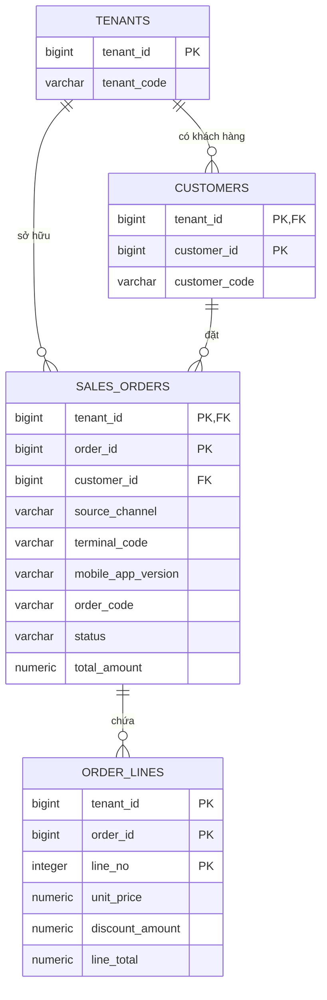
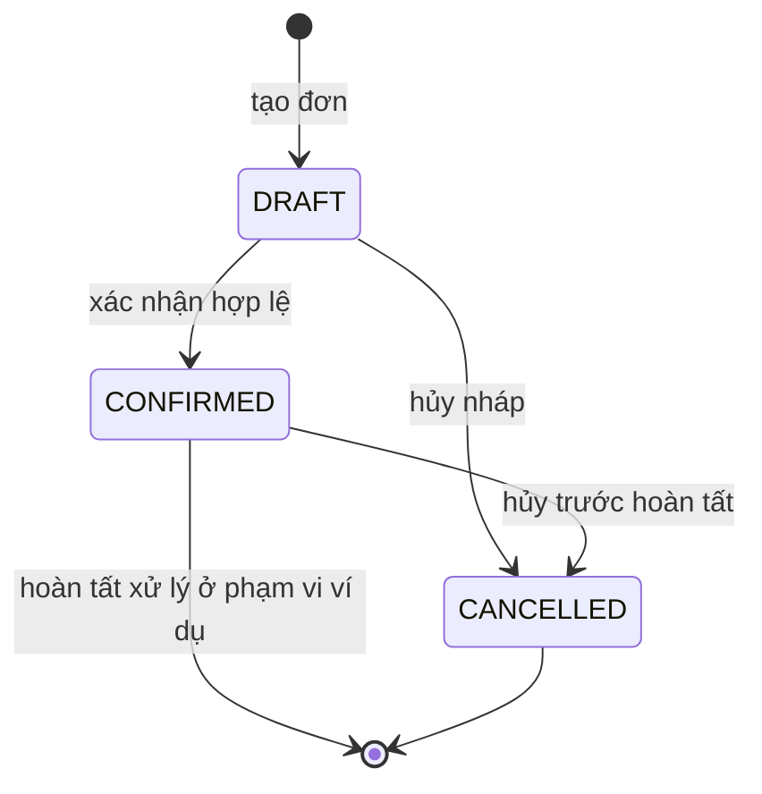
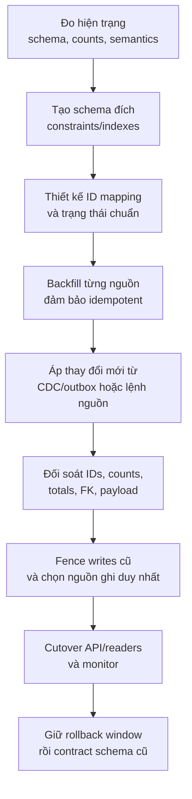

# Tạo quá nhiều bảng hoặc kiểu chỉ để thể hiện khác biệt rất nhỏ

Một ứng dụng bán hàng cho phép tạo đơn từ ba kênh: **website**, **ứng dụng di động** và **quầy thu ngân (POS)**. Cả ba đều có khách hàng, dòng sản phẩm, số lượng, đơn giá, giảm giá, trạng thái và thời điểm tạo đơn. Chỉ có vài thuộc tính khác nhau, chẳng hạn mã thiết bị POS hoặc phiên bản ứng dụng di động. Nhóm phát triển lập ba bảng `web_orders`, `mobile_orders`, `pos_orders`, ba bảng dòng hàng, ba repository và ba kiểu đối tượng Java, rồi viết ba bộ migration và báo cáo gần như giống hệt nhau.

Ban đầu, mô hình này có vẻ “rõ ràng theo loại”. Sau sáu tháng, khi thêm trường `cancelled_at`, sửa quy tắc giảm giá hay triển khai đối soát, cả ba nhánh phải thay đổi đồng bộ. Một nhánh thiếu ràng buộc khóa ngoại, một nhánh quên kiểm tra trạng thái, báo cáo phải `UNION ALL` nhiều nguồn và chương trình có các phép chuyển kiểu lặp lại. **Khác biệt nhỏ đã bị biến thành khác biệt cấu trúc lớn.**

Đây là lỗi **mô hình hóa quá mức** (*over-modeling* hoặc *over-specialization*): tạo quá nhiều bảng, entity, subtype, interface, enum phụ hoặc tầng trừu tượng chỉ để biểu diễn các biến thể không có khác biệt đáng kể về **grain, vòng đời, quan hệ, ràng buộc hoặc hành vi nghiệp vụ**.

Bài thuộc chương **Lỗi thường gặp** của module **DATABASE_DATA_MODELING**. Mục tiêu là nhận biết khi nào một khác biệt chỉ nên là **thuộc tính hoặc giá trị phân loại**, khi nào cần bảng mở rộng/kiểu dữ liệu riêng, và khi nào thật sự phải tách thực thể. Ta sẽ đi từ yêu cầu đến khóa, FK, `CHECK`, chỉ mục, truy vấn, mô hình Java, kế hoạch di chuyển và bộ kiểm thử có thể kiểm chứng.

> **Luận điểm chính:** Không có quy tắc “càng ít bảng càng tốt” hay “mỗi tên nghiệp vụ là một bảng”. Thiết kế tốt chọn **đúng ranh giới thực thể** và thể hiện khác biệt với **mức cấu trúc tối thiểu đủ bảo vệ bất biến nghiệp vụ**.

## 1. Nhận diện triệu chứng: khi sự đa dạng bị thổi thành nhiều mô hình

Một vài dấu hiệu thường gặp:

- Các bảng `web_orders`, `mobile_orders`, `pos_orders` có hơn 90% cột giống nhau, cùng khóa khách, cùng dòng hàng và cùng trạng thái.
- Mỗi lần thêm một trường dùng chung phải sửa ba DDL, ba entity Java, ba mapper, ba API và ba bộ test.
- Báo cáo “toàn bộ đơn hàng” phải ghép nhiều bảng rồi tự xử lý sự khác biệt về tên cột hoặc ý nghĩa trạng thái.
- Phát sinh thêm biến thể `KIOSK` buộc tạo một bộ bảng mới, dù nó chỉ khác giá trị `source_channel` và một mã máy.
- Có nhiều kiểu `WebOrderId`, `MobileOrderId` và `PosOrderId` nhưng tất cả đều được xử lý như cùng một định danh nghiệp vụ, không có quy tắc riêng.
- Một quan hệ tới “đơn hàng” không thể có FK chuẩn vì đơn nằm trong nhiều bảng; code tạo các cột `web_order_id`, `mobile_order_id`, `pos_order_id` với điều kiện “chỉ một cột khác null”.
- Các biến thể có cùng use case xác nhận/hủy nhưng triển khai ba state machine riêng và dần hoạt động khác nhau ngoài ý muốn.

**Không phải sự lặp lại nào cũng là lỗi.** Hai bảng có nhiều cột giống nhau nhưng mang **ngữ nghĩa, vòng đời hoặc ràng buộc khác** có thể cần giữ tách biệt. Cần tìm nguyên nhân của khác biệt trước khi xóa các ranh giới.

### 1.1. Phân biệt ba câu hỏi

| Câu hỏi | Ví dụ | Hướng mô hình hóa thường cân nhắc |
|---|---|---|
| **Đây có phải cùng một thực thể?** | Đơn Web và đơn POS đều là một giao dịch bán hàng | Một thực thể `SalesOrder` |
| **Đây có phải một thuộc tính của thực thể?** | Đơn được tạo từ kênh `WEB` hay `MOBILE` | Cột `source_channel` có tập giá trị kiểm soát |
| **Đây có phải vòng đời/nghĩa nghiệp vụ khác?** | Đơn bán và đơn mua từ nhà cung cấp | Có thể là hai thực thể riêng |

Khi câu trả lời thứ ba là “khác”, đừng ép mọi thứ vào một bảng chung chỉ vì có các cột `id`, `status` và `created_at`.

### 1.2. Độ phức tạp lan truyền

Giả sử có `N` biến thể và `K` chức năng/cơ chế phải duy trì (CRUD, confirm, cancel, báo cáo, audit, migration, export). Khi mỗi biến thể có cả bộ triển khai riêng, số nơi có thể cần sửa tăng gần với `N × K`. Đây **không phải công thức dự báo chi phí chính xác**, nhưng cho thấy cơ chế khiến một phân nhánh nhỏ lan sang nhiều tầng.

Khi thêm biến thể mới:

```text
Thiết kế phân mảnh:
  thêm kênh -> bảng + FK + repository + service + báo cáo + migration

Thiết kế tập trung có discriminator:
  thêm kênh -> mở rộng giá trị kiểm soát + metadata + rule thực sự khác
```

Mục tiêu không chỉ giảm số file; mục tiêu là **tránh tạo những bất biến và đường dữ liệu trùng lặp**, từ đó giảm xác suất các biến thể sai lệch.

## 2. Bắt đầu từ grain và vòng đời, không từ tên loại

**Grain** trả lời “mỗi hàng biểu diễn điều gì?”. Với ví dụ này:

> Một hàng `sales_orders` = một đơn bán hàng của **một tenant**, có một mã đơn, một khách, một kênh tạo đơn và một vòng đời xác nhận–hủy–hoàn tất chung.

Một hàng `order_lines` = một dòng hàng thuộc chính xác một đơn đó.

Website, mobile và POS là **nguồn khởi tạo**. Chúng không tạo ra ba nghĩa mới của “đơn hàng” khi khách, trạng thái, các dòng, tổng tiền và chính sách giao hàng giống nhau.

### 2.1. Kiểm chứng hai biến thể có cùng grain không

Đặt các câu hỏi:

1. Một đơn Web và một đơn POS có cùng ý nghĩa pháp lý/nghiệp vụ về bán hàng không?
2. Cả hai có cùng một chủ thể sở hữu, một tenant và một khách hàng không?
3. Cùng quy tắc thêm dòng, tính tổng và hoàn thành không?
4. Đơn có thể chuyển kênh theo chính sách không, hay kênh chỉ là metadata bất biến lúc tạo?
5. Cả hai có cùng yêu cầu lưu lịch sử, thanh toán và đối soát không?
6. Khác biệt nằm ở **thuộc tính bổ sung**, hay thật sự ở số bước/phê duyệt và cấu trúc quan hệ?

Nếu đa số khác biệt chỉ là **kênh nguồn và một số metadata**, ưu tiên một mô hình chung rồi kiểm tra những trường hợp đặc thù.

### 2.2. Cùng tên cột chưa chứng minh cùng thực thể

Ngược lại, bảng `purchase_orders` dành cho mua hàng từ nhà cung cấp và `sales_orders` dành cho bán hàng cho khách có thể đều có `order_id`, `status`, `total_amount`, `created_at`. Nhưng chúng có bên đối tác, nghĩa của nợ/phải trả/phải thu, approval, hàng nhập/xuất và quy tắc thanh toán khác nhau.

Hợp nhất hai thực thể ấy vào một bảng `everything_orders` chỉ vì “trùng cột” có thể gây **mô hình quá tổng quát** (*under-modeling*). Bài học ở đây là cân bằng: tránh cả **phân mảnh không cần thiết** lẫn **gom những ý nghĩa khác nhau**.

### 2.3. Domain identity khác nhãn hiển thị

Các tên `WEB`, `MOBILE`, `POS` là giá trị của phân loại đầu vào. Nếu kênh `MOBILE` đổi thương hiệu hoặc thêm phiên bản app, đó không nhất thiết là một loại Order mới. Đừng chọn cấu trúc bảng chỉ vì product owner thích gọi mỗi kênh bằng một tên sản phẩm riêng.

## 3. Tình huống đối chiếu: ba kênh tạo đơn

Giả định một nền tảng SaaS hỗ trợ nhiều tenant. Khách hàng mua hàng qua ba kênh:

| Yêu cầu | Web | Mobile | POS |
|---|---|---|---|
| Một đơn thuộc một tenant, một customer | Có | Có | Có |
| Nhiều dòng sản phẩm, quantity, giá snapshot | Có | Có | Có |
| Trạng thái `DRAFT/CONFIRMED/CANCELLED` | Có | Có | Có |
| Tổng tiền bằng tổng dòng | Có | Có | Có |
| Mã sự kiện nguồn để chống nhập trùng (nếu có) | Có | Có | Có |
| Phiên bản ứng dụng mobile | Không | Có | Không |
| Mã thiết bị thu ngân | Không | Không | Có |
| Cần báo cáo doanh thu chung | Có | Có | Có |

**Yêu cầu khác biệt thật:** Mobile có `mobile_app_version`, POS có `terminal_code`. Web không cần hai thuộc tính ấy. Cả ba có thể dùng chung định nghĩa order và order line.

### 3.1. Bộ dữ liệu ví dụ

```text
Tenant 101:
  Order 9001: channel WEB,    customer 7, 2 lines,  total 230.00 USD
  Order 9002: channel MOBILE, customer 7, 1 line,   total  75.00 USD
  Order 9003: channel POS,    customer 9, 3 lines,  total 150.00 USD

Tenant 202:
  Order 9001: channel POS, customer 7, 1 line, total 40.00 USD
```

`order_id=9001` có thể trùng giữa tenant. Một đơn ở tenant 101 không được tham chiếu customer hoặc sản phẩm của tenant 202. Kênh nguồn không phải biên bảo mật thay tenant.

### 3.2. Những bất biến không được đánh mất khi gom bảng

| Mã | Bất biến | Lớp bảo vệ |
|---|---|---|
| I01 | Order, customer và line thuộc cùng tenant | Composite FK với `tenant_id` |
| I02 | `order_code` duy nhất trong tenant | `UNIQUE(tenant_id, order_code)` |
| I03 | Mỗi order có đúng một `source_channel` hợp lệ | `NOT NULL` + `CHECK` hoặc FK lookup |
| I04 | `terminal_code` chỉ dành cho POS và bắt buộc với POS (trong ví dụ) | Conditional `CHECK` |
| I05 | `mobile_app_version` chỉ dành cho MOBILE, bắt buộc với MOBILE | Conditional `CHECK` |
| I06 | Line có quantity dương, giá/giảm giá hợp lệ | `CHECK`/generated column |
| I07 | Không nhân đôi một sự kiện nguồn trong phạm vi đã định | Unique source key + so payload |
| I08 | Không sửa dòng đơn sau khi xác nhận | Transaction/state policy |
| I09 | `total_amount` khớp tổng `line_total` | Giao thức ghi + đối soát |
| I10 | Không đọc/ghi dữ liệu tenant khác | Auth, DB privileges, RLS nếu phù hợp |

Gộp bảng **không được làm yếu ràng buộc**. Một mô hình ít bảng nhưng chỉ có một cột `payload_json` tự do và không kiểm tra các bất biến cốt lõi chưa chắc tốt hơn thiết kế cũ.

## 4. Thiết kế phân mảnh: tại sao dễ sai về lâu dài?

Một ví dụ **cố ý chưa tốt**:

```sql
-- MINH HỌA ANTI-PATTERN: ba thực thể có cấu trúc gần như trùng nhau.
CREATE TABLE web_orders_bad (
    tenant_id BIGINT NOT NULL,
    order_id BIGINT NOT NULL,
    customer_id BIGINT NOT NULL,
    status VARCHAR(20) NOT NULL,
    total_amount NUMERIC(19, 2) NOT NULL,
    created_at TIMESTAMPTZ NOT NULL,
    PRIMARY KEY (tenant_id, order_id)
);

CREATE TABLE mobile_orders_bad (
    tenant_id BIGINT NOT NULL,
    order_id BIGINT NOT NULL,
    customer_id BIGINT NOT NULL,
    status VARCHAR(20) NOT NULL,
    total_amount NUMERIC(19, 2) NOT NULL,
    mobile_app_version VARCHAR(40),
    created_at TIMESTAMPTZ NOT NULL,
    PRIMARY KEY (tenant_id, order_id)
);

CREATE TABLE pos_orders_bad (
    tenant_id BIGINT NOT NULL,
    order_id BIGINT NOT NULL,
    customer_id BIGINT NOT NULL,
    status VARCHAR(20) NOT NULL,
    total_amount NUMERIC(19, 2) NOT NULL,
    terminal_code VARCHAR(50),
    created_at TIMESTAMPTZ NOT NULL,
    PRIMARY KEY (tenant_id, order_id)
);
```

Lưu ý đây là ba bảng **độc lập**. `order_id=9001` có thể xuất hiện trong Web và POS của cùng tenant vì không có unique constraint toàn nhóm. Nếu nghiệp vụ cần một **không gian order ID chung**, thiết kế này phải bổ sung bộ định danh toàn cục hoặc bảng gốc khác. Không thể tạo FK đơn giản từ `payment_events` tới “một trong ba bảng” mà vẫn có constraint tham chiếu chuẩn đến một bảng mục tiêu chung.

### 4.1. Bùng nổ quan hệ

Khi tạo ba bảng `web_order_lines`, `mobile_order_lines`, `pos_order_lines`, cùng nghiệp vụ tính tổng bị lặp. Đến khi thêm `payment_events`:

```text
payment_events
  -> web_order_id?
  -> mobile_order_id?
  -> pos_order_id?
```

Ba FK nullable với quy tắc “đúng một FK được điền” là một cách **mã hóa sự phân mảnh** sang nhiều bảng khác. Cần thêm `CHECK` để đếm cột khác null, query phức tạp, và khi thêm kênh thứ tư phải đổi mọi quan hệ.

### 4.2. Báo cáo buộc gom lại những thứ từng tách

```sql
-- Bắt buộc UNION khi doanh thu toàn hệ thống nằm ở ba bảng.
SELECT tenant_id, 'WEB' AS source_channel, total_amount, created_at
FROM web_orders_bad
UNION ALL
SELECT tenant_id, 'MOBILE', total_amount, created_at
FROM mobile_orders_bad
UNION ALL
SELECT tenant_id, 'POS', total_amount, created_at
FROM pos_orders_bad;
```

`UNION ALL` không tự sai. Nhưng nếu nhu cầu báo cáo và phần lớn hành vi luôn xử lý **tất cả đơn** như một thực thể, việc lặp `UNION ALL` trong mọi API/báo cáo là dấu hiệu đã đặt ranh giới vật lý theo nhãn kênh thay vì theo nghiệp vụ.

### 4.3. “Mỗi bảng một repository” lan thành “mỗi kênh một domain”

Một sửa lỗi validation giảm giá ở Web có thể bị quên ở Mobile. Một migration thêm `cancelled_at` có thể chỉ chạy trên hai bảng. Một batch export có thể thiếu POS. Lỗi không nằm ở `UNION ALL`, mà ở **nhiều nguồn sự thật cho cùng một bất biến**.

Tuy vậy, nếu các kênh về sau có hợp đồng thanh toán/vòng đời thực sự khác và phải tách hạ tầng, mô hình riêng có thể trở nên hợp lý. Quyết định nên dựa trên tiêu chí ở các phần sau, không trên nỗi sợ mọi bảng trùng nhau.

## 5. Thiết kế đề xuất: một order, một discriminator

Thay vì tạo bảng theo kênh, giữ một bảng `sales_orders` có cột `source_channel` và các thuộc tính nguồn nhỏ. Quan hệ order–customer và order–lines **chỉ định nghĩa một lần**.



Tất cả order có **cùng grain và khóa**, chỉ khác giá trị của thuộc tính kênh và những metadata có ý nghĩa khi một kênh cụ thể được chọn.

### 5.1. Khi discriminator là đủ

Một cột `source_channel` thường đủ nếu:

- Các trạng thái/lệnh nghiệp vụ cốt lõi giống nhau.
- Hầu hết quan hệ 1–N, FK và báo cáo áp dụng cho mọi kênh.
- Phần khác nhau là ít thuộc tính, có loại và quy tắc kiểm tra rõ.
- Không cần thay thế lược đồ mỗi khi xuất hiện một nguồn mới tương tự.
- Khác biệt hiệu năng có thể xử lý bằng index, partition hoặc read model nếu cần, **không nhất thiết bằng bảng entity khác**.

### 5.2. Phân loại không đồng nghĩa subtype

Một giá trị `source_channel = 'MOBILE'` chỉ nói đơn được tạo từ ứng dụng di động. Nó không tự biến đơn thành một Java subclass có mọi phương thức override; nếu hành vi giống nhau, enum/lookup table và xử lý đầu vào ở lớp adapter là đủ.

### 5.3. Không nhập nhằng một thuộc tính đang thay đổi với một thực thể mới

Nếu một đơn có thể chuyển từ Web sang POS để hoàn tất thanh toán, cần định nghĩa `source_channel` là **kênh tạo** (bất biến) hay **kênh phục vụ hiện tại** (có thể đổi). Có thể cần `created_channel` và các sự kiện chuyển kênh, chứ không tạo thêm một “đơn POS thứ hai” rồi làm mất định danh chung.

## 6. Lược đồ PostgreSQL chung, bảo vệ khác biệt bằng constraint

Ví dụ dưới đây tạo bốn bảng cốt lõi. Mọi số tiền ở đơn vị USD có hai chữ số thập phân, còn `source_channel` là tập giá trị có kiểm soát.

```sql
CREATE TABLE tenants (
    tenant_id BIGINT PRIMARY KEY,
    tenant_code VARCHAR(80) NOT NULL UNIQUE
);

CREATE TABLE customers (
    tenant_id BIGINT NOT NULL REFERENCES tenants(tenant_id),
    customer_id BIGINT NOT NULL,
    customer_code VARCHAR(64) NOT NULL,
    display_name VARCHAR(200) NOT NULL,
    PRIMARY KEY (tenant_id, customer_id),
    CONSTRAINT uq_customer_code_per_tenant
        UNIQUE (tenant_id, customer_code)
);

CREATE TABLE sales_orders (
    tenant_id BIGINT NOT NULL REFERENCES tenants(tenant_id),
    order_id BIGINT NOT NULL,
    order_code VARCHAR(64) NOT NULL,
    customer_id BIGINT NOT NULL,
    source_channel VARCHAR(10) NOT NULL
        CHECK (source_channel IN ('WEB', 'MOBILE', 'POS')),
    terminal_code VARCHAR(50),
    mobile_app_version VARCHAR(40),
    source_event_id VARCHAR(120),
    status VARCHAR(20) NOT NULL
        CHECK (status IN ('DRAFT', 'CONFIRMED', 'CANCELLED')),
    total_amount NUMERIC(19, 2) NOT NULL DEFAULT 0
        CHECK (total_amount >= 0),
    version BIGINT NOT NULL DEFAULT 0 CHECK (version >= 0),
    created_at TIMESTAMPTZ NOT NULL DEFAULT CURRENT_TIMESTAMP,
    PRIMARY KEY (tenant_id, order_id),
    CONSTRAINT uq_order_code_per_tenant
        UNIQUE (tenant_id, order_code),
    CONSTRAINT fk_order_customer_same_tenant
        FOREIGN KEY (tenant_id, customer_id)
        REFERENCES customers(tenant_id, customer_id),
    CONSTRAINT ck_terminal_only_for_pos
        CHECK (
            (source_channel = 'POS' AND terminal_code IS NOT NULL)
            OR
            (source_channel <> 'POS' AND terminal_code IS NULL)
        ),
    CONSTRAINT ck_app_version_only_for_mobile
        CHECK (
            (source_channel = 'MOBILE'
                 AND mobile_app_version IS NOT NULL)
            OR
            (source_channel <> 'MOBILE'
                 AND mobile_app_version IS NULL)
        )
);

CREATE UNIQUE INDEX uq_order_source_event
ON sales_orders(tenant_id, source_channel, source_event_id)
WHERE source_event_id IS NOT NULL;

CREATE TABLE order_lines (
    tenant_id BIGINT NOT NULL,
    order_id BIGINT NOT NULL,
    line_no INTEGER NOT NULL CHECK (line_no > 0),
    sku VARCHAR(80) NOT NULL,
    quantity INTEGER NOT NULL CHECK (quantity > 0),
    unit_price NUMERIC(19, 2) NOT NULL CHECK (unit_price >= 0),
    discount_amount NUMERIC(19, 2) NOT NULL DEFAULT 0
        CHECK (discount_amount >= 0),
    line_total NUMERIC(19, 2)
        GENERATED ALWAYS AS (
            quantity * unit_price - discount_amount
        ) STORED,
    PRIMARY KEY (tenant_id, order_id, line_no),
    CONSTRAINT fk_line_order_same_tenant
        FOREIGN KEY (tenant_id, order_id)
        REFERENCES sales_orders(tenant_id, order_id),
    CONSTRAINT ck_line_discount_cap
        CHECK (discount_amount <= quantity * unit_price)
);

CREATE INDEX idx_orders_tenant_time
ON sales_orders(tenant_id, created_at DESC, order_id DESC);

CREATE INDEX idx_orders_tenant_channel_time
ON sales_orders(
    tenant_id, source_channel, created_at DESC, order_id DESC
);
```

### 6.1. Những ràng buộc đang bảo vệ điều gì?

| Constraint | Ý nghĩa |
|---|---|
| `PRIMARY KEY(tenant_id, order_id)` | Mỗi order ID duy nhất trong một tenant; ID có thể trùng giữa tenant |
| `UNIQUE(tenant_id, order_code)` | Mã order không trùng trong cùng tenant |
| `FOREIGN KEY(tenant_id, customer_id)` | Order không thể tham chiếu customer thuộc tenant khác |
| `source_channel IN (...)` | Không xuất hiện kênh không được phê duyệt |
| `ck_terminal_only_for_pos` | POS cần terminal; kênh khác không được chứa terminal |
| `ck_app_version_only_for_mobile` | MOBILE cần app version; kênh khác không được chứa app version |
| `uq_order_source_event` | Source event khác null không bị trùng trong phạm vi tenant và kênh |
| `fk_line_order_same_tenant` | Dòng hàng luôn thuộc đúng tenant/order |
| `ck_line_discount_cap` | Discount không lớn hơn giá trị dòng |
| Generated `line_total` | DB duy trì phép tính trên cùng một dòng |

Hai cột có thể nullable **không phải lỗi tự thân**: chúng chỉ có nghĩa ở một kênh cụ thể và `CHECK` giải thích rõ khi nào phải có/không được có. Nếu có hàng trăm cột tùy chọn và rất nhiều constraint chéo thì thiết kế một bảng chung sẽ không còn dễ hiểu; phần sau trình bày cách chọn bảng mở rộng.

### 6.2. Những gì DDL chưa bảo đảm

- `total_amount` bằng `SUM(order_lines.line_total)`: invariant đa hàng, cần giao thức ghi transaction/triggers và đối soát.
- Không thay đổi dòng sau khi order `CONFIRMED`: phải chặn ở đường ghi hoặc DB trigger/quyền phù hợp.
- User được phép đọc tenant/order nào: cần authentication, authorization và có thể thêm RLS.
- Một source event ID bị gửi lại với **nội dung khác**: unique chặn bản ghi mới nhưng không giải thích xung đột payload; cần idempotency handling.
- `source_event_id` có scope thật sự theo tenant/kênh hay còn theo hệ thống tích hợp? Ví dụ giả định mỗi kênh có một namespace ID đã chuẩn hóa; nếu có nhiều hệ thống tạo ID trong một kênh, cần thêm `source_system` hoặc tên provider vào khóa.

**Lược đồ ít bảng vẫn cần các invariant đúng.** Quyết định giảm số bảng không phải lý do bỏ kiểm tra dữ liệu.

### 6.3. Tại sao ID không tự sinh?

Ví dụ trên không khai báo generator cho `order_id` và `customer_id`. Giả định dịch vụ cấp ID an toàn trong phạm vi tenant. Có thể thay bằng surrogate key toàn cục như UUID/identity và tạo unique/foreign keys ghép theo tenant cho ranh giới quan hệ. Dù dùng cách nào, cần test hai yêu cầu đồng thời không tạo trùng khóa.

### 6.4. Partial unique index và ý nghĩa `NULL`

`source_event_id` có thể `NULL` khi đơn tạo nội bộ không có message source. Partial unique index chỉ kiểm tra những hàng có ID nguồn. Nó **không** bảo đảm mọi đơn đều có source event; nếu tất cả đơn POS phải có ID, cần thêm `CHECK` riêng hoặc policy.

Trong PostgreSQL, một unique constraint thông thường cũng cho phép nhiều `NULL` theo mặc định, nhưng partial index giúp diễn đạt rõ trường hợp cần unique chỉ khi đã có giá trị. Không được dùng `ON CONFLICT` sai mục tiêu: khi xử lý duplicate bằng partial unique index, cú pháp conflict target phải phù hợp với điều kiện index hoặc dùng phương án bắt lỗi unique và tra payload được kiểm soát.

## 7. Chạy bộ dữ liệu minh họa và phản ví dụ

Giả định bảng đang rỗng:

```sql
INSERT INTO tenants(tenant_id, tenant_code)
VALUES (101, 'SHOP_A'), (202, 'SHOP_B');

INSERT INTO customers(
    tenant_id, customer_id, customer_code, display_name
)
VALUES
    (101, 7, 'C-001', 'Khách A'),
    (101, 9, 'C-009', 'Khách B'),
    (202, 7, 'C-001', 'Khách tenant 202');

INSERT INTO sales_orders(
    tenant_id, order_id, order_code,
    customer_id, source_channel,
    terminal_code, mobile_app_version,
    status, total_amount
)
VALUES
    (101, 9001, 'O-1', 7, 'WEB', NULL, NULL, 'DRAFT', 0),
    (101, 9002, 'O-2', 7, 'MOBILE', NULL, '3.2.0', 'DRAFT', 0),
    (101, 9003, 'O-3', 9, 'POS', 'T-12', NULL, 'DRAFT', 0),
    (202, 9001, 'O-1', 7, 'POS', 'T-55', NULL, 'DRAFT', 0);
```

Hai tenant cùng dùng `order_id=9001` và `order_code='O-1'` là hợp lệ. **Đó là bằng chứng** thiết kế đúng scoped uniqueness; nếu truy vấn chỉ dùng `order_id=9001` mà bỏ tenant, nó sẽ mơ hồ.

### 7.1. Những thao tác phải bị từ chối

```sql
-- Sai: POS không có terminal.
INSERT INTO sales_orders(
    tenant_id, order_id, order_code, customer_id,
    source_channel, status
)
VALUES (101, 9004, 'O-4', 7, 'POS', 'DRAFT');
-- Kỳ vọng: ck_terminal_only_for_pos từ chối.

-- Sai: WEB mang metadata chỉ dành cho MOBILE.
INSERT INTO sales_orders(
    tenant_id, order_id, order_code, customer_id,
    source_channel, mobile_app_version, status
)
VALUES (101, 9005, 'O-5', 7, 'WEB', '3.2.0', 'DRAFT');
-- Kỳ vọng: ck_app_version_only_for_mobile từ chối.

-- Sai: customer 99 chỉ tồn tại ở tenant khác (nếu đã seed).
-- Với dữ liệu seed trên, customer 99 không tồn tại ở tenant 101.
INSERT INTO sales_orders(
    tenant_id, order_id, order_code, customer_id,
    source_channel, status
)
VALUES (101, 9006, 'O-6', 99, 'WEB', 'DRAFT');
-- Kỳ vọng: fk_order_customer_same_tenant từ chối.
```

Trong PostgreSQL, một statement bị lỗi sẽ làm transaction hiện tại ở trạng thái abort cho tới rollback/savepoint; hãy chạy các test **dự kiến lỗi** riêng hoặc dùng test harness để rollback, không nối liên tục trong cùng transaction rồi hiểu nhầm lỗi sau.

### 7.2. Khi một kênh mới xuất hiện

Giả sử thêm kênh `KIOSK`, có cùng nghĩa đơn hàng nhưng có `kiosk_id` thay vì POS terminal. Đừng tạo ngay `kiosk_orders`. Review trước:

- KIOSK có cùng các trạng thái và quan hệ không?
- `kiosk_id` là một thuộc tính nhỏ, nên thêm cột có `CHECK`, bảng metadata nguồn hay một reference entity?
- Số lượng biến thể trong tương lai có tăng nhanh không?
- Có cần giữ version schema và xử lý dữ liệu cũ?

Nếu chỉ thêm một giá trị trong `CHECK(source_channel)`, đó là migration hữu hạn và rõ. Nếu KIOSK có hàng chục thuộc tính riêng và quy trình phê duyệt khác, nên cân nhắc tách phần mở rộng thay vì làm một hàng chứa quá nhiều `NULL`.

## 8. Truy vấn chung và báo cáo theo kênh

Một màn hình “50 đơn mới nhất của tenant” dùng một bảng:

```sql
SELECT order_id, order_code, source_channel,
       status, total_amount, created_at
FROM sales_orders
WHERE tenant_id = :tenant_id
ORDER BY created_at DESC, order_id DESC
LIMIT 50;
```

Một dashboard “giá trị đơn theo kênh”:

```sql
SELECT source_channel,
       COUNT(*) AS order_count,
       SUM(total_amount) AS total_value
FROM sales_orders
WHERE tenant_id = :tenant_id
  AND status = 'CONFIRMED'
  AND created_at >= :from_instant
  AND created_at < :to_instant
GROUP BY source_channel
ORDER BY source_channel;
```

Đây là **tổng giá trị các đơn đang CONFIRMED trong khoảng thời gian tạo**, không phải mặc định doanh thu đã ghi nhận hoặc tiền đã thanh toán. Nếu đơn hủy sau khi đã confirmed hoặc được hoàn tiền, phải có định nghĩa metric và dữ liệu sự kiện riêng. Thiết kế một bảng giúp truy vấn dễ hơn, **không thay thế định nghĩa số đo**.

### 8.1. Cần `UNION ALL` khi nào?

`UNION ALL` phù hợp khi dữ liệu thực sự có nguồn/kiểu độc lập hoặc khi đang **migrate từ các bảng cũ**. Trong trường hợp ba kênh có cùng grain, một union lặp ở mọi báo cáo thường là chi phí không cần thiết. Không dùng `UNION` (loại trùng) thay `UNION ALL` để “sửa” dữ liệu trùng: hai đơn khác nhau có thể cùng giá trị các cột hiển thị, và `UNION` có thể loại nhầm chúng.

### 8.2. Đừng vô tình nhân dòng khi join

```sql
SELECT o.order_id, o.source_channel,
       COUNT(l.line_no) AS line_count
FROM sales_orders AS o
LEFT JOIN order_lines AS l
  ON l.tenant_id = o.tenant_id
 AND l.order_id = o.order_id
WHERE o.tenant_id = :tenant_id
GROUP BY o.order_id, o.source_channel;
```

Query minh họa line count trong tenant; nó hợp lệ theo grain. Nhưng nếu nối thêm nhiều bảng con độc lập như payments/audit, số dòng trung gian có thể tăng theo tích bội số. Lúc đó tính aggregate riêng hoặc dùng `EXISTS`/subquery thay vì join tất cả rồi `SUM` số đo order nhiều lần.

### 8.3. Cùng tên chỉ số phải có cùng công thức

Trước khi hợp nhất báo cáo, xác nhận ba bảng cũ thực sự cùng ý nghĩa `total_amount`. Nếu Web lưu tiền sau giảm giá nhưng POS lưu tiền đã gồm thuế, không nên ghép thẳng rồi gọi là “doanh thu chung”. Phải chuẩn hóa định nghĩa hoặc giữ các số đo có tên khác và logic chuyển đổi có thể đối soát.

## 9. Bảng mở rộng khi thuộc tính riêng tăng nhưng thực thể vẫn chung

Giả sử POS bắt đầu lưu mã ca làm việc, nhân viên thu ngân, thiết bị, quầy, phiên giao ca và trạng thái kết nối; Mobile lưu nguồn chiến dịch, phiên bản OS, build, device platform và trạng thái offline. Cốt lõi order vẫn giống nhau nhưng cột đặc thù tăng mạnh.

Một cách cân bằng là:

```text
sales_orders (tenant_id, order_id, source_channel, ...)
    |
    +-- pos_order_context (tenant_id, order_id, terminal_id, cashier_id, ...)
    |
    +-- mobile_order_context (tenant_id, order_id, app_version, platform, ...)
```

**Bảng mở rộng không thay bảng gốc.** Order, lines, payment, reporting vẫn tham chiếu `sales_orders`. Các bảng context chỉ lưu đặc điểm nguồn có vòng đời/kiểu riêng.

### 9.1. DDL bảng mở rộng không phá ranh giới

Ví dụ độc lập để minh họa ý tưởng: giả sử `sales_orders` đã được thiết kế phiên bản mở rộng với `source_channel`, không còn dùng trực tiếp các cột metadata nhỏ ở mục 6.

```sql
-- Một UNIQUE ghép hỗ trợ FK ràng buộc đúng source channel.
ALTER TABLE sales_orders
ADD CONSTRAINT uq_order_channel
UNIQUE (tenant_id, order_id, source_channel);

CREATE TABLE pos_order_context (
    tenant_id BIGINT NOT NULL,
    order_id BIGINT NOT NULL,
    source_channel VARCHAR(10) NOT NULL DEFAULT 'POS'
        CHECK (source_channel = 'POS'),
    terminal_code VARCHAR(50) NOT NULL,
    cashier_id BIGINT,
    shift_code VARCHAR(40),
    PRIMARY KEY (tenant_id, order_id),
    FOREIGN KEY (tenant_id, order_id, source_channel)
        REFERENCES sales_orders(
            tenant_id, order_id, source_channel
        )
);

CREATE TABLE mobile_order_context (
    tenant_id BIGINT NOT NULL,
    order_id BIGINT NOT NULL,
    source_channel VARCHAR(10) NOT NULL DEFAULT 'MOBILE'
        CHECK (source_channel = 'MOBILE'),
    app_version VARCHAR(40) NOT NULL,
    device_platform VARCHAR(30),
    PRIMARY KEY (tenant_id, order_id),
    FOREIGN KEY (tenant_id, order_id, source_channel)
        REFERENCES sales_orders(
            tenant_id, order_id, source_channel
        )
);
```

**Lưu ý quan trọng:** DDL này minh họa một **phương án thay thế có điều chỉnh**, không phải cứ chạy `CREATE TABLE` này trên bản mẫu ở mục 6 là có ngay mô hình hoàn chỉnh. Bản mẫu mục 6 còn `CHECK` bắt buộc metadata POS/MOBILE trên hàng order, nên nếu chuyển sang context tables cần migration: nạp context, thay/bỏ `CHECK` cũ và cột metadata cũ đúng thứ tự. Không bỏ qua quá trình chuyển đổi đó.

FK ghép với discriminator chứng minh context POS không gắn nhầm vào order MOBILE. Nhưng nó **không cưỡng chế** rằng mọi order POS đều có context tương ứng: FK từ child tới parent chỉ bảo đảm child không mồ côi. Quy tắc “POS order phải có context” cần được kiểm tra trong **transaction tạo/xác nhận**, trigger, hoặc cơ chế schema phù hợp, và có test.

### 9.2. Khi bảng mở rộng hợp lý?

- Có nhiều thuộc tính đặc thù, phần lớn NULL ở kênh khác.
- Dữ liệu context được đọc rất khác tần suất với order cốt lõi.
- Có thành phần bí mật nhạy cảm cần quyền/retention khác.
- Dữ liệu nguồn có lịch sử/bội số riêng (ví dụ một order có nhiều lần thiết bị đồng bộ).
- Muốn thêm đặc điểm nguồn mà ít ảnh hưởng schema order.

Nếu chỉ có **một hoặc hai cột nhỏ** và không có yêu cầu tách đời sống riêng, bảng mở rộng có thể làm phức tạp join/transaction không cần thiết.

### 9.3. Tránh bẫy “một subtype = một bảng cốt lõi”

Ngay khi dùng bảng context riêng, vẫn có **một** order ID, **một** trạng thái đơn, **một** mối quan hệ order–customer và **một** tập order lines. Đừng sao chép thêm `total_amount`, `status`, `created_at` vào từng context table rồi khiến một order có nhiều nguồn sự thật.

## 10. Một bảng rộng, EAV hay JSON: lựa chọn nào có điều kiện?

Không phải “bỏ nhiều bảng” nghĩa là dồn mọi thứ vào một bảng với 300 cột nullable, hay một cặp `attribute_name` / `attribute_value`.

| Lựa chọn | Phù hợp | Không phù hợp |
|---|---|---|
| Cột có kiểu + `CHECK` | Ít khác biệt, tập kênh ổn định | Hàng trăm field tùy nguồn thay đổi liên tục |
| Bảng context theo nguồn | Nhóm thuộc tính riêng đủ lớn, quan hệ/lifecycle rõ | Mỗi biến thể chỉ có một field đơn giản |
| JSON/JSONB metadata | Thuộc tính hiếm, tùy biến, không cần FK mạnh | Định danh, tiền, trạng thái, quan hệ bảo mật cốt lõi |
| EAV | Bộ thuộc tính mở với metadata/schema quản trị rất chặt | Mô hình OLTP cần nhiều constraint kiểu/đơn vị, join thường xuyên |
| Mỗi biến thể một bảng hoàn chỉnh | Khác biệt thực thể/vòng đời/retention/quyền lớn | Chỉ khác nhãn kênh hoặc một optional field |

### 10.1. JSONB: linh hoạt nhưng không “miễn phí”

```sql
-- Ví dụ một thiết kế THAY THẾ cho metadata ít quan trọng:
ALTER TABLE sales_orders
ADD COLUMN source_metadata JSONB NOT NULL DEFAULT '{}'::jsonb;
```

Một hàng:

```json
{
  "sourceChannel": "MOBILE",
  "appVersion": "3.2.0",
  "campaign": "spring-sale"
}
```

Vì `source_channel` vẫn là cột chuẩn, không cần lặp nó trong JSON; ví dụ payload trên cho thấy một lỗi đồng bộ dễ xảy ra nếu JSON chứa thêm `sourceChannel` có thể mâu thuẫn với cột. Thiết kế thực tế nên loại khóa trùng nghĩa và giữ JSON chỉ cho metadata mở rộng như:

```json
{"appVersion":"3.2.0","campaign":"spring-sale"}
```

Nếu appVersion là bắt buộc của Mobile, phải có validation ở tầng ghi và/hoặc constraint SQL tương ứng với JSON:

```sql
-- Minh họa kiểm tra tối thiểu khi dùng JSON metadata:
ALTER TABLE sales_orders
ADD CONSTRAINT ck_mobile_metadata
CHECK (
    source_channel <> 'MOBILE'
    OR (
        source_metadata ? 'appVersion'
        AND jsonb_typeof(source_metadata -> 'appVersion') = 'string'
    )
);
```

**Lưu ý:** đây là chiến lược thay thế; khi chuyển từ cột `mobile_app_version` sang JSON, phải sửa các `CHECK` cũ từ mục 6. `JSONB` giúp bớt migration cho field mới nhưng giảm kiểm soát kiểu/quan hệ nếu không bổ sung validation, schema version và test. Không đưa trường tiền, tenant ID hoặc FK vào JSON chỉ vì tiện.

### 10.2. EAV dễ tạo “kiểu chuỗi cho mọi thứ”

```text
order_attributes:
  order_id | name         | value
  9001     | amount       | "120.00"
  9001     | created_at   | "yesterday"
  9001     | confirmed    | "sometimes"
```

Nếu không có registry tên thuộc tính, kiểu, đơn vị, constraint và parser, dữ liệu rất khó truy vấn và bảo vệ. EAV có thể phục vụ hệ thống cấu hình thuộc tính động với metadata phức tạp, nhưng **không** phải mặc định thay thế các bảng quan hệ chuẩn.

### 10.3. Tránh bảng “Entity” vạn năng

Một bảng `entities(id, type, parent_id, payload)` cho khách, order, payment, stock, invoice có thể làm mất FK, tính đúng của state, hiệu năng truy vấn và quyền trên từng resource. Lỗi này nằm ở cực **gom quá mức**, đối lập với lỗi tạo quá nhiều bảng. Mục tiêu vẫn là **đặt ranh giới theo invariant**.

## 11. Quá nhiều kiểu Java: phân biệt hành vi với metadata

Lỗi tương tự xuất hiện trong mã Java khi mỗi giá trị của `source_channel` được biến thành một class entity hoặc một hệ phân cấp lớn:

```java
// Anti-pattern khi hành vi/vòng đời hoàn toàn giống nhau:
class WebOrder { /* các field chung */ }
class MobileOrder { /* các field chung + appVersion */ }
class PosOrder { /* các field chung + terminalCode */ }

class WebOrderRepository { /* CRUD lặp */ }
class MobileOrderRepository { /* CRUD lặp */ }
class PosOrderRepository { /* CRUD lặp */ }
```

Hậu quả:

- Ba class có ba phiên bản validation/status dễ bị lệch.
- Các service muốn xử lý “một order” phải viết `if`/`switch` hoặc ép kiểu.
- ORM mapping, query, audit và serialization cần phối hợp thêm.
- Mỗi kênh mới làm phát sinh thêm nhiều class, dù không có hành vi khác.

### 11.1. Dùng một kiểu cốt lõi và enum đúng vai trò

```java
public enum OrderChannel {
    WEB, MOBILE, POS
}

public record OrderSourceInfo(
    OrderChannel channel,
    String terminalCode,
    String mobileAppVersion
) {}

public record OrderDraft(
    long customerId,
    OrderSourceInfo source,
    java.util.List<OrderDraftLine> lines
) {}

public record OrderDraftLine(
    String sku,
    int quantity
) {}
```

Đây là **kiểu DTO/command minh họa**, không phải entity đầy đủ hay mã production có sẵn validation. `tenant_id` và quyền ghi phải đến từ **server-side authenticated context**, không tin hoàn toàn một trường do client tự gửi. Giá bán cũng phải được tra từ nguồn giá có thẩm quyền và ghi snapshot đúng quy tắc nghiệp vụ.

Một `SalesOrder` domain entity chung có thể giữ `OrderChannel`, danh sách dòng, state machine và những hành vi chung. Validation kênh cụ thể ở adapter hoặc service nguồn chỉ xử lý khác biệt thật, không tạo thêm ba domain aggregates.

### 11.2. Tránh “enum cũng là một kiến trúc quá mức”

Một enum gọn, đặt tên rõ và được version hóa hợp lý hơn một cây class chỉ để phân biệt nhãn. Nhưng đừng chọn enum cố định cho danh mục mà người dùng có thể tùy ý thêm hàng nghìn loại từ DB; khi danh mục cần metadata, quyền quản lý và vòng đời riêng, một **lookup table** có thể phù hợp hơn.

| Cách biểu diễn loại | Khi nên dùng | Cần lưu ý |
|---|---|---|
| Java `enum` + DB `CHECK` | Tập nhỏ, ít đổi, do ứng dụng quản lý | Đồng bộ phiên bản code và migration DB |
| Bảng lookup `order_channels` | Loại có tên, trạng thái, metadata do dữ liệu quản lý | FK, quản lý active/inactive và migrations |
| PostgreSQL enum type | Tập hẹp, validation ở DB | Thay đổi giá trị cần quy trình migration |
| Class hierarchy | Subtype có hành vi/invariant khác đáng kể | Mapping, polymorphic query, chi phí subtype |

Không phải vì có ba kênh mà cần tạo ba Java interfaces `WebOrderType`, `MobileOrderType`, `PosOrderType` nếu chúng không thêm hợp đồng nào hữu ích.

### 11.3. Strategy chỉ cho hành vi thực sự khác

Một số khác biệt ở **cách nhập** dữ liệu:

```text
WEB    -> xác nhận phiên khách và giỏ hàng
MOBILE -> kiểm tra app token/build được hỗ trợ
POS    -> xác thực thiết bị/quầy và ca làm
              |
              v
        CreateOrderCommand
              |
              v
       Order domain chung
```

Có thể dùng các adapter/strategy cho xác thực nguồn riêng, rồi chuyển vào **cùng use case tạo đơn**. Nếu quy tắc hoàn tiền hoặc phương thức xác nhận thật sự khác, đó là lúc chiến lược nghiệp vụ có lý do tồn tại. Strategy không nên chỉ gọi ba lần cùng một phương thức với tên class khác.

### 11.4. Dùng type system để bảo vệ invariant, không để trang trí

Một kiểu `Money` có đơn vị tiền và quy tắc decimal giúp ngăn cộng USD với VND có giá trị rõ ràng hơn ba kiểu `WebMoney`, `MobileMoney`, `PosMoney` chỉ khác kênh bán. Tương tự, kiểu `ConfirmedOrder` có API ngăn sửa dòng có thể có giá trị nếu hệ thống dùng typestate nhất quán; nhưng không nên tạo mọi tổ hợp `ConfirmedWebOrder`, `DraftMobileOrder`, `CancelledPosOrder` khi có thể biểu diễn bằng trạng thái và một state machine đã được kiểm chứng.

## 12. ORM inheritance không phải lý do tự động tách bảng

Trong Java/JPA, ba chiến lược kế thừa ánh xạ quan hệ thường được nhắc đến:

| Chiến lược | Cách lưu | Ưu điểm | Rủi ro khi biến thể rất nhỏ |
|---|---|---|---|
| **SINGLE_TABLE** | Một bảng, có discriminator và cột subtype tùy chọn | Query đa hình đơn giản, ít join | Cột nullable, constraint theo loại cần cẩn trọng |
| **JOINED** | Bảng gốc + bảng subtype với PK/FK | Tách thuộc tính subtype, ít NULL ở bảng gốc | Nhiều bảng/join cho khác biệt nhỏ |
| **TABLE_PER_CLASS** | Bảng riêng cho concrete class | Tách vật lý các kiểu | Query đa hình có thể cần union, lặp field/invariant |

### 12.1. Một discriminator không bắt buộc có Java inheritance

Schema có cột `source_channel` không có nghĩa ứng dụng **phải** định nghĩa class con `WebOrder extends SalesOrder`. Một entity hoặc record `SalesOrder` giữ `OrderChannel` là đủ nếu không có hành vi khác biệt đáng kể.

Nếu dùng JPA:

```java
// Ví dụ giản lược: entity chung, không cần @Inheritance.
@Entity
@Table(name = "sales_orders")
class SalesOrder {
    @EmbeddedId
    private OrderKey id;

    @Enumerated(EnumType.STRING)
    @Column(name = "source_channel", nullable = false)
    private OrderChannel sourceChannel;

    @Version
    private long version;

    // Các thuộc tính và hành vi chung khác...
}
```

Đây là khung minh họa, **không phải lớp biên dịch độc lập**; `OrderKey`, các imports, constructors và mapping đầy đủ cần được định nghĩa theo dự án. Với khóa ghép, cần triển khai `@Embeddable`/`@EmbeddedId` đúng quy tắc JPA. `@Version` hỗ trợ phát hiện cập nhật cũ cho hàng order; nó không tự bảo vệ mọi thao tác chèn vào bảng lines nếu lệnh ghi không phối hợp version/lock.

### 12.2. Không để quyết định ORM điều khiển domain

Nếu chỉ vì thư viện ORM có `@Inheritance` mà tạo hierarchy sâu, domain sẽ bị ràng buộc vào cơ chế lưu trữ. Hãy xác định:

- Thực thể thật sự có cùng định danh và vòng đời không?
- Có hành vi/invariant riêng đủ lớn để cần đa hình không?
- Query theo toàn bộ base type có phổ biến không?
- Cần bắt buộc có subtype row không? Cưỡng chế ở DB thế nào?
- Có chấp nhận join/union và nullable fields không?

Sau đó mới chọn chiến lược mapping. Không dùng mọi mẫu kế thừa Java làm phép biến đổi máy móc thành một bảng cho mỗi class.

### 12.3. Composition có thể rõ hơn inheritance

`SalesOrder` là aggregate chung, còn `PosSourceContext` hay `MobileSourceContext` là thành phần dữ liệu. Cách này cho phép dùng cùng vòng đời order mà không phải mang hierarchy qua toàn bộ service/API/warehouse.

Tuy nhiên, nếu subtype có hành vi độc lập đủ lớn và hợp đồng ổn định, inheritance hoặc composition với implementation riêng đều có thể hợp lý. Trọng tâm là **mức khác biệt thật**, không phải “inheritance xấu” hay “composition luôn tốt”.

## 13. Vòng đời và transaction: cái gì phải chỉ có một bản?

Giả sử mọi kênh cùng dùng quy tắc:



Mô hình chung giúp tập trung **một state machine**. Nhưng việc gom bảng chỉ đáng tin khi mọi kênh **cùng** tuân các lệnh chuyển trạng thái; nếu POS hỗ trợ trả hàng ngay tại quầy và Web có quy trình vận chuyển khác, hãy mô hình hóa nghiệp vụ tương ứng thay vì ép cùng một transition nếu điều kiện thật sự khác.

### 13.1. Thêm dòng trong transaction

Quy tắc:

1. Bắt đầu transaction, xác thực quyền của actor đối với tenant/order.
2. Khóa order cha bằng `SELECT ... FOR UPDATE`.
3. Kiểm tra status còn `DRAFT`.
4. Thêm/sửa/xóa dòng, giữ giá snapshot.
5. Tính lại tổng và tăng version.
6. Commit cả thay đổi dòng và tổng.

```sql
BEGIN;

SELECT status, version
FROM sales_orders
WHERE tenant_id = :tenant_id
  AND order_id = :order_id
FOR UPDATE;
-- Service kiểm tra có đúng một order và status = DRAFT.

-- Thêm line bằng dữ liệu đã được xác minh:
INSERT INTO order_lines(
    tenant_id, order_id, line_no, sku,
    quantity, unit_price, discount_amount
)
VALUES (
    :tenant_id, :order_id, :line_no, :sku,
    :quantity, :unit_price, :discount_amount
);

UPDATE sales_orders AS o
SET total_amount = (
    SELECT COALESCE(SUM(l.line_total), 0)
    FROM order_lines AS l
    WHERE l.tenant_id = o.tenant_id
      AND l.order_id = o.order_id
),
version = version + 1
WHERE o.tenant_id = :tenant_id
  AND o.order_id = :order_id
  AND o.status = 'DRAFT'
RETURNING version, total_amount;

COMMIT;
```

Đây là **mẫu luồng SQL**: ứng dụng phải kiểm tra kết quả từng bước và rollback nếu điều kiện không hợp lệ. Với hai writer cùng cấp `line_no = MAX(line_no)+1`, cả hai phải tuân khóa parent hoặc dùng bộ cấp khóa an toàn; PK chặn trùng nhưng không bảo đảm cả hai thao tác tự thành công.

### 13.2. Xác nhận đơn và chặn sửa dòng cùng lúc

```text
T1 confirm: lock sales_orders(101,9001)
T2 add line: đợi lock sales_orders(101,9001)
T1: kiểm tra lines, status DRAFT -> CONFIRMED, commit
T2: lấy lock, thấy CONFIRMED -> từ chối
```

Nếu các đường ghi **đều** giữ khóa hàng order cha, invariant “không thêm line sau confirm” có thể được bảo vệ bằng giao thức chung. Nhưng FK chỉ kiểm tra order tồn tại, không tự kiểm tra status `DRAFT`; một service có quyền `INSERT` trực tiếp bỏ qua khóa có thể phá invariant. Muốn DB bảo vệ trước các writer không tin cậy, cần quyền hạn chế và trigger/stored procedure hoặc cơ chế cưỡng chế khác.

### 13.3. Một lệnh chung không xóa khác biệt cần có

POS có thể cần xác minh ca thu ngân trước khi confirm; Web cần địa chỉ giao hàng hợp lệ. Hãy diễn đạt các rule ấy thành policy/validation được gọi ở bước thích hợp, không sao chép toàn bộ transaction confirm. Nếu quy tắc riêng ảnh hưởng nhiều bước hoặc dữ liệu khác grain, đến lúc cần đánh giá lại ranh giới.

## 14. Phân biệt cấu trúc dữ liệu với phương thức truy cập

Đôi khi team tạo `web_orders` và `pos_orders` chỉ để “truy vấn POS nhanh hơn”. Nhưng **cách truy vấn khác nhau không nhất thiết yêu cầu thực thể khác nhau**.

### 14.1. Read model có thể riêng trong khi source-of-truth chung

```text
sales_orders (nguồn ghi duy nhất)
  ├── idx_orders_tenant_time
  ├── idx_orders_tenant_channel_time
  ├── view/reports theo kênh
  ├── pos_dashboard_projection
  └── sales_fact_daily (analytics)
```

Một bảng read model riêng cho dashboard POS không đồng nghĩa một bảng `pos_orders` **cốt lõi độc lập**. Read model là dữ liệu dẫn xuất có quy trình refresh/reconciliation, trong khi `sales_orders` là nguồn sự thật OLTP.

### 14.2. Khi cần chỉ mục theo kênh

```sql
EXPLAIN (ANALYZE, BUFFERS)
SELECT order_id, total_amount, created_at
FROM sales_orders
WHERE tenant_id = 101
  AND source_channel = 'POS'
ORDER BY created_at DESC, order_id DESC
LIMIT 50;
```

Chỉ mục `idx_orders_tenant_channel_time` có thể hữu ích cho query này. Nhưng nếu chỉ 1% request lọc POS, index thứ hai có thể tăng chi phí ghi nhiều hơn lợi ích. Đo trên dữ liệu đại diện, bao gồm tenant nhỏ/lớn và lưu lượng ghi cao.

### 14.3. Partition theo channel không phải subtype table

Có thể chọn partitioning vật lý theo `source_channel` hoặc theo thời gian/tenant vì workload, nhưng:

- Partition không tạo nghiệp vụ Order riêng.
- Parent table vẫn là bảng logic chung.
- PK/UNIQUE trên bảng partitioned của PostgreSQL có các giới hạn liên quan **partition key**, có thể khiến `PRIMARY KEY(tenant_id, order_id)` không phù hợp nếu partition theo channel và không chứa channel.
- Trước khi đổi sang partitioned table, cần thiết kế lại uniqueness/FK hoặc chọn partition key khác, rồi kiểm thử.

Đừng dùng partition để che việc tạo quá nhiều subtype nếu không có lý do vật lý đáng kể. Cũng đừng giữ một bảng không phân vùng bằng mọi giá khi dữ liệu thật sự lớn và workload yêu cầu chia phần.

## 15. Bảo mật, lịch sử và retention: những khác biệt nhỏ có thể không nhỏ

Một biến thể chỉ khác một trường có thể vẫn cần tách lưu trữ nếu **ý nghĩa bảo mật hoặc thời hạn giữ** thay đổi đáng kể.

Ví dụ:

- Đơn POS mang `terminal_code` bình thường: thuộc tính nhỏ, có thể cùng bảng.
- Đơn trong chương trình y tế chứa hồ sơ sức khỏe nhạy cảm, có quyền truy cập/retention khác hoàn toàn: có thể cần **ranh giới dữ liệu và quyền riêng** chứ không chỉ thêm `channel='HEALTH'`.
- Một kênh có yêu cầu **lưu tại quốc gia khác**: tách DB/region có thể bắt buộc về vận hành, dù domain vẫn là Order chung.
- Một nguồn ghi tệp bí mật cần khóa mã hóa, quyền audit và retention riêng: bảng context hoặc storage riêng có thể có lợi.

**Độ nhỏ của khác biệt về số cột không đồng nghĩa độ nhỏ về rủi ro nghiệp vụ.** Không chọn mô hình chỉ bằng cách tính phần trăm số cột giống nhau.

### 15.1. Tenant scope luôn là bất biến ngang kênh

`source_channel` không thể thay `tenant_id`. Câu `WHERE source_channel = 'WEB'` không phải bộ lọc bảo mật, vì Web có dữ liệu của mọi tenant. Mọi read/write cần xác thực người gọi, kiểm tra quyền tenant và tài nguyên cụ thể, kết hợp DB privileges/RLS khi phù hợp.

### 15.2. Lịch sử theo thời điểm giao dịch

Không được sửa `unit_price` của một line đã xác nhận chỉ vì catalog đổi giá. Không được biến `MOBILE` thành `POS` trong lịch sử khi sau đó đơn được xử lý tại quầy nếu `source_channel` là **nguồn tạo**. Nếu cần biết mọi lần chuyển cách xử lý, hãy ghi event hoặc bảng lịch sử kênh, thay vì tạo một order bản sao ở bảng khác.

### 15.3. Không lạm dụng `ON DELETE CASCADE`

Một order bị hủy không nhất thiết có nghĩa được xóa toàn bộ lines, payments và audit. Cơ chế soft-delete/hard-delete, retention, khôi phục và anonymization phải theo **vòng đời nghiệp vụ**; việc gộp ba kênh không tự quyết định chính sách xóa.

## 16. Kế hoạch di chuyển từ nhiều bảng cũ sang mô hình chung

Giả sử ứng dụng đang chạy production với `web_orders_bad`, `mobile_orders_bad`, `pos_orders_bad` và các bảng line tương ứng. Việc thống nhất thành `sales_orders` cần **migration dữ liệu có kiểm chứng**, không chỉ đổi tên class hoặc copy nhanh vài hàng.

### 16.1. Vấn đề ID đụng nhau

Ví dụ:

```text
Nguồn cũ:
  tenant=101, table=web_orders_bad, order_id=9001
  tenant=101, table=pos_orders_bad, order_id=9001

Đích mới:
  tenant=101, sales_orders.order_id = 9001   (không thể chứa cả hai)
```

Hai hàng không tự là cùng một đơn. Nếu bảng đích giữ PK `(tenant_id, order_id)`, cần **cấp ID mới cho ít nhất một hàng** và cập nhật toàn bộ FK từ line/payment/audit. Không được giải quyết bằng `INSERT ... ON CONFLICT DO NOTHING` vì sẽ làm mất một đơn thật.

Một bảng mapping migration:

```sql
-- Chỉ dùng trong migration hoặc giữ làm legacy-reference
-- nếu hệ thống tích hợp còn dùng ID từ bảng cũ.
CREATE TABLE order_legacy_map (
    tenant_id BIGINT NOT NULL,
    source_channel VARCHAR(10) NOT NULL
        CHECK (source_channel IN ('WEB', 'MOBILE', 'POS')),
    legacy_order_id BIGINT NOT NULL,
    new_order_id BIGINT NOT NULL,
    PRIMARY KEY (
        tenant_id, source_channel, legacy_order_id
    ),
    UNIQUE (tenant_id, new_order_id),
    FOREIGN KEY (tenant_id, new_order_id)
        REFERENCES sales_orders(tenant_id, order_id)
);
```

Nếu giữ bảng mapping có FK tới bảng đích, nó được nạp **sau khi** các hàng order đích tồn tại, hoặc dùng quy trình staging phù hợp để chuẩn bị mapping trước rồi ghi bảng chính thức. Bộ cấp ID mới phải an toàn dưới concurrency và được lưu ổn định qua retry. Trong một số hệ thống, mapping cần thêm `source_system` vì ID cũ trùng cả trong một kênh nhưng khác hệ thống.

### 16.2. Chuẩn hóa trường trước khi chuyển

Ba bảng cũ có thể khác nhau:

| Dữ liệu | Web cũ | Mobile cũ | POS cũ | Quy tắc chuyển |
|---|---|---|---|---|
| `status` | `OPEN/CLOSED` | `DRAFT/PAID` | `SALE/VOID` | Lập bảng mapping có chủ nghiệp vụ chấp thuận |
| `price` | Giá trước thuế | Giá sau giảm | Giá đã gồm phí | Không gộp `total_amount` khi định nghĩa chưa giống |
| `order_id` | Sequence Web | Sequence Mobile | Sequence POS | Map sang một định danh chung |
| `created_at` | UTC | Giờ máy người dùng | Giờ POS địa phương | Chuẩn hóa instant/timezone nguồn |
| `customer_id` | Có thể null với khách vãng lai | Có | Có thể null | Quyết định mô hình guest customer hoặc optional FK |

**Không tự biến `SALE` thành `CONFIRMED` chỉ vì nghe giống nhau** khi một loại có thể gồm thanh toán/hoàn tất còn loại khác chưa. Nếu nguồn cũ có trường không đáp ứng lược đồ chung (ví dụ POS cho phép khách vãng lai mà `customer_id` bắt buộc), phải sửa yêu cầu/DDL hoặc có chiến lược dữ liệu hợp lệ; không chèn fake customer tùy tiện.

### 16.3. Quy trình expand–migrate–cutover–contract



**Expand:** triển khai bảng chung và code có thể đọc hai nguồn trong giai đoạn chuyển, không phá hợp đồng cũ.

**Map:** sinh `new_order_id`, lưu mapping ổn định, kiểm tra số dòng thuộc cùng tenant, đánh dấu những đơn không thể chuyển vì dữ liệu nguồn sai.

**Backfill:** copy order trước rồi mới copy child lines/payments/audit bằng mapping, không để child trỏ vào order ID cũ. Nếu có unique conflict hoặc giá trị ngoài miền, cách ly bản ghi và điều tra.

**Catch-up:** nguồn vẫn tiếp tục ghi trong lúc copy, nên cần CDC, outbox hoặc cơ chế đồng bộ có idempotency. Không thể chỉ chạy một lần `INSERT ... SELECT` rồi đổi route trong khi production có ghi.

**Validate:** so sánh count, số dòng, tổng giá trị theo tenant/kênh/trạng thái, FK và hash ở mức ID nguồn. Tổng đúng không chứng minh mọi hàng đúng vì sai lệch có thể triệt tiêu.

**Cutover:** ngăn ghi vào nguồn cũ sau khi dữ liệu đích bắt kịp; chuyển writer/readers có fencing và quan sát. Duy trì đường rollback có kiểm soát; nếu đích đã nhận ghi mới, không thể đơn giản route về nguồn cũ thiếu những ghi đó.

**Contract:** chỉ loại bảng cũ sau khi hết thời hạn rollback, các tích hợp không còn dựa ID cũ và chính sách retention cho phép.

### 16.4. Kiểm chứng count theo từng nguồn

Ví dụ query kiểm kê từ thiết kế cũ:

```sql
SELECT tenant_id, 'WEB' AS source_channel,
       COUNT(*) AS order_count
FROM web_orders_bad
GROUP BY tenant_id
UNION ALL
SELECT tenant_id, 'MOBILE', COUNT(*)
FROM mobile_orders_bad
GROUP BY tenant_id
UNION ALL
SELECT tenant_id, 'POS', COUNT(*)
FROM pos_orders_bad
GROUP BY tenant_id;
```

So sánh với đích:

```sql
SELECT tenant_id, source_channel,
       COUNT(*) AS order_count
FROM sales_orders
GROUP BY tenant_id, source_channel;
```

Hai kết quả phải khớp **sau khi** xác định phạm vi dữ liệu được chuyển (ví dụ chỉ ACTIVE, hoặc có cả đơn lỗi/quá khứ). Cần kiểm tra thêm mapping khóa và dòng con; count trùng không đủ nếu một đơn bị mất và một đơn khác bị sao chép.

### 16.5. Thay đổi cách API định danh order

Nếu URL cũ là `/web-orders/9001` hoặc `/pos-orders/9001`, chuyển sang `/orders/{id}` cần dùng mapping và chiến lược tương thích. Nếu ID cũ trùng giữa hai nguồn, không thể suy ra new ID chỉ từ số `9001` mà thiếu kênh/tenant. Public API, webhook reference, export và audit đều phải được kiểm tra khi đổi định danh.

## 17. Khi nào **nên** giữ bảng hoặc kiểu riêng?

Lỗi đang học **không** phải lời khuyên xóa hết subtype. Có những ranh giới dù nhìn giống nhau bề mặt nhưng quan trọng:

### 17.1. Khác biệt vòng đời nghiệp vụ

`sales_orders` và `purchase_orders` cùng có dòng, giá, đối tác và trạng thái, nhưng một bên là bán cho khách, một bên là mua từ nhà cung cấp; quy trình thu–chi, nhập–xuất hàng, thuế, kiểm soát nội bộ và quyền phê duyệt có thể hoàn toàn khác.

**Giữ riêng** khi đó thường dễ hiểu hơn một bảng `generic_orders` với hàng chục cột `buyer_or_supplier` và các ràng buộc mâu thuẫn.

### 17.2. Khác biệt vòng đời và cardinality của con

Một sản phẩm vật lý có số serial theo từng chiếc, tồn kho và lô hàng; một subscription có kỳ gia hạn, seat count và lịch thu phí. Dù cùng gọi là “product” trên UI, nhiều phần nghiệp vụ có thể cần các entity chi tiết riêng. Có thể giữ catalog chung cho thuộc tính dùng chung và bảng domain riêng cho inventory/subscription, thay vì ép mọi nghiệp vụ vào bảng `product_attributes`.

### 17.3. Khác biệt ràng buộc và tính bắt buộc lớn

Nếu subtype A bắt buộc 20 field và subtype B bắt buộc 25 field hoàn toàn khác, một bảng chung với 45 cột nullable và hàng chục `CHECK` phức tạp có thể khó maintain hơn joined-subtype tables. Khi đó parent chung + subtype table, hoặc các aggregate riêng, có cơ sở hợp lý.

### 17.4. Khác biệt quyền, retention và dữ liệu nhạy cảm

Một loại hồ sơ yêu cầu kiểm soát truy cập đặc biệt, khóa mã hóa riêng, policy lưu giữ khác hoặc cư trú ở khu vực khác có thể cần schema/database/storage riêng, ngay cả khi có vài cột giống dữ liệu phổ thông.

### 17.5. Khác biệt hiệu năng và khối lượng có chứng cứ

Một tenant cực lớn có thể cần shard riêng; lịch sử sensor sampling 100 nghìn bản ghi/giây có mô hình lưu khác bảng transaction nhỏ. Nhưng hãy phân biệt **phân vùng/tách vật lý cho hiệu năng** với **tạo một định nghĩa thực thể nghiệp vụ mới**.

### 17.6. Khác biệt độ độc lập của team và sản phẩm

Hai bounded contexts độc lập sở hữu dữ liệu, chu kỳ phát hành, tính nhất quán và điều kiện thay đổi riêng có thể chọn database riêng dù có cột giống nhau. Ngược lại, hai lớp Java do hai team viết nhưng cùng sở hữu một aggregate không phải lý do tự động tách bảng; cần xác định owner và contract.

**Bảng quyết định nhanh:**

| Câu hỏi | Nếu câu trả lời là “có” |
|---|---|
| Chỉ khác một vài nhãn hoặc metadata nhỏ? | Ưu tiên discriminator/lookup + validation |
| Cùng định danh và state machine cốt lõi? | Ưu tiên một aggregate/bảng gốc |
| Có nhiều field riêng nhưng cùng identity/lifecycle? | Xem bảng context theo subtype |
| Vòng đời, chủ sở hữu hoặc invariant khác hẳn? | Xem thực thể/bảng/domain riêng |
| Chỉ khác cách báo cáo hoặc tải? | Xem index/read model/partition trước khi tách entity |
| Có yêu cầu tách vùng lưu/kiểm soát tài nguyên? | Tách physical placement mà giữ ngữ nghĩa entity |

## 18. Một khung đánh giá có trọng số cho ranh giới

Đừng đếm cột giống nhau rồi kết luận. Một buổi review có thể chấm định tính các tiêu chí dưới đây:

| Tiêu chí | Một bảng chung nghiêng về | Bảng/domain riêng nghiêng về |
|---|---|---|
| **Identity** | Cùng ID, cùng phạm vi unique | ID sống độc lập và có ý nghĩa khác |
| **Grain** | Mỗi hàng cùng loại sự kiện/đối tượng | Một hàng đại diện loại thực thể khác |
| **Lifecycle** | Cùng trạng thái và transition | Các state machine khác đáng kể |
| **Relationships** | Cùng quan hệ parent/child/FK | Cardinality và phụ thuộc khác |
| **Constraints** | Hầu hết ràng buộc giống | Nhiều rule bắt buộc khác nhau |
| **Queries** | Phần lớn truy vấn xử lý chung | Gần như luôn truy vấn độc lập |
| **Retention/security** | Cùng chính sách | Tách biệt pháp lý/nhạy cảm |
| **Volume/performance** | Chỉ mục/partition đáp ứng | Tải/ghi/độ trễ cần phân tách thật |
| **Migration** | Thường phát triển đồng thời | Version, owner và release độc lập |

### 18.1. Không dùng tổng điểm máy móc

Ngay cả khi 8/9 tiêu chí giống nhau, một khác biệt về **bảo mật bắt buộc** hoặc **hợp đồng giao dịch** có thể đủ để giữ riêng storage/aggregate. Trọng số chỉ hỗ trợ thảo luận; invariant quan trọng không được bỏ qua bằng phép trung bình.

### 18.2. Viết ADR cho lựa chọn có đánh đổi

```text
ADR-042: Gộp Web/Mobile/POS vào sales_orders
Context: Cùng grain, customer, lines, tổng và state.
Decision: Cột source_channel + metadata có CHECK.
Alternatives:
  1. Ba bảng orders riêng
  2. Parent order + bảng subtype context
  3. JSONB source_metadata
Reason: Khác biệt hiện tại chỉ hai trường nhỏ.
Validation:
  - Tenant-scoped FK/UNIQUE
  - Query tất cả order không cần UNION
  - Negative checks terminal/mobile_app_version
  - Concurrent confirm/add line
Revisit when:
  - Mỗi kênh có nhiều constraint/vòng đời riêng
  - Performance/security/region yêu cầu split
Owner: Sales domain team
```

Một ADR như vậy giúp người kế tiếp biết **điều kiện nào khiến quyết định cần đổi**, không buộc code bám vĩnh viễn vào thiết kế đầu tiên.

## 19. Những ngộ nhận phổ biến quanh “ít bảng” và “nhiều kiểu”

**Ngộ nhận 1 — “Mỗi nhãn nghiệp vụ phải có một bảng.”** Nhãn `WEB`/`POS` có thể chỉ là giá trị của một thuộc tính. Bảng nên phản ánh grain và vòng đời.

**Ngộ nhận 2 — “Có subclass Java thì phải có bảng subclass.”** Mô hình object và quan hệ không ánh xạ một-một; chọn theo hành vi và truy vấn.

**Ngộ nhận 3 — “Hai bảng trùng 80% cột chắc chắn phải gộp.”** 20% khác biệt có thể là ranh giới bảo mật hoặc transaction quan trọng.

**Ngộ nhận 4 — “Một bảng có cột NULL là mô hình xấu.”** Nullable fields hợp lệ khi chỉ áp dụng cho biến thể xác định, có validation đúng.

**Ngộ nhận 5 — “Cứ chuyển mọi khác biệt sang JSON thì đơn giản.”** JSON không tự cung cấp FK, kiểu tiền, constraint và chỉ mục phù hợp.

**Ngộ nhận 6 — “EAV giúp khỏi phải migration.”** Có thể chuyển chi phí migration sang validation, query, schema registry và data quality.

**Ngộ nhận 7 — “Có 10 kênh thì tạo 10 state machine để dễ đọc.”** Nếu cùng hành vi, sự lặp lại gây drift và lỗi logic.

**Ngộ nhận 8 — “Muốn báo cáo POS nhanh thì bắt buộc lưu POS ở bảng riêng.”** Index, materialized read model hoặc partition có thể đủ.

**Ngộ nhận 9 — “Tách bảng tự động tăng bảo mật.”** Quyền DB và application authorization vẫn là điều kiện bắt buộc.

**Ngộ nhận 10 — “Gộp bảng làm mất khả năng đặt rule theo loại.”** Conditional `CHECK`, lookup, context tables và policy có thể bảo vệ khác biệt.

**Ngộ nhận 11 — “Bảng context có FK là tự bắt buộc mọi POS phải có context.”** FK child→parent chỉ ngăn child mồ côi; yêu cầu parent phải có child cần cơ chế khác.

**Ngộ nhận 12 — “Có unique source ID thì retry luôn an toàn.”** Cùng ID nhưng payload khác phải được phát hiện, không âm thầm bỏ qua.

**Ngộ nhận 13 — “`UNION` giúp tự loại order trùng khi ghép các bảng.”** `UNION` có thể xóa những order khác nhau nhưng cùng giá trị hiển thị; cần khóa nghiệp vụ để dedup.

**Ngộ nhận 14 — “Một khi gộp bảng thì không thể tách lại.”** Có thể tiến hóa với bảng context, partition, read models hoặc migration khi có bằng chứng cần tách.

**Ngộ nhận 15 — “Chia bảng theo kênh đồng nghĩa chia tải đều.”** Một kênh có thể chiếm 99% dữ liệu; phân tách vật lý cần dựa trên workload.

**Ngộ nhận 16 — “Gộp bảng xong không cần test các kênh riêng.”** Các rule có điều kiện và thao tác nhập liệu từng kênh vẫn cần negative tests.

**Ngộ nhận 17 — “Tổng tiền của ba kênh có cùng tên thì chắc cùng nghĩa.”** Phải xác minh thuế, giảm giá, phí, currency và thời điểm ghi nhận.

**Ngộ nhận 18 — “Chỉ đổi entity/repository, migration sẽ tự lo.”** Phải xử lý ID collisions, FK con, trạng thái cũ, đồng bộ ghi và rollback.

## 20. Kiểm thử thiết kế gọn nhưng không làm yếu dữ liệu

### 20.1. Ma trận test cho ba kênh

| Tình huống | Kết quả mong đợi | Cơ chế |
|---|---|---|
| Đơn WEB không có metadata nguồn | ALLOW | `CHECK` chỉ yêu cầu các trường đặc thù khi áp dụng |
| Đơn MOBILE có `mobile_app_version` | ALLOW | `CHECK` đúng kênh |
| Đơn POS có `terminal_code` | ALLOW | `CHECK` đúng kênh |
| Đơn POS thiếu terminal | DENY | `ck_terminal_only_for_pos` |
| Đơn WEB có terminal | DENY | `ck_terminal_only_for_pos` |
| Đơn MOBILE thiếu app version | DENY | `ck_app_version_only_for_mobile` |
| Đơn POS có app version | DENY | `ck_app_version_only_for_mobile` |
| `source_channel = 'FAX'` | DENY | `CHECK` miền giá trị |
| Order tenant 101 trỏ customer tenant 202 | DENY | FK ghép |
| Hai tenant có cùng order ID và code | ALLOW | PK/UNIQUE scoped |
| Trùng `order_code` trong cùng tenant | DENY | Unique scoped |
| Hai order cùng source event ID trong cùng tenant/channel | DENY | Partial unique index |
| Hai source event ID giống nhau nhưng khác tenant | ALLOW theo giả định scope nguồn | Unique có tenant |
| Line có `quantity = 0` | DENY | `CHECK` |
| Discount lớn hơn giá trị dòng | DENY | `CHECK` |
| Thêm line sau confirm | DENY nếu mọi writer tuân policy | Giao thức ghi + bảo vệ quyền/trigger |
| API tenant A đọc order tenant B | DENY | Authorization/RLS thích hợp |

Những ca ALLOW là **được phép về cấu trúc dữ liệu**; với API thực tế vẫn cần user có quyền tương ứng. Không được gọi `INSERT` thành công là bằng chứng một người dùng đã được cấp phép tạo order.

### 20.2. Đối soát metadata theo discriminator

Nếu dữ liệu đã đi qua import cũ hoặc engine không enforce `CHECK`, dùng query phát hiện:

```sql
SELECT tenant_id, order_id, source_channel,
       terminal_code, mobile_app_version
FROM sales_orders
WHERE source_channel NOT IN ('WEB', 'MOBILE', 'POS')
   OR NOT (
       (source_channel = 'POS' AND terminal_code IS NOT NULL)
       OR (source_channel <> 'POS' AND terminal_code IS NULL)
   )
   OR NOT (
       (source_channel = 'MOBILE'
            AND mobile_app_version IS NOT NULL)
       OR (source_channel <> 'MOBILE'
            AND mobile_app_version IS NULL)
   );
```

Kỳ vọng không có hàng. Query này diễn đạt đúng **quy tắc của phiên bản schema ở mục 6**; nếu mô hình chuyển sang bảng context/JSON hoặc thêm KIOSK, cần đổi query theo semantic contract mới. Tránh tiếp tục chạy kiểm tra cũ rồi báo lỗi giả.

### 20.3. Kiểm tra tổng order khi nhiều dòng

```sql
SELECT o.tenant_id, o.order_id,
       o.total_amount AS stored_total,
       COALESCE(SUM(l.line_total), 0) AS calculated_total
FROM sales_orders AS o
LEFT JOIN order_lines AS l
  ON l.tenant_id = o.tenant_id
 AND l.order_id = o.order_id
GROUP BY o.tenant_id, o.order_id, o.total_amount
HAVING o.total_amount <> COALESCE(SUM(l.line_total), 0);
```

`line_total` đã được DB tính theo dòng, nhưng `sales_orders.total_amount` chưa tự cập nhật khi dòng đổi. Query đối soát phải rỗng **sau những transaction commit hợp lệ** theo hợp đồng bài. Không chạy nó giữa một transaction đang cập nhật rồi kết luận một trạng thái trung gian là bug.

### 20.4. Kiểm tra nguồn trùng nhưng nội dung khác

Một event nguồn có ID `evt-abc` đến hai lần:

```text
Lần 1: tenant=101, channel=WEB, event_id=evt-abc,
       customer=7, amount=230.00
Lần 2: tenant=101, channel=WEB, event_id=evt-abc,
       customer=7, amount=230.00
=> Retry giống hệt; không tạo order thứ hai.

Lần 3: tenant=101, channel=WEB, event_id=evt-abc,
       customer=9, amount=150.00
=> Xung đột nội dung nguồn; không âm thầm bỏ qua.
```

Unique index bảo vệ key, còn service phải so sánh một **canonical payload/hash** và ghi log xung đột. Nếu nguồn thực sự cho phép cập nhật cùng event ID (một mô hình khác), cần có version/sequence và quy tắc upsert rõ, không coi retry và correction là một.

### 20.5. Kiểm tra giao dịch đồng thời

Test tối thiểu:

```text
T1: BEGIN; lock order 101/9001; chuẩn bị confirm
T2: BEGIN; cố thêm line vào 101/9001
T1: status DRAFT -> CONFIRMED; COMMIT
T2: sau khi lấy lock phải từ chối thao tác; ROLLBACK
```

Chạy bài test qua **mọi đường tạo đơn/kênh**, không chỉ Web. Một thiết kế gộp thành công có **một state machine được dùng đúng** ở Web/Mobile/POS, chứ không phải một bảng chung nhưng ba service bỏ qua các rule của nhau.

### 20.6. Kiểm tra khi chuyển từ bảng cũ

Kiểm tra từng tenant/channel:

1. Số lượng legacy order bằng số lượng order tương ứng tại đích theo phạm vi di chuyển.
2. Mỗi mapping `(tenant, channel, old_order_id)` có đúng một new order ID.
3. Không mất hoặc nhân đôi lines/payments/audit.
4. Tất cả FK tenant/order hợp lệ.
5. Total sau chuẩn hóa được đối chiếu theo định nghĩa nguồn đã được phê duyệt.
6. Đơn có ID cũ đụng nhau vẫn là hai order hợp lệ ở đích.
7. Đường redirect API hoặc consumer cũ tìm đúng order mới.
8. Khi có write trong lúc backfill, kết quả sau cutover không mất giao dịch.

Test này là bằng chứng **chuyển dữ liệu đúng**, khác với test DDL cho một bảng rỗng.

## 21. Một quy trình review có thể lặp lại

**Bước 1 — Liệt kê các biến thể.** Ghi tên loại, mục đích, nguồn dữ liệu, actor và hành động thực tế; không dùng tên loại làm quyết định schema ngay.

**Bước 2 — Xác định grain và identity.** Hỏi một hàng mỗi biến thể có thật cùng ý nghĩa không, có một ID chung và cùng owner không.

**Bước 3 — Viết invariant chung.** PK, unique, FK, status, aggregate, retention, tenant và permission nào giống nhau?

**Bước 4 — Liệt kê khác biệt *thật*.** Không ghi “loại A khác B” chung chung; nêu field, kiểu, bắt buộc hay không, state transition và quy trình.

**Bước 5 — Chọn phương án nhỏ nhất đáp ứng yêu cầu.** Discriminator/lookup → một số cột có `CHECK` → bảng context → domain/subtype riêng nếu có bằng chứng.

**Bước 6 — Chọn nơi cưỡng chế.** Cùng hàng thì `CHECK`; quan hệ thì FK; phạm vi duy nhất thì unique; đa hàng và trạng thái thì transaction/trigger/service và test.

**Bước 7 — Chạy truy vấn thực.** List/detail, lookup theo kênh, báo cáo tổng, join con, xuất dữ liệu; xem có `UNION ALL`/N+1/row multiplication không.

**Bước 8 — Đo workload.** Index plan, tenant skew, retention, write rate, p95 latency. Chỉ tách vật lý nếu có nhu cầu hoặc ràng buộc rõ.

**Bước 9 — Kiểm tra bảo mật/lịch sử.** Tenant scope, RLS/DB roles, PII, giữ snapshot, xóa/khôi phục và data residency.

**Bước 10 — Lập kế hoạch tiến hóa.** Nếu thêm biến thể mới, sửa một invariant chung hay thêm một module mới? Ghi điều kiện revisit và kế hoạch schema migration.

**Bước 11 — Viết test đối kháng.** Cùng ID ở hai tenant, metadata sai kênh, source ID trùng payload khác, concurrent update, backfill và restore.

**Bước 12 — Ghi quyết định.** Owner, lựa chọn, đánh đổi, phương án bỏ qua, bằng chứng và rủi ro còn mở.

### 21.1. Checklist trước khi duyệt một mô hình “mỗi loại một bảng”

| Câu hỏi | Nếu không trả lời được |
|---|---|
| Mỗi bảng có grain khác nhau cụ thể ở đâu? | Có thể chỉ đang tách theo nhãn |
| Các bảng có cùng khách/đơn/dòng và state machine không? | Kiểm tra khả năng dùng chung aggregate |
| Nếu thêm một thuộc tính chung, cần sửa mấy nơi? | Chi phí đồng bộ có thể không cần thiết |
| Một quan hệ ngoài bảng trỏ tới “bất kỳ biến thể nào” ra sao? | Có thể thiếu FK chung |
| Báo cáo tổng hợp có cần `UNION ALL` lặp lại không? | Dấu hiệu ranh giới bảng đặt sai |
| Các metadata đặc thù có cần ràng buộc riêng không? | Discriminator + `CHECK`/context có thể đủ |
| Có khác biệt bảo mật, retention hoặc region không? | Đừng gộp mù quáng |
| Có khác biệt trạng thái/approval/transaction không? | Có thể cần thực thể/domain riêng |
| Query workload có chứng minh cần tách vật lý không? | Thử chỉ mục/read model/partition trước |
| Kiểu Java có hành vi thật khác không? | Tránh hierarchy chỉ để chứa nhãn |
| Migration có mapping source ID khi va chạm không? | Nguy cơ làm mất dòng |
| Có test dữ liệu sai kênh và cross-tenant không? | Mô hình mới có thể yếu hơn mô hình cũ |

### 21.2. Một công cụ review đơn giản: bảng khác biệt

Trước khi tạo thêm bảng, viết bảng:

| Thuộc tính/quy tắc | WEB | MOBILE | POS | Kết luận |
|---|---|---|---|---|
| `tenant_id`, `order_id`, `customer_id` | Giống | Giống | Giống | Cốt lõi chung |
| `order_lines` và tổng tiền | Giống | Giống | Giống | Cốt lõi chung |
| `status` và transition | Giống | Giống | Giống | Một state machine |
| `source_channel` | WEB | MOBILE | POS | Discriminator |
| `app_version` | Không | Có | Không | Thuộc tính có điều kiện |
| `terminal_code` | Không | Không | Có | Thuộc tính có điều kiện |
| Quyền xác thực nguồn | Session web | App token | Thiết bị/ca | Adapter validation riêng |

Khi bảng khác biệt như trên, mô hình “một order + metadata” thường dễ kiểm chứng hơn ba order cốt lõi. Nếu bảng có nhiều hàng thực sự khác về lifecycle, quan hệ và nghĩa số tiền, kết luận sẽ thay đổi.

## 22. Bài học mở rộng: phân loại nguồn dữ liệu không phải phân loại đối tượng

Ví dụ khác: một hệ thống nhận thông báo từ `EMAIL`, `SMS` và `PUSH`. Có thể có một thực thể `notification_requests` chung nếu cả ba là một **yêu cầu gửi thông báo** với status tạo/đặt lịch/đã gửi, recipient, template và audit tương tự.

Nhưng `email_delivery_attempt` có thể chứa MIME/message ID, `sms_delivery_attempt` chứa nhà mạng/số phân đoạn, còn `push_delivery_attempt` có token/endpoint; các **lần giao nhận** có thể có lifecycle và payload khác nhau. Khi ấy:

```text
notification_requests  (một yêu cầu nghiệp vụ chung)
    |
    +-- delivery_attempts  (các lần thử gửi chung nếu grain giống)
              |
              +-- email_attempt_details
              +-- sms_attempt_details
              +-- push_attempt_details
```

Hoặc nếu cơ chế retry, delivery receipt và cấu trúc attempts khác đáng kể, có thể giữ các bảng delivery đặc thù nhưng vẫn có **request ID chung**. Đây là ví dụ cho thấy quyết định nên đưa ra **ở từng grain**, không bằng câu hỏi “email và SMS khác nhau thì phải tách toàn bộ database không?”.

Một ví dụ nữa: form “địa chỉ nhà”, “địa chỉ công ty”, “địa chỉ giao hàng” có thể là **cùng kiểu giá trị Address với vai trò khác nhau**, chứ không cần `HomeAddress`, `WorkAddress`, `ShippingAddress` như ba subtype chỉ để khác một nhãn. Nhưng quan hệ ownership/retention của địa chỉ có thể khác, nên cần xác định record value sống cùng thực thể nào và có chia sẻ hay không.

## 23. Bài tập thực hành: sửa thiết kế quá phân mảnh

**Bối cảnh:** một hệ thống đăng ký khóa học nhận hồ sơ từ `WEB`, `MOBILE`, `KIOSK` và `PARTNER_API`. Mỗi hồ sơ có người nộp, khóa học, thời điểm nộp, trạng thái `DRAFT/SUBMITTED/APPROVED/REJECTED` và lịch sử xét duyệt. Mobile có `app_version`, Kiosk có `device_code`, Partner API có `partner_reference`. Website không có metadata riêng.

Nhóm trước đây tạo:

```text
web_applications
mobile_applications
kiosk_applications
partner_applications

web_application_reviews
mobile_application_reviews
kiosk_application_reviews
partner_application_reviews
```

Mỗi bảng application có gần cùng cột. Một báo cáo “số hồ sơ được duyệt tháng này” phải `UNION ALL` bốn bảng rồi chuyển các tên trạng thái. Một service cấp quyền duyệt phải có bốn repository và dễ quên một nguồn.

### 23.1. Yêu cầu bài tập

1. Viết grain của **application**, **review event** và **applicant**. Có phải tất cả đều cùng grain không?
2. Tách invariant chung khỏi metadata đặc thù. Những điểm nào đủ để coi bốn nguồn cùng một application?
3. Đề xuất `applications` chung với `source_channel`, PK, FK và unique theo tenant/trường học.
4. Dùng `CHECK` diễn đạt `app_version` chỉ có ở MOBILE, `device_code` chỉ có ở KIOSK và `partner_reference` chỉ có ở PARTNER_API — hoặc đề xuất bảng context nếu có lý do.
5. Chọn cấu trúc `application_reviews` để một đơn có nhiều lần xét duyệt và không mất lịch sử khi đổi trạng thái.
6. Giải thích vì sao `review_count` không được bằng số lượng các application có status APPROVED.
7. Viết truy vấn báo cáo APPROVED theo nguồn và ngày duyệt; chỉ rõ timestamp dùng và giả định lịch sử.
8. Nếu partner API phát lại cùng `external_id`, xây idempotency key ra sao khi nhiều đối tác có thể dùng cùng ID?
9. Một trường hợp nào khiến hồ sơ của Partner API **phải có quy trình riêng** nhưng vẫn có thể dùng cùng application ID?
10. Khi nào nên tách `partner_application_context` thành bảng riêng?
11. Đề xuất một lý do đúng để **giữ riêng** bảng `scholarship_applications` nếu nó có thể có vòng đời, approval và quyền dữ liệu khác đáng kể.
12. Lập kế hoạch chuyển dữ liệu cũ khi Web và Kiosk cùng có `application_id=100` trong cùng tenant.
13. Nêu các kiểm thử negative cho missing metadata, cross-tenant FK, duplicate source event và concurrency.
14. Có cần dùng Java sealed hierarchy cho bốn application types không? Trả lời theo hành vi, không chỉ tên loại.
15. Thiết kế một query phân trang hồ sơ chung không gây N+1 và không bỏ tenant scope.

### 23.2. Gợi ý mô hình SQL

Đây là **lược đồ mới độc lập** cho bài tập, chỉ minh họa phạm vi các bảng cốt lõi:

```sql
CREATE TABLE applicants (
    tenant_id BIGINT NOT NULL,
    applicant_id BIGINT NOT NULL,
    display_name VARCHAR(200) NOT NULL,
    PRIMARY KEY (tenant_id, applicant_id)
);

CREATE TABLE applications (
    tenant_id BIGINT NOT NULL,
    application_id BIGINT NOT NULL,
    applicant_id BIGINT NOT NULL,
    course_code VARCHAR(80) NOT NULL,
    source_channel VARCHAR(20) NOT NULL
        CHECK (
            source_channel IN (
                'WEB', 'MOBILE', 'KIOSK', 'PARTNER_API'
            )
        ),
    app_version VARCHAR(40),
    device_code VARCHAR(80),
    partner_id VARCHAR(80),
    partner_reference VARCHAR(100),
    status VARCHAR(20) NOT NULL
        CHECK (
            status IN (
                'DRAFT', 'SUBMITTED', 'APPROVED', 'REJECTED'
            )
        ),
    submitted_at TIMESTAMPTZ,
    PRIMARY KEY (tenant_id, application_id),
    FOREIGN KEY (tenant_id, applicant_id)
        REFERENCES applicants(tenant_id, applicant_id),
    CHECK (
        (source_channel = 'MOBILE' AND app_version IS NOT NULL)
        OR (source_channel <> 'MOBILE' AND app_version IS NULL)
    ),
    CHECK (
        (source_channel = 'KIOSK' AND device_code IS NOT NULL)
        OR (source_channel <> 'KIOSK' AND device_code IS NULL)
    ),
    CHECK (
        (source_channel = 'PARTNER_API'
            AND partner_id IS NOT NULL
            AND partner_reference IS NOT NULL)
        OR (source_channel <> 'PARTNER_API'
            AND partner_id IS NULL
            AND partner_reference IS NULL)
    )
);

CREATE UNIQUE INDEX uq_partner_application_reference
ON applications(tenant_id, partner_id, partner_reference)
WHERE source_channel = 'PARTNER_API';

CREATE TABLE application_reviews (
    tenant_id BIGINT NOT NULL,
    application_id BIGINT NOT NULL,
    review_no INTEGER NOT NULL CHECK (review_no > 0),
    decision VARCHAR(20) NOT NULL
        CHECK (decision IN ('APPROVED', 'REJECTED')),
    decided_at TIMESTAMPTZ NOT NULL,
    PRIMARY KEY (tenant_id, application_id, review_no),
    FOREIGN KEY (tenant_id, application_id)
        REFERENCES applications(tenant_id, application_id)
);
```

Đây là lược đồ tối giản: chưa định nghĩa table `tenants`, `courses`, `partners`, role của người duyệt, rule transition, version và cách duy trì `applications.status` từ review history. Trong sản phẩm thật cần bổ sung ràng buộc/transaction phù hợp. `partner_id`/`partner_reference` có scope theo tenant/đối tác, nên unique bao gồm partner, **không** chỉ reference.

### 23.3. Hướng giải quan trọng

- Bốn kênh cùng **một application grain** và cùng state machine; biến thể nguồn nhỏ nên dùng discriminator/metadata có điều kiện.
- `application_reviews` có grain “một lần xét duyệt” và PK riêng theo application + review number, **không** nên tạo bốn bảng review nếu vòng đời xét duyệt chung.
- Số hồ sơ được duyệt theo trạng thái **hiện tại** khác số **lần xét duyệt APPROVED**. Một application có thể từng được duyệt, bị mở lại và duyệt lần nữa nếu nghiệp vụ cho phép; cần lịch sử và định nghĩa metric.
- Với báo cáo “duyệt trong tháng”, dùng `decided_at` từ review event theo timezone nghiệp vụ, không lấy `submitted_at`. Nếu chỉ cần một lần duyệt cuối, phải xác định chọn revision nào và không tự đếm mọi review.
- API partner cần khóa `(tenant_id, partner_id, partner_reference)` và so payload khi retry. Một đối tác mới có cùng reference với đối tác khác không tự là cùng application.
- Nếu Partner API có kiểm định nguồn, tài liệu ủy quyền và hợp đồng cập nhật ngoài luồng, thêm adapter/policy hoặc context table. Chỉ tách application domain khi thực sự khác invariant/vòng đời.
- Khi legacy IDs đụng nhau, dùng mapping `(tenant, source, legacy_id) → new_application_id`, backfill review theo mapping và đối soát trước cutover.

### 23.4. Bài kiểm tra phản ví dụ

Tạo Application 100 từ Web và Application 100 từ Kiosk (cùng tenant) ở schema legacy; khi migrate sang `applications`, cả hai phải thành hai application có ID mới khác nhau. Thêm một Application Partner API thiếu `partner_id` phải bị từ chối. Thêm hồ sơ tenant 101 tham chiếu Applicant chỉ tồn tại ở tenant 202 phải bị FK từ chối. Hai webhook đối tác cùng khóa nhưng payload khác phải được ghi nhận xung đột, không tự coi là retry giống hệt.

Cuối cùng, đo query lấy 50 application mới nhất của một tenant và query thống kê theo nguồn; chứng minh cả hai **không cần bốn bộ repository hoặc `UNION ALL` bốn bảng application**.

## 24. Ghi nhớ

**Tạo quá nhiều bảng hoặc kiểu chỉ để thể hiện khác biệt rất nhỏ** làm tăng số điểm sửa schema, validation, mapping, test, transaction và báo cáo, trong khi có thể vẫn đại diện **cùng một thực thể và một vòng đời**. Với biến thể chỉ khác nguồn/kênh và ít thuộc tính, ưu tiên **một bảng cốt lõi có discriminator/lookup và ràng buộc rõ**, rồi dùng bảng context hoặc metadata được quản lý nếu khác biệt tăng lên.

Không vì muốn ít bảng mà ép mọi nghiệp vụ vào một kiểu vạn năng: nếu **grain, identity, state machine, quan hệ, bảo mật, retention hoặc chủ sở hữu dữ liệu** khác đáng kể, tách bảng/domain có thể là lựa chọn đúng. **Lựa chọn không dựa vào phần trăm cột giống nhau**, mà dựa vào những bất biến cần cưỡng chế và những câu hỏi cần trả lời.

Một thiết kế đáng tin phải đi được từ **yêu cầu → grain → PK/FK/UNIQUE/CHECK → transaction → query → test → migration và vận hành**. Khi hợp nhất các bảng cũ, phải xử lý ID đụng nhau, FK con, khác biệt ngữ nghĩa số liệu, dữ liệu đến trong lúc backfill và khả năng rollback. Kết quả mong muốn không chỉ là một schema gọn hơn, mà là **một nguồn sự thật rõ ràng, ít trùng lặp và vẫn có bằng chứng bảo vệ tính đúng đắn**.
