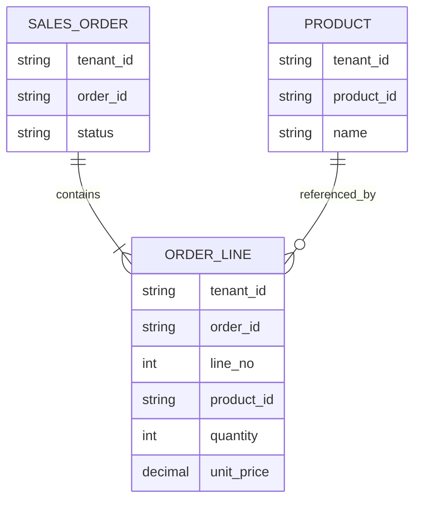
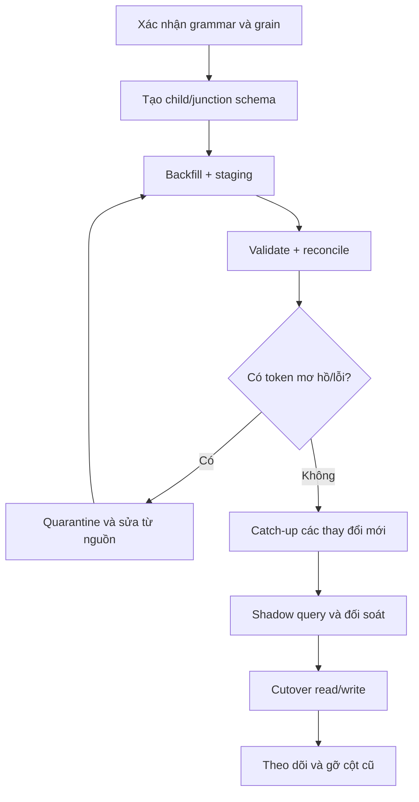

# Danh sách phân cách bằng dấu phẩy và nhóm cột lặp như item1, item2

## 1. Vì sao một dấu phẩy có thể biến thành vấn đề thiết kế dữ liệu?

Trong một ứng dụng quản lý đơn hàng, người phát triển muốn lưu nhanh danh sách sản phẩm vào một cột:

```text
order_id = O-101
items    = "P01,P02,P03"
```

Ở một hệ thống khác, bảng đơn được tạo theo mẫu:

```text
order_id | item1 | item2 | item3
---------+-------+-------+------
O-101    | P01   | P02   | P03
O-102    | P02   | NULL  | NULL
```

Cả hai cách trông thuận tiện khi chỉ có vài sản phẩm. Nhưng khi nghiệp vụ yêu cầu tìm “mọi đơn có P02”, gắn số lượng và đơn giá từng sản phẩm, hỗ trợ 30 mặt hàng hoặc ngăn mã sản phẩm không tồn tại, các lựa chọn trên nhanh chóng lộ hạn chế.

Đây là hai **dấu hiệu thường gặp của việc nhét tập các giá trị thành một thuộc tính hoặc nhóm cột lặp**:

- **Danh sách phân cách:** `item_ids = 'P01,P02,P03'`; đôi khi dùng dấu chấm phẩy, dấu gạch đứng hoặc ký tự tùy ý.
- **Nhóm cột lặp:** `item1`, `item2`, `item3`, ...; nhiều cột có cùng vai trò nghiệp vụ và chỉ khác số thứ tự.

Chúng thường xuất hiện khi chưa xác định rõ **độ hạt (grain)**, **bội số quan hệ (cardinality)** và **ranh giới dữ liệu**. Giải pháp không đơn thuần là “luôn tách thành bảng mới”. Cần hỏi các phần tử có **danh tính, thuộc tính, ràng buộc và vòng đời riêng hay không**.

Bài thuộc chương **Lỗi thường gặp** của mô-đun **DATABASE_DATA_MODELING**: chuyển yêu cầu nghiệp vụ thành mô hình dữ liệu rõ ràng từ thực thể, quan hệ, khóa, chỉ mục và ràng buộc đến lược đồ vật lý; so sánh mô hình quan hệ, document, đồ thị và phân tích để có cấu trúc dễ tiến hóa và kiểm chứng.

**Kết quả học tập:** sau bài này, bạn có thể nhận diện cấu trúc lặp không phù hợp, giải thích sự khác biệt với quy tắc 1NF, chọn bảng con hoặc bảng liên kết theo đúng grain, thiết kế khóa và unique, di chuyển dữ liệu legacy có kiểm soát, và biết trường hợp ARRAY/JSON hoặc một chuỗi chứa dấu phẩy vẫn hoàn toàn hợp lý.

## 2. Nhận diện các dạng biểu diễn gây mơ hồ

### 2.1. Một cột chứa nhiều phần tử có nghĩa nghiệp vụ

Ví dụ:

```text
customers.favorite_categories = "BOOK,COURSE,SOFTWARE"
classes.instructor_ids        = "I-07,I-08"
orders.product_ids            = "P01,P02,P03"
courses.prerequisites         = "C101,C205"
```

Nếu từng phần tử cần tìm kiếm, join, kiểm tra khóa ngoại, gỡ/thêm độc lập hoặc lưu thuộc tính riêng, một chuỗi ghép như trên đang che giấu quan hệ.

### 2.2. Nhiều cột cùng tên gốc, khác chỉ số

Ví dụ:

```text
contact_phone1, contact_phone2, contact_phone3
item1, item2, item3, item4
skill_1, skill_2, skill_3
reviewer_1, reviewer_2
```

Với loại cột như `item1`–`item4`, câu hỏi ngay lập tức là: **tại sao chỉ được có bốn phần tử?** Có phải số 4 là quy tắc nghiệp vụ được chấp thuận, hay chỉ là số cột tác giả tạo lúc đầu?

### 2.3. Một cột chứa cấu trúc nội bộ tự phát

```text
order_details = "P01:2:120000|P02:1:80000"
```

Trong một chuỗi đã xuất hiện ba trường cho mỗi phần tử: mã sản phẩm, số lượng và giá. Để đọc được, các chương trình cần biết grammar tự tạo. Chỉ cần mã chứa ký tự phân cách, thiếu giá hoặc thay quy tắc escape, dữ liệu có thể bị diễn giải sai.

### 2.4. Những dấu hiệu không đủ để kết luận lỗi

**Dấu phẩy tự nó không phải bằng chứng sai thiết kế.** Ví dụ:

- `full_address = '12 Nguyễn Huệ, Quận 1, TP.HCM'` có thể là **một chuỗi hiển thị nguyên vẹn**.
- `description = 'Đọc, viết và thảo luận'` là **một đoạn văn**.
- `color_rgb = '255,128,0'` có thể là một định dạng dữ liệu được công bố — dù tùy cách sử dụng, ba thành phần số riêng có thể hữu ích hơn.
- Một file xuất chuẩn **CSV** có nhiều trường tách bằng dấu phẩy là **định dạng trao đổi dữ liệu**, không tự đồng nghĩa một cột trong database chứa danh sách nhiều phần tử.

Điều cần kiểm chứng là **ý nghĩa và thao tác nghiệp vụ trên các phần tử**, không chỉ tìm ký tự dấu phẩy trong schema.

## 3. Liên hệ 1NF: “giá trị nguyên tử” có nghĩa gì?

### 3.1. Cách giải thích thực hành

Trong thiết kế cơ sở dữ liệu quan hệ, **First Normal Form (1NF)** thường được dùng để nhắc rằng mỗi ô của một quan hệ nên biểu diễn một giá trị theo miền dữ liệu được xác định, không nhét nhóm lặp vào cùng các cột rồi buộc query hiểu cấu trúc lặp đó.

Ví dụ `orders.product_ids = 'P01,P02,P03'` gây khó khi từng mã sản phẩm là một thực thể có khóa và cần tham chiếu riêng.

Cách diễn giải hữu ích là:

> Nếu nghiệp vụ phải xử lý từng phần tử như một bản ghi hoặc quan hệ độc lập, hãy mô hình hóa các phần tử theo một grain riêng thay vì dùng chuỗi phân cách hoặc nhiều cột đánh số.

### 3.2. Đừng giản lược 1NF thành “trong một ô tuyệt đối không có dấu phẩy”

Khái niệm **atomic value** phụ thuộc vào **miền giá trị và giao diện thao tác**. Một địa chỉ bưu chính dạng text có dấu phẩy có thể là một giá trị hoàn chỉnh cho một tính năng chỉ cần in nhãn. Ngược lại, một cột `items` phải được tách mỗi lần lọc/gộp đang bộc lộ nhiều phần tử quan hệ, bất kể nó ngăn cách bằng dấu phẩy, JSON string hay ký tự khác.

Các hệ quản trị hiện đại còn hỗ trợ `ARRAY`, `JSON`, cấu trúc document và các kiểu phức hợp. Chúng có thể hợp lý cho một workload cụ thể. Việc chọn chúng cần được đánh giá qua **query shapes, constraint, update, concurrency và vòng đời**, không chỉ bằng khẩu hiệu “1NF cấm mọi mảng”.

### 3.3. Bảng so sánh theo ngữ nghĩa

| Giá trị | Nghiệp vụ có xử lý từng thành phần không? | Hướng cân nhắc |
| --- | --- | --- |
| `"P01,P02,P03"` là các mã sản phẩm của đơn | Có: từng item có số lượng, giá, FK | Bảng `order_lines` |
| `"I1,I2"` là giảng viên phụ trách lớp | Có: phân công, vai trò, ngày hiệu lực | Bảng `instructor_assignments` |
| `"12 A, Phường B, TP C"` chỉ là chuỗi in vận đơn | Không trong quy trình hiện tại | Có thể là text snapshot |
| `"255,128,0"` là màu được xử lý như một value object | Tùy phép tính/tìm kiếm | Kiểu có cấu trúc hoặc 3 trường |
| `["draft","reviewed"]` là các nhãn nội bộ hữu hạn | Có, nhưng chỉ đọc/ghi toàn bộ trong một document | Có thể dùng array/document nếu đáp ứng yêu cầu |
| File CSV nhập từ đối tác | Có parser và cột định dạng chuẩn | Phân tích/validate rồi ghi vào schema đích |

**Điểm quyết định là ý nghĩa của mỗi phần tử.** Một bảng con không phải “cách mã hóa khác” cho chuỗi; nó làm rõ thực thể, quan hệ và ràng buộc vốn đang bị ẩn.

## 4. Hai câu hỏi phải trả lời trước khi sửa schema: grain và cardinality

### 4.1. Grain: một dòng đại diện cho điều gì?

Lấy đơn hàng:

- `Order`: **một đơn đặt hàng** được một tenant tạo.
- `OrderLine`: **một dòng hàng** trong một đơn, có số lượng và giá tại lúc chốt.
- `Product`: **một sản phẩm** trong catalog, có định danh nghiệp vụ và vòng đời độc lập.

Nếu đặt tất cả mã sản phẩm trong `orders.product_ids`, bảng đang cố giữ cả grain **Order** và grain **OrderLine** trong một row.

Tương tự:

- `ClassOffering`: một lần mở lớp.
- `InstructorAssignment`: một lần phân công giảng viên cho lớp trong một khoảng hiệu lực.
- `Instructor`: một hồ sơ giảng viên.

Không phải mọi quan hệ nhiều phần tử đều là “danh sách ID”; bản thân mối quan hệ có thể chứa **vai trò, thứ tự, số lượng, thời điểm và trạng thái**.

### 4.2. Cardinality: bao nhiêu phần tử là hợp lệ?

Ví dụ một đơn có:

```text
Order 1 -- 1..n OrderLine
Product 1 -- 0..n OrderLine
```

Nghĩa là theo một hợp đồng giả định, một đơn **đã được đặt** phải có ít nhất một dòng. Nhưng một **bản nháp** có thể có 0 dòng. Điều kiện tối thiểu thay đổi theo **vòng đời**.

Một lớp học có 0..n giảng viên khi DRAFT, nhưng phải có ít nhất một người khi PUBLISHED. Không thể giải quyết sự khác biệt này chỉ bằng việc thêm cột `instructor2`.

### 4.3. Phần tử có cho phép trùng và có thứ tự không?

Một đơn có thể ghi:

```text
Line 1: P01, qty=2, price=100000
Line 2: P02, qty=1, price=50000
Line 3: P01, qty=1, price=90000
```

Hai dòng P01 có thể hợp lệ vì khác đợt giá, chiết khấu hoặc mục đích giao hàng. Nếu chỉ lưu tập `{P01,P02}` sẽ mất thông tin dòng 3.

Cần quyết định:

- Danh sách là **set** không trùng hay **multiset** cho phép trùng?
- Thứ tự có ý nghĩa trình bày/nghiệp vụ không?
- Có thể gộp hai dòng cùng SKU không, theo điều kiện nào?
- Mỗi phần tử có định danh/phiên bản riêng không?
- Có thể cập nhật hoặc xóa **một phần tử** mà không viết lại toàn bộ danh sách không?

Một bảng con thường cần `line_no` hoặc `line_id` nếu thứ tự hoặc danh tính dòng có ý nghĩa.

## 5. Hậu quả của chuỗi phân cách trong quan hệ

### 5.1. Tìm kiếm gần đúng gây false positive

Với:

```text
P01,P011,P101
```

truy vấn:

```sql
SELECT *
FROM legacy_orders
WHERE item_ids LIKE '%P01%';
```

sẽ khớp cả `P01`, `P011` và `P101`. Phép tìm theo substring **không phải kiểm tra thành viên của tập mã sản phẩm**.

Có thể dùng quy tắc ranh giới token đặc biệt, nhưng khi mã hoặc escape phức tạp, logic này trở thành một bộ parser nằm trong truy vấn — khó kiểm soát và tối ưu.

### 5.2. Không có FK cho từng phần tử

Nếu `item_ids = 'P01,P02,P99'` và `P99` không tồn tại trong catalog, một FK trên chuỗi `item_ids` không thể tự xác minh ba mã riêng. Database chỉ thấy **một text value**.

Hậu quả:

- Không chặn tham chiếu tới mã sản phẩm không có thật.
- Khi đổi/xóa Product, khó tìm và cập nhật mọi nơi đang nhúng mã.
- Dễ có mã trùng hoặc khoảng trắng sai, ví dụ `'P01, P02,P02'`.
- Có thể lẫn mã cùng tên ở hai tenant nếu thiếu namespace.

### 5.3. Cập nhật mất tính nguyên tử theo từng phần tử

Hai tiến trình cùng đọc `item_ids='P01'`:

```text
Writer A muốn thêm P02 -> "P01,P02"
Writer B muốn thêm P03 -> "P01,P03"
```

Nếu cả hai ghi đè toàn bộ cột mà không có cơ chế concurrency, lần ghi sau có thể làm mất cập nhật của lần trước (*lost update*).

Một quan hệ child row cho phép ghi, xóa hoặc khóa theo từng phần tử; nó **không tự giải quyết mọi concurrency**, nhưng cấu trúc giúp thể hiện phạm vi cập nhật và áp ràng buộc riêng.

### 5.4. Ngữ nghĩa trùng lặp và thứ tự bị ẩn

```text
P01,P02
P02,P01
P01,P02,P01
P01, P02
```

Đây là cùng tập sản phẩm hay bốn trường hợp khác? Nếu nghiệp vụ xem thứ tự là quan trọng, chúng khác nhau. Nếu không, cần chuẩn hóa thứ tự và xử lý trùng trước khi so sánh. Lưu text không đưa ra câu trả lời mặc định.

### 5.5. Index và thống kê truy vấn khó phát huy

Một B-tree index thông thường trên toàn chuỗi không mang nghĩa “chỉ mục cho từng mã phân cách”. Câu `LIKE '%P01%'` có thể không tận dụng index B-tree thường theo cách query điểm.

Hệ quản trị có công cụ riêng cho full-text, trigram hoặc array membership, nhưng đó là **cơ chế lập chỉ mục khác**, không biến một chuỗi định dạng tự phát thành quan hệ có FK và phép truy cập kiểu Product.

### 5.6. Báo cáo và tổng hợp dễ đếm sai

Một đơn chứa ba mã trong một cột vẫn là **một row Order**, không phải ba row OrderLine. `COUNT(*)` trên bảng Order không trả số dòng hàng. Khi parser phát hiện phần tử lặp, nếu không xác định grain thì đếm theo SKU có thể khác đếm theo dòng.

Một danh sách chuỗi càng khó xử lý khi mỗi item phải có `quantity`, `unit_price`, `discount`, `tax_rate` hoặc `fulfillment_status`.

## 6. Hậu quả của nhóm cột đánh số

### 6.1. Giới hạn nhân tạo

Nếu thiết kế:

```text
items(item1, item2, item3, item4)
```

thì đơn thứ năm cần gì? Thêm `item5` là migration schema, sửa API, DTO, validation, SQL và báo cáo. Khi số phần tử là **không giới hạn theo nghiệp vụ**, số cột cố định chỉ là giới hạn kỹ thuật ngẫu nhiên.

### 6.2. Thêm trường cho mỗi item làm số cột tăng theo cấp số nhân

Giả sử từng item có 4 thuộc tính:

```text
item1_id, item1_quantity, item1_price, item1_discount
item2_id, item2_quantity, item2_price, item2_discount
item3_id, item3_quantity, item3_price, item3_discount
```

Với 20 item sẽ có 80 cột. Mọi phép kiểm “price không âm”, “product_id tồn tại”, “discount hợp lệ” phải được lặp cho từng nhóm. Chỉ cần cột thứ 17 không được cập nhật cùng logic, dữ liệu lệch.

### 6.3. NULL và các lỗ hổng vị trí

Nếu `item1=P01`, `item2=NULL`, `item3=P03`, có hợp lệ không? Có cần dồn item3 lên item2? Sau khi xóa item1 có tự dời mọi cột? Nếu không quy định, thứ tự và vị trí không ổn định.

Một bảng con có `line_no` giúp biểu diễn vị trí tường minh, và việc tái sắp xếp là một thao tác được thiết kế, không phụ thuộc tên cột.

### 6.4. Truy vấn lặp và aggregate sai

Ví dụ tìm đơn chứa P01:

```sql
SELECT order_id
FROM legacy_orders
WHERE item1 = 'P01'
   OR item2 = 'P01'
   OR item3 = 'P01';
```

Khi thêm `item4`, mọi query tương tự phải sửa. Query tính tổng theo item càng dài và dễ bỏ sót một cột. Có thể dùng `UNION ALL` hoặc unpivot để đọc legacy, nhưng đó là biện pháp **chuyển đổi/đối soát**, không phải bằng chứng rằng mô hình lâu dài hợp lý.

### 6.5. Các cột lặp thật ra có thể là vai trò khác nhau

Không kết luận sai chỉ dựa vào suffix số. Ví dụ:

```text
primary_reviewer_id
secondary_reviewer_id
```

có thể là hai **vai trò cố định khác nghĩa**, không phải repeating group. Tương tự `billing_address` và `shipping_address` là hai loại địa chỉ theo vai trò, không phải `address1`, `address2` tùy tiện.

Cần hỏi: **số vị trí cố định do quy tắc nghiệp vụ, hay chỉ do quyết định schema lúc đầu?** Nếu vị trí có nghĩa nghiệp vụ ổn định, cột riêng hoặc value object có thể hợp lý.

## 7. Chọn bảng con hay bảng liên kết theo quan hệ

### 7.1. Một-nhiều: Order và OrderLine



Bảng `order_lines` chứa các thuộc tính riêng của một dòng. Một dòng tham chiếu một Order và một Product theo phạm vi, còn Product có thể xuất hiện trong nhiều dòng.

**Chú ý:** ký hiệu `|{` trong sơ đồ thể hiện một Order thường có ít nhất một dòng theo một giai đoạn nghiệp vụ. Bản nháp có thể 0 dòng; constraint “ít nhất một” khi submit cần được bảo vệ bằng workflow/transaction thích hợp, không chỉ bằng FK từ child sang parent.

### 7.2. Nhiều-nhiều: Learner và Skill

Một học viên có nhiều kỹ năng, một kỹ năng thuộc nhiều học viên:

```text
learner_skills(
  tenant_id,
  learner_id,
  skill_id,
  level,
  verified_at,
  source
)
```

Bảng liên kết không chỉ lưu hai FK: có thể chứa **mức độ thành thạo, thời điểm xác minh và nguồn chứng minh**.

Quy tắc unique có thể là `(tenant_id, learner_id, skill_id)` nếu mỗi cặp chỉ có một trạng thái hiện hành. Nếu cần lịch sử đánh giá, hãy dùng một grain “một đánh giá kỹ năng” với ID hoặc mốc phiên bản riêng.

### 7.3. Dòng có quantity không luôn được gộp thành quan hệ set

Danh sách mã:

```text
"P01,P01,P02"
```

không đủ nói P01 xuất hiện hai lần vì **số lượng 2**, hay có **hai dòng độc lập**. Nếu nghiệp vụ yêu cầu quantity, nên lưu thành một thuộc tính số trong `order_lines`. Nhưng nếu giá/khuyến mãi ở hai lần thêm P01 khác nhau, có thể phải giữ hai line.

**Không tự áp UNIQUE(tenant_id, order_id, product_id)** trừ khi nghiệp vụ bắt buộc mỗi Product chỉ xuất hiện tối đa một lần trong một Order.

## 8. Những bất biến cần xác định trước khi viết DDL

| Bất biến | Câu hỏi xác minh | Cách bảo vệ ứng viên |
| --- | --- | --- |
| Mỗi OrderLine thuộc một Order | OrderLine có được tồn tại độc lập không? | FK tới Order |
| Mỗi mã Product phải tồn tại | Product có thể bị ngừng kinh doanh không? | FK + policy ngừng bán |
| Khóa có phạm vi tenant | Hai tenant có thể cùng mã P01? | Composite PK/FK |
| Số lượng dương | Có chấp nhận qty=0 hoặc âm khi trả hàng? | CHECK theo loại giao dịch |
| Đơn giá hợp lệ | Giá chốt có thể thay khi catalog đổi? | Snapshot unit price + rule |
| Line number duy nhất trong đơn | Có giữ thứ tự/ID dòng không? | PK/UNIQUE |
| Một Order có bao nhiêu dòng? | DRAFT 0..n, CONFIRMED 1..n? | Command submit + transaction |
| Cho phép duplicate SKU? | Có nhiều dòng cùng Product không? | Unique chỉ khi được chứng minh |
| Xóa Product ảnh hưởng dòng cũ? | Lịch sử đơn có được mất không? | FK policy + snapshot |
| Sửa danh sách đồng thời | Hai lần thêm item có lost update? | Transaction/locking/version |
| Retry command | Có sinh hai dòng ngoài ý muốn? | Idempotency và business rule |
| Báo cáo | Tổng tiền theo Order hay theo dòng? | Grain và đối soát theo đúng đơn vị |

Với mỗi quy tắc, ghi **nguồn quyết định** (người quản lý nghiệp vụ, hợp đồng API hoặc quy trình vận hành), **bằng chứng** và **tầng bảo vệ**. Nếu câu trả lời là “chưa biết”, việc tự tạo năm cột `item1`–`item5` không giải quyết bất định đó.

## 9. Mô hình quan hệ thay thế: Order, OrderLine và Product

Từ grain đã xác định, một thiết kế quan hệ hợp lý cho ví dụ đơn hàng là:

```sql
CREATE TABLE dm_products (
    tenant_id text NOT NULL,
    product_id text NOT NULL,
    product_name text NOT NULL,
    is_active boolean NOT NULL DEFAULT true,
    PRIMARY KEY (tenant_id, product_id)
);

CREATE TABLE dm_sales_orders (
    tenant_id text NOT NULL,
    order_id text NOT NULL,
    status text NOT NULL DEFAULT 'DRAFT',
    currency_code char(3) NOT NULL,
    created_at timestamptz NOT NULL DEFAULT now(),
    version bigint NOT NULL DEFAULT 1,
    PRIMARY KEY (tenant_id, order_id),
    CHECK (status IN ('DRAFT', 'CONFIRMED', 'CANCELLED')),
    CHECK (version > 0)
);

CREATE TABLE dm_order_lines (
    tenant_id text NOT NULL,
    order_id text NOT NULL,
    line_no integer NOT NULL,
    product_id text NOT NULL,
    quantity integer NOT NULL,
    unit_price_minor bigint NOT NULL,
    product_name_at_order text NOT NULL,
    PRIMARY KEY (tenant_id, order_id, line_no),
    FOREIGN KEY (tenant_id, order_id)
      REFERENCES dm_sales_orders(tenant_id, order_id),
    FOREIGN KEY (tenant_id, product_id)
      REFERENCES dm_products(tenant_id, product_id),
    CHECK (line_no > 0),
    CHECK (quantity > 0),
    CHECK (unit_price_minor >= 0)
);

CREATE INDEX dm_order_lines_by_product
ON dm_order_lines(tenant_id, product_id, order_id);
```

**Grain rõ:** mỗi row của `dm_order_lines` là một dòng thuộc một đơn. `line_no` có ý nghĩa thứ tự trong đơn; `product_id` tham chiếu Product; `quantity` và `unit_price_minor` mô tả đúng **dòng hàng**, không phải thuộc tính của toàn Order.

### 9.1. Dữ liệu mẫu với Product lặp hợp lệ

```sql
INSERT INTO dm_products(tenant_id, product_id, product_name)
VALUES
    ('ORG-A','P01','Khóa SQL'),
    ('ORG-A','P02','Khóa Java'),
    ('ORG-B','P01','Sản phẩm khác cùng mã');

INSERT INTO dm_sales_orders
    (tenant_id, order_id, status, currency_code)
VALUES ('ORG-A','O-101','DRAFT','VND');

INSERT INTO dm_order_lines (
    tenant_id, order_id, line_no,
    product_id, quantity, unit_price_minor, product_name_at_order
) VALUES
    ('ORG-A','O-101',1,'P01',2,120000,'Khóa SQL'),
    ('ORG-A','O-101',2,'P02',1, 80000,'Khóa Java'),
    ('ORG-A','O-101',3,'P01',1,100000,'Khóa SQL');
```

Trong ví dụ, P01 xuất hiện hai lần với giá khác nhau. **Không tự thêm UNIQUE(tenant_id,order_id,product_id)** nếu nghiệp vụ cho phép nhiều dòng có cùng sản phẩm. Hai tenant có mã P01 giống nhau nhưng composite FK giữ đúng phạm vi.

### 9.2. Dữ liệu lịch sử và nguồn sự thật

- `product_name_at_order` là snapshot tên lúc chốt, không phải tên hiện tại.
- `unit_price_minor` là đơn giá giao dịch, không được tự đồng bộ về catalog khi giá đổi.
- `dm_products.product_name` và `is_active` thuộc vòng đời catalog.
- Xóa Product đang được tham chiếu cần chính sách lưu giữ/tham chiếu, không CASCADE tùy tiện.

Đây là **trùng lặp có chủ đích để bảo toàn ý nghĩa giao dịch**, khác với dùng CSV string làm nguồn sự thật.

### 9.3. Constraint chưa bảo vệ mọi bất biến

DDL chưa tự kiểm tra “Order CONFIRMED phải có ít nhất một dòng”, tổng tiền đã chốt, thuế/chiết khấu, quyền sửa đơn, xử lý hoàn tiền hay các lệnh cạnh tranh. Những quy tắc đó cần transaction, domain validation và test riêng.

## 10. Truy vấn sau khi tách: đúng phần tử, đúng grain

### 10.1. Tìm đơn có mã P01 chính xác

```sql
SELECT o.tenant_id, o.order_id
FROM dm_sales_orders AS o
WHERE o.tenant_id = :authorized_tenant_id
  AND EXISTS (
      SELECT 1
      FROM dm_order_lines AS l
      WHERE l.tenant_id = o.tenant_id
        AND l.order_id = o.order_id
        AND l.product_id = :product_id
  );
```

Phép so sánh `l.product_id = :product_id` tìm **đúng mã đầy đủ**, không khớp nhầm P011/P101 như `LIKE '%P01%'`. `EXISTS` tránh việc trả Order nhiều lần nếu chứa P01 ở hai dòng.

### 10.2. Tính giá trị dòng hàng và tổng đơn

```sql
SELECT
    l.tenant_id, l.order_id,
    SUM(l.quantity::bigint * l.unit_price_minor) AS total_minor
FROM dm_order_lines AS l
WHERE l.tenant_id = :authorized_tenant_id
  AND l.order_id = :order_id
GROUP BY l.tenant_id, l.order_id;
```

Dữ liệu mẫu có tổng:

```text
2 * 120000 + 1 * 80000 + 1 * 100000 = 420000
```

Ví dụ chưa tính thuế/khuyến mãi; phải có quy tắc tiền tệ, làm tròn và chặn tràn số. Nếu Order không có dòng, truy vấn không trả row, khác với “trả tổng 0”. Hai kết quả cần được diễn giải theo trạng thái nghiệp vụ.

### 10.3. Đếm đơn khác đếm dòng và số lượng

| Câu hỏi | Đơn vị đếm | Query hướng tới |
| --- | --- | --- |
| Bao nhiêu Order chứa P01? | Mỗi Order một lần | `EXISTS` / `COUNT(DISTINCT order_id)` trong tenant |
| Bao nhiêu OrderLine chứa P01? | Mỗi dòng một lần | `COUNT(*)` trên `dm_order_lines` đã lọc |
| Bán bao nhiêu đơn vị P01? | Số lượng hàng | `SUM(quantity)` trên dòng hợp lệ |
| Bao nhiêu Product khác nhau trong Order? | Mã sản phẩm phân biệt | `COUNT(DISTINCT product_id)` |

Một chuỗi `'P01,P01,P02'` không làm rõ bốn số đo này. Bảng con giải quyết bằng grain, không phải bằng cách viết parser phức tạp hơn.

### 10.4. Cẩn thận JOIN giữa hai bảng một-nhiều

Nếu mỗi Order có ba OrderLines và hai PaymentAttempts, JOIN cả hai rồi SUM giá trị OrderLine sẽ nhân đôi mỗi dòng. Phải **tổng hợp các child tables về cùng grain Order trước khi JOIN**, hoặc chỉ JOIN nguồn thực sự cần. Dùng `DISTINCT` tùy tiện có thể che dữ liệu lặp hợp lệ.

### 10.5. Index phải theo workload

PK `(tenant_id, order_id, line_no)` hỗ trợ đọc dòng theo đơn; index `(tenant_id, product_id, order_id)` hỗ trợ tìm đơn có sản phẩm trong tenant. Hãy dùng `EXPLAIN (ANALYZE, BUFFERS)` với dữ liệu đại diện để xác minh; index cũng có chi phí ghi và bảo trì.

## 11. Migration chuỗi phân cách: phải xác nhận grammar

Giả sử dữ liệu cũ:

```text
O-1: "P01,P02,P03"
O-2: "P01, P02"
O-3: "P01,,P03"
O-4: NULL
O-5: "P,02"
```

Trước khi chuyển, xác nhận:

1. Dấu phẩy là delimiter hay có thể thuộc mã?
2. Có quy tắc quote/escape không?
3. Khoảng trắng có được trim? Mã có phân biệt hoa/thường?
4. Token rỗng là lỗi hay dữ kiện thiếu?
5. Một ID lặp hai lần mang nghĩa hai dòng, quantity=2 hay nhập liệu sai?
6. `NULL` là danh sách rỗng hay chưa biết?
7. Những trường số lượng, giá và thời gian chốt được lấy ở đâu?

**Không thể khôi phục chắc chắn O-5 nếu nguồn không có grammar phân biệt mã `P,02` với hai token.** Cần dữ liệu gốc hoặc đưa vào diện đối soát, không tự tách rồi coi là đúng.

### 11.1. File CSV thực thụ khác một cột text tùy tiện

Một file CSV có quoting:

```csv
order_id,item_id,quantity
O-101,P01,2
O-102,"P,02",1
O-103,"P""SPECIAL",3
```

`"P,02"` là **một trường có dấu phẩy**, còn `"P""SPECIAL"` chứa dấu ngoặc kép trong giá trị. Dữ liệu CSV còn có thể chứa xuống dòng trong trường được quote.

**`String.split(",")` hoặc `string_to_array(value, ',')` không phải CSV parser đầy đủ.** Dùng một parser có hỗ trợ đúng grammar/escaping/encoding, rồi validate trước khi ghi schema mới.

### 11.2. Khi nào `string_to_array` dùng được?

Chỉ khi hợp đồng nguồn **bảo đảm** token không chứa delimiter, không quote, không escape và quy tắc khoảng trắng rõ, có thể dùng:

```sql
SELECT
    btrim(token) AS product_id,
    ordinal_position
FROM unnest(string_to_array('P01,P02,P03', ','))
     WITH ORDINALITY AS x(token, ordinal_position);
```

Đây là parser cho một định dạng **đơn giản đã xác nhận**, không phải parser CSV tổng quát. Cần bắt token rỗng và ID không hợp lệ. `ordinal_position` giúp giữ vị trí nếu vị trí là một phần grain.

### 11.3. Không tự bịa dữ liệu bị thiếu

Nếu legacy chỉ lưu Product IDs, không có quantity hay giá lúc chốt, **không lấy catalog price hiện tại để “khôi phục” lịch sử**. Hãy tìm chứng từ, đơn nguồn, event/audit hoặc dữ liệu giá lịch sử đáng tin. Khi không có, ghi nhận giới hạn và đưa vào xử lý theo chính sách; không âm thầm gán giá/số lượng mặc định giả.

### 11.4. Luồng parsing và staging

```text
for each legacy order:
    obtain tenant, order identity, raw field
    parse using the documented source grammar

    for each token and original position:
        validate token and namespace
        distinguish duplicate versus valid repeated line
        preserve position, raw source and provenance
        quarantine ambiguous/invalid data
        stage normalized row with migration version

    reconcile row counts, identifiers and totals
    only then load authoritative target tables
```

Có thể lưu `migration_batch_id`, `source_position`, `raw_hash` và trạng thái xử lý trong bảng staging để retry idempotent. Chúng không nhất thiết là trường của OrderLine production.

## 12. Migration từ item1/item2/item3: unpivot theo vị trí

### 12.1. Chuyển từng cột thành một row

Giả sử bảng legacy có `tenant_id, order_id, item1, item2, item3`. PostgreSQL:

```sql
SELECT
    o.tenant_id, o.order_id,
    v.line_no, v.product_id
FROM legacy_orders AS o
CROSS JOIN LATERAL (
    VALUES
        (1, o.item1),
        (2, o.item2),
        (3, o.item3)
) AS v(line_no, product_id)
WHERE v.product_id IS NOT NULL
ORDER BY o.tenant_id, o.order_id, v.line_no;
```

Nếu `item2=NULL` và `item3='P03'`, kết quả có `line_no=3`; giữ lại hay đánh số liên tục là quyết định nghiệp vụ. Dòng toàn khoảng trắng khác NULL, cần kiểm tra riêng.

### 12.2. Nhiều thuộc tính của cùng một vị trí phải đi cùng nhau

Với `item1_id, item1_qty, item1_price`, ...:

```sql
SELECT
    o.tenant_id, o.order_id,
    v.line_no, v.product_id, v.quantity, v.unit_price_minor
FROM legacy_orders AS o
CROSS JOIN LATERAL (
    VALUES
        (1, o.item1_id, o.item1_qty, o.item1_price),
        (2, o.item2_id, o.item2_qty, o.item2_price),
        (3, o.item3_id, o.item3_qty, o.item3_price)
) AS v(line_no, product_id, quantity, unit_price_minor)
WHERE v.product_id IS NOT NULL;
```

Kiểm tra những nhóm có product NULL nhưng quantity/price không NULL, price âm, quantity không dương và duplicate theo chính sách. **Không tách Product ID và quantity thành hai luồng không đồng bộ rồi nối theo vị trí được tính lại**, vì sẽ gán giá sai item.

### 12.3. Quy tắc đối soát quan trọng

- Tổng số token hợp lệ có trùng với số row staging không?
- Số token mơ hồ/rỗng/lỗi đã được báo cáo chưa?
- Vị trí legacy có giữ được không?
- Có mất dòng do item2 rỗng nhưng item3 có giá trị không?
- Product ID có đúng tenant/source namespace không?
- Tổng tiền và quantity có khớp dữ liệu nguồn đã được xác minh không?

Một migration hoàn tất mà chỉ so số Order trước/sau **không chứng minh các item đã được giữ**.

## 13. Expand–migrate–verify–cutover–contract



### 13.1. Expand và migrate

Tạo bảng child với FK/unique/index phù hợp. Backfill theo batch, dùng checkpoint và khóa staging chẳng hạn `(tenant_id, source_order_id, source_position, migration_version)` để chạy lại không insert trùng.

### 13.2. Xử lý ghi đồng thời trong quá trình chuyển

Nếu người dùng tiếp tục sửa Order khi backfill, bản sao vừa được tạo có thể trở nên cũ. Cần một nguồn write có thẩm quyền, cơ chế CDC/outbox, transaction đồng bộ hoặc cửa sổ khóa ghi đã được chấp nhận. Không mặc định dual-write giữa bảng cũ/mới luôn nguyên tử.

### 13.3. Verify và cutover

Đối soát theo từng Order: số item, mã, vị trí, quantity, giá, tổng, tenant, trạng thái. Chạy query mới song song với đường cũ trên một checkpoint có ý nghĩa và phân loại sai khác do parser, dữ liệu nguồn hay semantics.

Chỉ chuyển toàn bộ read/write khi có bằng chứng. Giữ kế hoạch rollback an toàn và chưa xóa cột cũ/backup trước khi quá trình nghiệm thu hoàn tất. Rollback không được phục hồi mô hình cũ theo cách làm mất các phần tử vượt giới hạn cột.

## 14. Khi ARRAY hoặc JSON là lựa chọn hợp lý

Không phải mọi nhóm giá trị đều phải có bảng child. Có trường hợp **value collection nhỏ, cùng vòng đời với bản ghi cha, luôn được đọc/ghi nguyên cụm** phù hợp với ARRAY hoặc JSON.

### 14.1. PostgreSQL ARRAY cho tùy chọn giao diện nhỏ

```sql
CREATE TABLE user_view_settings (
    tenant_id text NOT NULL,
    user_id text NOT NULL,
    visible_sections text[] NOT NULL DEFAULT ARRAY[]::text[],
    PRIMARY KEY (tenant_id, user_id)
);

CREATE INDEX user_view_settings_sections_gin
ON user_view_settings USING gin(visible_sections);
```

Ví dụ tìm user có section COURSES:

```sql
SELECT user_id
FROM user_view_settings
WHERE tenant_id = :authorized_tenant_id
  AND visible_sections @> ARRAY['COURSES']::text[];
```

Phù hợp khi tập phần tử nhỏ, không có FK riêng hoặc vòng đời độc lập, chủ yếu đọc/ghi cả setting. **ARRAY không tự tạo FK tới từng mã section**, không tự cấm phần tử trùng, và cần logic concurrency/update thích hợp.

### 14.2. JSON/document cho một aggregate nhỏ

```json
{
  "formId": "F-100",
  "answers": [
    {"questionId": "Q-1", "text": "Rất tốt"},
    {"questionId": "Q-2", "score": 4}
  ]
}
```

Nếu form có kích thước giới hạn, các câu trả lời cùng vòng đời và thường được lưu nguyên form, document model có thể phù hợp. Vẫn cần kiểm tra schema version, kiểu dữ liệu, trùng `questionId`, giới hạn array, quyền truy cập, concurrency và index nếu muốn lọc từng câu trả lời.

**Chuyển chuỗi `"P01,P02"` thành mảng JSON không tự giải quyết ràng buộc FK, identity hay lịch sử của từng Product.**

### 14.3. Ma trận lựa chọn

| Điều kiện | Child/junction table | ARRAY/JSON trong parent |
| --- | --- | --- |
| Phần tử có identity, FK, quyền riêng | Thường phù hợp | Cần kiểm soát riêng |
| Query thường xuyên theo phần tử xuyên nhiều parent | Chỉ mục quan hệ rõ ràng | Có thể dùng index chuyên dụng, tùy DB |
| Mỗi phần tử có giá, quantity, trạng thái, hiệu lực | Rất phù hợp | Có thể phức tạp hơn |
| Tập nhỏ, vòng đời chung, đọc/ghi nguyên cụm | Có thể dùng | Có thể đơn giản hơn |
| Tập tăng không giới hạn | Dễ chia, query, bảo trì | Nguy cơ document/row phình lớn |
| Cần báo cáo giao dịch theo grain item | Dễ định nghĩa | Cần flatten/unwind đúng grain |

Lựa chọn phải dựa trên **query shapes, cardinality, storage engine và benchmark**, không phải phán đoán chung rằng quan hệ hay JSON luôn tốt hơn.

## 15. Chuỗi có dấu phẩy nào vẫn là dữ liệu đúng?

### 15.1. Một văn bản nguyên vẹn

```text
address_label = "123 Main Street, Floor 2, HCMC"
description   = "Học đọc, viết và thực hành"
```

Nếu chỉ hiển thị/in văn bản nguyên vẹn, đó có thể là **một text value**. Nếu cần lọc theo tỉnh/thành phố, không nên split địa chỉ tùy tiện; bổ sung trường địa chỉ có cấu trúc theo hợp đồng phù hợp.

### 15.2. Chuỗi display/export được dẫn xuất từ dữ liệu có cấu trúc

```sql
SELECT
    l.tenant_id, l.order_id,
    string_agg(
        l.product_name_at_order,
        ', ' ORDER BY l.line_no
    ) AS display_items
FROM dm_order_lines AS l
GROUP BY l.tenant_id, l.order_id;
```

Đây là **định dạng đầu ra** cho người đọc, không phải nguồn để parse lại các Product IDs. Nếu tên sản phẩm chứa dấu phẩy, chuỗi hiển thị vẫn có thể phù hợp nhưng không còn khả nghịch.

### 15.3. Vai trò cố định không phải repeating group

Hai thuộc tính `primary_contact` và `emergency_contact` có **vai trò khác nhau** và số lượng được nghiệp vụ giới hạn có thể có cấu trúc riêng. Ngược lại `contact1`–`contact5` không diễn đạt vai trò, ngày hiệu lực hoặc số lượng thực được phép.

## 16. Những ràng buộc nâng cao vẫn phải kiểm chứng sau khi tách

### 16.1. Thứ tự, duplicate và identity

- `line_no` quyết định thứ tự, không phải thứ tự SELECT mặc định của DB.
- Trùng Product ở hai dòng có thể hợp lệ; trùng do retry một command là vấn đề khác.
- `product_id`, `order_line_id/line_no`, `request_id` và `event_id` có trách nhiệm khác nhau.
- Đổi thứ tự cần transaction và phương án xử lý unique tạm thời; đừng UPDATE hàng loạt không nghĩ về va chạm.

### 16.2. Đồng thời và tổng tiền

Nếu hai người cùng thêm dòng, ứng dụng phải bảo vệ phiên bản của aggregate Order, cấp line_no không va chạm và cập nhật các điều kiện liên quan trong cùng transaction. Một câu ví dụ:

```sql
UPDATE dm_sales_orders
SET version = version + 1
WHERE tenant_id = :tenant_id
  AND order_id = :order_id
  AND status = 'DRAFT'
  AND version = :expected_version
RETURNING version;
```

Chỉ khi trả đúng một dòng mới tiếp tục command theo quy tắc. Việc tách child table không tự giải quyết optimistic concurrency hoặc idempotency.

### 16.3. Quan hệ có vòng đời riêng

Một phân công giảng viên cần hơn danh sách IDs:

```text
instructor_assignments(
  tenant_id,
  offering_id,
  instructor_id,
  role,
  valid_from,
  valid_to,
  assigned_by
)
```

Nếu chỉ lưu `instructor_ids='I1,I2'`, không biết ai có vai trò PRIMARY, còn hiệu lực từ khi nào hoặc ai phê duyệt. Nếu cấm hai PRIMARY chồng khoảng, cần kiểm tra thời gian/constraint phù hợp, không chỉ FK.

### 16.4. Tính tùy chọn và tenant scope

- Danh sách rỗng có thể hợp lệ ở Order DRAFT nhưng sai khi CONFIRMED.
- `NULL` có thể là “chưa biết”, khác “không có item”; cần hợp đồng dữ liệu.
- `product_id='P01'` ở tenant A và B không mặc nhiên cùng Product.
- Composite FK bảo vệ tham chiếu, còn API vẫn phải authorization riêng.

## 17. Kiểm tra chất lượng dữ liệu trước và sau chuyển đổi

### 17.1. Bộ số đo tối thiểu

Trước migration, nên tạo **báo cáo hiện trạng**:

| Số đo | Tại sao cần? |
| --- | --- |
| Số Order theo tenant/status | Kiểm tra đủ bản ghi cha |
| Số token đã parse theo Order | Phát hiện thiếu/thừa item |
| Số token rỗng hoặc không parse được | Phân biệt lỗi nguồn với danh sách rỗng hợp lệ |
| Số token không khớp Product trong namespace | Phát hiện mã mồ côi/lẫn tenant |
| Số Product trùng trong một Order | Quyết định giữ dòng riêng hay gộp |
| Số itemN có lỗ hổng vị trí | Kiểm tra trật tự và blank giữa danh sách |
| Số dòng có quantity/price không khớp ID | Phát hiện thuộc tính bị lệch vị trí |
| Tổng tiền đã được xác minh theo Order | Phát hiện đổi giá/số lượng trong migration |
| Số row bị quarantine | Không âm thầm bỏ dữ liệu |
| Thời gian đối soát và số batch retry | Đánh giá khả năng tiếp tục/recovery |

Đây là số đo theo **source semantics**, không phải chỉ so tổng byte của hai bảng.

### 17.2. Kiểm tra row child trùng số thứ tự

```sql
SELECT tenant_id, order_id, line_no, COUNT(*) AS copies
FROM dm_order_lines
GROUP BY tenant_id, order_id, line_no
HAVING COUNT(*) > 1;
```

Khi PRIMARY KEY đang được enforce đúng, truy vấn phải trả 0 row; nó vẫn có giá trị trên staging hoặc hệ đích chưa có đầy đủ constraint.

### 17.3. Kiểm tra Product ID tham chiếu sai tenant

```sql
SELECT
    l.tenant_id, l.order_id, l.line_no, l.product_id
FROM dm_order_lines AS l
LEFT JOIN dm_products AS p
  ON p.tenant_id = l.tenant_id
 AND p.product_id = l.product_id
WHERE p.product_id IS NULL;
```

Nếu composite FK hoạt động, kết quả phải rỗng. Với tập staging, query sẽ giúp phát hiện nguồn sai.

**Không JOIN chỉ theo `product_id`**, vì Product P01 ở hai tenant có thể là hai thực thể khác nhau.

### 17.4. Kiểm tra lỗ hổng line_no

Nếu nghiệp vụ yêu cầu line_no liên tiếp 1..N (không phải hệ nào cũng yêu cầu), với số thứ tự dương và duy nhất có thể dùng:

```sql
SELECT
    tenant_id, order_id,
    COUNT(*) AS line_count,
    MIN(line_no) AS first_line,
    MAX(line_no) AS last_line
FROM dm_order_lines
GROUP BY tenant_id, order_id
HAVING MIN(line_no) <> 1
    OR MAX(line_no) <> COUNT(*);
```

Nếu số thứ tự **được phép có gap** để giữ dấu vết dòng đã xóa hoặc vị trí legacy, truy vấn này không phải kiểm tra lỗi; nó chỉ báo những trường hợp khác tiêu chuẩn “liên tiếp”.

### 17.5. Đối soát tính đúng không bằng cách “cố khớp tổng”

Giả sử tổng legacy là 1.000.000 nhưng migration tạo 950.000. Không được thêm một dòng `ADJUSTMENT=50000` tùy tiện để làm tổng khớp khi chưa xác định nguyên nhân. Cần truy ngược:

- Token nào bị bỏ?
- Có mã Product lỗi?
- Quantity/price đã được dựng từ nguồn nào?
- Có trả hàng hoặc khoản giảm giá không nằm ở bảng item?
- Có đơn trùng hoặc lệnh retry không?

Một kết quả “tổng tiền bằng nhau” vẫn có thể che **hai dòng sai bù trừ nhau**. Phải kiểm tra ở grain OrderLine khi nguồn đủ dữ liệu.

## 18. So sánh mô hình quan hệ, document, đồ thị và phân tích

### 18.1. Quan hệ: mạnh về FK, unique và truy vấn tập hợp

Trong OLTP quan hệ, bảng OrderLine là phương án rõ ràng khi:

- Cần xác minh Product tồn tại.
- Item có số lượng, giá, thuộc tính và vòng đời riêng.
- Query xuyên nhiều Order cần lọc/group theo item.
- Có concurrency và transaction trên từng aggregate.
- Cần phân biệt trùng sản phẩm với trùng dòng.

Việc thêm bảng là **giá của mô hình hóa đúng quan hệ**, không phải lỗi thiết kế chỉ vì phải JOIN.

### 18.2. Document: nhúng khi ranh giới aggregate phù hợp

Một document Order:

```json
{
  "tenantId": "ORG-A",
  "orderId": "O-101",
  "status": "DRAFT",
  "lines": [
    {"lineId": "L-1", "productId": "P01", "quantity": 2, "priceMinor": 120000},
    {"lineId": "L-2", "productId": "P02", "quantity": 1, "priceMinor": 80000}
  ]
}
```

có thể hợp lý nếu:

- Mỗi Order được đọc/ghi chủ yếu như một đơn vị.
- Kích thước mảng hữu hạn theo chính sách.
- Không cần lifecycle độc lập của mỗi line ngoài aggregate.
- Database hỗ trợ thao tác nguyên tử phù hợp phạm vi document, cùng validation và index cần thiết.

Khác với CSV string, đây là **mảng có cấu trúc và kiểu**, giữ thuộc tính từng dòng. Nhưng không nên nhúng một danh sách có thể tăng vô hạn hoặc bỏ qua identity/tenant của Product. Nếu truy vấn toàn bộ OrderLines theo Product rất nhiều, cần đánh giá index/chỉ mục phụ hoặc read model khác.

### 18.3. Graph: quan hệ cần thuộc tính trở thành cạnh hoặc nút riêng

Ví dụ một khóa học có các môn tiên quyết:

```text
(Course C101)-[:REQUIRES]->(Course C205)
(Course C101)-[:REQUIRES]->(Course C310)
```

Cạnh `REQUIRES` có thể chứa `requirement_type`, `min_grade` hoặc `valid_from`. Nếu nguồn chỉ lưu `prerequisites='C205,C310'`, các thuộc tính này và câu hỏi “có chu trình phụ thuộc không?” khó xử lý đúng.

Graph model có thể phù hợp khi query thường xuyên duyệt nhiều bước; nhưng vẫn cần kiểm soát tenant, các cạnh sai hướng, cycle và quyền xem node. **Đổi từ CSV sang graph không tự bảo đảm đồ thị không có chu trình**.

### 18.4. Phân tích: phải chọn grain của fact

Trong warehouse:

```text
fact_order_line:
  tenant_id
  order_id
  line_id
  product_sk
  order_date_sk
  quantity
  line_revenue_minor
```

Mỗi fact row biểu diễn **một dòng giao dịch**, thuận phân tích theo Product. Một Order có nhiều dòng nên `COUNT(*)` trên fact đo số dòng, không phải số đơn; muốn số đơn phải tính distinct order identity trong scope hoặc dùng fact ở grain Order.

Nếu một hệ thống xuất CSV để tải warehouse, **format CSV là phương tiện truyền tải**, không nên dùng một ô text `"P01,P02"` trong fact như “danh sách sản phẩm của đơn” mà thiếu định nghĩa grain.

### 18.5. Không một dạng lưu trữ duy nhất thắng mọi workload

| Yêu cầu | Ứng viên |
| --- | --- |
| OrderLine có FK, giá, quantity | Bảng con quan hệ |
| Form nháp có mảng câu trả lời nhỏ | JSON/document có schema |
| Quan hệ tiên quyết duyệt nhiều bước | Junction table hoặc graph |
| Danh sách nhãn UI nhỏ | ARRAY/value collection |
| Tổng hợp doanh thu theo Product | Fact ở grain OrderLine |
| Chuỗi tên item hiển thị | Projection/`string_agg` từ nguồn có cấu trúc |

Chọn theo **grain, truy vấn, ràng buộc, vòng đời và dữ liệu tăng trưởng**.

## 19. Case study: tiên quyết khóa học và giảng viên của một lớp

### 19.1. Mô hình legacy

Một nền tảng học trực tuyến có:

```text
courses(
  tenant_id,
  course_id,
  name,
  prerequisite_ids     -- "C101,C102"
)

offerings(
  tenant_id,
  offering_id,
  course_id,
  instructor1_id,
  instructor2_id
)
```

Yêu cầu mới:

- Một khóa có thể có 0..n khóa tiên quyết.
- Có loại bắt buộc hoặc khuyến nghị, mức điểm tối thiểu và thời gian áp dụng.
- Không cho khóa học tự là tiên quyết của chính nó.
- Không muốn xuất hiện chu trình `A → B → C → A` trong quan hệ tiên quyết.
- Một lớp có thể có nhiều giảng viên với vai trò PRIMARY hoặc ASSISTANT.
- Lớp DRAFT chưa cần giảng viên; PUBLISHED phải có ít nhất một PRIMARY hợp lệ.
- Mã khóa học và giảng viên chỉ duy nhất trong tenant.
- Có báo cáo “học viên bị chặn vì còn thiếu khóa tiên quyết”.

### 19.2. Mô hình ứng viên

```text
courses(
  tenant_id, course_id, name, status
  PK(tenant_id, course_id)
)

course_prerequisites(
  tenant_id,
  course_id,
  prerequisite_course_id,
  requirement_type,
  min_grade,
  valid_from,
  valid_to,
  ...
)

instructor_assignments(
  tenant_id,
  offering_id,
  instructor_id,
  role,
  valid_from,
  valid_to,
  ...
)
```

**Một dòng `course_prerequisites` là một quan hệ “khóa X yêu cầu khóa Y”** trong phạm vi/thời gian được xác định. Nếu quan hệ có nhiều phiên bản theo thời gian, identity phải chứa mốc hiệu lực hoặc một `prerequisite_rule_id`, không chỉ hai mã Course.

### 19.3. DDL minh họa cho prerequisites hiện hành, không lưu lịch sử

```sql
CREATE TABLE cs_courses (
    tenant_id text NOT NULL,
    course_id text NOT NULL,
    name text NOT NULL,
    PRIMARY KEY (tenant_id, course_id)
);

CREATE TABLE cs_course_prerequisites (
    tenant_id text NOT NULL,
    course_id text NOT NULL,
    prerequisite_course_id text NOT NULL,
    requirement_type text NOT NULL,
    min_grade numeric(5,2),
    PRIMARY KEY (tenant_id, course_id, prerequisite_course_id),
    FOREIGN KEY (tenant_id, course_id)
        REFERENCES cs_courses(tenant_id, course_id),
    FOREIGN KEY (tenant_id, prerequisite_course_id)
        REFERENCES cs_courses(tenant_id, course_id),
    CHECK (course_id <> prerequisite_course_id),
    CHECK (requirement_type IN ('REQUIRED', 'RECOMMENDED')),
    CHECK (min_grade IS NULL OR (min_grade >= 0 AND min_grade <= 100))
);
```

Lược đồ chặn tự tham chiếu trực tiếp và các FK sai tenant. **Nó chưa chặn chu trình độ dài lớn hơn 1**. Command cập nhật prerequisites phải kiểm tra tính không có chu trình trong điều kiện concurrency phù hợp; cần test `C101→C205→C310→C101`.

Nếu thêm `valid_from/valid_to` vào quan hệ, phải thiết kế unique/overlap theo thời gian, không giữ nguyên PK trong mọi trường hợp một cách máy móc.

### 19.4. Mô hình phân công có vòng đời

```text
instructor_assignments:
  tenant_id, offering_id, instructor_id, role,
  valid_from, valid_to, assigned_by
```

Ràng buộc “PUBLISHED phải có PRIMARY” liên quan tới **nhiều row và trạng thái lớp**; một FK đơn giản từ Assignment tới Offering không tự bảo vệ việc lớp có ít nhất một Assignment.

Cần kiểm tra khi publish và khi gỡ phân công cuối cùng trong các transaction được điều phối phù hợp. Nếu chỉ được một PRIMARY có hiệu lực tại một thời điểm, cần cơ chế cấm overlap hoặc kiểm thử tương ứng.

### 19.5. Truy vấn báo cáo không được đếm số dòng sai

Nếu một khóa có ba prerequisites và có 100 learners, JOIN trực tiếp course × prerequisites × learner enrollments có thể tạo tới 300 cặp. **COUNT(*) không tự là số học viên bị chặn**.

Cần xác định:

1. Một học viên có hoàn thành từng prerequisite bắt buộc không?
2. Quan hệ prerequisite nào đang hiệu lực tại mốc nào?
3. Báo cáo đếm learner, khóa, hay cặp learner–prerequisite còn thiếu?
4. Một khóa học có nhiều offerings có tạo nhiều enrollment hợp lệ không?
5. Kết quả được tính theo tenant và quyền nào?

Dùng `EXISTS/NOT EXISTS`, CTE hoặc các phép tổng hợp đúng grain thay vì `COUNT(*)` trên kết quả fan-out.

### 19.6. Giá trị của việc tách quan hệ

Sau khi thay CSV/repeating columns bằng các relationship rows, hệ thống có thể:

- Thêm loại điều kiện tiên quyết mà không thêm cột `prerequisite4`.
- Kiểm chứng khóa đích tồn tại và đúng tenant.
- Gắn `requirement_type`, `min_grade`, khoảng hiệu lực.
- Dò chu trình theo quan hệ.
- Phân quyền/quản trị từng luật.
- Đối soát số quan hệ thực với các nguồn dữ liệu cũ.

Mục tiêu không phải “nhiều bảng hơn”, mà là **đúng đơn vị quan hệ và hành vi nghiệp vụ**.

## 20. Hiệu năng: chuẩn hóa đúng không đồng nghĩa chấp nhận query chậm

### 20.1. So sánh công bằng

Giả sử 2 triệu Order, mỗi Order có trung bình 5 dòng. Hai phương án:

- **Legacy:** 2 triệu rows Order, có `items_csv` hoặc `item1..item8`.
- **Normalized:** 2 triệu rows Order và khoảng 10 triệu rows OrderLine, index theo Order và Product.

Không thể kết luận normalized chậm hơn vì có nhiều row, hoặc CSV nhanh hơn vì ít row. Cần đo **đúng truy vấn**:

| Truy vấn | Điều cần quan sát |
| --- | --- |
| Lấy chi tiết một Order | Số row đọc, index lookup, payload |
| Tìm Order chứa Product P01 | Exact match, index, false positive |
| Sửa quantity một dòng | Lock contention, write amplification |
| Cộng doanh thu theo Product | Parse/unnest vs aggregation theo grain |
| Xóa/đóng Product | Kiểm tra FK và lịch sử |
| Thêm dòng thứ 9 | Legacy có phải đổi schema không? |
| Ghi đồng thời cùng Order | Lost update, version conflict, retry |
| Migrate lại batch | Idempotency, số row sai lệch |

### 20.2. Query phổ biến quyết định index

Nếu phần lớn request là đọc toàn Order, PK và index `(tenant_id,order_id,line_no)` hỗ trợ đọc dòng theo đơn. Nếu phần lớn request là tìm Product trong các đơn, cần đường truy cập `(tenant_id,product_id,order_id)`.

Với JSON array, cần đánh giá GIN hoặc index chuyên dụng và chi phí cập nhật khi document lớn. Không mặc định mọi truy vấn JSON đều chạy full scan, cũng không mặc định nó có ràng buộc quan hệ tương đương FK.

### 20.3. Caching và read projection vẫn có thể dùng

Đường đọc có thể muốn JSON thẻ Order gồm danh sách dòng đã ghép:

```json
{
  "orderId": "O-101",
  "items": [
    {"productId": "P01", "quantity": 2},
    {"productId": "P02", "quantity": 1}
  ]
}
```

Có thể tạo response hoặc materialized read projection từ bảng nguồn và cache theo ID/version. **Projection không nhất thiết phải chuẩn hóa giống write model**. Nhưng cần xử lý freshness, quyền tenant và invalidation khi ghi.

### 20.4. Benchmark cần dữ liệu méo thực tế

Một số đơn có 1 dòng, vài đơn có 1.000 dòng; một Product xuất hiện trong 40% Order; một tenant có tải lớn hơn nhiều tenant khác. Nếu benchmark chỉ dùng mọi Order có đúng 3 item, nó sẽ che các vấn đề giới hạn cột, skew và chi phí array/document growth.

## 21. Bộ kiểm thử âm và đối soát khi nghiệm thu

| Tình huống | Kỳ vọng |
| --- | --- |
| Tìm P01 khi có P011/P101 | Chỉ trả P01 |
| Một Order có 30 item | Schema không phải thêm `item30` |
| Product P01 của hai tenant | Không gộp hoặc tham chiếu chéo tenant |
| Item bị lặp hai lần với hai giá | Giữ hai dòng nếu nghiệp vụ cho phép |
| Client retry cùng command thêm dòng | Không tạo side effect thừa |
| Item mã rỗng trong CSV legacy | Bị phát hiện/quarantine |
| Mã chứa dấu phẩy được quote đúng | Parse thành một item |
| Mã có dấu phẩy nhưng không có grammar | Báo mơ hồ, không tự diễn giải |
| item2 rỗng, item3 có dữ liệu | Không bỏ item3 |
| item1_id có qty/price sai | Validation từ chối/ghi lỗi |
| Product không tồn tại | FK hoặc validation từ chối |
| Quantity bằng 0 hoặc âm | Bị từ chối theo policy ví dụ |
| Product bị đổi tên sau chốt | Snapshot của OrderLine giữ tên đúng |
| Hai writer cùng sửa Order | Không lost update theo chính sách transaction |
| OrderLine join PaymentAttempt | Doanh thu không bị nhân bởi fan-out |
| Order DRAFT chưa có item | Được phép nếu nghiệp vụ cho |
| Order CONFIRMED không có item | Bị chặn nếu policy yêu cầu |
| Migration chạy lại cùng batch | Không thêm dòng trùng |
| Read projection bị stale | Không dùng để quyết định ghi quan trọng |
| Dữ liệu thiếu giá lịch sử | Không tự lấy catalog price rồi gắn là giá cũ |

### 21.1. Property-based test ý tưởng

```text
For each Order O:
  each OrderLine L belongs to exactly one O by scoped key
  every L has quantity > 0
  every L has unit_price_minor >= 0
  no two L share (tenant_id, order_id, line_no)

For each Product P:
  references across tenants are never merged by product_id alone

For each migration source row S:
  all parsed tokens are either:
    validated and represented in target,
    or explicitly quarantined with reason
  no silent token loss

For each submitted Order:
  a confirmed order has the required lines and valid total
  according to the chosen domain policy
```

Một kiểm thử không thể chứng minh nghiệp vụ đúng nếu bản thân policy chưa rõ. Ví dụ có được hai dòng cùng Product không là **quyết định cần phê duyệt**, không thể suy từ tên cột.

### 21.2. So khớp hai chiều

Sau migration, kiểm tra **legacy → normalized** (mọi phần tử cũ đã được giải thích) và **normalized → legacy** (không có row mới tự sinh ngoài nguồn hoặc command đã chấp nhận). Một bên đủ số row không bảo đảm cả hai bên đồng nghĩa, đặc biệt khi có trùng và dữ liệu mơ hồ.

## 22. Những lỗi thường đi kèm và cách sửa

**“Thêm `item4` là đủ cho tương lai.”**  
Nếu số item không có giới hạn nghiệp vụ, đây chỉ là trì hoãn migration.

**“CSV tiết kiệm JOIN nên luôn nhanh hơn.”**  
Tìm kiếm và tổng hợp từng item cần parsing, dễ sai và mất hiệu quả index; hãy benchmark query shapes thực.

**“Dấu phẩy trong text nghĩa là vi phạm 1NF.”**  
Địa chỉ, văn bản và giá trị có dấu phẩy vẫn có thể là một giá trị theo domain; vấn đề là các phần tử cần được quản lý độc lập.

**“Chuyển sang JSON array là đã chuẩn hóa.”**  
JSON có cấu trúc nhưng không tự cung cấp FK, unique, identity và quyền từng phần tử.

**“Chỉ cần `LIKE '%P01%'`.”**  
Có thể khớp P011/P101, không biểu diễn token membership.

**“Chỉ cần `split(',')` khi migrate.”**  
Sai với CSV quoting/escaping hoặc mã chứa dấu phẩy; phải xác định grammar nguồn.

**“`UNIQUE(order_id, product_id)` luôn đúng.”**  
Sai nếu Product có thể ở hai dòng với giá/đợt giao khác nhau; phải xác định grain.

**“`NULL` và chuỗi rỗng đều nghĩa là không có item.”**  
Có thể là thiếu dữ liệu hoặc lỗi ingest; cần phân loại theo trạng thái/nguồn.

**“Tổng Order đúng là đủ, không cần kiểm từng item.”**  
Hai lỗi có thể bù tiền nhau; cần đối soát cả item identity, số lượng và giá.

**“Tách bảng con là tự an toàn dưới concurrency.”**  
Vẫn cần transaction, idempotency, version và bảo vệ số thứ tự.

**“FK chỉ cần product_id vì ID là global.”**  
Phải kiểm chứng scope thật; trong hệ nhiều tenant cần tránh tham chiếu sai namespace.

**“Chuỗi hiển thị có thể parse trở lại thành dữ liệu chuẩn.”**  
`string_agg` để display có thể mất thông tin escape/thứ tự/identity; nguồn dữ liệu chuẩn vẫn phải ở quan hệ.

**“Mọi quan hệ nhiều-nhiều đều là set không trùng.”**  
Phải xác định temporal version, đánh giá/ghi danh nhiều lần và các thuộc tính của quan hệ.

**“Bảng ít cột lặp là normalized, nhiều cột lặp là sai.”**  
Số lượng cột không phải tiêu chí duy nhất; cần hỏi vai trò thực sự, bội số, truy vấn và vòng đời.

## 23. Bài tập thực hành

### Bài tập A — Giỏ hàng CSV

Một hệ thống lưu `cart.items='P01,P02,P02'`. Yêu cầu tìm giỏ có P02, tăng quantity của P02, áp voucher cho một dòng và chặn hàng không còn bán.

**Yêu cầu:** nêu grain, khóa, bảng đề xuất, ràng buộc và xử lý trùng P02. Tại sao `LIKE '%P02%'` không đủ?

*Gợi ý:* nếu giỏ chỉ cho một dòng/Product thì business unique khác so với giỏ cho nhiều dòng cùng Product nhưng khác tùy chọn.

### Bài tập B — Thông tin liên lạc đánh số

Bảng khách hàng có `phone1`, `phone2`, `phone3`. Về sau một khách có 10 số, mỗi số có loại WORK/HOME, trạng thái verified và ngày hiệu lực.

**Yêu cầu:** tạo bảng `customer_phones`; xác định identity, optionality, role, unique, và quy tắc có một số điện thoại chính đang hiệu lực. Liệu số điện thoại có phù hợp là business key của khách không?

### Bài tập C — Mã sản phẩm chứa delimiter

Chuỗi legacy `'P01,"P,02",P03'` được khai báo theo CSV quoting. Hãy mô tả parser, kết quả ba token và việc preserve thứ tự. Nếu không có metadata/grammar, có thể khôi phục token thứ hai chắc chắn không?

### Bài tập D — Nhiều giảng viên

Một lớp có `teacher1_id` và `teacher2_id`, nhưng nghiệp vụ mới cho hai PRIMARY ở các khoảng không chồng nhau và nhiều ASSISTANT song song.

**Yêu cầu:** đề xuất `instructor_assignments`, khóa, quan hệ hiệu lực và cách chặn hai PRIMARY cùng thời điểm. Ràng buộc “PUBLISHED phải có PRIMARY” cần bảo vệ ở đâu?

### Bài tập E — Phân tích doanh thu

Một Order có 3 OrderLines và 2 PaymentAttempts. Một query JOIN cả hai rồi SUM OrderLine revenue.

**Yêu cầu:** giải thích vì sao có thể nhân tổng gấp đôi và viết chiến lược tổng hợp từng nguồn theo Order trước khi JOIN.

### Bài tập F — Đổi schema khi đang có ghi

Dữ liệu CSV được chuyển sang `order_lines` trong lúc ứng dụng còn cập nhật cột cũ. Một batch đã backfill O-101 lúc 10:00, nhưng người dùng thêm P04 lúc 10:01.

**Yêu cầu:** thiết kế catch-up/transaction/CDC, checkpoint, idempotency và cách đối soát để P04 không bị mất.

### Bài tập G — Chọn ARRAY, JSON hay bảng con

Xét ba yêu cầu:

1. Danh sách tab UI người dùng được phép bật, tối đa 8 phần tử, lưu nguyên cụm.
2. Danh sách Product trên hóa đơn có giá, quantity, refund status.
3. Một tài liệu khảo sát nháp với 10 câu trả lời và validation theo form version.

**Yêu cầu:** lựa chọn cấu trúc có thể phù hợp và chỉ ra điều kiện nào khiến lựa chọn phải thay đổi.

## 24. Quy trình quyết định và checklist cuối bài

### 24.1. Quy trình mười hai bước

1. **Nhận diện dữ liệu lặp:** CSV string, cột `item1..itemN`, JSON array hoặc bảng child.
2. **Xác định grain:** mỗi phần tử là một giá trị, quan hệ, sự kiện hay entity độc lập?
3. **Xác định cardinality:** 0..n, 1..n, giới hạn thật hay giới hạn do schema.
4. **Xác định identity:** mã phần tử, ID dòng, nguồn/tenant, thứ tự, cho phép trùng.
5. **Liệt kê query shapes:** tìm theo phần tử, lọc, JOIN, báo cáo, update.
6. **Xác định vòng đời:** thêm/xóa/sửa một phần tử, phiên bản, quyền, thời gian.
7. **Chọn cấu trúc:** child, junction, document/ARRAY hay text nguyên vẹn.
8. **Thiết kế constraint:** PK, FK, UNIQUE, CHECK, required-by-status.
9. **Thiết kế transaction:** concurrency, idempotency, consistency, snapshot.
10. **Thiết kế migration:** grammar parser, staging, quarantine, checkpoint, backfill/catch-up.
11. **Đối soát/benchmark:** đúng bản ghi, số lượng, tiền, p95/p99 và chi phí ghi.
12. **Ghi tài liệu:** lý do lựa chọn, giả định, giới hạn, test và kế hoạch tiến hóa.

### 24.2. Checklist nghiệm thu

- [ ] Đã phân biệt một **text value chứa dấu phẩy** với tập phần tử có nghĩa nghiệp vụ.
- [ ] Không suy diễn “vi phạm 1NF” chỉ vì có dấu phẩy hoặc kiểu ARRAY/JSON.
- [ ] Mỗi bảng, document và relationship có grain được viết rõ bằng một câu.
- [ ] Bội số và số lượng tối đa thực sự do nghiệp vụ quyết định.
- [ ] Đã kiểm tra thứ tự, trùng và danh tính từng phần tử.
- [ ] Những trường có vai trò cố định được phân biệt với repeating group.
- [ ] Không giữ Product IDs trong CSV khi từng phần tử cần FK và thuộc tính riêng.
- [ ] Trường lặp `item1..itemN` đã được đánh giá theo đường đọc/ghi và nhu cầu mở rộng.
- [ ] Bảng con/junction có khóa, phạm vi tenant và index phù hợp.
- [ ] Unique theo Product chỉ áp dụng nếu phù hợp grain; không cấm các dòng hợp lệ.
- [ ] Snapshot giá/tên trên giao dịch không bị cập nhật theo catalog hiện hành ngoài ý muốn.
- [ ] Các query tìm theo Product không dùng substring match gây false positive.
- [ ] Các metric COUNT/SUM/JOIN dùng đúng grain; không có fan-out ngoài ý muốn.
- [ ] Có chính sách NULL, token rỗng, dấu phẩy trong mã và quoting/escaping.
- [ ] Parser CSV đúng grammar, không dùng `split(',')` mù quáng.
- [ ] Migration giữ position/quantity/price cùng một nhóm; không gán chéo cột.
- [ ] Dữ liệu không thể giải mã được quarantine thay vì tự bịa giá trị.
- [ ] Backfill/catch-up xử lý ghi đồng thời, retry và idempotency.
- [ ] Đối soát từng Order/từng dòng, không chỉ tổng số Order.
- [ ] Nếu dùng ARRAY/JSON, đã xác nhận kích thước, FK, concurrency và query shape.
- [ ] Nếu dùng document/graph/warehouse, đã kiểm tra grain và quyền liên kết.
- [ ] Có test mã Product trùng giữa tenant, ID chứa delimiter và item ở vị trí có gap.
- [ ] Có benchmark truy vấn thực và quan sát chi phí index/việc ghi.
- [ ] Có rollback an toàn, tránh phục hồi giới hạn `item1..itemN` gây mất dữ liệu.
- [ ] Thiết kế được giải thích bằng câu hỏi nghiệp vụ và bằng chứng, không chỉ “ít bảng hơn”.

**Điểm cần nhớ:** Danh sách `"P01,P02"` trong một cột và các cột `item1`, `item2`, `item3` thường là dấu hiệu **một quan hệ nhiều phần tử đang bị giấu trong cấu trúc không phù hợp**. Khi từng phần tử cần danh tính, ràng buộc, thuộc tính, query hoặc vòng đời riêng, hãy mô hình hóa bảng con/bảng liên kết với grain và khóa rõ ràng. Khi một tập nhỏ thuộc cùng aggregate, ARRAY hoặc JSON có thể hợp lý; khi dấu phẩy thuộc một chuỗi nguyên vẹn, không cần tách. Quyết định đúng phải được kiểm chứng bằng **query shapes, cardinality, dữ liệu biên, migration có đối soát và ràng buộc nghiệp vụ**, không chỉ bằng khẩu hiệu chuẩn hóa.
