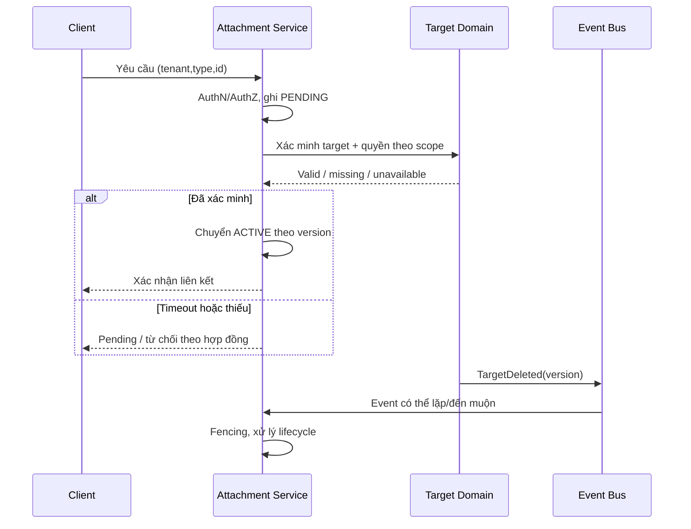
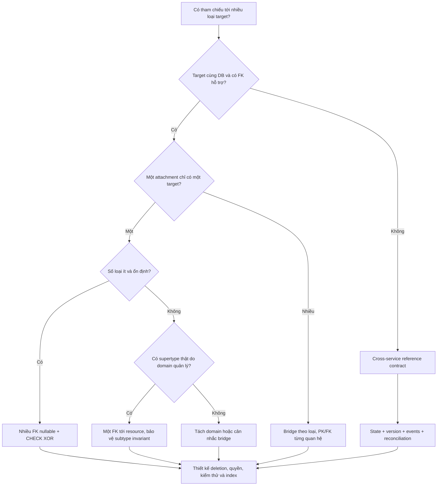

# Khóa ngoại đa hình không có cách kiểm soát tham chiếu rõ ràng

## Mục tiêu học tập

Sau bài học, bạn có thể:

- Nhận diện **khóa ngoại đa hình** (*polymorphic foreign key / polymorphic association*) dạng `target_type + target_id` và phân biệt nó với một khóa ngoại quan hệ có thể được hệ quản trị cưỡng chế.
- Giải thích vì sao chỉ kiểm tra `target_type` hợp lệ hoặc `target_id` có dạng UUID **không chứng minh đối tượng đích tồn tại**, đúng loại và đúng phạm vi tenant.
- Chỉ ra các lỗi **tham chiếu mồ côi, sai loại, ghép nhầm tenant, xóa không lan truyền, đua tranh đọc–ghi, trùng định danh và dữ liệu lịch sử mất nghĩa**.
- Thiết kế ba hướng thay thế: **nhiều khóa ngoại tường minh có ràng buộc đúng một đích**, **bảng liên kết riêng cho từng loại đích** và **bảng thực thể cha/registry có khóa tham chiếu chung**.
- Biết khi nào một association đa hình là quyết định có chủ đích vì đối tượng nằm ngoài cùng cơ sở dữ liệu, và những **bảo đảm thay thế** phải được công bố.
- Xác định trách nhiệm giữa **FK, UNIQUE, CHECK, trigger, transaction, event/CDC, service validation và reconciliation** thay vì cho rằng một lớp thay thế được tất cả lớp khác.
- Mô hình hóa chính sách **ON DELETE, soft delete, retention, lịch sử, ACL và tenant isolation** cho liên kết đa loại.
- Lập kế hoạch di trú từ lược đồ cũ sang thiết kế có thể kiểm chứng bằng backfill, kiểm tra mồ côi, dual-read, cutover và rollback.
- Viết truy vấn SQL và bộ kiểm thử chứng minh không có liên kết mơ hồ, không vi phạm ràng buộc và không nhân dòng dữ liệu sau khi join.

Bài học thuộc module **DATABASE_DATA_MODELING**, có mục tiêu chuyển yêu cầu nghiệp vụ thành mô hình dữ liệu rõ ràng từ thực thể, quan hệ, ràng buộc đến khóa, chỉ mục và lược đồ vật lý, đồng thời cân nhắc mô hình quan hệ, document, đồ thị và phân tích. Trong chương **Lỗi thường gặp**, trường hợp này đặc biệt nguy hiểm vì một cấu trúc có vẻ “dễ mở rộng” có thể đẩy toàn bộ tính đúng đắn tham chiếu khỏi database mà không ai thực sự nhận trách nhiệm.

> **Cốt lõi:** nếu một hàng nói “tôi trỏ tới đối tượng X”, thiết kế phải giải thích **X được định danh trong không gian nào, ai chứng minh X tồn tại, ai ngăn X bị xóa sai, và cách phát hiện/sửa lỗi khi hệ gặp sự cố**.

---

## 1. Tình huống thực tế: tệp đính kèm cho nhiều loại hồ sơ

Một nền tảng bán hàng có ba loại đối tượng có thể nhận tệp đính kèm:

1. **Đơn hàng** — chứng từ khách cung cấp cho đơn.
2. **Yêu cầu trả hàng** — ảnh hiện trạng, hóa đơn hoàn.
3. **Phiếu hỗ trợ** — ảnh minh họa lỗi hoặc trao đổi.

Yêu cầu ban đầu:

```text
POST /attachments
  tenantId = shop_17
  targetType = "ORDER"
  targetId = "ord_908"
  objectKey = "obj_45"
```

Nhóm phát triển muốn một bảng duy nhất:

```sql
-- Ví dụ thiết kế có nguy cơ: không có foreign key
-- thực sự tới orders / returns / support_tickets.
CREATE TABLE attachments (
    tenant_id       VARCHAR(60) NOT NULL,
    attachment_id   VARCHAR(80) NOT NULL,
    target_type     VARCHAR(30) NOT NULL,
    target_id       VARCHAR(100) NOT NULL,
    object_key      VARCHAR(200) NOT NULL,
    uploaded_at     TIMESTAMP NOT NULL,
    PRIMARY KEY (tenant_id, attachment_id),
    CHECK (target_type IN ('ORDER', 'RETURN', 'TICKET'))
);
```

Nhìn vào schema, có `PRIMARY KEY` và `CHECK` nên tưởng như đã đủ. Nhưng **chưa có ràng buộc nào nói**:

- Khi `target_type='ORDER'`, `target_id` phải tồn tại trong `orders`.
- Khi `target_type='RETURN'`, ID đó phải tồn tại trong `returns`.
- `tenant_id` của attachment phải **trùng tenant của đích**.
- Khi đơn bị xóa/ẩn, attachment được giữ, xóa hay tách liên kết như thế nào.
- Trước khi trả file, người gọi phải có quyền xem **đúng đối tượng đích**, không chỉ biết object key.

Chính khoảng trống đó là lỗi **khóa ngoại đa hình không có cách kiểm soát tham chiếu rõ ràng**.

### 1.1. Khóa ngoại thực sự là gì?

Trong lược đồ quan hệ, một **khóa ngoại (foreign key, FK)** là ràng buộc nêu rõ **cột nguồn nào tham chiếu tới khóa ứng viên/duy nhất của một bảng đích xác định**, dưới các quy tắc NULL và hành động cập nhật/xóa mà DBMS hỗ trợ.

Ví dụ:

```sql
-- Mối liên hệ có một bảng đích xác định.
CREATE TABLE orders (
    tenant_id VARCHAR(60) NOT NULL,
    order_id  VARCHAR(100) NOT NULL,
    status    VARCHAR(30) NOT NULL,
    PRIMARY KEY (tenant_id, order_id)
);

CREATE TABLE order_documents (
    tenant_id   VARCHAR(60) NOT NULL,
    document_id VARCHAR(80) NOT NULL,
    order_id    VARCHAR(100) NOT NULL,
    object_key  VARCHAR(200) NOT NULL,
    PRIMARY KEY (tenant_id, document_id),
    FOREIGN KEY (tenant_id, order_id)
      REFERENCES orders(tenant_id, order_id)
);
```

Khi tạo một `order_documents` có `order_id` không tồn tại trong **cùng tenant**, DBMS có thể từ chối lệnh theo chính sách constraint. Khi xóa order, constraint cùng engine tham gia xử lý, thay vì mong mọi developer nhớ kiểm tra.

Định nghĩa này **không** bảo đảm rằng object storage có file thật hoặc người dùng có quyền tải file; đó là những ràng buộc khác. Nhưng nó bảo vệ chính xác sự tồn tại của **đích quan hệ** mà FK công bố.

### 1.2. Vì sao `target_type + target_id` không phải FK đúng nghĩa?

Với kiểu đa hình:

```text
attachments.target_type = 'ORDER'
attachments.target_id   = 'ord_908'
```

bảng tham chiếu cần thay đổi **theo giá trị của từng hàng**. Trong SQL quan hệ thông thường, khai báo kiểu:

```text
FOREIGN KEY (target_id)
  REFERENCES tableChosenBy(target_type)(id)
```

không phải cú pháp FK tiêu chuẩn. Một `CHECK` kiểm tra chuỗi `ORDER` chỉ kiểm tra **miền giá trị loại**, không kiểm tra **hàng đích**.

Có thể có các tính năng riêng của engine, trigger, extension, partitioning hoặc cơ chế ứng dụng để bổ sung kiểm tra, nhưng không nên mô tả chúng như **FK được cơ sở dữ liệu cưỡng chế đầy đủ** nếu thực tế chỉ có một quy ước viết code.

### 1.3. Đừng nhầm “đa hình” với “kế thừa kiểu” ở một bảng

Một bảng duy nhất có:

```text
resources(
    resource_id,
    resource_type,  -- ORDER/RETURN/TICKET
    owner_tenant_id,
    ...
)
```

và một FK trỏ `resources(resource_id)` **không phải lỗi ở cùng mức**: nó trỏ tới **một bảng đích rõ ràng**. Câu hỏi còn lại là registry này có thật là nguồn thực thể cha và có bảo đảm hàng con tồn tại/đúng loại hay không.

Tương tự, một cột `event_type` trong event log hoặc `payment_method_type` trong bảng giao dịch không tự là “polymorphic FK”. Vấn đề xuất hiện khi một **cặp type/id được dùng như một quan hệ tham chiếu xuyên nhiều bảng đích** mà thiếu hợp đồng kiểm soát.

## 2. Năm loại lỗi có thể xảy ra dù schema vẫn hợp lệ

### 2.1. Tham chiếu mồ côi (orphan reference)

```text
attachments:
  (shop_17, att_1, ORDER, ord_908)

orders:
  -- không có ord_908 ở shop_17
```

DBMS vẫn nhận attachment vì chỉ kiểm tra `target_type` hợp lệ. Khi ứng dụng hiển thị, join không tìm thấy order. Nếu giao diện chỉ bỏ qua attachment, lỗi có thể tồn tại nhiều tháng mà không có cảnh báo.

### 2.2. Sai loại đối tượng và trùng ID

```text
orders:          (shop_17, id = 908)
support_tickets: (shop_17, id = 908)

attachments:
  target_type = TICKET
  target_id   = 908
```

Nếu code ở một nhánh lại truy vấn `orders` chỉ theo `target_id`, attachment có thể hiển thị vào **đơn 908** thay vì **ticket 908**. Không thể dựa vào suy đoán “ID khác bảng sẽ không trùng”: UUID hoặc sequence không phải giấy phép bỏ type và namespace.

### 2.3. Sai tenant — lỗi còn nghiêm trọng hơn dữ liệu mồ côi

```text
attachments:
  tenant_id   = shop_17
  target_type = ORDER
  target_id   = ord_5

orders:
  (shop_18, ord_5)
```

Nếu lookup `WHERE order_id='ord_5'` mà thiếu `tenant_id`, code có thể xác nhận đích của shop 18 và trả file/metadata cho shop 17. Đây là lỗi **cách ly dữ liệu và phân quyền**, không chỉ lỗi phân tích.

**Quy tắc:** khi ID chỉ duy nhất trong tenant, khóa liên kết phải bảo tồn **tenant + loại + ID**, và mọi truy vấn phải kiểm tra quyền độc lập với sự tồn tại của record.

### 2.4. Xóa hoặc thay đổi đích không lan sang liên kết

Khi order bị xóa, FK thật có thể chặn/xóa/set null theo chính sách. Cặp `target_type + target_id` không biết bảng nào phải phát cảnh báo, nên:

- Attachment còn treo dù target đã bị xóa.
- File vật lý ở object storage vẫn tồn tại.
- Read model, search index hoặc cache vẫn cho tìm kiếm bằng target cũ.
- Một ID được tái sử dụng khiến liên kết cũ **trỏ nhầm sang đối tượng mới**.

Xử lý đúng phụ thuộc retention: có file cần giữ để giải quyết hoàn tiền, có file phải xóa khi hết mục đích. Điều kiện này **phải được thiết kế**, không được quyết định ngẫu nhiên bằng `CASCADE`.

### 2.5. Race giữa kiểm tra và ghi

Mã ứng dụng như:

```text
if existsOrder(tenantId, targetId):
    insertAttachment(tenantId, 'ORDER', targetId)
```

không nguyên tử nếu lệnh kiểm tra và insert không có cơ chế điều phối thích hợp:

```text
T1: API A thấy ord_908 còn tồn tại
T2: API B xóa ord_908
T3: API A tạo attachment trỏ ord_908
```

Kết quả là orphan dù **đã viết hàm existsOrder**. FK được engine thực thi cùng cơ chế giao dịch và đồng bộ phù hợp giải quyết lớp race này trong phạm vi một DB. Trigger/lock tự viết phải **xem xét cả phía xóa target**, không chỉ phía insert attachment.

## 3. Ma trận ràng buộc: cần kiểm soát những gì?

Để xem một thiết kế có đủ an toàn, hãy lập bảng câu hỏi:

| Bất biến/hành vi | Câu hỏi kiểm chứng | Cơ chế phù hợp |
| --- | --- | --- |
| **Loại hợp lệ** | `target_type` chỉ nhận loại công bố? | `CHECK`/enum có version |
| **Đích tồn tại** | Mỗi liên kết có hàng đích thật? | FK trực tiếp, registry có invariant, hoặc xác minh ngoại hệ |
| **Đúng tenant** | Liên kết không nhảy tenant? | FK ghép tenant + ID, authz và scoped lookup |
| **Đúng loại** | Đích là ORDER thật, không chỉ resource bất kỳ? | Typed FK hoặc registry type + invariant subtype |
| **Không mơ hồ** | Một attachment trỏ một hay nhiều đích? | CHECK XOR, key constraint hoặc hợp đồng nhiều–nhiều |
| **Tạo/xóa đồng thời** | Không sinh orphan do race? | Transaction/FK hoặc workflow có fencing |
| **Vòng đời** | Xóa target thì liên kết/file ra sao? | `RESTRICT`/`CASCADE`/redaction + policy |
| **Đúng quyền** | Ai được đọc/tải attachment? | Authorization theo object/tenant, không nhờ FK |
| **Trạng thái lịch sử** | Target bị soft-delete thì vẫn tham chiếu được? | Status/lifecycle rule và query contract |
| **Các bản sao** | Cache/index/analytics/file vật lý được dọn? | Event/CDC, delete orchestration, reconciliation |
| **Quan sát lỗi** | Có cảnh báo orphan, sai loại, mismatch tenant? | Integrity jobs, metrics, runbook |

Một câu nói “chúng ta có validation ở controller” **chỉ trả lời một phần**. Bản ghi có thể được tạo bởi CLI, batch, CDC, worker hay restore mà không đi qua controller đó.

## 4. Chọn mô hình theo quyền sở hữu và số loại đích

Trước khi chọn SQL, trả lời:

1. **Có bao nhiêu loại đích?** Ba loại ổn định hay hàng trăm loại thường thêm?
2. **Chúng ở cùng database?** Cùng hệ quản trị giao dịch, các database khác nhau, hay dịch vụ riêng?
3. **Bản ghi nguồn là một liên kết hay có thể liên kết nhiều đích?** Một ảnh gắn một ticket, hay một file được tái sử dụng cho nhiều hồ sơ?
4. **Đích có cùng vòng đời và quyền?** Xóa ticket có xóa file được không? Order có nghĩa vụ giữ chứng từ riêng không?
5. **Một đối tượng đích có thể có bao nhiêu attachment?** Cần index/pagination thế nào?
6. **ID được cấp ở đâu?** Theo tenant, theo loại hay global; có được tái sử dụng không?
7. **SLA nhất quán?** Có chấp nhận vài giây một bản dẫn xuất chưa cập nhật không?
8. **Ai quyết định membership?** Attachment Service, Order Domain hay một Resource Registry có chủ sở hữu rõ?

Từ đó mới lựa chọn. Không có câu trả lời “mọi polymorphic FK đều phải thay bằng đúng một cách”.

### 4.1. Tổng quan các lựa chọn

| Phương án | Ưu điểm | Hạn chế/phạm vi |
| --- | --- | --- |
| Nhiều cột FK nullable + CHECK đúng một | FK thực tới bảng từng loại; dễ kiểm chứng | Nhiều cột, thêm loại phải migration; phù hợp tập loại nhỏ |
| Bảng liên kết riêng theo loại | FK rõ; một attachment có thể liên kết nhiều đích có chủ ý | Nhiều bảng; exclusivity xuyên bảng không tự có |
| Supertype/registry nguồn chung | Một FK tới bảng cha; thêm loại linh hoạt | Cần bảo đảm registry ↔ subtype tồn tại và nhất quán |
| Tách bảng attachment theo domain | Ranh giới ownership/lifecycle rõ | Có thể trùng schema, muốn danh sách chung phải union/read model |
| Trigger kiểm tra type/id | Có thể giữ lược đồ cũ | Race, delete/update target, bulk load, engine-specific, khó kiểm chứng |
| Validation ứng dụng + event/reconcile | Dùng được khi đích ở dịch vụ khác | Không phải ACID/FK; có cửa sổ eventual và vận hành phức tạp |

## 5. Phương án A: nhiều FK tường minh, đúng một đích

Khi chỉ có ba loại đích ổn định và mỗi attachment phải thuộc **đúng một** đối tượng, dùng ba cột FK nullable:

```text
attachments:
  tenant_id
  attachment_id
  order_id       NULL
  return_id      NULL
  ticket_id      NULL
  object_key
```

Chúng ta quy định:

\[
isNotNull(orderId)+isNotNull(returnId)+isNotNull(ticketId)=1.
\]

Nếu cả ba NULL, attachment không có đích. Nếu hai hoặc ba khác NULL, attachment trỏ nhiều đích dù hợp đồng yêu cầu đúng một. `CHECK` dạng tổng số cột không NULL tránh cả hai tình huống.

### 5.1. DDL minh họa (PostgreSQL và nhiều DB quan hệ có cú pháp tương tự)

Giả sử ba bảng đích tồn tại với PK ghép:

```sql
CREATE TABLE orders (
    tenant_id VARCHAR(60) NOT NULL,
    order_id  VARCHAR(100) NOT NULL,
    PRIMARY KEY (tenant_id, order_id)
);

CREATE TABLE return_requests (
    tenant_id VARCHAR(60) NOT NULL,
    return_id VARCHAR(100) NOT NULL,
    PRIMARY KEY (tenant_id, return_id)
);

CREATE TABLE support_tickets (
    tenant_id VARCHAR(60) NOT NULL,
    ticket_id VARCHAR(100) NOT NULL,
    PRIMARY KEY (tenant_id, ticket_id)
);

CREATE TABLE attachments (
    tenant_id     VARCHAR(60) NOT NULL,
    attachment_id VARCHAR(80) NOT NULL,
    order_id      VARCHAR(100),
    return_id     VARCHAR(100),
    ticket_id     VARCHAR(100),
    object_key    VARCHAR(200) NOT NULL,

    PRIMARY KEY (tenant_id, attachment_id),

    CONSTRAINT attachment_exactly_one_target CHECK (
        (CASE WHEN order_id IS NOT NULL THEN 1 ELSE 0 END)
      + (CASE WHEN return_id IS NOT NULL THEN 1 ELSE 0 END)
      + (CASE WHEN ticket_id IS NOT NULL THEN 1 ELSE 0 END) = 1
    ),

    CONSTRAINT fk_attachment_order
      FOREIGN KEY (tenant_id, order_id)
      REFERENCES orders (tenant_id, order_id)
      ON DELETE RESTRICT,

    CONSTRAINT fk_attachment_return
      FOREIGN KEY (tenant_id, return_id)
      REFERENCES return_requests (tenant_id, return_id)
      ON DELETE RESTRICT,

    CONSTRAINT fk_attachment_ticket
      FOREIGN KEY (tenant_id, ticket_id)
      REFERENCES support_tickets (tenant_id, ticket_id)
      ON DELETE RESTRICT
);
```

**Giải thích đúng semantics:**

- `tenant_id` và `attachment_id` không NULL. `order_id`, `return_id`, `ticket_id` nullable.
- Với hành vi **MATCH SIMPLE** mặc định của FK ghép trong PostgreSQL, một cặp `(tenant_id, order_id)` có `order_id=NULL` không buộc phải có hàng order; CHECK bảo đảm **ít nhất một** cột đích khác NULL.
- Khi `order_id` khác NULL, FK kiểm tra chính **(tenant_id,order_id)** chứ không phải `order_id` toàn cục.
- `CHECK` đếm bằng `CASE` thay vì dùng trực tiếp biểu thức có thể thành UNKNOWN trong logic ba giá trị.
- `ON DELETE RESTRICT` là **chính sách ví dụ**: chưa cho xóa parent khi attachment còn tham chiếu. Có thể thay bằng xử lý nghiệp vụ khác nếu được phê duyệt.
- Không dùng `ON DELETE SET NULL` một cách tùy tiện: nó có thể khiến cả ba cột đích NULL, **vi phạm CHECK đúng một**, trừ khi đã có quy trình chuyển liên kết sang trạng thái khác.

Một lệnh insert hợp lệ:

```sql
INSERT INTO attachments (
    tenant_id, attachment_id, order_id, object_key
) VALUES (
    'shop_17', 'att_45', 'ord_908', 'objects/doc45'
);
```

Lệnh trên chỉ thành công **nếu** order `(shop_17,ord_908)` đã tồn tại; nếu không, FK từ chối theo bảo đảm của DB.

### 5.2. Chỉ mục và truy vấn theo từng loại đích

```sql
-- PostgreSQL: partial indexes giúp bỏ hàng không thuộc role.
CREATE INDEX idx_attachment_order
    ON attachments (tenant_id, order_id, attachment_id)
    WHERE order_id IS NOT NULL;

CREATE INDEX idx_attachment_return
    ON attachments (tenant_id, return_id, attachment_id)
    WHERE return_id IS NOT NULL;

CREATE INDEX idx_attachment_ticket
    ON attachments (tenant_id, ticket_id, attachment_id)
    WHERE ticket_id IS NOT NULL;
```

Truy vấn danh sách file của một đơn:

```sql
SELECT attachment_id, object_key
FROM attachments
WHERE tenant_id = 'shop_17'
  AND order_id = 'ord_908'
ORDER BY attachment_id;
```

Hệ quản trị có thể chọn index trên theo kế hoạch thực thi. **FK không đồng nghĩa database tự tạo index phù hợp trên cột FK ở phía con** trong mọi sản phẩm; cần kiểm tra thống kê, plan và workload.

### 5.3. Khi nào phương án A không phù hợp?

- Số loại đích rất lớn hoặc được thêm thường xuyên: mỗi loại thêm cột và constraint.
- Một attachment thật sự có **nhiều đích**; XOR không diễn đạt đúng quan hệ N–M.
- Các bảng đích ở database/service khác nhau: FK trực tiếp có thể không khả thi.
- Mỗi loại có quyền/retention hoàn toàn khác: có thể nên tách thành phần sở hữu theo domain.

Không dùng `CHECK exactly_one` nếu nghiệp vụ cho phép tài liệu **đang tải lên chưa gắn đích**. Có thể tách hai giai đoạn `STAGED` → `ATTACHED` với schema/trạng thái rõ, hoặc bảng upload staging riêng; không đơn giản bỏ hết constraint mà không thay bằng chính sách nào.

## 6. Phương án B: bảng liên kết theo từng loại thực thể

Nếu **file là đối tượng độc lập** và có thể được liên kết có chủ ý với nhiều đơn/ticket, sử dụng:

```text
attachments(tenant_id, attachment_id, object_key, ...)
order_attachments(tenant_id, order_id, attachment_id)
return_attachments(tenant_id, return_id, attachment_id)
ticket_attachments(tenant_id, ticket_id, attachment_id)
```

### 6.1. DDL cho quan hệ theo loại

```sql
CREATE TABLE stored_files (
    tenant_id     VARCHAR(60) NOT NULL,
    attachment_id VARCHAR(80) NOT NULL,
    object_key    VARCHAR(200) NOT NULL,
    PRIMARY KEY (tenant_id, attachment_id)
);

CREATE TABLE order_attachments (
    tenant_id     VARCHAR(60) NOT NULL,
    order_id      VARCHAR(100) NOT NULL,
    attachment_id VARCHAR(80) NOT NULL,

    PRIMARY KEY (tenant_id, order_id, attachment_id),

    FOREIGN KEY (tenant_id, order_id)
      REFERENCES orders(tenant_id, order_id),

    FOREIGN KEY (tenant_id, attachment_id)
      REFERENCES stored_files(tenant_id, attachment_id)
);

CREATE TABLE return_attachments (
    tenant_id     VARCHAR(60) NOT NULL,
    return_id     VARCHAR(100) NOT NULL,
    attachment_id VARCHAR(80) NOT NULL,

    PRIMARY KEY (tenant_id, return_id, attachment_id),

    FOREIGN KEY (tenant_id, return_id)
      REFERENCES return_requests(tenant_id, return_id),

    FOREIGN KEY (tenant_id, attachment_id)
      REFERENCES stored_files(tenant_id, attachment_id)
);
```

`ticket_attachments` được xây tương tự. Cặp FK trên bảo vệ sự tồn tại của **cả file lẫn đích** trong **cùng tenant**. Khóa chính ngăn một cặp liên kết bị ghi hai lần trong cùng bảng. Các bảng bridge có grain **một quan hệ file–đích**, không phải một file.

### 6.2. Chọn đúng ngữ nghĩa 1–N hay N–M

Nếu file được liên kết với nhiều order, nhiều hàng trong `order_attachments` là hợp lệ. Nhưng nếu yêu cầu **mỗi file chỉ gắn một target duy nhất trên toàn hệ**, ba bảng bridge tách biệt **không tự bảo đảm exclusivity xuyên bảng**:

```text
order_attachments:  (shop_17, ord_908, att_45)
return_attachments: (shop_17, ret_12, att_45)
```

Mỗi FK và PK riêng vẫn hợp lệ. Để cưỡng chế một đích tổng thể, cần:

- Đưa quyền sở hữu đích về một bảng liên kết chung có cấu trúc phù hợp và ràng buộc mạnh; hoặc
- Dùng thiết kế A với CHECK XOR; hoặc
- Có transaction/constraint khác được chứng minh xử lý **toàn bộ loại đích** (khó hơn, đặc biệt khi thêm loại mới).

Nếu nghiệp vụ **cho phép nhiều liên kết**, đây không phải lỗi: phải viết rõ định nghĩa về quyền tải file và retention khi **một trong nhiều đích** bị xóa. Xóa file vật lý chỉ khi không còn tham chiếu hợp lệ **và** không có nghĩa vụ giữ khác.

### 6.3. Không bỏ qua chiều tra cứu ngược

Một schema cần hỗ trợ:

- `listAttachments(orderId)`: dùng index/PK theo `(tenant_id,order_id)`.
- `findTargets(attachmentId)`: có thể cần **index riêng** theo `(tenant_id,attachment_id)` ở các bridge table.
- Dọn quan hệ khi order bị xóa hoặc đổi chủ.
- Kiểm tra quyền theo **đích cụ thể**, không chỉ theo `stored_files`.

Thứ tự cột trong PK hoặc index làm thay đổi khả năng dùng index hiệu quả cho đường truy cập; không dựa vào tên “bridge” để khẳng định cả hai chiều đều nhanh.

## 7. Phương án C: supertype hoặc resource registry có FK thật

Khi nhiều loại thực thể có **cùng vòng đời/định danh tài nguyên** và cần một kiểu tham chiếu chung, có thể mô hình hóa một **supertype**:

```text
resources:
  (tenantId, resourceType, resourceId) -> lifecycle, owner, ...

orders:
  (tenantId, orderId) -> order-specific fields

return_requests:
  (tenantId, returnId) -> return-specific fields

attachments:
  (tenantId, targetType, targetId) -> resources(...)
```

Bây giờ liên kết từ attachments có thể là **FK trực tiếp tới một bảng rõ ràng**.

### 7.1. DDL resource registry

```sql
CREATE TABLE resources (
    tenant_id      VARCHAR(60) NOT NULL,
    resource_type  VARCHAR(30) NOT NULL,
    resource_id    VARCHAR(100) NOT NULL,
    lifecycle      VARCHAR(24) NOT NULL,

    PRIMARY KEY (tenant_id, resource_type, resource_id),
    CHECK (resource_type IN ('ORDER', 'RETURN', 'TICKET'))
);

CREATE TABLE resource_attachments (
    tenant_id      VARCHAR(60) NOT NULL,
    attachment_id  VARCHAR(80) NOT NULL,
    resource_type  VARCHAR(30) NOT NULL,
    resource_id    VARCHAR(100) NOT NULL,
    object_key     VARCHAR(200) NOT NULL,

    PRIMARY KEY (tenant_id, attachment_id),

    CONSTRAINT fk_attachment_resource
      FOREIGN KEY (tenant_id, resource_type, resource_id)
      REFERENCES resources(
          tenant_id, resource_type, resource_id
      )
);
```

Thiết kế này bảo đảm:

- `resource_type` thuộc loại registry công nhận.
- Một liên kết tới **hàng resource thật** trong cùng tenant.
- Xóa resource khỏi registry chịu hành động FK đã khai báo.

Nhưng cần chú ý **registry có thể không tương ứng với hàng subtype**.

### 7.2. Hàng registry không chứng minh hàng subtype tồn tại

Giả sử:

```text
resources:
  (shop_17, ORDER, ord_908)

orders:
  -- không có ord_908
```

`resource_attachments` vẫn hợp lệ vì trỏ **registry**, trong khi UI đọc `orders` lại không thấy order. Lỗi chỉ chuyển thành quan hệ **registry ↔ subtype**.

Cần xác định **registry có ý nghĩa gì**:

**Trường hợp 1: Registry là nguồn có thẩm quyền về sự tồn tại của resource.** Hàng resource chỉ được tạo sau khi đăng ký hợp lệ theo transaction/workflow; subtype có thể là chi tiết tùy chọn hoặc dữ liệu xuất hiện sau. FK bảo vệ hợp đồng **“resource đã đăng ký”**, không hứa mọi loại có một hàng subtype ngay lập tức.

**Trường hợp 2: Subtype mới là nguồn có thẩm quyền.** Muốn bảo đảm “resource ORDER luôn có đúng một order”, phải có cơ chế bảo vệ **chiều registry → subtype**:

- Transaction quản lý create/delete của resource và subtype.
- Constraint/triggers/thiết kế kế thừa phù hợp sản phẩm, được kiểm chứng concurrency.
- Một bảng nguồn chung quyết định sự tồn tại, còn subtype là phần mở rộng.
- Reconciliation và trạng thái `PENDING/ACTIVE` nếu eventual consistency là chủ đích.

**Một FK từ `orders` tới `resources` chỉ bảo vệ chiều orders → resources**, không buộc mọi resource có order tương ứng.

### 7.3. Liên kết subtype với đúng loại

Nếu subtype `orders` tham chiếu registry, không nên chỉ dùng `(tenant_id,resource_id)` và bỏ `resource_type`. Có thể dùng **cột loại hằng được CHECK**, rồi FK ghép:

```sql
CREATE TABLE order_details (
    tenant_id      VARCHAR(60) NOT NULL,
    order_id       VARCHAR(100) NOT NULL,
    resource_type  VARCHAR(30) NOT NULL DEFAULT 'ORDER',
    order_status   VARCHAR(30) NOT NULL,

    PRIMARY KEY (tenant_id, order_id),
    CHECK (resource_type = 'ORDER'),

    FOREIGN KEY (tenant_id, resource_type, order_id)
      REFERENCES resources(
          tenant_id, resource_type, resource_id
      )
);
```

Một hàng `order_details` không thể trỏ tới resource RETURN. Nhưng vẫn chưa bảo đảm **mỗi resource ORDER có đúng một `order_details`**. Nếu đó là bất biến, cần cơ chế bổ sung.

### 7.4. Hai cách cấp khóa cho registry

```text
A. PRIMARY KEY (tenantId, resourceType, resourceId)
   -> mỗi loại có namespace riêng.

B. PRIMARY KEY (tenantId, globalResourceId)
   -> các loại dùng chung ID từ registry.
   -> resourceType là thuộc tính của resource.
```

Với B, FK trên `(tenantId,globalResourceId)` chứng minh resource tồn tại; nếu attachment còn lưu `declaredTargetType`, phải bảo đảm loại này khớp loại thật bằng composite unique/FK phù hợp, hoặc không lưu loại trùng. UUID không tự chứng minh đúng loại hay tenant.

### 7.5. Đánh đổi của registry

- Thêm bước ghi và ràng buộc lifecycle khi tạo/xóa.
- Có thể thành nút chia sẻ/hotspot giữa nhiều service.
- Cần owner rõ: ai được đăng ký hoặc xóa resource?
- Nếu thực thể ở hệ khác, cần mapping/event đến muộn và reconcile.
- Cần chống tình trạng **ID đã xóa rồi được tái sử dụng**.
- Registry có version và lịch sử, retention và quyền truy cập riêng.

**Không xây registry chỉ để có một FOREIGN KEY** nếu chưa làm rõ invariant giữa registry và bản ghi nghiệp vụ.

## 8. Phương án D: tách attachment theo bounded context

Nếu đích có **quyền, retention và lifecycle khác nhau**, schema “dùng chung” có thể không còn là lợi ích:

```text
order_documents:
  (tenantId, orderId, documentId, objectKey, documentPurpose)

return_evidence:
  (tenantId, returnId, evidenceId, objectKey, evidenceType)

support_attachments:
  (tenantId, ticketId, attachmentId, objectKey, visibility)
```

Mỗi bảng có FK tới **một loại đích** và chính sách riêng. Khi cần hiển thị mọi tệp, tạo view `UNION ALL` hoặc read model có kiểm soát.

### 8.1. View gom đường đọc, không gộp ownership

```sql
CREATE VIEW all_attachment_refs AS
SELECT
    tenant_id,
    'ORDER' AS target_type,
    order_id AS target_id,
    document_id AS attachment_id,
    object_key
FROM order_documents

UNION ALL

SELECT
    tenant_id,
    'RETURN' AS target_type,
    return_id AS target_id,
    evidence_id AS attachment_id,
    object_key
FROM return_evidence;
```

View phục vụ **đọc**, không biến dữ liệu thành một hàng ghi chung hoặc tự cấp quyền chéo domain. Cần kiểm tra phân quyền từng nhánh và `attachment_id` có duy nhất toàn hệ hay chỉ trong từng loại. API cần mang namespace đầy đủ.

### 8.2. Khi nào nên tách?

- Ngữ nghĩa file khác: hóa đơn, bằng chứng hoàn trả, tệp hỗ trợ nhạy cảm.
- Domain ownership khác nhau.
- Retention, sự kiện và quyền truy cập không tương thích.
- Không có transaction chung và schema trung tâm gây coupling.
- Service cần tiến hóa độc lập, không muốn sửa enum chung mỗi lần thêm domain.

Đánh đổi là nhiều bảng và adapter, đổi lấy ranh giới ownership và bảo mật rõ.

## 9. Vì sao trigger kiểm tra đích có thể nguy hiểm?

Một nhóm muốn giữ `target_type + target_id` và viết trigger:

```text
BEFORE INSERT INTO attachments:
    if NEW.target_type = ORDER:
        assert exists orders[NEW.target_id]
    else if NEW.target_type = TICKET:
        assert exists tickets[NEW.target_id]
```

**Kiểm tra tồn tại là cần nhưng chưa đủ**:

1. **Race:** target có thể bị xóa sau SELECT nhưng trước insert commit.
2. **Chiều ngược:** delete/update order cũng phải xét các liên kết.
3. **Thêm loại:** trigger/quyền/migration phải đổi đồng bộ.
4. **Tenant:** kiểm tra khóa ghép, không chỉ ID.
5. **Bulk load/restore:** có đường nạp có thể tắt/bỏ qua trigger với đặc quyền.
6. **Deadlock/throughput:** trigger truy cập/khóa nhiều bảng.
7. **Id reuse/soft delete:** còn row vật lý chưa hẳn hợp lệ về lifecycle.
8. **Audit:** logic khó quan sát, test và nâng cấp.

### 9.1. Khóa và isolation phải được xác minh

Để tránh cuộc đua insert–delete, giải pháp tùy engine có thể cần **row lock trên target**, trigger ở phía delete/update, isolation thích hợp và test concurrency.

```sql
-- KHÔNG phải ràng buộc toàn vẹn hoàn chỉnh.
SELECT 1 FROM orders
WHERE tenant_id = :tenant_id
  AND order_id = :target_id;
```

Không thể tin target tồn tại đến commit chỉ vì SELECT vừa trả một hàng. Ngay cả khi viết trigger đúng trong một DB, **FK tường minh thường đơn giản và dễ audit hơn**.

### 9.2. Trigger không tạo transaction xuyên service

Trigger trong Attachment DB không mặc định lock/rollback transaction tại Order DB khác. Nếu tham chiếu cross-service, phải công bố phạm vi consistency, xử lý service đích mất kết nối, delete events, retry, reconciliation và quyền.

Không quảng cáo logic “gọi API xác minh đích” như thể là foreign key của SQL.

## 10. ORM giúp điều hướng object, không bảo đảm FK tự động

Một số ORM có tính năng liên kết đa hình. Chẳng hạn Hibernate có khả năng riêng để chọn entity theo discriminator, trong khi `@ManyToOne` thông thường trong JPA trỏ tới **một loại entity xác định**.

Code có thể tiện:

```text
Attachment.getTarget()
    -> Order hoặc ReturnRequest hoặc SupportTicket
```

Nhưng cần kiểm tra:

- DDL thực tế có **FK tới đâu**?
- `target_type` có CHECK không?
- Tenant/authorization được kiểm tra ở đâu?
- Xóa target qua batch SQL hoặc service khác có dọn liên kết không?
- Thêm entity type mới cần cập nhật những nơi nào?
- ORM bị bỏ qua bởi migration/import có còn bảo đảm integrity không?

**ORM mapping là cách điều hướng object, không đồng nghĩa ràng buộc toàn vẹn DB.**

### 10.1. Đã có FK vẫn phải validate nghiệp vụ

FK chứng minh **hàng tồn tại**, không chứng minh:

- Ticket còn mở hoặc order chưa bị khóa.
- Người dùng có quyền đọc/ghi attachment.
- MIME/size hợp lệ và file đã được virus-scan.
- Tệp thật sự tồn tại trong object storage.
- Purpose/retention phù hợp.
- File không bị xóa logic hoặc đính kèm trái workflow.

Các điều kiện này cần service/domain logic. **Không có FK thì validation nghiệp vụ càng không phải bằng chứng thay thế FK**.

## 11. Liên kết qua nhiều service: nhất quán có chủ đích

Nếu Orders, Returns và Tickets có DB riêng, FK trực tiếp thường **không khả thi hoặc trái ownership**. Association đa loại có thể là một **foreign reference có chủ đích**, nhưng cần hợp đồng rõ.

### 11.1. Các trạng thái liên kết

```text
attachment_reference:
  tenantId
  attachmentId
  targetType
  targetId
  targetGeneration
  targetVersionSeen
  state = PENDING_VALIDATION | ACTIVE
        | TARGET_MISSING | TARGET_DELETED | BLOCKED
  lastCheckedAt
```

- `PENDING_VALIDATION`: chưa xác minh được target/quyền.
- `ACTIVE`: xác nhận theo mức nhất quán công bố.
- `TARGET_MISSING`: không tìm thấy sau retry/thời hạn thích hợp.
- `TARGET_DELETED`: domain nguồn xác nhận delete/retire.
- `BLOCKED`: cần review quyền/chính sách; không phục vụ file.

State machine minh họa không thay SLA. Nếu nghiệp vụ yêu cầu “attachment chỉ được tạo khi order hiện hữu tại commit”, eventual validation **không có cùng bảo đảm**.

### 11.2. Workflow tạo và xác minh



Phải phân biệt:

- API trả “exists” không xóa race nếu target bị xóa ngay sau đó.
- ACTIVE có thể nghĩa là **được xác minh tại version T**, không bảo đảm tồn tại vĩnh viễn.
- Quyền tải file có thể cần kiểm lại từ nguồn.
- Delete event có ID/phiên bản, retry, idempotency và reconciliation.
- Event thất lạc hoặc consumer offline phải có đường sửa sai.

### 11.3. Event sai thứ tự và ID reuse

```text
v7: Target ACTIVE
v8: Target DELETED
consumer nhận v8, v7, v8
```

Nếu cập nhật theo thứ tự nhận, v7 hồi sinh liên kết đã xóa. Cần:

- Version đơn điệu theo `(tenant,type,id,generation)`.
- Conditional write chống trùng/out-of-order.
- Identity epoch/generation nếu ID có thể được tái sử dụng.
- Reconciliation với source of truth.
- Delete/retire fence theo replay/restore horizon.

Bản ghi còn vật lý nhưng đã **soft-delete** có thể không được phép nhận thêm file. `exists=true` không đủ khi business policy xét trạng thái.

### 11.4. Chỉ mục và fan-out

```sql
CREATE INDEX idx_attachment_target
ON attachments (tenant_id, target_type, target_id, attachment_id);
```

Nhưng “mọi file của một khách qua order, return và ticket” vẫn cần query/đối chiếu nhiều domain; một index đa hình không giải quyết tự động mọi truy vấn cross-domain. Read model tổng hợp cần source/version/owner và delete propagation rõ.

## 12. Xóa, đổi chủ và bảo vệ dữ liệu

FK được database bảo vệ vẫn cần **chính sách xóa**, đặc biệt file có thể chứa hóa đơn, ảnh, địa chỉ hoặc chứng từ nhạy cảm.

### 12.1. Các hành động xóa không tương đương

| Hành động | Nghĩa | Cần thận trọng |
| --- | --- | --- |
| `ON DELETE RESTRICT` / `NO ACTION` | Ngăn/trì hoãn xóa parent nếu còn con, tùy engine/timing | Cần xử lý liên kết trước |
| `ON DELETE CASCADE` | Xóa row con trong cùng DB theo FK | **Không tự xóa bytes ở object storage**, có thể xóa chứng từ cần giữ |
| `ON DELETE SET NULL` | Đặt FK thành NULL | Có thể vi phạm CHECK XOR hoặc mất nghĩa |
| `ON DELETE SET DEFAULT` | Đổi FK sang default nếu hợp lệ | Không dùng fake target tùy tiện |
| Soft delete | Parent vẫn có row nhưng trạng thái đã đóng/xóa | FK đúng, business policy có thể cấm đọc/gắn file |

### 12.2. Metadata và bytes ở các kho khác nhau

```text
Attachment metadata DB:
  tenant, attachmentId, targetRef, objectKey,
  purpose, retentionClass, lifecycle, version

Object storage:
  bytes, objectVersion, encryption metadata

Search/analytics:
  attachment summary, target reference, extracted text
```

Xóa metadata DB không tự xóa bytes/object version. Xóa bytes không tự dọn search index hoặc extracted text. Cần owner retention, workflow delete, chống replay, reconciliation và không dùng ID đoán được làm **quyền tải file**.

### 12.3. Kiểm tra quyền mỗi lần truy cập

Nếu attachment chuyển từ ticket này sang ticket khác, API chỉ kiểm `attachment_id` là thiếu. Quyền cần xét tenant, target, purpose và hành động:

```text
authorize(requester,
          action='READ_ATTACHMENT',
          tenantId, targetType, targetId, purpose)
```

Nếu liên kết là read model eventual, quyết định rõ khi nào quyền từ bản sao đủ, khi nào phải xác minh ở nguồn. **FK tồn tại không đồng nghĩa người dùng được đọc**.

## 13. Di trú từ schema đa hình cũ sang ràng buộc có thể kiểm chứng

Một hệ đã có hàng triệu hàng `attachments(target_type,target_id)` không thể đổi trực tiếp sang FK mới bằng một câu `ALTER TABLE` mà bỏ qua dữ liệu lịch sử.

### 13.1. Xác nhận hợp đồng trước khi sửa schema

Phải chốt:

- Những loại `target_type` nào đang thật sự tồn tại trong dữ liệu, kể cả loại đã ngừng hỗ trợ.
- Với mỗi loại, **bảng nguồn có thẩm quyền** và khóa định danh đầy đủ gồm tenant/epoch nếu cần.
- Một attachment được phép thuộc **một hay nhiều target**.
- Đích bị soft-delete, đã archive, đã chuyển tenant hoặc hard-delete thì liên kết phải được xử lý ra sao.
- Attachment ở trạng thái **đang tải lên** có được tạm thời không có target hay không.
- Những bản ghi không thể đối chiếu phải được **quarantine, giữ làm bằng chứng, hoặc dọn theo chính sách**, không tự chọn target có ID gần giống.
- Hệ có đủ khả năng transaction/locking để bảo vệ dữ liệu mới ngay từ thời điểm di trú không.

Trước khi đo tỷ lệ lỗi, cần phân biệt **tham chiếu không tồn tại trái hợp đồng** với **tham chiếu lịch sử cố ý được giữ sau khi target đã bị xóa**. Hai trường hợp có thể có cùng triệu chứng `JOIN` không tìm thấy hàng nhưng yêu cầu sửa khác nhau.

### 13.2. Bước 1 — Chụp baseline và phát hiện orphan

Với schema phần 1, có thể kiểm tra từng loại bằng cách `LEFT JOIN` theo type **và tenant**.

```sql
-- SQL minh họa trên schema legacy.
-- Một hàng là "orphan" khi target của type đó
-- không tìm thấy theo tenant và id đã công bố.
SELECT
    a.tenant_id,
    a.attachment_id,
    a.target_type,
    a.target_id
FROM attachments AS a
LEFT JOIN orders AS o
  ON a.target_type = 'ORDER'
 AND o.tenant_id = a.tenant_id
 AND o.order_id = a.target_id
LEFT JOIN return_requests AS r
  ON a.target_type = 'RETURN'
 AND r.tenant_id = a.tenant_id
 AND r.return_id = a.target_id
LEFT JOIN support_tickets AS t
  ON a.target_type = 'TICKET'
 AND t.tenant_id = a.tenant_id
 AND t.ticket_id = a.target_id
WHERE a.target_type NOT IN ('ORDER', 'RETURN', 'TICKET')
   OR (a.target_type = 'ORDER' AND o.order_id IS NULL)
   OR (a.target_type = 'RETURN' AND r.return_id IS NULL)
   OR (a.target_type = 'TICKET' AND t.ticket_id IS NULL);
```

**Ý nghĩa của kết quả:** đây là **candidate orphan theo snapshot đọc**, không tự chứng minh bản ghi phải bị xóa. Phải xét soft-delete, archive, dữ liệu nguồn vừa chuyển trạng thái, replication lag và contract lịch sử.

Cần đếm **theo tenant/type/source version** và điều tra mẫu ngẫu nhiên + nhóm quan trọng, không chỉ nhìn tổng số lỗi.

### 13.3. Bước 2 — Chọn đích migration

Ví dụ chọn **phương án A** vì chỉ có ba loại ổn định và mỗi attachment có đúng một target.

Lược đồ đích:

```text
attachments_v2:
  tenant_id
  attachment_id
  order_id nullable
  return_id nullable
  ticket_id nullable
  object_key
  migration_version
```

Đối chiếu từ schema cũ:

| Legacy | V2 | Điều kiện |
| --- | --- | --- |
| `ORDER/ord_908` | `order_id=ord_908` | Order tồn tại đúng tenant và hợp lệ |
| `RETURN/ret_12` | `return_id=ret_12` | Return tồn tại đúng tenant và hợp lệ |
| `TICKET/tik_30` | `ticket_id=tik_30` | Ticket tồn tại đúng tenant và hợp lệ |
| Type không nhận diện | `UNRESOLVED` trong staging | Không ép vào một loại |
| Đích đã xóa hợp lệ | Theo retention/historical policy | Không tạo fake parent chỉ để thỏa FK |

Nếu chọn bảng bridge hoặc resource registry, migration map tương ứng. Đừng vừa migration vừa đổi nghĩa “một file có thể thuộc nhiều đích” khi chưa có quyết định nghiệp vụ.

### 13.4. Bước 3 — Chặn tạo dữ liệu xấu mới

Trước khi backfill kéo dài, cần có đường ghi mới:

- API/service chỉ nhận enum/role đã xác nhận.
- Kiểm tra quyền và tenant.
- Ghi vào schema đích có FK/constraint hoặc transaction bảo vệ.
- Có idempotency cho retry và đường upload chưa hoàn tất.
- Nếu phải dual-write trong giai đoạn chuyển, có **nguồn có thẩm quyền**, cách nhận biết version và đối soát hai bản.
- Không để batch/import/worker cũ tiếp tục ghi loại mới không đăng ký.

Nếu dữ liệu cũ và mới được ghi bởi hai hệ không có transaction chung, **dual-write có thể lỗi từng phần**. Cần event/outbox/CDC và kiểm tra độ trễ hoặc chiến lược read-repair được định nghĩa.

### 13.5. Bước 4 — Backfill có checkpoint và version

```text
snapshot/watermark = W

for each legacy attachment in stable page order:
    read key + sourceVersion
    resolve target by full namespace
    if ambiguous or missing:
        record unresolved case + reason
    else:
        write idempotent v2 mapping
    record checkpoint

consume changes after W
reconcile until projection caught up
```

Lưu ý:

- Đọc theo **khóa ổn định**, không dùng offset pagination vô hạn trên bảng đang thay đổi.
- Không lặng lẽ chuyển `target_type='ORDER'` sang bảng khác vì trùng `target_id`.
- Nếu target đổi/xóa trong lúc backfill, phải xử lý **version và deletion fence**.
- Nếu job chạy lại, khóa idempotency phải tránh nhân liên kết.
- Checkpoint không được đi trước trạng thái đã ghi bền vững trong một cách không khôi phục được.

### 13.6. Bước 5 — Triển khai ràng buộc có kế hoạch

Với một số hệ như PostgreSQL, có thể thêm ràng buộc mới ở chế độ **chưa validate dữ liệu cũ**, sau đó làm sạch và validate; chi tiết loại constraint/khóa/DDL hỗ trợ phải kiểm tra theo phiên bản engine.

Cần xem:

- Ràng buộc được **thực thi đối với ghi mới từ thời điểm nào**.
- Việc validate bảng lớn có thể quét/khóa/tăng tải tới đâu.
- Tạo index trước hay sau, có hỗ trợ tạo index không khóa viết không.
- DDL có thể rollback hay cần migration phiên bản hai chiều.
- Trường nullable/temporary state có phù hợp CHECK XOR không.
- Các job bulk load có thể bypass constraint không.

Không ép tất cả dữ liệu lỗi vào một “Unknown Order” giả để tăng tỷ lệ validate: cách đó **che mất tính đúng đắn** và có thể làm rò quyền ở target chung.

### 13.7. Bước 6 — Cutover và đối soát

Trước khi đổi API/read model sang v2:

1. Đếm tổng attachment theo tenant/type và trạng thái.
2. So từng `attachment_id` và `object_key`, không chỉ count.
3. Chứng minh mỗi bản v2 có **đúng một** FK hợp lệ (nếu policy yêu cầu).
4. Kiểm tra quyền tải file của nhiều tenant và object type.
5. Đối soát orphan/unknown ở v1: có danh sách nguyên nhân và xử lý.
6. Chạy test tạo/xóa target đồng thời, retry, idempotency và soft-delete.
7. Đo p95/p99 truy vấn sau đổi index và policy.
8. Chuyển traffic có kiểm soát; giám sát mismatch/new orphan.
9. Chỉ bỏ đường cũ sau khi đủ điều kiện rollback và retention.
10. Kiểm tra backup/restore từ snapshot trước migration không làm schema cũ “sống lại”.

**Bằng chứng tốt** là một reconciliation theo **khóa, loại, tenant, version và trạng thái**, không phải câu khẳng định “migrate hoàn tất không có exception”.

## 14. Kiểm thử tính toàn vẹn: schema, nghiệp vụ và concurrency

Một bộ test đáng tin nên kiểm tra cả **đường thành công** lẫn **đường lỗi bị từ chối đúng cách**.

### 14.1. Ma trận kiểm thử cho nhiều FK tường minh

| Test | Dữ liệu/lệnh | Kết quả cần chứng minh |
| --- | --- | --- |
| Target hợp lệ | Attachment trỏ order cùng tenant | Insert thành công |
| Orphan | Trỏ order chưa tồn tại | FK từ chối |
| Cross-tenant | Attachment shop A trỏ order chỉ có ở shop B | FK ghép từ chối |
| Hai đích | Cùng hàng có order_id và ticket_id | CHECK XOR từ chối |
| Không có đích | Cả ba FK nullable đều NULL | CHECK từ chối, trừ khi có staging riêng |
| Đúng loại | Dùng ID order ở cột ticket_id, không có ticket tương ứng | FK từ chối |
| ID giống nhau ở hai loại | Order và ticket cùng text ID | Chỉ cột FK được chọn có nghĩa |
| Xóa parent | Order còn attachment khi dùng RESTRICT | Xóa bị từ chối theo engine |
| Soft-delete | Order vẫn còn row nhưng trạng thái CLOSED | FK vẫn đúng; domain validation quyết định |
| Tải file | User không có quyền trên target | API từ chối dù FK hợp lệ |
| Dữ liệu nhạy cảm | Xóa target thuộc retention cleanup | Metadata/object/index dọn theo chính sách |
| Bulk load | Import dữ liệu có ID không tồn tại | Constraint vẫn được kiểm tra |
| Ghi cạnh tranh | Một transaction insert, transaction khác delete target | Không commit trạng thái orphan dưới bảo đảm DB |
| Retry | Tạo cùng attachment_id hai lần | PK/idempotency xử lý đúng |
| Restore | Khôi phục dữ liệu cũ sau xóa | Version/fence và constraint bảo vệ |

### 14.2. Test của registry phải kiểm tra thêm hai chiều

Với resource registry, cần test:

- `resource_attachments → resources`: FK thật và scoped.
- `order_details → resources`: subtype trỏ đúng resource type.
- **`resources → order_details`:** nếu hợp đồng yêu cầu tất cả resource ORDER có subtype, có test/constraint/workflow và SLA đúng.
- Resource `DELETED` có còn được phép nhận attachment hay không.
- Đổi `resource_type` khi đã có tham chiếu bị chặn.
- Registry event đến trước/sau bản chi tiết thì trạng thái trung gian được xử lý ra sao.
- Delete registry và subtype có transaction/ordering/reconciliation nào.

Một registry tạo ra **một đích FK chung**; nó không tự xóa nghĩa vụ kiểm chứng **sự tồn tại của thực thể nghiệp vụ**.

### 14.3. Test của bảng bridge phải kiểm tra cardinality

Nếu một file có thể thuộc nhiều target:

- Hai liên kết khác đích là hợp lệ hay phải bị chặn?
- Một cặp `(tenant,target,attachment)` trùng bị PK từ chối.
- Xóa một target có làm mất file vẫn được dùng ở target khác không?
- Quyền xem file được tính theo **từng liên kết** hay theo metadata file?
- Một query join bridge và targets có nhân dòng hoặc vượt tenant không?

Nếu mục tiêu KPI là **số file duy nhất**, không dùng `COUNT(*)` trên bảng bridge rồi mặc định mỗi file một liên kết. Phải xác định **grain**: đếm file, đếm liên kết hay đếm target có file.

### 14.4. Fault injection cho kiểm tra ở tầng ứng dụng

Khi không có FK liên DB, thử:

```text
1. Target được xác minh ACTIVE.
2. Attachment request được nhận.
3. Target bị xóa trước khi attachment commit.
4. Delete event phát ra nhưng consumer offline.
5. Consumer nhận delete v8 rồi update v7.
6. Cache còn target đến khi TTL hết.
7. Worker backfill đọc snapshot trước delete.
8. Registry tái cấp cùng ID sau khi restart.
9. Client retry cùng request với target khác.
```

Kết quả phải có quy tắc rõ: pending/block/refuse, không phát file trái quyền; delete fence không cho event cũ hồi sinh; reconciliation phát hiện liên kết sai; và mọi trạng thái lỗi có owner cùng hạn xử lý.

## 15. Hiệu năng: linh hoạt schema không đồng nghĩa truy vấn tốt

Cặp `target_type + target_id` có vẻ chỉ cần một index:

```sql
CREATE INDEX idx_attachment_lookup
ON attachments (tenant_id, target_type, target_id);
```

Điều này có thể phục vụ truy vấn **biết đủ tenant, type, ID**, nhưng những truy vấn khác không tự nhanh:

- “Lấy mọi attachment của khách này” cần đi qua order, return và ticket theo mô hình sở hữu.
- “Đếm file theo từng loại” có thể dùng group nhưng cần kiểm tra orphan/retention.
- “Hiển thị một màn hình với 100 target khác loại” dễ sinh N+1 query nếu ORM gọi từng repository.
- “Kiểm tra có đúng target” phải truy cập bảng/hệ của type đó; index attachments không thay thế việc xác minh.
- “Xóa parent” cần tìm và xử lý liên kết; thiếu index ngược gây quét toàn bảng.

### 15.1. So sánh đường truy cập

| Hướng | Tìm file theo target | Tìm target theo file | Kiểm chứng FK | Mức coupling |
| --- | --- | --- | --- | --- |
| Type + ID thuần | Một index nếu đủ khóa | Một hàng attachment | Không tự có | Thấp ở DDL, cao ở code vận hành |
| Nhiều FK với XOR | Index theo từng cột | Một hàng, biết cột non-NULL | Có, tới bảng từng loại | Tăng khi thêm loại |
| Bridge theo type | Index composite theo target | Index ngược theo attachment | Có ở từng bridge | Theo số loại |
| Registry chung | Một index/PK theo resource | Một FK tới resource | Có ở registry; subtype cần riêng | Coupling với registry |
| Mỗi domain một bảng | Index rõ theo parent | Theo domain/read model | Có trong từng domain | Ranh giới owner rõ |

Đo bằng execution plan, bytes scanned, số round-trip, p95/p99 và tải đỉnh. Không tối ưu theo số cột hay số bảng mà bỏ **tính đúng và quyền truy cập**.

### 15.2. Multi-tenant và phân vùng

Trong hệ phân tán, nếu parent partition theo `(tenantId,orderId)` nhưng attachment partition theo `attachmentId`, việc join có thể cần cross-shard lookup. Một số engine hỗ trợ colocated tables theo cùng routing; **tên cột giống nhau không tự đảm bảo colocated**.

Nếu một tenant cực lớn, shard theo tenant đơn thuần có thể nóng. Việc đổi partition key vì hiệu năng không được làm mất **phạm vi khóa** của FK logic hoặc cơ chế kiểm tra quyền.

### 15.3. Đừng dựa vào index để sửa orphan

Một index có thể giúp tìm nhanh `target_id`, nhưng không biết target tồn tại. **Index** giải quyết đường truy cập; **FK/constraint/workflow** giải quyết toàn vẹn. Không thể chứng minh integrity chỉ bằng việc tạo một index đẹp.

## 16. Cách chọn mô hình bằng một cây quyết định



Cây quyết định là gợi ý, không thay các yêu cầu có thêm luật: loại subtype động, nhiều tenant, dữ liệu event bất biến, lịch sử, privacy/retention và ràng buộc cơ sở dữ liệu đặc thù.

### 16.1. Ngoại lệ quan trọng: reference lịch sử không buộc target hiện còn

Không phải mọi cặp `type/id` đều là **FK cần bảo đảm tồn tại hiện tại**.

Ví dụ event bất biến:

```json
{
  "eventId": "ev_905",
  "actorType": "CUSTOMER",
  "actorId": "user_42",
  "occurredAt": "2026-11-01T10:00:00Z",
  "action": "ORDER_VIEWED"
}
```

Nếu audit event cần ghi **định danh tại thời điểm sự kiện** ngay cả khi customer đã bị xóa hợp lệ, một FK cứng tới bảng `customers_current` có thể **trái với hợp đồng lịch sử**. Khi ấy nên mô hình hóa đúng:

- `actorType/actorId` là **snapshot historical reference** với namespace và event time, **không phải FK sống**.
- Có chính sách giảm nhận diện, retention, quyền và xóa dữ liệu liên quan.
- Không dùng dữ liệu lịch sử đó để suy ra account còn tồn tại/được phép đăng nhập.
- Nếu cần join lịch sử, dùng lịch sử định danh/version có chính sách phù hợp, không nối tùy tiện current ID.

**Sai lầm không phải lúc nào cũng là “thiếu FK”. Sai lầm là có một tham chiếu đa hình nhưng không xác định nó có nghĩa là quan hệ sống được bảo đảm, quan hệ lịch sử, hay một external locator eventual.**

## 17. Checklist trước khi phê duyệt schema

### 17.1. Ngữ nghĩa và định danh

- Mỗi hàng attachment đại diện **file** hay **liên kết file–target**?
- Một file có được thuộc nhiều target không? Nếu không, gì cưỡng chế XOR?
- Namespace ID gồm tenant, entity type, generation/epoch khi cần chưa?
- Tên loại có version/hợp đồng và hành vi khi type mới xuất hiện?
- Target có thể bị soft-delete/retire/archived nhưng còn tồn tại vật lý không?
- Nếu là tham chiếu lịch sử, có ghi rõ không hứa target còn sống không?

### 17.2. Toàn vẹn và giao dịch

- Mỗi loại có FK tới bảng đúng? Nếu không, vì sao?
- FK ghép tenant đúng phạm vi, không chỉ ID?
- CHECK/UNIQUE/NOT NULL phù hợp trạng thái staging?
- Resource registry có invariant subtype thật, hay chỉ có một hàng placeholder?
- Trigger (nếu có) xử lý insert, update, delete, concurrency và bulk load?
- Nếu cross-service, validation có được phân biệt với bảo đảm atomicity?
- Retry, event ordering, idempotency và reconciliation có owner?

### 17.3. Vòng đời và vận hành

- `ON DELETE` và soft-delete của từng loại được định nghĩa?
- File bytes, metadata, index, cache và export có cùng chính sách?
- Quyền xem file gắn với đúng target/tenant/purpose?
- Có đường tìm liên kết ngược trước khi xóa target?
- Có query phát hiện orphan, sai type, cross-tenant và mapping cũ?
- Có monitoring/backfill/restore test chống dữ liệu cũ tái tạo?
- Có kế hoạch thêm loại mới mà không phá ràng buộc cũ?

### 17.4. Hiệu năng và thiết kế vật lý

- Access patterns biết `tenant,type,id` đầy đủ?
- Có index cho `listByTarget`, `findTargetsByFile` và cleanup?
- Có fan-out hoặc N+1 vì mỗi type phải truy vấn nguồn khác?
- Có cột/hệ thống trung tâm thành hotspot không?
- Đo latency và contention sau khi bật FK/constraint chưa?
- Query analytics đang đếm **file**, **liên kết** hay **target**, có nguy cơ nhân bản?

## 18. Bài tập vận dụng

### Bài tập A — Phát hiện orphan

Có:

```text
orders:
  (shop_17, ord_1)
  (shop_18, ord_2)

attachments:
  (shop_17, att_1, ORDER, ord_1)
  (shop_17, att_2, ORDER, ord_2)
  (shop_17, att_3, TICKET, tk_9)
```

`support_tickets` không có `tk_9`.

**Yêu cầu:** chỉ ra liên kết hợp lệ/sai, phân biệt missing target và sai tenant. Viết điều kiện join an toàn.

**Gợi ý:** att_1 hợp lệ. att_2 **không hợp lệ trong shop_17** dù ord_2 tồn tại tại shop_18. att_3 mồ côi. Join phải dùng tenant + ID + target type.

### Bài tập B — Sửa schema với ba loại ổn định

Mỗi attachment chỉ có một đích ORDER/RETURN/TICKET, tất cả cùng PostgreSQL DB.

**Yêu cầu:** chọn mô hình có FK DB thật, viết invariant, nêu DELETE policy.

**Gợi ý:** ba cột nullable FK ghép tenant, CHECK tổng số non-NULL bằng 1. `ON DELETE RESTRICT` trong ví dụ bảo vệ liên kết, nhưng cần workflow xử lý attachment/retention trước khi xóa parent.

### Bài tập C — Cùng file gắn hai target

Một hóa đơn hợp lệ được đính vào Order và yêu cầu Return của chính order đó.

**Yêu cầu:** CHECK XOR có hợp lý không? Grain nào đúng? Nếu xóa Return, có xóa bytes không?

**Gợi ý:** một file có thể nhiều liên kết; dùng `stored_files` và bridge theo loại. Xóa một liên kết không xóa bytes khi vẫn còn đích hoặc nghĩa vụ giữ hợp lệ. Grain là một hàng cho mỗi file ở bảng file và một hàng cho mỗi liên kết ở bridge.

### Bài tập D — Registry là nguồn hay bản sao?

Registry có `(shop_17, ORDER, ord_1)` nhưng `orders` không có ord_1.

**Yêu cầu:** FK attachments → resources đã bảo đảm điều gì? Có đủ để hiển thị order không?

**Gợi ý:** chỉ chứng minh hàng registry có; không chứng minh subtype. Cần quyết định registry có thẩm quyền về existence hay order là nguồn, sau đó bảo vệ registry/subtype invariant bằng transaction/workflow/reconciliation.

### Bài tập E — Trigger và race

Transaction A kiểm tra order tồn tại; B xóa order; A ghi attachment.

**Yêu cầu:** vì sao “đã SELECT exists” không đủ? Đề xuất hai cách sửa.

**Gợi ý:** race giữa kiểm tra và ghi. Dùng FK tường minh trong cùng DB hoặc cơ chế khóa/trigger đúng cả insert và delete được xác minh; nếu khác service, cần state/fence/retire event và công bố eventual consistency.

### Bài tập F — ORM đa hình

Một nhóm Java dùng Hibernate để ánh xạ `Attachment.target` và cho rằng ORM tự bảo đảm integrity. Import CSV chạy SQL trực tiếp tạo ID không có target.

**Yêu cầu:** vì sao vẫn lỗi? Nên kiểm tra gì?

**Gợi ý:** ORM hỗ trợ đọc object, nhưng nếu không có FK DB thì import bỏ qua validation. Kiểm tra DDL, bulk import, constraint và query orphan; xác định owner cho các đường ghi ngoài ORM.

### Bài tập G — Soft-delete và quyền

Ticket `tk_9` vẫn còn row nhưng đã `DELETED`. Attachment có FK hợp lệ; user trước kia có quyền xem ticket.

**Yêu cầu:** có thể kết luận user vẫn được tải file không? Bên nào quyết định?

**Gợi ý:** không. FK chỉ xác nhận row tồn tại. Domain authorization/lifecycle quyết định quyền hiện hành; file và các bản sao phải tuân retention.

### Bài tập H — Multi-service và event sai thứ tự

Order Service gửi:

```text
TargetChanged(v7, ACTIVE)
TargetDeleted(v8, DELETED)
consumer nhận: v8, v7, v8
```

**Yêu cầu:** cách nào tránh liên kết active trở lại? Nếu một event bị mất thì sao?

**Gợi ý:** version/generation, conditional writes, deletion fence, idempotency và reconciliation với source of truth. Không dùng thời gian nhận làm thứ tự nghiệp vụ.

### Bài tập I — Migration có dữ liệu lỗi

Có 1 triệu attachment legacy; 2% target không tìm thấy và 0,1% reference trỏ sang tenant khác do import cũ.

**Yêu cầu:** có nên tạo “Unknown Target” cho tất cả để FK pass? Những bước bắt buộc trước cutover?

**Gợi ý:** không. Phân loại nguyên nhân, xác minh owner, quarantine, backfill theo checkpoint, chặn ghi xấu mới, đối soát từng key/tenant/type/version và kiểm thử quyền. Không biến dữ liệu đáng ngờ thành liên kết hợp lệ giả.

### Bài tập J — KPI qua bridge

Một attachment được gắn với hai order. Dashboard đếm “số file lưu” bằng `COUNT(*)` trên `order_attachments` và đếm hai.

**Yêu cầu:** vì sao khác số file vật lý? Định nghĩa lại KPI.

**Gợi ý:** bridge có grain một liên kết, không phải một file. `COUNT(*)` đếm liên kết; muốn số file duy nhất cần đếm theo `(tenant_id,attachment_id)` trên đúng phạm vi hoặc trực tiếp ở `stored_files`.

### Bài tập K — Historical reference không cần FK sống

Event “customer viewed order” phải được giữ theo chính sách nội bộ trong khi khách có thể xóa profile sau đó.

**Yêu cầu:** một FK cứng tới `customers_current` có luôn đúng không? Làm sao mô hình hóa mà không đánh mất nghĩa và không giữ PII quá hạn?

**Gợi ý:** có thể coi actor ID là tham chiếu lịch sử theo namespace/generation/event time, có retention và quyền riêng. Không xem đó là quan hệ customer current còn sống. Nếu muốn resolve, dùng lớp lịch sử được phép lưu và chính sách xóa/redaction phù hợp.

## Tổng kết kiến thức

**Khóa ngoại đa hình** kiểu `(target_type,target_id)` không sai chỉ vì có hai cột, mà nguy hiểm khi được sử dụng **như một FK sống** trong khi không có cơ chế bảo vệ đối tượng đích, loại, tenant, vòng đời và tính nhất quán. `CHECK` loại, UUID và ORM mapping **không tự chứng minh** target tồn tại hay quan hệ đúng nghĩa.

Với một database và số loại ổn định, **nhiều FK tường minh + CHECK XOR** thường dễ kiểm chứng. Nếu một file có thể liên kết nhiều đích, **bridge theo loại** diễn đạt đúng quan hệ. Nếu domain thực sự có **supertype/resource registry**, FK tới registry có ích nhưng phải quản lý invariant giữa registry và subtype. Với hệ nhiều service, hãy công bố **độ nhất quán, trạng thái tham chiếu, version/fencing, deletion events và reconciliation** thay vì giả vờ có transaction toàn cục.

Thiết kế tốt phải trả lời đầy đủ: **“Tôi có thể chứng minh đích tồn tại theo đúng tenant và loại không? Nếu đích bị xóa/đổi trạng thái giữa hai thao tác thì điều gì xảy ra? Ai được đọc file và ai có quyền xóa? Khi thêm một loại đích hoặc khôi phục dữ liệu cũ, cơ chế nào phát hiện và sửa mọi liên kết sai?”**
