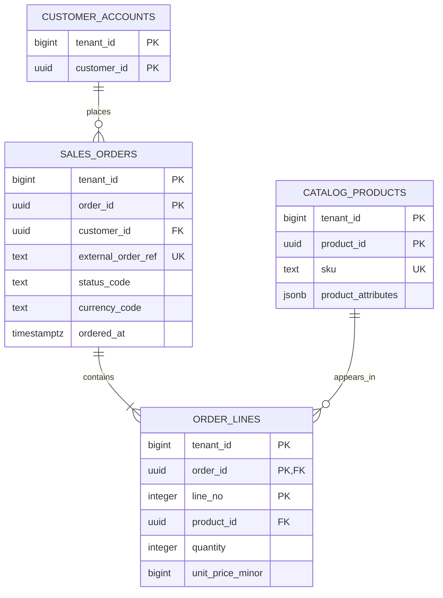
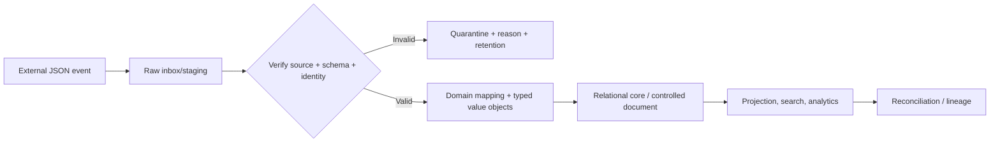

# Lạm dụng cột JSON để né xác định cấu trúc dữ liệu

Khi phát triển tính năng gấp, một đề xuất thường xuất hiện: “Cứ lưu tất cả vào một cột `JSON`; sau này biết cần gì thì tách”. Ban đầu, cách này có vẻ tiết kiệm thời gian: thêm thuộc tính không phải sửa bảng, nhận payload từ đối tác mà không cần mapping, và một đối tượng Java có thể được serialize nguyên vẹn. Nhưng khi đơn hàng, người dùng, giá tiền, trạng thái, khóa tham chiếu và lịch sử đều nằm sâu trong một document, những quyết định quan trọng về **danh tính, grain, kiểu, quan hệ, ràng buộc và vòng đời dữ liệu** không biến mất. Chúng chỉ bị dời ra khỏi mô hình được kiểm soát, thường thành quy ước rải rác trong nhiều ứng dụng.

Giả sử mỗi đơn được lưu bằng một dòng `orders(id, payload JSONB)`. Hệ thống vẫn phải trả lời: hai đơn có thể dùng cùng mã bên ngoài không? Một dòng hàng có số lượng âm được không? `customerId` có tồn tại và thuộc đúng tenant không? Một giá trị `"120000"` là tiền hay chuỗi? Thay đổi tên key có làm dashboard cũ tính sai không? Hai transaction cùng thay JSON có làm mất thay đổi của nhau không? Một payload chứa địa chỉ khách có được giữ cùng thời hạn với đơn hàng không?

**Lỗi không phải là dùng JSON. Lỗi là dùng JSON để tránh xác định những hợp đồng mà dữ liệu bắt buộc phải có.** JSON có thể là một lựa chọn đúng cho cấu trúc đa dạng, thuộc tính bổ sung không quyết định bất biến, hoặc payload tích hợp cần giữ tạm để kiểm toán/replay. Nó không tự thay thế việc xác định thực thể, khóa, ràng buộc quan hệ, truy vấn và chính sách thay đổi.

Bài thuộc chương **Lỗi thường gặp** của module **DATABASE_DATA_MODELING**. Theo mục tiêu module, ta luyện chuyển yêu cầu nghiệp vụ thành mô hình rõ từ thực thể, quan hệ và ràng buộc đến chuẩn hóa, khóa, chỉ mục và lược đồ vật lý; đồng thời so sánh mô hình quan hệ, document, đồ thị và phân tích để lựa chọn cấu trúc phù hợp, dễ tiến hóa và kiểm chứng. Ví dụ sử dụng **PostgreSQL 15+**, cú pháp `JSONB` và Java 17+. Cần kiểm tra tính năng cụ thể của từng DBMS/phiên bản khi áp dụng vào một hệ thống khác.

## 1. Phân biệt định dạng dữ liệu và mô hình dữ liệu

JSON là **định dạng biểu diễn một cây giá trị**: object, array, string, number, boolean hoặc null. Một document có thể lồng nhiều cấp và có các key tùy chọn. Điều này không trả lời các câu hỏi nghiệp vụ:

| Câu hỏi mô hình hóa | JSON tự trả lời được? | Cần quyết định |
|---|---|---|
| Một bản ghi đại diện cho cái gì? | Không | Grain: đơn, dòng đơn, khách, sự kiện |
| Hai bản ghi là cùng một thực thể khi nào? | Không | Business key, surrogate key, phạm vi duy nhất |
| Thuộc tính nào bắt buộc và kiểu gì? | Chỉ có kiểu JSON tổng quát | Data contract, validation, nullable/missing |
| Tham chiếu sang đối tượng khác có hợp lệ? | Không | FK hoặc cơ chế toàn vẹn được chứng minh |
| Có được đổi trạng thái từ A sang B? | Không | State machine, transaction, domain invariant |
| Ai được đọc dữ liệu nhạy cảm? | Không | Quyền, purpose, data minimization |
| Có thể truy vấn hoặc tổng hợp thế nào? | Không | Grain, chỉ mục, đơn vị, thời gian, metric |
| Khi schema thay đổi, dữ liệu cũ xử lý sao? | Không | Versioning, migration, compatibility, backfill |

Một cột `JSONB` có thể **được ràng buộc và lập chỉ mục** trong PostgreSQL. Vì thế nhận định “JSON không có schema” cũng không chính xác tuyệt đối. Điều đúng hơn là **schema có thể không được thể hiện tường minh ở cột SQL**, khiến trách nhiệm xác minh chuyển sang validator, generated column, expression index, ứng dụng hoặc pipeline.

### Vì sao “lưu được” không có nghĩa “mô hình đúng”?

Database cho phép lưu:

```json
{
  "customerId": "C-101",
  "status": "PAID",
  "total": "120000",
  "items": [
    {"sku": "P-7", "qty": "2"}
  ]
}
```

Nhưng từ document này chưa biết `total` có đơn vị gì, có thể đổi sau thanh toán không, `items` chứa dòng hàng đã chốt hay chỉ giỏ hàng, `customerId` có tồn tại, hoặc `qty` có thể là chuỗi hay số. Những thiếu sót ấy không được giải quyết bằng việc thêm một thư viện parse JSON.

## 2. Đề bài chuẩn: xác định invariant trước khi chọn JSON hay bảng

Hãy lấy hệ thống bán hàng nhiều tenant với các yêu cầu:

1. Một đơn thuộc **một tenant** và **một khách hàng có thật trong tenant ấy**.
2. Mã đơn bên ngoài `external_order_ref` duy nhất trong tenant.
3. Một đơn có nhiều dòng; mỗi dòng có số thứ tự, sản phẩm, số lượng và **đơn giá đã chốt tại thời điểm đặt**.
4. `quantity` là số nguyên dương, `unit_price_minor` không âm, `currency_code` hợp lệ theo chính sách tiền tệ.
5. Trạng thái đơn có tập giá trị được kiểm soát và có quy tắc chuyển trạng thái.
6. Mỗi yêu cầu đặt đơn retry không được tạo thêm đơn hoặc trừ tồn kho hai lần.
7. Báo cáo tính số lượng và số tiền ở đúng grain, không nhân số đo khi join.
8. Sản phẩm có một số **thuộc tính mô tả thay đổi theo ngành hàng**: màu, vật liệu, thông số đóng gói.
9. Hệ thống nhận bản ghi tích hợp từ đối tác có thể chứa những field chưa hỗ trợ; raw payload chỉ được giữ trong thời hạn/phạm vi được phê duyệt.
10. Nếu một thuộc tính trở thành điều kiện lọc/khóa nghiệp vụ quan trọng, mô hình phải có đường nâng cấp.

Một lựa chọn hợp lý là giữ **khách, đơn, dòng đơn, sản phẩm và các khóa trong mô hình quan hệ**, rồi xem xét JSON cho **thuộc tính bổ sung của sản phẩm** hoặc **payload sự kiện thô ở vùng staging**.

### Bắt buộc phân biệt ba loại dữ liệu

- **Core domain data:** tham gia identity, FK, số tiền, trạng thái, quy tắc giao dịch; cần mô hình mạnh.
- **Flexible attributes:** khác nhau theo loại đối tượng, có ngữ nghĩa được quản lý, không phải quan hệ/khóa cốt lõi.
- **Raw integration evidence:** bản nhận từ bên ngoài, có `source`, event ID, schema version, thời gian nhận, chất lượng; không tự trở thành nguồn domain đã xác minh.

Trộn cả ba vào một `payload` không làm hệ thống “linh hoạt hơn” theo nghĩa có thể tiến hóa an toàn; thường chỉ khiến mọi đường đọc phải giải mã nhiều ngoại lệ.

## 3. Dấu hiệu một cột JSON đang bị lạm dụng

Một hoặc hai dấu hiệu chưa đủ kết luận JSON sai. Nhưng khi nhiều dấu hiệu xuất hiện, cần review lại data model:

- Dữ liệu được đặt tên chung `data`, `extra`, `metadata` nhưng chứa `customerId`, `orderTotal`, `status` hoặc khóa định danh chính.
- Mọi query đều phải viết `payload->>'...'` để lọc các trường cố định.
- Các key được ứng dụng hiểu khác nhau: `quantity`, `qty`, `count` cùng mang một nghĩa.
- Một JSON property được cập nhật bởi nhiều service có owner khác nhau.
- DBA phải tạo hàng loạt expression index để thay thế các cột vốn cố định.
- Muốn bảo đảm unique cần quét toàn bộ JSON bằng ứng dụng.
- Join dựa vào chuỗi rút từ JSON, không có FK rõ ràng.
- BI phải `jsonb_array_elements` ở mọi báo cáo để đếm dòng đơn.
- Nhiều bản ghi có field thiếu, `null` hoặc kiểu dữ liệu khác nhau mà không có version.
- Một bug chỉ được phát hiện lúc CAST hoặc query production, không phải lúc ingest.
- Chỉ vì không muốn migration mà mọi thay đổi được gói vào object mới.
- JSON chứa thông tin cá nhân không được kiểm kê trong retention, audit, cache và export.
- Không có schema registry, consumer inventory hoặc contract test cho payload.

**Mùi thiết kế thường gặp:** application đã coi `payload.customerId` là cột bắt buộc, nhưng database và tài liệu lại ghi “metadata tùy ý”. Đó là sự mâu thuẫn trong hợp đồng.

## 4. Ví dụ phản diện: đơn hàng bị nhét hết vào `JSONB`

DDL có vẻ đơn giản:

```sql
-- PHẢN DIỆN: dùng để phân tích lỗi, không khuyến nghị.
CREATE TABLE orders_json (
    tenant_id BIGINT NOT NULL,
    order_id UUID NOT NULL,
    payload JSONB NOT NULL,

    CONSTRAINT pk_orders_json
        PRIMARY KEY (tenant_id, order_id),
    CONSTRAINT ck_payload_is_object
        CHECK (jsonb_typeof(payload) = 'object')
);
```

Hai bản ghi ví dụ có thể được chấp nhận về kiểu SQL:

```json
{
  "externalOrderRef": "WEB-1001",
  "customerId": "9e4d77c2-9463-4f12-80ab-ef738ce26701",
  "status": "CONFIRMED",
  "currency": "VND",
  "lines": [
    {"lineNo": 1, "productId": "P-7", "quantity": 2, "unitPriceMinor": 120000},
    {"lineNo": 2, "productId": "P-8", "quantity": 1, "unitPriceMinor": 50000}
  ]
}
```

```json
{
  "externalOrderRef": "WEB-1001",
  "customerId": "not-a-valid-id",
  "status": "SHIPPED_WRONG_VALUE",
  "currency": null,
  "lines": [
    {"lineNo": 1, "productId": "P-7", "quantity": "-5", "unitPriceMinor": "free"}
  ]
}
```

Nếu hai payload có `order_id` khác nhau, PK trên `(tenant_id,order_id)` **không** ngăn trùng `externalOrderRef`. `CHECK(jsonb_typeof(payload)='object')` chỉ biết payload là object, không xác minh các key con, kiểu, quan hệ hoặc trạng thái.

### Các bất biến bị bỏ trống

| Bất biến muốn có | Điều thực tế trong phản diện |
|---|---|
| Customer tồn tại trong tenant | Không có FK từ `payload.customerId` |
| External order ref duy nhất theo tenant | Không có unique trên business key |
| Status thuộc tập cho phép | Bất kỳ string nào được lưu |
| Currency bắt buộc và hợp lệ | Có thể thiếu hoặc JSON null |
| Quantity là số nguyên dương | Có thể là string âm |
| Unit price là tiền ở minor units | Có thể là string hoặc số thực không rõ precision |
| Line number duy nhất trong đơn | Hai object trong array có thể cùng `lineNo` |
| Product ID có thật và cùng tenant | Không có FK tới product |
| Truy vấn dòng đơn hiệu quả | Phải nở array và cast |
| Mỗi field có retention và owner | Mọi thứ cùng một payload không được phân loại |

Dữ liệu không trở nên hợp lệ khi deserialize được về `Map<String,Object>`. Bản ghi phản diện có thể dẫn đến báo cáo sai, giao hàng sai hoặc lỗi runtime trong lúc CAST.

## 5. Vấn đề grain: một document không đồng nghĩa một thực thể

**Grain** trả lời “một dòng/tài liệu đại diện cho bao nhiêu sự kiện hoặc đối tượng”. `orders_json` có **grain một đơn** nhưng bên trong lại nhúng một tập **dòng đơn** với grain khác.

Điều đó không luôn sai — một aggregate có thể được lưu nguyên như một document nếu hợp đồng và workload phù hợp. Lỗi xuất hiện khi:

- Dòng đơn cần được tham chiếu, hoàn trả hoặc đối soát độc lập.
- Cần bảo vệ uniqueness của `lineNo` hoặc identity của dòng.
- Sản phẩm phải có FK hoặc quyền truy cập khác với đơn.
- Hai bộ phận cập nhật hai dòng trong cùng document cạnh tranh nhau.
- Báo cáo cần grain dòng sản phẩm/ngày và phải parse toàn bộ đơn.
- Chi phí thay một dòng đòi ghi lại cả document lớn.
- Một lô đơn chỉ có một JSON array trong khi hệ thống cần phân trang/filter dòng.

Ví dụ một đơn có ba dòng, tổng phải trả 300.000. Nếu báo cáo nở ba dòng và cộng trường tổng của đơn ở mỗi dòng:

\[
300\,000 + 300\,000 + 300\,000 = 900\,000.
\]

Đó là **fan-out measure**. Lỗi không phát sinh chỉ do JSON; nó phát sinh vì **trộn số đo ở grain đơn với dữ liệu ở grain dòng**. JSON lồng nhau dễ che mờ chỗ thay grain này.

### Chuyển sang mô hình dòng khi nào?

Khi mỗi item có danh tính, kiểm soát độc lập, cần join/FK, được query thường xuyên hoặc có lịch sử riêng, hãy cân nhắc một bảng `order_lines` với PK rõ ràng. Nếu items thật sự là một value object nhỏ, chỉ đọc/ghi cùng aggregate và không có ràng buộc độc lập, lưu document vẫn có thể hợp lý.

## 6. Thiết kế quan hệ cho phần lõi có hợp đồng ổn định

Một mô hình quan hệ cụ thể bảo vệ các bất biến đã nêu:



Sơ đồ thể hiện mô hình logic: mỗi order tham chiếu một customer cùng tenant, có nhiều dòng, và dòng tham chiếu product. Ký hiệu `||--|{` gợi kỳ vọng **ít nhất một dòng**, nhưng FK/PK bên dưới chỉ bắt buộc *mỗi dòng thuộc một đơn*; việc đơn ở trạng thái `CONFIRMED` phải có ít nhất một dòng cần được kiểm tra trong transaction/use case. Không nên coi ký hiệu ERD là constraint đã thực thi.

### PostgreSQL DDL minh họa

```sql
CREATE TABLE customer_accounts (
    tenant_id BIGINT NOT NULL,
    customer_id UUID NOT NULL,

    CONSTRAINT pk_customer_accounts
        PRIMARY KEY (tenant_id, customer_id)
);

CREATE TABLE catalog_products (
    tenant_id BIGINT NOT NULL,
    product_id UUID NOT NULL,
    sku TEXT NOT NULL,
    product_name TEXT NOT NULL,
    product_attributes JSONB NOT NULL DEFAULT '{}'::jsonb,

    CONSTRAINT pk_catalog_products
        PRIMARY KEY (tenant_id, product_id),
    CONSTRAINT uq_catalog_product_sku
        UNIQUE (tenant_id, sku),
    CONSTRAINT ck_catalog_product_sku
        CHECK (btrim(sku) <> ''),
    CONSTRAINT ck_catalog_product_name
        CHECK (btrim(product_name) <> ''),
    CONSTRAINT ck_product_attributes_object
        CHECK (jsonb_typeof(product_attributes) = 'object'),
    CONSTRAINT ck_product_attribute_color
        CHECK (
            NOT (product_attributes ? 'color')
            OR jsonb_typeof(product_attributes -> 'color') = 'string'
        )
);

CREATE TABLE sales_orders (
    tenant_id BIGINT NOT NULL,
    order_id UUID NOT NULL,
    customer_id UUID NOT NULL,
    external_order_ref TEXT NOT NULL,
    status_code TEXT NOT NULL DEFAULT 'DRAFT',
    currency_code CHAR(3) NOT NULL,
    ordered_at TIMESTAMPTZ NOT NULL DEFAULT CURRENT_TIMESTAMP,

    CONSTRAINT pk_sales_orders
        PRIMARY KEY (tenant_id, order_id),
    CONSTRAINT uq_external_order_ref
        UNIQUE (tenant_id, external_order_ref),
    CONSTRAINT fk_order_customer
        FOREIGN KEY (tenant_id, customer_id)
        REFERENCES customer_accounts (tenant_id, customer_id)
        ON DELETE RESTRICT,
    CONSTRAINT ck_order_ref_not_blank
        CHECK (btrim(external_order_ref) <> ''),
    CONSTRAINT ck_order_status
        CHECK (status_code IN (
            'DRAFT', 'CONFIRMED', 'SHIPPING',
            'COMPLETED', 'CANCELLED'
        )),
    CONSTRAINT ck_order_currency
        CHECK (currency_code ~ '^[A-Z]{3}$')
);

CREATE TABLE order_lines (
    tenant_id BIGINT NOT NULL,
    order_id UUID NOT NULL,
    line_no INTEGER NOT NULL,
    product_id UUID NOT NULL,
    quantity INTEGER NOT NULL,
    unit_price_minor BIGINT NOT NULL,

    CONSTRAINT pk_order_lines
        PRIMARY KEY (tenant_id, order_id, line_no),
    CONSTRAINT fk_line_order
        FOREIGN KEY (tenant_id, order_id)
        REFERENCES sales_orders (tenant_id, order_id)
        ON DELETE RESTRICT,
    CONSTRAINT fk_line_product
        FOREIGN KEY (tenant_id, product_id)
        REFERENCES catalog_products (tenant_id, product_id)
        ON DELETE RESTRICT,
    CONSTRAINT ck_order_line_number
        CHECK (line_no > 0),
    CONSTRAINT ck_order_line_quantity
        CHECK (quantity > 0),
    CONSTRAINT ck_order_line_price
        CHECK (unit_price_minor >= 0)
);
```

### Điều DB hiện có thể đảm bảo

- Một order và một product có danh tính PK rõ, trong **phạm vi tenant**.
- `external_order_ref` duy nhất trong tenant **dưới quy tắc so sánh văn bản DB đang dùng**.
- FK ghép không cho order tham chiếu customer khác tenant và không cho line trỏ sản phẩm/đơn thuộc tenant khác.
- Quantity, line number và unit price có kiểu số/chặn giá trị không hợp lệ ở DB.
- Status, currency có miền cơ bản đã được khai báo; currency regex chỉ kiểm tra **dạng ba chữ cái**, không xác minh danh sách mã tiền tệ hoặc chính sách pháp lý.
- `product_attributes` phải là một JSON object; `color` nếu có phải là string. Các key khác cần data contract/validator riêng.

### Bất biến DB chưa tự giải quyết

- Chuyển trạng thái `COMPLETED → DRAFT` có được không? `CHECK` chỉ biết trạng thái thuộc danh sách, không biết transition.
- Một đơn `CONFIRMED` có ít nhất một dòng? Cần transaction/use case/constraint liên bảng phù hợp.
- `SUM(quantity × unit_price_minor)` có bằng số phải trả sau giảm giá, thuế, phí không? Cần nguồn giao dịch và quy tắc kế toán.
- `external_order_ref` khác hoa/thường có coi trùng không? Cần chuẩn hóa/collation đã chốt.
- Mỗi source request có được xử lý một lần không? Cần idempotency business key và transaction.
- Các thuộc tính linh hoạt có làm thay đổi SKU/giá/đơn vị đo không? Nếu có, chúng có thể cần promotion thành mô hình chính.

Chuyển sang quan hệ không giải quyết **mọi** bất biến; nó làm những bất biến ổn định dễ thấy và dễ bảo vệ hơn.

## 7. JSON phù hợp nhất khi ranh giới dữ liệu thật sự linh hoạt

Một số ngành hàng có thuộc tính khác nhau:

| Nhóm sản phẩm | Thuộc tính mô tả có thể có |
|---|---|
| Áo | `color`, `fabric`, `careInstructions` |
| Bàn | `color`, `assemblyRequired`, `finish` |
| Thiết bị mạng | `portCount`, `wirelessStandard` |
| Đồ đóng gói | `packageMaterial`, `recyclable` |

Nếu các thuộc tính này chỉ giúp hiển thị/lọc phụ, chưa tham gia identity, FK hay nghiệp vụ tài chính, cột `catalog_products.product_attributes JSONB` có thể hợp lý.

```json
{
  "color": "blue",
  "fabric": "cotton",
  "careInstructions": "machine-wash"
}
```

Hợp đồng vẫn cần mô tả:

- Key nào được hỗ trợ cho từng `product_kind`?
- Kiểu dữ liệu và đơn vị của từng key là gì?
- Những giá trị nào tùy chọn, có được gửi `null` không?
- Ai có quyền thêm/sửa key?
- Có cần version của attribute schema?
- Có được dùng field làm bộ lọc công khai không?
- Có chứa thông tin cá nhân hoặc dữ liệu nhạy cảm không?
- Khi key đổi tên, consumer cũ đọc thế nào?

**Thuộc tính linh hoạt không đồng nghĩa key tùy ý hoàn toàn.** Một attribute dictionary hoặc schema theo loại sản phẩm có thể quản lý các định nghĩa này mà không cần ép mọi ngành hàng vào hàng trăm cột nullable.

### Ranh giới không nên giấu trong `product_attributes`

Không nên mặc định để trong JSON:

- `product_id`, `tenant_id`, SKU tham chiếu bởi nhiều bảng.
- Đơn vị tiền và giá chốt của dòng giao dịch.
- Mã kho và tồn khả dụng cần cập nhật nguyên tử.
- Mã category bắt buộc join tới dimension có FK.
- Thuộc tính cấu thành **một biến thể sản phẩm** có identity, tồn và giá riêng.

Nếu một áo màu xanh size M và size L có tồn kho, SKU và giá riêng, chúng nên được xem là **hai variant có danh tính riêng** (hoặc một thiết kế biến thể tương đương), không chỉ hai chuỗi giá trị trong JSON bất kỳ.

## 8. So sánh bảng quan hệ, JSONB và EAV theo đặc tính thực tế

**EAV** (*Entity–Attribute–Value*) lưu mỗi thuộc tính như một dòng `entity_id, attribute_name, value`. Nó cũng là một cách biểu diễn linh hoạt, nhưng không tự giải quyết ngữ nghĩa hay ràng buộc.

| Nhu cầu | Cột quan hệ typed | JSONB | EAV |
|---|---|---|---|
| Thuộc tính cố định, bắt buộc | Rõ, ràng buộc tốt | Cần validator/constraint trên path | Cần kiểm soát metadata và completeness |
| Quan hệ với entity khác | FK tự nhiên | Cần chiếu key sang cột, generated column hoặc ứng dụng | FK theo value/phân loại phức tạp |
| Unique theo business key | PK/UNIQUE rõ | Expression/generated index, cẩn thận null/type | Thường phải cấu trúc thêm |
| Thêm optional attribute | Cần migration/nullable | Thuận tiện | Thuận tiện |
| Query theo nhiều field | B-tree/statistics phù hợp | GIN/expression index, tùy query | Nhiều self-join/pivot |
| Kiểm tra kiểu theo field | Column type/CHECK | JSON schema/validator/CHECK | Attribute metadata + typed value |
| Đọc một aggregate | Join/shape response | Một document có thể thuận | Cần pivot |
| Cập nhật một phần | Cập nhật cột, MVCC theo hàng | Chỉnh document, MVCC theo hàng | Cập nhật dòng thuộc tính |
| Reporting & BI | Grain/measure rõ | Cần nở/mapping | Cần pivot và chuẩn hóa |
| Tiến hóa hợp đồng | Migration có kiểm soát | Versioning/validation vẫn cần | Metadata/versioning vẫn cần |

**Không phải JSONB, EAV hay quan hệ luôn thắng.** Quyết định dựa vào số lượng attribute, độ ổn định, truy vấn chính, ràng buộc cần DB cưỡng chế và khả năng bảo trì.

Một hybrid thường hiệu quả: **cột typed cho lõi ổn định + JSONB cho phần thực sự linh hoạt + schema registry/validation cho thuộc tính bổ sung**.

## 9. Missing, JSON null, SQL NULL và chuỗi rỗng khác nhau

Một sai lầm nguy hiểm là xem mọi dạng “không có giá trị” như nhau.

```json
{}
```

```json
{"discountMinor": null}
```

```json
{"discountMinor": 0}
```

```json
{"discountMinor": ""}
```

Chúng có thể mang nghĩa khác nhau:

- **Missing key:** nguồn chưa gửi/không hỗ trợ field; không tự hiểu là 0.
- **JSON null:** nguồn chủ động ghi null; ngữ nghĩa phải theo contract.
- **0:** giá trị số đã biết chắc bằng 0, nếu field định nghĩa là số.
- **Chuỗi rỗng:** string có độ dài 0; thường không phải số.

Trong PostgreSQL:

```sql
SELECT
    '{}'::jsonb ? 'discountMinor'
        AS missing_key_present,         -- false

    '{"discountMinor":null}'::jsonb ? 'discountMinor'
        AS json_null_key_present,       -- true

    '{}'::jsonb ->> 'discountMinor'
        AS missing_text_value,          -- SQL NULL

    '{"discountMinor":null}'::jsonb ->> 'discountMinor'
        AS json_null_text_value,        -- SQL NULL

    jsonb_typeof('{}'::jsonb -> 'discountMinor')
        AS missing_json_type,           -- SQL NULL

    jsonb_typeof('{"discountMinor":null}'::jsonb
        -> 'discountMinor')
        AS explicit_json_type;          -- text 'null'
```

`->>` trả text nên có thể làm **mất phân biệt missing và JSON null**. Đừng vội dùng:

```sql
-- PHẢN DIỆN: che sự khác biệt giữa chưa biết và thực sự bằng 0.
SELECT COALESCE(payload ->> 'discountMinor', '0')
FROM orders_json;
```

Một công thức tiền có `discount = 0` chỉ hợp lệ nếu nguồn **xác nhận không giảm giá**. Nếu thiếu field do phiên bản cũ hoặc lỗi ingestion, biến nó thành 0 có thể làm tổng tiền sai mà không báo lỗi.

### SQL CHECK và logic ba giá trị

PostgreSQL `CHECK` chỉ từ chối biểu thức cho kết quả **FALSE**; nếu kết quả là **NULL/UNKNOWN**, row vẫn có thể qua kiểm tra.

```sql
-- Không đủ bảo đảm trường luôn tồn tại:
CHECK ((payload ->> 'quantity')::integer > 0)
```

Khi không có `quantity`, biểu thức có thể thành NULL và CHECK **không từ chối**. Cần ràng buộc presence/type/validity rõ, và luôn kiểm tra dữ liệu lỗi trước khi CAST để tránh lỗi runtime.

## 10. Kiểu số, tiền tệ, đơn vị đo và thời gian không nên “để JSON tự lo”

### 10.1. Kiểu của JSON number không nói hết nghĩa

`{"amount": 100}` là JSON number nhưng không biết:

- 100 VND, 100 cent hay 100 USD?
- Đây là giá chốt, giá niêm yết, tổng trước thuế hay sau thuế?
- Có phải số nguyên minor units?
- Khi cộng hai bản ghi có cùng currency và cùng grain không?
- Có được âm khi xử lý refund không?

Nếu `unitPriceMinor` là tiền đã chốt, nên lưu **cột số có kiểu và currency code**. Không lạm dụng `double`/binary floating point cho nghiệp vụ tiền. Có thể dùng `BIGINT` minor units với giới hạn phạm vi, hoặc `NUMERIC` khi cần precision khác.

### 10.2. Number với string không tương đương

```json
{"quantity": 2}
```

```json
{"quantity": "2"}
```

Một client có thể parse cả hai bằng coercion, client khác từ chối. Một query SQL như:

```sql
SELECT (payload ->> 'quantity')::integer
FROM orders_json;
```

sẽ gặp lỗi với `"quantity": "two"` và những trường hợp giá trị không hợp lệ; thiếu field có thể cho NULL. Validator ở ingress phải **chặn/đưa vào vùng lỗi** thay vì để query báo cáo hỏng sau nhiều tháng.

### 10.3. Timestamp và timezone

```json
{"createdAt":"2026-11-01T08:30:00+07:00"}
```

Đây là một chuỗi JSON. Nếu cần lọc theo thời gian thật, ngày kinh doanh, retention hay partitioning, hãy **parse thành thời điểm hợp lệ** và lưu `TIMESTAMPTZ` ở mô hình chuẩn, giữ chính sách timezone doanh nghiệp.

So sánh lexical các chuỗi timestamp có offset khác nhau không luôn tương đương so sánh thời điểm tuyệt đối. Không dùng `received_at` thay `event_time` nếu nghiệp vụ cần thời điểm xảy ra.

### 10.4. Đơn vị đo

`{"length":10}` không biết là cm, m hay inch. Nếu attribute linh hoạt thực sự là đại lượng vật lý, contract có thể yêu cầu dạng:

```json
{"length":{"value":10,"unit":"cm"}}
```

hoặc chuẩn hóa về đơn vị cơ sở có version. Nếu `length` tham gia tính phí vận chuyển, giới hạn sản phẩm hoặc constraint chính thức, nên cân nhắc cột typed và ràng buộc thay vì chờ runtime phát hiện đơn vị sai.

## 11. Ràng buộc JSON có thể viết được, nhưng hãy đếm chi phí của chúng

Không đúng khi nói PostgreSQL không thể ràng buộc JSONB. Có thể kiểm tra type, key tồn tại và đôi khi đưa giá trị JSON ra index.

Ví dụ một bảng receipt JSON có contract cố định:

```sql
CREATE TABLE receipt_raw_check (
    receipt_id UUID PRIMARY KEY,
    payload JSONB NOT NULL,

    CONSTRAINT ck_receipt_payload
        CHECK (jsonb_typeof(payload) = 'object'),

    CONSTRAINT ck_receipt_currency
        CHECK (
            jsonb_typeof(payload -> 'currency')
                IS NOT DISTINCT FROM 'string'
            AND (payload ->> 'currency') ~ '^[A-Z]{3}$'
        ),

    CONSTRAINT ck_receipt_status
        CHECK (
            jsonb_typeof(payload -> 'status')
                IS NOT DISTINCT FROM 'string'
            AND payload ->> 'status' IN ('DRAFT', 'FINAL')
        )
);
```

**Điểm tốt:** database từ chối payload thiếu/khác kiểu `currency` và `status` khi biểu thức CHECK rõ ràng dẫn tới FALSE.

**Điểm chưa đủ:** chưa có PK/FK trên customer hoặc lines, chưa xác minh currency thuộc tập được hỗ trợ, chưa ngăn JSON key thừa, chưa kiểm tra nghiệp vụ cross-row.

Với trường phức tạp, `CHECK` rất nhanh trở thành chuỗi extraction/type/CAST khó kiểm tra. Nếu một field đã là định danh, khóa join hoặc trạng thái được query hằng ngày, câu hỏi không còn là “có thể viết CHECK cho JSON không?” mà là “**vì sao không cho field này một cột typed dễ đọc?**”.

### Ví dụ extraction thiếu phòng thủ

```sql
-- PHẢN DIỆN: đường ghi có thể lỗi khi CAST, hoặc dữ liệu NULL lọt.
CHECK ((payload ->> 'priceMinor')::bigint >= 0)
```

Nếu JSON chứa `"priceMinor": "free"`, cast thất bại. Nếu không có key, kết quả kiểm tra có thể UNKNOWN. Nếu định nghĩa của field là cốt lõi và cố định, cột `price_minor BIGINT NOT NULL CHECK(price_minor>=0)` gọn và chính xác hơn.

**Lưu ý:** validate input trước khi vào DB không thay cho constraint ở nguồn chung nếu nhiều writer có thể bỏ qua validator. Tốt nhất là validation ở ranh giới + constraint tại nơi lưu có thẩm quyền, với mỗi lớp bảo vệ phần invariant mình thực sự kiểm soát.

## 12. Khóa ngoại: một ID ẩn trong JSON không tự có referential integrity

Giả sử:

```json
{
  "customerId": "9e4d77c2-9463-4f12-80ab-ef738ce26701"
}
```

Trên `orders_json`, database chưa được khai báo rằng `payload.customerId` phải tồn tại trong `customer_accounts` của cùng tenant. Query có thể join qua phép ép kiểu:

```sql
-- Chỉ an toàn nếu input đã được xác minh UUID hợp lệ.
SELECT o.order_id, c.customer_id
FROM orders_json AS o
JOIN customer_accounts AS c
  ON c.tenant_id = o.tenant_id
 AND c.customer_id = (o.payload ->> 'customerId')::uuid;
```

Lỗi tiềm ẩn:

- Nếu `customerId` sai dạng UUID, query có thể **ném lỗi**.
- Nếu missing/null, `INNER JOIN` làm order biến mất khỏi kết quả.
- Nếu customer bị xóa hoặc thuộc tenant khác, bản ghi vẫn có thể nằm trong JSON mà không có FK.
- Nếu mã được đổi/merge, payload cũ cần được tìm và cập nhật/diễn giải theo policy.

### Generated column có giải quyết được không?

PostgreSQL hỗ trợ **stored generated column** từ biểu thức đủ điều kiện. Có thể chiếu một giá trị JSON ổn định thành cột rồi đặt FK:

```sql
-- Mẫu riêng để giải thích khả năng kỹ thuật.
-- Chỉ dùng khi dữ liệu đầu vào được bảo đảm UUID hợp lệ.
CREATE TABLE orders_json_with_customer_fk (
    tenant_id BIGINT NOT NULL,
    order_id UUID NOT NULL,
    payload JSONB NOT NULL,

    customer_id UUID GENERATED ALWAYS AS (
        (payload ->> 'customerId')::uuid
    ) STORED,

    CONSTRAINT pk_orders_json_customer
        PRIMARY KEY (tenant_id, order_id),
    CONSTRAINT fk_json_customer
        FOREIGN KEY (tenant_id, customer_id)
        REFERENCES customer_accounts (tenant_id, customer_id)
);
```

Đây là một **cơ chế có thật**, nên không nên tuyên bố “JSON không bao giờ đặt FK được”. Nhưng:

- `customerId` thiếu sẽ cho generated `NULL`; FK mặc định có thể **không từ chối NULL**. Nếu field bắt buộc, thêm `NOT NULL`/CHECK thích hợp.
- Chuỗi không phải UUID sẽ làm phép CAST thất bại khi insert/update.
- Ghi nguyên JSON làm thay đổi generated column, FK và index; migration cần quản lý phụ thuộc.
- Cột generated đã trở thành **cột quan hệ cốt lõi** dù nguồn nằm trong JSON.

Nếu ứng dụng đã cần customer ID để join, FK và filter, một cột `customer_id UUID NOT NULL` trực tiếp thường rõ ràng và đơn giản hơn.

## 13. Tính duy nhất: index trên JSON path có giới hạn hợp đồng

Có thể tạo unique expression index:

```sql
-- Chỉ ví dụ trên bảng phản diện orders_json.
CREATE UNIQUE INDEX uq_orders_json_external_ref
    ON orders_json (
        tenant_id,
        (payload ->> 'externalOrderRef')
    );
```

Index trên giúp chặn hai dòng cùng tenant có **cùng text externalOrderRef không NULL**, theo ngữ nghĩa index/collation. Nhưng vẫn có các vấn đề:

1. **Missing key** và **JSON null** thường được `->>` chuyển thành SQL NULL; unique index mặc định có thể cho nhiều row có NULL, nên không tự bảo đảm mọi đơn có external ref.
2. `"WEB-1"` và `"web-1"` có thể được coi khác nhau nếu business yêu cầu so không phân biệt hoa/thường mà index chưa chuẩn hóa.
3. Payload có thể chứa `externalOrderRef` sai kiểu, ví dụ number; `->>` chuyển thành text và index có thể tạo cảm giác field hợp lệ dù sai schema.
4. Nếu dữ liệu partition theo ngày nhưng business key cần unique xuyên tháng, unique cục bộ hoặc constraint không bao gồm partition key có thể không bảo vệ đúng phạm vi.
5. Khi rename key, index cũ và các writer cũ cần migration đồng bộ; unique trên một path không tự hiểu hai tên key là cùng identity.

**Nên xác định khóa như một thuộc tính typed và NOT NULL khi nó là business key.** Nếu vì yêu cầu đặc thù vẫn dùng expression index, phải có validator/constraint về presence, type, normalization, phạm vi uniqueness và migration version.

### Idempotency không tự xuất hiện từ JSON

Một request đặt đơn retry có thể mang cùng `clientRequestId` trong payload. Nếu không có khóa unique được thực thi trong phạm vi đúng, hai request đồng thời vẫn có thể tạo hai `order_id` khác nhau. Không dùng `SELECT payload @> ...` rồi `INSERT` để chống race; cần unique/idempotency record nguyên tử và xử lý payload conflict.

Một khóa idempotency hợp lý có thể là `(tenant_id, source_system, request_id)` trong bảng riêng, với request fingerprint và trạng thái xử lý. Business ID của đơn và ID của request có thể là **hai bất biến khác nhau**.

## 14. Truy vấn JSONB: các toán tử phổ biến và bẫy tương thích

PostgreSQL có nhiều toán tử hữu ích:

| Cú pháp | Ý nghĩa cơ bản | Cần chú ý |
|---|---|---|
| `data -> 'key'` | Lấy giá trị JSONB con | Missing cho SQL NULL; kết quả vẫn là JSONB |
| `data ->> 'key'` | Lấy text | Có thể làm mất phân biệt missing/JSON null |
| `data #> '{a,b}'` | Lấy giá trị JSONB theo path | Path không có tạo SQL NULL |
| `data #>> '{a,b}'` | Lấy text theo path | Cần parse kiểu nếu tính toán |
| `data ? 'key'` | Key top-level tồn tại | Không kiểm tra đúng kiểu của value |
| `data @> '{"color":"blue"}'` | JSONB bên trái chứa cấu trúc bên phải | Hữu ích cho equality/containment có cấu trúc |
| `jsonb_array_elements(data)` | Nở array thành nhiều dòng | Có thể fan-out, lỗi nếu input không phải array |
| `jsonb_set(data,path,new,...)` | Tạo JSONB mới với path được cập nhật | Không tự tạo mọi object cha bị thiếu; không bảo vệ lost update khi thay toàn payload |

### Ví dụ lọc thuộc tính linh hoạt hợp lệ

```sql
SELECT
    tenant_id,
    product_id,
    sku,
    product_name
FROM catalog_products
WHERE tenant_id = 42
  AND product_attributes @> '{"color":"blue"}'::jsonb;
```

Query này có nghĩa nếu `color` là **thuộc tính do contract xác định**, không phải một key có thể do mỗi nguồn phát khác nghĩa.

### Không tin chuỗi timestamp chỉ vì JSON parse được

Một key `"eventTime"` được gửi dưới nhiều offset, hoặc một epoch timestamp ở định dạng số, cần được chuẩn hóa với chính sách rõ ràng. Không dùng phép so sánh text của `->>` như thể luôn là so sánh thời điểm thực.

## 15. Chọn GIN hay expression B-tree index dựa vào câu hỏi

Không đúng khi nói “JSON không lập chỉ mục được”. PostgreSQL có **GIN index cho JSONB** và expression index. Nhưng không phải index nào cũng giúp mọi query.

### GIN cho containment

```sql
CREATE INDEX ix_products_attributes_gin
    ON catalog_products
    USING GIN (product_attributes jsonb_path_ops);
```

Với `jsonb_path_ops`, index đặc biệt phù hợp một số query containment `@>` và các toán tử JSONPath được hỗ trợ. Nó **không hỗ trợ mọi toán tử như `?` kiểm tra tồn tại key top-level**. Nếu workload cần truy vấn existence và tập toán tử rộng hơn, xem xét operator class mặc định `jsonb_ops`; cái nào tốt hơn phụ thuộc dữ liệu và query thật.

### Expression index cho một path thường dùng

```sql
CREATE INDEX ix_product_tenant_color
    ON catalog_products (
        tenant_id,
        (product_attributes ->> 'color')
    )
    WHERE product_attributes ? 'color';
```

Một query tương ứng:

```sql
SELECT product_id, sku
FROM catalog_products
WHERE tenant_id = 42
  AND product_attributes ? 'color'
  AND product_attributes ->> 'color' = 'blue';
```

Predicate hiện diện key trong query giúp planner có cơ sở dùng **partial index**. Nếu query không có predicate đủ để chứng minh điều kiện index, PostgreSQL có thể không sử dụng index dù người viết tưởng nó liên quan.

**Không tạo cả GIN lẫn nhiều B-tree expression index một cách máy móc.** Cần đo `EXPLAIN (ANALYZE, BUFFERS)` trên môi trường kiểm thử phù hợp, phân bố dữ liệu, selectivity và tỉ lệ ghi. Mỗi index làm tăng dung lượng và chi phí ghi/cập nhật.

### Statistics và query planning

Cột typed có thể được phân tích thống kê trực tiếp phù hợp với nhiều pattern. Với path JSONB, planner có thể cần expression statistics/index để ước lượng tốt hơn. Một query chạy nhanh với vài nghìn document không đủ chứng minh hiệu năng khi có hàng triệu sản phẩm với các key phân bố lệch.

## 16. Hiệu năng: JSONB không phải “một cột là miễn phí”

PostgreSQL `JSONB` lưu dạng phân tích sẵn để hỗ trợ toán tử và indexing, nhưng một document lớn có chi phí riêng:

- **WAL/MVCC:** update một thuộc tính của row có thể tạo phiên bản row mới; document lớn có thể gây I/O, TOAST và write amplification đáng kể.
- **Index maintenance:** expression/GIN index có thể phải cập nhật khi JSONB đổi, tùy index và giá trị thay đổi.
- **Serialization:** ứng dụng phải parse/serialize, validate và chuyển kiểu nhiều lần.
- **Query:** lọc/xếp hạng trên path không được index phù hợp có thể phải quét và trích xuất trên nhiều row.
- **Memory/network:** trả một document lớn để lấy một trường nhỏ lãng phí băng thông và thời gian xử lý.
- **Vacuum/bloat:** thay đổi thường xuyên ở document lớn có thể tạo tải MVCC/vacuum cao.
- **Khả năng phân mảnh ownership:** nhiều consumer sửa các key khác nhau trên cùng một document gây contention trên **cùng hàng**.

JSONB cũng có lợi thế: đọc một document nhỏ theo khóa chính có thể rất hiệu quả, và có thể giảm join/round-trip cho một aggregate được đọc/ghi toàn phần. Vì vậy kết luận phải dựa trên **workload và độ lớn dữ liệu**, không dựa trên định kiến “JSON luôn chậm”.

### Benchmark phải có trường hợp đối nghịch

Đo ít nhất:

- P50/P95/P99 của lookup theo business key và path JSON.
- Thời gian nở array để tạo fact dòng đơn.
- WAL bytes và số row/index update khi sửa một attribute.
- Dung lượng bảng/TOAST/index/backup.
- Tranh chấp khi hai writer sửa hai key khác nhau.
- Query sau khi key tăng gấp đôi số phiên bản hoặc một số document có kích thước rất lớn.
- Khả năng xóa/ẩn thông tin cá nhân từ document và các projection.

Nếu JSON được chọn chỉ vì giảm số migration nhưng vận hành phải chịu hàng chục chỉ mục expression và code parse rải rác, tổng chi phí hệ thống có thể **lớn hơn nhiều** một migration schema có chủ đích.

## 17. Cập nhật JSON và tranh chấp đồng thời

Giả sử bảng tùy chọn người dùng:

```sql
CREATE TABLE account_preferences (
    tenant_id BIGINT NOT NULL,
    customer_id UUID NOT NULL,
    preferences JSONB NOT NULL
        DEFAULT '{"theme":"light","language":"vi"}'::jsonb,
    row_version BIGINT NOT NULL DEFAULT 0,

    CONSTRAINT pk_account_preferences
        PRIMARY KEY (tenant_id, customer_id),

    CONSTRAINT fk_preferences_customer
        FOREIGN KEY (tenant_id, customer_id)
        REFERENCES customer_accounts (tenant_id, customer_id),

    CONSTRAINT ck_preferences_object
        CHECK (jsonb_typeof(preferences) = 'object'),
    CONSTRAINT ck_preferences_version
        CHECK (row_version >= 0)
);
```

T1 đọc `{"theme":"light","language":"vi"}` và đổi theme thành dark. T2 đồng thời đọc bản cũ, đổi language thành en. Nếu cả hai dùng:

```sql
-- PHẢN DIỆN: app gửi lại cả JSON từ snapshot đã đọc trước đó.
UPDATE account_preferences
SET preferences = :stale_full_json
WHERE tenant_id = :tenant_id
  AND customer_id = :customer_id;
```

Update cuối có thể ghi đè thay đổi của transaction trước, dù hai người sửa **hai key khác nhau**.

### Sửa theo path trên giá trị hiện tại

```sql
UPDATE account_preferences
SET
    preferences = jsonb_set(
        preferences,
        '{theme}',
        '"dark"'::jsonb,
        true
    ),
    row_version = row_version + 1
WHERE tenant_id = :tenant_id
  AND customer_id = :customer_id
RETURNING row_version;
```

Trong PostgreSQL `READ COMMITTED`, khi hai transaction cập nhật **cùng một hàng**, DB phối hợp row lock và đánh giá cập nhật dựa trên giá trị hàng thích hợp. `jsonb_set(preferences,...)` không giống việc ứng dụng gửi lại nguyên bản JSON cũ. Tuy nhiên, vẫn phải cân nhắc quy tắc cross-field và thứ tự sửa.

### Optimistic locking khi cập nhật phụ thuộc snapshot

```sql
UPDATE account_preferences
SET
    preferences = jsonb_set(
        preferences, '{theme}', '"dark"'::jsonb, true
    ),
    row_version = row_version + 1
WHERE tenant_id = :tenant_id
  AND customer_id = :customer_id
  AND row_version = :expected_row_version
RETURNING row_version;
```

Nếu trả 0 dòng, phiên bản đã đổi hoặc row không tồn tại; ứng dụng phải đọc lại và quyết định retry/merge xung đột. Không coi 0 dòng là cập nhật thành công.

**Cảnh báo:** `jsonb_set` với path lồng sâu **không tự tạo tất cả object cha bị thiếu**, ngay cả khi tham số `create_if_missing=true`; phải khởi tạo cấu trúc hợp lệ theo contract hoặc dùng logic tạo object có kiểm soát.

Nếu nhiều service cùng ghi chung một JSON, câu hỏi quan trọng còn là **ai sở hữu từng key**. Dùng một field chung có thể làm ranh giới aggregate và transaction mơ hồ, kể cả khi không mất update về mặt kỹ thuật.

## 18. Schema evolution: JSON không loại bỏ migration

Đổi:

```json
{"shipping":{"phone":"..."}}
```

thành:

```json
{"delivery":{"contactPhone":"..."}}
```

là thay đổi schema dù không cần `ALTER TABLE`. Những consumer chỉ biết path cũ có thể đọc thiếu trường, ghi nhầm hoặc hiển thị số 0.

### Vì sao cần version và policy?

Một document có thể tồn tại trong nhiều tháng/năm, trong khi code đã triển khai nhiều phiên bản. Cần trả lời:

- Bản ghi v1 được reader v2 đọc theo adapter hay backfill?
- Một key bị rename có được giữ cả hai trong giai đoạn chuyển đổi không?
- Khi có hai key cùng xuất hiện, key nào có thẩm quyền?
- Key cũ được xóa khi nào và những batch/consumer nào còn dùng?
- Một value trước đây là string, nay là number — parse lỗi xử lý thế nào?
- Dữ liệu lịch sử có đủ nguồn để chuyển đổi chính xác không?
- Nếu đổi metric/tiền tệ, giá trị cũ có cùng nghĩa không?

Có thể lưu metadata:

```json
{
  "schemaVersion": 2,
  "attributes": {
    "color": "blue",
    "fabric": "cotton"
  }
}
```

Nhưng **thêm `schemaVersion` không tự thực hiện migration**. Phải có schema definition, validator tương ứng, reader compatibility, backfill và chỉ tiêu coverage.

### Expand–migrate–contract cho JSON

1. **Expand:** reader hiểu v1 và v2; validator nhận các phiên bản được phép.
2. **Writer cutover:** writer mới phát v2; chặn writer cũ tạo bản thiếu field quan trọng.
3. **Backfill:** nâng v1 sang v2 bằng biến đổi được kiểm chứng và có idempotency.
4. **Đối soát:** so số bản ghi, kiểu, số giá trị, nguồn tham chiếu, metric/grain.
5. **Contract:** chỉ gỡ path v1 khi consumer inventory đã xác nhận không còn phụ thuộc.

Một lợi ích thật của JSON là **bớt DDL** cho thay đổi thuộc tính linh hoạt; nó không làm biến mất các bước **đổi hợp đồng, sửa dữ liệu cũ và thông báo consumer**.

## 19. Data contract và validation: cần ba lớp khác nhau

Nếu dùng JSONB hợp lệ, hãy định nghĩa một **schema được công bố và version hóa**, không để mọi service tự diễn giải.

### 19.1. Kiểm tra ở ranh giới nhận

Có thể dùng JSON Schema hoặc validator tương ứng:

```json
{
  "$schema": "https://json-schema.org/draft/2020-12/schema",
  "type": "object",
  "required": ["color", "fabric"],
  "additionalProperties": false,
  "properties": {
    "color": {
      "type": "string",
      "minLength": 1
    },
    "fabric": {
      "type": "string",
      "minLength": 1
    }
  }
}
```

Đây là **schema minh họa cho một loại sản phẩm yêu cầu đúng hai thuộc tính**; không áp dụng chung cho mọi `product_kind`. Một loại khác có thể cho optional fields và mức mở rộng khác.

Validator phải chạy ở **mọi đường ghi có thẩm quyền**, gồm API, batch import, admin tool và consumer event. Nếu raw payload phải được giữ để điều tra, hãy tách vùng raw/staging có trạng thái invalid thay vì đưa dữ liệu sai schema vào bảng domain.

### 19.2. Kiểm tra ở DB

Dùng cột typed, `CHECK`, unique, FK hoặc generated column cho các bất biến DB có thể cưỡng chế. Với JSON optional có thể chỉ cần `jsonb_typeof(attributes)='object'` và một số kiểu key được sử dụng ổn định.

Đừng cố tái triển khai toàn bộ JSON Schema phức tạp thành một `CHECK` dài nếu vận hành sẽ không thể kiểm tra/maintain; thay vào đó hãy xác định những bất biến cốt lõi phải có **điểm bảo vệ đủ mạnh**.

### 19.3. Kiểm tra ngữ nghĩa nghiệp vụ

JSON Schema có thể xác nhận `quantity` là integer dương, nhưng chưa chắc xác nhận:

- Sản phẩm có còn bán hay thuộc tenant đúng không?
- Giá đã chốt được phép áp dụng ở thời điểm này không?
- Hai dòng có thể trùng SKU không?
- Đơn có được sửa khi đã hoàn tất không?
- Một event đã được xử lý trước đó chưa?

Những quy tắc ấy cần domain service, transaction, khóa, nguồn chuẩn, constraint liên bảng hoặc đối soát theo kiến trúc.

**Ba lớp không loại trừ nhau:** validation ở ingress giảm dữ liệu bẩn; constraint ở DB bảo vệ trước writer cạnh tranh/bypass; domain logic bảo vệ nghĩa nghiệp vụ xuyên đối tượng và thời gian.

## 20. Java: `Map<String,Object>` không phải hợp đồng cho phần lõi

Một cách làm hấp dẫn:

```java
// PHẢN DIỆN khi đây là dữ liệu lõi của Order.
public record OrderRequest(
    java.util.Map<String, Object> data
) {}
```

Controller đưa nguyên `data` vào database rồi các service khác tự lấy `data.get("total")`, `data.get("customer")`. Điều này đẩy bất biến ra runtime:

- Không biết field nào bắt buộc ở thời điểm compile.
- Mỗi consumer có thể cast kiểu khác nhau.
- Không có value object cho tiền, trạng thái hoặc danh tính.
- Một typo key có thể sống lâu trong production.
- Phân quyền field-level và validation request khó kiểm kê.

### DTO typed cho core, JSON riêng cho attributes có quản lý

```java
import java.util.List;
import java.util.Map;
import java.util.UUID;

public record CreateOrderRequest(
    String externalOrderRef,
    List<CreateOrderLineRequest> lines
) {}

public record CreateOrderLineRequest(
    UUID productId,
    int quantity
) {}

public record ProductAttributesRequest(
    String productKind,
    Map<String, Object> attributes,
    int schemaVersion
) {}
```

Ở đây:

- `tenant_id`/`customer_id` phải lấy từ **context xác thực**, không tin từ JSON client.
- Giá chốt và currency được xác định bởi dịch vụ đáng tin cậy; không tin `unitPriceMinor` tùy ý do caller gửi.
- `CreateOrderLineRequest` có cấu trúc rõ; phải validate `quantity > 0` và sự tồn tại/phạm vi sản phẩm.
- `ProductAttributesRequest` có phần linh hoạt thật, nhưng được validate bằng **schema theo productKind/version**.
- `Map<String,Object>` chỉ xuất hiện ở ranh giới được quản trị, không lan khắp domain model.

Một Java `record` chỉ giúp định nghĩa shape, **không tự validate dữ liệu**. Cần áp Bean Validation, constructor/factory invariant, test và kiểm soát JSON deserialization theo framework. Nếu parser tự bỏ qua unknown fields, phải có chính sách rõ và test rằng các field thừa **không được lưu/forward/log** ngoài mục đích.

### Domain model không nên là bản sao mù của JSON

Một đơn hàng cần hành vi: xác nhận, hủy, chốt giá, kiểm soát trạng thái. Không nên chỉ có setter `put("status","COMPLETED")` trên map rồi cho mọi service đổi trạng thái tùy ý. Sử dụng kiểu trạng thái, command và invariant được kiểm chứng là phần **thiết kế miền**, không phải tùy chọn của ORM.

## 21. Giữ raw JSON khi tích hợp: đúng chỗ, đúng mục đích, đúng vòng đời

Khi nhận webhook từ đối tác, raw payload có thể hữu ích cho:

- Xác minh phiên bản giao thức và truy nguyên lỗi.
- Replay có kiểm soát khi parser thay đổi.
- Đối soát một event đã nhận nhưng chưa được xử lý.
- Kiểm tra source, event ID, thời điểm nhận và dữ liệu đầu vào.

Nhưng raw payload **không mặc nhiên là bản ghi domain tin cậy**. Nên dùng pipeline:



### Raw inbox SQL minh họa

```sql
CREATE TABLE integration_event_inbox (
    tenant_id BIGINT NOT NULL,
    source_system TEXT NOT NULL,
    source_event_id TEXT NOT NULL,
    schema_version INTEGER NOT NULL,
    event_time TIMESTAMPTZ,
    received_at TIMESTAMPTZ NOT NULL DEFAULT CURRENT_TIMESTAMP,
    processing_status TEXT NOT NULL DEFAULT 'RECEIVED',
    raw_payload JSONB NOT NULL,

    CONSTRAINT pk_integration_event_inbox
        PRIMARY KEY (tenant_id, source_system, source_event_id),
    CONSTRAINT ck_inbox_schema_version
        CHECK (schema_version > 0),
    CONSTRAINT ck_inbox_source_nonblank
        CHECK (btrim(source_system) <> ''
               AND btrim(source_event_id) <> ''),
    CONSTRAINT ck_inbox_status
        CHECK (processing_status IN (
            'RECEIVED', 'VALIDATED', 'REJECTED', 'APPLIED'
        ))
);
```

Trong ví dụ này:

- PK bảo vệ **event identity** theo tenant/nguồn, không phải toàn bộ business state.
- `schema_version` và `source_system` là cột typed để routing/validation.
- `event_time` có thể thiếu ở raw nhưng phải được xác định nếu downstream report theo event time.
- `processing_status` giúp phân biệt đã nhận, đã kiểm tra và đã áp dụng; chuyển trạng thái phải có transaction/idempotency.
- Cần thêm payload fingerprint hoặc cơ chế tương đương để phát hiện **cùng event ID nhưng payload khác**, thay vì im lặng bỏ qua.
- `raw_payload` có thể chứa dữ liệu cá nhân/bí mật; phải giới hạn quyền, retention và tránh lặp sang log.

**Lưu ý chữ ký:** PostgreSQL `JSONB` có thể chuẩn hóa biểu diễn object (ví dụ thứ tự key, whitespace và xử lý key trùng). Nếu webhook yêu cầu xác minh chữ ký trên **byte payload gốc**, phải xác minh dựa trên **raw bytes nhận được** trước khi parse; một `JSONB` đã chuẩn hóa không tương đương các byte dùng cho signature. Giữ raw byte riêng chỉ khi cần, có quyền và thời hạn thích hợp.

## 22. Lỗi cập nhật dữ liệu muộn và idempotency khi document đổi schema

Một nguồn phát:

```text
Event A / sourceVersion=12 / product.attributes.color="blue"
Event B / sourceVersion=11 / product.attributes.color="red"
Nhận A trước, nhận B sau
```

Nếu consumer chỉ `UPDATE product_attributes = :new_json` theo thứ tự nhận, bản mới (blue) bị ghi lùi về red.

Một metadata field trong document như `"version":12` không tự bảo vệ nếu writer bỏ qua nó. Có thể dùng cột typed `source_version BIGINT` và conditional update:

```sql
-- Ví dụ tưởng tượng một bảng projection có tenant_id, product_id,
-- attributes JSONB và source_version BIGINT.
UPDATE product_attribute_projection
SET
    attributes = :attributes_json,
    source_version = :incoming_version
WHERE tenant_id = :tenant_id
  AND product_id = :product_id
  AND source_version < :incoming_version;
```

Đoạn này chỉ dành cho **snapshot trạng thái đầy đủ từ một nguồn có version đơn điệu**. Nó không thay thế xử lý insert row chưa tồn tại hoặc conflict cùng version. Với **delta event** (nhập kho +5, xuất kho −2), không được bỏ một delta đến muộn chỉ vì version thấp hơn snapshot mới nhất; cần ledger, event identity, ordering hoặc rebuild.

### Đồng thời + JSON có hai lớp vấn đề

1. **Row update concurrency:** lost update khi client gửi lại JSON cũ.
2. **Message/event concurrency:** snapshot cũ ghi lùi phiên bản mới hoặc delta được xử lý hai lần.

`jsonb_set` có thể giúp sửa một path trên giá trị DB hiện tại, nhưng **không tự giải quyết** thứ tự nghiệp vụ, conflict payload hoặc idempotency trong hệ thống tích hợp.

## 23. Dữ liệu phân tích: nở JSON phải kiểm soát cardinality

Một truy vấn từ `orders_json` có thể nở các dòng:

```sql
-- Chỉ chạy sau khi đã kiểm tra mọi payload.lines là JSON array
-- và mọi phần tử có quantity/unitPriceMinor là số hợp lệ.
SELECT
    o.tenant_id,
    o.order_id,
    line ->> 'productId' AS product_id_text,
    (line ->> 'quantity')::INTEGER AS quantity,
    (line ->> 'unitPriceMinor')::BIGINT AS unit_price_minor
FROM orders_json AS o
CROSS JOIN LATERAL jsonb_array_elements(
    o.payload -> 'lines'
) AS line;
```

Nếu `lines` không phải array, query có thể lỗi. Nếu quantity là text `"free"`, CAST có thể lỗi. Nếu array chứa hai item cùng `lineNo` do ingest lỗi, metric có thể bị nhân.

### Trộn grain gây nhân số đo

```sql
-- PHẢN DIỆN: giả sử có payload.totalMinor ở grain order.
SELECT
    o.tenant_id,
    SUM((o.payload ->> 'totalMinor')::NUMERIC) AS total
FROM orders_json AS o
CROSS JOIN LATERAL jsonb_array_elements(
    o.payload -> 'lines'
) AS line
GROUP BY o.tenant_id;
```

Mỗi `totalMinor` bị cộng **một lần cho mỗi line**. `SUM(DISTINCT totalMinor)` không phải cách sửa vì nhiều đơn có thể cùng số tiền. Cách đúng là tổng hợp **một lần trên mỗi order**, hoặc tính từ các dòng đã chuẩn hóa ở grain phù hợp và quy tắc thành phần đầy đủ.

### Tách source và fact có grain rõ ràng

Một data mart có thể lưu:

```text
FactOrderLine
  tenant_id
  order_id
  line_no
  product_id
  quantity
  unit_price_minor
  order_business_date
  currency_code
```

Nếu báo cáo cần doanh thu theo sản phẩm, có thể nhóm từ fact dòng. Nếu cần **số đơn duy nhất**, dùng `COUNT(DISTINCT order_id)` tại grain nhóm cần đếm, không cộng số đơn đếm từ các nhóm sản phẩm lại như thể chúng không giao nhau.

**Không để JSON shape quyết định metric bằng sự tình cờ.** Grain, sign, currency, timezone và snapshot rule phải được chốt độc lập với storage format.

## 24. Bảo vệ dữ liệu: JSON không phải chỗ miễn trừ phân quyền hoặc retention

Một field `metadata JSONB` thường đi qua các mapper có kiểu `Map<String,Object>` và được log nguyên. Nếu nó chứa email, điện thoại, địa chỉ, token, số giấy tờ hoặc thông tin định danh, rủi ro có thể lớn hơn một cột typed được phân loại rõ.

### Ví dụ nhầm lẫn mục đích

```json
{
  "campaign": "autumn",
  "debug": {
    "recipientEmail": "example@invalid.test",
    "deliveryAddress": "Địa chỉ minh họa",
    "authorizationHeader": "secret-redacted"
  }
}
```

Không nên cho phép gửi `authorizationHeader` hay thông tin cá nhân ngoài mục đích vào payload, kể cả dưới key `debug`. Đổi tên key không làm dữ liệu mất tính nhạy cảm.

Cần review:

- **Allowlist key:** chỉ cho các field phù hợp mục đích.
- **Phân quyền:** ai được đọc/sửa toàn bộ JSON hoặc các phần được lộ ra?
- **Tenant scope:** tenant phải là cột/khóa/quyền có thẩm quyền, không dựa vào một trường JSON do caller khai.
- **Retention:** field nào phải xóa sớm hơn aggregate chứa nó?
- **Event/log/cache:** bản sao nào nhận nguyên payload và sống bao lâu?
- **Search/BI:** có index hoặc công bố một thuộc tính vốn không cần phân tích không?
- **Backup/restore:** dữ liệu đã xóa có được xử lý lại theo chính sách khi restore không?

### Một JSON document có nhiều vòng đời

Nếu một JSON chứa cả trạng thái đơn cần giữ lâu và địa chỉ giao hàng chỉ cần tạm, việc xóa toàn document không phù hợp, còn giữ nguyên toàn document cũng có thể sai mục đích. Tách thực thể hoặc field theo **vòng đời, quyền và ranh giới truy cập** giúp purge, audit và hồi phục dễ chứng minh hơn.

Pseudonymization, token hoặc mã hóa không tự chứng minh dữ liệu đã được ẩn danh hoặc được phép giữ vô thời hạn.

## 25. Kế hoạch chuyển một bảng JSON “tổng hợp mọi thứ” sang mô hình rõ

Không nên cố `ALTER TABLE` một phát rồi bắt tất cả reader chuyển ngay. Một migration tốt có **inventories, staging, dual-read/write có kiểm soát và đối soát**.

### Giai đoạn A — Kiểm kê và chốt hợp đồng

1. Liệt kê từng key/path JSON thực tế, tần suất, kiểu, số dòng thiếu, JSON null và key không biết.
2. Phân loại theo **core, flexible, raw, PII**; xác định owner và mục đích.
3. Chốt grain, danh tính, uniqueness, currency/unit/timezone.
4. Lập danh sách API, jobs, CDC, event, search, cache, BI đọc path cũ.
5. Chốt schema đích, tương thích reader/writer, phiên bản và quy tắc rollback.

### Giai đoạn B — Tạo cấu trúc mới

1. Tạo bảng typed, PK/FK/UNIQUE/CHECK và index theo query.
2. Tạo cột `product_attributes JSONB` chỉ cho optional attributes hợp lý.
3. Chạy validator/giao thức nhập trên các writer có thẩm quyền.
4. Lưu raw payload ở staging có retention nếu còn mục đích rõ; không xóa bừa bằng chứng cần đối soát.
5. Xây adapter từ JSON v1/v2 sang domain model typed, có phân loại record invalid/unknown.

### Giai đoạn C — Backfill và quarantine

Đọc nguồn theo batch, phân nhóm:

| Trường hợp | Cách xử lý |
|---|---|
| Đủ key, đúng kiểu, FK tồn tại | Map, ghi typed row và child rows |
| Missing required field | Quarantine, không tự bịa default |
| JSON null nhưng domain `NOT NULL` | Điều tra nguồn/chính sách |
| `quantity="2"` string | Chỉ convert nếu contract migration có quy tắc rõ và có log |
| `quantity="two"` | Reject/quarantine |
| External ref trùng trong tenant | Giải quyết conflict nghiệp vụ, không chọn ngẫu nhiên |
| Product/customer không tồn tại | Staging hoặc repair với owner |
| Row thay đổi trong lúc backfill | Version/checkpoint/CDC catch-up |
| Dòng đơn bị nhân khi parse array | Đối soát key `(tenant,order,line_no)` |
| Field chứa dữ liệu cá nhân không mục đích | Không lan sang schema mới, xử lý theo chính sách |

**Không ghi status “đã migrate” chỉ vì job không ném exception.** Phải so được số order, số dòng, tổng số lượng, tổng tiền theo currency, số FK orphan và số bản ghi quarantine.

### Giai đoạn D — Cutover và contract

1. Cho reader mới chạy shadow trên dữ liệu đã chuyển.
2. So kết quả API, query, BI và các trường hợp lỗi.
3. Chặn writer cũ đưa JSON shape không tương thích vào nguồn.
4. Chuyển read traffic theo canary/feature flag.
5. Theo dõi mismatch, latency, validation errors và replay.
6. Gỡ path cũ **sau khi** mọi consumer/backup/retention dependency đã được xem xét.

Nếu không còn đủ dữ liệu lịch sử để tái dựng trường mới, dùng trạng thái **unknown/not reconstructable**, không tự điền 0 hoặc giá hiện tại để làm bảng có vẻ đầy đủ.

## 26. SQL kiểm kê chất lượng trước khi migration

Trên bảng phản diện `orders_json`, có thể bắt đầu bằng những câu không CAST vào kiểu đích.

### 26.1. Tìm payload thiếu required structure

```sql
SELECT
    tenant_id,
    order_id,
    CASE
        WHEN jsonb_typeof(payload -> 'externalOrderRef')
             IS DISTINCT FROM 'string'
            THEN 'INVALID_EXTERNAL_REF'
        WHEN btrim(payload ->> 'externalOrderRef') = ''
            THEN 'BLANK_EXTERNAL_REF'
        WHEN jsonb_typeof(payload -> 'customerId')
             IS DISTINCT FROM 'string'
            THEN 'INVALID_CUSTOMER_ID_TYPE'
        WHEN jsonb_typeof(payload -> 'currency')
             IS DISTINCT FROM 'string'
            THEN 'INVALID_CURRENCY_TYPE'
        WHEN jsonb_typeof(payload -> 'lines')
             IS DISTINCT FROM 'array'
            THEN 'INVALID_LINES_TYPE'
        ELSE 'STRUCTURE_NEEDS_DEEP_VALIDATION'
    END AS diagnostic
FROM orders_json
WHERE jsonb_typeof(payload -> 'externalOrderRef')
          IS DISTINCT FROM 'string'
   OR btrim(payload ->> 'externalOrderRef') = ''
   OR jsonb_typeof(payload -> 'customerId')
          IS DISTINCT FROM 'string'
   OR jsonb_typeof(payload -> 'currency')
          IS DISTINCT FROM 'string'
   OR jsonb_typeof(payload -> 'lines')
          IS DISTINCT FROM 'array';
```

Câu này chỉ nhận diện **một số bất thường top-level**, không chứng minh mọi dòng còn lại đúng. Nó chưa kiểm tra UUID hợp lệ, currency được hỗ trợ, line item và các business invariants. Để chuyển kiểu an toàn, sử dụng validator đủ mạnh ở staging; đừng xem một `WHERE jsonb_typeof(...)` là giấy phép CAST bất kỳ ở mọi nhánh query.

### 26.2. Tìm duplicate business key trong JSON

```sql
SELECT
    tenant_id,
    payload ->> 'externalOrderRef' AS external_order_ref,
    COUNT(*) AS row_count
FROM orders_json
WHERE jsonb_typeof(payload -> 'externalOrderRef') = 'string'
GROUP BY tenant_id, payload ->> 'externalOrderRef'
HAVING COUNT(*) > 1
ORDER BY row_count DESC, tenant_id, external_order_ref;
```

Nếu business key chuẩn hóa phải không phân biệt hoa/thường, query cần dùng **đúng quy tắc canonicalization nghiệp vụ**, không chỉ so raw text. Nếu có nhiều khóa rỗng, đó là lỗi presence riêng.

### 26.3. Thống kê key top-level đang xuất hiện

```sql
SELECT
    k.key,
    COUNT(*) AS document_count
FROM orders_json AS o
CROSS JOIN LATERAL jsonb_object_keys(o.payload) AS k(key)
GROUP BY k.key
ORDER BY document_count DESC, k.key;
```

Query này giúp inventory key top-level nếu `payload` là object như constraint ví dụ. Nó không thống kê path lồng sâu, kiểu field hoặc source version; cần bổ sung kiểm kê theo các path có nghiệp vụ sử dụng.

### 26.4. Kiểm tra orphan sau khi đã chuẩn hóa

```sql
SELECT
    o.tenant_id,
    o.order_id,
    o.customer_id
FROM sales_orders AS o
LEFT JOIN customer_accounts AS c
  ON c.tenant_id = o.tenant_id
 AND c.customer_id = o.customer_id
WHERE c.customer_id IS NULL;
```

Nếu FK đang được thực thi đầy đủ, query cần trả 0; vẫn hữu ích khi kiểm tra dữ liệu migrate/import trước khi bật FK hoặc khi warehouse không cưỡng chế constraint.

**Không chỉ kiểm tra số hàng:** hai lần ghi trùng và một lần bỏ sót có thể giữ `COUNT(*)` tổng không đổi mà dữ liệu vẫn sai.

## 27. Khi nào nên “nâng” JSON key thành cột/thực thể?

Một thuộc tính linh hoạt có thể dần thành dữ liệu lõi. Dấu hiệu cần chuyển:

| Dấu hiệu | Lựa chọn cân nhắc |
|---|---|
| Key là định danh nghiệp vụ | Cột typed `NOT NULL + UNIQUE` |
| Key trỏ thực thể khác | Cột FK hoặc bảng liên kết |
| Key tham gia giao dịch/tính tiền | Cột/snapshot domain có invariant |
| Key cần query thường xuyên với SLA | Cột/index phù hợp; benchmark trước |
| Key có thay đổi độc lập, nhiều version | Bảng con/history có grain riêng |
| Key chứa mảng phần tử có identity | Bảng con có PK và FK |
| Key có retention/quyền khác document | Tách thực thể/vùng lưu trữ |
| Key phục vụ nhiều report theo grain riêng | Fact/dimension typed |
| Key trở thành status/state machine | Enum/lookup/transition contract |
| Key bị nhiều writer sửa cạnh tranh | Xem lại aggregate boundary, ownership/transaction |
| Key phải duy nhất toàn tenant/hệ thống | Unique tại đúng scope; cân nhắc partition/shard |
| Key thật sự optional và ít truy vấn | Giữ JSONB với contract nhẹ nếu hợp lý |

**Một nguyên tắc thực dụng:** không cần chuyển mọi JSON key thành cột. Chuyển những key mà hệ thống đã đối xử như **cấu trúc ổn định hoặc bất biến chính thức**, đồng thời giữ phần còn lại đủ linh hoạt trong ranh giới được quản lý.

### Mỗi lần promotion vẫn là một schema migration

Cần:

- Xác định nguồn chân lý trước và sau.
- Backfill từ các schema version cũ.
- Đặt default/NULL policy theo nghĩa nghiệp vụ.
- Thêm constraint sau khi dữ liệu lịch sử đã sạch.
- Chuyển reader/writer, loại đường ghi hai nơi không đồng bộ.
- Đối soát số liệu và consumer.
- Kiểm tra xóa key khỏi JSON nếu tránh dữ liệu lặp.

Nếu vừa giữ `product_attrs.color` vừa có cột `color`, phải chọn **một nguồn có thẩm quyền** và quy tắc đồng bộ. Không để chúng trôi thành hai giá trị khác nhau.

## 28. So sánh giữa quan hệ, document, graph và phân tích

### 28.1. Cơ sở dữ liệu quan hệ

Quan hệ phù hợp khi có PK/FK/UNIQUE/CHECK, nhiều join theo khóa và transaction liên bảng. JSONB có thể tồn tại như một **phần** của thiết kế quan hệ, không biến hệ thống thành document database hoàn chỉnh.

Ưu tiên cột typed cho tiền, trạng thái, thời gian, ID, constraint; dùng JSONB cho optional attributes/raw events có hợp đồng. Cần cân nhắc partitioning: unique trên expression JSON path ở một partition không tự đảm bảo toàn bộ lịch sử trong hệ có nhiều partition/shard.

### 28.2. Document database

Document storage có thể phù hợp với aggregate nhỏ, đọc/ghi theo aggregate, cấu trúc theo loại, ít yêu cầu join và có schema validation/indexing của engine. Nhưng **document không đồng nghĩa phi cấu trúc**. Vẫn cần:

- Identity và phạm vi unique theo shard key.
- Validation kiểu/schema version ở collection/ứng dụng.
- Thời điểm, owner, retention và quyền.
- Atomicity khi update nhiều document.
- Query/index có chủ đích, không để mọi field trở thành filter.
- Quy tắc nhúng hay tham chiếu giữa aggregate.

Nếu một field trong document phải FK sang nhiều entity và được cập nhật riêng bởi nhiều service, việc nhúng toàn bộ có thể làm ownership phức tạp hơn mô hình quan hệ.

### 28.3. Graph database

Graph hữu ích khi chính quan hệ và traversal là trọng tâm. Nhưng một property JSON chứa `relatedCustomerIds` không tự trở thành các cạnh đã được bảo vệ danh tính/loại/hiệu lực. Nếu cần truy vấn “khách nào liên quan đơn nào, có hiệu lực khi nào”, node/edge có key và validity rõ thường tốt hơn một mảng ID tùy ý.

Graph cũng cần schema/constraint tùy engine, uniqueness trên node identity và chính sách cạnh có thể bị tạo trùng/đến trễ.

### 28.4. Kho phân tích

Một warehouse cần fact grain, dimensions, measure với khả năng cộng đúng theo thời gian/đối tượng. Raw JSON ở data lake có thể hữu ích cho ingest linh hoạt, nhưng fact phục vụ BI phải có **schema và metric definition được công bố**. Không lấy dữ liệu parse một cách ngẫu nhiên từ JSON trực tiếp cho báo cáo doanh thu đã khóa sổ.

Trong event stream, lưu raw JSON có thể là “bronze/raw”; bảng typed và deduplicated là “silver/normalized”; aggregate BI theo grain là “gold/serving”. Tên các lớp chỉ có ý nghĩa khi có kiểm chứng về source, rule, version, completeness và quyền.

## 29. Ma trận kiểm thử để chống “schema vô hình”

| Ca kiểm thử | Kết quả kỳ vọng |
|---|---|
| `payload` là array, trong khi hợp đồng là object | Bị từ chối/quarantine |
| Thiếu `externalOrderRef` | Không tạo order hợp lệ |
| `externalOrderRef: null` | Không được coi là key hợp lệ |
| Hai order cùng business key trong tenant | Unique thực thi nguyên tử, không chỉ SELECT |
| Hai tenant dùng cùng external ref | Được phép nếu scope unique là tenant |
| `quantity: "2"` | Xử lý theo contract, không coerced âm thầm |
| `quantity: "two"` | Validation thất bại, không để BI CAST lỗi |
| `quantity: -1` | Bị từ chối theo invariant |
| `unitPriceMinor: "free"` | Bị từ chối |
| `unitPriceMinor: 120000` | Được parse theo minor unit/currency đã chốt |
| Currency thiếu hoặc sai | Không được tính tổng tiền như cùng currency |
| `customerId` khác tenant | FK/authorization từ chối |
| `customerId` sai dạng UUID | Validation thất bại trước query/runtime |
| Dòng đơn lặp `lineNo` trong cùng order | Unique PK dòng từ chối hoặc validator chặn |
| Cùng một request retry | Không tạo hai order/tác dụng thanh toán |
| Hai writer cập nhật hai key trong JSON | Không mất update; version/atomic patch được thử |
| Snapshot version cũ tới sau | Không ghi đè state mới |
| Delta event tới muộn | Không bị bỏ nếu chưa xử lý, không double apply |
| JSON null vs missing vs zero | Giữ nghĩa khác nhau |
| Key đổi từ `qty` thành `quantity` | Reader cũ/mới tương thích theo policy |
| `color` có type object thay vì string | Validator/CHECK từ chối |
| `product_attributes` chứa PII ngoài allowlist | Không lưu, không forward/log |
| Query lọc color nhiều triệu rows | Index/plan/latency đạt ngưỡng |
| Product attribute lớn và update liên tục | I/O/WAL/lock được đo |
| Nở JSON lines rồi SUM order total | Test phát hiện fan-out |
| Raw webhook event ID lặp với payload khác | Phát hiện conflict, không âm thầm bỏ |
| Event signature dựa trên raw bytes | Verify trước JSONB normalization |
| Retention xóa dữ liệu cá nhân | Cả JSON, cache, event copies và restore được xử lý |
| Migration dữ liệu thiếu field | Đưa vào unknown/quarantine, không bịa default |
| Rollback reader sau cutover | Schema/format cũ còn được hỗ trợ trong thời gian cam kết |

Một bộ test chỉ xác nhận “JSON parse thành công” không bảo đảm **tính đúng, khả năng truy vấn, bảo vệ dữ liệu hoặc tương thích phiên bản**.

## 30. Quy trình review trước khi thêm một cột JSONB mới

Một nhóm có thể dùng 12 câu hỏi:

1. **Một dòng đại diện cho gì?** Grain được ghi rõ chưa?
2. **Field nào là lõi?** Identity, FK, tiền, trạng thái, số lượng, thời gian có đang bị nhét vào JSON không?
3. **JSON thực sự cần linh hoạt ở đâu?** Optional attributes, raw integration hay một aggregate document?
4. **Có data contract không?** Schema, types, required/optional, unit và version?
5. **Ai là nguồn chân lý?** Dùng dữ liệu JSON như snapshot hay state nguồn có thẩm quyền?
6. **Có nhiều writer không?** Lost update, ordering và idempotency được giải quyết thế nào?
7. **Truy vấn nào cần chạy?** Equality, containment, range, sort, group và index tương ứng?
8. **Ràng buộc nào phải có ở DB?** PK/FK/UNIQUE/CHECK, scope tenant/shard/partition?
9. **Dữ liệu nhạy cảm ra sao?** Purpose, quyền, retention, log/cache/search/backup?
10. **Khi format đổi thì sao?** Compatibility, migrate, backfill, rollback?
11. **Đã benchmark đúng workload chưa?** Size, query latency, write amplification, concurrency?
12. **Có test phản ví dụ không?** Missing/null/type mismatch, duplicate, late event, fan-out?

Nếu không thể trả lời những câu hỏi này, vấn đề thường là **chưa làm data modeling**, không phải thiếu một tính năng trong PostgreSQL.

### Tín hiệu quyết định

- **Chọn cột typed/bảng quan hệ** khi tính đúng phụ thuộc constraint và quan hệ rõ.
- **Chọn JSONB có quản lý** khi biến thiên shape là thật và các ràng buộc cốt lõi nằm ở nơi khác.
- **Chọn raw JSON staging** khi cần tiếp nhận dữ liệu chưa tin cậy và có quy trình xác minh trước khi đưa vào domain.
- **Chọn document model** khi aggregate/truy vấn thực tế phù hợp cách lưu document, không chỉ vì muốn tránh migration.

## 31. Bài tập thực hành: chuyển catalogue và order từ JSON sang mô hình kiểm chứng được

Một nền tảng thương mại điện tử có hai nhóm bảng:

```text
legacy_orders(
  tenant_id,
  order_id,
  payload JSONB
)

legacy_products(
  tenant_id,
  product_id,
  data JSONB
)
```

Trong `legacy_orders.payload` có `externalOrderRef`, `customerId`, `status`, `currency`, `lines[]`, `orderTotal`, `shippingAddress`. Trong `legacy_products.data` có `sku`, `productName`, `priceMinor`, `color`, `fabric`, `dimensions` và đôi khi `stockByWarehouse[]`. Nhiều partner gửi thêm field mới không theo version, có event retry và `orderTotal` ở một số đơn chỉ là **giá trị trước giảm giá**.

Doanh nghiệp yêu cầu: không bán quá tồn, báo cáo doanh thu theo sản phẩm/ngày, mỗi mã đơn bên ngoài duy nhất trong tenant, dòng hàng có giá chốt, địa chỉ giao không sống cùng thời hạn mọi dữ liệu đơn, và partner payload có thể được replay an toàn.

### Nhiệm vụ

1. Viết **ma trận purpose-to-field** cho đơn, dòng, sản phẩm, tồn kho, giao hàng, integration inbox và BI.
2. Xác định **grain** và PK/business key của mỗi thực thể; giải thích vì sao mảng `lines[]` và `stockByWarehouse[]` không nên tiếp tục là dữ liệu vô cấu trúc.
3. Đề xuất các bảng typed: `Customer`, `Order`, `OrderLine`, `Product`, `ProductVariant` nếu cần, `StockBalance`, `StockMovement`, `DeliveryDetail` và `IntegrationEventInbox`.
4. Xác định trường linh hoạt có thể giữ trong `product_attributes JSONB`, kèm schema/version theo product kind.
5. Viết PostgreSQL **PK/FK/UNIQUE/CHECK**, đặc biệt unique `(tenant_id,external_order_ref)` và các khóa dòng/kho.
6. Thiết kế transaction giữ hàng dùng `UPDATE ... WHERE available_qty>=:qty RETURNING`, reservation ID unique và xử lý retry.
7. Viết validator cho raw JSON: required keys, null, kiểu số, currency, schema version, nested arrays.
8. Đưa ra trường hợp **không thể tái dựng orderTotal sau giảm giá** từ dữ liệu cũ; giải thích vì sao không được tự điền discount=0.
9. Viết truy vấn inventory các path JSON, kiểu dữ liệu và duplicate business key trước migration.
10. Thiết kế quá trình **expand–migrate–contract**, backfill, quarantine và reconciliation.
11. So sánh `GIN jsonb_path_ops` với expression B-tree cho lọc màu sản phẩm; chọn theo workload.
12. Thiết kế test hai writer sửa một JSON cùng lúc và test hai request tạo cùng external ref.
13. Chứng minh báo cáo không nhân số đo khi nở line array hay join với nhiều shipment/payment.
14. Tách địa chỉ giao hàng khỏi order có thời hạn lâu; xác định purge/search/cache/backup.
15. Thiết kế inbox idempotent cho event retry qua ngày/tháng, source event ID và payload fingerprint.
16. Đánh giá dùng document database thay cho PostgreSQL: những invariant nào vẫn phải có owner và cơ chế cưỡng chế?
17. Đặt ít nhất 20 **test case** cho missing/null/invalid type, FK, unique, state, money, concurrency, late data, privacy và performance.

**Tiêu chí đạt:** có thể chỉ ra rõ **field nào là data contract lõi** và field nào thực sự linh hoạt; tính duy nhất, FK, số lượng và tiền tệ được cưỡng chế tại đúng nơi; JSON không bị dùng để che ranh giới aggregate, grain, quyền hoặc version; dữ liệu cũ được chuyển đổi/đối soát mà không dựng số giả.

## 32. Tổng kết

- **JSON là cách biểu diễn, không phải giải pháp thay thế data modeling.** Danh tính, grain, khóa, quan hệ, bất biến, độ mới và vòng đời dữ liệu vẫn phải được xác định.
- Lưu toàn bộ domain vào một `payload JSONB` khiến những quy tắc vốn rõ như `NOT NULL`, `UNIQUE`, `FOREIGN KEY`, kiểu tiền, số lượng và trạng thái phải được tái tạo ở ứng dụng hoặc expression/validator.
- **JSONB có thể ràng buộc và lập chỉ mục**, nhưng một chuỗi CHECK/CAST/path phức tạp có thể là tín hiệu nên dùng cột typed.
- **Missing key, JSON null, SQL NULL, zero và empty string** không phải cùng một giá trị; lạm dụng `COALESCE` có thể che dữ liệu thiếu.
- Dữ liệu có **identity và vòng đời riêng** như order line, stock movement hay address giao hàng thường cần thực thể/grain riêng, không chỉ một array con.
- Thuộc tính mô tả thật sự linh hoạt có thể giữ trong JSONB **với schema version, validator, owner và chính sách index/truy vấn**.
- **GIN, expression B-tree và `jsonb_set`** là công cụ hữu ích, không thay thế unique scope, transaction, idempotency và đánh giá hiệu năng.
- Raw JSON từ đối tác nên ở **inbox/staging có kiểm soát**, rồi được xác minh/mapping sang domain; không coi webhook payload là dữ liệu đã sạch.
- **Schema evolution vẫn tồn tại bên trong JSON**; đổi tên key/type cần compatibility, backfill và consumer inventory.
- Bảo vệ dữ liệu áp dụng cả JSON, log, cache, search, export và backup; không giấu PII trong `metadata` để tránh quản trị.
- Mô hình vững là mô hình có thể chứng minh **vì sao một dữ liệu được giữ ở JSON hay cột typed, ràng buộc nào thực sự hoạt động và cách kiểm thử kết quả dưới dữ liệu xấu, cạnh tranh và thay đổi phiên bản**.
