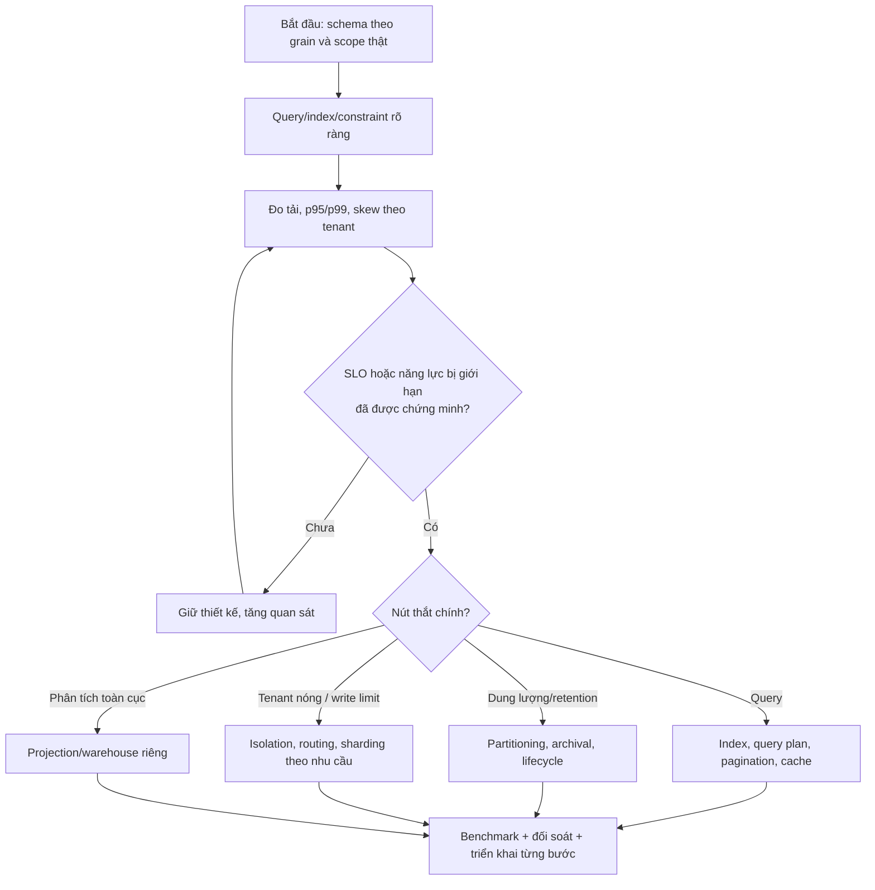
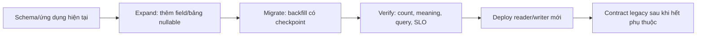

# Thiết kế cho mọi khả năng tương lai mà không có yêu cầu hoặc bằng chứng

Một nhóm chuẩn bị xây hệ thống quản lý yêu cầu hỗ trợ (*support ticket*) cho khách hàng doanh nghiệp. Nhu cầu đã được xác nhận khá cụ thể: nhân viên thuộc một tổ chức tạo ticket cho khách hàng của tổ chức đó, gán độ ưu tiên, theo dõi trạng thái và liệt kê ticket gần nhất. Nhưng trong cuộc họp thiết kế, các giả định lần lượt xuất hiện:

- “Một ngày nào đó có thể quản lý cả tài sản, hóa đơn, đơn hàng nên hãy dùng **một bảng `objects` cho mọi thực thể**.”
- “Mỗi đối tác có thể có hàng nghìn trường khác nhau nên hãy lưu **tất cả thuộc tính dưới dạng tên–giá trị**.”
- “Có thể cần hỗ trợ một triệu tổ chức và hàng tỷ ticket nên tách sẵn **64 shard**, dù hiện tại chỉ vài nghìn ticket/ngày.”
- “Có thể cần lịch sử mọi trường ở mọi thời điểm, nên tất cả thao tác phải qua **event sourcing**, dù chưa có yêu cầu tái dựng trạng thái.”
- “Sau này chắc chắn thêm nhiều database, nên xây một **lớp truy vấn chung** hỗ trợ SQL, document, graph và KV ngay từ đầu.”

Kết quả có thể là một hệ thống rất linh hoạt **trên slide**, nhưng mỗi trường dữ liệu thật lại mất kiểu, mỗi truy vấn đơn giản phải đi qua nhiều tầng mapping, những quy tắc nghiệp vụ không được database bảo vệ, và việc sửa lỗi trở nên khó. Nhóm đã trả trước chi phí cho nhiều tương lai **chưa ai biết có xảy ra không**, trong khi độ phức tạp ấy hiện diện mỗi ngày.

Đây là lỗi **thiết kế tổng quát quá sớm** (*speculative generality*, *overengineering*): mở rộng mô hình cho các nhu cầu tưởng tượng thay vì cho những yêu cầu, bất biến hoặc rủi ro đã có bằng chứng. Nó khác với việc chuẩn bị cho thay đổi một cách có trách nhiệm. Bài này thuộc chương **Lỗi thường gặp** của module **DATABASE_DATA_MODELING**, nơi kỹ năng cốt lõi là chuyển yêu cầu nghiệp vụ thành thực thể, quan hệ, ràng buộc, khóa, chỉ mục và lược đồ vật lý rõ ràng; so sánh mô hình quan hệ, document, đồ thị và phân tích để lựa chọn cấu trúc phù hợp, dễ tiến hóa và kiểm chứng.

## 1. Đặt đúng vấn đề: không phải “thiết kế càng đơn giản càng tốt”

Một thiết kế tốt phải **đủ** để bảo vệ các quy tắc quan trọng của hiện tại và chịu được những thay đổi có thể dự đoán **bằng chứng**, nhưng không biến giả thuyết mơ hồ thành chi phí chắc chắn.

| Cách tiếp cận | Ý nghĩa | Kết quả thường gặp |
| --- | --- | --- |
| **Thiết kế thiếu** | Bỏ qua ràng buộc đã biết như khóa duy nhất, quyền tổ chức, tiền tệ | Lỗi dữ liệu, mất an toàn, phải sửa kiến trúc gấp |
| **Thiết kế vừa đủ có đường tiến hóa** | Mô hình rõ, invariant được bảo vệ, thay đổi được chuẩn bị theo mức rủi ro | Dễ đọc, dễ kiểm thử, chi phí hợp lý |
| **Thiết kế trước mọi giả thuyết** | Tạo tầng trừu tượng, schema động, shard, workflow engine cho tương lai mơ hồ | Tăng số khả năng phải hiểu và duy trì dù chưa có người dùng |

Nguyên tắc **YAGNI** (*You Aren't Gonna Need It*) gợi ý đừng xây tính năng chỉ vì “có thể cần”. Nhưng không được dùng YAGNI để bỏ qua **bảo mật, toàn vẹn dữ liệu, quyền riêng tư, idempotency, backup, ràng buộc pháp lý hay giới hạn không thể đảo ngược**. Những điều này có thể là yêu cầu **ngay bây giờ**, kể cả khi chưa có nút giao diện riêng.

Điểm phân biệt là **có căn cứ** chứ không phải **có vẻ tiên tiến**.

## 2. Phân loại từng tuyên bố về tương lai

Trước một đề xuất kiến trúc, hỏi: nó thuộc loại nào?

| Loại | Ví dụ | Cách phản hồi |
| --- | --- | --- |
| **Yêu cầu đã cam kết** | Quý tới phải hỗ trợ thêm tổ chức B trong cùng nền tảng | Đưa vào phạm vi và thiết kế/kiểm thử |
| **Bất biến phải giữ ngay** | Không cho ticket của tổ chức A tham chiếu khách của B | Ràng buộc và kiểm tra quyền ngay từ đầu |
| **Giới hạn vận hành đã đo** | p99 liệt kê ticket vượt SLO khi một tenant có 2 triệu hàng | Đo query plan và tối ưu có kiểm chứng |
| **Ràng buộc khó sửa về sau** | Cần lưu đúng currency và đơn vị tiền của giao dịch | Mô hình hóa ngay để không mất ý nghĩa |
| **Giả thuyết có dấu hiệu** | Có vài khách yêu cầu trường tùy biến, đang thử nghiệm | Thiết kế điểm mở rộng có giới hạn; đặt ngưỡng quyết định |
| **Khả năng tưởng tượng** | Một ngày nào đó mọi ticket có thể thành node trong đồ thị toàn cầu | Không biến thành schema hiện tại; ghi giả thuyết để xem xét lại |

Không phải mọi “yêu cầu tương lai” đều vô căn cứ: hợp đồng đã ký, lịch ra mắt được tài trợ, quy định có hiệu lực sắp tới hoặc sự cố đã đo là bằng chứng đáng xem xét. Ngược lại, “một kỹ sư từng gặp hệ thống một tỷ người dùng” **không** chứng minh ứng dụng hiện tại phải sharding.

### 2.1. Hỏi năm câu trước khi trả chi phí

1. **Ai cần?** Có người dùng, nghiệp vụ, hợp đồng hoặc hệ tiêu thụ xác định không?
2. **Bao giờ cần?** Có mốc triển khai, khối lượng dữ liệu và mức phục vụ dự kiến không?
3. **Bằng chứng gì?** Traces, workload, dữ liệu, prototype, pháp lý, sự cố hay chỉ là suy đoán?
4. **Nếu chờ, cái giá đổi sau là gì?** Chỉ thêm index hay phải đổi khóa của hàng tỷ bản ghi?
5. **Nếu làm trước mà không cần, ai phải trả?** Mọi người viết query, trực ca, tích hợp, kiểm thử và migration.

Một câu trả lời “chưa biết” không nhất thiết dẫn tới “làm ngay để đề phòng”. Nó là lý do để **giữ một đường thay đổi rõ ràng**, đặt mốc đo và tránh cam kết vào cấu trúc khó bỏ.

## 3. Bắt đầu từ câu hỏi nghiệp vụ và grain

Với hệ ticket, các use case được xác nhận:

| ID | Tình huống thật | Dữ liệu và ràng buộc cần có |
| --- | --- | --- |
| U1 | Nhân viên tạo ticket cho khách trong tổ chức của mình | `org_id`, `customer_id` có mapping đúng scope; người gọi có quyền |
| U2 | Danh sách ticket mới nhất theo tổ chức | `org_id`, `created_at`, phân trang ổn định |
| U3 | Xem ticket theo ID | Định danh ticket và kiểm tra object-level authorization |
| U4 | Đổi ưu tiên, trạng thái | Tập giá trị hợp lệ, quy tắc transition, lịch sử nếu yêu cầu |
| U5 | Tìm ticket mở có độ ưu tiên cao | `status`, `priority`, đường truy vấn/filter xác định |
| U6 | Tổng số ticket đã giải quyết trong tuần | Thời điểm resolution và định nghĩa “đã giải quyết” |

**Grain** cho bảng ticket là **một yêu cầu hỗ trợ được tạo trong phạm vi một tổ chức**. Grain cho khách là **một hồ sơ khách trong phạm vi tổ chức**. Các thực thể cần thiết hiện tại không phải một siêu thực thể `Object` chứa mọi thứ.

Phân biệt rõ:

- **Business key / primary key:** định danh một ticket.
- **Foreign key:** ticket thuộc khách/tổ chức nào.
- **Attribute:** chủ đề, mức ưu tiên, thời điểm.
- **Invariant:** khách phải thuộc cùng tổ chức; trạng thái giải quyết có thời điểm hợp lệ.
- **Query pattern:** API liệt kê ticket theo tổ chức và thời gian.
- **Phi chức năng:** phân quyền, retention, p99, concurrency, backup.

Khi viết được các câu này, lựa chọn lược đồ trở thành bài toán **có thể kiểm chứng**, không còn là thi xem ai tưởng tượng ra nhiều loại dữ liệu hơn.

## 4. Bẫy bảng “vạn năng”: mọi thứ là object và attribute

Một thiết kế tổng quát hấp dẫn có thể là:

```sql
-- Ví dụ phản diện: schema EAV minh họa, KHÔNG khuyến nghị
-- cho các thực thể nghiệp vụ lõi đã có yêu cầu rõ ràng.
CREATE TABLE universal_object (
    org_id UUID NOT NULL,
    object_id UUID NOT NULL,
    object_type TEXT NOT NULL,
    PRIMARY KEY (org_id, object_id)
);

CREATE TABLE universal_attribute (
    org_id UUID NOT NULL,
    object_id UUID NOT NULL,
    attribute_name TEXT NOT NULL,
    value_text TEXT,
    PRIMARY KEY (org_id, object_id, attribute_name),
    FOREIGN KEY (org_id, object_id)
        REFERENCES universal_object(org_id, object_id)
);
```

Một ticket có thể được lưu thành:

```text
universal_object
  (A, T-1, "ticket")

universal_attribute
  (A, T-1, "status", "OPEN")
  (A, T-1, "priority", "HIGH")
  (A, T-1, "created_at", "2030-04-01T09:00:00Z")
  (A, T-1, "customer_id", "C-17")
```

Schema **chạy được**, nhưng database không còn dễ bảo vệ:

- `value_text` không ép đúng kiểu thời gian, số, boolean hay UUID theo từng thuộc tính.
- Một câu query có thể so sánh chuỗi `"100"` và `"20"` theo thứ tự chữ thay vì số.
- `customer_id` đang nằm trong text, không có FK thực tới khách hàng hợp lệ theo cùng `org_id`.
- Không có `CHECK(status IN (...))` tự nhiên cho riêng ticket.
- Không kiểm tra được việc ticket phải có `created_at` chỉ bằng `NOT NULL` trên một cột của ticket.
- Mỗi phép lọc nhiều thuộc tính có thể cần join/pivot nhiều lần, gây khó đọc và khó lập kế hoạch hiệu năng.
- Các bảng đều chứa hàng của nhiều kiểu object; query và audit không tự rõ ràng đối tượng nào thuộc domain nào.

**EAV (Entity–Attribute–Value)** không luôn sai. Nó phù hợp một số bài toán **thuộc tính tùy biến thực sự** hoặc dữ liệu đo thay đổi liên tục khi yêu cầu và công cụ quản trị phù hợp. Sai lầm ở đây là **đẩy các trường đã biết, được truy vấn thường xuyên và có invariant quan trọng vào một cơ chế động chỉ để chuẩn bị cho đối tượng tương lai chưa có**.

### 4.1. Một câu truy vấn dễ trở nên rối

Muốn lấy ticket `OPEN` và `HIGH` trong schema vạn năng:

```sql
SELECT o.object_id
FROM universal_object AS o
JOIN universal_attribute AS status_attr
  ON status_attr.org_id = o.org_id
 AND status_attr.object_id = o.object_id
 AND status_attr.attribute_name = 'status'
JOIN universal_attribute AS priority_attr
  ON priority_attr.org_id = o.org_id
 AND priority_attr.object_id = o.object_id
 AND priority_attr.attribute_name = 'priority'
WHERE o.org_id = $1
  AND o.object_type = 'ticket'
  AND status_attr.value_text = 'OPEN'
  AND priority_attr.value_text = 'HIGH';
```

So với:

```sql
SELECT ticket_id
FROM support_ticket
WHERE org_id = $1
  AND status = 'OPEN'
  AND priority = 'HIGH';
```

Khác biệt không chỉ là số dòng SQL: mô hình cụ thể cho phép **kiểu dữ liệu rõ, ràng buộc, chỉ mục theo truy vấn và diễn giải đơn giản**. Đừng chọn EAV chỉ vì nó làm một lần `ALTER TABLE` có vẻ thừa.

## 5. Thiết kế quan hệ vừa đủ: giữ ngữ nghĩa trong schema

Ví dụ sau dùng PostgreSQL, không phải DDL của hệ thống thật. Nó thể hiện **những yêu cầu đã có**: multi-tenant, khách hàng, ticket, priority/status và thời điểm.

```sql
CREATE TABLE organization (
    org_id UUID PRIMARY KEY,
    org_name TEXT NOT NULL
);

CREATE TABLE customer (
    org_id UUID NOT NULL REFERENCES organization(org_id),
    customer_id UUID NOT NULL,
    display_name TEXT NOT NULL,
    PRIMARY KEY (org_id, customer_id)
);

CREATE TABLE support_ticket (
    org_id UUID NOT NULL,
    ticket_id UUID NOT NULL,
    customer_id UUID NOT NULL,
    subject TEXT NOT NULL,
    priority VARCHAR(10) NOT NULL
        CHECK (priority IN ('LOW', 'NORMAL', 'HIGH')),
    status VARCHAR(16) NOT NULL
        CHECK (status IN ('OPEN', 'IN_PROGRESS', 'RESOLVED')),
    created_at TIMESTAMPTZ NOT NULL DEFAULT now(),
    resolved_at TIMESTAMPTZ,
    PRIMARY KEY (org_id, ticket_id),
    FOREIGN KEY (org_id, customer_id)
        REFERENCES customer(org_id, customer_id),
    CONSTRAINT ck_ticket_subject_not_blank
        CHECK (length(btrim(subject)) > 0),
    CONSTRAINT ck_ticket_resolved_shape CHECK (
        (
            status = 'RESOLVED'
            AND resolved_at IS NOT NULL
            AND resolved_at >= created_at
        )
        OR
        (
            status <> 'RESOLVED'
            AND resolved_at IS NULL
        )
    )
);

CREATE INDEX ix_support_ticket_recent
    ON support_ticket(org_id, created_at DESC, ticket_id DESC);

CREATE INDEX ix_support_ticket_status_priority
    ON support_ticket(
        org_id, status, priority, created_at DESC, ticket_id DESC
    );
```

### 5.1. Lý do lựa chọn thiết kế

| Quyết định | Bằng chứng hiện tại | Điều được bảo vệ |
| --- | --- | --- |
| Một bảng `support_ticket` có cột cụ thể | U1–U6 đang sử dụng các trường này | Loại dữ liệu, invariant, query dễ đọc |
| PK `(org_id,ticket_id)` | Hệ SaaS đa tổ chức, ID được truy vấn theo scope | Identity trong tenant |
| FK ghép `(org_id,customer_id)` | Ticket chỉ được tham chiếu khách trong chính tổ chức | Chống reference xuyên tenant |
| `priority/status` có CHECK | Luồng hiện tại có tập giá trị đã xác nhận | Ngăn giá trị rác và typo |
| `created_at/resolved_at` | Danh sách theo thời gian và KPI giải quyết | Thời gian có mục đích cụ thể |
| Index theo org/time và org/status/priority | U2 và U5 là query cần phục vụ | Đường truy cập có thể đo `EXPLAIN` |

Đây vẫn là **một thiết kế cần thử**, không là schema chuẩn cho mọi ticket product. Chẳng hạn:

- Một số sản phẩm cho phép **reopen ticket**: check `resolved_at IS NULL` với trạng thái chưa RESOLVED chỉ đúng nếu `resolved_at` mang nghĩa *thời điểm giải quyết hiện tại*, không phải *thời điểm từng giải quyết*. Nếu phải giữ lịch sử, cần event/history riêng hoặc định nghĩa cột khác.
- Nếu ticket có thể không có khách (ticket nội bộ), `customer_id NOT NULL` sẽ không hợp lệ; phải sửa theo **yêu cầu thực**, không vì “tương lai có thể cần”.
- Thêm index có chi phí write/storage; U2/U5 phải được đo, không mặc định cả hai index đều cần ở tải thực tế.
- FK và CHECK không thay quyền API, chính sách role hay trạng thái chuyển đổi; phần đó cần kiểm thử và ownership.

**Thiết kế vừa đủ không có nghĩa schema bất biến**. Nó là điểm khởi đầu minh bạch để thay đổi có kiểm soát khi bằng chứng xuất hiện.

## 6. Tối ưu dựa trên mẫu truy cập, không dựa trên số lượng bảng

Trước khi quyết định “schema này sẽ chậm ở một tỷ row”, hãy đo workload thật hoặc đặt giả định có nhãn:

| Query | Bộ lọc | Phân trang | Dữ liệu điển hình | Chỉ số cần đo |
| --- | --- | --- | --- | --- |
| Danh sách ticket mới | `org_id` | Theo `created_at,ticket_id` | Một tenant cụ thể | Rows scanned, p95/p99, buffer hit |
| Ticket theo ID | `(org_id,ticket_id)` | Không | Một row | Lookup latency, index usage |
| Ticket HIGH chưa giải quyết | `org_id,status,priority` | Theo thời gian | Một tập đang mở | Query plan, lọc, sorting |
| Báo cáo theo tuần | Khoảng `resolved_at` | Aggregate | Hàng từ nhiều ngày | Scan cost, freshness |

Một query cursor-based có thể là:

```sql
-- Trang đầu của danh sách ticket mới.
SELECT ticket_id, subject, status, priority, created_at
FROM support_ticket
WHERE org_id = $1
ORDER BY created_at DESC, ticket_id DESC
LIMIT 50;

-- Trang sau: $2 là created_at cuối trang trước,
-- $3 là ticket_id cuối trang trước.
SELECT ticket_id, subject, status, priority, created_at
FROM support_ticket
WHERE org_id = $1
  AND (created_at, ticket_id) < ($2, $3)
ORDER BY created_at DESC, ticket_id DESC
LIMIT 50;
```

Với thứ tự giảm dần và bộ `(created_at,ticket_id)` có tie-break, điều kiện tuple so sánh đúng cho các trang **nếu dữ liệu không bị thay đổi thứ tự trong lúc duyệt**. Trong hệ ghi liên tục, pagination vẫn có thể gặp hàng mới xuất hiện, hàng bị sửa/xóa và vấn đề snapshot; cần quyết định consistency theo API. **Khóa phân trang không thay thế toàn bộ hợp đồng phân trang**.

Đo bằng `EXPLAIN (ANALYZE, BUFFERS)` trên môi trường được phép với dữ liệu đại diện; lưu ý `ANALYZE` thực thi query và có thể tốn tài nguyên. Đừng xây shard hay read model mới trước khi hiểu thống kê dữ liệu, index, N+1 queries, cache, tập truy vấn và SLO thực tế.

## 7. JSONB: một đường mở rộng nhỏ, không phải thùng chứa mọi thứ

Nếu khách hàng thí điểm cần vài thuộc tính ít dùng riêng theo tổ chức, một cột `JSONB` có thể là lựa chọn tạm thời cho **metadata không mang invariant cốt lõi**:

```sql
ALTER TABLE support_ticket
ADD COLUMN custom_metadata JSONB NOT NULL DEFAULT '{}'::jsonb,
ADD CONSTRAINT ck_ticket_metadata_object
    CHECK (jsonb_typeof(custom_metadata) = 'object');
```

Ví dụ:

```json
{
  "source_campaign": "spring-pilot",
  "external_case_ref": "CASE-842"
}
```

Một chính sách an toàn cho extension:

- Xác định danh sách trường **được phép**, kiểu, độ dài, retention và owner theo contract cụ thể.
- Không đưa `org_id`, `customer_id`, `status`, `priority` hoặc thông tin quyết định phân quyền vào metadata tùy ý.
- Không cho client ghi payload không giới hạn kích thước, PII hay secret chỉ vì JSON có thể chứa bất kỳ key nào.
- Không tự thêm GIN index cho toàn bộ JSONB khi chưa có query/filter cần thiết; index có chi phí.
- Khi một field trở thành **bắt buộc, được join/lọc thường xuyên hoặc cần uniqueness/FK**, cân nhắc nâng thành cột typed hoặc bảng riêng.
- Với metadata cần dùng cho quyết định kinh doanh, định nghĩa version/validation rõ hơn một object JSON không kiểm tra.

**Không có “JSONB = future-proof”**. Nó chuyển một phần yêu cầu từ database constraint sang ứng dụng, data-quality gate và tài liệu. Nếu cả schema biến thành một cột JSON, chúng ta chỉ **giấu sự phức tạp khỏi ERD**, không làm nó biến mất.

### 7.1. Khi nào EAV/JSONB thực sự là yêu cầu?

Một hệ *form builder* cho phép mỗi tổ chức định nghĩa hàng trăm câu hỏi động, có version, bắt buộc theo form, tìm kiếm theo một số trường. Đây là bài toán khác ticket:

- Người dùng thật sự cần tạo field **lúc runtime**.
- Các field có định nghĩa, loại, version và quyền riêng.
- Query/điều kiện lọc của field động được mô tả bằng hợp đồng.
- Hệ thống chấp nhận chi phí index/validation hoặc dùng một storage phù hợp.

Lúc này, một mô hình metadata + typed values hoặc JSON Schema có version **có căn cứ**. Nhưng không nên mang toàn bộ kiến trúc form builder vào hệ ticket chỉ vì “sau này có thể thêm trường”.

## 8. Sáu nhóm chi phí ẩn của “thiết kế cho mọi thứ”

| Chi phí | Biểu hiện | Cách phát hiện |
| --- | --- | --- |
| **Nhận thức** | Mọi kỹ sư phải hiểu object registry, mapper, rule engine mới sửa một field | Thời gian onboarding, lỗi thay đổi |
| **Tính đúng** | Không còn FK/type/constraint; validation phân tán | Data quality failures, invariant tests |
| **Hiệu năng** | Pivot/join nhiều lần, nhiều index động, query fan-out | Query plan, bytes scanned, p99 |
| **Vận hành** | Shard routing, consumer, projection, retry, migration khó | Alert, backlog, incident, restore drills |
| **Thay đổi** | Phụ thuộc abstract API; sửa một contract ảnh hưởng nhiều tenant | Số nơi phải sửa, số test phải cập nhật |
| **Cơ hội** | Nhóm trì hoãn tính năng có người dùng để xây nền tảng giả định | Lead time và backlog đã cam kết |

Một tầng abstraction **chỉ đáng giá** khi độ phức tạp nó loại bỏ lớn hơn độ phức tạp nó tạo ra **trong những tình huống đã có hoặc có bằng chứng mạnh**. Không đo giá trị bằng số interface, số pattern hay số tùy chọn cấu hình.

### 8.1. Tổng chi phí quyết định

Có thể dùng cách nhìn:

\[
C_{\text{total}}
= C_{\text{build}}
+ C_{\text{operate}}
+ C_{\text{change}}
+ C_{\text{risk}}
\]

Đây là **khung tư duy**, không phải công thức kế toán đủ để dự báo chính xác. Một thiết kế tổng quát có thể giảm chi phí của **một tương lai cụ thể**, nhưng tăng `C_operate` và `C_change` ngay từ ngày đầu; trong khi xác suất tương lai ấy xảy ra chưa được xác minh.

Nếu giả định phương án tổng quát chỉ có lợi khi có 50 loại entity mới, cần hỏi có **lộ trình đã cam kết** cho 50 loại entity đó không. Nếu hiện tại chỉ có ticket, không thể lấy lợi ích trong trường hợp chưa có để biện hộ cho chi phí chắc chắn của mọi request hôm nay.

## 9. Đừng nhầm “generic” với “dễ thay đổi”

Một sơ đồ generic không tự tiến hóa tốt. Đôi khi nó **khóa chặt** hơn:

- Bảng `universal_attribute` trở thành điểm nối chung của mọi query; thay cấu trúc sẽ ảnh hưởng toàn sản phẩm.
- Mọi dữ liệu được serialize vào một `value_text`; đổi cách parse ảnh hưởng dữ liệu lịch sử không có version.
- Generic repository che khuất câu SQL thực, khiến tối ưu query trọng điểm khó.
- Các bảng dùng một DSL filter không được DB kiểm tra; mỗi đội thêm một ngoại lệ và dần tạo ngôn ngữ truy vấn thứ hai.
- Một khóa “hỗ trợ mọi trường hợp” chứa quá nhiều thành phần có thể khiến migration/rekey khó hơn cấu trúc cụ thể.

**Dễ thay đổi** thường đến từ những điều ít hào nhoáng hơn:

1. Grain, danh tính và invariant rõ ràng.
2. Migration có version, có kế hoạch expand–migrate–contract.
3. Bounded contexts và hợp đồng ổn định giữa các phần.
4. Code đủ đơn giản để sửa khi học được điều mới.
5. Data-quality tests và workload metrics làm bằng chứng.
6. Những quyết định khó đảo ngược được chuẩn bị sớm; những quyết định dễ đảo ngược được trì hoãn.

Nói cách khác, **một thiết kế cụ thể, được quản trị tốt** có thể tiến hóa dễ hơn một “siêu mô hình” không ai dám sửa.

## 10. Phân biệt quyết định dễ đảo và khó đảo

Mục tiêu không phải trì hoãn mọi quyết định. Hãy đánh giá **chi phí đổi sau này** và **chi phí làm trước ngay bây giờ**.

| Quyết định | Thay đổi về sau | Hướng thực dụng |
| --- | --- | --- |
| Thêm index để phục vụ query đã đo | Thường có thể bổ sung sau, nhưng cần tính lock/cost theo engine | Đo query trước, thêm khi có SLO |
| Thêm cột nullable mới | Thường qua migration mở rộng | Không tạo hàng trăm cột tương lai |
| Đổi tên field trong một service riêng | Có thể dùng adapter/rolling migration | Giữ contract/version rõ |
| Business key/ID được phát ra bên ngoài | Có thể rất khó đổi khi consumer và dữ liệu đã tích lũy | Chọn ID ổn định, namespace rõ ngay |
| Multi-tenant ownership/authorization | Bổ sung muộn dễ để lại dữ liệu trộn lẫn | Nếu đa tổ chức là yêu cầu hiện tại, bảo vệ từ đầu |
| Currency/unit/temporal semantics | Mất đơn vị có thể không khôi phục được | Lưu đúng ý nghĩa và precision ngay |
| Partition/shard key vật lý | Có thể cần backfill hoặc di chuyển hàng tỷ bản ghi | Không tối ưu quá sớm; chuẩn bị routing hợp lý theo workload |
| Tách microservice và transaction boundary | Rất tốn công thay khi đã có nhiều consumer | Chốt ranh giới từ nghiệp vụ thật, không từ tên công nghệ |
| Event sourcing toàn hệ | Đổi hướng lưu trữ, replay, eventual consistency và vận hành đáng kể | Chỉ chọn khi nhu cầu lịch sử/rebuild/audit rõ ràng |
| Xóa dữ liệu và retention | Có thể không phục hồi được dữ liệu đã hết hạn hoặc vi phạm nếu giữ quá lâu | Định nghĩa policy theo yêu cầu thật ngay |

Một điểm quan trọng: **có thể phải thiết kế dự phòng cho rủi ro có tác động lớn dù xác suất thấp**, như cô lập tenant hoặc khả năng khôi phục sau sự cố. Khi đó bằng chứng có thể là threat model, contract hoặc hậu quả nghiêm trọng, không chỉ số request/giây. Bản chất của việc này khác giả định “sẽ cần GraphQL + 12 database”.

## 11. “Nhỡ sau này có 1 triệu tenant”: đánh giá quy mô có căn cứ

Giả sử năm đầu dự kiến:

- 500 tenant đang hoạt động.
- Khoảng 2.000 ticket/ngày toàn hệ thống.
- 90% request đọc ticket theo một tenant cụ thể.
- Retention 2 năm.
- SLO đọc danh sách gần nhất p95 dưới mức do đội sản phẩm phê duyệt.

Các con số chỉ là **giả định để thực hành**, không phải dữ liệu thật của một doanh nghiệp. Với một số lượng như vậy, nhảy ngay sang 64 shard, cross-shard transactions và 3 loại database có thể là chi phí lớn không có bằng chứng.

### 11.1. Những phép đo cần trước khi scale-out

- Số row/byte hiện tại và dự báo theo tenant, số tenant lớn nhất.
- Write/read QPS theo endpoint, top tenant, peak/burst.
- Query plan, index selectivity, lock contention, p95/p99 theo tải.
- CPU, RAM, I/O, disk growth, WAL/replication lag và backup restore time.
- Số request cần join xuyên tenant; quyền truy cập liên tổ chức.
- Chi phí vận hành và hỗ trợ on-call nếu thêm shard/replica.

Hash theo `org_id` có thể phân phối **các tenant khác nhau**, nhưng **một tenant cực nóng** vẫn có thể tập trung vào một shard. Thêm 64 shard cũng không sửa được truy vấn thiếu index hay N+1 trong ứng dụng. Cần đo nguyên nhân trước khi chọn giải pháp.

### 11.2. Một lộ trình tăng trưởng dễ kiểm chứng



Sơ đồ là **cách đưa bằng chứng vào quyết định**, không hàm ý nhất thiết sẽ đi đến sharding. RDBMS với partitioning/index tốt có thể đủ trong thời gian dài; hệ khác có thể cần scale-out sớm vì workload thực tế. Quan trọng là **lý do và phép thử**, không phải quy mô “trông có vẻ tương lai”.

## 12. Giữ phần có thể mở rộng, không triển khai tất cả ngay

Một thiết kế vừa đủ vẫn có thể có **extension points** hữu ích:

| Vị trí | Chuẩn bị hợp lý | Chuẩn bị quá mức |
| --- | --- | --- |
| ID | UUID/business key với namespace rõ; không lấy email làm ID | Tạo ID registry chung cho mọi object tưởng tượng |
| Schema | Migration và version contract có quy trình | Tự xây schema language runtime cho mọi bảng |
| Dữ liệu tùy biến | JSONB/tables riêng có giới hạn khi có pilot thật | Chuyển toàn bộ entity sang EAV |
| Query | Repository theo use case cần thiết | Query DSL “đa engine” không có provider thứ hai |
| Phân quyền | Scope + roles theo nhu cầu và threat model | Generic policy language tự chế cho mọi tương lai |
| Analytics | Định nghĩa grain/time/unit; xuất event có ID ổn định | Dựng full lakehouse và real-time OLAP khi chưa có query |
| Tích hợp | ACL/adapters ở boundary ngoài đã biết | 20 plugin interface cho đối tác chưa tồn tại |
| Audit | Sự kiện cần thiết cho đối soát, bảo mật và lỗi | Event sourcing mọi thay đổi nội bộ không có use case |

Một extension point tốt có **bề mặt nhỏ và tiêu chí mở rộng rõ**. Ví dụ một interface `CustomerDirectory` có hai caller và một implementation là hợp lý nếu domain cần tránh lệ thuộc CRM; nhưng một hierarchy gồm `AbstractUniversalEntityRepository` và hàng chục adapter cho hệ chưa có sẽ làm đường đi của mọi ticket khó theo dõi hơn.

## 13. Ví dụ Java 17: domain type cụ thể thay vì map vạn năng

Khi code, vấn đề tương tự EAV. Một API kiểu:

```java
// Anti-pattern nếu dùng cho mọi quy tắc cốt lõi:
Map<String, Object> ticket = new HashMap<>();
ticket.put("status", "OPEN");
ticket.put("priority", "HIGH");
ticket.put("customerId", "...");
// Lỗi chính tả, kiểu sai hoặc key thiếu chỉ lộ ra ở runtime.
```

Một mô hình domain cụ thể, có thể biên dịch và kiểm thử:

```java
import java.time.Instant;
import java.util.Objects;
import java.util.UUID;

public class TicketModelDemo {
    enum Priority { LOW, NORMAL, HIGH }
    enum TicketStatus { OPEN, IN_PROGRESS, RESOLVED }

    record TicketId(UUID value) {
        TicketId {
            Objects.requireNonNull(value, "ticketId");
        }
    }

    record OrgId(UUID value) {
        OrgId {
            Objects.requireNonNull(value, "orgId");
        }
    }

    record CustomerId(UUID value) {
        CustomerId {
            Objects.requireNonNull(value, "customerId");
        }
    }

    record Ticket(
        OrgId orgId,
        TicketId id,
        CustomerId customerId,
        String subject,
        Priority priority,
        TicketStatus status,
        Instant createdAt,
        Instant resolvedAt
    ) {
        Ticket {
            Objects.requireNonNull(orgId);
            Objects.requireNonNull(id);
            Objects.requireNonNull(customerId);
            Objects.requireNonNull(priority);
            Objects.requireNonNull(status);
            Objects.requireNonNull(createdAt);
            if (subject == null || subject.isBlank()) {
                throw new IllegalArgumentException("subject is blank");
            }
            if (status == TicketStatus.RESOLVED) {
                if (resolvedAt == null
                    || resolvedAt.isBefore(createdAt)) {
                    throw new IllegalArgumentException(
                        "invalid resolvedAt"
                    );
                }
            } else if (resolvedAt != null) {
                throw new IllegalArgumentException(
                    "only resolved tickets have resolvedAt"
                );
            }
        }

        static Ticket open(
            OrgId org, TicketId id, CustomerId customer,
            String subject, Priority priority, Instant created
        ) {
            return new Ticket(
                org, id, customer, subject, priority,
                TicketStatus.OPEN, created, null
            );
        }

        Ticket resolve(Instant at) {
            if (status == TicketStatus.RESOLVED) {
                throw new IllegalStateException("already resolved");
            }
            return new Ticket(
                orgId, id, customerId, subject, priority,
                TicketStatus.RESOLVED, createdAt, at
            );
        }
    }

    public static void main(String[] args) {
        Instant openedAt = Instant.parse(
            "2030-04-01T09:00:00Z"
        );
        Ticket ticket = Ticket.open(
            new OrgId(UUID.randomUUID()),
            new TicketId(UUID.randomUUID()),
            new CustomerId(UUID.randomUUID()),
            "Không đăng nhập được",
            Priority.HIGH,
            openedAt
        );
        Ticket resolved = ticket.resolve(
            Instant.parse("2030-04-01T10:00:00Z")
        );
        System.out.println(resolved.status());
    }
}
```

Code minh họa **hợp đồng trạng thái hiện tại**. Khi nghiệp vụ thêm `REOPENED`, cần xác định `resolvedAt` là “lần giải quyết hiện tại” hay “lần đầu từng giải quyết”, rồi sửa mô hình rõ ràng. Không cố nhét mọi workflow tương lai vào một map/string để khỏi thay enum.

### 13.1. Những gì ví dụ chưa tự bảo đảm

- Java record không xác minh `CustomerId` thuộc cùng `OrgId`; cần repository lookup/constraint FK theo scope.
- Không có optimistic locking hay xử lý nhiều worker cập nhật cùng ticket.
- Chưa có xác thực người gọi, bảo mật, audit, version hóa API và retention.
- Một domain khác có thể cho phép reopened ticket với quy tắc khác.

Đó là **đường ranh giới kiến thức** được công khai, không phải lý do để viết trước một universal workflow engine. Khi một yêu cầu thật xuất hiện, chọn thêm capability phù hợp và kiểm thử invariant mới.

## 14. Cách thêm nhu cầu mới mà không cần “siêu mô hình”

Giả sử sau ba tháng đã có hợp đồng rõ ràng: nhóm hỗ trợ cần gắn **SLA policy** cho ticket, một số ticket có hạn xử lý và báo cáo quá hạn.

Từ yêu cầu, ta biết:

- Có `sla_policy_id` hoặc snapshot của SLA khi ticket được tạo.
- Cần `due_at` cho ticket có SLA; một số ticket không áp dụng.
- Query mới: `WHERE org_id = ? AND status <> 'RESOLVED' AND due_at < now()`.
- Phải định nghĩa timezone, ngày làm việc, nghỉ lễ và thay đổi chính sách khi ticket đã tạo.

### 14.1. Expand theo nhu cầu đã xác nhận

Một ví dụ đơn giản khi business đã quyết định **lưu deadline tính sẵn**, chưa cần nhiều phiên bản policy ở database:

```sql
ALTER TABLE support_ticket
    ADD COLUMN due_at TIMESTAMPTZ;

CREATE INDEX ix_ticket_open_due
    ON support_ticket (org_id, due_at, ticket_id)
    WHERE status <> 'RESOLVED'
      AND due_at IS NOT NULL;
```

Đây mới là **một bước triển khai**. Trước khi đưa vào production:

1. Xác định những ticket cũ có SLA hay không; `NULL` nghĩa là gì?
2. Backfill và chính sách xử lý ticket cũ có được nghiệp vụ phê duyệt không?
3. App phiên bản cũ có đọc/ghi được schema mở rộng không?
4. Query overdue có SLO cụ thể, index có được dùng đúng không?
5. Khi đổi SLA sau này, `due_at` có giữ ý nghĩa lịch sử không, có cần `sla_policy_version` không?

Không tự xây một lịch làm việc động cho 180 quốc gia nếu hợp đồng mới chỉ có giờ làm việc của một tổ chức. Nhưng cũng không tính deadline bằng `now() + 24 hours` nếu SLA xác định theo **giờ làm việc**; cần đáp ứng **yêu cầu thật**, kể cả khi logic phức tạp hơn.

### 14.2. Expand–migrate–contract

Một rollout an toàn thường gồm:



Khả năng rollback phụ thuộc **dữ liệu mới có biểu diễn được bằng version cũ hay không**. Một cột `due_at` nullable có thể an toàn hơn nếu để lại khi rollback ứng dụng; nhưng một SLA state mới không được code cũ hiểu có thể khiến rollback riêng code trở nên nguy hiểm. Không cần dựng hệ vạn năng để có **đường tiến hóa có kiểm soát**.

## 15. Một ngoại lệ quan trọng: thứ gì đã biết là không thể sửa muộn?

Đừng áp dụng “chờ đến khi cần” với những thông tin **mất là không tái tạo được** hoặc ranh giới bảo vệ hiện đã có.

| Chủ đề | Vì sao phải định nghĩa sớm? | Điều không cần làm trước |
| --- | --- | --- |
| **Khóa định danh** | Dùng sai business key có thể gây collision và rekey lớn | Xây registry cho mọi loại thực thể chưa xuất hiện |
| **Tenant isolation** | Trộn tổ chức gây lỗi bảo mật và dữ liệu khó tách | Tự xây một authorization language toàn năng |
| **Đơn vị tiền/đo lường** | Không lưu currency/scale có thể mất nghĩa dữ liệu | Hỗ trợ mọi loại tài sản số mà sản phẩm không dùng |
| **Event identity/idempotency** | Retry có thể nhân đôi giao dịch và chỉ số | Event-sourcing toàn bộ ứng dụng |
| **Time semantics** | Mất timezone/effective time gây sai báo cáo | Lưu bốn loại timestamp trên mọi bảng vô điều kiện |
| **Privacy/retention** | Có thể vi phạm nghĩa vụ nếu lưu/xóa sai | Dựng hệ xóa tự chế cho các nguồn chưa tích hợp |
| **Backup/recovery** | Mất dữ liệu kinh doanh có thể không phục hồi | Kiến trúc đa vùng phức tạp khi chưa có SLO tương ứng |
| **Grain/measure semantics** | Gộp dòng giao dịch thành tổng sẽ mất chi tiết | Xây warehouse real-time trước khi có use case phân tích |

Một quyết định **thiết kế đúng sớm** là chọn và ghi rõ những điều không thể đoán lại: `event_id`, `org_id`, currency/unit, thời điểm nghiệp vụ, ranh giới quyền. Một quyết định **thiết kế thừa sớm** là tạo trừu tượng lớn để “sau này thay mọi thứ không sửa code”. Hai việc không nên bị đánh đồng.

## 16. Khi nào phải chọn mô hình khác quan hệ?

Module DATABASE_DATA_MODELING đề cập quan hệ, document, đồ thị và phân tích; lựa chọn nào cũng cần **mẫu truy cập và yêu cầu**.

| Mô hình | Lý do **có bằng chứng** để chọn | Sử dụng sai vì “có thể cần” |
| --- | --- | --- |
| **Quan hệ** | Giao dịch, FK/unique, cập nhật nhiều thực thể cần tính nhất quán, query SQL rõ | Mô hình mọi thứ quan hệ bất chấp dữ liệu thực sự là graph traversals nhiều hop |
| **Document** | Aggregate document thay đổi cấu trúc có version, đọc/ghi thường theo cả document | Chuyển tất cả bảng vào JSON chỉ để tránh migration |
| **Đồ thị** | Query traversal nhiều hop, quan hệ phức tạp là sản phẩm chính, degree/latency được đo | Xây graph database vì “mọi thứ đều có quan hệ” |
| **KV/Wide-column** | Point/range theo partition key ở tải lớn, access pattern có thể thiết kế trước | Đưa ticket bình thường vào Cassandra khi cần query/filter tùy ý chưa xác định |
| **Columnar/warehouse** | Quét và tổng hợp lớn, schema fact/dim và chi phí scan đã rõ | Dựng lakehouse streaming cho dashboard 20 dòng |

Đừng coi việc giữ **hợp đồng domain không phụ thuộc SDK** là lý do phải xây abstraction cho mọi engine. Một repository phục vụ use case hiện tại có thể là ranh giới đủ tốt, không cần mô phỏng MongoDB, Neo4j và Cassandra bằng một interface giả vờ có cùng transaction/query semantics.

### 16.1. “Polyglot persistence” có thể tăng tính đúng hoặc tăng rủi ro

Nếu vừa có API ticket truy vấn theo tenant vừa có báo cáo thống kê toàn cục trên hàng tỷ sự kiện, tách **operational store** và **analytics projection** có thể có bằng chứng. Nhưng nó kéo theo:

- Source of truth và quyền ghi ở đâu?
- CDC/outbox đảm bảo consistency thế nào?
- Event tới muộn, retry hoặc correction cập nhật projection ra sao?
- Xóa dữ liệu lan sang những hệ nào?
- SLA freshness và reconciliation giữa hai hệ là gì?

Không thêm storage thứ hai chỉ vì một sơ đồ kiến trúc sẽ “đầy đủ hơn”. Cần một vấn đề hiện tại hoặc yêu cầu gần hạn **có thể đo và kiểm chứng**.

## 17. Đo ưu–nhược trước khi trừu tượng hóa

Một thử nghiệm so sánh EAV và schema cụ thể nên kiểm tra:

| Tiêu chí | Câu hỏi cần đo | Dữ liệu dùng |
| --- | --- | --- |
| **Development lead time** | Thêm field bắt buộc có test mất bao lâu? | Thực hiện một feature thật ở hai prototype |
| **Data correctness** | Có dễ chèn priority sai kiểu hoặc FK chéo tổ chức không? | Negative tests và constraints |
| **Query cost** | Lọc OPEN/HIGH theo tenant có bao nhiêu join và byte đọc? | `EXPLAIN`/benchmark có dữ liệu lệch |
| **Change cost** | Khi đổi status semantics, phải sửa bao nhiêu nơi? | Diff code/schema/test |
| **Operational overhead** | Backup, migration, monitoring, incident chịu thêm những gì? | Runbook, drill, metrics |
| **Extensibility thật** | Một trường tùy biến của khách pilot thêm bằng cách nào? | End-to-end feature spike |
| **Ownership** | Ai chịu trách nhiệm validate trường và phân quyền? | Contract/ADR và review |

Chọn bộ dữ liệu **có heavy hitters, missing values, duplicates, multi-tenant collision** thay vì chỉ 100 object ngẫu nhiên. Một prototype EAV chạy nhanh với 10 hàng không chứng minh nó phù hợp với truy vấn thực tế và yêu cầu bảo mật.

### 17.1. Không chạy thử để xác nhận điều mình đã muốn

Đặt trước:

- Workload đại diện và khoảng đo.
- Tiêu chí pass/fail: đúng dữ liệu, p95/p99, độ trễ ghi, effort thay đổi, phạm vi quyền.
- Các giới hạn môi trường và nguồn số liệu.
- Quyết định nào được đưa ra từ kết quả.

Nếu hệ cụ thể đạt SLO và thời gian triển khai thấp, không nên vẫn chọn EAV chỉ vì “kiến trúc này đẹp hơn”. Nếu dữ liệu thực chứng minh user-defined fields là năng lực sản phẩm chính, ngược lại phải sẵn sàng chọn mô hình dynamic có kiểm chứng.

## 18. Cách ghi nhận giả thuyết: ADR nhỏ và trigger rõ

Một **Architecture Decision Record (ADR)** ngắn có thể đủ để tránh cả xây trước lẫn quên rủi ro:

```text
ADR-012: Chưa chọn EAV cho dữ liệu ticket cốt lõi

Context:
- Ticket có status, priority, customer, createdAt đã biết.
- Chưa có hợp đồng cho người dùng tự định nghĩa entity/field.
- API chính: tìm ticket theo tenant, state, priority, time.

Decision:
- Dùng bảng support_ticket có kiểu, FK và CHECK rõ ràng.
- Chỉ dành custom_metadata có validation cho pilot nếu được yêu cầu.

Consequences:
- Thêm core field cần migration được review.
- Constraint và query đơn giản hơn.
- Không hỗ trợ "tạo entity mới qua UI" ở phiên bản hiện tại.

Revisit when:
- Có yêu cầu runtime custom fields đã được chấp thuận;
- Có workload cụ thể về filter/index trên các field đó;
- Prototype chứng minh cột/bảng cụ thể không đáp ứng.

Owner: ticket-domain
Evidence: use cases U1..U6, query plans, data-quality tests
```

Điểm quan trọng là **trigger phải quan sát được**. “Sẽ review khi lớn mạnh” không hữu ích bằng “review khi pilot có yêu cầu filter theo ít nhất ba field động, kèm khối lượng query và SLA được xác nhận”. Những ngưỡng cụ thể là **đề xuất nội bộ**, không phải giới hạn kỹ thuật chung cho mọi hệ.

### 18.1. Một “sổ giả thuyết” rẻ hơn tầng abstraction

| Giả thuyết | Bằng chứng hiện có | Quan sát tiếp theo | Quyết định hiện tại |
| --- | --- | --- | --- |
| Người dùng muốn custom entity tự do | Chưa có phỏng vấn/contract | Discovery với pilot customers | Chưa xây generic object store |
| Tenant lớn sẽ gây hotspot | Chỉ là dự báo | Đo top tenant QPS/row count | Giữ index và telemetry |
| Cần báo cáo toàn cầu realtime | Một dashboard ngày | Xác nhận freshness SLA và truy vấn BI | Batch/report hiện tại |
| Có đối tác CRM thứ hai | Đang đàm phán, chưa có contract | Chốt mapping API/schema | Giữ ACL ở boundary đã có |
| Quy định retention thay đổi | Có văn bản/chính sách nội bộ dự kiến | Review với owner có thẩm quyền | Thiết kế retention theo policy, không bịa thời hạn |

Hãy cho các giả thuyết **ngày xem xét lại và owner**, không biến sổ này thành một backlog công việc mặc định phải triển khai.

## 19. Một vài bẫy “future-proofing” khác cần nhận diện

| Bẫy | Hậu quả | Giải pháp thực dụng |
| --- | --- | --- |
| **Một bảng cho mọi entity** | Mất kiểu, constraint và ý nghĩa quan hệ | Mô hình entity thật theo grain |
| **Mọi field dạng string** | Sai số, timestamp, type, validation khó | Dùng kiểu/đơn vị cụ thể |
| **Một bảng quan hệ polymorphic `(entity_type,entity_id)`** | Không có FK tự nhiên tới nhiều bảng đích | Bảng liên kết typed hoặc supertype có chứng cứ |
| **Mọi thứ là JSONB** | Schema ẩn, query/index/privacy phức tạp | JSON cho metadata giới hạn; core field typed |
| **Generic repository đa engine** | Che semantics giao dịch/query khác nhau | Port theo use case, adapter khi có provider thật |
| **Event sourcing mọi đối tượng** | Complexity replay/version/outbox không cần | Audit/event log đúng yêu cầu trước |
| **Shard trước khi đo** | Routing, fan-out, rebalancing và migration tốn kém | Index/partition/scale theo bottleneck |
| **Tạo index cho mọi cột** | Write amplification/storage cao | Index theo query plan và SLO |
| **Mọi status là table cấu hình runtime** | Chuyển trạng thái thiếu rule, dữ liệu không nhất quán | Enum/check + workflow rule rõ; config khi cần |
| **Abstraction cho một implementation không có boundary** | Khó lần theo call stack, mock che SQL thật | Module rõ, interface ở ranh giới có ý nghĩa |
| **Không tạo constraint vì sợ “sau này khác”** | Dữ liệu sai xuất hiện ngay hôm nay | Constraint phản ánh invariant hiện tại, có migration |
| **Tổng quát hóa tenancy** | Quyền xuyên tenant khó hiểu, cache/query dễ leak | Scope hiện tại và contract chia sẻ cụ thể |
| **Thêm trạng thái “ANY/UNKNOWN” cho mọi trường** | Che chất lượng dữ liệu hoặc trộn N/A | Phân biệt missing/unknown/not-applicable có ý nghĩa |
| **Tự động sao chép sang mọi database** | Duplicate, retention/delete và reconciliation phức tạp | Chỉ tạo read model có consumer rõ |
| **Quên đường thoát vì tưởng đã “vạn năng”** | Về sau khó bỏ schema chung | ADR, version, backfill/rebuild plan |

Một dấu hiệu dễ nhận ra: khi reviewer hỏi “**Use case nào thật sự cần cấu trúc này?**” mà câu trả lời liên tục là “**nhỡ sau này...**”, thiết kế đang cần bổ sung bằng chứng hoặc cắt giảm phạm vi.

## 20. Khi nào không nên cắt giảm thiết kế?

Có những ràng buộc phải làm ngay dù **không thấy trong feature hiện tại**:

1. **Security/tenant isolation:** khóa ngoại, quyền đọc/ghi và scope phải ngăn truy cập chéo khi hệ có nhiều tổ chức.
2. **Tiền và tính đúng số liệu:** currency, scale, rounding và grain phải rõ trước khi tính doanh thu.
3. **Bảo vệ dữ liệu cá nhân:** minimization, retention, quyền xóa, mapping dữ liệu và backup policy theo yêu cầu áp dụng.
4. **Định danh và idempotency:** sự kiện/payment/order retry không được nhân đôi nghiệp vụ.
5. **Khả năng recovery:** dữ liệu không thể mất chỉ vì thiếu backup/test khôi phục khi nghiệp vụ đòi hỏi.
6. **Tương thích hợp đồng đã cam kết:** API, event schema và migration không được phá consumer đang hoạt động.
7. **Hệ thống có giới hạn cứng đã biết:** ví dụ dữ liệu bắt buộc ở một vùng pháp lý hoặc thời gian chốt không thể trễ.

Các yếu tố trên có **căn cứ trực tiếp** từ invariant, threat model, hợp đồng, SLO hoặc quy định. Chúng không phải “mở rộng cho tương lai mơ hồ”, mà là **một phần của bài toán cần giải ngay từ đầu**.

## 21. Bộ kiểm thử chứng minh mô hình “vừa đủ”

| Ca kiểm thử | Điều cần chứng minh |
| --- | --- |
| Hai tổ chức dùng cùng `customer_id` | Ticket không tham chiếu customer chéo tổ chức |
| Một ticket có `priority='URGENT_UNKNOWN'` | Schema/validation chặn khi chưa có requirement |
| `resolved_at` thiếu ở ticket RESOLVED | Constraint ngăn trạng thái không nhất quán theo policy mẫu |
| `created_at` hai ticket bằng nhau | Pagination tie-break bằng `ticket_id` ổn định |
| Listing ticket một tenant lớn | Query có kế hoạch và p95/p99 phù hợp |
| Ticket HIGH/OPEN nhiều hơn dự kiến | Index/filter còn đáp ứng workload |
| Field pilot dạng JSON quá lớn hoặc chứa PII | API validation/size/privacy gate từ chối |
| Client cố sửa `org_id` | Authorization/DB bảo vệ scope; không chỉ tin UUID |
| Thêm field `due_at` | Expand–migrate–verify không làm hỏng app cũ |
| Có ticket cũ chưa có SLA | `NULL` được phân loại đúng, không tự tính quá hạn |
| Hai worker update một ticket | Không lost update theo concurrency policy |
| Đổi workflow sang cho phép reopen | Domain/DB check và lịch sử được xem xét lại |
| Data correction hoặc retry import | Không nhân đôi ticket/event có grain và ID ổn định |
| Thêm một đối tác CRM thật | ACL/schema có thể mở rộng mà không đổi ý nghĩa lõi |
| Yêu cầu xóa khách hàng | Không chỉ xóa bảng gốc, còn downstream/projections phù hợp |
| Dự báo tăng tải 100× | Benchmark chỉ ra bottleneck cụ thể trước khi shard |

**Không có test nào chứng minh mọi tương lai đều được hỗ trợ.** Mục tiêu của kiểm chứng là phát hiện **rủi ro hiện tại và đường thay đổi đã dự kiến**, không tạo một nhãn “future-proof” thiếu tiêu chí.

## 22. Bài tập vận dụng

### Bài tập A — Phản biện bảng vạn năng

Một nhóm đề nghị lưu `Customer`, `Ticket`, `Invoice` bằng `universal_object/universal_attribute` vì dự báo sau này có 50 loại entity. Hiện mới triển khai Ticket. Hãy lập danh sách ít nhất năm quy tắc/đường query bị khó kiểm chứng bởi EAV, rồi viết schema typed tối thiểu.

**Gợi ý:** Thử FK theo tenant, status/priority CHECK, index theo org+time, đếm ticket resolved và kiểm soát kiểu timestamp.

### Bài tập B — JSONB hay cột cụ thể?

Khách pilot muốn thêm `external_case_ref` để hiển thị nhưng chưa filter. Ba tháng sau, nhiều khách muốn tìm kiếm theo `external_case_ref` và bảo đảm giá trị duy nhất trong từng tổ chức. Đề xuất cách đi từ metadata có giới hạn sang cột typed/bảng liên kết, backfill, uniqueness và triển khai tương thích.

**Gợi ý:** Khi dữ liệu trở thành identity/query quan trọng, hãy dùng constraint/index hợp lý, không dựa vào một JSON field không được validate.

### Bài tập C — Shard hay index?

Ứng dụng có 800 tenant, một tenant chứa 60% ticket. Query `GET /tickets?org_id=...&status=OPEN` có p99 cao. CTO đề xuất hash shard theo `org_id`. Hãy phân tích vì sao một tenant nóng vẫn là hot key, nêu ít nhất bốn phép đo trước khi chọn index, cache, isolation hoặc sharding phụ.

**Gợi ý:** Đo query plan, index selectivity, top tenant QPS, rows scanned, I/O và traffic skew; hash tenant không tự chia nội bộ một tenant.

### Bài tập D — Chuẩn bị đúng cái khó sửa

Trong một hệ bán hàng đa tiền tệ, nhóm muốn bỏ cột `currency_code` để “schema đơn giản hơn” và muốn thêm một service “generic pricing engine” cho mọi sản phẩm có thể xuất hiện. Hãy chỉ ra quyết định nào **phải làm sớm** và quyết định nào cần bằng chứng.

**Gợi ý:** Không lưu currency/scale có thể làm mất nghĩa tiền; pricing engine vạn năng cần use case và hợp đồng cụ thể.

### Bài tập E — Khi nào EAV là đúng?

Một sản phẩm mới thực sự cho phép từng khách thiết kế form khảo sát với trường động, validation theo version và filter theo field tùy biến. Hãy viết tiêu chí khiến EAV/JSON Schema có căn cứ, đánh đổi hiệu năng và toàn vẹn, cách quản lý type/version, security và index.

**Gợi ý:** Sự linh hoạt lúc runtime là năng lực sản phẩm **đã có yêu cầu**, khác với phỏng đoán ticket tương lai.

### Bài tập F — Đánh giá chi phí quyết định

So sánh hai phương án: bảng `support_ticket` cụ thể và universal object store. Lập bảng ước lượng tương đối về thời gian làm U1–U6, số test, chi phí query, migration, vận hành và phạm vi thay đổi. Điều kiện nào khiến quyết định có thể đổi?

**Gợi ý:** Cần dữ liệu thử nghiệm và tiêu chí, không chấm điểm phương án chung bằng cảm giác “linh hoạt”.

### Bài tập G — Thiết kế tiến hóa không mất dữ liệu

Đang có `status` ba giá trị; yêu cầu thật bổ sung trạng thái `REOPENED` kèm lịch sử lần đóng và mở. Đề xuất schema/history, logic transition, migration và cách xử lý consumer cũ chưa hiểu trạng thái mới.

**Gợi ý:** Có thể cần bảng lịch sử hoặc event rõ nghĩa; không chỉ thêm enum rồi giả định mọi phiên bản đều hiểu.

### Bài tập H — Quyết định đa mô hình

Nhóm muốn dùng PostgreSQL + MongoDB + Neo4j + Cassandra ngay từ MVP vì “mô hình dữ liệu càng đa dạng càng tốt”. Hãy chỉ ra query thực nào khiến từng engine có thể cần thiết, chi phí data synchronization, quyền xóa, idempotency và cách đơn giản hóa khi chưa có bằng chứng.

**Gợi ý:** Lựa chọn storage phải dựa trên workload/semantics đã đo; thêm một database đồng nghĩa có thêm bản sao và trách nhiệm vận hành.

## 23. Checklist trước khi duyệt một đề xuất “future-proof”

- [ ] Đã viết **grain, business key, PK/FK, quan hệ và invariant** của use case hiện tại.
- [ ] Mỗi tính năng mở rộng có **chủ sở hữu, yêu cầu và bằng chứng** hoặc được đánh dấu giả thuyết.
- [ ] Có workload, p95/p99, phân bố dữ liệu và đường query đủ để biện hộ index/partition/sharding.
- [ ] Đã so sánh schema cụ thể với EAV/JSONB/generic table bằng cả **tính đúng dữ liệu** và hiệu năng.
- [ ] Không bỏ kiểu, CHECK, UNIQUE, FK hoặc quyền tổ chức chỉ để tránh migration tương lai.
- [ ] Không dựng query language chung, service/plugin framework hoặc storage mới khi chưa có consumer thật.
- [ ] Các quyết định khó đảo ngược (ID, scope, đơn vị, thời gian, retention) được xử lý theo **bằng chứng và rủi ro**.
- [ ] Các quyết định dễ thay đổi được trì hoãn khi yêu cầu chưa xác định.
- [ ] Điểm mở rộng có ranh giới nhỏ, rule validation rõ và không che giấu domain semantics.
- [ ] Có kế hoạch expand–migrate–contract khi một yêu cầu mới xuất hiện.
- [ ] Rollback window và compatibility với data/consumer cũ được xem xét trước cutover.
- [ ] Mọi read model, projection hoặc storage thứ hai có source of truth, sync, replay và deletion policy.
- [ ] Có prototype/benchmark khi quyết định lớn dựa trên dự báo tăng trưởng.
- [ ] Chi phí vận hành, on-call, QA, migration và cognitive load đã được tính, không chỉ công sức viết code ban đầu.
- [ ] ADR ghi rõ **vì sao chưa làm** một khả năng tương lai và **trigger** sẽ khiến quyết định được xem lại.
- [ ] Phân biệt bảo vệ dữ liệu bắt buộc với abstraction chỉ nhằm “chắc ăn”.
- [ ] Test negative case về quyền, type, dữ liệu thiếu, concurrency và late events trước khi coi model đạt yêu cầu.
- [ ] Không gọi thiết kế “future-proof” nếu chưa có **tiêu chí kiểm chứng cụ thể**.

**Ghi nhớ:** Thiết kế dữ liệu tốt không phải dự đoán đúng **mọi tương lai**, mà là giải quyết **những quy tắc đang thật sự tồn tại**, giữ lại **thông tin khó khôi phục** và tạo **đường tiến hóa với chi phí có thể kiểm soát**. Khi ai đó đề xuất bảng vạn năng, vô số extension point hay sharding sớm, hãy hỏi **“Use case nào yêu cầu điều đó, bằng chứng đâu, và nếu chờ thì thật sự mất gì?”**. Chọn cấu trúc đơn giản nhất **đủ đúng và có khả năng thay đổi đã được kiểm chứng**, thay vì trả chi phí chắc chắn cho những khả năng chưa có căn cứ.
