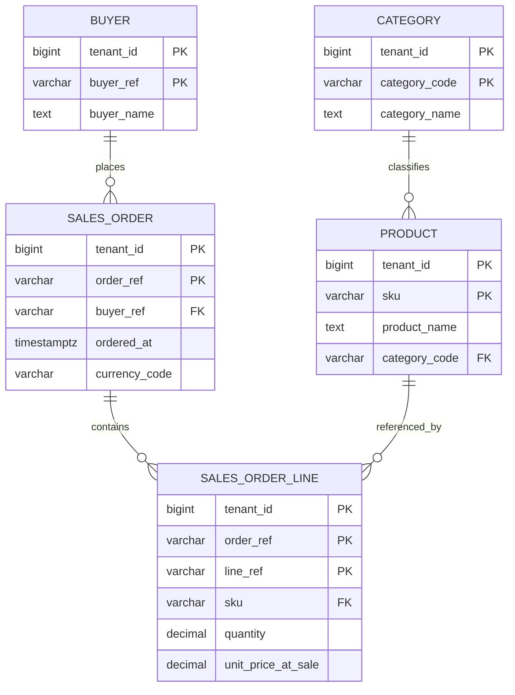
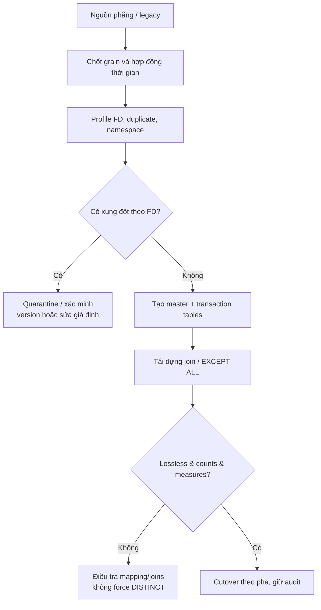

# Chuẩn hóa mô hình quan hệ và kiểm tra các phương án phân rã

## 1. Mục tiêu của bài thực hành tổng hợp

Trong module `DATABASE_DATA_MODELING`, người học rèn kỹ năng chuyển yêu cầu nghiệp vụ thành mô hình dữ liệu rõ ràng, từ thực thể, quan hệ, ràng buộc, chuẩn hóa, khóa và chỉ mục đến lược đồ vật lý. Người học cũng cần hiểu khi nào nên chọn mô hình quan hệ, document, graph hay phân tích để dữ liệu dễ tiến hóa và kiểm chứng. Chủ đề **Thực hành tổng hợp** này đi sâu vào một tình huống thường gặp: một bảng dữ liệu nguồn có vẻ thuận tiện để báo cáo, nhưng trộn thông tin đơn hàng, khách, sản phẩm và dòng bán, gây bất thường cập nhật.

Nhiệm vụ không dừng ở “chia bảng ra cho chuẩn hóa”. Ta phải **chứng minh** rằng mỗi phương án phân rã:

1. Phản ánh đúng **khái niệm nghiệp vụ và grain** của từng quan hệ.
2. Có **phụ thuộc hàm** và **khóa ứng viên** được suy ra từ quy tắc, không đoán từ vài dòng dữ liệu.
3. Đạt mục tiêu 1NF/2NF/3NF/BCNF theo những giả định đã công bố.
4. **Nối lại không mất thông tin** (*lossless-join decomposition*).
5. **Bảo toàn phụ thuộc** (*dependency preservation*) khi có thể, hoặc nêu rõ chi phí kiểm tra liên bảng khi không thể.
6. Có ràng buộc PK/FK/UNIQUE/CHECK và bộ kiểm thử dữ liệu trước khi chốt mô hình vật lý.
7. Không vô tình làm sai lịch sử giao dịch, tiền tệ, định danh tenant hoặc cách tính doanh thu khi tối ưu truy vấn.

Đây là bài thực hành độc lập với **PostgreSQL 16** làm môi trường SQL minh họa. Không cần đọc bài khác để hiểu các bước. Các bảng và số liệu dưới đây là dữ liệu giả định phục vụ giảng dạy, không đại diện cho một hệ production cụ thể.

### Đầu ra mong đợi

Người học nên tự tạo được: glossary và grain statement, tập phụ thuộc hàm \(F\), phép tính bao đóng khóa, danh sách anomaly, ít nhất hai phương án phân rã, chứng minh lossless và dependency-preserving, ERD, DDL, dữ liệu mẫu, truy vấn đối soát, các ca kiểm thử âm tính và một quyết định kiến trúc ngắn giải thích đánh đổi.

## 2. Tình huống: dữ liệu bán hàng phẳng từ nhiều tenant

Một hệ thống nhập báo cáo bán hàng từ hai tenant. Mỗi dòng nguồn hiện chứa **một dòng đơn hàng** cùng với dữ liệu lặp lại của đơn, người mua, sản phẩm và danh mục:

| Cột | Ý nghĩa được đề xuất | Ghi chú |
|---|---|---|
| `tenant_id` | Phạm vi dữ liệu khách thuê | Các mã bên dưới chỉ được hiểu trong tenant tương ứng |
| `order_ref` | Mã đơn trong tenant | Giả định nguồn hiện tại chỉ có một hệ phát đơn/tenant |
| `line_ref` | Mã dòng trong một đơn | Dòng khác nhau có thể cùng SKU |
| `buyer_ref` | Tham chiếu người mua | Chưa đồng nhất với payer/recipient |
| `buyer_name` | Tên hiển thị trong danh mục người mua tại một mốc đồng bộ | **Không** mặc định là tên chốt trên chứng từ quá khứ |
| `ordered_at` | Thời điểm đơn được chấp nhận theo hợp đồng dữ liệu | Là event time, không phải thời gian nhập kho |
| `currency_code` | Tiền tệ chung của các dòng trong đơn | Ví dụ VND |
| `sku` | Mã mặt hàng bán hiện tại | Được namespace bởi tenant |
| `product_name` | Tên sản phẩm hiện tại tại một mốc đồng bộ | Có thể thay đổi về sau |
| `category_code` | Mã danh mục hiện tại của sản phẩm | Có thể đổi theo thời gian |
| `category_name` | Tên danh mục hiện tại | Không tự là phân loại tại thời điểm bán |
| `quantity` | Số lượng bán của dòng | Số dương, theo đơn vị của loại hàng |
| `unit_price_at_sale` | Giá đơn vị được chốt ở dòng | Không phụ thuộc riêng vào SKU |

**Giả định bắt buộc cho bài toán chuẩn hóa:** dữ liệu phẳng là một *snapshot nhất quán* của master data ở một mốc đồng bộ xác định. Trong snapshot ấy, mỗi (`tenant_id`, `buyer_ref`) có một `buyer_name`, mỗi (`tenant_id`, `sku`) có một tên và một mã category hiện tại, mỗi (`tenant_id`, `category_code`) có một tên category. Ngoài snapshot này, các trường “hiện tại” có thể đổi; bài sẽ trở lại rủi ro thời gian ở phần sau.

**Giới hạn:** đơn hàng ví dụ không có thuế, giảm giá, phí vận chuyển hay hoàn tiền; chỉ dùng tiền VND trong mỗi phép cộng. Một đơn có nhiều dòng, còn mỗi dòng được định danh bằng (`tenant_id`, `order_ref`, `line_ref`). Việc chuyển mã từ hệ ngoài khác nhau có thể đòi thêm `source_system` nếu giả định “một hệ phát đơn/tenant” không đúng.

## 3. Dữ liệu ví dụ: bốn dòng nhưng có nhiều đối tượng

| Tenant | Order | Line | Buyer | SKU | Category | Qty | Giá/đơn vị |
|---:|---|---|---|---|---|---:|---:|
| 42 | O100 | L01 | B01 – An | SKU-A – Cà phê | DRINK | 2 | 50.000 |
| 42 | O100 | L02 | B01 – An | SKU-B – Bánh quy | FOOD | 1 | 20.000 |
| 42 | O101 | L01 | B02 – Bình | SKU-A – Cà phê | DRINK | 1 | 55.000 |
| 43 | O100 | L01 | B01 – Linh | SKU-A – Trà | DRINK | 1 | 30.000 |

Trong tenant 42:

- O100 có **hai dòng**, tổng giá hàng là \(2\times50\,000+1\times20\,000=120\,000\) VND.
- O101 có một dòng SKU-A nhưng giá lúc bán là **55.000**, khác O100 dù cùng SKU.
- Tổng tiền hàng trên ba dòng là **175.000 VND**.

Trong tenant 43, O100 và SKU-A tồn tại hợp lệ nhưng có người mua/sản phẩm khác; tổng tiền hàng là **30.000 VND**. **Không cộng chéo tenant** hoặc đồng nhất hai mã O100 nếu yêu cầu kinh doanh không cho phép.

### Câu hỏi ban đầu

1. Thay tên người mua B01 của tenant 42 cần sửa bao nhiêu dòng nếu giữ bảng phẳng?
2. Xóa dòng cuối cùng của SKU-B có thể vô tình xóa luôn tên sản phẩm và category không?
3. Có thể thêm một SKU mới chưa bán lần nào vào bảng phẳng không?
4. Vì sao `(tenant_id, sku) -> unit_price_at_sale` **không** đúng?
5. Có thể tách buyer, category và product mà không làm mất dữ liệu dòng bán không?
6. Hai phương án cùng khử trùng lặp có luôn cùng khả năng cưỡng chế phụ thuộc không?

## 4. Bước 1 — Chốt grain và glossary trước khi tính chuẩn

**Grain của quan hệ nguồn `SalesFlat`:**

> Một hàng biểu diễn **một dòng của một đơn hàng đã được chấp nhận**, duy nhất bởi (`tenant_id`, `order_ref`, `line_ref`), kèm thuộc tính đơn, người mua, sản phẩm và category được *denormalize* tại một mốc đồng bộ.

| Khái niệm | Grain hoặc quyền sở hữu | Điều không được tự suy |
|---|---|---|
| Order | Một đơn trong một tenant; có nhiều line | Một đơn = một dòng |
| Order line | Một dòng có `line_ref` duy nhất trong order | Một SKU chỉ được xuất hiện một lần/đơn |
| Buyer | Một người mua trong tenant | Buyer luôn là payer/recipient |
| Product | Một mặt hàng hiện tại trong Catalog, mã SKU có namespace | Giá bán mọi đơn bằng giá catalog |
| Category | Một danh mục hiện tại trong Catalog | Category không bao giờ đổi |
| Price at sale | Giá được chốt cho **dòng bán** | `sku -> unit_price` |
| Currency | Một tiền tệ của đơn theo hợp đồng ví dụ | Mọi tenant và mọi kỳ đều cùng currency |

Trước khi suy phụ thuộc hàm, xác nhận **tập thuộc tính và thời điểm áp dụng**. Nếu `buyer_name` là ảnh chụp tên trên chứng từ và có thể khác giữa hai đơn cùng buyer, thì phụ thuộc (`tenant_id`, `buyer_ref`) → `buyer_name` **sai**. Khi đó phải lưu `buyer_name_at_sale` ở grain giao dịch, hoặc dùng version dimension đúng thời điểm, chứ không được cố chuẩn hóa dựa vào giả định sai.

## 5. Bước 2 — Viết tập phụ thuộc hàm theo nghiệp vụ

Ký hiệu ngắn:

| Ký hiệu | Thuộc tính |
|---|---|
| \(T,O,L\) | `tenant_id`, `order_ref`, `line_ref` |
| \(B,BN\) | `buyer_ref`, `buyer_name` |
| \(D,C\) | `ordered_at`, `currency_code` |
| \(S,PN\) | `sku`, `product_name` |
| \(G,GN\) | `category_code`, `category_name` |
| \(Q,P\) | `quantity`, `unit_price_at_sale` |

Quan hệ:

\[
R(T,O,L,B,BN,D,C,S,PN,G,GN,Q,P)
\]

Các phụ thuộc hàm (FD) áp dụng **trong phạm vi snapshot và hợp đồng đã nêu**:

\[
\begin{aligned}
TO &\rightarrow B,D,C &&\text{(một order có người mua, mốc và tiền tệ)}\\
TB &\rightarrow BN &&\text{(buyer master trong một tenant)}\\
TS &\rightarrow PN,G &&\text{(product hiện tại trong một tenant)}\\
TG &\rightarrow GN &&\text{(category hiện tại trong một tenant)}\\
TOL &\rightarrow S,Q,P &&\text{(một dòng có item, lượng và giá chốt)}
\end{aligned}
\]

Lưu ý:

- `T,O` đủ xác định buyer, thời điểm và currency, nhưng không xác định **một line duy nhất**.
- `T,S` có thể xác định tên/category hiện tại, nhưng **không xác định** giá chốt vì cùng SKU được bán giá khác nhau.
- `T,B` xác định tên hiển thị trong *snapshot* hiện tại, nhưng không tự xác định địa chỉ giao, payer hoặc tên người mua tại mọi thời điểm quá khứ.
- `T,G` xác định tên category **trong snapshot**; nếu category có nhiều version, khóa phải tính cả version hoặc khoảng thời gian.
- Các phụ thuộc theo namespace tenant **không có nghĩa** `S -> PN` hay `O -> B` trên toàn hệ thống. SKU-A của tenant 42 và 43 là phản ví dụ cụ thể.

**Không suy FD chỉ vì bốn dòng dữ liệu vô tình thỏa.** Ví dụ ở đây mọi `buyer_ref` trong một tenant xuất hiện với một currency nhất định, nhưng không có quy tắc “mỗi buyer chỉ mua một currency”. Vì thế không thêm `TB -> C`.

### Tập phủ tối thiểu

Để áp dụng thuật toán tổng hợp 3NF, có thể tách mọi FD nhiều thuộc tính vế phải thành các FD đơn thuộc tính:

```text
TO  -> B
TO  -> D
TO  -> C
TB  -> BN
TS  -> PN
TS  -> G
TG  -> GN
TOL -> S
TOL -> Q
TOL -> P
```

Đây là một biểu diễn tương đương với tập FD nhóm phía trên. Trong ví dụ, không bỏ được một thành phần quan trọng ở vế trái theo các FD đã khai báo; kiểm tra bằng bao đóng trước khi kết luận là phủ tối thiểu. Một FD suy ra được từ những FD khác thì có thể bỏ khỏi phủ tối thiểu nhưng vẫn thuộc \(F^+\).

## 6. Bước 3 — Tính bao đóng và chứng minh khóa ứng viên

Bao đóng \(X^+\) theo \(F\) là tập mọi thuộc tính suy ra từ \(X\). Thuật toán:

1. Khởi tạo `closure = X`.
2. Nếu có FD `Y -> Z` mà \(Y\subseteq closure\), thêm `Z` vào closure.
3. Lặp đến khi không thêm được thuộc tính nào.
4. Nếu closure bằng toàn bộ \(R\), \(X\) là **superkey**; nếu không tập con thực sự nào của X là superkey, X là **candidate key**.

Áp dụng cho \(K=\{T,O,L\}\):

| Lượt | FD áp dụng | Thuộc tính mới |
|---|---|---|
| 0 | Khởi tạo | \(T,O,L\) |
| 1 | \(TO\rightarrow B,D,C\) | \(B,D,C\) |
| 2 | \(TOL\rightarrow S,Q,P\) | \(S,Q,P\) |
| 3 | \(TB\rightarrow BN\) | \(BN\) |
| 4 | \(TS\rightarrow PN,G\) | \(PN,G\) |
| 5 | \(TG\rightarrow GN\) | \(GN\) |

Vậy:

\[
(TOL)^+=\{T,O,L,B,BN,D,C,S,PN,G,GN,Q,P\}=R
\]

**Tính tối thiểu:** \(T\), \(O\), \(L\) không xuất hiện ở vế phải của FD nào trong tập đã xác định; không thể suy một trong ba từ các thuộc tính còn lại. Do đó mọi khóa ứng viên phải chứa cả \(T,O,L\), và vì bộ ba đã là superkey, nó là **khóa ứng viên duy nhất** trong phạm vi FD đã biết.

Kiểm tra ba tập con trực tiếp:

- \((TO)^+\) chứa B,D,C,BN nhưng không xác định L và dữ liệu dòng.
- \((TL)^+\) không có O và không biết dòng thuộc đơn nào.
- \((OL)^+\) không có T; cùng mã order/line có thể lặp ở tenant khác.

**Đừng chọn (`tenant_id`, `sku`) làm khóa của `SalesFlat`** chỉ vì SKU là một danh tính sản phẩm: một sản phẩm có thể bán ở nhiều đơn và nhiều dòng.

## 7. Bước 4 — Nhận diện ba loại bất thường dữ liệu

| Loại anomaly | Bảng `SalesFlat` gây ra thế nào? | Hệ quả |
|---|---|---|
| **Update anomaly** | Đổi tên buyer B01 cần cập nhật mọi dòng ở mọi đơn của buyer | Một dòng sửa thiếu khiến cùng buyer có hai tên “hiện tại” |
| **Insertion anomaly** | Product mới chưa có order line thì không có hàng để lưu | Không thể quản lý catalog độc lập khỏi doanh số |
| **Deletion anomaly** | Xóa dòng cuối dùng SKU-B có thể làm mất thông tin Product/Category | Xóa dữ liệu giao dịch xóa luôn master data |

Thêm hai rủi ro:

- **Định danh chéo tenant:** nếu quên \(T\), dữ liệu hai tenant có thể bị hợp nhất.
- **Lịch sử bị cập nhật hồi tố ngoài ý muốn:** nếu bảng phẳng được dùng làm chứng từ bán, việc sửa toàn bộ `product_name` hiện tại có thể thay đổi tên trên các đơn cũ.

**Không phải tất cả lặp dữ liệu đều sai.** Ví dụ `product_name_at_sale` trên order line có thể cố ý được snapshot để giữ chứng từ. Muốn đánh giá anomaly phải biết field đó là **master data hiện tại** hay **giá trị lịch sử cố định**.

## 8. Bước 5 — Kiểm tra 1NF: một hàng có trường dữ liệu theo grain nào?

Một quan hệ thường được coi ở **First Normal Form (1NF)** khi mỗi giá trị thuộc tính là một giá trị thuộc miền đã định nghĩa, không dùng nhóm lặp không có cấu trúc quan hệ riêng; mỗi hàng có định danh rõ.

Sai lầm phổ biến:

```text
order_ref | sku_list       | quantities  | prices
--------- | -------------- | ----------- | -------------
O100      | "SKU-A,SKU-B"  | "2,1"       | "50000,20000"
```

Để trả lời “một dòng là gì”, phải parse các danh sách song song và phụ thuộc vào thứ tự phần tử. Điều đó dễ mất ràng buộc từng dòng và khó kiểm tra hai danh sách cùng chiều dài. Một biểu diễn quan hệ hợp lý là `Order` và `OrderLine` có line identity riêng.

**Điểm tinh tế:** JSON/array không bị “cấm tuyệt đối” trong mọi thiết kế hiện đại. Một giá trị document có thể được coi là đơn vị atomic đối với thao tác của aggregate, nhưng nếu bài toán cần lọc, FK, thống kê và cập nhật từng line riêng thì nhúng danh sách vào một field có **đánh đổi thực tế**. Chuẩn hóa quan hệ được đánh giá trên semantics và các phép truy vấn/ràng buộc, không chỉ qua việc “có dấu phẩy trong string”.

Trong `SalesFlat` của bài tập, mỗi field đã là giá trị đơn theo schema được mô tả; vấn đề chính không nằm ở cách tách chuỗi, mà ở **phụ thuộc hàm** và trùng dữ liệu của order/master.

## 9. Bước 6 — Kiểm tra 2NF: phụ thuộc bộ phận vào khóa ghép

Một quan hệ ở **Second Normal Form (2NF)** khi đã ở 1NF và **không có thuộc tính không khóa (non-prime) phụ thuộc vào một tập con thực sự của khóa ứng viên**.

Khóa của `SalesFlat` là \(TOL\). Nhưng:

\[
TO\rightarrow B,D,C
\]

\(TO\) là tập con thực sự của \(TOL\); `buyer_ref`, `ordered_at`, `currency_code` không phải thuộc tính khóa. Vì vậy `SalesFlat` **vi phạm 2NF**.

Một bước phân rã:

```text
OrderCore(T, O, B, D, C)
LineRest(T, O, L, B, BN, S, Q, P, PN, G, GN)
```

Đây mới là bước đầu, không phải mô hình cuối. `LineRest` vẫn lặp tên buyer, product và category qua các dòng. Thực tế có thể trực tiếp đi đến bộ bảng cuối thay vì tạo một bảng trung gian tồn tại lâu.

**Chứng minh không mất thông tin của bước này:** giao hai quan hệ là (`T`, `O`, `B`). Vì \(TO\rightarrow B,D,C\), giao đó xác định toàn bộ `OrderCore`. Theo tiêu chuẩn lossless của phân rã nhị phân dựa trên FD, bước tách này không tạo hàng giả khi join lại theo các thuộc tính chung. `LineRest` tạm giữ `B` để tiếp tục kiểm tra \(TB\rightarrow BN\); về sau có thể loại `B` khỏi quan hệ dòng do đã được xác định bởi (`T`,`O`) trong `OrderCore`.

Không được kết luận “tách thành hai bảng là lossless vì luôn JOIN được”. Cần chứng minh rằng phần giao xác định một phía theo \(F^+\) hoặc dùng phương pháp chase phù hợp cho phân rã phức tạp.

## 10. Bước 7 — Kiểm tra 3NF: phụ thuộc bắc cầu và không qua khóa

Một quan hệ đạt **Third Normal Form (3NF)** nếu với mọi FD không tầm thường \(X\rightarrow A\) trong \(F^+\), một trong hai điều kiện đúng:

- \(X\) là **superkey**, hoặc
- \(A\) là **prime attribute** (xuất hiện trong ít nhất một candidate key).

Trong `SalesFlat`, chỉ \(T,O,L\) là các prime attributes. Vì vậy các FD:

\[
TB\rightarrow BN,\quad TS\rightarrow PN,G,\quad TG\rightarrow GN
\]

đều vi phạm 3NF trong quan hệ nguồn: vế trái không là superkey của toàn `SalesFlat` và vế phải là non-prime.

Ta tách master data ra các quan hệ có grain riêng:

```text
Buyer(T, B, BN)
Category(T, G, GN)
Product(T, S, PN, G)
Order(T, O, B, D, C)
OrderLine(T, O, L, S, Q, P)
```

Các khóa ứng viên kỳ vọng:

| Quan hệ | Grain | Khóa ứng viên trong phạm vi giả định |
|---|---|---|
| `Buyer` | Một buyer hiện tại trong tenant | (`T`, `B`) |
| `Category` | Một category hiện tại trong tenant | (`T`, `G`) |
| `Product` | Một SKU hiện tại trong tenant | (`T`, `S`) |
| `Order` | Một đơn trong tenant | (`T`, `O`) |
| `OrderLine` | Một dòng trong một đơn | (`T`, `O`, `L`) |

**Điểm cần hỏi trước khi áp dụng:** nếu business ID của order không duy nhất trong tenant vì có nhiều nguồn, hãy thêm namespace nguồn vào khóa Order và OrderLine; nếu category/product được version theo thời gian, quan hệ master “hiện tại” không phải câu trả lời đầy đủ cho lịch sử.

## 11. Bước 8 — Kiểm tra BCNF cho các bảng đã phân rã

**Boyce–Codd Normal Form (BCNF)** mạnh hơn 3NF: với mọi FD không tầm thường \(X\rightarrow Y\) trên một quan hệ, \(X\) phải là **superkey**.

Trong bộ năm quan hệ ở mục 10, nếu **chỉ có các FD theo đúng giả định bài tập**, thì:

- `Buyer`: (`T`, `B`) xác định `BN`, là khóa.
- `Category`: (`T`, `G`) xác định `GN`, là khóa.
- `Product`: (`T`, `S`) xác định `PN,G`, là khóa.
- `Order`: (`T`, `O`) xác định `B,D,C`, là khóa.
- `OrderLine`: (`T`, `O`, `L`) xác định `S,Q,P`, là khóa.

Vì các determinant không tầm thường của mỗi quan hệ đều là superkey, bộ quan hệ trên **đạt BCNF theo tập FD đã mô tả**. Nếu trong nghiệp vụ thật xuất hiện thêm một FD khác, ví dụ `product_name -> sku` trong một tenant (không nên tự giả định), kết luận phải kiểm tra lại.

**Đừng tối ưu mục tiêu “BCNF mọi giá”.** Có những quan hệ đạt 3NF nhưng không đạt BCNF; việc tiếp tục phân rã có thể đánh đổi khả năng **bảo toàn FD**, khiến cần join hoặc kiểm tra liên bảng để cưỡng chế một luật quan trọng. Ta sẽ thực hành phản ví dụ ở mục 21.

## 12. Sơ đồ quan hệ sau phân rã



Đây là một **sơ đồ logic**. Đường FK trong PostgreSQL phải bảo vệ cùng tenant bằng **khóa ghép**, không chỉ nối `buyer_ref` hay `sku` một mình.

## 13. DDL PostgreSQL 16 cho phương án đã chuẩn hóa

Ví dụ dưới dùng mã nghiệp vụ ghép làm PK để dễ đối chiếu FD. Trong hệ lớn, có thể dùng surrogate ID ổn định cùng các `UNIQUE` trên natural/business key; việc dùng surrogate không thay đổi grain hoặc luật tránh trùng nguồn.

```sql
CREATE TABLE buyer (
    tenant_id BIGINT NOT NULL,
    buyer_ref VARCHAR(40) NOT NULL,
    buyer_name TEXT NOT NULL,
    CONSTRAINT pk_buyer PRIMARY KEY (tenant_id, buyer_ref),
    CONSTRAINT ck_buyer_ref_nonblank
        CHECK (char_length(btrim(buyer_ref)) > 0)
);

CREATE TABLE category (
    tenant_id BIGINT NOT NULL,
    category_code VARCHAR(40) NOT NULL,
    category_name TEXT NOT NULL,
    CONSTRAINT pk_category PRIMARY KEY (tenant_id, category_code),
    CONSTRAINT ck_category_code_nonblank
        CHECK (char_length(btrim(category_code)) > 0)
);

CREATE TABLE product (
    tenant_id BIGINT NOT NULL,
    sku VARCHAR(60) NOT NULL,
    product_name TEXT NOT NULL,
    category_code VARCHAR(40) NOT NULL,
    CONSTRAINT pk_product PRIMARY KEY (tenant_id, sku),
    CONSTRAINT fk_product_category_same_tenant
        FOREIGN KEY (tenant_id, category_code)
        REFERENCES category (tenant_id, category_code),
    CONSTRAINT ck_product_sku_nonblank
        CHECK (char_length(btrim(sku)) > 0)
);

CREATE TABLE sales_order (
    tenant_id BIGINT NOT NULL,
    order_ref VARCHAR(60) NOT NULL,
    buyer_ref VARCHAR(40) NOT NULL,
    ordered_at TIMESTAMPTZ NOT NULL,
    currency_code VARCHAR(3) NOT NULL,
    CONSTRAINT pk_sales_order PRIMARY KEY (tenant_id, order_ref),
    CONSTRAINT fk_order_buyer_same_tenant
        FOREIGN KEY (tenant_id, buyer_ref)
        REFERENCES buyer (tenant_id, buyer_ref),
    CONSTRAINT ck_order_currency
        CHECK (currency_code ~ '^[A-Z]{3}$')
);

CREATE TABLE sales_order_line (
    tenant_id BIGINT NOT NULL,
    order_ref VARCHAR(60) NOT NULL,
    line_ref VARCHAR(40) NOT NULL,
    sku VARCHAR(60) NOT NULL,
    quantity NUMERIC(12,3) NOT NULL,
    unit_price_at_sale NUMERIC(14,2) NOT NULL,
    CONSTRAINT pk_sales_order_line
        PRIMARY KEY (tenant_id, order_ref, line_ref),
    CONSTRAINT fk_line_order_same_tenant
        FOREIGN KEY (tenant_id, order_ref)
        REFERENCES sales_order (tenant_id, order_ref),
    CONSTRAINT fk_line_product_same_tenant
        FOREIGN KEY (tenant_id, sku)
        REFERENCES product (tenant_id, sku),
    CONSTRAINT ck_line_positive_quantity
        CHECK (quantity > 0),
    CONSTRAINT ck_line_nonnegative_price
        CHECK (unit_price_at_sale BETWEEN 0 AND 999999999999)
);
```

**Bất biến đang được DBMS thực thi:**

1. Mỗi tenant có một dòng master cho một buyer, category và SKU theo khóa hiện trạng.
2. Mỗi order trong tenant có một header; mỗi (`tenant_id`, `order_ref`, `line_ref`) có tối đa một dòng.
3. FK ghép ngăn order của tenant 42 tham chiếu buyer của tenant 43, line của tenant 42 tham chiếu order/product của tenant 43.
4. `quantity` dương; `unit_price_at_sale` không âm và ở miền hữu hạn được định nghĩa cho ví dụ.
5. `currency_code` có hình thức ba chữ hoa, **không** tự xác nhận mã ISO hợp lệ hay tỷ giá.

**Bất biến chưa được DBMS bảo đảm bằng DDL này:**

- Một order có ít nhất một line trước khi được xác nhận.
- Tổng tiền đã thu bằng tiền hàng, vì **capture không thuộc mô hình ví dụ** và cần hợp đồng thuế/chiết khấu/refund.
- Một SKU hiện tại có đúng tên theo catalog ngoài hệ thống ở mọi thời điểm.
- Mọi sản phẩm có thể được xóa mà vẫn giữ chứng từ: FK đang hạn chế delete; có thể cần trạng thái ngừng bán, snapshot giao dịch hoặc lịch sử sản phẩm.
- Luồng sửa quantity/price sau khi chốt giao dịch: phải có domain workflow và audit.

Không thêm index tùy tiện trước khi đo workload. PK/FK có lợi cho những đường join hiện có, nhưng PostgreSQL **không tự tạo index cho mọi cột FK phía tham chiếu**; nếu workload join từ buyer → nhiều orders hoặc product → lines nặng, hãy xét index phụ trên cột FK cùng tenant và chi phí ghi.

## 14. Tạo bảng staging phẳng và nạp bốn dòng mẫu

Chạy trong một schema thử mới để các tên bảng chưa tồn tại. Bảng staging mô phỏng dữ liệu vừa nhận; cố ý **chưa đặt UNIQUE**, để ta có thể đo duplicate và FD conflict trước khi chuyển vào các bảng chuẩn hóa.

```sql
CREATE TABLE staging_sales_flat (
    tenant_id BIGINT NOT NULL,
    order_ref VARCHAR(60) NOT NULL,
    line_ref VARCHAR(40) NOT NULL,
    buyer_ref VARCHAR(40) NOT NULL,
    buyer_name TEXT NOT NULL,
    ordered_at TIMESTAMPTZ NOT NULL,
    currency_code VARCHAR(3) NOT NULL,
    sku VARCHAR(60) NOT NULL,
    product_name TEXT NOT NULL,
    category_code VARCHAR(40) NOT NULL,
    category_name TEXT NOT NULL,
    quantity NUMERIC(12,3) NOT NULL,
    unit_price_at_sale NUMERIC(14,2) NOT NULL
);

INSERT INTO staging_sales_flat (
    tenant_id, order_ref, line_ref, buyer_ref, buyer_name,
    ordered_at, currency_code, sku, product_name,
    category_code, category_name, quantity, unit_price_at_sale
)
VALUES
    (42, 'O100', 'L01', 'B01', 'An',
     '2027-01-10 10:00:00+00', 'VND',
     'SKU-A', 'Cà phê', 'DRINK', 'Đồ uống', 2, 50000),
    (42, 'O100', 'L02', 'B01', 'An',
     '2027-01-10 10:00:00+00', 'VND',
     'SKU-B', 'Bánh quy', 'FOOD', 'Thực phẩm', 1, 20000),
    (42, 'O101', 'L01', 'B02', 'Bình',
     '2027-01-12 15:30:00+00', 'VND',
     'SKU-A', 'Cà phê', 'DRINK', 'Đồ uống', 1, 55000),
    (43, 'O100', 'L01', 'B01', 'Linh',
     '2027-01-11 08:00:00+00', 'VND',
     'SKU-A', 'Trà', 'DRINK', 'Đồ uống tenant 43', 1, 30000);
```

**Dữ liệu mẫu tương lai năm 2027 chỉ là một kịch bản thử**, không phải ghi nhận của một hệ thống hiện tại. Đừng đồng nhất tenant 42 và 43 chỉ vì mã `O100`/`SKU-A` trùng nhau.

## 15. Profile dữ liệu nguồn trước khi phân rã

**Một FD là quy tắc nghiệp vụ; SQL chỉ có thể tìm phản ví dụ trên tập dữ liệu đang có.** Không tìm thấy vi phạm trong bốn hàng không chứng minh FD đúng cho mọi dữ liệu tương lai. Tuy vậy, profile là bước quan trọng để tránh nhập dữ liệu sai vào schema chuẩn.

### 15.1. Kiểm tra duplicate theo grain

```sql
SELECT
    tenant_id, order_ref, line_ref,
    COUNT(*) AS copies
FROM staging_sales_flat
GROUP BY tenant_id, order_ref, line_ref
HAVING COUNT(*) > 1;
```

Kỳ vọng rỗng. Nếu có trùng khóa, phải phân biệt **identical retry**, event/revision khác nhau hoặc source identity được định nghĩa thiếu. Không được xóa một hàng bất kỳ bằng `DISTINCT` trước khi xác minh.

### 15.2. Kiểm tra FD của order

```sql
-- Với mỗi (tenant, order), tất cả thuộc tính header phải giống nhau.
SELECT tenant_id, order_ref
FROM staging_sales_flat
GROUP BY tenant_id, order_ref
HAVING COUNT(DISTINCT (buyer_ref, ordered_at, currency_code)) > 1;
```

Kỳ vọng rỗng. Nếu cùng một order_ref có nhiều buyer/currency do dữ liệu nguồn thực sự thay đổi theo revision, ta không nên “chọn MIN(...)” để che xung đột; phải mô hình hóa revision hoặc tìm hợp đồng state hiện hành.

### 15.3. Kiểm tra FD của buyer, product và category

```sql
SELECT 'BUYER' AS fd_kind, tenant_id, buyer_ref AS determinant
FROM staging_sales_flat
GROUP BY tenant_id, buyer_ref
HAVING COUNT(DISTINCT buyer_name) > 1

UNION ALL

SELECT 'PRODUCT', tenant_id, sku
FROM staging_sales_flat
GROUP BY tenant_id, sku
HAVING COUNT(DISTINCT (product_name, category_code)) > 1

UNION ALL

SELECT 'CATEGORY', tenant_id, category_code
FROM staging_sales_flat
GROUP BY tenant_id, category_code
HAVING COUNT(DISTINCT category_name) > 1;
```

Kỳ vọng rỗng trong snapshot mẫu. Cả hai phía của những FD ở đây đều `NOT NULL` trong staging. Nếu mô hình thực tế cho phép `NULL`, `COUNT(DISTINCT ...)` có cách bỏ qua `NULL` khác với logic cần kiểm tra; phải dùng logic null-safe, ví dụ `IS DISTINCT FROM` hoặc tập cặp giá trị có kiểm soát.

### 15.4. Đối soát theo tenant

```sql
SELECT
    tenant_id,
    COUNT(*) AS source_lines,
    SUM(quantity * unit_price_at_sale) AS source_merchandise_amount
FROM staging_sales_flat
GROUP BY tenant_id
ORDER BY tenant_id;
```

Kỳ vọng: tenant 42 có 3 dòng, **175.000 VND**; tenant 43 có 1 dòng, **30.000 VND**. Việc tổng hợp này chỉ hợp lệ vì ví dụ mỗi tenant ở đây đều dùng VND; ở dữ liệu thật nên nhóm theo `currency_code`, hoặc quy đổi với nguồn tỷ giá và thời điểm đã chốt.

## 16. Nạp các bảng chuẩn hóa có thứ tự và kiểm soát

Sau khi profile không có bất thường cần cách ly, có thể nạp **bảng master trước bảng con**. Một lô mẫu ngắn có thể dùng một transaction; đối với hệ lớn cần chia lô, checkpoint, idempotency và kiểm soát writer đang hoạt động.

```sql
BEGIN;

INSERT INTO buyer (tenant_id, buyer_ref, buyer_name)
SELECT DISTINCT tenant_id, buyer_ref, buyer_name
FROM staging_sales_flat;

INSERT INTO category (tenant_id, category_code, category_name)
SELECT DISTINCT tenant_id, category_code, category_name
FROM staging_sales_flat;

INSERT INTO product (tenant_id, sku, product_name, category_code)
SELECT DISTINCT tenant_id, sku, product_name, category_code
FROM staging_sales_flat;

INSERT INTO sales_order (
    tenant_id, order_ref, buyer_ref, ordered_at, currency_code
)
SELECT DISTINCT
    tenant_id, order_ref, buyer_ref, ordered_at, currency_code
FROM staging_sales_flat;

INSERT INTO sales_order_line (
    tenant_id, order_ref, line_ref, sku, quantity, unit_price_at_sale
)
SELECT tenant_id, order_ref, line_ref, sku, quantity, unit_price_at_sale
FROM staging_sales_flat;

COMMIT;
```

**Đoạn này dành cho nạp một lần trên schema sạch**, không phải job production tự động chạy lại vô hạn:

- `SELECT DISTINCT` chỉ khử các hàng master lặp **hoàn toàn giống nhau**. Nếu cùng buyer_ref có hai tên khác nhau, hai hàng vẫn được chọn và PK đích làm giao dịch lỗi — đúng hơn là im lặng lấy một tên.
- Nếu chạy lại `INSERT` lên cùng PK, sẽ lỗi; để idempotent cần `UPSERT`/merge có rule so sánh revision, source ownership và audit, không chỉ `ON CONFLICT DO NOTHING` cho mọi trường hợp.
- Với nhiều writer đồng thời, phải dùng snapshot/transaction boundary, staging version, hoặc cơ chế copy/CDC đủ chặt để không có khoảng trống giữa dữ liệu được copy và thay đổi sau đó.
- Không dùng việc `COMMIT` thành công làm bằng chứng mọi FD hoặc semantic đều đúng; test đối soát ở phần tiếp vẫn bắt buộc.

## 17. Chứng minh phân rã không mất thông tin: logic trước, SQL sau

Một phân rã \(R\to R_1,R_2\) được gọi là **lossless** theo \(F\) nếu với mọi quan hệ hợp lệ \(r\) thỏa \(F\):

\[
r=\pi_{R_1}(r)\ \bowtie\ \pi_{R_2}(r)
\]

Nó không được tạo **hàng giả** (*spurious tuples*) hoặc mất hàng hợp lệ khi nối các phép chiếu tự nhiên theo thuộc tính giao nhau.

### 17.1. Tiêu chuẩn cho phân rã nhị phân

Gọi \(X=R_1\cap R_2\). Phân rã nhị phân lossless theo \(F\) nếu:

\[
X\rightarrow R_1 \quad\text{hoặc}\quad X\rightarrow R_2
\]

trong bao đóng \(F^+\). Khi tách `OrderCore(T,O,B,D,C)` và `LineRest(T,O,L,B,BN,S,Q,P,PN,G,GN)` ở mục 9, giao thực tế là \(TOB\), **không chỉ \(TO\)**. Vì \(TO\rightarrow B,D,C\), nên giao \(TOB\) xác định toàn bộ `OrderCore`, bảo đảm lossless.

Để kiểm tra toàn bộ quá trình, có thể phân rã tiếp **theo từng bước không mất thông tin**:

| Bước | Quan hệ tách ra | Phần còn lại sau khi tách | Thuộc tính giao xác định phía nào? |
|---|---|---|---|
| 1 | `OrderCore(T,O,B,D,C)` | `(T,O,L,B,BN,S,Q,P,PN,G,GN)` | \(TOB\rightarrow OrderCore\) |
| 2 | `Buyer(T,B,BN)` | `(T,O,L,B,S,Q,P,PN,G,GN)` | \(TB\rightarrow Buyer\) |
| 3 | `Product(T,S,PN,G)` | `(T,O,L,B,S,Q,P,G,GN)` | \(TSG\rightarrow Product\), vì \(TS\rightarrow PN,G\) |
| 4 | `Category(T,G,GN)` | `(T,O,L,B,S,Q,P,G)` | \(TG\rightarrow Category\) |
| 5 | `ProductCategory(T,S,G)` | `(T,O,L,B,S,Q,P)` | \(TS\rightarrow ProductCategory\) |
| 6 | `OrderBuyer(T,O,B)` | `OrderLine(T,O,L,S,Q,P)` | \(TO\rightarrow OrderBuyer\) |

Ở các bước 5 và 6, hai quan hệ phụ `ProductCategory(T,S,G)` và `OrderBuyer(T,O,B)` **là tập con thuộc tính** của `Product` và `OrderCore` đã giữ, nên có thể bỏ các quan hệ phụ mà không mất khả năng tái dựng. Kết quả cuối gồm đúng năm quan hệ ở mục 10.

Nếu thực hiện từng bước dựa trên những FD đúng, phép nối tự nhiên năm quan hệ tái dựng dữ liệu phẳng. **Một bảng con thiếu master row trong thực tế là lỗi completeness/FK hoặc ingestion, không phải bằng chứng lý thuyết FD tự sai.** SQL inner join có thể mất hàng khi dữ liệu lệch; vì thế ta vừa kiểm tra lossless theo lý thuyết vừa kiểm tra trên dữ liệu đã nạp.

### 17.2. Vì sao “tách tùy ý” có thể sinh hàng giả?

Xét quan hệ nhỏ `R(A,B,C)`:

| A | B | C |
|---|---|---|
| a1 | b1 | c1 |
| a2 | b1 | c2 |

Nếu tách thành `R1(A,B)` và `R2(B,C)`, giao là `B`. Trong hai dòng trên, \(B\) **không xác định A hay C**. Join sẽ có bốn tổ hợp:

```text
(a1,b1,c1) -- gốc
(a1,b1,c2) -- hàng giả
(a2,b1,c1) -- hàng giả
(a2,b1,c2) -- gốc
```

Hai hàng giả có mặt dù cả R1 và R2 đều chứa dữ liệu lấy từ quan hệ nguồn hợp lệ. **Không phải mọi phép tách bảng giảm cột đều là phân rã không mất thông tin.**

## 18. Kiểm tra thực tế bằng phép tái dựng và EXCEPT ALL

Sau khi nạp dữ liệu, hãy tái dựng cùng các cột từ năm bảng rồi so sánh **cả giá trị lẫn số lần xuất hiện**.

```sql
WITH rebuilt AS (
    SELECT
        o.tenant_id,
        o.order_ref,
        l.line_ref,
        o.buyer_ref,
        b.buyer_name,
        o.ordered_at,
        o.currency_code,
        l.sku,
        p.product_name,
        p.category_code,
        c.category_name,
        l.quantity,
        l.unit_price_at_sale
    FROM sales_order_line AS l
    JOIN sales_order AS o
      ON o.tenant_id = l.tenant_id
     AND o.order_ref = l.order_ref
    JOIN buyer AS b
      ON b.tenant_id = o.tenant_id
     AND b.buyer_ref = o.buyer_ref
    JOIN product AS p
      ON p.tenant_id = l.tenant_id
     AND p.sku = l.sku
    JOIN category AS c
      ON c.tenant_id = p.tenant_id
     AND c.category_code = p.category_code
),
source_data AS (
    SELECT
        tenant_id, order_ref, line_ref,
        buyer_ref, buyer_name, ordered_at, currency_code,
        sku, product_name, category_code, category_name,
        quantity, unit_price_at_sale
    FROM staging_sales_flat
)
SELECT 'source_minus_rebuilt' AS discrepancy,
       COUNT(*) AS differing_rows
FROM (
    SELECT * FROM source_data
    EXCEPT ALL
    SELECT * FROM rebuilt
) AS missing

UNION ALL

SELECT 'rebuilt_minus_source',
       COUNT(*)
FROM (
    SELECT * FROM rebuilt
    EXCEPT ALL
    SELECT * FROM source_data
) AS extra;
```

Kỳ vọng **0 và 0**. Lưu ý:

- `EXCEPT ALL` giữ khác biệt về **bội số bản ghi**, hữu ích khi tìm trùng. `EXCEPT` không có ALL loại bản ghi trùng và có thể che lỗi duplicate.
- Hai CTE phải có **cùng danh sách cột, cùng thứ tự và kiểu tương thích**; ví dụ đã viết tường minh.
- Kết quả bằng 0 trên bốn hàng chỉ chứng minh **dữ liệu thử cụ thể** tái dựng được; lossless là thuộc tính của **mọi quan hệ thỏa F**, cần lập luận theo FD như mục 17.
- Nếu trạng thái nguồn thay đổi trong khi so sánh ở hai snapshot khác nhau, kết quả có thể lệch do concurrency chứ không do phép phân rã. Chạy trên một snapshot nhất quán hoặc chốt phiên bản ingestion.

### Kiểm tra cả số hàng và tổng tiền theo tenant/currency

```sql
SELECT
    o.tenant_id,
    o.currency_code,
    COUNT(*) AS normalized_line_count,
    SUM(l.quantity * l.unit_price_at_sale)
        AS normalized_merchandise_amount
FROM sales_order_line AS l
JOIN sales_order AS o
  ON o.tenant_id = l.tenant_id
 AND o.order_ref = l.order_ref
GROUP BY o.tenant_id, o.currency_code
ORDER BY o.tenant_id, o.currency_code;
```

Kỳ vọng tenant 42: 3 dòng/175.000 VND; tenant 43: 1 dòng/30.000 VND. **Không dùng tổng tiền để thay thế kiểm tra từng record:** có thể một dòng thừa 100 và một dòng thiếu 100 làm tổng vẫn khớp.

## 19. Bảo toàn phụ thuộc: kiểm tra được cục bộ hay phải join?

Một phân rã là **dependency-preserving** theo \(F\) nếu hợp các phép chiếu phụ thuộc lên các quan hệ con suy ra được mọi FD của \(F\). Lợi ích là mỗi luật FD cơ bản có thể kiểm tra trong một quan hệ, thay vì phải join nhiều bảng tại mỗi lần ghi.

Với phân rã năm bảng:

| FD gốc | Quan hệ chứa đầy đủ determinant và dependent | Cách bảo vệ thực tế |
|---|---|---|
| \(TO\rightarrow B,D,C\) | `sales_order` | PK (`T`,`O`) |
| \(TB\rightarrow BN\) | `buyer` | PK (`T`,`B`) |
| \(TS\rightarrow PN,G\) | `product` | PK (`T`,`S`) |
| \(TG\rightarrow GN\) | `category` | PK (`T`,`G`) |
| \(TOL\rightarrow S,Q,P\) | `sales_order_line` | PK (`T`,`O`,`L`) |

Mỗi FD được giữ trong ít nhất một bảng con, nên tập này **bảo toàn các phụ thuộc đã nêu**. FK ghép còn bảo vệ rằng giá trị reference tồn tại trong master/parent đúng tenant.

**Phân biệt hai loại toàn vẹn:**

- **Functional dependency:** cùng determinant không thể có hai dependent khác nhau. PK/UNIQUE thường là công cụ cục bộ để cưỡng chế.
- **Referential integrity:** một giá trị foreign key phải tham chiếu tới hàng đích tồn tại. FD không tự chứng minh FK, và FK không tự chặn mọi luật về thời gian/trạng thái.

Ví dụ một FK từ `sales_order_line.sku` tới `product.sku` không chứng minh giá `unit_price_at_sale` phải bằng giá catalog. Đó là giá chốt của giao dịch ở grain khác và **có thể khác hợp lệ**.

## 20. Kiểm thử âm tính: dữ liệu nào phải bị từ chối?

Đừng chỉ chứng minh insert dữ liệu “đẹp” thành công. Cần thử những trường hợp phá bất biến. Mỗi đoạn lỗi dưới đây nên chạy **riêng trong transaction thử**, rollback sau khi quan sát SQLSTATE; không thực hiện trên cơ sở dữ liệu thật.

### 20.1. Chèn cùng dòng nguồn hai lần

```sql
BEGIN;

-- Trùng (tenant_id, order_ref, line_ref) với dữ liệu đã nạp.
INSERT INTO sales_order_line (
    tenant_id, order_ref, line_ref, sku, quantity, unit_price_at_sale
)
VALUES (42, 'O100', 'L01', 'SKU-A', 10, 1);

-- Lệnh trên được kỳ vọng lỗi unique_violation (SQLSTATE 23505).
ROLLBACK;
```

Sau lỗi trong PostgreSQL, transaction chuyển sang trạng thái aborted; trong một phiên tương tác hãy `ROLLBACK` trước khi thử ca mới.

### 20.2. Tham chiếu SKU không có trong tenant

```sql
BEGIN;

INSERT INTO sales_order_line (
    tenant_id, order_ref, line_ref, sku, quantity, unit_price_at_sale
)
VALUES (42, 'O100', 'L99', 'SKU-NOT-FOUND', 1, 50000);

-- Kỳ vọng foreign_key_violation (SQLSTATE 23503).
ROLLBACK;
```

Nếu thử tham chiếu SKU-A của tenant 43 từ một line tenant 42, phải dùng một SKU **chỉ tồn tại ở tenant 43**; ở dữ liệu mẫu SKU-A tồn tại ở cả hai tenant, nên ví dụ đó sẽ không phát hiện lỗi cross-tenant. Thiết kế test cần chú ý dữ liệu phản chứng, không chỉ câu SQL.

### 20.3. Giá trị số lượng không hợp lệ

```sql
BEGIN;

INSERT INTO sales_order_line (
    tenant_id, order_ref, line_ref, sku, quantity, unit_price_at_sale
)
VALUES (42, 'O100', 'L98', 'SKU-A', -2, 50000);

-- Kỳ vọng check_violation (SQLSTATE 23514).
ROLLBACK;
```

Các test trên chứng minh constraint hoạt động, nhưng **không chứng minh** nguồn đã xác nhận đúng price, sản phẩm còn được phép bán hoặc order đã có trạng thái hợp lệ. Những quy tắc này cần domain validation, audit và transaction ở đúng ranh giới nghiệp vụ.

## 21. Phương án khác: một bảng ở 3NF nhưng chưa BCNF

Để so sánh thực chất 3NF và BCNF, dùng một quan hệ riêng:

\[
R(Student,Course,Instructor)
\]

Quy tắc giả định:

1. Mỗi cặp **(Student, Course)** chỉ có **một Instructor**.
2. Mỗi **Instructor** chỉ dạy **một Course**, nhưng Course có thể có nhiều Instructor.
3. Mỗi Student có thể học nhiều Course.

Tập phụ thuộc:

\[
SC\rightarrow I,\quad I\rightarrow C
\]

### 21.1. Tính khóa ứng viên

- \((SC)^+=\{S,C,I\}\), nên \(SC\) là candidate key.
- \((SI)^+=\{S,I,C\}\), do \(I\rightarrow C\), nên \(SI\) cũng là candidate key.
- \(I^+=\{I,C\}\), thiếu S; Instructor **không** là superkey.

Vì **mọi thuộc tính S,C,I đều là prime** (S,C nằm trong SC; S,I nằm trong SI), FD \(I\rightarrow C\) **thỏa điều kiện 3NF** mặc dù I không là superkey. Do đó R ở **3NF nhưng không ở BCNF**.

### 21.2. Phân rã BCNF và chứng minh lossless

Theo FD vi phạm \(I\rightarrow C\), phân rã:

```text
InstructorCourse(Instructor, Course)    -- I -> C
StudentInstructor(Student, Instructor)  -- key (S,I)
```

Giao là `Instructor`, là khóa của `InstructorCourse`. Vì vậy phân rã **lossless**.

### 21.3. Nhưng FD nào bị mất bảo toàn?

FD \(SC\rightarrow I\) **không thể được kiểm tra cục bộ trong hai bảng**:

- `InstructorCourse` không có Student.
- `StudentInstructor` không có Course.

Hai bảng có thể **riêng lẻ hợp lệ**:

```text
InstructorCourse:
  I1 -> C1
  I2 -> C1

StudentInstructor:
  S1 -> I1
  S1 -> I2
```

Join cho ra:

```text
(S1, C1, I1)
(S1, C1, I2)
```

Tập kết quả **vi phạm \(SC\rightarrow I\)** vì cùng student/course có hai instructor. Vậy phân rã BCNF **không bảo toàn tất cả phụ thuộc**, dù lossless.

**Điểm sâu:** “lossless” nói rằng phép chiếu của **một quan hệ gốc hợp lệ** rồi join sẽ tái tạo nó; nó **không bảo đảm** mọi tổ hợp dữ liệu ghi độc lập vào các quan hệ con đều thỏa các FD gốc bị mất bảo toàn. Đó là hai tính chất khác nhau.

### 21.4. Khi nào chọn 3NF thay vì BCNF?

| Lựa chọn | Ưu điểm | Đánh đổi |
|---|---|---|
| **Giữ R ở 3NF** | Có cột để kiểm tra \(SC\rightarrow I\) cục bộ, ít join cho truy vấn đơn giản | \(I\rightarrow C\) có thể gây lặp và anomaly nếu chỉ dùng bảng đó |
| **Tách thành BCNF** | Mỗi instructor/course mapping lưu một lần; không lặp course trong bảng association | \(SC\rightarrow I\) cần kiểm tra liên bảng hoặc một giao thức ghi có kiểm soát |
| **BCNF + constraint bổ sung/projection được quản trị** | Có thể kết hợp cấu trúc chuẩn với cơ chế giữ bất biến | Thêm transaction/trigger/materialized validation và vận hành |

Không chọn theo khẩu hiệu “BCNF luôn tốt hơn”. Hãy hỏi **luật nào cần enforce ở database**, mức độ thay đổi thực tế và khả năng chấp nhận cơ chế kiểm tra liên bảng.

## 22. So sánh phương án phân rã bằng bốn tiêu chí riêng

Với cùng một quan hệ gốc, bốn câu hỏi sau phải được đánh giá **độc lập**:

| Tiêu chí | Câu hỏi | Công cụ kiểm tra |
|---|---|---|
| **Không mất thông tin** | Join các phép chiếu có tạo hàng giả/mất hàng không? | Điều kiện giao khóa cho binary decomposition; chase; dữ liệu phản chứng |
| **Bảo toàn FD** | Có thể suy mọi FD gốc từ union FD trên các bảng con không? | Projection FD, closure của hợp FD và phép suy diễn |
| **Chuẩn mong muốn** | Mỗi determinant có đáp ứng 3NF/BCNF không? | Candidate keys, prime attributes, kiểm tra từng FD |
| **Triển khai thực tế** | FK, unique, workload và migration có ổn không? | DDL, transaction tests, EXPLAIN, benchmark và review |

Ví dụ:

- Phân rã `SalesFlat` thành năm quan hệ ở mục 10 vừa **lossless** vừa **dependency-preserving** theo F được giả định và các bảng đạt BCNF.
- Phân rã `R(S,C,I)` ở mục 21 **lossless** và đạt BCNF nhưng **không bảo toàn \(SC\rightarrow I\)**.
- Phân rã tùy tiện \(R(A,B,C)\rightarrow R(A,B),R(B,C)\) ở mục 17 có thể **lossy** và sinh spurious tuples.

**Số bảng ít/nhiều không phải tiêu chí hình thức thay cho bốn câu hỏi này.**

## 23. Thuật toán tổng hợp 3NF và phân rã BCNF: dùng đúng mục tiêu

### 23.1. Tổng hợp 3NF (3NF synthesis)

Ý tưởng của thuật toán phổ biến:

1. Tính **minimal cover** của \(F\).
2. Với từng vế trái \(X\), tạo quan hệ chứa \(X\) và các thuộc tính phụ thuộc \(A\) tương ứng.
3. Loại quan hệ có tập thuộc tính là tập con của quan hệ khác nếu không cần để bảo vệ mục tiêu.
4. Nếu chưa có quan hệ nào chứa một candidate key của \(R\), thêm một quan hệ chứa khóa ứng viên.

Với `SalesFlat`, nhóm các FD trong mục 5 sinh ra Buyer, Category, Product, Order, OrderLine; quan hệ OrderLine chứa khóa \(TOL\). Vì vậy lộ trình này phù hợp mục tiêu **lossless và dependency-preserving** cho tập F đã công bố.

**Lưu ý thuật toán:** phải dùng tập FD đúng (không bịa FD từ dữ liệu mẫu), xử lý các FD dư thừa và kiểm tra danh sách quan hệ sau khi loại bảng con. Một sơ đồ “trông hợp lý” không thay thế việc chứng minh điều kiện.

### 23.2. Phân rã BCNF

Một thuật toán thường dùng chọn quan hệ \(R_i\) có FD \(X\rightarrow Y\) vi phạm BCNF, rồi tách thành:

\[
R_{i1}=X\cup Y,\quad R_{i2}=R_i-(Y-X)
\]

Lặp cho tới khi từng quan hệ đạt BCNF. Bước tách theo FD vi phạm bảo đảm lossless, nhưng **không bảo đảm dependency preservation**. Thứ tự chọn FD có thể dẫn tới các tập quan hệ BCNF khác nhau, nên phải đánh giá lựa chọn cụ thể.

### 23.3. Chọn theo điều gì?

Nếu phụ thuộc là **luật kiểm soát giao dịch có rủi ro cao** và chỉ có thể enforce cục bộ ở 3NF, 3NF có thể đáng ưu tiên. Nếu anomaly do phụ thuộc vi phạm BCNF gây ra rất nặng và có phương án cưỡng chế luật còn lại, BCNF có thể phù hợp hơn. Cả hai cần SQL tests và đánh giá vận hành.

## 24. Vượt 3NF/BCNF: quan hệ đa trị và 4NF

Không phải mọi bất thường do FD. Giả sử một product có nhiều supplier và nhiều market, và **hai tập này độc lập**:

```text
ProductSupplierMarket
  P1, Supplier-A, Market-VN
  P1, Supplier-A, Market-SG
  P1, Supplier-B, Market-VN
  P1, Supplier-B, Market-SG
```

Nếu business rule thật sự nói “supplier hợp lệ cho product không phụ thuộc market” và “market của product không phụ thuộc supplier”, ta có các **multivalued dependencies**:

\[
Product\twoheadrightarrow Supplier,\quad
Product\twoheadrightarrow Market
\]

Quan hệ ba cột lặp tất cả tổ hợp. Một phân rã theo tinh thần **4NF**:

```text
ProductSupplier(Product, Supplier)
ProductMarket(Product, Market)
```

có thể phù hợp khi sự độc lập là sự thật. Nhưng nếu Supplier-A **chỉ** cung ứng P1 ở VN còn Supplier-B **chỉ** ở SG, mối quan hệ ba ngôi mang ý nghĩa thật; tách hai bảng sẽ join ra các cặp supplier–market **không được phép**.

**Bài học:** trước khi áp dụng MVD/4NF, phải xác nhận độc lập hay điều kiện chéo bằng ví dụ phản chứng. Không tự cho rằng mọi quan hệ ba ngôi là tích Descartes cần phân rã.

## 25. Giá chốt và dữ liệu lịch sử: đừng chuẩn hóa mất sự thật giao dịch

Trong lược đồ cuối, `product.product_name` và `product.category_code` được hiểu là **thông tin hiện tại**. `sales_order_line.unit_price_at_sale` thuộc **giao dịch** vì cùng SKU có thể bán nhiều giá. Nếu thay bảng Product bằng giá catalog mới nhất rồi tính lại tiền dòng:

```sql
-- PHẢN VÍ DỤ VỀ NGỮ NGHĨA:
-- Không tính số tiền lịch sử từ giá catalog hiện tại.
-- SELECT line.quantity * product.current_price
-- FROM sales_order_line AS line
-- JOIN product ...
```

thì doanh thu kỳ trước có thể đổi khi đội Catalog chỉnh giá hôm nay.

### Ba phương án giữ ngữ nghĩa lịch sử

| Yêu cầu | Mô hình phù hợp có thể cân nhắc | Bất biến cần ghi |
|---|---|---|
| Giá/tên in trên chứng từ phải cố định | Snapshot `unit_price_at_sale`, `product_name_at_sale` ở order line | Bản chốt không bị update tùy tiện; correction có audit |
| Phân loại sản phẩm theo **thời điểm bán** | Product/category SCD2 với valid-time hoặc snapshot classification | Join đúng version, không overlap/không mất mapping |
| Báo cáo theo **danh mục hiện tại** | Join current product hoặc bảng restatement được duyệt | KPI có tên khác báo cáo lịch sử as-booked |

Do đó, FD \(TS\rightarrow PN,G\) của ví dụ **chỉ đúng cho master snapshot hiện tại**, không chứng minh “cùng SKU luôn có một tên/category ở mọi thời điểm”. Nếu dùng dữ liệu giao dịch nhiều năm với `product_name_at_sale`, không được tách giá trị này vào bảng Product hiện tại mà mất thông tin.

### Thời gian hiệu lực và thời gian được biết

Một category thay đổi có hiệu lực ngày 01/03 nhưng hệ thống chỉ nhận ngày 07/03. **Valid time** mô tả lúc thay đổi áp dụng nghiệp vụ; **recorded time** mô tả lúc hệ thống biết. Nếu báo cáo phải tái lập “tại ngày 05/03 ta đã tin gì”, có thể cần bitemporal hoặc audit log. Mỗi yêu cầu thời gian mới có thể thay đổi FD, candidate key và lựa chọn phân rã.

## 26. Tối ưu truy vấn sau chuẩn hóa: có được denormalize trở lại?

Có, nếu có mục tiêu rõ và nguồn sự thật được bảo vệ.

| Nhu cầu đọc | Giải pháp bổ sung | Rủi ro và cơ chế kiểm soát |
|---|---|---|
| Trang chi tiết order cần tên buyer và danh sách line | Query join đúng khóa, read DTO, cache/projection | TTL, invalidation, fallback khi dữ liệu trễ |
| Dashboard doanh thu theo category/ngày | Fact ở grain order line + dimension/version hoặc snapshot | Nhân dòng nếu join dimension n–n, sai as-of |
| Tìm kiếm catalog bằng tên/thuộc tính | Search projection/JSON document | CDC/outbox, idempotency, lag, rebuild |
| Báo cáo tháng hàng tỷ dòng | Columnar warehouse, partition, materialized aggregate | Query semantics, grain, kiểm tra totals và freshness |
| Duyệt phụ thuộc sản phẩm–nhà cung cấp–địa bàn | Graph projection từ quan hệ nguồn | Cạnh có provenance và thời gian hiệu lực, tránh kết hợp giả |

**Denormalization có chủ đích khác với bảng phẳng ban đầu chưa hiểu nghĩa.** Một projection có thể chứa buyer_name và product_name để đọc nhanh nếu nó có:

1. **Owner/source of truth** rõ cho từng field.
2. Quy tắc materialize và cập nhật theo event/CDC.
3. ID và grain của hàng projection.
4. Độ trễ chấp nhận, checkpoint/replay và đối soát.
5. Chính sách dữ liệu lịch sử: snapshot hay restated.

Không lấy “join nhiều bảng có vẻ chậm” làm lý do bỏ khóa và hợp nhất mọi thứ trước khi chạy `EXPLAIN` với workload đại diện.

### Truy vấn tham khảo

```sql
EXPLAIN (ANALYZE, BUFFERS)
SELECT
    o.tenant_id,
    o.order_ref,
    o.ordered_at,
    b.buyer_name,
    l.line_ref,
    p.product_name,
    l.quantity,
    l.unit_price_at_sale
FROM sales_order AS o
JOIN buyer AS b
  ON b.tenant_id = o.tenant_id
 AND b.buyer_ref = o.buyer_ref
JOIN sales_order_line AS l
  ON l.tenant_id = o.tenant_id
 AND l.order_ref = o.order_ref
JOIN product AS p
  ON p.tenant_id = l.tenant_id
 AND p.sku = l.sku
WHERE o.tenant_id = 42
  AND o.order_ref = 'O100'
ORDER BY l.line_ref;
```

`EXPLAIN (ANALYZE, BUFFERS)` thực sự chạy truy vấn; đo trên môi trường kiểm soát. Với bốn hàng mẫu, kết quả hiệu năng **không dự đoán** được plan của hàng trăm triệu dòng. Cần đánh giá p95, buffers, số hàng thực/ước lượng, scan, join, tenant skew, index size, write load và latency của nghiệp vụ quan trọng.

## 27. Migration dữ liệu legacy: kiểm tra FD trước khi tạo các master

Trong dữ liệu thật, cùng buyer có thể xuất hiện với nhiều tên do lỗi chính tả hoặc thay tên qua thời gian. Nếu chọn ngẫu nhiên một dòng để tạo `buyer`, ta có thể làm mất lịch sử hoặc tạo master không đúng. Quy trình đề xuất:



Thứ tự thực tế:

1. Thu thập chính xác business keys, timestamp, version và scope tenant/source.
2. Chốt các FD được nghiệp vụ xác nhận; kiểm tra xung đột trên full dataset.
3. Phân loại dữ liệu vi phạm: duplicate retry, sửa nguồn, đổi tên hợp lệ qua thời gian, record hỏng.
4. Không tự lấy giá trị nhỏ nhất/lớn nhất để “chuẩn hóa” khi không có quy tắc nguồn.
5. Nạp master và fact/transaction theo đúng thứ tự, có checkpoint và audit cho các hàng ngoại lệ.
6. Kiểm tra từng grain bằng SQL, so từng record bằng `EXCEPT ALL` và totals theo currency.
7. Nếu source còn ghi, dùng snapshot + CDC/outbox hoặc cơ chế thích hợp; tránh khoảng dữ liệu phát sinh giữa copy và stream.
8. Reader thử trên schema mới theo canary/shadow-read, đo drift và độ trễ.
9. Chỉ xóa đường đọc/ghi cũ khi hợp đồng với consumer và rollback window đã được kiểm chứng.

**Không có phép phân rã lý thuyết nào tự khôi phục dữ liệu quá khứ mà nguồn đã đánh mất.** Một legacy row chứa tổng order nhưng không chứa lines không thể biến thành các line thật bằng cách chia đều giả định.

## 28. Bộ test tổng hợp cho các phương án phân rã

| Mã | Tình huống | Kết quả mong đợi |
|---|---|---|
| T01 | Hai tenant cùng có order O100 | Không coi là một order |
| T02 | Hai tenant cùng có SKU-A với tên khác | Product theo tenant giữ được hai tên |
| T03 | Một order có hai line | Order giữ một hàng, line có hai |
| T04 | Cùng SKU bán ở hai đơn với giá khác | Giá giao dịch không bị ép bằng nhau |
| T05 | Tên buyer lặp trên nhiều line trong staging | Tạo một buyer master theo (`T`,`B`) nếu cùng snapshot |
| T06 | Cùng buyer ref trong snapshot nhưng tên xung đột | FD profiler phát hiện; không chọn tùy ý |
| T07 | Cùng (`T`,`S`) nhưng category khác trong cùng snapshot | FD profiler phát hiện hoặc phải sửa temporal scope |
| T08 | Chèn trùng khóa line | PK từ chối |
| T09 | Line trỏ order không tồn tại trong tenant | FK từ chối |
| T10 | Product trỏ category không tồn tại trong tenant | FK từ chối |
| T11 | Line trỏ SKU chỉ tồn tại ở tenant khác | FK ghép từ chối |
| T12 | Quantity âm hoặc bằng 0 | CHECK từ chối |
| T13 | Reconstruct năm bảng sau phân rã | `EXCEPT ALL` hai chiều = 0 |
| T14 | Có hai hàng giống hệt trong nguồn staging | `EXCEPT ALL`/grain check phát hiện bội số |
| T15 | Tách `R(A,B,C)` theo B không phải determinant | Join sinh spurious tuples |
| T16 | Chọn BCNF cho \(R(S,C,I)\) | Lossless nhưng mất bảo toàn \(SC\rightarrow I\) |
| T17 | Student có hai instructor dạy cùng course ở hai bảng BCNF | Local constraints có thể cho phép, FD toàn cục bị vi phạm |
| T18 | Product–Supplier và Product–Market độc lập | Có thể phân rã theo MVD |
| T19 | Supplier chỉ được phục vụ một market cụ thể | Không tự tách ternary thành hai binary |
| T20 | Product đổi tên sau giao dịch | Giá/tên chứng từ lịch sử được giữ theo chính sách snapshot |
| T21 | Category có version SCD2 | Tra đúng hiệu lực; không join current khi yêu cầu as-of |
| T22 | Dữ liệu duplicate do retry và dữ liệu correction | Phân biệt bằng event/revision thay vì bỏ tất cả trùng |
| T23 | Snapshot + CDC có cập nhật chồng lên nhau | Không làm dữ liệu mới bị ghi đè bởi bản backfill cũ |
| T24 | Báo cáo gộp hai currency | Tách currency hoặc quy đổi có tỷ giá và thời điểm rõ |

### Câu hỏi ngắn để tự kiểm chứng

1. `(tenant_id, order_ref)` có phải khóa của `SalesFlat` không? Vì sao?
2. Trong tập F ở mục 5, `TS -> P` có đúng không? Phản ví dụ cụ thể?
3. Bảng `Product` có cần `order_ref` để bảo vệ product name không?
4. Tại sao mất một FK row có thể làm phép join thực tế mất dữ liệu dù phân rã là lossless về lý thuyết?
5. Khi nào `EXCEPT ALL` tốt hơn `EXCEPT`?
6. Với \(SC\rightarrow I\), \(I\rightarrow C\), vì sao quan hệ đạt 3NF nhưng không đạt BCNF?
7. Vì sao cùng một phép phân rã có thể lossless nhưng không dependency-preserving?
8. Nếu lưu `product_name_at_sale`, nên đặt trong Product hiện tại hay giao dịch? Điều gì làm thay đổi câu trả lời?

**Đáp án định hướng:** 1. Không, vì một đơn có nhiều lines. 2. Không, cùng SKU-A được bán giá 50.000 và 55.000. 3. Không, theo FD `TS -> PN`; product là master hiện tại theo tenant. 4. Lossless giả định các phép chiếu đầy đủ/tính nhất quán; thiếu FK row làm dữ liệu vật lý sai hoặc chưa đủ. 5. Khi cần phát hiện khác biệt bội số bản ghi. 6. FD `I -> C` có determinant không là superkey nhưng C là prime attribute. 7. Lossless bảo đảm tái dựng từ dữ liệu gốc hợp lệ, preservation nói các FD còn kiểm tra được cục bộ. 8. Nếu là snapshot chứng từ cần giữ tại grain giao dịch hoặc một phiên bản lịch sử thích hợp.

## 29. Bài thực hành mở rộng: một hệ thống đặt lịch nhiều dịch vụ

**Yêu cầu:** một đơn đặt dịch vụ có nhiều mục việc, mỗi mục có thể được xử lý bởi nhiều kỹ thuật viên, một đơn có thể thanh toán nhiều lần và hoàn tiền một phần. Mã booking chỉ duy nhất trong chi nhánh; đơn được xác nhận ngày 31/03, hai mục hoàn thành vào hai ngày khác nhau, một capture đến muộn. Người dùng muốn báo cáo:

- Số booking xác nhận theo tháng.
- Số mục việc hoàn tất theo ngày.
- Số tiền thu theo ngày capture.
- Doanh thu từng kỹ thuật viên theo một **chính sách phân bổ có trọng số**, tổng quy về kỹ thuật viên phải bằng số tiền đủ điều kiện.
- Công việc tồn đọng tại cuối mỗi ngày và lịch sử thay đổi đội kỹ thuật viên.

### Nhiệm vụ độc lập

1. Xây **glossary** cho Booking, BookingItem, ServiceExecution, TechnicianAssignment, Capture, Refund, Buyer/Payer.
2. Viết grain một hàng của các entity, event và periodic snapshot; chốt namespace (`tenant`, `branch`, `booking_ref`).
3. Đề xuất **một bảng nguồn phẳng** ít nhất 12 thuộc tính, có dữ liệu dễ sinh anomaly.
4. Viết các FD được xác nhận; phân biệt FD chỉ đúng trong snapshot với FD đúng qua thời gian.
5. Tìm candidate key bằng closure; không chọn khóa chỉ dựa trên dữ liệu mẫu.
6. Phân rã tới 3NF và thử BCNF; chứng minh lossless, dependency preservation hoặc chi phí kiểm tra FD còn lại.
7. Viết DDL có PK/FK ghép theo tenant/branch, CHECK cho quantity/amount và ràng buộc chống duplicate event.
8. Nạp ít nhất ba booking, trong đó có booking nhiều mục, nhiều capture và một mục có hai kỹ thuật viên.
9. Chứng minh một join thô nhân money khi nối items, captures và technicians. Viết truy vấn tổng hợp đúng grain và có allocation weights được duyệt.
10. Đề xuất các truy vấn profile FD, grain duplicates, `EXCEPT ALL`, lineage/late-data và test concurrency.
11. Chỉ ra chỗ cần snapshot/as-of (giá dịch vụ, đội kỹ thuật viên) để không đổi báo cáo cũ.
12. Viết một **ADR ngắn**: chọn 3NF, BCNF hay denormalized projection, trình bày phương án đã cân nhắc, bất biến, đánh đổi và trigger xem xét lại.

### Thang đánh giá gợi ý

| Hạng mục | Điểm tối đa | Điều kiện đạt điểm |
|---|---:|---|
| Glossary, ranh giới và grain | 20 | Định nghĩa tường minh, namespace và event/snapshot rõ |
| FD, closure và candidate keys | 20 | FD dựa luật nghiệp vụ; tính bao đóng đúng; có phản ví dụ |
| Phân rã 2NF/3NF/BCNF | 20 | Không tùy tiện tách; hiểu prime/superkey và trường hợp không BCNF |
| Lossless và dependency preservation | 15 | Có lập luận hình thức và kiểm tra thực nghiệm |
| DDL, tenant isolation và SQL tests | 15 | Constraint đúng grain, dữ liệu mẫu, negative tests và đối soát |
| Migration, temporal và đánh đổi | 10 | Nhận diện dữ liệu lịch sử, late data, cost và rollback |
| **Tổng** | **100** | |

Điểm chỉ mang tính gợi ý. Một bài có 100 điểm theo hình thức nhưng sai **grain hoặc FD nghiệp vụ** vẫn có thể tạo dữ liệu sai; những ràng buộc căn bản này cần được xem là điều kiện bắt buộc khi chấm thực tế.

## 30. Checklist bàn giao cho người review mô hình

- [ ] Một câu grain cho **mỗi** quan hệ và mỗi fact/event, kể cả namespace tenant/source.
- [ ] Các thuật ngữ dễ nhầm đã có owner, định nghĩa và phản ví dụ.
- [ ] Tất cả FD dùng để chuẩn hóa có căn cứ nghiệp vụ và phạm vi thời gian rõ.
- [ ] Candidate keys được chứng minh bằng closure và tính tối thiểu, không chỉ đoán từ dữ liệu mẫu.
- [ ] Đã kiểm tra 1NF/2NF/3NF/BCNF theo đúng định nghĩa và tập FD.
- [ ] Có ít nhất một phản ví dụ cho phân rã lossy hoặc FD mất preservation.
- [ ] Mỗi bước lossless có chứng minh giao khóa hoặc chase phù hợp.
- [ ] Mỗi FD quan trọng còn được kiểm tra cục bộ, hoặc có kế hoạch enforce liên bảng.
- [ ] DDL PK/UNIQUE/FK/CHECK bảo vệ đúng tenant và grain; không nhầm FK với FD.
- [ ] Giá tại thời điểm bán, ngày nghiệp vụ, timezone và thuộc tính master có lịch sử không bị chuẩn hóa mất nghĩa.
- [ ] Staging được profile duplicate, xung đột FD và giá trị null/out-of-domain trước khi nạp.
- [ ] Phép tái dựng đã được kiểm tra bằng `EXCEPT ALL` hai chiều, counts và measures cùng currency.
- [ ] Data import có idempotency, transaction/checkpoint và chính sách source revisions/late data.
- [ ] Không dùng `SUM(DISTINCT amount)` để sửa fanout; measure được tổng hợp ở đúng grain.
- [ ] Nếu denormalize/read model, nguồn sự thật và cơ chế rebuild/reconciliation đã được mô tả.
- [ ] Các ca âm tính, tenant isolation, temporal, migration và rollback có kết quả/owner.
- [ ] Quyết định 3NF hay BCNF được ghi bằng ưu/nhược điểm thực tế, không theo khẩu hiệu.

**Chuẩn hóa thành công không có nghĩa tạo được nhiều bảng “đẹp” hơn.** Nó là khả năng diễn đạt đúng sự thật nghiệp vụ ở từng grain, loại bất thường dữ liệu mà không mất thông tin, đồng thời vẫn có cách cưỡng chế những phụ thuộc quan trọng. Một phép phân rã đáng tin phải đi qua **phụ thuộc hàm → khóa → chuẩn hóa → chứng minh lossless và preservation → DDL → kiểm thử dữ liệu/khối lượng thực**, rồi mới quyết định tối ưu hoặc denormalize có chủ đích. Khi làm đúng thứ tự đó, mô hình quan hệ vừa dễ tiến hóa vừa có thể được bảo vệ bằng bằng chứng thay vì trực giác.
