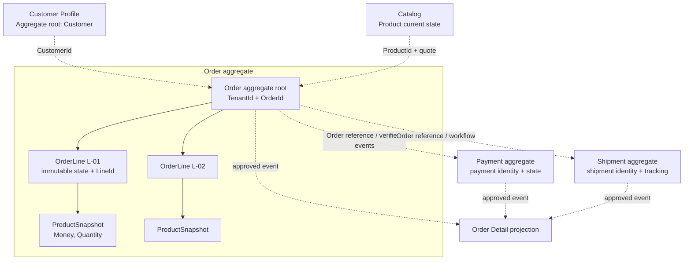
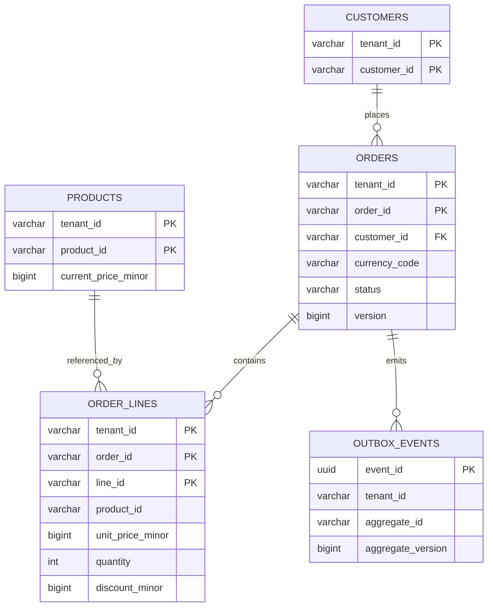
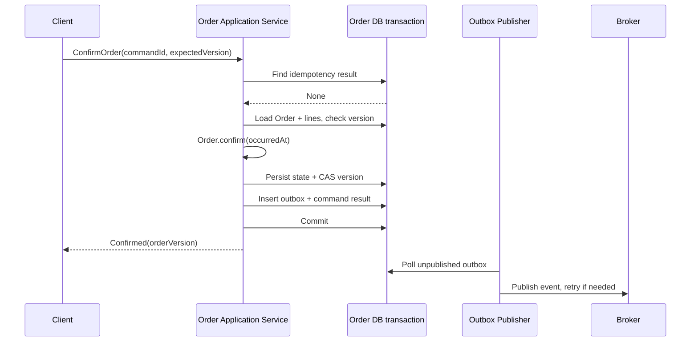
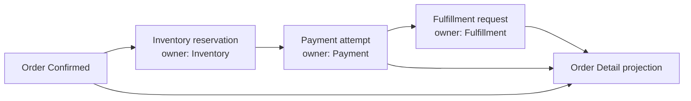

# Thiết kế mô hình Java với đối tượng giá trị và ranh giới aggregate

Một nhóm phát triển hệ thống bán hàng được giao xây chức năng đặt đơn bằng Java. Bản thiết kế đầu tiên có một lớp `Order` chứa cả `customerName`, `currentProductPrice`, `paymentStatus`, `trackingCode` và danh sách mọi lịch sử giao hàng. Mỗi nơi trong ứng dụng có thể gọi `order.setStatus(...)` hoặc `order.getLines().clear()`. Khi yêu cầu mới xuất hiện — thanh toán nhiều lần, giao hàng theo kiện, đổi giá sản phẩm, hai yêu cầu đặt hàng tới đồng thời — mô hình bắt đầu mất tính nhất quán.

Bài thực hành này yêu cầu bạn thiết kế lại từ **ngôn ngữ nghiệp vụ → thực thể và value object → aggregate boundary → hành vi Java → lưu trữ và kiểm chứng**. Mục tiêu là đặt **đúng bất biến vào đúng nơi có quyền thay đổi**, thay vì chỉ biến bảng dữ liệu thành các class Java với getter/setter.

Bài thuộc chương **Thực hành tổng hợp** của học phần **DATABASE_DATA_MODELING**. Học phần rèn kỹ năng chuyển yêu cầu nghiệp vụ thành mô hình dữ liệu rõ ràng, từ thực thể, quan hệ và ràng buộc tới chuẩn hóa, khóa, chỉ mục, lược đồ vật lý; đồng thời so sánh mô hình quan hệ, document, đồ thị và phân tích để chọn cấu trúc phù hợp, dễ tiến hóa và kiểm chứng. Các khái niệm **value object** và **aggregate** ở đây là công cụ để đảm bảo mô hình **Java** và mô hình **dữ liệu** diễn đạt cùng một quy tắc.

**Mục tiêu hoàn thành:** tự đề xuất được mô hình có khả năng bảo vệ giá trị tiền, số lượng, trạng thái đơn, khóa theo tenant và cập nhật đồng thời; giải thích được tại sao một số đối tượng được giữ trong aggregate Order, còn Payment và Shipment không bị nhúng tùy tiện vào nguồn ghi của Order.

**Giả định phạm vi:** ví dụ dùng Java 21+, JUnit 5 và PostgreSQL cho phần minh họa. Mọi ID, số tiền, ngày tháng là dữ liệu giả. Đơn hàng dùng duy nhất **VND nguyên**, chưa xét thuế, phí vận chuyển, mã giảm giá cấp đơn, đổi ngoại tệ, partial fulfillment phức tạp hay hoàn hàng. Việc mở rộng phải đi qua quy tắc nghiệp vụ riêng, không mặc định ví dụ đã giải quyết tất cả.

## 1. Đề bài: nền tảng đặt hàng đa tenant

Cửa hàng có nhiều tenant dùng chung hạ tầng. Trong mỗi tenant, một khách có thể tạo đơn nháp, thêm hoặc sửa dòng hàng, rồi xác nhận.

**Yêu cầu nghiệp vụ bắt buộc:**

| Mã | Quy tắc | Hành vi mong đợi |
| --- | --- | --- |
| BR-01 | Order ID chỉ cần duy nhất trong tenant | `(tenantId, orderId)` định danh một Order |
| BR-02 | Customer ID và Product ID là tham chiếu có kiểu riêng | Không truyền nhầm `ProductId` vào vị trí `CustomerId` |
| BR-03 | Order mới ở trạng thái `DRAFT` | Đơn có thể chưa có dòng hàng |
| BR-04 | Khi `DRAFT`, được thêm/xóa dòng và sửa quantity | Thao tác bị chặn khi đơn đã xác nhận |
| BR-05 | Một line có `quantity > 0` và `unitPrice ≥ 0` | Không có dòng hàng với số lượng 0 hoặc âm |
| BR-06 | `0 ≤ lineDiscount ≤ unitPrice × quantity` | Không tạo dòng có giá trị thuần âm |
| BR-07 | Tiền có currency rõ, phép cộng/trừ phải cùng currency | Không cộng VND với USD |
| BR-08 | `CONFIRMED` yêu cầu tối thiểu một line | `confirm()` trên DRAFT rỗng phải thất bại |
| BR-09 | Line sau khi xác nhận không được sửa âm thầm | Giá và số lượng chốt là snapshot |
| BR-10 | Hai command ghi cùng version không được silently overwrite | Dùng optimistic concurrency/locking |
| BR-11 | Retry cùng một command không gây tác động nghiệp vụ lần hai | Idempotency key/result ở application boundary |
| BR-12 | Payment do Payment domain quản lý, Shipment do Fulfillment quản lý | Order không giữ mọi callback/tracking event |
| BR-13 | Truy vấn một tenant không đọc/ghi dữ liệu tenant khác | Tenant scope ở API, khóa và query |
| BR-14 | Đổi giá Catalog không sửa giá đơn đã xác nhận | `ProductSnapshot` thuộc OrderLine |
| BR-15 | Event phát ra bên ngoài chỉ sau khi thay đổi nguồn đã commit | Lưu outbox cùng transaction |
| BR-16 | Read model dẫn xuất có nguồn và độ mới rõ | Search/analytics không được tự sửa trạng thái nguồn |

**Yêu cầu phi chức năng của bài:**

- Mã Java không có setter công khai cho trạng thái Aggregate.
- Value object là **immutable** và so sánh theo **giá trị**.
- Aggregate không gọi trực tiếp database, HTTP, message broker hoặc đồng hồ hệ thống.
- Cập nhật Order và các line phải có **transaction và version scope** rõ.
- Khóa không trộn tenant.
- Test kiểm tra **cả trường hợp hợp lệ và phản ví dụ**, gồm điều không được xảy ra sau khi lệnh thất bại.
- Có phương án cho query tổng hợp đơn hàng mà **không gộp tất cả domain thành một aggregate khổng lồ**.

### 1.1. Dữ liệu mẫu để đối chiếu

Tenant `T-01` có khách `C-01` tạo đơn `O-101`. Đơn có hai dòng:

| Line | Product | Quantity | Đơn giá chốt | Giảm giá dòng | Net |
| --- | --- | ---: | ---: | ---: | ---: |
| `L-01` | `P-BOOK` | 2 | 100.000 VND | 10.000 VND | 190.000 VND |
| `L-02` | `P-PEN` | 1 | 30.000 VND | 0 VND | 30.000 VND |
| **Tổng** | | **3 đơn vị hàng** | | **10.000 VND** | **220.000 VND** |

Tổng trước giảm giá là **230.000 VND**. Catalog có thể đổi giá P-BOOK lên 110.000 VND và P-PEN lên 35.000 VND sau đó; **tổng đã chốt của O-101 vẫn là 220.000 VND**.

Đơn O-101 có thể nhận hai khoản thanh toán thành công `PAY-01 = 120.000 VND` và `PAY-02 = 100.000 VND`, và được giao bởi `SHIP-01`, `SHIP-02` trong những thời điểm khác nhau. Các con số được dùng để kiểm tra cả ranh giới aggregate lẫn lỗi JOIN nhân tiền.

### 1.2. Đầu ra phải nộp trong bài thực hành

1. Bảng thuật ngữ và **grain/identity** cho mỗi khái niệm.
2. Sơ đồ chỉ ra **value object, entity, aggregate root** và quan hệ liên aggregate.
3. Mã Java cho các value object `TenantId`, `OrderId`, `CustomerId`, `ProductId`, `LineId`, `Money`, `Quantity` và `ProductSnapshot`.
4. Java `Order` aggregate với hành vi, không để consumer đổi state/line tùy ý.
5. Repository contract, quy tắc transaction, optimistic version, idempotency và outbox.
6. SQL schema dùng khóa tenant-scoped và ràng buộc cục bộ.
7. Bộ JUnit/API tests có **positive và negative cases**.
8. Giải thích lựa chọn relational/document/graph/analytical cho cùng miền.
9. Bảng các invariant **database thực thi được** và invariant phải nằm ở domain/workflow.
10. Một bản tự đánh giá theo rubric cuối bài.

## 2. Nền tảng cần nắm: value object, entity, aggregate và domain service

### 2.1. Value object (*đối tượng giá trị*)

Một value object được định nghĩa bởi **giá trị và bất biến nội tại**, không bởi một định danh nghiệp vụ riêng cần theo dõi xuyên thời gian. Hai `Money("VND", 100000)` tương đương về giá trị dù được tạo từ hai lệnh khác nhau.

Ví dụ:

- `Money`: currency + số tiền nhỏ nhất.
- `Quantity`: số nguyên dương theo quy tắc của bài.
- `DeliveryWindow`: khoảng bắt đầu/kết thúc được kiểm tra.
- `ProductSnapshot`: tham chiếu sản phẩm và giá/tên chốt tại thời điểm mua.
- Các typed IDs như `OrderId` và `CustomerId`: **value objects bọc định danh**, dù giá trị bên trong **dùng để nhận diện entity**.

Đặc điểm mong muốn:

- **Immutable:** không có setter làm thay đổi giá trị đã tạo.
- **Self-validating:** constructor/factory không tạo instance sai bất biến.
- **Equality by value:** giá trị bằng nhau theo nội dung có ý nghĩa.
- **No independent lifecycle:** không cần repository riêng cho một `Quantity(2)`.
- **Operations return new values:** `price.multiply(quantity)` trả một Money mới.
- **Semantics explicit:** cùng là `String` không có nghĩa Email, CustomerId và ProductId có thể dùng lẫn.

Trong Java, `record` phù hợp cho **nhiều** value object nhờ constructor, accessor, `equals` và `hashCode` theo thành phần. Nhưng `record` chỉ bảo đảm **shallow immutability**: nếu chứa `List` có thể sửa hoặc một object mutable, vẫn cần **defensive copy** và đóng ranh giới thích hợp.

### 2.2. Entity (*thực thể có danh tính*)

Một entity giữ **danh tính liên tục qua những thay đổi**. Order O-101 vẫn là cùng Order dù số dòng, trạng thái hoặc version thay đổi. Một dòng hàng `LineId("L-01")` vẫn là dòng ấy sau khi sửa quantity trong DRAFT.

So sánh:

| Đối tượng | So sánh chính | Vòng đời |
| --- | --- | --- |
| `Money("VND", 100000)` | Currency và amount | Giá trị, không danh tính riêng |
| `Quantity(2)` | Số lượng | Giá trị |
| `ProductSnapshot(P-BOOK, "Book", 100000)` | Toàn bộ nội dung snapshot | Giá trị tại một mốc |
| `Order O-101` | `(tenantId, orderId)` | Draft → Confirmed/Cancelled |
| `OrderLine L-01` | ID line trong đúng Order | Có thể đổi quantity khi draft |
| `Payment PAY-01` | Identity payment do Payment domain quản lý | Pending → Succeeded/Failed |
| `Shipment SHIP-01` | Identity shipment | Planned → Delivered/Failed |

Một `OrderLine` có thể được **cài đặt bằng record immutable** mà vẫn mang **entity semantics** nếu nó có `LineId` ổn định và việc thay đổi được biểu diễn bằng **thay thế state của cùng line ID**. **Kiểu Java record không tự định nghĩa DDD identity.** Domain semantics mới quyết định entity hay value object.

### 2.3. Aggregate và aggregate root

Aggregate là **ranh giới nhất quán cho những bất biến phải được giữ trong một lần thay đổi**. Aggregate root là đầu vào duy nhất cho command sửa phần nội bộ của aggregate.

Trong ví dụ:

- `Order` là root.
- `OrderLine` được quản lý bên trong Order.
- `Order.addLine`, `changeQuantity`, `removeLine`, `confirm` là hành vi được phép.
- Không có `order.setStatus("PAID")` hoặc `order.lines().clear()` công khai.
- Payment, Shipment và Customer Profile **không thuộc Order aggregate** chỉ vì có `orderId`.

**Một aggregate không nhất thiết là một database table hay một document.** Order và các line có thể nằm trong hai bảng nhưng phải được sửa qua **cùng một contract/transaction**. Một document có thể nhúng line và vẫn giữ cùng aggregate semantics. Không cần tạo microservice riêng cho mọi aggregate.

### 2.4. Tại sao cần root?

Nếu client được sửa trực tiếp `OrderLine`, nó có thể xóa dòng cuối sau khi Order đã xác nhận, làm vi phạm `CONFIRMED ⇒ at least one line`. Khi mọi thay đổi đi qua Order root, root có thể kiểm tra **trạng thái trước và sau thao tác**.

Giới hạn: root chỉ bảo vệ được invariant khi mọi write path thực sự đi qua nó hoặc được DB/workflow cưỡng chế tương đương. Một script SQL update trực tiếp sau lưng domain vẫn có thể phá invariant nếu quyền ghi không được kiểm soát.

### 2.5. Domain service và application service khác nhau

- **Value object:** quy tắc một giá trị, ví dụ Money cộng/trừ và Quantity dương.
- **Aggregate:** quy tắc bên trong một ranh giới nhất quán, ví dụ Order không thể confirm khi rỗng.
- **Domain service/policy:** phép quyết định nghiệp vụ không thuộc tự nhiên một entity/VO, ví dụ tính điều kiện giữ chỗ xuyên nhiều tồn kho theo policy.
- **Application service:** điều phối authorization, load, transaction, repository, idempotency, outbox và tác vụ ngoài domain.
- **Infrastructure:** SQL, ORM mapping, broker, event publisher, cache, search.

Không đưa database access hoặc HTTP client vào `Money` hay `Order.confirm()`. Đặt nguồn giờ, danh tính actor và kết quả xác minh quyền **tại biên application** và truyền vào domain khi cần.

## 3. Tìm ranh giới aggregate từ bất biến và vòng đời

### 3.1. Sơ đồ đề xuất



Đường nét đứt thể hiện **tham chiếu/hợp đồng giữa các aggregate**, không phải ownership của root này đối với state của root kia. `Order` không tự thay đổi `Payment.status` bằng setter. Application/workflow xác nhận payment qua nguồn có thẩm quyền và ra lệnh cập nhật một projection hoặc trạng thái thích hợp theo domain contract.

### 3.2. Bảng quyết định boundary

| Khái niệm | Boundary đề xuất | Lý do | Không nên làm |
| --- | --- | --- | --- |
| Order status/version | Order | Quản lý trạng thái và lệnh xác nhận | Cho mọi service set status |
| OrderLine | Trong Order | Confirm phụ thuộc ít nhất 1 line hợp lệ | Cho sửa line qua repository tự do |
| Money/Quantity | Value objects | Bảo vệ tính hợp lệ giá trị | Dùng String/double rời rạc |
| ProductSnapshot | Value object trong line | Giá lịch sử phải ổn định | Dùng current catalog price để tính đơn cũ |
| Current Product | Catalog aggregate khác | Giá/tên catalog đổi độc lập | Nhúng cả Product hiện tại vào Order |
| Customer profile | Customer aggregate khác | Liên hệ/đồng ý/retention riêng | Cho Order sở hữu current email |
| Payment transaction | Payment aggregate khác | Có callback/retry/settlement riêng | Nhúng mọi payment event trong Order |
| Shipment | Fulfillment aggregate khác | Nhiều kiện/trạng thái độc lập | Đổi shipment cần lock mọi OrderLine |
| Order Detail Read Model | Projection | Một màn hình đọc nhiều nguồn | Coi read model là source of truth |

### 3.3. Bất biến nào cần nguyên tử trong Order?

Tối thiểu:

\[
\text{Order.status = CONFIRMED} \Rightarrow |\text{Order.lines}| \ge 1
\]

\[
\forall \ell\in\text{Order.lines}:
\text{quantity}_{\ell}>0
\quad\land\quad
0\le \text{discount}_{\ell}
\le\text{quantity}_{\ell}\times\text{unitPrice}_{\ell}
\]

\[
\text{Order.total}=\sum_{\ell\in\text{Order.lines}}
(\text{quantity}_{\ell}\times\text{unitPrice}_{\ell}-\text{discount}_{\ell})
\]

Tất cả phép cộng tiền ở ví dụ phải **cùng VND**, kết quả không âm và không vượt miền số của kiểu đã chọn.

Những bất biến **không thể bảo vệ chỉ bằng một Order Java object**:

- Payment provider thực sự xác nhận settlement hay chưa.
- Tồn kho đã được giữ chỗ từ nguồn Inventory nào.
- Shipment nào đã giao thành công trong Fulfillment.
- Khách có quyền mua hoặc sản phẩm đang được phép bán tại thời điểm ra lệnh.
- Một command đã được ghi bền vững/idempotent hay chưa sau khi mạng timeout.
- Outbox đã publish/broker đã deliver hay chưa.

Các điều này cần **kiểm tra nguồn, transaction, workflow, event, reservation hoặc reconciliation** phù hợp.

## 4. Chọn Java type: tránh primitive obsession và chặn trạng thái sai

### 4.1. Sai lầm: String và double ở mọi nơi

```java
// PHẢN VÍ DỤ — không áp dụng.
void addLine(
    String orderId,
    String productId,
    double unitPrice,
    int quantity,
    double discount
) {
    // Không có tenant scope, currency,
    // không chặn quantity âm, có sai số floating-point,
    // và chưa biết order đã CONFIRMED hay chưa.
}
```

Nó cho phép các lỗi như tráo `orderId` và `productId`, truyền `-2` vào quantity, hoặc tính tiền với `double`. Tập hợp nhiều primitive rời rạc khiến rất khó chứng minh bất biến.

### 4.2. Typed IDs có giá trị nhưng không thay authorization

Ở phạm vi bài học, các ID đều là chuỗi định dạng đơn giản. Trong dự án thật, có thể dùng UUID/ULID/long tùy yêu cầu. Điều quan trọng là **không trao đổi nhầm semantic role**.

```java
// Ids.java — toàn bộ type đặt trong cùng package của bài tập.
// Để export qua package/module, tách thành các file public riêng.
package example.shop.order;

import java.util.Objects;

final class IdRules {
    private IdRules() {}

    static String valid(String value) {
        Objects.requireNonNull(value, "id");
        if (!value.matches("[A-Za-z0-9_-]{1,64}")) {
            throw new IllegalArgumentException("INVALID_ID");
        }
        return value;
    }
}

record TenantId(String value) {
    TenantId { value = IdRules.valid(value); }
}
record OrderId(String value) {
    OrderId { value = IdRules.valid(value); }
}
record CustomerId(String value) {
    CustomerId { value = IdRules.valid(value); }
}
record ProductId(String value) {
    ProductId { value = IdRules.valid(value); }
}
record LineId(String value) {
    LineId { value = IdRules.valid(value); }
}
record Quantity(int value) {
    Quantity {
        if (value <= 0) {
            throw new IllegalArgumentException("QUANTITY_MUST_BE_POSITIVE");
        }
    }
}
```

Những record package-private chỉ phục vụ ví dụ đặt chung package `example.shop.order`. Nếu ứng dụng chia module và cần type public, mỗi `public record` phải nằm trong file Java cùng tên hoặc dùng một cấu trúc API thích hợp. Không nên thay mọi ID bằng một record `GenericId` duy nhất chỉ vì ngắn code; như vậy mất lợi ích an toàn kiểu.

**Lưu ý khóa:** `OrderId("O-101")` không bảo đảm duy nhất toàn hệ; **định danh Order đầy đủ là `(TenantId, OrderId)`**. Type-safe ID không thay thế xác thực tenant của người gọi, kiểm soát quyền hay FK theo tenant.

### 4.3. Money immutable, cùng currency và không dùng double

Với VND nguyên, một lựa chọn dễ kiểm chứng là `long minor` cộng với currency code. Phép toán dùng `Math.addExact` và `Math.multiplyExact` để **phát hiện overflow**, không âm thầm wrap số.

```java
// Money.java
package example.shop.order;

import java.util.Locale;
import java.util.Objects;

public record Money(String currencyCode, long minor) {
    public Money {
        Objects.requireNonNull(currencyCode, "currency");
        currencyCode = currencyCode.trim().toUpperCase(Locale.ROOT);
        if (!currencyCode.matches("[A-Z]{3}")) {
            throw new IllegalArgumentException("INVALID_CURRENCY_CODE");
        }
        if (minor < 0) {
            throw new IllegalArgumentException("NEGATIVE_MONEY");
        }
    }

    public static Money vnd(long minor) {
        return new Money("VND", minor);
    }

    public static Money zero(String currencyCode) {
        return new Money(currencyCode, 0);
    }

    public Money plus(Money other) {
        sameCurrency(other);
        return new Money(
            currencyCode,
            Math.addExact(minor, other.minor)
        );
    }

    public Money minus(Money other) {
        sameCurrency(other);
        return new Money(
            currencyCode,
            Math.subtractExact(minor, other.minor)
        );
    }

    public Money multiply(Quantity quantity) {
        Objects.requireNonNull(quantity, "quantity");
        return new Money(
            currencyCode,
            Math.multiplyExact(minor, quantity.value())
        );
    }

    private void sameCurrency(Money other) {
        Objects.requireNonNull(other, "other");
        if (!currencyCode.equals(other.currencyCode)) {
            throw new IllegalArgumentException("CURRENCY_MISMATCH");
        }
    }
}
```

Quy tắc của type này:

- Không thể có `Money("VND", -1)`.
- Không thể cộng VND với USD.
- `minus` không cho tổng âm.
- `multiply` cần `Quantity` dương.
- Overflow ném `ArithmeticException` thay vì tạo số sai.
- `equals/hashCode` của record là equality theo currency và minor.

**Giới hạn:** regex `[A-Z]{3}` chỉ kiểm tra hình dạng mã, **không xác minh mã tiền thuộc ISO 4217**; nếu cần phải dùng danh mục/cấu hình tiền tệ có thẩm quyền. Hệ đa tiền tệ và các loại thuế/chiết khấu yêu cầu **scale, rounding và exchange-rate policy** rõ; có thể dùng `BigDecimal` một cách có kiểm soát thay vì `long` theo bài toán. Không lấy `double` làm nguồn tính tiền chính xác.

### 4.4. Tại sao không lưu `currency` ngoài Money rồi truyền rời rạc?

```java
// PHẢN VÍ DỤ
long amount = 100000;
String currency = "VND";
// Sau một refactor, amount có thể bị gán từ giá USD
// nhưng currency vẫn là VND.
```

Khi Money là một value object, các thao tác tiền luôn mang currency. Điều đó không tự giải quyết tỷ giá hay kiểm toán, nhưng hạn chế nhiều trạng thái không hợp lệ ngay tại điểm tạo giá trị.

### 4.5. Value object có thể chứa nhiều trường nhưng phải immutable thật

```java
// ProductSnapshot.java
package example.shop.order;

import java.util.Objects;

public record ProductSnapshot(
    ProductId productId,
    String titleAtOrder,
    Money unitPrice
) {
    public ProductSnapshot {
        Objects.requireNonNull(productId, "productId");
        Objects.requireNonNull(titleAtOrder, "titleAtOrder");
        Objects.requireNonNull(unitPrice, "unitPrice");
        titleAtOrder = titleAtOrder.strip();
        if (titleAtOrder.isEmpty()) {
            throw new IllegalArgumentException("EMPTY_PRODUCT_TITLE");
        }
    }
}
```

`ProductSnapshot` giữ **title và unitPrice được chốt cho giao dịch**, không là object tham chiếu sống tới `Product` hiện tại trong Catalog. Nếu Catalog đổi giá ngày mai, `OrderLine` cũ không đổi. Nếu nghiệp vụ chỉ cần product ID + price, snapshot có thể bỏ title; hãy giữ đúng dữ kiện phục vụ chứng từ, hiển thị lịch sử và retention.

**Phản ví dụ record không immutable sâu:**

```java
// PHẢN VÍ DỤ
record PriceHistory(java.util.List<Money> prices) { }
// new PriceHistory(mutableList) vẫn dùng cùng List,
// caller có thể mutableList.add(...) sau khi tạo record.
```

Nếu dùng list trong VO, cần `List.copyOf(prices)` trong compact constructor, và bảo đảm các phần tử cũng immutable; nếu cần defensive copy của binary array thì `List.copyOf` không thay thế copy array.

## 5. OrderLine: entity theo ID, nhưng state có thể immutable

Một OrderLine có `LineId` ổn định để phân biệt hai dòng cùng sản phẩm với hai chương trình giá khác nhau. Việc thay đổi quantity khi Draft không tạo một danh tính line mới; nó tạo **phiên bản state mới cho cùng LineId**.

```java
// OrderLine.java
package example.shop.order;

import java.util.Objects;

public record OrderLine(
    LineId id,
    ProductSnapshot product,
    Quantity quantity,
    Money discount
) {
    public OrderLine {
        Objects.requireNonNull(id, "lineId");
        Objects.requireNonNull(product, "product");
        Objects.requireNonNull(quantity, "quantity");
        Objects.requireNonNull(discount, "discount");

        Money gross = product.unitPrice().multiply(quantity);
        if (!gross.currencyCode().equals(discount.currencyCode())) {
            throw new IllegalArgumentException("CURRENCY_MISMATCH");
        }
        if (discount.minor() > gross.minor()) {
            throw new IllegalArgumentException("DISCOUNT_EXCEEDS_GROSS");
        }
    }

    public Money gross() {
        return product.unitPrice().multiply(quantity);
    }

    public Money net() {
        return gross().minus(discount);
    }

    public OrderLine withQuantity(Quantity next) {
        return new OrderLine(id, product, next, discount);
    }
}
```

**Giải thích quyết định:**

- `LineId` là identity **trong phạm vi đúng Order**.
- Record được dùng để **thay state** thay vì mutation rải rác.
- Chỉ aggregate `Order` được phép quyết định có thể thay state line vào thời điểm nào.
- Constructor kiểm tra quantity, currency và discount.
- Giảm quantity có thể làm discount vượt gross; `withQuantity` sẽ **từ chối**, không âm thầm chuyển thành tổng âm.
- `gross()` và `net()` là **giá trị tính toán**, không phải “current catalog amount”.

**Lưu ý về equality:** vì `OrderLine` được cài bằng Java `record`, phương thức `equals()` mặc định so sánh **tất cả thành phần của record**. Hai phiên bản của cùng dòng có thể có `LineId` bằng nhau nhưng `quantity` khác nhau, vì vậy `record.equals()` trả `false`. Trong mô hình này, **entity identity phải so bằng `LineId` trong phạm vi Order**; `Map<LineId, OrderLine>` và việc thay immutable state thể hiện chủ ý đó. Đừng dùng `OrderLine` record làm khóa của một `HashMap` cần identity ổn định qua thay đổi. Nếu muốn `equals/hashCode` theo entity identity cho mọi client, nên dùng class entity với quy tắc equality rõ thay vì mặc định record equality.

Ở mô hình lớn, Line có thể là class entity mutable với constructor/access control; điều quan trọng không phải `record` hay class, mà là **không cho caller bypass Order invariants**.

### 5.1. Có nên dùng `Product` entity trực tiếp trong OrderLine?

Không nên lấy object `Product` mutable và giữ reference lâu dài chỉ để tính total. Nếu Product Service đổi giá trên cùng instance, tổng tiền đơn đã chốt có thể tự thay đổi, phá vỡ ý nghĩa giao dịch.

Thay vào đó, lúc tạo line cần chọn **giá hợp lệ tại thời điểm xác định bởi policy**, tạo snapshot value và lưu nó. Quy tắc xác nhận báo giá, thời điểm hết hạn quote và quyền mua sản phẩm thuộc **application/domain policy**, không thể được OrderLine tự suy ra chỉ từ ProductId.

## 6. Order aggregate: bảo vệ hành vi thay vì phơi setter

Các phương thức được phép:

- `Order.draft(...)` tạo aggregate ban đầu.
- `addLine(OrderLine)` chỉ khi Draft.
- `changeQuantity(LineId, Quantity)` chỉ khi Draft.
- `removeLine(LineId)` chỉ khi Draft.
- `confirm(Instant)` chỉ khi Draft và có ít nhất một line.
- `cancelDraft()` chỉ khi Draft theo phạm vi đơn giản hóa.
- `total()` tính thuần từ lines đã lưu.
- `lines()` trả snapshot read-only, không lộ map mutable.

Trong bài này, `Order.status` chỉ gồm **DRAFT, CONFIRMED, CANCELLED**. Trạng thái thanh toán thuộc Payment domain và view/command được thiết kế riêng. Không thêm `PAID` vào Order chỉ vì cần hiển thị Payment trên trang đơn.

### 6.1. State và domain error

```java
// OrderStatus.java
package example.shop.order;

public enum OrderStatus {
    DRAFT, CONFIRMED, CANCELLED
}
```

```java
// DomainRuleViolation.java
package example.shop.order;

public final class DomainRuleViolation extends RuntimeException {
    private final String code;

    public DomainRuleViolation(String code) {
        super(code);
        this.code = code;
    }

    public String code() {
        return code;
    }
}
```

Domain error code ổn định giúp test/API phân biệt **ORDER_NOT_DRAFT**, **ORDER_HAS_NO_LINES**, **DUPLICATE_LINE**, **LINE_NOT_FOUND**. Code ứng dụng có thể map chúng thành phản hồi thích hợp; không nhất thiết mọi lỗi đều là HTTP 400. Với dữ liệu không thuộc tenant, API cần tránh tiết lộ tồn tại của entity qua thông báo lỗi không đúng quyền.

### 6.2. Source Java cho Order

```java
// Order.java
package example.shop.order;

import java.time.Instant;
import java.util.LinkedHashMap;
import java.util.List;
import java.util.Map;
import java.util.Objects;

public final class Order {
    private final TenantId tenantId;
    private final OrderId id;
    private final CustomerId customerId;
    private final String currencyCode;
    private final Map<LineId, OrderLine> lines = new LinkedHashMap<>();

    private OrderStatus status = OrderStatus.DRAFT;
    private Instant confirmedAt;

    private Order(
        TenantId tenantId,
        OrderId id,
        CustomerId customerId,
        String currencyCode
    ) {
        this.tenantId = Objects.requireNonNull(tenantId);
        this.id = Objects.requireNonNull(id);
        this.customerId = Objects.requireNonNull(customerId);
        this.currencyCode = Money.zero(currencyCode).currencyCode();
        // Phạm vi bài: chỉ VND, để tránh cross-currency policy.
        if (!"VND".equals(this.currencyCode)) {
            throw new IllegalArgumentException("ORDER_CURRENCY_NOT_SUPPORTED");
        }
    }

    public static Order draft(
        TenantId tenantId,
        OrderId id,
        CustomerId customerId
    ) {
        return new Order(tenantId, id, customerId, "VND");
    }

    public TenantId tenantId() { return tenantId; }
    public OrderId id() { return id; }
    public CustomerId customerId() { return customerId; }
    public OrderStatus status() { return status; }
    public Instant confirmedAt() { return confirmedAt; }

    public List<OrderLine> lines() {
        return List.copyOf(lines.values());
    }

    public Money total() {
        Money total = Money.zero(currencyCode);
        for (OrderLine line : lines.values()) {
            total = total.plus(line.net());
        }
        return total;
    }

    public void addLine(OrderLine line) {
        requireDraft();
        Objects.requireNonNull(line, "line");

        if (!currencyCode.equals(
            line.product().unitPrice().currencyCode()
        )) {
            throw new IllegalArgumentException("CURRENCY_MISMATCH");
        }
        if (lines.putIfAbsent(line.id(), line) != null) {
            throw new DomainRuleViolation("DUPLICATE_LINE");
        }
    }

    public void changeQuantity(LineId lineId, Quantity next) {
        requireDraft();
        Objects.requireNonNull(lineId, "lineId");
        Objects.requireNonNull(next, "next");

        OrderLine old = lines.get(lineId);
        if (old == null) {
            throw new DomainRuleViolation("LINE_NOT_FOUND");
        }
        // Tạo dòng hợp lệ trước; nếu exception, không đổi map.
        OrderLine replacement = old.withQuantity(next);
        lines.put(lineId, replacement);
    }

    public void removeLine(LineId lineId) {
        requireDraft();
        Objects.requireNonNull(lineId, "lineId");
        if (lines.remove(lineId) == null) {
            throw new DomainRuleViolation("LINE_NOT_FOUND");
        }
    }

    public OrderConfirmed confirm(Instant at) {
        requireDraft();
        Objects.requireNonNull(at, "confirmedAt");
        if (lines.isEmpty()) {
            throw new DomainRuleViolation("ORDER_HAS_NO_LINES");
        }

        // Kiểm tra arithmetic overflow trước khi đổi state.
        Money amount = total();
        status = OrderStatus.CONFIRMED;
        confirmedAt = at;
        return new OrderConfirmed(tenantId, id, amount, at);
    }

    public void cancelDraft() {
        requireDraft();
        status = OrderStatus.CANCELLED;
    }

    private void requireDraft() {
        if (status != OrderStatus.DRAFT) {
            throw new DomainRuleViolation("ORDER_NOT_DRAFT");
        }
    }
}
```

Code trên là **domain logic tập trung vào quy tắc**. Nó chưa mô tả cách JPA/JDBC tái tạo Order từ database, chưa chạy authorization, transaction, optimistic locking, outbox hay xác minh product quote. Các vấn đề đó cần ở tầng ứng dụng/infrastructure.

### 6.3. Domain event là thông điệp về điều đã được chấp nhận trong mô hình

```java
// OrderConfirmed.java
package example.shop.order;

import java.time.Instant;
import java.util.Objects;

public record OrderConfirmed(
    TenantId tenantId,
    OrderId orderId,
    Money total,
    Instant occurredAt
) {
    public OrderConfirmed {
        Objects.requireNonNull(tenantId);
        Objects.requireNonNull(orderId);
        Objects.requireNonNull(total);
        Objects.requireNonNull(occurredAt);
    }
}
```

`Order.confirm(at)` **trả một domain event candidate**, không tự publish. Nếu transaction sau đó thất bại khi lưu Order, event **không được công bố ra broker như thể đã commit**. Application service cần persist state và outbox **trong cùng transaction**, sau đó publisher riêng mới gửi; consumer phải chịu được duplicate.

### 6.4. Tại sao `lines()` có thể trả List mà không cho sửa?

`List.copyOf(lines.values())` tạo snapshot không hỗ trợ thêm/xóa. Các phần tử `OrderLine` và các value object đi kèm đều immutable trong thiết kế, nên caller không thể sửa quantity qua object reference.

**Phản ví dụ:**

```java
// PHẢN VÍ DỤ
public List<OrderLine> getLines() {
    return internalMutableList; // caller có thể .clear()
}
```

Nếu dùng các entity mutable, trả `Collections.unmodifiableList` trên list gốc chỉ chặn thao tác thêm/xóa trên list, **không chặn sửa các phần tử**. Cần view/DTO immutable hoặc kiểm soát chặt đối tượng trả ra.

### 6.5. Không tự biến mọi trường thành public accessor

API domain phải cung cấp những thông tin cần thiết cho command và query. Không phải vì yêu cầu ORM mà thêm `setStatus`, `setCustomerId` hoặc `setConfirmedAt` công khai. Persistence mapper có thể dùng **rehydration factory**, package-private constructor hoặc mapping bên ngoài, nhưng phải giữ đúng invariant và tránh cho ứng dụng thông thường bypass hành vi.

Một snapshot lưu lâu năm có thể chứa dữ liệu **được viết theo phiên bản schema cũ**. Khi hydrate, cần quyết định: reject dữ liệu sai, migration/repair hoặc đọc qua adapter; không đơn giản bỏ qua lỗi và tạo một aggregate ở trạng thái không thể xuất hiện qua API hợp lệ.

## 7. Walkthrough từng bước với O-101

### 7.1. Tạo đơn nháp

```java
TenantId tenant = new TenantId("T-01");
Order order = Order.draft(
    tenant,
    new OrderId("O-101"),
    new CustomerId("C-01")
);

assert order.status() == OrderStatus.DRAFT;
assert order.lines().isEmpty();
assert order.total().equals(Money.vnd(0));
```

Đơn nháp chưa có dòng **hợp lệ**. Đừng đưa điều kiện “mọi Order phải có ít nhất một line” vào constructor nếu nghiệp vụ cho phép Draft rỗng.

### 7.2. Thêm hai dòng với giá snapshot

```java
order.addLine(new OrderLine(
    new LineId("L-01"),
    new ProductSnapshot(
        new ProductId("P-BOOK"),
        "Book",
        Money.vnd(100_000)
    ),
    new Quantity(2),
    Money.vnd(10_000)
));

order.addLine(new OrderLine(
    new LineId("L-02"),
    new ProductSnapshot(
        new ProductId("P-PEN"),
        "Pen",
        Money.vnd(30_000)
    ),
    new Quantity(1),
    Money.vnd(0)
));

assert order.total().equals(Money.vnd(220_000));
```

`P-BOOK` đang có giá nào trong Catalog sau đó **không ảnh hưởng** tới tổng snapshot này. Tính toán:

\[
(2\times100{,}000-10{,}000)
+
(1\times30{,}000-0)
=220{,}000\ \text{VND}.
\]

### 7.3. Xác nhận đơn

```java
import java.time.Instant;

Instant confirmedAt = Instant.parse("2026-10-01T03:00:00Z");
OrderConfirmed event = order.confirm(confirmedAt);

assert order.status() == OrderStatus.CONFIRMED;
assert order.total().equals(Money.vnd(220_000));
assert event.total().equals(Money.vnd(220_000));
```

Sự kiện được tạo trong domain, nhưng chưa thể tuyên bố broker đã nhận. Chỉ khi application service persist state và outbox **thành công** mới xem transaction nguồn đã cam kết. `confirmedAt` dùng một `Instant` được truyền từ bên ngoài để test có thể tái lập; domain không gọi `Instant.now()`.

### 7.4. Thử thay đổi sau khi xác nhận

```java
// Kỳ vọng DomainRuleViolation("ORDER_NOT_DRAFT").
order.removeLine(new LineId("L-01"));
```

Vì `requireDraft()` chạy trước khi map bị sửa, **Order vẫn CONFIRMED và giữ hai dòng**. Lưu ý với JPA/session mapping thực tế, cần bảo đảm rollback khi lỗi ở ứng dụng và không persist partial changes ngoài ý muốn.

### 7.5. Ví dụ phản chứng làm lộ ranh giới sai

Nếu một `PaymentConsumer` nhận callback và gọi:

```java
// PHẢN VÍ DỤ — không cung cấp API như thế này.
order.setPaymentStatus("SUCCEEDED");
order.getShipments().get(0).setTrackingStatus("DELIVERED");
```

nó đang lấy Order làm **owner của Payment và Shipment** mà không chứng minh có invariant chung cần giao dịch nguyên tử. Khi Payment/Shipment đổi độc lập, Order có thể trở thành hot aggregate; callback stale có thể ghi đè giá trị mới hoặc phân tán thành nhiều đường ghi không được quản lý.

Giải pháp là giữ identity `PaymentId`, `ShipmentId` và state riêng theo domain; Order có thể nhận **kết quả xác minh** qua workflow, hoặc projection tổng hợp có các source versions để hiển thị.

## 8. Tự kiểm tra: Value Object nên có những invariant nào?

### 8.1. Money

| Giá trị/thao tác | Mong đợi |
| --- | --- |
| `Money.vnd(0)` | Hợp lệ |
| `Money.vnd(100000)` | Hợp lệ |
| `Money.vnd(-1)` | Bị từ chối |
| `Money.vnd(100000).plus(Money.vnd(50000))` | 150000 VND |
| `Money.vnd(100000).minus(Money.vnd(150000))` | Bị từ chối |
| `Money("VND",100).plus(Money("USD",100))` | Bị từ chối |
| `Money.vnd(Long.MAX_VALUE).plus(Money.vnd(1))` | Overflow được phát hiện |
| `Money.vnd(0).multiply(Quantity(2))` | 0 VND |

Đối với số tiền âm trong điều chỉnh kế toán, **đừng tùy tiện nới lỏng Money không âm** nếu nó đang là invariant cho unit price và sale amount. Có thể thiết kế **SignedMoney/Adjustment** với ý nghĩa và kiểm tra riêng, hoặc một Money chung cho phép âm nhưng ràng buộc positivity ở đúng nơi; quyết định phải được ghi rõ theo nghiệp vụ.

### 8.2. Quantity

- `Quantity(1)` hợp lệ.
- `Quantity(0)`, `Quantity(-3)` không hợp lệ.
- `quantity.value()` là int dương; nếu mặt hàng bán theo kilogram hoặc khối lượng thập phân, **không dùng nguyên mẫu này**. Cần `MeasuredQuantity(value, unit)` hoặc kiểu tương đương với precision, rounding và conversion policy.

### 8.3. ProductSnapshot

- Mỗi snapshot có ProductId, title không rỗng và unit price.
- Hai snapshot có cùng product nhưng giá khác **không bằng nhau theo value equality**, vì chúng đại diện cho hai nội dung giá chốt.
- Giá snapshot thuộc đơn không bị thay đổi khi Catalog cập nhật.
- ProductSnapshot không cần repository riêng vì nó không có vòng đời độc lập theo contract hiện tại.

## 9. JUnit 5: kiểm chứng bất biến bằng ví dụ hợp lệ và phản ví dụ

Bài thực hành được chấm không chỉ bằng số dòng code mà bằng **khả năng chứng minh rule**. Dưới đây là một bộ test mẫu; mỗi ví dụ có thể được đưa vào một test suite Java cùng package để truy cập các ID record package-private.

### 9.1. Test Money, Quantity và equality

```java
// MoneyTest.java
package example.shop.order;

import org.junit.jupiter.api.Test;
import static org.junit.jupiter.api.Assertions.*;

class MoneyTest {
    @Test
    void sameMoneyHasValueEquality() {
        assertEquals(
            new Money("vnd", 100_000),
            Money.vnd(100_000)
        );
        assertNotEquals(
            Money.vnd(100_000),
            new Money("USD", 100_000)
        );
    }

    @Test
    void rejectsInvalidAmountsAndQuantities() {
        assertThrows(
            IllegalArgumentException.class,
            () -> Money.vnd(-1)
        );
        assertThrows(
            IllegalArgumentException.class,
            () -> new Quantity(0)
        );
        assertThrows(
            IllegalArgumentException.class,
            () -> new Quantity(-2)
        );
    }

    @Test
    void rejectsCrossCurrencyArithmetic() {
        assertThrows(
            IllegalArgumentException.class,
            () -> Money.vnd(10).plus(new Money("USD", 10))
        );
    }

    @Test
    void reportsOverflow() {
        assertThrows(
            ArithmeticException.class,
            () -> Money.vnd(Long.MAX_VALUE).plus(Money.vnd(1))
        );
    }
}
```

Test này xác minh **value semantics**, không chứng minh quy tắc thanh toán thực tế hoặc currency conversion. Những trường hợp ấy thuộc domain workflow khác.

### 9.2. Test Order aggregate

```java
// OrderTest.java
package example.shop.order;

import java.time.Instant;
import org.junit.jupiter.api.Test;
import static org.junit.jupiter.api.Assertions.*;

class OrderTest {
    private Order draft(String orderId) {
        return Order.draft(
            new TenantId("T-01"),
            new OrderId(orderId),
            new CustomerId("C-01")
        );
    }

    private OrderLine bookLine() {
        return new OrderLine(
            new LineId("L-01"),
            new ProductSnapshot(
                new ProductId("P-BOOK"),
                "Book",
                Money.vnd(100_000)
            ),
            new Quantity(2),
            Money.vnd(10_000)
        );
    }

    @Test
    void draftCanBeEmptyButCannotBeConfirmedEmpty() {
        Order order = draft("O-EMPTY");
        assertEquals(OrderStatus.DRAFT, order.status());
        assertEquals(Money.vnd(0), order.total());

        DomainRuleViolation ex = assertThrows(
            DomainRuleViolation.class,
            () -> order.confirm(Instant.EPOCH)
        );

        assertEquals("ORDER_HAS_NO_LINES", ex.code());
        assertEquals(OrderStatus.DRAFT, order.status());
        assertNull(order.confirmedAt());
    }

    @Test
    void confirmationLocksLines() {
        Order order = draft("O-101");
        order.addLine(bookLine());
        order.addLine(new OrderLine(
            new LineId("L-02"),
            new ProductSnapshot(
                new ProductId("P-PEN"), "Pen",
                Money.vnd(30_000)
            ),
            new Quantity(1),
            Money.vnd(0)
        ));

        OrderConfirmed event =
            order.confirm(Instant.parse("2026-10-01T03:00:00Z"));

        assertEquals(OrderStatus.CONFIRMED, order.status());
        assertEquals(Money.vnd(220_000), order.total());
        assertEquals(Money.vnd(220_000), event.total());

        DomainRuleViolation ex = assertThrows(
            DomainRuleViolation.class,
            () -> order.removeLine(new LineId("L-01"))
        );
        assertEquals("ORDER_NOT_DRAFT", ex.code());
        assertEquals(2, order.lines().size());
        assertEquals(Money.vnd(220_000), order.total());
    }

    @Test
    void doesNotExposeMutableLines() {
        Order order = draft("O-101");
        order.addLine(bookLine());

        assertThrows(
            UnsupportedOperationException.class,
            () -> order.lines().clear()
        );
        assertEquals(1, order.lines().size());
    }

    @Test
    void changingQuantityCannotMakeDiscountTooLarge() {
        Order order = draft("O-101");
        order.addLine(new OrderLine(
            new LineId("L-01"),
            new ProductSnapshot(
                new ProductId("P-BOOK"), "Book",
                Money.vnd(100_000)
            ),
            new Quantity(2),
            Money.vnd(150_000)
        ));

        assertThrows(
            IllegalArgumentException.class,
            () -> order.changeQuantity(
                new LineId("L-01"),
                new Quantity(1)
            )
        );

        assertEquals(new Quantity(2),
                     order.lines().get(0).quantity());
        assertEquals(Money.vnd(50_000), order.total());
    }

    @Test
    void duplicateLineIdIsRejected() {
        Order order = draft("O-101");
        order.addLine(bookLine());

        DomainRuleViolation ex = assertThrows(
            DomainRuleViolation.class,
            () -> order.addLine(bookLine())
        );
        assertEquals("DUPLICATE_LINE", ex.code());
        assertEquals(1, order.lines().size());
    }
}
```

Test `changingQuantityCannotMakeDiscountTooLarge` đáng chú ý: dòng gốc có giá gộp 200.000 và giảm 150.000, net 50.000. Khi giảm xuống Quantity 1, gross 100.000, discount 150.000 trở thành không hợp lệ. Do tạo `replacement` trước khi `put` vào map, aggregate **không bị thay đổi một nửa** sau exception.

### 9.3. Không dùng `assert` Java thay cho test framework

Các đoạn `assert ...` trong walkthrough chỉ là ký hiệu dễ đọc. Java `assert` có thể bị tắt nếu JVM không bật assertions. Trong test thực tế, dùng `Assertions.assertEquals`, `assertThrows` v.v. của JUnit để đảm bảo luôn thực thi.

### 9.4. Các test còn phải viết

- `removeLine` trên LineId không tồn tại.
- `cancelDraft` rồi thử `addLine` hoặc `confirm`.
- `confirm` hai lần liên tiếp.
- Thêm line có currency khác VND.
- Thêm line có discount âm hoặc lớn hơn gross.
- Thay quantity rồi xác nhận tổng đúng.
- Hai line cùng ProductId nhưng khác LineId được phép nếu business rule cho phép.
- ID sai định dạng, null và chuỗi dài quá giới hạn.
- Phép cộng/multiplication overflow.
- Domain event không tự đi ra broker khi transaction bị rollback.

Một unit test có thể chứng minh class tự bảo vệ invariant **trong bộ nhớ**, nhưng không thay thế integration tests cho **khóa, transaction, optimistic concurrency và idempotency** trên hệ lưu trữ thật.

## 10. Bảng ranh giới cưỡng chế: quy tắc nào nằm ở đâu?

| Quy tắc | Value object | Aggregate | DB | Application/workflow | Verification |
| --- | --- | --- | --- | --- | --- |
| Quantity dương | **Chính** | Sử dụng | CHECK bổ trợ | Validation đầu vào | Unit + DB test |
| Money cùng currency | **Chính** | Tổng theo currency | CHECK/column type | Rate policy nếu có | Unit + DQ |
| Discount ≤ gross | OrderLine constructor | **Không bypass** | CHECK bổ trợ | Product quote policy | Unit + DB |
| Order Confirm có line | — | **Chính** | Có thể trigger/procedure nếu cần | Tx isolation/locking | Unit + integration |
| Line đóng băng khi Confirmed | — | **Chính** | Guard/privileges | Đường ghi được kiểm soát | State tests |
| Product price snapshot | Snapshot VO | Lưu line | Column snapshot | Catalog quote verification | Regression |
| Tenant-scoped ID/FK | Typed IDs | Cùng Order scope | PK/FK composite | Authorization | DB + security |
| Chống lost update | — | Invariant state | **CAS version** | Retry/conflict policy | Race test |
| Duplicate command | — | Không xử lý ở VO | Idempotency PK | **Chính** | Retry/crash test |
| Payment settlement | — | Không sở hữu | Payment store | **Payment owner** | Provider integration |
| Shipment lifecycle | — | Không sở hữu | Shipment store | **Fulfillment owner** | Workflow tests |
| Outbox delivery | — | Event candidate | Outbox row in tx | Publisher/consumer | Replay tests |
| Search projection mới tới đâu | — | Không sở hữu | Projection source version | Consumer | Lag/reconciliation |
| Dữ liệu cá nhân/retention | — | Chỉ tham chiếu cần thiết | ACL/RLS/retention support | **Privacy policy** | Access/deletion tests |

Bảng này giúp ngăn việc **đẩy mọi logic vào một chỗ**. Domain không thay thế database constraint; database cũng không thay thế quy trình nghiệp vụ liên dịch vụ; value object không thay phân quyền.

## 11. Persistence model: Order aggregate trong quan hệ

### 11.1. Quan hệ logic



Một Order có thể có **0 line khi DRAFT** và bắt buộc ≥1 khi CONFIRMED. Quan hệ nên biểu diễn 0..N về mặt cấu trúc, rồi **ghi rule theo trạng thái**; một ER diagram không tự diễn đạt đầy đủ điều kiện này.

`Products` trong diagram là **Catalog** có đời sống riêng. Trong hệ thực phân database, Order Service có thể chỉ lưu product snapshot, **không có FK liên DB tới catalog**; thay bằng quy trình xác minh nguồn và tham chiếu đã được kiểm soát. Sơ đồ dùng đường tham chiếu khái niệm, không phải cam kết mọi FK có thể được engine cưỡng chế xuyên hệ.

### 11.2. PostgreSQL schema tối giản

```sql
-- PostgreSQL — ví dụ VND nguyên, không phải schema thương mại đầy đủ.
CREATE TABLE orders (
    tenant_id VARCHAR(64) NOT NULL,
    order_id VARCHAR(64) NOT NULL,
    customer_id VARCHAR(64) NOT NULL,
    status VARCHAR(24) NOT NULL,
    currency_code CHAR(3) NOT NULL DEFAULT 'VND',
    version BIGINT NOT NULL DEFAULT 0,
    confirmed_at TIMESTAMPTZ,
    PRIMARY KEY (tenant_id, order_id),
    CHECK (status IN ('DRAFT', 'CONFIRMED', 'CANCELLED')),
    CHECK (currency_code = 'VND'),
    CHECK (version >= 0),
    CHECK (
        (status = 'CONFIRMED' AND confirmed_at IS NOT NULL)
        OR
        (status IN ('DRAFT', 'CANCELLED') AND confirmed_at IS NULL)
    )
);

CREATE TABLE order_lines (
    tenant_id VARCHAR(64) NOT NULL,
    order_id VARCHAR(64) NOT NULL,
    line_id VARCHAR(64) NOT NULL,
    product_id VARCHAR(64) NOT NULL,
    product_title_snapshot TEXT NOT NULL,
    quantity INTEGER NOT NULL,
    unit_price_minor NUMERIC(20,0) NOT NULL,
    discount_minor NUMERIC(30,0) NOT NULL DEFAULT 0,
    PRIMARY KEY (tenant_id, order_id, line_id),
    FOREIGN KEY (tenant_id, order_id)
        REFERENCES orders (tenant_id, order_id),
    CHECK (quantity > 0),
    CHECK (unit_price_minor >= 0),
    CHECK (discount_minor >= 0),
    CHECK (discount_minor <= quantity * unit_price_minor)
);

CREATE INDEX order_lines_tenant_product_idx
    ON order_lines (tenant_id, product_id);
```

`status` và `confirmed_at` là một invariant **cục bộ trên hàng** nên có thể diễn đạt bằng `CHECK`. Trong khi quy tắc “CONFIRMED có ≥1 line” là **invariant liên bảng**, không được bảo vệ bởi CHECK trên hàng `orders`. Cần service/transaction/trigger nếu muốn cưỡng chế, và test SQL phát hiện sai lệch.

**Chi tiết kiểu số:** Java `Money.minor` dùng `long`, nhưng database dùng `NUMERIC(20,0)` hoặc `NUMERIC(30,0)`. Mapper phải kiểm tra khi đọc vào Java `long`; dữ liệu vượt `Long.MAX_VALUE` **không thể đọc đúng** chỉ bằng `longValue()` âm thầm cắt số. Chọn `longValueExact()`/validation hoặc chỉnh precision phù hợp. Nếu dùng BigDecimal, kiểm tra scale chính xác.

### 11.3. Không để ORM quyết định bất biến thay domain

Nếu JPA tạo setter public và lazy collection để mọi service tự thêm/xóa OrderLine, aggregate chỉ còn tên gọi. Có thể sử dụng:

- Entity mapping với constructor/field access thích hợp.
- Repository adapter chuyển row → domain snapshot qua **rehydration method đáng tin**.
- Repository lưu thay đổi domain **trong một transaction**.
- DB constraint bảo vệ tối thiểu khi có đường ghi khác.
- Unit tests thuần Java + integration tests cho mapping.

Java `record` của Money/Quantity có thể cần `AttributeConverter` hoặc mapping phù hợp. Hãy tránh đánh đổi **type safety** chỉ vì ORM làm việc dễ hơn với primitive; cũng đừng ép mọi object domain được persist nguyên dạng nếu adapter tốt hơn.

### 11.4. Tái tạo aggregate từ nhiều row phải kiểm tra nhất quán

Repository tải Order và OrderLines trong cùng snapshot/transaction theo chính sách. Nếu `orders.status=CONFIRMED` nhưng không có line vì dữ liệu cũ lỗi hoặc import sai, adapter không nên im lặng tạo một aggregate “hợp lệ” rồi cho cập nhật tiếp. Cần báo **data corruption / migration problem**, yêu cầu repair hoặc quy trình rõ.

Nếu code domain chỉ có factory `draft`, persistence adapter có thể dùng rehydration factory package-private nhận state/lines đã lưu và **validate invariants**; không nên cho client gọi public `Order.confirmedWithoutLines(...)`.

## 12. Optimistic locking: version là hợp đồng giữa domain và storage

### 12.1. Tình huống lost update

```text
Client A đọc Order O-101 version=4 (DRAFT)
Client B cũng đọc version=4 (DRAFT)

A sửa L-01 quantity 2 -> 3
B xóa L-02

Nếu hai writer đều lưu snapshot toàn bộ mà không kiểm tra version,
bản ghi được lưu sau có thể ghi đè thay đổi trước.
```

### 12.2. Versioned repository contract

```java
// Hợp đồng minh họa, có thể đặt trong package application.
// Tên method mô tả hành vi, chưa phải implementation JDBC đầy đủ.
record VersionedOrder(Order aggregate, long persistedVersion) { }

interface OrderRepository {
    VersionedOrder load(TenantId tenantId, OrderId orderId);
    long save(Order order, long expectedVersion);
}
```

`persistedVersion` là **phiên bản của row/aggregate đã lưu**, không phải `OrderLine` index hay `ProductSnapshot` version. Repository trả version mới khi lưu thành công. Giá trị này được quản lý bởi **persistence**, không phải thông tin mà client được tùy ý set.

Nếu có cập nhật nhiều line trong cùng command, **mỗi command** nên tăng Order aggregate version **một lần**, và ghi mọi row liên quan trong cùng transaction. Các writer khác muốn sửa OrderLine phải tuân thủ cùng khóa/version parent. Nếu một service ghi `order_lines` trực tiếp mà không tăng/khóa version Order, optimistic lock của root **không bảo vệ được** các thay đổi đó.

### 12.3. CAS trên parent row

```sql
-- Chạy trong transaction cùng với INSERT/UPDATE/DELETE order_lines.
UPDATE orders
SET version = version + 1
WHERE tenant_id = :tenant_id
  AND order_id = :order_id
  AND version = :expected_version
RETURNING version;
```

Điều kiện trả **một row** mới là thành công. **0 row** có thể là not found, stale version hoặc không có quyền (nếu scope đã lọc trước); application phải trả lỗi thích hợp và không commit các thay đổi child đã dự tính. Nếu mọi command dùng CAS/lock trên parent trước khi ghi child, có thể đảm bảo các thay đổi trong aggregate được tuần tự hóa hợp lý.

**Không chỉ kiểm tra version trong Java rồi UPDATE không có WHERE version** — khoảng thời gian giữa `SELECT` và `UPDATE` tạo race. **Không chỉ dùng transaction mà mặc định mọi loại isolation đều ngăn lost update**; cơ chế cụ thể của DB và đường ghi phải được xem xét.

### 12.4. ConfirmOrder và row lock

Một confirm cần kiểm tra ít nhất một line, trạng thái Draft, rồi chuyển Confirmed. Ví dụ quy trình:

```text
BEGIN TRANSACTION
  1. Load Order root theo tenant và order ID.
  2. Lock/CAS parent version theo expected version.
  3. Đọc các OrderLine trong cùng transaction nhất quán.
  4. Domain.confirm(at) kiểm tra trạng thái và dòng.
  5. Persist Order status, confirmed_at, version.
  6. Insert outbox event cùng transaction.
  7. Lưu kết quả idempotency command nếu contract yêu cầu.
COMMIT; nếu bất kỳ bước nào thất bại -> ROLLBACK
```

**Cảnh báo quan trọng:** nếu một transaction có thể insert/delete `order_lines` mà **không cùng lock/CAS parent**, bước 3 và bước 5 có thể bị race (phantom hoặc dữ liệu đã thay đổi). Cần đóng tất cả đường ghi hoặc dùng isolation/locking/DB guard phù hợp. Không thể chứng minh invariant chỉ từ phương thức `Order.confirm()` trong bộ nhớ.

### 12.5. Retry không luôn đồng nghĩa “lệnh mới”

Nếu một request đã commit nhưng kết nối mất trước khi trả response, client có thể gửi lại. Lúc đó expected version cũ, repo trả conflict, nhưng tác động nghiệp vụ **đã xảy ra**. Để retry có kết quả hợp lý, application cần **idempotency key ổn định** và bản lưu kết quả.

Đừng đặt `commandId` vào `Money` hoặc tạo một `Order` mới mỗi khi retry. Đây là hợp đồng ở **application/persistence boundary**.

## 13. Idempotency và outbox: ngoài phạm vi aggregate nhưng thiết yếu

### 13.1. Mẫu command

```json
{
  "commandId": "CMD-101",
  "tenantId": "T-01",
  "orderId": "O-101",
  "expectedVersion": 4,
  "commandType": "ConfirmOrder",
  "requestedAt": "2026-10-01T03:00:00Z"
}
```

`tenantId` trong request không được tự trở thành **tenant có thẩm quyền**; backend phải lấy/quy chiếu tenant từ ngữ cảnh xác thực. `expectedVersion` là điều kiện concurrency, không phải cơ chế chống giả mạo.

### 13.2. Bảng lưu idempotency và outbox

```sql
CREATE TABLE processed_commands (
    tenant_id VARCHAR(64) NOT NULL,
    command_id VARCHAR(80) NOT NULL,
    command_type VARCHAR(80) NOT NULL,
    request_fingerprint VARCHAR(128) NOT NULL,
    result_ref VARCHAR(128),
    processed_at TIMESTAMPTZ NOT NULL,
    PRIMARY KEY (tenant_id, command_id)
);

CREATE TABLE order_outbox (
    event_id UUID NOT NULL,
    tenant_id VARCHAR(64) NOT NULL,
    order_id VARCHAR(64) NOT NULL,
    aggregate_version BIGINT NOT NULL,
    event_type VARCHAR(80) NOT NULL,
    schema_version INTEGER NOT NULL,
    payload JSONB NOT NULL,
    occurred_at TIMESTAMPTZ NOT NULL,
    published_at TIMESTAMPTZ,
    PRIMARY KEY (event_id),
    UNIQUE (tenant_id, order_id, aggregate_version)
);
```

Giả định **một business event theo mỗi lần tăng Order version** mới khiến `UNIQUE(tenant_id, order_id, aggregate_version)` phù hợp. Nếu một command phát nhiều event có ý nghĩa riêng cho cùng aggregate version, hãy dùng **event sequence/position** hoặc khóa tương ứng; không để constraint làm mất sự kiện hợp lệ.

`request_fingerprint` phải được xây từ **dữ liệu chuẩn hóa và đúng các trường có nghĩa đối với command**, có chính sách khi cùng `commandId` nhưng payload khác. Không đưa PII/secret raw vào log hoặc dùng hash không khóa của dữ liệu dễ đoán rồi mặc định là ẩn danh.

### 13.3. Luồng command có transaction



Các thao tác DB trong diagram phải nằm trong **cùng transaction** (khi sử dụng một database nguồn). Nếu event publish thành công nhưng publisher crash trước khi đánh dấu `published_at`, event có thể gửi lại; consumer vẫn phải idempotent.

### 13.4. Pseudocode ứng dụng đủ để thấy ranh giới

```java
// PSEUDOCODE gần Java; classes Tx, CommandStore,
// OutboxRepository, ConfirmCommand, Receipt là các adapter
// của application, không được định nghĩa trong domain model.
Receipt confirm(ConfirmCommand cmd, AuthenticatedActor actor) {
    return tx.inTransaction(() -> {
        permissions.requireConfirmOrder(actor, cmd.tenantId());

        var previous = commandStore.find(
            cmd.tenantId(), cmd.commandId()
        );
        if (previous != null) {
            previous.requireSameRequestFingerprint(cmd);
            return previous.receipt();
        }

        VersionedOrder loaded = orderRepository.load(
            cmd.tenantId(), cmd.orderId()
        );
        if (loaded.persistedVersion() != cmd.expectedVersion()) {
            throw new VersionConflict();
        }

        OrderConfirmed candidate = loaded.aggregate()
            .confirm(clock.instant());

        long nextVersion = orderRepository.save(
            loaded.aggregate(),
            loaded.persistedVersion()
        ); // CAS + child state in same transaction.

        outbox.append(candidate, nextVersion);
        Receipt receipt = Receipt.confirmed(
            cmd.orderId(), nextVersion
        );
        commandStore.record(cmd, receipt);
        return receipt;
    });
}
```

**Đừng xem pseudocode là code production hoàn chỉnh.** Để an toàn khi **hai request cùng commandId chạy đồng thời**, PK của `processed_commands` chỉ là một phần: xử lý conflict, retry transaction, trạng thái `IN_PROGRESS/COMPLETED` hoặc chiến lược tương đương; không để hai request phát side effect trước khi phân biệt ai là owner của command. Khoản thời gian giữ command result cũng phải dài đủ theo hợp đồng retry. Authorization, audit và error mapping cần chính sách thực tế.

**Một domain event candidate chưa phải external event thành công.** Chỉ ghi ra outbox trong transaction commit và publish sau commit; không gửi broker trực tiếp trong `Order.confirm()`.

## 14. Biên giữa Order và Payment/Shipment

### 14.1. Tại sao không thêm `PaymentStatus` vào OrderLine?

Payment có ID và vòng đời riêng:

```text
Payment PAY-01
  amount = 120000 VND
  status = SUCCEEDED
  provider_event_ids = ...
Payment PAY-02
  amount = 100000 VND
  status = SUCCEEDED
```

Nếu một đơn có hai payment, một field `order.paymentStatus` không cho biết transaction nào thành công, transaction nào retry, hoặc có partial capture/refund. Order Detail UI có thể hiển thị **derived paid amount**, nhưng nguồn của payment transaction vẫn thuộc Payment domain.

### 14.2. Settlement là bằng chứng từ nguồn có thẩm quyền

Đơn không được tự gọi `markPaid()` chỉ vì client gửi chuỗi `"SUCCEEDED"`. Cần kiểm tra webhook/provider, signature/authenticity, event ID, settlement policy và idempotency theo Payment domain. Order Service có thể nhận **PaymentCompleted** đã được xác minh từ owner để cập nhật **order settlement view hoặc business state nếu cần**. Ranh giới aggregate phụ thuộc rule chính xác, không phải tên trường.

### 14.3. Shipment độc lập

`Shipment SHIP-01` có thể đã giao, `SHIP-02` còn đang vận chuyển. Hai kiện không bắt buộc đổi trạng thái cùng thời điểm. Việc đặt hết shipment events vào `Order.lines` hoặc một scalar `order.deliveryStatus` sẽ làm mất thông tin theo kiện.

Nếu một dòng hàng có thể chia cho nhiều kiện, cần một thực thể/liên kết `ShipmentLineAllocation` với `shippedQuantity`, không suy bằng JOIN tất cả order lines với shipments theo order ID.

### 14.4. Workflow xuyên aggregate



Sơ đồ chỉ minh họa **một quy trình**; thứ tự reservation/payment/fulfillment tùy nghiệp vụ. Khi một bước thất bại phải có hành vi bù trừ hoặc trạng thái pending/retry phù hợp. Không dùng một transaction PostgreSQL cục bộ để tuyên bố đã commit nguyên tử qua HTTP tới ba service khác.

## 15. Cấu trúc dự án Java và ranh giới package

Một tổ chức package minh họa:

```text
example.shop.order/
  domain/
    Order.java
    OrderLine.java
    Money.java
    Quantity.java
    ProductSnapshot.java
    OrderStatus.java
    DomainRuleViolation.java
    ids/
      TenantId.java
      OrderId.java
      CustomerId.java
      ProductId.java
      LineId.java
  application/
    ConfirmOrderHandler.java
    AddLineHandler.java
    OrderRepository.java
    ProcessedCommandStore.java
    AuthorizationPort.java
    ClockPort.java
  infrastructure/
    JdbcOrderRepository.java
    JdbcOutboxStore.java
    BrokerOutboxPublisher.java
  api/
    OrderCommandController.java
    OrderReadController.java
  tests/
    MoneyTest.java
    OrderTest.java
    OrderRepositoryIntegrationTest.java
    ConfirmOrderRaceTest.java
```

Các đoạn code `Ids.java` bên trên **gộp nhiều package-private records để học ngắn gọn**, không phải layout đúng y nguyên với sơ đồ thư mục đề xuất. Khi tách thành package `domain.ids`, cần đổi thành public records ở file riêng và import phù hợp. Đó là bước chuẩn hóa **cấu trúc dự án**, không thay đổi ý nghĩa domain.

**Dependency direction khuyến nghị:**

```text
API -> Application -> Domain
           |
           v
      Ports/interfaces
           ^
           |
    Infrastructure adapters
```

Domain không import JPA/Hibernate, Spring Controller hoặc Kafka client chỉ để biểu diễn `Order.total()`. Dùng công cụ/framework khi nó **giúp triển khai contract**, không để annotation quyết định aggregate boundary.

## 16. Mô hình này có thể lưu bằng document không?

Có. Một Order document có thể nhúng những OrderLine đã chốt vì chúng **cùng aggregate**.

```json
{
  "_id": "T-01:O-101",
  "tenantId": "T-01",
  "orderId": "O-101",
  "customerId": "C-01",
  "status": "CONFIRMED",
  "version": 5,
  "currencyCode": "VND",
  "confirmedAt": "2026-10-01T03:00:00Z",
  "lines": [
    {
      "lineId": "L-01",
      "product": {
        "productId": "P-BOOK",
        "titleAtOrder": "Book",
        "unitPriceMinor": 100000
      },
      "quantity": 2,
      "discountMinor": 10000
    },
    {
      "lineId": "L-02",
      "product": {
        "productId": "P-PEN",
        "titleAtOrder": "Pen",
        "unitPriceMinor": 30000
      },
      "quantity": 1,
      "discountMinor": 0
    }
  ]
}
```

Trong document store, một cập nhật có điều kiện `WHERE _id ... AND version = expected` hoặc cơ chế equivalent giúp tránh lost update; thao tác phải bảo vệ **cả update line và bump version**. Số line lớn không giới hạn có thể khiến document quá to/hot; cần xác định cardinality/workload trước khi chọn embed.

**Không nên nhúng mọi payment attempt, shipment tracking event, refund và support note vào document Order như nguồn ghi chính** chỉ vì UI cần đọc cùng lúc. Có thể dùng một `OrderDetailProjection` khác, với source versions và chính sách làm mới.

### 16.1. Khi nào reference phù hợp hơn embed?

Nếu child có:

- ID và lifecycle độc lập;
- owner/transaction riêng;
- lịch sử tăng không giới hạn;
- yêu cầu truy vấn riêng theo thời gian;
- retention/quyền truy cập khác;
- cập nhật đồng thời cao;

thì reference hoặc collection riêng thường là lựa chọn đáng cân nhắc. Không có luật “một-to-many luôn nhúng” hoặc “một-to-many luôn tách”.

## 17. Graph và analytics: value/object boundaries có tác động gì?

### 17.1. Graph

Một graph có thể dùng đỉnh `Customer`, `Order`, `OrderLine`, `Payment`, `Shipment` và cạnh mô tả liên kết. Nhưng **một graph path** không đồng nghĩa một transaction hay ownership chung. Khi hai người dùng chung thiết bị, một đường graph không tự chứng minh hai người là một.

```cypher
// Cypher minh họa quan hệ nghiệp vụ theo tenant.
MATCH (o:Order {tenantId: $tenantId, orderId: $orderId})
OPTIONAL MATCH (o)-[:HAS_LINE]->(l:OrderLine)
RETURN o.orderId AS orderId, collect(l.lineId) AS lineIds;
```

Một projection graph dựng từ events của Order/Payment có thể trễ. Nếu cần ra quyết định thanh toán hoặc quyền, phải xem nguồn có thẩm quyền và độ mới, không lấy một cạnh stale làm sự thật cuối.

### 17.2. Analytical fact tables

Tách grain:

- `fact_order_line`: **một dòng hàng** đã đủ điều kiện ghi nhận theo policy.
- `fact_payment`: **một payment transaction/event** theo contract.
- `fact_shipment`: **một shipment hoặc shipment event**, tùy định nghĩa.
- `dim_product`: thông tin sản phẩm theo thời điểm/version.
- `dim_customer`: thông tin khách được phép phân tích, có thể SCD Type 2.

Không join hai fact thô chỉ theo `order_id` rồi cộng tiền. Với O-101 có 2 line và 2 payment, JOIN tạo 4 rows, làm `SUM(line_net)` từ 220.000 thành **440.000 VND**. Nếu thêm 2 shipment sẽ thành 8 rows và **880.000 VND**. Cần aggregate từng fact về grain chung trước khi join.

### 17.3. Vì sao value objects giúp data analytics?

Tiền có currency rõ và snapshot giá ổn định giúp pipeline phân tích biết **đang tính gì**. Typed ID và tenant scope giảm nối nhầm thực thể. Nhưng Java types không tự đi theo sang warehouse: cần **data contracts, schema, measure units, source lineage và validation** tương ứng. Một value object đúng trong app mà serialization thành hai cột không có ràng buộc có thể mất bảo đảm ở downstream.

## 18. Những anti-patterns phải tìm trong bài nộp

### 18.1. Anemic model và setter công khai

```java
// PHẢN VÍ DỤ
class Order {
    String status;
    List<OrderLine> lines;
    void setStatus(String newStatus) { status = newStatus; }
    List<OrderLine> getLines() { return lines; }
}
```

Mọi nơi đều có thể chuyển `CANCELLED → CONFIRMED` hoặc xóa dòng sau khi chốt. Một service chứa nhiều `if` rải rác có thể kiểm tra một vài đường, nhưng khó đảm bảo **mọi write path** cùng tuân theo rule.

### 18.2. Equality sai cho entity

Nếu hai Order có cùng customer, total và status nhưng khác `orderId`, chúng **không phải cùng entity**. Đừng dùng toàn bộ mutable fields để định nghĩa equality của entity đang được cache hoặc lưu trong Set/Map. Ngược lại, hai Money có cùng currency và minor có thể bằng nhau theo giá trị.

### 18.3. Record chứa tham chiếu mutable

Một record có `List<MutableOrderLine>` và không defensive copy là vỏ ngoài trông immutable nhưng còn đường mutate. Cần tính cả **độ bất biến của thành phần lồng nhau**.

### 18.4. Value object biết database

```java
// PHẢN VÍ DỤ
class Money {
    double amount;
    String currency;
    void saveToDatabase() { /* ... */ }
}
```

Money không nên sở hữu transaction, quyền tenant hoặc repository. Nó chỉ cần bảo vệ và vận hành **giá trị tiền**.

### 18.5. Aggregate gọi service khác trong constructor

Nếu `new Order(...)` gọi HTTP tới Catalog hoặc Payment Service, việc tạo domain object phụ thuộc network, khó test và tạo các hiệu ứng bên ngoài chưa commit. Application service lấy dữ liệu đầu vào đã được xác minh, rồi cung cấp **snapshot/policy result** cho Order.

### 18.6. Repository cho mọi value object

Không cần `MoneyRepository` hoặc `QuantityRepository` nếu những giá trị này không có danh tính/vòng đời riêng. Repository thường làm việc với **aggregate root**, không trực tiếp cấp quyền sửa child entity ngoài root.

### 18.7. Đưa Payment và Shipment vào Order vì “có FK”

FK từ Payment tới Order nói rằng Payment **tham chiếu** một Order; nó không có nghĩa Payment nằm trong cùng consistency boundary. Hãy nhìn **owner, invariant, lifecycle và cập nhật đồng thời**.

### 18.8. Quá nhiều aggregate nhỏ gây invariant xuyên ranh giới vô cớ

Ngược lại, tách từng OrderLine thành aggregate root riêng khi `ConfirmOrder` cần chốt tất cả line nguyên tử có thể làm việc bảo vệ invariant trở nên phức tạp hơn. **Tách có lý do, không tách theo mỗi class**.

### 18.9. Chỉ có unit test, không thử concurrency/persistence

Mọi domain test có thể pass nhưng hai request cùng version vẫn overwrite do SQL `UPDATE ... WHERE id=?` không so version. Phải có integration/race tests và kiểm soát đường ghi bypass domain.

### 18.10. Lấy UI projection làm chủ sở hữu nghiệp vụ

Một OrderDetail JSON có đủ status, paidAmount, shipmentCount không có nghĩa frontend được POST lại toàn bộ document để sửa mọi field. Source và read projection có **quyền ghi khác nhau**.

## 19. Bộ tình huống phản ví dụ bắt buộc kiểm thử

| ID | Tình huống | Kết quả đúng |
| --- | --- | --- |
| X-01 | `Quantity(0)` | Từ chối ngay ở value object |
| X-02 | `Money.vnd(-1)` | Từ chối |
| X-03 | Cộng VND và USD | Từ chối |
| X-04 | Discount 120.000 cho gross 100.000 | Từ chối line |
| X-05 | Confirm Order DRAFT rỗng | Error `ORDER_HAS_NO_LINES`, không đổi state |
| X-06 | Thêm LineId trùng | Error `DUPLICATE_LINE`, không ghi đè |
| X-07 | Sửa quantity sau CONFIRMED | Error `ORDER_NOT_DRAFT` |
| X-08 | Client cố gọi `order.lines().clear()` | Không sửa được collection |
| X-09 | Hai client ghi cùng expected version | Một thành công; lệnh stale bị từ chối/xử lý lại an toàn |
| X-10 | Gửi lại cùng commandId | Không tạo hai OrderConfirmed/outbox business effects |
| X-11 | Cùng OrderId ở hai tenant | Không trộn dữ liệu/authorization |
| X-12 | Payment callback gửi hai lần | Chỉ một hiệu ứng payment nghiệp vụ theo event ID/contract |
| X-13 | Payment thay đổi không đi kèm OrderLine update | Không cần sửa các line snapshot |
| X-14 | Catalog đổi giá | Tổng Order đã Confirmed không đổi |
| X-15 | Projection nhận event cũ hơn | Không ghi đè version mới |
| X-16 | Query analytics JOIN line × payment × shipment | Phát hiện fan-out, không công bố tổng sai |
| X-17 | Xóa/hạn chế thông tin liên hệ | Không lộ PII ở Order event/read model ngoài policy |
| X-18 | Aggregate hydrate thiếu line dù CONFIRMED | Báo dữ liệu không hợp lệ, không âm thầm coi hợp lệ |
| X-19 | Overflow khi cộng Money | Lỗi tường minh, không wrap |
| X-20 | Hai dòng cùng product nhưng khác LineId | Cho phép khi business rule có nhu cầu |
| X-21 | Hai consumer cập nhật hai phần projection | Không overwrite summary của nhau |
| X-22 | Outbox publisher retry | Consumer idempotent, dữ liệu hội tụ |

Không cần cố nhồi toàn bộ test vào một method. Bài làm tốt sẽ chia **unit tests của VO/aggregate**, **DB integration tests** và **workflow/concurrency tests** theo đúng loại invariant.

## 20. Thực hành độc lập: mở rộng yêu cầu và ra quyết định thiết kế

### Bài tập A — Thêm ShippingAddress mà không biến Order thành Customer Profile

Yêu cầu mới: khách chọn một địa chỉ giao hàng khi xác nhận. Sau khi chốt, có thể cần giữ địa chỉ nhận hàng để hỗ trợ giao hàng hoặc chứng từ theo chính sách.

**Nhiệm vụ:** đề xuất value object `AddressSnapshot` với các trường cần thiết, phân biệt nó với `Customer.currentAddress`. Giải thích cách giảm thiểu dữ liệu cá nhân, retention và truy cập.

**Gợi ý:** `AddressSnapshot` có thể thuộc Order nếu là **bằng chứng giao hàng tại thời điểm chốt** và thực sự cần giữ. `Customer.currentAddress` thuộc Customer Profile, đổi độc lập. Trong mô hình có rủi ro PII, cân nhắc chỉ lưu `contactRef` trong order và evidence store có quyền riêng. Không giả định mọi bản snapshot đều được lưu vô hạn.

### Bài tập B — Thêm Voucher và chính sách giảm giá

Yêu cầu: áp voucher một lần, có điều kiện hết hạn, giảm tối đa 50.000 VND.

**Nhiệm vụ:** phân biệt `Discount`/`VoucherCode` value object với `VoucherRedemption` entity, xử lý việc hai Order dùng voucher cùng lúc.

**Gợi ý:** số tiền/điều kiện voucher có thể là VO/policy, nhưng **quyền dùng voucher một lần xuyên nhiều Order** không thể được bảo vệ chỉ bằng Order aggregate. Cần Voucher/Promotion owner, reservation/claim trong transaction hoặc workflow, idempotency và xử lý khi Order thất bại.

### Bài tập C — Tồn kho giữ chỗ

Yêu cầu: một đơn muốn đặt 3 sản phẩm, số tồn chỉ còn 2.

**Nhiệm vụ:** `Order.confirm()` có tự trừ `Inventory.stock` không? Thiết kế ai có quyền nhận reservation command.

**Gợi ý:** Order domain không được tự sửa bảng tồn kho nếu Inventory sở hữu tính khả dụng. Application/workflow xác minh/giữ chỗ bằng Inventory owner với idempotency, timeout và rollback/compensation phù hợp. `Order` vẫn có thể bảo vệ bất biến của chính nó.

### Bài tập D — Hoàn tiền sau thanh toán

Yêu cầu: `PAY-01` đã thành công 120.000 VND; khách được hoàn 20.000 và sau đó hoàn thêm 10.000.

**Nhiệm vụ:** Refund là VO, child của Order hay aggregate/event riêng? Cần invariant nào?

**Gợi ý:** `Refund` thường có identity, trạng thái, provider reference và lifecycle riêng, nằm ở Payment/Refund domain. Tổng **refund thành công** không được vượt phần tiền có thể hoàn theo policy. Có thể nhiều refund cho một payment; payment source và transaction cần chống race, không chỉ một `order.refundAmount`.

### Bài tập E — Điểm đánh giá rủi ro

Yêu cầu: pipeline phân tích ước lượng `returnRiskScore` cho khách.

**Nhiệm vụ:** nên đặt field này trong `Order` hay Customer Profile? Có phải value object của Order không?

**Gợi ý:** đầu ra suy luận gắn với chủ thể có provenance/model version/TTL và purpose riêng. Không tự gắn nó vào Order aggregate hoặc coi dự đoán là sự thật, chỉ vì UI chi tiết đơn muốn hiển thị. Nó có thể là feature/read projection được bảo vệ bởi analytics/policy owner.

### Bài tập F — Multi-currency

Yêu cầu: bán sản phẩm bằng VND và USD, đồng thời báo cáo VND.

**Nhiệm vụ:** mở rộng Money, Order.currency và conversion policy thế nào?

**Gợi ý:** Money cần currency rõ; Order phải định nghĩa có chấp nhận nhiều currency trong một order hay không. Tỷ giá là dữ kiện có thời gian, nguồn, rounding policy và snapshot cho phép tính đối chiếu. Không lấy `new Money("USD",100)` cộng `Money.vnd(100)` hoặc ép bằng cách bỏ currency.

### Bài tập G — Một line có thể chia cho nhiều shipments

Yêu cầu: một dòng 10 chiếc giao 6 trong SHIP-A và 4 trong SHIP-B.

**Nhiệm vụ:** mô hình `ShipmentLineAllocation` hoặc tương đương; bảo vệ invariant nào?

**Gợi ý:** có thể là entity/VO có identity theo `(shipmentId, orderLineId)` và quantity dương. Tổng phân bổ cho line không vượt số lượng đặt theo quy tắc; phải kiểm tra trong một transaction/ledger có concurrency control ở Fulfillment/Inventory workflow.

### Bài tập H — Thêm phương thức đổi quantity sau xác nhận

Một stakeholder đề nghị thêm `order.changeQuantity(...)` cho cả CONFIRMED vì “khách đôi khi yêu cầu sửa”.

**Nhiệm vụ:** đánh giá có nên nới `requireDraft()` không.

**Gợi ý:** cần làm rõ luật giá, giữ chỗ, thanh toán, giao hàng, audit và chứng từ. Thay trực tiếp line snapshot có thể phá bất biến lịch sử; có thể dùng `OrderAdjustment`/amendment workflow với version và số tiền delta, không tự sửa chốt cũ.

## 21. Bài thực hành tổng hợp: thực hiện từng vòng

### Vòng 1 — Mô hình và glossary

Viết định nghĩa **Order**, **OrderLine**, **Customer**, **Product**, **Payment**, **Shipment**. Với từng đối tượng nêu:

- Business identity và tenant scope.
- Grain (một bản ghi là gì).
- Khi tạo, khi thay đổi, khi kết thúc.
- Chủ sở hữu lệnh ghi.
- Invariant tại biên hoặc xuyên biên.
- Có thể giữ snapshot/giá trị nào.
- Truy vấn nào là quan trọng.

**Nộp:** 1 bảng glossary + 1 aggregate diagram + 1 trang giả định/ngoại lệ.

### Vòng 2 — Value objects và hành vi aggregate

Cài `Money`, `Quantity`, typed IDs, `ProductSnapshot`, `OrderLine` và `Order`. Không thêm public setter. Viết code cho hai tình huống:

1. O-101 có 2 line, tổng 220.000, confirm thành công.
2. O-EMPTY không có line, confirm bị từ chối và state không thay đổi.

**Nộp:** code domain + unit tests có cả positive/negative.

### Vòng 3 — Persistence và concurrency

Thiết kế `orders`, `order_lines` với PK/FK theo tenant, index theo workload, CHECK tiền/số lượng và optimistic version. Mô tả transaction sửa line và confirm. Thử hai request cùng expected version.

**Nộp:** DDL + integration test + lời giải thích tại sao mọi child write phải phối hợp parent version.

### Vòng 4 — Cross-aggregate workflows

Đưa Payment và Shipment sang boundary riêng. Viết event/outbox envelope với aggregate ID, tenant, version, event ID, schema version và occurredAt. Định nghĩa idempotency cho callback/payment và command Order.

**Nộp:** sequence diagram + error/retry cases + ownership matrix.

### Vòng 5 — Read model và phân tích

Tạo contract cho `OrderDetailProjection` một document/order; mô tả nguồn và version riêng của Order/Payment/Shipment. Đề xuất fact `fact_order_line` và `fact_payment`. Chứng minh JOIN thô có thể nhân tiền.

**Nộp:** document JSON mẫu + SQL aggregation đúng grain + data quality query.

### Vòng 6 — Bảo vệ dữ liệu và lịch sử

Chỉ giữ field khách cần thiết, tách contact hiện hành khỏi snapshot được phép, không đưa dữ liệu nhạy cảm vào outbox chung. Xác định cách đổi/xóa/giới hạn thông tin khi projection đã nhân bản.

**Nộp:** field allowlist + retention/ownership notes + ít nhất ba negative tests.

### Vòng 7 — Phản biện và review

Giải thích hai quyết định không hiển nhiên:

- Tại sao `OrderLine` nằm trong Order nhưng `Payment` không?
- Tại sao `Money` là value object nhưng `OrderId`, dù cũng là value object wrapper, lại tham gia entity identity?

**Nộp:** câu trả lời bằng bất biến, vòng đời và quyền ghi, không chỉ bằng định nghĩa sách.

## 22. Rubric chấm điểm 100

| Nhóm | Điểm | Tiêu chí đạt |
| --- | ---: | --- |
| Khám phá yêu cầu, glossary, grain và identity | 12 | Đúng semantic; tenant-scoped keys, trạng thái/snapshot rõ |
| Value objects và immutability | 18 | Typed IDs; Money/Quantity đúng; không invalid state; không mutable leaks |
| Aggregate boundary và hành vi | 20 | Order root bảo vệ lines/confirm; Payment/Shipment có lý do tách |
| Java domain code và API contract | 12 | Không setter bypass; error rõ; pure domain, testable |
| Persistence, FK, transaction, concurrency | 14 | PK/FK theo tenant, CHECK, CAS/version, không bypass parent |
| Idempotency, outbox và workflow xuyên aggregate | 10 | Retry an toàn, event sau commit, source ownership |
| Test và phản ví dụ | 8 | Ít nhất 6 positive/negative, kiểm tra state sau lỗi |
| Read model, analytical grain và bảo vệ dữ liệu | 6 | Projection/source version; không nhân tiền/lộ PII |
| **Tổng** | **100** | |

**Gợi ý mức độ:** dưới 60 điểm nếu chỉ chuyển DDL thành POJO với setter; 60–79 nếu VO/aggregate có nhưng thiếu transaction hoặc cross-boundary; 80–89 nếu invariant, persistence, test khá đầy đủ; 90–100 nếu còn có **concurrency, idempotency, data lineage, privacy và phản biện trade-off** rõ.

Rubric là công cụ tự đánh giá, không thay kiểm thử thực tế. Bài có nhiều class hoặc framework không tự đạt điểm cao nếu boundary và bất biến sai.

## 23. Đáp án tham khảo: những quyết định phải có lý do

### 23.1. Vì sao không dùng `@Entity` JPA cho tất cả value objects?

Một VO như Money không có vòng đời độc lập; mapping có thể là embeddable/converter/columns trong OrderLine. Tạo table và repository riêng cho mỗi Money thường không cần thiết, khiến một phép cộng tiền vô tình phụ thuộc persistence. Tuy nhiên, domain có thể dùng record immutable dù infrastructure dùng DTO/JPA entities riêng.

### 23.2. Vì sao OrderLine có LineId?

Hai dòng cùng ProductId có thể khác chiết khấu, giá tại thời điểm chốt hoặc lý do bổ sung. Nếu dùng ProductId làm identity duy nhất trong order, sẽ không phân biệt được chúng. `LineId` cho phép cập nhật/xóa **đúng dòng** trong Draft, giữ audit và mapping shipment allocations. Nếu nghiệp vụ quy định luôn gộp cùng product thành một dòng, có thể thiết kế khác, nhưng đó phải là một **business rule rõ ràng**.

### 23.3. Vì sao Order không chứa Payment list?

Payment có provider events, retry, settlement, refund và quyền ghi riêng; một lần update payment không nhất thiết cần transaction sửa lines. Order có thể lưu `paymentSummary` dẫn xuất nếu thật sự cần đọc, nhưng phải đặt **source ownership, staleness và version** rõ. Nếu một trường hợp thật sự yêu cầu atomicity Payment+Order trong cùng local DB, vẫn phải chứng minh invariant và cơ chế transaction, không chỉ dựa vào tên aggregate.

### 23.4. Vì sao mọi lệnh ghi line phải tương tác parent version?

`Order.confirm()` cần nhìn được line hiện tại. Nếu một lệnh khác có thể xóa dòng trong DB mà không khóa/so version Order, một confirm có thể thành công dựa trên snapshot cũ và trạng thái lưu cuối thành CONFIRMED rỗng. Version chỉ có giá trị khi **mọi đường ghi aggregate** phối hợp với nhau.

### 23.5. Vì sao không gọi `publish` trong `confirm()`?

Nếu broker nhận event rồi transaction database rollback, consumer thấy một đơn đã xác nhận **không tồn tại ở nguồn**. Outbox trong transaction nguồn và publisher sau commit giảm failure window này; vẫn cần xử lý duplicate và kiểm tra ordering.

### 23.6. Vì sao không dùng `record Order(...)` rồi set tất cả trường?

Record hữu ích cho **dữ liệu bất biến**, nhưng một Order root có hành vi, trạng thái chuyển theo thời gian, collection line và invariant. Có thể xây immutable aggregate bằng cách mỗi command trả **Order state mới** nếu muốn, nhưng phải bảo đảm identity/version/transaction vẫn đúng; một data-carrier record với public constructor chứa tất cả field không tự trở thành aggregate an toàn.

### 23.7. Có nhất thiết dùng DDD đầy đủ cho mọi bảng không?

Không. Bảng lookup tĩnh, log sự kiện append-only hoặc fact phân tích có thể không cần domain aggregate phức tạp. Chọn VO và aggregate cho **nơi có bất biến, hành vi và consistency boundary thực sự cần**. Tránh “thiết kế lớp theo thời trang” mà mất mục tiêu mô hình dữ liệu rõ ràng.

## 24. Checklist review và lỗi thường gặp

| Câu hỏi review | Đạt khi |
| --- | --- |
| Một dòng OrderLine là gì? | Có LineId và parent Order rõ |
| Một Order định danh ra sao? | `(TenantId, OrderId)`, không chỉ string global |
| Money có thể âm hoặc sai currency không? | Constructor và operations chặn đúng |
| ProductSnapshot có thay đổi khi Catalog đổi không? | Không |
| DRAFT có 0 line được không? | Có |
| CONFIRMED có 0 line được không? | Không |
| Có setter công khai sửa trạng thái không? | Không |
| Có trả mutable line list ra ngoài không? | Không |
| Child entity có thể bypass root khi ghi DB không? | Không, write path phối hợp lock/version |
| Hai command cùng version có lost update không? | CAS/locking + race test |
| Retry command mất response rồi gửi lại? | Kết quả idempotent, không side effect thứ hai |
| Domain có gọi HTTP/DB/clock trực tiếp không? | Không |
| Payment/Shipment có chủ sở hữu riêng không? | Có boundary và workflow rõ |
| Outbox có ở cùng transaction với nguồn không? | Có |
| Event duplicate/out of order được xử lý không? | Consumer có version/dedup thích hợp |
| Read model có độ mới rõ không? | Có source versions/watermarks |
| KPI có bị join fan-out không? | Aggregation theo grain trước JOIN |
| Giá lịch sử có bị lấy từ catalog hiện tại không? | Không |
| Có đường xử lý PII, retention và xóa bản sao không? | Có policy và copy inventory |
| Bài có negative test và trạng thái sau lỗi không? | Có |
| Schema/domain có phiên bản và migration plan không? | Có cách tiến hóa kiểm chứng |

## 25. Tổng kết

**Thiết kế mô hình Java với đối tượng giá trị và ranh giới aggregate** không dừng ở việc đổi cột thành trường hay tạo nhiều class. **Value object** giúp biểu diễn giá trị đúng bằng kiểu và invariant: Money phải có currency, Quantity dương, ProductSnapshot là dữ liệu chốt. **Entity** giữ identity qua thay đổi, còn **aggregate root** tập trung những hành vi cần bảo vệ nguyên tử: Order kiểm soát OrderLines và không cho Confirmed rỗng hoặc bị sửa âm thầm. **Payment, Shipment, Customer Profile và Catalog** có quyền sở hữu, thời gian và quy trình riêng; chúng nên giao tiếp bằng ID, command/event/workflow thay vì bị ép vào một Order quá lớn.

Một mô hình tốt phải nhất quán từ **Java domain code → database PK/FK/transaction/version → event/outbox → read projection → analytics và bảo vệ dữ liệu**. Các bài test cần chứng minh không chỉ trường hợp thành công mà cả **trường hợp bị từ chối và không có side effect**. Tiêu chí cốt lõi không phải nhiều record, nhiều annotation hay nhiều bảng, mà là: **người đọc có thể chỉ ra từng bất biến được bảo vệ ở đâu, tại thời điểm nào, bởi ai, với bằng chứng kiểm chứng nào**.
