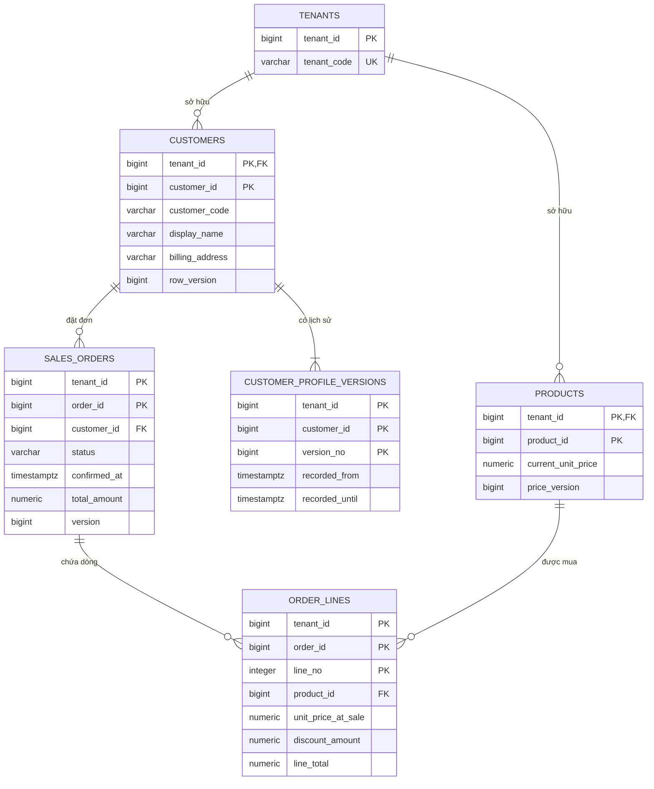
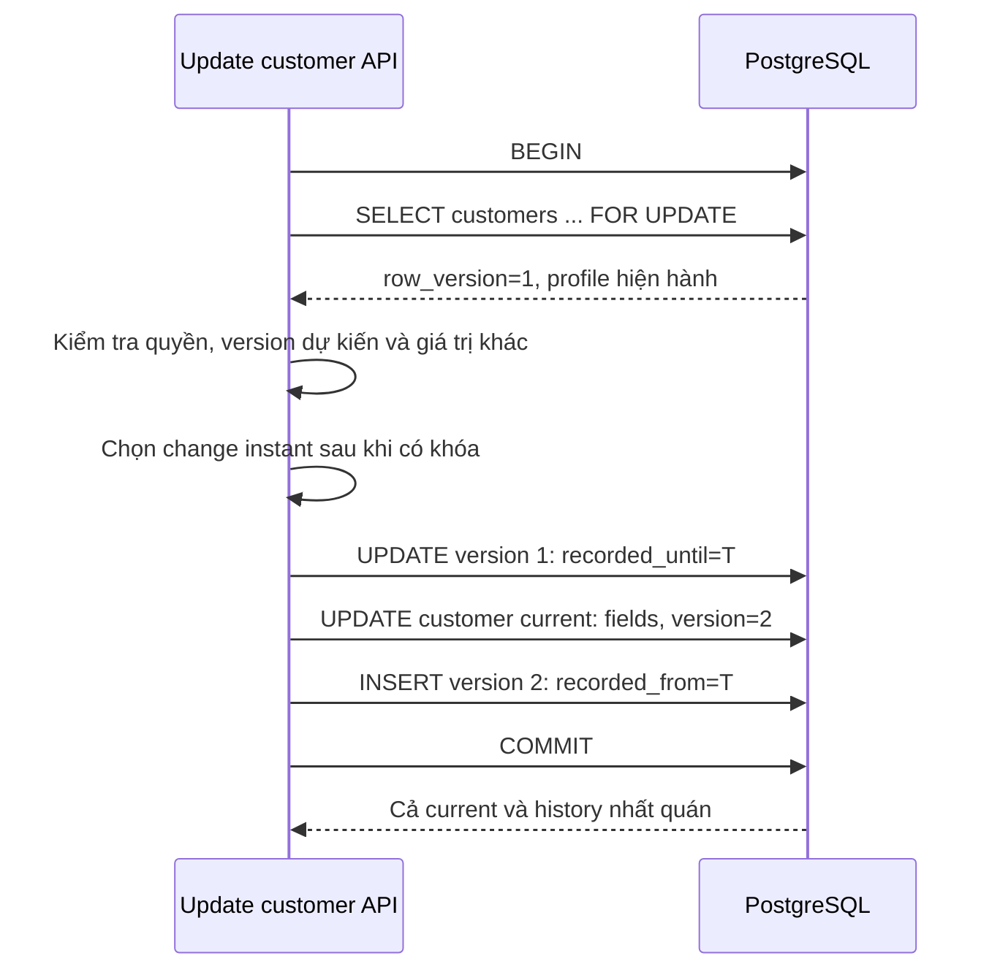

# Lưu giá bán tại giao dịch và lịch sử thay đổi thông tin khách hàng

Một cửa hàng bán tai nghe với giá niêm yết **120,00 USD**. Khách hàng Nguyễn An mua **2 chiếc**, được giảm tổng cộng **10,00 USD** trên dòng hàng; đơn xác nhận có giá trị **230,00 USD**. Hôm sau cửa hàng tăng giá niêm yết lên **135,00 USD**, đồng thời Nguyễn An đổi tên hiển thị và địa chỉ liên hệ. Khi nhân viên mở đơn cũ, hệ thống phải trả lời hai câu hỏi khác nhau:

1. **Khách đã mua với giá nào và thông tin người nhận nào được dùng khi xác nhận giao dịch?** Kết quả phải giữ nguyên theo chứng từ đã chốt: đơn giá 120,00 USD, tổng 230,00 USD và địa chỉ tại thời điểm xác nhận.
2. **Thông tin khách hàng hiện tại là gì, và hồ sơ đó đã thay đổi như thế nào theo thời gian?** Kết quả phải hiển thị hồ sơ mới, đồng thời có khả năng tra cứu những phiên bản cũ trong phạm vi chính sách lưu giữ.

Nếu `order_lines` chỉ lưu `product_id` rồi lấy `products.current_price` để tính tiền mỗi lần đọc, đơn cũ sẽ biến thành **260,00 USD** (2 × 135 − 10) dù không có giao dịch mới. Nếu `sales_orders` chỉ lưu `customer_id` rồi join hồ sơ hiện tại cho phần địa chỉ trên chứng từ, đơn cũ có thể hiển thị **địa chỉ mới** thay vì địa chỉ đã dùng. Ngược lại, sao chép toàn bộ hồ sơ khách vào từng đơn mà không có hồ sơ gốc và lịch sử thay đổi khiến việc quản lý dữ liệu khách hàng trở nên phân mảnh.

Đây là bài **thực hành tổng hợp** thuộc module **DATABASE_DATA_MODELING**: chuyển yêu cầu thành **thực thể, grain, khóa, quan hệ, ràng buộc, chuẩn hóa, snapshot lịch sử, phiên bản theo thời gian và lược đồ vật lý**, sau đó kiểm chứng bằng SQL, transaction, test đồng thời, quyền truy cập và truy vấn báo cáo. Bài tập cố ý kết hợp hai cơ chế khác nhau:

- **Transaction snapshot** lưu dữ kiện đã cam kết tại giao dịch, đặc biệt đơn giá, chiết khấu, tên sản phẩm và thông tin thanh toán/giao nhận được sử dụng.
- **Versioned customer profile** lưu hồ sơ khách hiện tại và các phiên bản đã ghi nhận, cho phép tra cứu “hệ thống biết thông tin nào tại thời điểm T?”.

> **Phạm vi và giả định:** Ví dụ dùng PostgreSQL, mô hình SaaS nhiều tenant, tiền tệ duy nhất **USD**, lượng hàng tính theo chiếc, hai chữ số thập phân, không triển khai thuế, phí vận chuyển, hoàn tiền, tỷ giá hoặc kế toán pháp lý. Các nghiệp vụ đó phải có quy tắc riêng khi mở rộng. Thời gian phiên bản hồ sơ ở đây là **recorded time** (lúc hệ thống ghi nhận thay đổi), không phải dữ kiện “đúng ngoài đời từ ngày nào” được suy đoán hồi tố. Thông tin cá nhân phải tuân chính sách bảo vệ và retention của hệ thống thực tế.

## 1. Kết quả học tập và sản phẩm cần bàn giao

Sau bài này, người học cần có thể:

1. Phân biệt **giá bán ở giao dịch** với **giá niêm yết hiện tại**, không để báo cáo lịch sử bị trôi khi catalog đổi.
2. Phân biệt **snapshot trên chứng từ** với **hồ sơ khách hàng có phiên bản**: hai cơ chế có câu hỏi và vòng đời khác nhau.
3. Chốt grain của tenant, customer, customer profile version, product, order và order line.
4. Vẽ ERD, chọn khóa theo tenant, FK cùng tenant, unique mã nghiệp vụ, kiểu dữ liệu tiền và timestamp.
5. Thiết kế transaction tạo customer và cập nhật hồ sơ sao cho phiên bản cũ đóng đúng thời điểm, phiên bản mới được mở; không tạo lịch sử trùng hoặc chồng lấn.
6. Thiết kế checkout lưu giá/tên sản phẩm cùng thông tin khách được chấp nhận **trong giao dịch nguyên tử**, không lấy lại từ bản ghi hiện tại khi đọc lịch sử.
7. Viết query cho **hồ sơ hiện tại**, **hồ sơ as-of thời điểm T**, **đơn tại lúc chốt** và **giá trị giao dịch theo ngày**.
8. Kiểm thử ghi đồng thời, cập nhật thất bại, sự kiện đến muộn, bản ghi đến từ tenant khác và chính sách dữ liệu cá nhân.
9. Nhận biết lúc nào cần **price history**, **customer SCD Type 2**, **bitemporal history**, **event sourcing**, bảng document hoặc kho phân tích.
10. Lập kế hoạch migration từ mô hình chỉ có dữ liệu hiện tại mà **không tự bịa lịch sử chưa từng được ghi**.

**Sản phẩm đầu ra của bài tập:** sơ đồ logic, DDL PostgreSQL có ràng buộc, mô tả transaction, ít nhất bốn truy vấn đọc, ma trận kiểm thử ALLOW/DENY, kết quả đối soát, và một bản ghi quyết định nêu rõ thời điểm snapshot cùng giả định về retention.

## 2. Làm rõ yêu cầu nghiệp vụ trước khi viết bảng

Giả sử ứng dụng phục vụ tenant 101 là cửa hàng A và tenant 202 là cửa hàng B. Cả hai có thể dùng cùng mã `CUS-001` và `SKU-17` vì mã chỉ duy nhất **trong một tenant**.

| Mã | Yêu cầu | Bất biến cần chứng minh |
|---|---|---|
| R01 | Một khách thuộc một tenant, có ID ổn định dù đổi tên/địa chỉ | PK và FK có tenant scope |
| R02 | Một mã khách chỉ unique trong tenant | `UNIQUE(tenant_id, customer_code)` |
| R03 | Hồ sơ khách có phiên bản theo thời gian ghi nhận | Mỗi version có identity và khoảng hiệu lực |
| R04 | Có đúng một phiên bản hiện hành cho một khách đang được quản lý | Unique version hiện hành + write protocol |
| R05 | Khoảng thời gian của các version không chồng nhau | Exclusion constraint hoặc cơ chế tương đương |
| R06 | Giá niêm yết có thể thay đổi mà không sửa dòng đơn đã xác nhận | Snapshot trên `order_lines` |
| R07 | Tổng đơn bằng tổng giá trị các dòng tại lúc chốt | Transaction + tính lại + đối soát |
| R08 | Tên/địa chỉ dùng trên chứng từ không đổi khi hồ sơ CRM đổi | Snapshot trên `sales_orders` |
| R09 | Sau khi CONFIRMED, không được âm thầm sửa snapshot giao dịch | Quyền/lệnh chuyển trạng thái/trigger |
| R10 | Hai request cập nhật hồ sơ không được mất version của nhau | Row lock + version check |
| R11 | Customer/Order/Product không tham chiếu chéo tenant | Composite FK |
| R12 | Tra cứu “as-of T” có ngữ nghĩa thời gian và timezone nhất quán | Khoảng nửa mở, timestamp và query |
| R13 | Truy vấn dữ liệu cá nhân và lịch sử có phân quyền, audit và retention | Authorization + bảo vệ PII |

### 2.1. Ba câu hỏi cần chốt với nghiệp vụ

**Giá được chốt khi nào?** Giá có thể được hiển thị khi thêm vào giỏ, nhưng giao dịch thực tế xác nhận sau đó. Trong bài này, service có thể lưu **giá dự kiến** cho đơn nháp; tại bước xác nhận, nó phải đối chiếu giá/ưu đãi còn hiệu lực và có sự chấp thuận của khách. **Giá được chấp nhận và lưu trong dòng tại lúc CONFIRMED** là chứng cứ giao dịch. Nếu giá đã thay đổi, phải yêu cầu khách xác nhận lại hoặc áp hợp đồng giữ giá/quote còn hạn, không âm thầm áp giá mới.

**“Thông tin khách hàng tại giao dịch” là thông tin nào?** Trong bài: tên hiển thị và địa chỉ thanh toán **được dùng ở thời điểm xác nhận**. Nếu khách nhập địa chỉ thanh toán khác hồ sơ mặc định, order phải lưu đúng địa chỉ khách đã chọn, không nhất thiết cập nhật profile. Do đó snapshot chứng từ có thể **khác** giá trị trong customer profile cùng thời điểm.

**“Lịch sử khách hàng” nghĩa là lịch sử ghi nhận hay hiệu lực nghiệp vụ?** Ở đây lưu **hệ thống ghi nhận tên/địa chỉ nào trong từng khoảng thời gian**. Nếu khách hôm nay nói “địa chỉ này đã có hiệu lực từ tháng trước”, hệ thống không tự viết lại lịch sử recorded-time; có thể cần bitemporal model để lưu cả thời gian hiệu lực ngoài đời và thời gian hệ thống biết.

### 2.2. Hai câu hỏi đọc phải có hai nguồn dữ liệu

| Câu hỏi | Dữ liệu chính cần dùng | Không nên làm |
|---|---|---|
| Đơn 9001 bán giá nào? | `order_lines.unit_price_at_sale` | Join `products.current_price` rồi tính lại |
| Tên sản phẩm khi bán là gì? | `order_lines.product_name_at_sale` | Hiển thị tên catalog hiện tại như lịch sử |
| Địa chỉ trên đơn 9001 là gì? | `sales_orders.billing_address_at_sale` | Join `customers.current_address` để thay chứng từ |
| Tên/địa chỉ khách hiện nay? | `customers` | Dùng snapshot của một đơn bất kỳ |
| Hệ thống ghi nhận hồ sơ nào tại T? | `customer_profile_versions` | Chỉ xem bản current |
| Ai đã thay đổi hồ sơ? | Version metadata/audit | Suy từ `customers.updated_at` duy nhất |
| Giá catalog ở T? | Price history/quote history **nếu có** | Suy từ một order làm giá niêm yết |

## 3. Phân biệt bốn loại thời gian trong ví dụ

Giả sử:

```text
2026-11-18 08:00 UTC — Hệ thống ghi nhận profile khách:
                          Nguyễn An, "12 Đường Hoa".
2026-11-19 09:00 UTC — Khách xác nhận đơn 9001:
                          2 sản phẩm giá 120.00, giảm 10.00,
                          địa chỉ thanh toán "12 Đường Hoa".
2026-11-20 10:00 UTC — Catalog đổi giá 120.00 -> 135.00.
2026-11-20 11:00 UTC — Khách đổi tên hiển thị và địa chỉ:
                          An Nguyễn, "20 Đường Hoa".
2026-11-21 08:00 UTC — Nhân viên mở đơn cũ và hồ sơ hiện tại.
```

Một thiết kế đúng phải trả:

- Order 9001: giá đơn vị `120.00`, lượng `2`, giảm `10.00`, tổng `230.00`, tên/địa chỉ snapshot đã chốt.
- Catalog hiện tại: `135.00` (không sửa lại dòng 9001).
- Customer hiện tại: `An Nguyễn`, `20 Đường Hoa`.
- Customer as-of `2026-11-19 09:00 UTC`: `Nguyễn An`, `12 Đường Hoa` theo lịch sử đã ghi.
- Customer as-of `2026-11-20 12:00 UTC`: `An Nguyễn`, `20 Đường Hoa`.

### 3.1. Timestamp nào ghi điều gì?

| Trường | Nghĩa | Cách dùng |
|---|---|---|
| `sales_orders.created_at` | Lúc tạo đơn/draft | Sắp xếp đơn và đo funnel |
| `sales_orders.confirmed_at` | Lúc xác nhận giao dịch | Ngày giao dịch trong phạm vi bài |
| `products.updated_at` | Lúc cập nhật bản catalog | Quan sát thay đổi, không thay order snapshot |
| `customers.updated_at` | Lúc ghi thay đổi profile hiện tại | Cho biết lần cập nhật mới nhất |
| `customer_profile_versions.recorded_from` | Từ lúc hệ thống ghi nhận version | Truy vấn as-of recorded-time |
| `customer_profile_versions.recorded_until` | Trước thời điểm nào version thôi hiện hành | Kết thúc khoảng nửa mở |
| `customer_profile_versions.version_no` | Thứ tự logic của version mỗi customer | Chống mất cập nhật, audit |

Dùng `TIMESTAMPTZ` để biểu diễn instant. Ngày theo giờ Việt Nam, New York hay tenant-configured timezone phải được chuyển đổi **khi báo cáo**. Không so sánh ngày dạng chuỗi hoặc coi timezone của server là định nghĩa ngày nghiệp vụ.

### 3.2. Khoảng nửa mở và trạng thái hiện hành

Một version có hiệu lực recorded-time:

```text
[recorded_from, recorded_until)
```

Nếu `recorded_until IS NULL`, khoảng kéo dài tới tương lai. Tại đúng thời điểm chuyển version `T1`, version cũ **không** còn hiệu lực (vì `T < recorded_until`), và version mới bắt đầu có hiệu lực (vì `recorded_from <= T`). Cách này ngăn một thời điểm biên thuộc cả hai version.

Đừng trộn `recorded_from` với `valid_from` nếu người dùng muốn backdate hiệu lực thực. Hai mốc trả lời hai câu hỏi khác nhau.

## 4. Domain model, grain, định danh và liên kết

### 4.1. ERD logic



### 4.2. Bảng grain

| Bảng | Một hàng biểu diễn | Khóa |
|---|---|---|
| `tenants` | Một tổ chức dùng nền tảng | `tenant_id` |
| `customers` | Hồ sơ hiện tại của một khách trong tenant | `(tenant_id, customer_id)` |
| `customer_profile_versions` | Một **phiên bản ghi nhận** của một customer | `(tenant_id, customer_id, version_no)` |
| `products` | Sản phẩm catalog hiện tại của một tenant | `(tenant_id, product_id)` |
| `sales_orders` | Một đơn trong tenant, trạng thái hiện tại và snapshot chứng từ | `(tenant_id, order_id)` |
| `order_lines` | Một dòng thuộc một order, giá/tên lúc bán | `(tenant_id, order_id, line_no)` |

**Đơn hàng không phải là một phiên bản của customer.** Một customer có thể đặt nhiều đơn khi hồ sơ không đổi; một đơn có thể lấy địa chỉ thanh toán đã được chọn khác profile. Vì vậy **order snapshot** và **customer history** có grain và mục đích riêng.

### 4.3. Phụ thuộc hàm và lý do chuẩn hóa

```text
(tenant_id, customer_id)
   -> customer_code, current_name, current_address, row_version

(tenant_id, customer_id, version_no)
   -> recorded_from, recorded_until, name_at_version, address_at_version

(tenant_id, product_id)
   -> sku, current_price, price_version

(tenant_id, order_id)
   -> customer_id, status, confirmed_at,
      customer_name_at_sale, billing_address_at_sale, total_amount

(tenant_id, order_id, line_no)
   -> product_id, quantity, unit_price_at_sale,
      discount_amount, line_total
```

Không sao chép mỗi lần sửa customer thành một customer ID mới; làm vậy sẽ phá quan hệ đơn lịch sử. Không sửa mọi dòng đơn khi giá catalog thay đổi; mỗi line đã có **giá tại giao dịch**.

## 5. Chọn đúng giữa snapshot, lịch sử phiên bản và event log

| Cách lưu | Câu hỏi giải quyết tốt | Giới hạn |
|---|---|---|
| Chỉ lưu FK tới bảng hiện tại | Tham chiếu thực thể hiện giờ | Không giữ giá/tên tại giao dịch |
| Snapshot trong order/line | “Giao dịch này chốt dữ kiện nào?” | Không tự tạo lịch sử mọi thay đổi profile/catalog |
| Bảng version SCD Type 2 | “Hệ thống ghi nhận giá trị nào tại T?” | Phải định nghĩa thời gian, loại thay đổi và update protocol |
| Append-only domain events | “Những sự kiện gì dẫn tới trạng thái?” | Replay, thứ tự, event schema và correction phức tạp |
| Bitemporal model | “Thông tin đúng từ khi nào, và hệ thống biết từ khi nào?” | Hai trục thời gian, backdating/correction phức tạp |
| Data warehouse SCD2 dimension | Phân tích theo phiên bản dimension | Độ trễ ETL và FK surrogate khác OLTP |

### 5.1. Tại sao cần **cả** snapshot order và history customer?

Nếu chỉ lưu customer history, nhân viên có thể cố tìm version profile tại `confirmed_at`. Nhưng khách có thể chọn địa chỉ thanh toán khác hồ sơ hoặc hệ thống sửa hồi tố profile; ngoài ra một số thông tin trên chứng từ là **quyết định chấp thuận của giao dịch**, không phải thuộc tính định danh khách ở thời điểm đó. Vì vậy **order snapshot là nguồn dữ liệu được dùng cho chứng từ**.

Nếu chỉ lưu snapshot trên từng đơn, ứng dụng không biết lịch sử hồ sơ khách **giữa các lần mua** hoặc các lần sửa không tạo đơn. Vì vậy **profile version history** phục vụ audit/as-of customer data.

### 5.2. Giá catalog theo thời gian là một bài toán bổ sung

Giả sử cửa hàng cần giải thích “tại sao tuần trước catalog niêm yết 120 USD?”, không thể suy từ `order_lines.unit_price_at_sale` của một đơn: đơn giá thực bán có thể gồm voucher, giá hợp đồng hoặc quote riêng. Muốn tra cứu **niêm yết ở thời điểm T**, nên có `product_price_versions`/price list lịch sử với time semantics riêng.

Không gộp một bảng `prices` chứa lẫn **giá niêm yết**, **giá được chào**, **giá đã chốt** khi ba khái niệm có rule khác nhau. Trong bài này, `products.current_unit_price` là catalog hiện hành; giá giao dịch nằm trên order line.

## 6. Lược đồ PostgreSQL: hồ sơ hiện tại, lịch sử và chứng từ

Dưới đây là **một mô hình cụ thể cho bài tập**, không phải bộ migration production hoàn chỉnh. Các khóa ID được cung cấp từ ứng dụng/test fixture; ở hệ thống thật cần cơ chế cấp ID an toàn. Bảng `customer_profile_versions` là lịch sử **recorded-time**, không tự hỗ trợ correction hồi tố.

### 6.1. Tenant, hồ sơ khách và sản phẩm hiện tại

```sql
CREATE TABLE tenants (
    tenant_id BIGINT PRIMARY KEY,
    tenant_code VARCHAR(80) NOT NULL UNIQUE
);

CREATE TABLE customers (
    tenant_id BIGINT NOT NULL REFERENCES tenants(tenant_id),
    customer_id BIGINT NOT NULL,
    customer_code VARCHAR(64) NOT NULL,
    display_name VARCHAR(200) NOT NULL,
    billing_address VARCHAR(300) NOT NULL,
    contact_email VARCHAR(254),
    row_version BIGINT NOT NULL DEFAULT 1
        CHECK (row_version >= 1),
    updated_at TIMESTAMPTZ NOT NULL,
    PRIMARY KEY (tenant_id, customer_id),
    CONSTRAINT uq_customer_code_tenant
        UNIQUE (tenant_id, customer_code)
);

CREATE TABLE products (
    tenant_id BIGINT NOT NULL REFERENCES tenants(tenant_id),
    product_id BIGINT NOT NULL,
    sku VARCHAR(80) NOT NULL,
    product_name VARCHAR(200) NOT NULL,
    current_unit_price NUMERIC(19, 2) NOT NULL
        CHECK (current_unit_price >= 0),
    price_version BIGINT NOT NULL DEFAULT 1
        CHECK (price_version >= 1),
    is_active BOOLEAN NOT NULL DEFAULT TRUE,
    updated_at TIMESTAMPTZ NOT NULL,
    PRIMARY KEY (tenant_id, product_id),
    CONSTRAINT uq_product_sku_tenant
        UNIQUE (tenant_id, sku)
);
```

`customers` biểu diễn **giá trị hiện hành** để thao tác CRM nhanh. `row_version` tăng mỗi lần thay đổi profile có ý nghĩa; không bắt buộc tăng khi cập nhật một chỉ số kỹ thuật không thuộc profile, nếu hợp đồng đã nêu. `products.current_unit_price` là giá catalog **hiện tại**, không phải giá bán lịch sử.

### 6.2. Lịch sử customer kiểu SCD Type 2 tại OLTP

```sql
CREATE TABLE customer_profile_versions (
    tenant_id BIGINT NOT NULL,
    customer_id BIGINT NOT NULL,
    version_no BIGINT NOT NULL CHECK (version_no >= 1),
    display_name VARCHAR(200) NOT NULL,
    billing_address VARCHAR(300) NOT NULL,
    contact_email VARCHAR(254),
    recorded_from TIMESTAMPTZ NOT NULL,
    recorded_until TIMESTAMPTZ,
    changed_by VARCHAR(120) NOT NULL,
    change_reason VARCHAR(240),
    PRIMARY KEY (tenant_id, customer_id, version_no),
    CONSTRAINT fk_profile_customer_same_tenant
        FOREIGN KEY (tenant_id, customer_id)
        REFERENCES customers(tenant_id, customer_id),
    CONSTRAINT ck_profile_nonempty_interval
        CHECK (
            recorded_until IS NULL
            OR recorded_until > recorded_from
        )
);

-- Tối đa một phiên bản đang mở cho một customer.
CREATE UNIQUE INDEX uq_one_open_customer_profile
ON customer_profile_versions(tenant_id, customer_id)
WHERE recorded_until IS NULL;

-- Hỗ trợ truy vấn as-of và liệt kê lịch sử.
CREATE INDEX idx_customer_profile_asof
ON customer_profile_versions(
    tenant_id, customer_id, recorded_from DESC
);

-- PostgreSQL: btree_gist hỗ trợ toán tử '=' cho BIGINT trong GiST.
-- Cần quyền tạo extension hoặc chuẩn bị trước bởi DBA.
CREATE EXTENSION IF NOT EXISTS btree_gist;

ALTER TABLE customer_profile_versions
ADD CONSTRAINT ex_customer_profile_no_overlap
EXCLUDE USING gist (
    tenant_id WITH =,
    customer_id WITH =,
    tstzrange(
        recorded_from,
        COALESCE(
            recorded_until, 'infinity'::TIMESTAMPTZ
        ),
        '[)'
    ) WITH &&
);
```

**Ý nghĩa các ràng buộc:**

- PK `(tenant_id, customer_id, version_no)` giữ identity phiên bản; cùng `customer_id` ở tenant khác là customer khác.
- FK ghép chặn history trỏ sang customer của tenant khác.
- `CHECK` ngăn khoảng có điểm kết thúc không lớn hơn điểm bắt đầu.
- Partial unique index bảo đảm **tối đa một** phiên bản mở, không phải **ít nhất một**.
- GiST exclusion constraint ngăn **hai khoảng version chồng lấn** cho cùng tenant/customer, kể cả khi cả hai khoảng đã đóng.

Những constraint này **không tự bảo đảm các khoảng không có lỗ hổng** hay `customers.row_version` luôn đúng version hiện hành. Đó là invariant đa hàng phải được cưỡng chế qua giao thức ghi, stored procedure/trigger hoặc một mô hình nhất quán khác. Nếu không được cấp quyền cài `btree_gist` hoặc DB không hỗ trợ exclusion, phải thiết kế phương án kiểm soát overlap và concurrency tương đương; không nói rằng partial unique index thay thế hoàn toàn GiST exclusion.

### 6.3. Đơn hàng và giá bán snapshot

```sql
CREATE TABLE sales_orders (
    tenant_id BIGINT NOT NULL REFERENCES tenants(tenant_id),
    order_id BIGINT NOT NULL,
    order_code VARCHAR(64) NOT NULL,
    customer_id BIGINT NOT NULL,
    status VARCHAR(16) NOT NULL
        CHECK (status IN ('DRAFT', 'CONFIRMED', 'CANCELLED')),
    customer_name_at_sale VARCHAR(200),
    billing_address_at_sale VARCHAR(300),
    customer_version_at_sale BIGINT,
    currency_code CHAR(3) NOT NULL DEFAULT 'USD'
        CHECK (currency_code = 'USD'),
    total_amount NUMERIC(19, 2) NOT NULL DEFAULT 0
        CHECK (total_amount >= 0),
    order_version BIGINT NOT NULL DEFAULT 0
        CHECK (order_version >= 0),
    created_at TIMESTAMPTZ NOT NULL DEFAULT CURRENT_TIMESTAMP,
    confirmed_at TIMESTAMPTZ,
    PRIMARY KEY (tenant_id, order_id),
    CONSTRAINT uq_order_code_tenant
        UNIQUE (tenant_id, order_code),
    CONSTRAINT fk_order_customer_same_tenant
        FOREIGN KEY (tenant_id, customer_id)
        REFERENCES customers(tenant_id, customer_id),
    CONSTRAINT fk_order_customer_version
        FOREIGN KEY (
            tenant_id, customer_id,
            customer_version_at_sale
        ) REFERENCES customer_profile_versions(
            tenant_id, customer_id, version_no
        ),
    CONSTRAINT ck_confirmed_has_snapshot
        CHECK (
            status <> 'CONFIRMED'
            OR (
                confirmed_at IS NOT NULL
                AND customer_name_at_sale IS NOT NULL
                AND billing_address_at_sale IS NOT NULL
                AND customer_version_at_sale IS NOT NULL
            )
        )
);

CREATE TABLE order_lines (
    tenant_id BIGINT NOT NULL,
    order_id BIGINT NOT NULL,
    line_no INTEGER NOT NULL CHECK (line_no > 0),
    product_id BIGINT NOT NULL,
    product_name_at_sale VARCHAR(200) NOT NULL,
    quantity INTEGER NOT NULL CHECK (quantity > 0),
    unit_price_at_sale NUMERIC(19, 2) NOT NULL
        CHECK (unit_price_at_sale >= 0),
    catalog_price_version_at_sale BIGINT NOT NULL
        CHECK (catalog_price_version_at_sale >= 1),
    discount_amount NUMERIC(19, 2) NOT NULL DEFAULT 0
        CHECK (discount_amount >= 0),
    line_total NUMERIC(19, 2) GENERATED ALWAYS AS (
        quantity * unit_price_at_sale - discount_amount
    ) STORED,
    PRIMARY KEY (tenant_id, order_id, line_no),
    CONSTRAINT fk_line_order_same_tenant
        FOREIGN KEY (tenant_id, order_id)
        REFERENCES sales_orders(tenant_id, order_id),
    CONSTRAINT fk_line_product_same_tenant
        FOREIGN KEY (tenant_id, product_id)
        REFERENCES products(tenant_id, product_id),
    CONSTRAINT ck_discount_within_gross
        CHECK (
            discount_amount
            <= quantity * unit_price_at_sale
        )
);

CREATE INDEX idx_orders_tenant_confirmed
ON sales_orders(
    tenant_id, confirmed_at DESC, order_id DESC
);

CREATE INDEX idx_orders_tenant_customer
ON sales_orders(
    tenant_id, customer_id, confirmed_at DESC
);

CREATE INDEX idx_lines_tenant_product
ON order_lines(tenant_id, product_id);
```

**Lựa chọn quan trọng:**

1. `customer_name_at_sale` và `billing_address_at_sale` được điền **lúc confirm**, không tự thay khi `customers` đổi. Chúng nullable cho DRAFT, bắt buộc khi `status='CONFIRMED'`. Nếu CANCELLED từ một đơn đã chốt, service phải **giữ snapshot**; constraint trong ví dụ chưa phân biệt “hủy nháp” và “hủy sau xác nhận”.
2. `customer_version_at_sale` tham chiếu một version của đúng customer/tenant để tăng khả năng truy vết. Tên/địa chỉ snapshot **vẫn là nguồn chứng từ** ngay cả khi sau này có correction/anonymization ở history. FK version cũng có nghĩa **không thể tùy tiện xóa history** còn được đơn tham chiếu; vòng đời xóa/ẩn danh phải được thiết kế cùng nghĩa vụ retention.
3. `catalog_price_version_at_sale` ghi version catalog đã được dùng nhưng **không FK** vào `products.price_version` hiện tại, vì giá catalog về sau sẽ tăng version. Nếu muốn bảo đảm lineage tới một bản giá lịch sử, phải tạo bảng `product_price_versions` với PK phù hợp hoặc quote ID riêng.
4. `line_total` được tính từ những cột **cùng một dòng**, dùng generated column. `sales_orders.total_amount` là aggregate nhiều dòng, vì thế không tự được `CHECK` của một hàng bảo vệ; cần transaction và đối soát.
5. `NUMERIC(19,2)` dùng cho tiền USD theo giả định. Nếu bán số lượng phân số, tax, đơn vị khác hoặc đa tiền tệ, công thức, độ chính xác, currency và rounding policy cần được xác định lại.
6. DDL không cấm SQL trực tiếp sửa dòng sau confirm. Cơ chế đó cần lệnh ghi có kiểm soát, role DB phù hợp và/hoặc trigger/stored procedure.

### 6.4. Một số constraint không thể được tạo bằng một `CHECK` đơn giản

| Invariant | Constraint có thể làm? | Hướng xử lý |
|---|---|---|
| `line_total` = quantity × giá − giảm | Có, generated same-row | DDL |
| Giá bán của order cũ không đổi khi Product update | Có nếu dữ liệu snapshot đã được ghi và không sửa | Lệnh ghi + quyền/triggers |
| Tổng order khớp mọi dòng | Không bằng CHECK thuần cùng hàng | Transaction/trigger + reconcile |
| CONFIRMED có ít nhất một line | Không bằng CHECK thuần cùng hàng | Transition validation/trigger |
| Một phiên bản profile còn mở tối đa | Có, partial unique | DDL |
| Các khoảng profile không chồng | Có trong PostgreSQL với GiST exclusion | DDL + index |
| Không có khoảng profile bị hở | Không tự được FK/unique kiểm tra | Giao thức ghi hoặc validation |
| Phiên bản hiện tại = `customers.row_version` | Không tự được FK hiện tại bảo đảm | Transaction/trigger |
| Bản thanh toán dùng đúng địa chỉ được khách chấp nhận | Cần nguồn tin cậy và quy trình checkout | Business command/audit |
| Khách của tenant A không được xem data tenant B | Không chỉ bằng PK/FK | Authorization, RLS, kiểm thử |

**Bảng nào cũng cần có lý do tồn tại.** Lược đồ có thêm lịch sử customer vì nó có grain và nhu cầu truy vấn riêng; không tạo một bảng `order_price_history` chỉ vì order line đã lưu unit price nếu nghiệp vụ không cho sửa giá sau confirm.

## 7. Dựng dữ liệu thử có hai tenant và mốc thời gian cố định

Để kết quả có thể lặp lại, phần thực hành dùng **thời điểm giả lập** 18–20/11/2026 theo UTC. Trong production, `recorded_from` và `confirmed_at` phải được gán bằng thời điểm có thẩm quyền **sau các bước khóa/kiểm tra** trong transaction; không cho client tùy ý ghi lịch sử ngược thời gian. Các `INSERT` dưới đây chỉ là **test fixture**, giả sử các bảng còn rỗng.

### 7.1. Seed hai doanh nghiệp, customer và catalog

```sql
BEGIN;

INSERT INTO tenants (tenant_id, tenant_code)
VALUES (101, 'SHOP_A'), (202, 'SHOP_B');

INSERT INTO customers (
    tenant_id, customer_id, customer_code,
    display_name, billing_address, contact_email,
    row_version, updated_at
)
VALUES
    (
        101, 7, 'CUS-001',
        'Nguyễn An', '12 Đường Hoa', 'an@example.test',
        1, TIMESTAMPTZ '2026-11-18 08:00:00+00'
    ),
    (
        202, 7, 'CUS-001',
        'Khách B', '80 Đường Sông', NULL,
        1, TIMESTAMPTZ '2026-11-18 08:00:00+00'
    );

INSERT INTO customer_profile_versions (
    tenant_id, customer_id, version_no,
    display_name, billing_address, contact_email,
    recorded_from, recorded_until,
    changed_by, change_reason
)
VALUES
    (
        101, 7, 1,
        'Nguyễn An', '12 Đường Hoa', 'an@example.test',
        TIMESTAMPTZ '2026-11-18 08:00:00+00', NULL,
        'system:onboarding', 'Hồ sơ ban đầu'
    ),
    (
        202, 7, 1,
        'Khách B', '80 Đường Sông', NULL,
        TIMESTAMPTZ '2026-11-18 08:00:00+00', NULL,
        'system:onboarding', 'Hồ sơ ban đầu'
    );

INSERT INTO products (
    tenant_id, product_id, sku, product_name,
    current_unit_price, price_version,
    is_active, updated_at
)
VALUES
    (
        101, 17, 'SKU-17', 'Tai nghe Mẫu A',
        120.00, 1, TRUE,
        TIMESTAMPTZ '2026-11-18 08:00:00+00'
    ),
    (
        202, 17, 'SKU-17', 'Tai nghe Mẫu B',
        40.00, 1, TRUE,
        TIMESTAMPTZ '2026-11-18 08:00:00+00'
    );

COMMIT;
```

Mã `CUS-001`, `SKU-17` và ID `7`/`17` lặp lại ở hai tenant **hợp lệ** vì khóa được scoped. Nếu FK chỉ dùng `customer_id` hoặc `product_id` mà không có tenant, việc tham chiếu sẽ mơ hồ hoặc có thể trỏ sai thực thể.

### 7.2. Kiểm tra bất biến sau seed

```sql
SELECT c.tenant_id, c.customer_id, c.display_name,
       c.row_version, v.version_no,
       v.recorded_from, v.recorded_until
FROM customers AS c
JOIN customer_profile_versions AS v
  ON v.tenant_id = c.tenant_id
 AND v.customer_id = c.customer_id
 AND v.recorded_until IS NULL
ORDER BY c.tenant_id, c.customer_id;
```

Kỳ vọng **hai** hàng: customer 7 của tenant 101 và customer 7 của tenant 202, mỗi người có `row_version=1`, `version_no=1`, một history mở.

### 7.3. Một bài test sai khóa

```sql
-- KHÔNG chạy chung transaction với các negative tests khác.
INSERT INTO sales_orders (
    tenant_id, order_id, order_code, customer_id, status
)
VALUES (101, 9999, 'ORDER-INVALID', 999, 'DRAFT');
-- Kỳ vọng: lỗi fk_order_customer_same_tenant.
```

Muốn thử **tham chiếu chéo tenant** một cách thuyết phục, thêm customer `(202, 999)` nhưng không có `(101, 999)`, sau đó chạy insert order tenant 101 như trên. FK ghép phải từ chối dù customer ID 999 có tồn tại ở tenant 202.

Chạy mỗi test dự kiến lỗi trong transaction riêng hoặc test harness có rollback/savepoint. PostgreSQL giữ transaction ở trạng thái aborted sau lỗi SQL cho đến rollback.

## 8. Tạo hồ sơ mới phải mở history trong cùng transaction

Trong production, không nên cho một endpoint chèn vào `customers` mà quên tạo history ban đầu. Cả hai hàng phải được tạo **nguyên tử**:

```sql
BEGIN;

-- :created_at là instant do server chọn trong transaction.
INSERT INTO customers (
    tenant_id, customer_id, customer_code,
    display_name, billing_address, contact_email,
    row_version, updated_at
)
VALUES (
    :tenant_id, :customer_id, :customer_code,
    :display_name, :billing_address, :contact_email,
    1, :created_at
);

INSERT INTO customer_profile_versions (
    tenant_id, customer_id, version_no,
    display_name, billing_address, contact_email,
    recorded_from, recorded_until,
    changed_by, change_reason
)
VALUES (
    :tenant_id, :customer_id, 1,
    :display_name, :billing_address, :contact_email,
    :created_at, NULL,
    :actor, 'Initial profile'
);

COMMIT;
```

**Điều kiện để gọi transaction thành công:** hai insert thực hiện cùng một kết nối/giao dịch; unique customer code không bị vi phạm; actor được cấp quyền trong tenant; các giá trị có nguồn tin cậy và vượt validation nghiệp vụ. Nếu insert history thất bại, phải rollback customer; đừng commit hồ sơ hiện hành mà **không có version mở**.

### 8.1. Vì sao không để history được tạo “cuối ngày”?

Nếu ứng dụng chỉ copy hồ sơ hiện tại sang lịch sử mỗi đêm, mọi thay đổi trong ngày có thể bị mất và query as-of giữa các lần copy sai. Snapshot cuối ngày có thể phù hợp cho một bài toán phân tích cụ thể, nhưng **không** phải cùng yêu cầu “ghi lại từng thay đổi profile”.

Nếu dùng outbox/CDC bất đồng bộ để cập nhật history, phải định nghĩa độ trễ và thứ tự rõ. Ví dụ bài học chọn **ghi đồng bộ cùng transaction** để có hai bảng nhất quán tại commit.

### 8.2. Validation không chỉ là NOT NULL

Ví dụ email `contact_email` có thể nullable, nhưng nếu có giá trị cần kiểm tra cú pháp ở tầng ứng dụng; `VARCHAR(254)` không tự chứng minh địa chỉ email hợp lệ hoặc người dùng sở hữu nó. `billing_address` được giữ dạng một chuỗi đơn giản cho ví dụ; hệ thống có vận chuyển quốc tế có thể cần cấu trúc địa chỉ nhiều cột hoặc value object, nhưng tránh tạo hơn một customer chỉ để lưu mỗi địa chỉ.

Không dùng email làm PK/customer identity: khách có thể đổi email, dùng chung hộp thư hoặc yêu cầu xóa/ẩn danh thông tin đó. `customer_id` là khóa ổn định; email chỉ là thuộc tính với chính sách riêng.

## 9. Cập nhật hồ sơ khách: đóng version cũ, mở version mới

Yêu cầu: lúc 20/11/2026 11:00 UTC, khách tenant 101/customer 7 đổi tên từ `Nguyễn An` thành `An Nguyễn` và địa chỉ từ `12 Đường Hoa` sang `20 Đường Hoa`. Sau commit phải có:

```text
Customer hiện tại: row_version = 2

History version 1:
  recorded_from  = 2026-11-18 08:00 UTC
  recorded_until = 2026-11-20 11:00 UTC
  name/address   = Nguyễn An / 12 Đường Hoa

History version 2:
  recorded_from  = 2026-11-20 11:00 UTC
  recorded_until = NULL
  name/address   = An Nguyễn / 20 Đường Hoa
```

### 9.1. Luồng transaction an toàn cho một customer



Mọi đường thay đổi profile phải dùng giao thức này hoặc một stored procedure/trigger tương đương. **Khóa hàng customer** tuần tự hóa hai writer cạnh tranh trên cùng hồ sơ. Client cũng gửi `expected_version` để phát hiện người dùng chỉnh sửa dựa trên dữ liệu cũ, không tự overwrite.

### 9.2. SQL minh họa cho lần đổi version 1 → 2

```sql
BEGIN;

SELECT row_version, display_name, billing_address
FROM customers
WHERE tenant_id = 101 AND customer_id = 7
FOR UPDATE;
-- Service kiểm tra có đúng một hàng, row_version=1,
-- principal có quyền cập nhật hồ sơ tenant 101.

SELECT version_no, recorded_from
FROM customer_profile_versions
WHERE tenant_id = 101
  AND customer_id = 7
  AND recorded_until IS NULL
FOR UPDATE;
-- Service kiểm tra đúng một phiên bản đang mở, version_no=1.

-- TEST FIXTURE sử dụng instant cố định cho kết quả tái lập.
-- Production: lấy clock_timestamp() SAU KHI GIỮ KHÓA,
-- bind cùng một :change_time cho cả ba lệnh;
-- kiểm tra :change_time > recorded_from hiện hành.
UPDATE customer_profile_versions
SET recorded_until = TIMESTAMPTZ '2026-11-20 11:00:00+00'
WHERE tenant_id = 101
  AND customer_id = 7
  AND version_no = 1
  AND recorded_until IS NULL
RETURNING version_no;
-- Kỳ vọng đúng một hàng.

UPDATE customers
SET display_name = 'An Nguyễn',
    billing_address = '20 Đường Hoa',
    row_version = row_version + 1,
    updated_at = TIMESTAMPTZ '2026-11-20 11:00:00+00'
WHERE tenant_id = 101
  AND customer_id = 7
  AND row_version = 1
RETURNING row_version;
-- Kỳ vọng đúng một hàng, version=2.

INSERT INTO customer_profile_versions (
    tenant_id, customer_id, version_no,
    display_name, billing_address, contact_email,
    recorded_from, recorded_until,
    changed_by, change_reason
)
VALUES (
    101, 7, 2,
    'An Nguyễn', '20 Đường Hoa', 'an@example.test',
    TIMESTAMPTZ '2026-11-20 11:00:00+00', NULL,
    'user:7', 'Cập nhật thông tin liên hệ'
);

COMMIT;
```

**Đây là tình huống thử version 1 → 2**, không phải đoạn SQL nên chạy lặp lại. Trong code thật, dùng các giá trị bind `:tenant_id`, `:customer_id`, `:expected_version`, `:change_time` và dữ liệu đã validation. Nếu bất kỳ bước nào trả sai số hàng, có giá trị không hợp lệ hoặc không thể ghi history, **rollback toàn bộ**.

### 9.3. Vì sao phải lấy thời điểm sau khi có khóa?

Trong PostgreSQL, `transaction_timestamp()`/`CURRENT_TIMESTAMP` cố định từ lúc **bắt đầu transaction**. Transaction T2 có thể bắt đầu sớm nhưng phải đợi T1 giữ khóa customer; khi T2 lấy được khóa, timestamp của T2 **có thể sớm hơn** version T1 vừa ghi. Nếu dùng trực tiếp timestamp bắt đầu làm `recorded_from`, thứ tự thời gian có thể sai và exclusion constraint từ chối hoặc tạo lỗ hổng.

Với recorded-time, sau khi có lock, hãy lấy instant hiện tại bằng `clock_timestamp()` (hoặc nguồn thời gian hệ thống được kiểm soát), bảo đảm **strictly greater** version trước. Nếu đồng hồ lùi, trùng precision hoặc không thể đảm bảo thứ tự, hệ thống cần xử lý/retry hoặc dùng **version sequence** làm thứ tự logic, không tự đưa một thời điểm sớm hơn vào khoảng lịch sử.

Một hệ thống có nhiều DB node còn cần xem xét độ lệch đồng hồ và chuẩn consistency; timestamp đơn thuần không chứng minh thứ tự toàn cục giữa mọi nguồn.

### 9.4. Không tạo version khi không có thay đổi thực

Nếu khách gửi lại đúng tên, địa chỉ và email, tạo version mới chỉ vì endpoint `PUT` được gọi có thể gây lịch sử nhiễu. Sau khi lock, so sánh các trường được theo dõi bằng ngữ nghĩa null-safe (ví dụ SQL `IS DISTINCT FROM` hoặc so sánh typed value trong application). Nếu không thay đổi, có thể trả response idempotent mà **không tăng row_version**.

Nếu nghiệp vụ yêu cầu ghi cả lần xác nhận lại thông tin không đổi, đó là **audit event** riêng, không nhất thiết là profile version mới.

## 10. Checkout: chốt giá và địa chỉ trong một transaction

Ở thời điểm **2026-11-19 09:00 UTC**, trước khi giá catalog và hồ sơ khách đổi, người mua xác nhận:

```text
tenant=101, order=9001, customer=7
product=17, quantity=2, accepted unit price=120.00
discount_amount=10.00 (cả dòng)
confirmed total=230.00 USD
billing address accepted="12 Đường Hoa"
```

Ở đây giả sử luồng checkout xác nhận một đơn mới có một dòng; đơn nháp và nhiều dòng có thể dùng giao thức khóa order cha tương tự. **Không cho client tự quyết định giá**; ứng dụng phải kiểm tra price quote hoặc giá server hiện hành được khách chấp nhận.

### 10.1. Điều kiện tiền giao dịch

1. Principal được phép tạo đơn trong tenant 101.
2. Customer `(101, 7)` tồn tại; thông tin billing được khách chấp nhận và được validation.
3. Product `(101, 17)` còn active, giá và `price_version` khớp quote hoặc chính sách giá đã chấp thuận.
4. Discount `10.00` là quyền/ưu đãi hợp lệ, không chỉ do client điền.
5. `order_id` và `order_code` chưa trùng trong tenant; nếu HTTP request retry, cần **idempotency key cho lệnh tạo đơn** để không tạo hai order khác nhau.
6. Các bảng được ghi trong cùng một transaction; lỗi ở bất kỳ bước nào làm rollback.

### 10.2. SQL checkout minh họa với một dòng

```sql
BEGIN;

INSERT INTO sales_orders (
    tenant_id, order_id, order_code,
    customer_id, status, created_at
)
VALUES (
    101, 9001, 'O-9001', 7, 'DRAFT',
    TIMESTAMPTZ '2026-11-19 09:00:00+00'
);

-- Ổn định profile trong transaction khi lấy snapshot chứng từ.
SELECT row_version, display_name, billing_address
FROM customers
WHERE tenant_id = 101 AND customer_id = 7
FOR SHARE;
-- Phải thấy version=1; yêu cầu cùng tenant đã được authorize.

-- Ổn định bản giá/catalog trong transaction.
SELECT price_version, product_name, current_unit_price
FROM products
WHERE tenant_id = 101
  AND product_id = 17
  AND is_active = TRUE
FOR SHARE;
-- Phải thấy price_version=1, price=120.00
-- và khớp báo giá/đồng ý của khách.

-- Dùng dữ liệu từ PRODUCT phía server, không lấy đơn giá từ client.
INSERT INTO order_lines (
    tenant_id, order_id, line_no, product_id,
    product_name_at_sale, quantity,
    unit_price_at_sale,
    catalog_price_version_at_sale,
    discount_amount
)
SELECT
    101, 9001, 1, p.product_id,
    p.product_name, 2,
    p.current_unit_price,
    p.price_version,
    10.00
FROM products AS p
WHERE p.tenant_id = 101
  AND p.product_id = 17
  AND p.is_active = TRUE
  AND p.price_version = 1
  AND p.current_unit_price = 120.00
RETURNING line_total;
-- Phải chèn đúng một hàng, line_total=230.00.

-- Chốt cả tên/địa chỉ customer và tổng tính từ lines.
UPDATE sales_orders AS o
SET status = 'CONFIRMED',
    confirmed_at = TIMESTAMPTZ '2026-11-19 09:00:00+00',
    customer_name_at_sale = c.display_name,
    billing_address_at_sale = c.billing_address,
    customer_version_at_sale = c.row_version,
    total_amount = (
        SELECT COALESCE(SUM(l.line_total), 0)
        FROM order_lines AS l
        WHERE l.tenant_id = o.tenant_id
          AND l.order_id = o.order_id
    ),
    order_version = order_version + 1
FROM customers AS c
WHERE c.tenant_id = o.tenant_id
  AND c.customer_id = o.customer_id
  AND o.tenant_id = 101
  AND o.order_id = 9001
  AND o.status = 'DRAFT'
  AND EXISTS (
      SELECT 1
      FROM order_lines AS l
      WHERE l.tenant_id = o.tenant_id
        AND l.order_id = o.order_id
  )
RETURNING
    o.order_id, o.status, o.total_amount,
    o.customer_name_at_sale,
    o.billing_address_at_sale,
    o.customer_version_at_sale;
-- Phải trả đúng một hàng: CONFIRMED, 230.00, Nguyễn An,
-- 12 Đường Hoa, customer version 1.

COMMIT;
```

**Mốc 09:00 và giá 120.00 chỉ dành cho fixture deterministic.** Production phải bind `:confirmed_at` do server xác định ở điểm xác nhận sau khi kiểm tra locks/giá, `:accepted_quote_version` và `:accepted_quote_price` từ một báo giá có tính toàn vẹn; nếu đã hết hạn hoặc đổi giá, trả yêu cầu xác nhận lại. Một SQL `INSERT ... SELECT` trả 0 dòng vì giá không còn khớp **không** được coi là giao dịch thành công.

### 10.3. Vì sao dùng `FOR SHARE` cho profile và Product?

Trong PostgreSQL, `SELECT ... FOR SHARE` giữ row-level share lock ngăn update/delete cạnh tranh trên hàng đó tới khi transaction kết thúc (theo semantics của PostgreSQL). Vì vậy customer update/profile change và product price update sẽ phải chờ checkout commit hoặc rollback trước khi thay giá/trường profile được lấy snapshot.

Với checkout nhiều sản phẩm, hãy lấy khóa theo **thứ tự product ID ổn định** để giảm deadlock. Với các use case còn khóa order/customer/product, cần tài liệu hóa **một thứ tự lock thống nhất** giữa các đường ghi. `FOR SHARE` không ngăn mọi thay đổi ở bảng liên quan, không thay chính sách quote, và cũng không ngăn một writer có quyền trực tiếp sửa `order_lines` sau confirm.

### 10.4. Những điểm service phải kiểm tra mà SQL không tự hoàn thiện

- Phải kiểm tra kết quả đúng **1 hàng** cho mỗi lệnh chốt quan trọng; trong checkout nhiều dòng, số dòng phù hợp request.
- Số tiền discount phải được tính và chấp nhận theo rule thực tế, không chỉ `CHECK(discount <= gross)`.
- Khách được quyền dùng địa chỉ billing ấy; nếu chọn địa chỉ riêng khác profile, ghi **snapshot đã được chấp nhận**, không tự lấy profile current.
- Không ghi nhận `CONFIRMED` nếu line không tồn tại, quote không hợp lệ hoặc total vượt ngưỡng tiền/độ chính xác của schema.
- Một retry của lệnh tạo order phải xử lý idempotency trước khi cấp một `order_id` mới.
- Nếu hệ thống cần lưu lịch sử xác nhận/cancel, phải ghi event/audit trong cùng transaction hoặc outbox phù hợp.

### 10.5. Khi order đã CONFIRMED

Điều kiện domain: không sửa `unit_price_at_sale`, `quantity`, `discount_amount`, `product_name_at_sale` hay địa chỉ snapshot bằng endpoint cập nhật hồ sơ. Nếu trả hàng, điều chỉnh giá sau chốt hoặc phát hiện nhầm địa chỉ chứng từ, cần **sự kiện điều chỉnh/chứng từ bổ sung** theo hợp đồng nghiệp vụ, không âm thầm ghi đè để mất dấu vết giao dịch.

Để enforce mạnh khi nhiều service/batch có quyền trực tiếp ghi DB, cân nhắc:

- Chỉ cho runtime gọi stored procedure/command an toàn thay vì DML tùy ý trên bảng giao dịch.
- Trigger chặn `UPDATE/DELETE` vào snapshot đã chốt, với đường sửa lỗi được audit và phân quyền riêng.
- Row lock/optimistic locking cho toàn bộ thao tác sửa dòng và confirm trên một aggregate.
- Kiểm thử concurrent confirm vs add/update line bằng hai transaction thực.

## 11. Cập nhật catalog và hồ sơ sau giao dịch: điều gì phải bất biến?

Sau checkout `CONFIRMED` ở 19/11, thử cập nhật catalog trước:

```sql
UPDATE products
SET current_unit_price = 135.00,
    price_version = price_version + 1,
    updated_at = TIMESTAMPTZ '2026-11-20 10:00:00+00'
WHERE tenant_id = 101
  AND product_id = 17
  AND price_version = 1
RETURNING price_version, current_unit_price;
-- Một hàng: version 2, price 135.00.
```

Tiếp theo thực hiện transaction đổi customer ở mục 9 lúc 11:00 UTC. **Kỳ vọng sau cả hai thay đổi:**

| Giá trị | Trước khi thay đổi | Sau khi thay đổi |
|---|---|---|
| Product current price | 120.00 | **135.00** |
| Product price version | 1 | **2** |
| Customer current name | Nguyễn An | **An Nguyễn** |
| Customer current address | 12 Đường Hoa | **20 Đường Hoa** |
| Customer row version | 1 | **2** |
| Order 9001 line unit price | 120.00 | **120.00** |
| Order 9001 total | 230.00 | **230.00** |
| Order 9001 customer name snapshot | Nguyễn An | **Nguyễn An** |
| Order 9001 billing snapshot | 12 Đường Hoa | **12 Đường Hoa** |
| Order 9001 customer version snapshot | 1 | **1** |

Một hệ thống chỉ “lưu mọi thứ bằng FK tới bản hiện hành” sẽ không đáp ứng hàng cuối bảng. Một hệ thống chỉ copy mọi thuộc tính vào order mà không có profile history sẽ không trả lời “trước 11:00 hồ sơ CRM ra sao?” cho mọi thời điểm không có giao dịch.

### 11.1. Vì sao không tạo giá trị snapshot bằng trigger mỗi lần đọc?

Snapshot giao dịch là **dữ kiện lưu tại thời điểm chốt**. Nó không thể được tạo lại một cách chắc chắn từ catalog hiện tại nếu giá cũ không còn, voucher đã hết hạn hoặc thông tin khách đã đổi. Tạo trên **đường ghi** là cách làm đúng; một view join hiện hành chỉ tạo **ảnh của hiện tại**, không phải ảnh lịch sử.

### 11.2. Catalog price version giúp truy vết gì?

Nếu một dòng lưu `catalog_price_version_at_sale=1` còn Product hiện có `price_version=2`, ta biết dòng đã dựa trên một version cũ hơn. Nhưng **không thể tái dựng nội dung price version 1 từ số 1** nếu không lưu bảng giá lịch sử hoặc quote. `unit_price_at_sale=120.00` vẫn là chứng cứ giá được chốt; version chỉ là một dấu vết hỗ trợ.

### 11.3. Đơn nháp khác đơn đã xác nhận

Ở DRAFT, ứng dụng có thể trình bày giá tạm tính hoặc dự kiến. Nếu giá sản phẩm đổi trước confirm, cần quy tắc: giữ giá quote tới hạn, yêu cầu reconfirm, hoặc từ chối checkout. Sau CONFIRMED, snapshot không còn bị catalog update ảnh hưởng. Phải nêu ranh giới này trong API và test; “đơn có giá snapshot” nhưng chỉ là giỏ chưa chốt không phải chứng cứ một giao dịch đã hoàn tất.

## 12. Truy vấn hiện tại, as-of và chứng từ tại giao dịch

Truy vấn là nơi kiểm chứng **nguồn sự thật** cho mỗi câu hỏi. Nếu nhìn kết quả đúng trên dữ liệu thử nhỏ nhưng query lấy giá từ bảng sai, mô hình vẫn không đúng về mặt ngữ nghĩa lịch sử.

### 12.1. Hồ sơ customer hiện tại

```sql
SELECT tenant_id, customer_id,
       customer_code, display_name,
       billing_address, contact_email,
       row_version, updated_at
FROM customers
WHERE tenant_id = 101 AND customer_id = 7;
```

Sau update mục 9, phải trả `An Nguyễn`, `20 Đường Hoa`, `row_version=2`. Query CRM hiện tại không nên phải tự chạy `ORDER BY recorded_from DESC LIMIT 1` trên lịch sử cho mọi lần đọc nếu ứng dụng cố ý lưu bản current. Nhưng vì lưu song song, cần ràng buộc/protocol giúp current **khớp** version đang mở.

### 12.2. Toàn bộ lịch sử đã ghi nhận

```sql
SELECT version_no, display_name, billing_address,
       recorded_from, recorded_until,
       changed_by, change_reason
FROM customer_profile_versions
WHERE tenant_id = 101 AND customer_id = 7
ORDER BY version_no;
```

Kỳ vọng đúng **hai** phiên bản. Version 1 kết thúc tại `2026-11-20 11:00:00+00`; version 2 bắt đầu đúng thời điểm ấy và chưa kết thúc.

### 12.3. Tra cứu hồ sơ ở một instant T

```sql
SELECT version_no, display_name, billing_address,
       contact_email, recorded_from, recorded_until
FROM customer_profile_versions
WHERE tenant_id = :tenant_id
  AND customer_id = :customer_id
  AND recorded_from <= :as_of_instant
  AND (
      recorded_until IS NULL
      OR :as_of_instant < recorded_until
  )
ORDER BY version_no DESC
LIMIT 1;
```

Với fixture:

| `:as_of_instant` | Version | Tên và địa chỉ |
|---|---:|---|
| `2026-11-17 12:00+00` | Không có | Chưa có profile được hệ thống ghi nhận |
| `2026-11-18 08:00+00` | 1 | Nguyễn An, 12 Đường Hoa |
| `2026-11-19 09:00+00` | 1 | Nguyễn An, 12 Đường Hoa |
| `2026-11-20 10:59:59+00` | 1 | Nguyễn An, 12 Đường Hoa |
| `2026-11-20 11:00+00` | 2 | An Nguyễn, 20 Đường Hoa |
| `2026-11-21 08:00+00` | 2 | An Nguyễn, 20 Đường Hoa |

Tại **đúng** 11:00, version cũ không còn hiệu lực vì khoảng `[from, until)` loại trừ `until`. Unique/exclusion giúp một instant không trỏ tới hai version cùng customer. Tuy nhiên nếu dữ liệu có **lỗ hổng**, truy vấn có thể trả 0 hàng; đó là lỗi dữ liệu cần đối soát, không nên tự dùng version gần nhất rồi âm thầm che lỗi khi yêu cầu lịch sử chính xác.

### 12.4. Đọc chứng từ order bằng snapshot đã chốt

```sql
SELECT
    o.tenant_id, o.order_id, o.order_code,
    o.status, o.confirmed_at,
    o.customer_id,
    o.customer_name_at_sale,
    o.billing_address_at_sale,
    o.customer_version_at_sale,
    o.total_amount,
    l.line_no, l.product_id, l.product_name_at_sale,
    l.quantity, l.unit_price_at_sale,
    l.discount_amount, l.line_total
FROM sales_orders AS o
JOIN order_lines AS l
  ON l.tenant_id = o.tenant_id
 AND l.order_id = o.order_id
WHERE o.tenant_id = 101
  AND o.order_id = 9001
  AND o.status = 'CONFIRMED'
ORDER BY l.line_no;
```

Kỳ vọng giá đơn vị `120.00`, line_total `230.00`, tên `Nguyễn An` và địa chỉ `12 Đường Hoa` trên chứng từ. **Không join `products.current_unit_price` hoặc `customers.billing_address` để thay hai giá trị snapshot**.

Nếu UI muốn hiển thị cả hồ sơ hiện tại, có thể join riêng và **đặt nhãn rõ**:

```sql
SELECT
    o.order_code,
    o.customer_name_at_sale AS name_on_document,
    o.billing_address_at_sale AS address_on_document,
    c.display_name AS current_customer_name,
    c.billing_address AS current_customer_address
FROM sales_orders AS o
JOIN customers AS c
  ON c.tenant_id = o.tenant_id
 AND c.customer_id = o.customer_id
WHERE o.tenant_id = 101
  AND o.order_id = 9001;
```

Sau thay đổi, `name_on_document` khác `current_customer_name` — **đây là kết quả đúng**, không phải dữ liệu mâu thuẫn cần “sửa đồng bộ”.

### 12.5. Query sai mà nhiều hệ thống vô tình dùng

```sql
-- SAI khi dùng để chứng minh số tiền lịch sử:
SELECT o.order_id,
       SUM(l.quantity * p.current_unit_price - l.discount_amount)
           AS recomputed_using_today_price
FROM sales_orders AS o
JOIN order_lines AS l
  ON l.tenant_id = o.tenant_id
 AND l.order_id = o.order_id
JOIN products AS p
  ON p.tenant_id = l.tenant_id
 AND p.product_id = l.product_id
WHERE o.tenant_id = 101 AND o.order_id = 9001
GROUP BY o.order_id;
```

Sau khi catalog lên 135.00, query sai trên trả `260.00` thay vì `230.00`. Sự sai khác 30.00 chính là tín hiệu snapshot transaction phải được dùng để tính số tiền đã chốt.

### 12.6. Bắt buộc có tenant scope ở mọi truy vấn

Nếu tenant 101 và 202 cùng có `customer_id=7`, query:

```sql
-- Không đủ phạm vi:
SELECT * FROM customer_profile_versions WHERE customer_id = 7;
```

có thể trả lịch sử cả hai tenant. API phải xác thực principal và kiểm tra quyền tenant trước khi sử dụng `tenant_id` được chọn. Các query as-of, export, search, cache, batch job và bản sao phân tích cũng phải giữ scope, không chỉ endpoint `GET /customers/{id}`.

## 13. Truy vấn báo cáo và các chỉ số dễ bị nhầm

### 13.1. Giá trị bán hàng theo ngày xác nhận

Theo phạm vi chỉ USD, nếu metric được định nghĩa là **tổng giá trị đơn hiện đang CONFIRMED theo ngày xác nhận**, có thể viết:

```sql
SELECT
    (confirmed_at AT TIME ZONE 'Asia/Ho_Chi_Minh')::DATE
        AS business_date,
    COUNT(*) AS confirmed_order_count,
    SUM(total_amount) AS confirmed_order_value_usd
FROM sales_orders
WHERE tenant_id = :tenant_id
  AND status = 'CONFIRMED'
  AND confirmed_at >= :from_instant
  AND confirmed_at < :to_instant
GROUP BY business_date
ORDER BY business_date;
```

Đây **không mặc định là doanh thu kế toán hoặc tiền đã thu**. Một đơn confirmed có thể chưa thanh toán; một đơn canceled sau confirm có thể bị loại khỏi thống kê **trạng thái hiện tại**, khiến con số lịch sử thay đổi. Nếu cần **giá trị đã xác nhận tại thời điểm quá khứ**, phải lưu event/ledger/snapshot metric có đúng grain và cách điều chỉnh, không suy từ `status` hiện tại.

### 13.2. Nhóm theo customer hiện tại hay tên lúc giao dịch?

Hai báo cáo khác nhau:

- “Doanh số của **customer identity 7** theo tháng” → group theo `(tenant_id, customer_id)`, dùng ID ổn định.
- “Chứng từ xuất dưới **tên nào lúc bán**?” → group/hiển thị `customer_name_at_sale`.

Không dùng `customers.display_name` làm khóa group lâu dài: khách đổi tên, hai khách có thể trùng tên, và một khách có thể dùng nhiều tên lịch sử. Nếu muốn phân tích theo thuộc tính lịch sử (ví dụ nhóm khách tại thời điểm chốt), cần chính sách as-of cho dimension thích hợp, không đơn giản join dimension current.

### 13.3. Đừng dùng SCD2 làm thay thế mọi snapshot giao dịch

Một data warehouse có thể lưu `dim_customer_scd2` và cho fact order trỏ tới surrogate key version tại lúc nạp. Nhưng nghiệp vụ chứng từ vẫn cần địa chỉ **được chấp nhận trên giao dịch**; một customer version theo CRM chưa chắc đại diện cho địa chỉ giao nhận chọn riêng. Bảng warehouse không tự là bằng chứng cho hợp đồng bán hàng.

### 13.4. Catalog price history có hữu ích nhưng không thay đổi order line

Nếu có bảng price history:

```text
Product 17:
  catalog price 120.00 valid 18/11 -> 20/11
  catalog price 135.00 valid từ 20/11
```

ta có thể tra cứu giá niêm yết tại T. Nhưng giá bán 120 có thể do giá hợp đồng/voucher, và line giảm 10; báo cáo giao dịch vẫn phải dựa **unit_price_at_sale** và **discount_amount** lưu trên dòng.

### 13.5. Kết hợp as-of và order event

Query as-of profile tại `o.confirmed_at` có ích để kiểm tra “hệ thống biết profile nào lúc order được xác nhận”, nhưng không có nghĩa là giá trị profile khi ấy **phải** bằng snapshot trên order. Nếu người mua chọn một địa chỉ khác, hai giá trị có thể khác hợp lệ. Vì vậy đối soát cần kiểm tra **nguồn và lựa chọn được chấp thuận** chứ không cưỡng ép equality với mọi trường snapshot.

## 14. Đối soát dữ liệu và các truy vấn kiểm chứng

Một mô hình có thể chạy DDL thành công nhưng dữ liệu bị lệch do batch import, job cũ hoặc thao tác quản trị bỏ qua giao thức. SQL đối soát là **kiểm soát phát hiện**, bổ sung cho constraint và transaction.

### 14.1. Customer current không khớp history đang mở

```sql
SELECT c.tenant_id, c.customer_id,
       c.row_version, v.version_no,
       c.display_name AS current_name,
       v.display_name AS history_name,
       c.billing_address AS current_address,
       v.billing_address AS history_address
FROM customers AS c
LEFT JOIN customer_profile_versions AS v
  ON v.tenant_id = c.tenant_id
 AND v.customer_id = c.customer_id
 AND v.recorded_until IS NULL
WHERE v.version_no IS NULL
   OR c.row_version <> v.version_no
   OR c.display_name IS DISTINCT FROM v.display_name
   OR c.billing_address IS DISTINCT FROM v.billing_address
   OR c.contact_email IS DISTINCT FROM v.contact_email;
```

**Kỳ vọng:** 0 hàng sau những transaction đã commit thành công. Nếu xuất hiện hàng, có thể một đường ghi đã sửa `customers` nhưng không mở history hoặc dữ liệu bị nhập sai.

### 14.2. Khoảng ghi nhận bị hở giữa các version

```sql
WITH ordered_versions AS (
    SELECT
        tenant_id, customer_id, version_no,
        recorded_from, recorded_until,
        LEAD(recorded_from) OVER (
            PARTITION BY tenant_id, customer_id
            ORDER BY version_no
        ) AS next_from
    FROM customer_profile_versions
)
SELECT *
FROM ordered_versions
WHERE next_from IS NOT NULL
  AND (
      recorded_until IS NULL
      OR recorded_until <> next_from
  );
```

Query kiểm tra **liên tục theo thứ tự version_no** giữa các lần ghi đã có. GiST exclusion ngăn overlap nhưng **không tự chặn gap**; đây là kiểm tra bổ sung. Nếu chính sách cho phép có khoảng “không có hồ sơ hợp lệ”, phải định nghĩa điều đó và thay expected result; trong bài này các lần thay đổi profile không được tạo gap.

Một kiểm tra nữa là so `version_no` liền kề có tăng 1 không. Nếu hệ thống cố ý có gap do thao tác audit hoặc merge dữ liệu, phải ghi cách xử lý; ví dụ này dùng version liên tiếp cho mỗi customer.

### 14.3. Có nhiều version hiện hành?

```sql
SELECT tenant_id, customer_id, COUNT(*) AS active_versions
FROM customer_profile_versions
WHERE recorded_until IS NULL
GROUP BY tenant_id, customer_id
HAVING COUNT(*) > 1;
```

Với unique partial index, query phải rỗng trong PostgreSQL khi constraint được áp. Nhưng nó **không** phát hiện customer có **0** version mở: dùng `LEFT JOIN` của mục 14.1 để phát hiện trường hợp ấy.

### 14.4. Tổng đơn không khớp các dòng snapshot

```sql
SELECT o.tenant_id, o.order_id,
       o.status,
       o.total_amount AS stored_total,
       COALESCE(SUM(l.line_total), 0) AS calculated_total
FROM sales_orders AS o
LEFT JOIN order_lines AS l
  ON l.tenant_id = o.tenant_id
 AND l.order_id = o.order_id
GROUP BY o.tenant_id, o.order_id, o.status, o.total_amount
HAVING o.total_amount <> COALESCE(SUM(l.line_total), 0);
```

**Kỳ vọng:** rỗng khi hệ thống cam kết tổng được duy trì sau mỗi giao dịch commit, kể cả DRAFT. Nếu thiết kế chỉ bảo đảm tổng tại `CONFIRMED`, điều kiện phải được giới hạn cho trạng thái ấy và giao diện DRAFT phải có định nghĩa “giá tạm tính” khác.

### 14.5. Order đã CONFIRMED thiếu snapshot

```sql
SELECT tenant_id, order_id, status, confirmed_at,
       customer_name_at_sale, billing_address_at_sale,
       customer_version_at_sale
FROM sales_orders
WHERE status = 'CONFIRMED'
  AND (
      confirmed_at IS NULL
      OR customer_name_at_sale IS NULL
      OR billing_address_at_sale IS NULL
      OR customer_version_at_sale IS NULL
  );
```

`CHECK ck_confirmed_has_snapshot` đã bảo vệ trường hợp này trên DB ví dụ. Query vẫn hữu ích khi kiểm kê dữ liệu legacy trước khi thêm constraint hoặc sau import từ nguồn không có constraint.

### 14.6. Dòng thuộc order và product cùng tenant

Constraint FK ghép đã được khai báo; có thể chủ động thử chèn product chỉ tồn tại ở tenant 202 vào order tenant 101. Hệ thống phải từ chối dù `product_id` là một số hợp lệ ở tenant khác. Các câu SQL kiểm kê trong môi trường khác không enforce FK có thể dùng anti-join để phát hiện orphan/wrong-tenant, nhưng **không cần** thay FK bằng một batch job quét mỗi đêm.

### 14.7. “Dữ liệu lịch sử bất biến” cần test thay vì chỉ query hiện tại

Không thể chỉ lấy một snapshot sau khi giá đổi rồi chứng minh nó chưa từng bị sửa. Một test đúng cần lưu kết quả sau confirm, sau đó thay Product và Customer rồi so **từng giá trị** của order/line với kết quả cũ. Nếu có người đã update order snapshot trước khi test đọc, SQL hiện tại không biết nó từng là 120 nếu không có audit hoặc bản lưu tin cậy. Vì vậy cần kiểm soát đường ghi và audit của các thao tác điều chỉnh.

## 15. Giao dịch đồng thời: hai nhóm invariant khác nhau

### 15.1. Hai request cùng sửa customer

Giả sử cả T1 và T2 đều đọc customer 101/7 ở `row_version=1`:

```text
T1: BEGIN; SELECT customer FOR UPDATE -> version 1
T2: BEGIN; SELECT customer FOR UPDATE -> phải đợi T1
T1: đóng profile version 1, ghi current/version 2, COMMIT
T2: lấy khóa, nhìn thấy version 2
T2: expected_version=1 không khớp -> conflict; ROLLBACK
```

Kỳ vọng **không** có version 3 được tạo bằng dữ liệu cũ chỉ vì request T2 retry tự động không kiểm tra. Client có thể tải lại version mới và quyết định merge trường, nhưng không overwrite im lặng.

### 15.2. Đổi giá catalog cùng lúc xác nhận order

```text
T1 checkout: lock Product 17 FOR SHARE, giá 120/version 1
T2 catalog: UPDATE Product 17 giá 135/version 2 -> đợi
T1: INSERT line snapshot 120, confirm, COMMIT
T2: UPDATE tiếp tục, COMMIT
=> Đơn T1 giữ 120, catalog hiện tại 135
```

Nếu T2 cập nhật trước khi T1 lấy khóa, T1 thấy giá 135/version 2. Khi user đã chấp nhận quote version 1/giá 120, **checkout phải báo giá đổi hoặc dùng một quote còn hạn được phép**, không tự ghi line giá 135 mà vẫn thông báo thành công theo 120.

### 15.3. Đổi customer profile cùng lúc xác nhận order

```text
T1 checkout: lock Customer 7 FOR SHARE, profile version 1
T2 update: muốn UPDATE Customer 7 -> đợi
T1: snapshot tên/địa chỉ version 1 trên order, COMMIT
T2: ghi profile version 2, COMMIT
=> Order gắn version 1, current customer là version 2
```

Nếu T2 commit trước khi T1 khóa, T1 snapshot version 2. Cả hai thứ tự đều có thể **đúng** theo giao thức, miễn order ghi **phiên bản thực tế được chấp thuận** và audit time phù hợp; không được tuyên bố transaction nào “chắc chắn thắng” nếu chưa xác định thứ tự khóa/commit.

### 15.4. Khi update history thất bại giữa chừng

```text
BEGIN
  lock customer
  close version 1
  UPDATE current -> thành công
  INSERT version 2 -> lỗi UNIQUE / EXCLUDE
ROLLBACK
```

Sau rollback, version 1 vẫn mở và customer vẫn ở trạng thái cũ. Đó là lợi ích của transaction. Nếu người viết code commit update `customers` rồi mới bắt đầu transaction riêng để insert history, có nguy cơ hai bảng lệch khi sự cố xảy ra.

### 15.5. Isolation level không thay thế thiết kế invariant

`READ COMMITTED` với khóa hàng và các constraint phù hợp có thể đủ cho ví dụ từng customer/order nếu mọi writer dùng giao thức. `SERIALIZABLE` có thể phát hiện thêm anomaly và yêu cầu retry transaction, nhưng không làm tự xuất hiện snapshot giá lịch sử, không chặn client chọn địa chỉ không được phép, và không bảo đảm mọi quy tắc nhiều bảng khi code bỏ qua chúng.

Một global invariant như “khách không được có hai order đang hoạt động cùng một external reference” cần UNIQUE/lock thích hợp, không chỉ tăng isolation và hy vọng query kiểm tra trước `INSERT` là đủ.

## 16. Bảo vệ dữ liệu khách hàng, tenant và quyền xem lịch sử

Hồ sơ khách hàng có tên, địa chỉ và email — đây là dữ liệu cá nhân. Bảng `customer_profile_versions` còn lưu **các giá trị cũ**, làm tăng bề mặt tiếp cận thông tin. Không thể bảo vệ bằng việc chỉ thêm `tenant_id` và hy vọng mọi query đều lọc đúng.

### 16.1. Authorization trước khi chọn tenant

```text
Authenticate principal
  -> verify membership / role in tenant 101
  -> authorize action:
       customer.read_current
       customer.read_history
       customer.update
       order.read
       order.export
  -> establish trusted tenant context
  -> execute scoped SQL
  -> audit sensitive access when required
```

**Đọc lịch sử** có thể cần quyền mạnh hơn **đọc customer hiện tại** vì nó chứa địa chỉ và email cũ. Không tự suy từ quyền xem đơn hàng rằng user được xem mọi lịch sử thay đổi hồ sơ. Những hành động xuất dữ liệu hàng loạt hoặc truy xuất địa chỉ snapshot trên đơn cũ cũng cần quyền riêng nếu chính sách yêu cầu.

### 16.2. PostgreSQL RLS làm lớp phòng thủ thêm

Ví dụ RLS theo tenant cho customer, giả định role `app_runtime` được DBA tạo với quyền tối thiểu, không là superuser, table owner được bypass hoặc role `BYPASSRLS`:

```sql
ALTER TABLE customers ENABLE ROW LEVEL SECURITY;
ALTER TABLE customers FORCE ROW LEVEL SECURITY;

CREATE POLICY customers_tenant_policy
ON customers
FOR ALL TO app_runtime
USING (
    tenant_id =
    NULLIF(current_setting('app.tenant_id', true), '')::BIGINT
)
WITH CHECK (
    tenant_id =
    NULLIF(current_setting('app.tenant_id', true), '')::BIGINT
);

ALTER TABLE customer_profile_versions ENABLE ROW LEVEL SECURITY;
ALTER TABLE customer_profile_versions FORCE ROW LEVEL SECURITY;

CREATE POLICY customer_history_tenant_policy
ON customer_profile_versions
FOR ALL TO app_runtime
USING (
    tenant_id =
    NULLIF(current_setting('app.tenant_id', true), '')::BIGINT
)
WITH CHECK (
    tenant_id =
    NULLIF(current_setting('app.tenant_id', true), '')::BIGINT
);
```

Đây chỉ là ví dụ lớp **tenant isolation**. Nó chưa bảo vệ `products`, `sales_orders`, `order_lines` hoặc phân biệt quyền xem **history** với **current** trong cùng tenant. Muốn bảo vệ đầy đủ, phải áp các policy/quyền tương ứng lên từng bảng và các API/storage khác. Nếu role runtime có `SELECT` trên customer history và chỉ RLS theo tenant, một query trong tenant có thể đọc history dù ứng dụng muốn hạn chế; cần vai trò, view hoặc object-level policy riêng.

Trong transaction:

```sql
BEGIN;
SELECT set_config('app.tenant_id', '101', true);
SELECT customer_id, display_name
FROM customers
ORDER BY customer_id;
COMMIT;
```

Server chỉ được đặt `101` sau khi xác thực principal/kiểm tra membership. `set_config(..., true)` có phạm vi transaction; connection pool phải thiết lập trên đúng connection sau `BEGIN`, không để context tenant trước rò sang request sau.

**Custom GUC không phải chứng cứ phân quyền khó giả mạo** nếu attacker có quyền thực thi SQL tùy ý bằng cùng runtime role. Cần tham số hóa, chống SQL injection, hạn chế DB privileges và đánh giá threat model. RLS không thay kiểm tra quyền ở ứng dụng, cũng không thay FK same-tenant.

### 16.3. Chính sách lưu giữ là một phần thiết kế version

Một câu hỏi khó: “Khách yêu cầu xóa thông tin cá nhân nhưng doanh nghiệp phải giữ chứng từ giao dịch theo nghĩa vụ nào đó”. Cần phân loại:

- **Customer profile hiện tại:** có thể xóa/ẩn danh khi không còn mục đích hợp lệ.
- **Customer profile history:** chứa PII ở nhiều thời điểm, có thể cần giới hạn retention hoặc ẩn danh theo chính sách; không mặc định lưu vĩnh viễn.
- **Order snapshot trên chứng từ:** có thể có căn cứ giữ trong thời hạn khác; phải được chính sách/điều kiện pháp lý áp dụng xem xét cụ thể, không tự tuyên bố lúc nào cũng được giữ.
- **Log, cache, search, warehouse, backup, object storage:** có thể chứa bản sao; xóa một hàng customer chưa kết thúc vòng đời dữ liệu.

Một thuật toán “xóa cứng `customers` theo yêu cầu” có thể bị FK chặn vì order/history tham chiếu customer. Đó là tín hiệu cần **quy trình xóa/ẩn danh được thiết kế**, không phải lý do gỡ tất cả FK. Nếu cần xóa một phiên bản history mà order đang tham chiếu bằng FK `customer_version_at_sale`, phải quyết định giữ bản ẩn danh, tách liên kết được phép hay thay mô hình lineage trước khi triển khai.

### 16.4. Audit thay đổi có giới hạn dữ liệu

`customer_profile_versions.changed_by` và `change_reason` giúp truy vết nhưng **không đủ** để bảo đảm audit bất biến nếu người dùng DB có quyền sửa/xóa mọi version. Với yêu cầu nghiêm ngặt, cần DB privileges tách biệt, append-only audit hoặc event log chống sửa trái phép, giám sát và retention.

Đừng đưa mật khẩu, token, số thẻ, nội dung tài liệu nhạy cảm hoặc toàn bộ bản copy hồ sơ không cần thiết vào `change_reason` hoặc logs. Lịch sử thay đổi càng nhiều, càng phải trả lời: ai được xem, xem vì lý do gì, dữ liệu tồn tại bao lâu và được bảo vệ thế nào.

## 17. Khóa, chỉ mục và hiệu năng theo workload

### 17.1. Ba loại query chính

| Query | Điều kiện quan trọng | Index/ràng buộc có thể hữu ích |
|---|---|---|
| Customer hiện tại | `tenant_id, customer_id` | PK trên `customers` |
| Customer as-of | `tenant_id, customer_id, recorded_from/recorded_until` | PK/version index và GiST cho no-overlap |
| Đơn theo ngày chốt | `tenant_id, confirmed_at` | `idx_orders_tenant_confirmed` |
| Đơn theo customer | `tenant_id, customer_id, confirmed_at` | `idx_orders_tenant_customer` |
| Chi tiết order | `tenant_id, order_id` | PK order và PK prefix trên lines |
| Soát sản phẩm được bán | `tenant_id, product_id` | `idx_lines_tenant_product` |

Đừng tạo index cho mọi cột thời gian hoặc cả hai chiều thứ tự rồi mặc định sẽ nhanh. Index tăng chi phí ghi, WAL, storage và maintenance; cần đo query plan với dữ liệu đại diện.

### 17.2. Query plan cho as-of

```sql
EXPLAIN (ANALYZE, BUFFERS)
SELECT version_no, display_name
FROM customer_profile_versions
WHERE tenant_id = 101
  AND customer_id = 7
  AND recorded_from
      <= TIMESTAMPTZ '2026-11-19 09:00:00+00'
  AND (
      recorded_until IS NULL
      OR recorded_until
          > TIMESTAMPTZ '2026-11-19 09:00:00+00'
  )
ORDER BY version_no DESC
LIMIT 1;
```

Với một customer chỉ có hai version, sequential scan có thể vẫn hợp lý; đó không phải bằng chứng index sai. Với hàng nghìn version trên một khách và nhiều triệu khách, đo số hàng được đọc, buffer, lock wait và latency; có thể cần query shape/index khác. GiST exclusion index chủ yếu bảo vệ overlap, không mặc định là index tối ưu nhất cho mọi truy vấn as-of.

### 17.3. Denormalization có rủi ro riêng

Việc giữ `customers` current cùng `customer_profile_versions` và giữ `sales_orders.total_amount` cùng `order_lines.line_total` là **dữ liệu dẫn xuất có chủ đích**. Mỗi bản sao tăng hiệu quả đọc hoặc bảo vệ chứng từ nhưng tạo invariant phải quản lý:

- Current customer phải bằng version đang mở.
- Order total phải bằng tổng dòng sau commit.
- Order snapshot phải không thay khi catalog/current profile đổi.

Mô hình không đúng khi chỉ chú trọng normalization “không trùng bất kỳ cột nào” hoặc denormalization “cứ copy dữ liệu để đọc nhanh”; phải đánh đổi theo **câu hỏi nghiệp vụ và bằng chứng transaction**.

### 17.4. Lịch sử có thể tăng dung lượng nhanh

Nếu một customer thay đổi địa chỉ mỗi ngày trong nhiều năm, `customer_profile_versions` tăng nhanh; nếu chỉ thay đổi một trường nhỏ, mỗi version vẫn sao chép cả bộ thuộc tính được theo dõi. Đó là bản chất SCD2 và có thể đáng chấp nhận nếu truy vấn as-of cần đầy đủ ảnh hồ sơ.

Nếu cần lưu từng thay đổi nhỏ và khôi phục đa dạng theo thời gian, có thể chọn **change events/field-level audit** cộng snapshot định kỳ, nhưng việc replay sẽ phức tạp và cần kiểm chứng thứ tự, schema version và correction. Đừng chuyển sang EAV chỉ vì muốn tránh bảng history, nếu làm mất kiểu dữ liệu và tính toàn vẹn.

## 18. Dữ liệu đến muộn và sửa lỗi lịch sử: khi một trục thời gian không đủ

Giả sử ngày 21/11 khách nói: “Địa chỉ mới đã được dùng từ ngày 15/11; hôm nay tôi mới khai báo”. Hai sự thật khác nhau:

1. **Recorded time:** hệ thống chỉ được thông báo và ghi nhận vào 21/11.
2. **Business valid time:** khách tuyên bố địa chỉ đã có hiệu lực ngoài đời từ 15/11.

Mô hình ở bài chỉ lưu **trục thứ nhất**. Nếu sửa `recorded_from` của version mới thành 15/11, ta sẽ giả rằng hệ thống đã biết thông tin đó từ ngày ấy, ảnh hưởng query audit và có thể chồng lấn history cũ.

### 18.1. Bitemporal cần hai trục

Một bảng bitemporal có thể dùng:

```text
customer_profile_bitemporal:
  tenant_id, customer_id, data...
  valid_from, valid_until        // Có hiệu lực trong nghiệp vụ khi nào?
  recorded_from, recorded_until  // Hệ thống ghi nhận phiên bản khi nào?
```

Query:

```text
As business-valid at T1, as known by system at T2
```

Cần kiểm tra **hai trục** và cách xử lý correction/retraction, chứ không chỉ thêm hai cột mà coi là xong. Nếu không có yêu cầu hồi tố rõ, phiên bản recorded-time đơn giản dễ vận hành và kiểm chứng hơn.

### 18.2. Backdated customer update không nên sửa chứng từ cũ

Nếu ngày 21/11 khách thông báo địa chỉ của họ đã đổi từ 15/11, chứng từ ngày 19/11 đã dùng địa chỉ `12 Đường Hoa` vẫn phản ánh **địa chỉ được dùng khi chốt**. Thay snapshot của order 9001 thành địa chỉ mới theo lời khai hôm nay sẽ làm biến đổi bằng chứng quá khứ.

Trường hợp cần điều chỉnh chứng từ vì sai sót phải là **nghiệp vụ correction** có lý do, phê duyệt và audit, không là side effect tự động của sửa customer profile.

### 18.3. Event sourcing có cần thiết không?

Một event stream `CustomerCreated`, `CustomerAddressChanged`, `CustomerNameChanged` có thể tái dựng current profile, nhưng kéo theo:

- Version schema của event và replay logic.
- Thứ tự sự kiện, dedup, idempotency, correction.
- Snapshot/projection để query nhanh.
- Chính sách PII/retention trên log bất biến.

Nếu yêu cầu chỉ là “biết tên và địa chỉ theo các lần ghi nhận”, bảng SCD2 có transaction đồng bộ thường đơn giản hơn. Event sourcing chỉ có giá trị khi bài toán thực sự cần lịch sử sự kiện và khả năng replay, không phải vì “mọi thứ thay đổi đều nên là event”.

## 19. Migration từ schema chỉ lưu thông tin hiện tại

Đây là phần dễ sai nhất khi bổ sung history cho hệ thống đã chạy. Giả sử schema cũ chỉ có:

```text
customers(customer_id, name, address, updated_at)
products(product_id, current_price)
orders(order_id, customer_id, created_at)
order_lines(order_id, product_id, quantity)
```

Nếu giá catalog hôm nay là 135.00 nhưng đơn cách đây một tháng đã bán giá 120.00, **không thể phục hồi giá bán thật chỉ bằng bảng hiện tại**. Tương tự, nếu customer hiện tại mang tên An Nguyễn, không thể suy ra chắc chắn họ từng dùng tên Nguyễn An khi order cũ được chốt.

### 19.1. Không bịa lịch sử từ snapshot hiện tại

Sai:

```sql
-- SAI về NGỮ NGHĨA: không được dùng làm dữ liệu giá lịch sử thật.
UPDATE legacy_order_lines AS l
SET unit_price_at_sale = p.current_unit_price
FROM products AS p
WHERE p.product_id = l.product_id;
```

Câu lệnh có thể điền đủ cột cho migration, nhưng nó đã **đưa giá hiện tại vào mọi đơn quá khứ**. Dữ liệu trở nên đầy đủ về mặt NOT NULL nhưng sai về mặt nghiệp vụ.

### 19.2. Phân loại nguồn phục hồi dữ liệu lịch sử

| Nguồn | Có thể phục hồi | Mức độ tin cậy cần kiểm tra |
|---|---|---|
| Hóa đơn/chứng từ đã phát hành | Giá, giảm giá, tên, địa chỉ trên chứng từ | Cần đối chiếu ID, version chứng từ, quyền và integrity |
| Payment receipt | Số tiền thanh toán | Có thể khác tổng giá trị đơn do refund/phí/partial capture |
| Quote/order event log | Giá được chào/chấp nhận tại thời điểm T | Cần event schema, signature, source ID |
| CDC/audit log | Thay đổi profile/catalog từng lúc | Có đủ retention và thứ tự không? |
| Backup cũ | Ảnh chụp một thời điểm | Chỉ chứng minh trạng thái ở backup time |
| Bảng current hôm nay | Trạng thái hiện tại | **Không** chứng minh giá/tên/địa chỉ lịch sử |

Nếu không tìm được nguồn lịch sử có thẩm quyền, phải lưu trạng thái **UNKNOWN/UNVERIFIED** hoặc bảo tồn legacy representation có giải thích; không biến unknown thành một số tiền đoán chỉ để vượt `NOT NULL`.

### 19.3. Expand–backfill–validate–contract

Một đường migration an toàn:

1. **Inventory:** đo schema cũ, dữ liệu trùng, FK thiếu, tồn tại chứng từ, phạm vi tenant và tính đúng của current values.
2. **Expand:** tạo bảng history, cột snapshot **nullable ban đầu** hoặc các bảng staging nếu phải phân biệt unknown; giữ code cũ chạy an toàn.
3. **Initial baseline:** mở version 1 của customer tại **thời điểm bắt đầu hệ thống ghi history mới**. Không gán `recorded_from` là ngày customer được tạo từ xa xưa nếu không có chứng cứ rằng hồ sơ từng giống hiện tại suốt thời gian ấy.
4. **Deploy writer mới:** mọi customer update ghi current + history cùng transaction; mọi giao dịch mới lưu snapshot giá/tên/địa chỉ đúng lúc chốt.
5. **Backfill đáng tin:** nạp giá/chứng từ của order cũ từ invoice, quote logs hoặc nguồn đã được xác nhận, theo batch idempotent.
6. **Validate:** đối chiếu counts, sums, snapshot lineage, row versions, open history, gaps/overlaps, source IDs và các trường unknown.
7. **Contract:** chỉ thêm NOT NULL/`CHECK` chặt hoặc loại code cũ khi dữ liệu và mọi writer đã đáp ứng; nếu còn record unknown hợp lệ, có thiết kế rõ cho trạng thái đó.
8. **Restore/rollback:** thử backup, rollback code, xử lý dữ liệu mới sinh sau cutover và không xóa nguồn cũ quá sớm.

**Điểm thiết kế:** DDL mục 6 là **đích mong muốn cho dữ liệu đã biết đầy đủ**, không phải lệnh backfill có thể áp ngay cho kho dữ liệu legacy không có giá lịch sử. Trong giai đoạn chuyển, không tự chèn giá giả để thỏa schema.

### 19.4. Khởi tạo customer history từ baseline hôm nay

Nếu hệ thống cũ chỉ có current profile, có thể khởi tạo:

```text
Customer 7:
  version=1
  recorded_from = thời điểm triển khai ghi history
  recorded_until = NULL
  profile = giá trị hiện tại quan sát tại migration
  source = BASELINE_CURRENT
```

Sau thời điểm ấy, mỗi thay đổi tạo version mới. Query as-of **trước baseline** không có câu trả lời từ bảng history mới; trả **không biết/không có dữ liệu**, không tự suy rằng version 1 đúng cho cả quá khứ.

### 19.5. Đối soát có phạm vi tenant và nguồn

Đếm order/line theo từng tenant, ngày xác nhận và trạng thái; so số tiền với chứng từ **cùng định nghĩa**. Một số tổng đúng không chứng minh mọi dòng đúng: hai lỗi có thể triệt tiêu. Kiểm tra khóa đơn nguồn, khóa con và hash các trường snapshot ở grain đủ nhỏ; tách riêng danh sách record không thể khôi phục.

### 19.6. Thử rollback khi đã có giao dịch mới

Nếu service mới đã ghi snapshot/history và API cũ chưa biết cột mới, phải bảo đảm tương thích hoặc giới hạn rollback. Nếu dữ liệu ở schema đích đã phát sinh mới trong lúc cutover, không thể đơn giản đổi router trở lại nguồn cũ và bỏ qua các write ấy. Kế hoạch rollback phải bao gồm **đồng bộ dữ liệu ngược** hoặc cơ chế chuyển quyền ghi được điều phối.

## 20. Mô hình Java/ORM: command và aggregate không được phá history

Ứng dụng Java có thể dùng JPA hoặc JDBC, nhưng **không nên để ORM tự động “merge mọi object hiện tại” lên các bảng history và snapshot**. Hãy phân biệt lệnh nghiệp vụ:

| Lệnh | Dữ liệu được thay đổi | Dữ liệu không được tự thay |
|---|---|---|
| `CreateCustomer` | Customer current + history version 1 | Order snapshots cũ |
| `UpdateCustomerProfile` | Customer current + đóng/mở một history version | Giá order, billing snapshot order |
| `UpdateCatalogPrice` | Product current + price version | `unit_price_at_sale` trên order đã chốt |
| `ConfirmOrder` | Order snapshot + line snapshots + status/total | Customer current nếu người dùng chỉ chọn billing address riêng |
| `GetOrderReceipt` | Không ghi; đọc snapshot | Không lấy giá hiện tại thay giá giao dịch |
| `GetCustomerHistory` | Không ghi; đọc version theo tenant/time | Không suy ngược thời gian hiệu lực ngoài đời |

### 20.1. Đừng dùng một DTO cho cả current profile và receipt

Một cách phân biệt ở API:

```java
public record CustomerProfileView(
    long customerId,
    String customerCode,
    String displayName,
    String billingAddress,
    long rowVersion
) {}

public record CustomerProfileVersionView(
    long customerId,
    long versionNo,
    String displayName,
    String billingAddress,
    java.time.Instant recordedFrom,
    java.time.Instant recordedUntil
) {}

public record OrderReceiptLine(
    long productId,
    String productNameAtSale,
    int quantity,
    java.math.BigDecimal unitPriceAtSale,
    java.math.BigDecimal discountAmount,
    java.math.BigDecimal lineTotal
) {}
```

Đây là **DTO minh họa**, không phải lớp persistence, chưa có xử lý currency, auth, validation hay constructor mapping. Điều quan trọng là tên thuộc tính **nói rõ tính thời điểm**; đừng dùng `price` mơ hồ khiến code lấy nhầm `current_price`.

### 20.2. Service cập nhật hồ sơ cần một transaction thực

Pseudo-code:

```java
@Transactional
public CustomerProfileView updateProfile(
    TenantContext tenant,
    long customerId,
    long expectedVersion,
    UpdateProfileCommand command
) {
    authorize(tenant, "customer.update", customerId);

    var current = customerRepo.findForUpdate(
        tenant.tenantId(), customerId
    );

    if (current.version() != expectedVersion) {
        throw new OptimisticConflictException();
    }
    validate(command);

    if (sameTrackedFields(current, command)) {
        return toView(current);
    }

    var t = databaseClock.nowAfterLock();
    historyRepo.closeCurrentVersion(
        tenant.tenantId(), customerId, expectedVersion, t
    );
    current.applyProfile(command);
    current.increaseVersion();
    currentRepo.updateWithExpectedVersion(
        current, expectedVersion, t
    );
    historyRepo.insertNewVersion(
        current, expectedVersion + 1, t, tenant.actor()
    );
    return toView(current);
}
```

Các tên repository/exception chỉ là **pseudocode thiết kế**. Triển khai thật cần bảo đảm:

- `@Transactional` dùng **một** DB transaction/connection cho cả ba write.
- `findForUpdate` thực sự dùng khóa phù hợp, không chỉ một query thường.
- Hàm close/update trả đúng số hàng mong đợi; thiếu hàng hoặc conflict phải rollback.
- Timestamp do DB/server sau khóa, có kiểm tra tăng đơn điệu.
- Lỗi unique/exclusion/serialization được phân loại và retry **có giới hạn** khi an toàn.
- Không tự dùng `entityManager.merge` với detached customer cũ rồi khiến row_version và history bị lệch.
- Worker/bulk SQL cũng phải đi qua quy tắc hoặc được bảo vệ bằng DB trigger/permissions phù hợp.

### 20.3. JPA `@Version` và profile history là hai khái niệm

`@Version` trong JPA hỗ trợ phát hiện lost update của **entity hiện tại**. Nó **không tự lưu** customer profile history. Nếu muốn history có phiên bản, cần tạo bản ghi phiên bản mỗi lần field được theo dõi thay đổi, trong cùng transaction.

Tương tự, thay đổi `products.current_unit_price` với `@Version` hoặc `price_version` không bảo đảm order đã chốt giữ giá nếu mapper của order vẫn lấy `Product.getCurrentUnitPrice()` khi xuất hóa đơn. Quy tắc snapshot phải được thể hiện **ở mô hình dữ liệu và đường đọc**.

### 20.4. API có thể dùng optimistic concurrency

Ví dụ:

```http
PATCH /tenants/101/customers/7
If-Match: "profile-v1"
Content-Type: application/json

{
  "displayName": "An Nguyễn",
  "billingAddress": "20 Đường Hoa"
}
```

Server ánh xạ validator mạnh tới `row_version=1`, kiểm tra quyền và cập nhật an toàn. Nếu row_version đã là 2, trả xung đột theo hợp đồng API (ví dụ `412 Precondition Failed` với `If-Match`), không tự lưu đè mà không thông báo. Header/tenant ID do client gửi không thay xác thực membership.

## 21. Bài tập tổng hợp: tự thiết kế, thực thi và kiểm chứng

### 21.1. Đề bài

Một SaaS bán hàng có hai tenant:

```text
Tenant 101 = SHOP_A
  Customer 7, customer_code CUS-001
  18/11 08:00 UTC: Nguyễn An, "12 Đường Hoa"
  Product 17, SKU-17, current price 120.00 USD

Tenant 202 = SHOP_B
  Customer 7, customer_code CUS-001
  Product 17, SKU-17, current price 40.00 USD

19/11 09:00 UTC:
  Customer 7 ở tenant 101 mua 2 sản phẩm 17;
  discount line 10.00 USD; xác nhận Order 9001.

20/11 10:00 UTC:
  Product 17 ở tenant 101 tăng giá lên 135.00 USD.

20/11 11:00 UTC:
  Customer 7 ở tenant 101 đổi tên thành An Nguyễn
  và địa chỉ thành "20 Đường Hoa".
```

Yêu cầu hệ thống phải giữ **chứng từ giao dịch** như lúc xác nhận, đồng thời quản lý hồ sơ customer hiện tại và history theo recorded-time; không cho user tenant 202 đọc dữ liệu tenant 101. Có thể có hai request update profile và một request checkout chạy đồng thời.

### 21.2. Các nhiệm vụ cần thực hiện

1. Viết rõ **grain** và candidate keys cho Customer, CustomerProfileVersion, Product, Order, OrderLine.
2. Nêu ít nhất **12 invariant**, gắn mỗi invariant với DB constraint, transaction hoặc authorization.
3. Vẽ ERD và giải thích tại sao cả `customer_profile_versions` lẫn `sales_orders` đều cần giữ thông tin quá khứ nhưng **không trùng mục đích**.
4. Viết DDL có tenant-scoped PK/UNIQUE/FK, kiểu tiền, version, interval history và snapshot giá.
5. Giải thích `CHECK`, partial unique và exclusion constraint giúp gì, và **invariant nào chưa** được bảo vệ.
6. Dựng customer ban đầu và version 1 **trong cùng transaction**.
7. Xây checkout lưu unit price, product name, discount và billing address đã chấp thuận, đồng thời tính total.
8. Mô phỏng cập nhật catalog từ 120 → 135 và kiểm tra order 9001 **không đổi**.
9. Mô phỏng đổi customer version 1 → 2, kiểm tra history không overlap/gap và order snapshot giữ version 1.
10. Viết query lấy current customer và as-of customer trước/sau 11:00 UTC, kể cả **đúng thời điểm biên**.
11. Viết query đọc chứng từ order và so sánh với câu query sai dùng giá catalog hiện tại.
12. Viết SQL đối soát current vs history, total vs lines, order thiếu snapshot và history có gap.
13. Kiểm thử hai update customer cùng `expected_version=1`; chỉ một được áp, request còn lại nhận conflict.
14. Kiểm thử product update cạnh checkout; kết quả order phải dùng **giá được chấp nhận** hoặc checkout bị từ chối/requote.
15. Phân biệt permission `customer.read_current`, `customer.read_history`, `order.read` và `order.export`.
16. Thiết kế policy PII retention/ẩn danh trên customer current, history và order snapshot; không tự tuyên bố một chính sách pháp lý chung cho mọi nơi.
17. Nếu chuyển từ legacy schema không lưu giá lịch sử, nêu dữ liệu nào **không thể phục hồi chắc chắn** và trạng thái UNKNOWN phải biểu diễn ra sao.
18. Giải thích khi nào cần thêm price history, bitemporal profile hay audit event stream thay vì mở rộng SCD2 vô hạn.

### 21.3. Kết quả số học bắt buộc

```text
quantity                  = 2
unit_price_at_sale        = 120.00
gross                      = 2 × 120.00 = 240.00
discount_amount           = 10.00
line_total                = 230.00
order_total               = 230.00

current_catalog_price     = 135.00
WRONG_recompute_with_now  = 2 × 135.00 − 10.00 = 260.00
drift_if_wrong            = +30.00
```

Mọi lời giải có tổng đơn cũ `260.00` sau khi catalog tăng giá là **sai về ngữ nghĩa lưu giá tại giao dịch**.

### 21.4. Bài thử “không được làm”

Một lập trình viên viết:

```sql
UPDATE order_lines
SET unit_price_at_sale = (
    SELECT p.current_unit_price
    FROM products AS p
    WHERE p.tenant_id = order_lines.tenant_id
      AND p.product_id = order_lines.product_id
);
```

Lệnh này sẽ sửa snapshot của mọi order line, kể cả đơn đã chốt; ngoài ra có thể sửa cả line DRAFT mà không hỏi người dùng. Hãy giải thích:

- Tại sao đây không phải “đồng bộ dữ liệu” hợp lệ?
- Cần quyền gì để chặn người dùng runtime chạy lệnh?
- Nếu lệnh từng chạy trong production, có thể khôi phục snapshot cũ từ đâu?
- Nếu không còn chứng cứ giá cũ, trạng thái dữ liệu cần được ghi nhận thế nào?

Một lời giải tốt **không** chỉ trả lời “đừng chạy lệnh này”, mà chỉ ra cơ chế phòng ngừa, phát hiện và phục hồi.

## 22. Hướng giải và giải thích các lựa chọn

### 22.1. Grain và khóa

**Customer** có grain một khách đang được quản lý trong một tenant; PK `(tenant_id, customer_id)`, unique `(tenant_id, customer_code)`. **CustomerProfileVersion** có grain một ảnh hồ sơ được ghi nhận từ thời điểm nhất định, PK `(tenant_id, customer_id, version_no)`. **Product** có PK tenant/product ID; giá catalog hiện hành là thuộc tính product. **Order** có PK tenant/order ID và snapshot chứng từ. **OrderLine** có PK tenant/order/line number và giá tại giao dịch.

Nếu một khách có hai đơn không có thay đổi hồ sơ giữa chúng, ta vẫn có thể có **một profile version và hai order snapshots**. Điều này đúng vì hai thực thể phục vụ hai sự kiện khác nhau.

### 22.2. Giá snapshot là sự thật của giao dịch

Khi xác nhận order 9001, hệ thống lưu:

```text
order_lines.unit_price_at_sale  = 120.00
order_lines.discount_amount    = 10.00
order_lines.line_total         = 230.00
sales_orders.total_amount      = 230.00
```

Tại thời điểm sau tăng giá catalog, read receipt **chỉ** lấy các trường snapshot. Nếu catalog price change dùng `UPDATE products`, các trường order line không bị động tới; transaction update catalog không có cascade hoặc event nào tự sửa order.

### 22.3. Customer current và version history

Ban đầu current có `row_version=1` và một history mở version 1. Khi đổi profile, transaction:

1. Lock customer, kiểm tra `expected_version=1`.
2. Chọn instant ghi nhận sau lock, lớn hơn mốc version cũ.
3. Đóng version 1 bằng `recorded_until=T`.
4. Đổi customer current, tăng `row_version=2`.
5. Insert version 2 từ `T` đến `NULL`.
6. Commit nguyên tử.

Sau commit, query as-of trước `T` ra version 1; tại đúng `T` ra version 2. `customers` và history version 2 phải có cùng tên/địa chỉ/email.

### 22.4. Order snapshot có thể khác profile lịch sử mà vẫn đúng

Nếu khách chọn billing address riêng khi checkout, `sales_orders.billing_address_at_sale` ghi giá trị được xác nhận; `customer_profile_versions` giữ địa chỉ CRM. **Không bắt ép** hai cột bằng nhau ở mọi giao dịch. Có thể lưu provenance `billing_address_source` = `PROFILE` hoặc `CHECKOUT_OVERRIDE` và audit sự chấp thuận nếu yêu cầu.

### 22.5. Transaction và constraint bảo vệ những phần khác nhau

- PK/FK/UNIQUE bảo vệ identity và ranh giới tenant.
- `CHECK` và generated column bảo vệ kiểu/giá trị cùng dòng.
- Partial unique/exclusion bảo vệ active version và non-overlap trong history.
- Row lock + version check bảo vệ cập nhật hồ sơ đồng thời.
- Checkout transaction + quote verification bảo vệ price/name/address tại điểm chốt.
- Authorization/RLS bảo vệ quyền đọc/ghi dữ liệu và history.
- Reconciliation giúp phát hiện đường ghi sai hoặc dữ liệu legacy.

Không một thành phần riêng lẻ trong danh sách có thể thay thế toàn bộ phần còn lại.

### 22.6. Cách giải thích “giá ở thời điểm T”

Phải hỏi “giá nào?” trước:

- **Giá catalog lúc T:** cần bảng price history nếu người dùng hỏi danh mục tại T.
- **Giá đã chốt cho order lúc T:** lấy từ order line snapshot.
- **Giá báo trước checkout:** cần quote/version và expiry nếu hợp đồng giữ giá.
- **Số tiền khách đã thanh toán:** cần payment/ledger và xử lý refund; không suy trực tiếp từ catalog hoặc order line.

Đây là bốn câu hỏi có vẻ đều liên quan “giá” nhưng khác grain và nguồn sự thật.

## 23. Ma trận kiểm thử đạt/không đạt

| Mã | Thao tác / tình huống | Kỳ vọng |
|---|---|---|
| T01 | Tạo customer có history version 1 | Cả current và history commit |
| T02 | Lỗi insert history ban đầu | Không có customer current mồ côi sau rollback |
| T03 | Cùng `customer_code` ở tenant 101 và 202 | Hợp lệ |
| T04 | Trùng `customer_code` trong tenant 101 | Unique từ chối |
| T05 | Order tenant 101 tham chiếu customer chỉ có ở 202 | FK từ chối |
| T06 | Order line tenant 101 tham chiếu product chỉ có ở 202 | FK từ chối |
| T07 | Checkout giá 120, qty 2, discount 10 | Order total = 230 |
| T08 | Giá catalog tăng lên 135 | Giá/total order cũ **không đổi** |
| T09 | Customer đổi name/address, version 1→2 | Current đúng version 2, history có 2 khoảng |
| T10 | As-of trước thời điểm update | Version 1 |
| T11 | As-of đúng thời điểm update | Version 2 |
| T12 | As-of trước khi customer được tạo | Không có version được ghi nhận |
| T13 | Thử tạo hai history current | Partial unique từ chối |
| T14 | Thử tạo hai khoảng history chồng nhau | Exclusion constraint từ chối |
| T15 | History bị thiếu khoảng do writer sai | Query gap phát hiện |
| T16 | Hai update cùng expected_version=1 | Chỉ một áp, request còn lại conflict |
| T17 | Checkout chấp nhận quote 120 nhưng catalog đã lên 135 | Không âm thầm bán giá 135; fail/requote hoặc quote hợp lệ |
| T18 | Client gửi đơn giá 0,01 để gian lận | Server không lấy giá client làm sự thật |
| T19 | Runtime cố UPDATE line sau confirm | Bị policy/trigger/quyền bảo vệ từ chối |
| T20 | User tenant 202 đọc customer history tenant 101 | DENY |
| T21 | User chỉ có `customer.read_current` gọi history endpoint | DENY |
| T22 | Truy vấn order dùng giá catalog mới | Negative test chứng minh ra số sai 260 |
| T23 | Query as-of customer với khoảng nửa mở | Không có hai version ở điểm biên |
| T24 | Migration chỉ có current, không có giá cũ | Không điền giá lịch sử bằng giá hôm nay |
| T25 | Khôi phục shared backup cho một tenant | Không ghi đè/sao chép nhầm tenant khác |

### 23.1. Test đồng thời phải dùng ít nhất hai transaction thực

Không thể chứng minh race condition chỉ bằng unit test gọi hàm tuần tự. Cần hai kết nối hoặc hai transaction độc lập; cố tình điều khiển thứ tự lock/commit để xem:

```text
Scenario A: T1 update customer lock -> T2 update waits -> T1 commit.
Scenario B: T1 checkout locks product -> T2 price update waits.
Scenario C: T1 checkout locks customer -> T2 profile update waits.
Scenario D: T1 confirm order -> T2 add line waits/rejects.
```

Đo kết quả **đã commit** cùng số phiên bản, total và snapshot; không chỉ xem request nào trả HTTP 200. Nếu gặp deadlock/serialization failure, service phải retry có kiểm soát và bảo đảm không tạo đơn/hồ sơ trùng.

### 23.2. Test tính chất tổng quát

Khi tạo ngẫu nhiên chuỗi hành động hợp lệ, sau mỗi commit có thể kiểm:

```text
For each customer:
  exactly one open profile version;
  current row_version == open version_no;
  current fields == open history fields;
  prior intervals do not overlap;
  adjacent recorded intervals are continuous.

For each confirmed order:
  snapshot fields exist;
  total_amount == sum(line_total);
  line_total == qty * accepted_price - discount;
  confirmed snapshots do not change when Product/Customer updates.

For each tenant:
  every FK connection stays within tenant;
  unauthorized principal sees no data.
```

Khi property-based test tìm được một chuỗi gây lỗi, thu nhỏ chuỗi ấy thành phản ví dụ tái hiện được. Ví dụ: “T1 update customer + T2 update customer với expected version cũ” hoặc “checkout chốt price quote trong lúc Product update”.

### 23.3. Kiểm thử backup và phục hồi

Nếu tenant 101/202 cùng dùng bảng chung, backup vật lý có thể chứa dữ liệu cả hai tenant. Muốn khôi phục riêng khách 101/7 hoặc order 101/9001, cần restore vào môi trường riêng, trích đúng hàng và quan hệ có tenant scope, rồi hợp nhất có kiểm soát; không restore đè cả database production và làm mất thay đổi của tenant 202.

Điều này còn áp dụng cho history và snapshot: khôi phục customer current mà không khôi phục version tương ứng có thể làm chúng lệch. Kế hoạch backup/restore phải coi bộ dữ liệu có liên kết là một đơn vị nhất quán phù hợp.

## 24. Những sai lầm thường gặp và cách phát hiện

**Sai lầm 1 — Chỉ lưu `product_id` trên dòng đơn.** Khi catalog đổi giá, báo cáo lịch sử tính lại bằng `current_unit_price` trở nên sai. Cần `unit_price_at_sale` và quy trình chốt giá.

**Sai lầm 2 — Dùng giá hiện tại để backfill giá đơn cũ.** Lấp đầy cột nhưng phá dữ liệu lịch sử. Phải tra chứng từ/quote/audit có thẩm quyền, hoặc ghi UNKNOWN.

**Sai lầm 3 — Cho client tùy ý điền giá đã chốt.** User có thể gửi giá 0,01. Giá phải được xác minh từ catalog, hợp đồng hoặc quote đã được server cấp và còn hiệu lực.

**Sai lầm 4 — Lưu giá nhưng không lưu discount hoặc currency.** Giá đơn vị 120, quantity 2 không giải thích được tổng 230 nếu thiếu discount 10. Cần công thức và đơn vị tiền rõ.

**Sai lầm 5 — Dùng `FLOAT/DOUBLE` cho tiền cần đối soát chính xác.** Các phép tính nhị phân dấu phẩy động có thể gây sai lệch làm tròn; dùng decimal/`NUMERIC` và quy tắc rounding phù hợp.

**Sai lầm 6 — Chỉ lưu snapshot customer trên order, không có hồ sơ history.** Không thể hỏi một khách đã đổi tên bao nhiêu lần hoặc hồ sơ ghi nhận tại thời điểm không có giao dịch.

**Sai lầm 7 — Chỉ lưu customer history, không snapshot chứng từ.** Một địa chỉ checkout được khách chấp nhận có thể khác hồ sơ CRM; backdated correction cũng có thể làm query as-of khác chứng từ gốc.

**Sai lầm 8 — Dùng email hoặc tên làm khóa customer.** Khách đổi email/tên, nhiều người trùng tên; cần identity ổn định.

**Sai lầm 9 — Cập nhật `customers` nhưng quên đóng/mở history.** Current và history lệch; cần transaction hoặc stored procedure/trigger có quyền cưỡng chế.

**Sai lầm 10 — Thêm history version bằng timestamp mới nhưng không đóng version cũ.** Có hai current version hoặc khoảng overlap; cần partial unique/exclusion và giao thức ghi.

**Sai lầm 11 — Dùng `CURRENT_TIMESTAMP` cố định lúc bắt đầu transaction sau khi chờ lock.** Recorded time có thể sớm hơn version vừa commit của giao dịch giữ khóa trước; chọn mốc sau khi có lock và kiểm tra đơn điệu.

**Sai lầm 12 — Dùng thời điểm hiệu lực ngoài đời làm thời điểm hệ thống đã biết.** Backdate `recorded_from` làm sai audit; nếu cần cả hai trục, dùng bitemporal model.

**Sai lầm 13 — Nghĩ partial unique bảo đảm lịch sử không có gap.** Nó chỉ bảo vệ tối đa một current row. Cần đối soát và giao thức ghi nhất quán để giữ các khoảng phiên bản liên tục.

**Sai lầm 14 — Nghĩ GiST exclusion tự bảo vệ mọi phiên bản current.** Nó ngăn khoảng chồng lấn, không tạo ít nhất một version, không buộc `customers.row_version` khớp.

**Sai lầm 15 — Sau confirm vẫn cho sửa `order_lines.unit_price_at_sale`.** Mất sự thật giao dịch. Cần lệnh ghi, quyền DB, audit hoặc correction riêng.

**Sai lầm 16 — Ràng buộc FK chỉ theo `customer_id`.** Với ID local, order tenant 101 có thể tham chiếu customer tenant 202; dùng khóa ghép có `tenant_id`.

**Sai lầm 17 — Dùng `WHERE customer_id = ?` cho API lịch sử.** Bỏ tenant scope có thể lộ dữ liệu; tenant context cần được server xác thực.

**Sai lầm 18 — RLS chỉ theo tenant rồi coi như ai trong tenant cũng được đọc PII history.** Quyền `read_history` có thể khác `read_current`; cần object/column permissions phù hợp.

**Sai lầm 19 — Xóa customer để xóa PII mà không xem quan hệ và chứng từ.** FK, history, snapshot, backup và chính sách retention đòi quy trình có căn cứ, không chỉ cascade.

**Sai lầm 20 — Coi `confirmed_at` và `created_at` giống nhau.** Giỏ tạo hôm trước có thể chốt hôm sau; báo cáo theo ngày cần mốc tương ứng định nghĩa metric.

**Sai lầm 21 — Query giá catalog theo thời gian bằng một order ngẫu nhiên.** Giá giao dịch có giảm giá/quote riêng, không phải giá niêm yết đúng của toàn catalog.

**Sai lầm 22 — Dùng `ON CONFLICT DO NOTHING` cho checkout mà không kiểm payload.** Retry cùng key nhưng nội dung khác cần báo conflict, không âm thầm coi hai yêu cầu là một.

**Sai lầm 23 — Thử race bằng hai lời gọi tuần tự.** Không tái hiện lock wait, stale version hoặc retry. Phải có hai transaction độc lập và các thứ tự commit khác nhau.

**Sai lầm 24 — Migration tạo baseline history từ ngày khách được tạo dù chỉ biết profile hôm nay.** Đó là bịa lịch sử; recorded_from của baseline chỉ nên biểu diễn **từ khi bắt đầu ghi nhận tin cậy**.

**Sai lầm 25 — Không phân biệt dữ liệu được giữ vì chứng từ với dữ liệu PII có thể xóa.** Một policy retention duy nhất cho mọi bảng thường không đủ; cần phân loại nguồn, nghĩa vụ và thời hạn.

## 25. Checklist và tiêu chí chấm bài thực hành

### 25.1. Checklist quyết định mô hình

| Câu hỏi | Đạt khi |
|---|---|
| “Giá” chỉ rõ giá catalog, quote hay giá bán không? | Mỗi giá có tên, nguồn, thời điểm và quy tắc riêng |
| Grain OrderLine đã xác định chưa? | Một line thuộc một order/tenant và có giá snapshot |
| Có phân biệt current customer với customer history không? | Hai grain, hai câu hỏi đọc rõ |
| Customer identity có ổn định không? | Đổi tên/email không đổi customer ID |
| Có FK tenant-scoped không? | Không tham chiếu sai tenant |
| History theo valid-time hay recorded-time? | Khai báo một trong hai hoặc bitemporal có chủ đích |
| Khoảng version có quy tắc biên? | Nửa mở `[from, until)`, test đúng thời điểm đổi |
| Current/history được ghi cùng transaction? | Không commit một nửa |
| Version cạnh tranh được xử lý sao? | Lock + expected version + rollback/conflict |
| Giá thay đổi trước confirm thì làm gì? | Requote hoặc quote còn hạn, không tự áp giá mới |
| Order snapshot giữ được khi catalog/profile đổi? | Negative tests chứng minh không đổi |
| Tổng đơn có công thức và currency không? | Decimal, discount, SUM và reconcile |
| RLS/authorization có kiểm tra history riêng? | Không lộ PII xuyên tenant hoặc role |
| Legacy thiếu giá cũ được xử lý thế nào? | UNKNOWN, truy vết nguồn, không đoán |
| Có test restore/migration? | Không mất FK, không overwrite tenant khác |

### 25.2. Rubric gợi ý cho bài nộp

| Nhóm đánh giá | Điểm tối đa | Bằng chứng cần có |
|---|---:|---|
| Phân tích yêu cầu, grain, time semantics | 15 | Yêu cầu và bất biến rõ, không nhầm snapshot/SCD2 |
| ERD, khóa, FK, UNIQUE, CHECK | 20 | DDL đúng tenant và được thử negative cases |
| Transaction chốt giá, snapshot | 15 | Giá 120/tổng 230 bất biến sau tăng catalog |
| Transaction customer version | 15 | Đóng/mở version đúng, conflict test |
| Query current/as-of/order/report | 10 | Kết quả đúng trước, tại và sau thời điểm biên |
| Đối soát và concurrency | 10 | SQL audit + two-transaction tests |
| Security, privacy, retention | 10 | Phân biệt quyền và lifecycle PII |
| Migration và trình bày đánh đổi | 5 | Không bịa dữ liệu quá khứ, có kế hoạch kiểm tra |
| **Tổng** | **100** | **Đánh giá theo bằng chứng, không theo số bảng** |

Một bài có DDL chạy được nhưng dùng giá niêm yết hiện tại để tính đơn lịch sử **chưa đạt tiêu chí cốt lõi**, dù có nhiều index hay sơ đồ đẹp. Một bài chỉ tạo history nhưng không khóa cập nhật khiến version bị mất cũng chưa đạt.

### 25.3. Mẫu ADR ngắn

```text
ADR: Snapshot bán hàng + customer recorded-time history
Context:
  Product price và thông tin khách thay đổi sau giao dịch.
Decision:
  1. Giữ unit_price_at_sale và discount trên OrderLine.
  2. Giữ tên/địa chỉ được chấp thuận trên Order khi CONFIRMED.
  3. Giữ Customer current + CustomerProfileVersions [from, until).
  4. Cập nhật customer/history trong một transaction có row lock.
Alternatives:
  - Chỉ FK tới current
  - Chỉ history customer, không order snapshot
  - Event sourcing/bitemporal cho mọi trường
Why:
  Hai câu hỏi lịch sử khác nhau, mức phức tạp hiện tại vừa đủ.
Consequences:
  Có dữ liệu dư thừa được quản lý chủ đích;
  cần audit, retention và reconcile.
Validation:
  price-change test, as-of boundary test, two-writer conflict,
  tenant-scoped FK/RLS, restore rehearsal.
Revisit when:
  Cần hồi tố ngày hiệu lực hoặc giá niêm yết as-of độc lập.
```

### 25.4. Câu hỏi tự kiểm tra cuối bài

1. Vì sao `order_lines.unit_price_at_sale` không phải “dữ liệu trùng sai chuẩn hóa” trong tình huống chứng từ?
2. Nếu một customer không mua hàng trong ba năm nhưng đổi địa chỉ hai lần, nguồn nào trả lời lịch sử ấy?
3. Vì sao gắn `customer_version_at_sale` vào order **không đủ** thay cho snapshot địa chỉ được chấp thuận?
4. Vì sao `UNIQUE(tenant_id, customer_id, recorded_from)` chưa đủ để chống chồng lấn các khoảng version?
5. Nếu có đúng một version mở, đã chứng minh khách không có khoảng trống lịch sử chưa?
6. Nếu checkout trả timeout sau commit, client retry có thể tạo hai đơn không? Cần khóa idempotency nào?
7. Nếu Product tăng giá khi checkout còn chờ khóa, ứng dụng phải thông báo giá nào?
8. Nếu khách muốn sửa thông tin có hiệu lực từ tuần trước, recorded-time có trả lời được hai câu hỏi lịch sử không?
9. Nếu cần xóa PII nhưng giữ chứng từ theo chính sách hợp lệ, nên đánh giá các bảng và bản sao nào?
10. Nếu chỉ có bảng current cũ, vì sao không thể điền chắc chắn giá 120 vào tất cả order line đã tạo trong quá khứ?

**Đáp án trọng tâm:** Câu 1–3 phân biệt grain và snapshot; câu 4–5 phân biệt uniqueness với interval/continuity; câu 6–7 yêu cầu idempotency, quote và transaction; câu 8 yêu cầu bitemporal nếu thực sự cần hai trục; câu 9 cần phân loại retention/PII end-to-end; câu 10 đòi bằng chứng nguồn, không bịa dữ liệu.

## 26. Ghi nhớ

**Giá bán tại giao dịch** và **lịch sử thay đổi thông tin khách hàng** là hai yêu cầu khác nhau, không thể giải quyết chỉ bằng một cột `updated_at` hoặc chỉ bằng FK tới các bảng hiện hành. **Order/OrderLine snapshot** giữ dữ kiện mà người mua và hệ thống đã chấp thuận lúc giao dịch: đơn giá, giảm giá, tên sản phẩm, tên/địa chỉ trên chứng từ. **Customer current + customer profile versions** giữ hồ sơ hiện nay và những ảnh hồ sơ đã được hệ thống ghi nhận theo khoảng thời gian.

Mô hình quan hệ đáng tin cần khai báo **grain, tenant-scoped PK/FK/UNIQUE, `NUMERIC` cho tiền, `CHECK` cho giới hạn cùng hàng, version và khoảng thời gian nửa mở**. Nhưng những invariant như tổng đơn, freeze snapshot sau confirm, current/history khớp nhau và thứ tự cập nhật khi nhiều writer cạnh tranh còn cần **transaction, row lock/optimistic concurrency, phân quyền và kiểm thử**.

Khi dữ liệu quá khứ không còn trong nguồn hiện tại, phải thừa nhận **không biết** và tìm chứng cứ từ invoice, quote, audit hoặc backup; không điền một giá trị hôm nay rồi gọi nó là giá tại giao dịch. Khi yêu cầu mở rộng tới hồi tố hiệu lực, nhiều tiền tệ, refund, quyền dữ liệu cá nhân hoặc phân tích lịch sử, hãy bổ sung đúng mô hình cần thiết thay vì làm mờ nghĩa của snapshot đã có.

Tiêu chí thành công cuối cùng là có thể chứng minh bằng dữ liệu và các giao dịch thử rằng **giá 120 USD và tổng 230 USD của đơn 9001 không bị giá catalog 135 USD thay thế**, trong khi **customer 7 có hồ sơ hiện tại phiên bản 2 và có thể tra lại phiên bản 1** theo recorded-time, tất cả đều đúng phạm vi tenant, quyền và chính sách lưu giữ.
