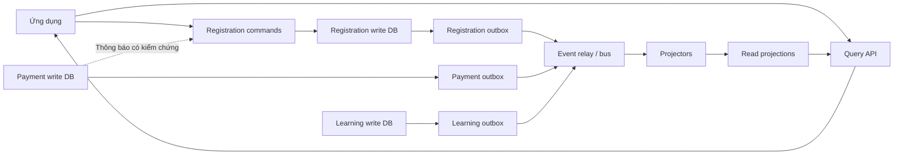
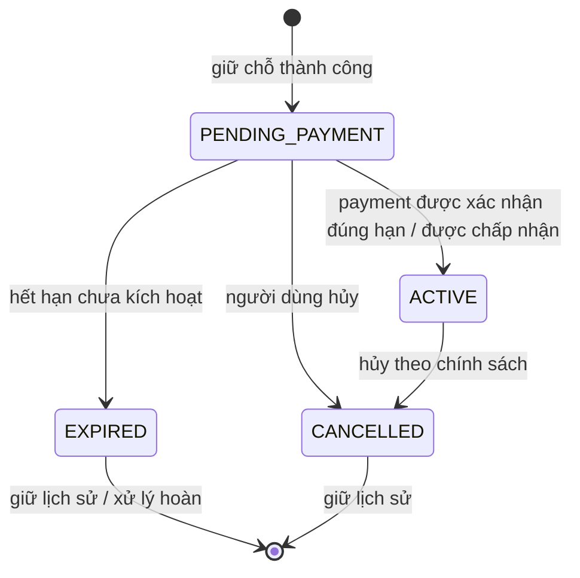
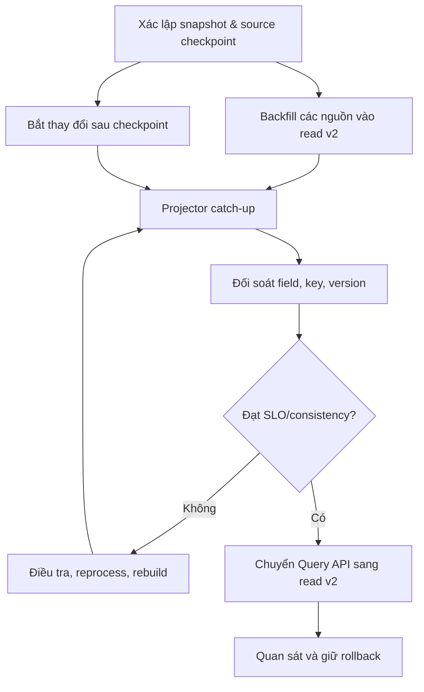

# Thiết kế mô hình đọc, sự kiện và hợp đồng trao đổi phù hợp

## 1. Bài toán thực hành tổng hợp: từ mô hình nghiệp vụ đến dữ liệu đọc

Trong một hệ thống bán khóa học cho nhiều doanh nghiệp, dữ liệu không chỉ nằm ở một nơi. Bộ phận ghi danh quản lý số chỗ và trạng thái học viên; bộ phận thanh toán xác nhận tiền; bộ phận học tập ghi tiến độ; còn ứng dụng cần **một trang tổng quan tải nhanh** để hiển thị tất cả thông tin liên quan.

Nếu mọi màn hình JOIN trực tiếp các bảng thuộc nhiều hệ thống, ứng dụng có thể chậm và gắn chặt với cấu trúc nội bộ của từng miền. Nếu thay bằng cách sao chép dữ liệu sang một kho đọc, lại xuất hiện những câu hỏi:

- Ai là **nguồn có thẩm quyền** của từng trường?
- Một dòng dữ liệu đọc đại diện cho **đơn vị nào**?
- Sự kiện nói về **một thay đổi** hay mang **toàn bộ trạng thái**?
- Bản ghi từ hai hệ đến **sai thứ tự** thì có làm hỏng kết quả không?
- Khi người dùng vừa thanh toán, màn hình có được hiển thị “Đã thanh toán” ngay không?
- Nếu đọc stale, có được phép cấp thêm một chỗ học không?
- Tên trường, khóa, phiên bản và quyền truy cập phải được thỏa thuận ra sao?
- Nếu mất toàn bộ kho đọc, có thể xây lại từ những nguồn nào?

Đó là phạm vi của bài **“Thiết kế mô hình đọc, sự kiện và hợp đồng trao đổi phù hợp”**, thuộc chương **Thực hành tổng hợp** của mô-đun **DATABASE_DATA_MODELING**. Mô-đun hướng tới chuyển yêu cầu nghiệp vụ thành mô hình dữ liệu rõ ràng, từ thực thể, quan hệ, ràng buộc, khóa, chỉ mục đến lược đồ vật lý; so sánh mô hình quan hệ, document, đồ thị và phân tích để chọn cấu trúc phù hợp, dễ tiến hóa và kiểm chứng.

Bài này là **một tình huống thiết kế có đáp án tham chiếu**, không phải quy chuẩn buộc mọi hệ thống phải dùng microservices, message broker hoặc CQRS phân tán.

**Kết quả cần đạt:** người học có thể viết hồ sơ thiết kế gồm mô hình nguồn, query model, event contracts, quy trình đồng bộ, chính sách nhất quán, kiểm thử và đánh đổi; chỉ ra được quyết định nào do ràng buộc nghiệp vụ, quyết định nào là giả định cần xác nhận.

## 2. Đề bài và những giả định dùng xuyên suốt

Nền tảng giả định **LearningMarket** phục vụ nhiều tổ chức thuê dịch vụ (*tenant*). Mỗi tổ chức có học viên, lớp học và quyền truy cập riêng.

### 2.1. Các miền nghiệp vụ

| Miền | Sở hữu dữ liệu | Trách nhiệm |
| --- | --- | --- |
| **Catalog** | Course template và metadata được công bố | Tên, mô tả, phiên bản nội dung |
| **Registration** | Offering, Enrollment, số chỗ | Ghi danh, hủy/ hết hạn, chống vượt capacity |
| **Payment** | PaymentIntent, trạng thái thanh toán | Thu tiền, xử lý gateway và yêu cầu hoàn tiền |
| **Learning** | Progress theo Enrollment | Bài đã hoàn thành và tổng số bài áp dụng |
| **Query/UI** | Các read projections dẫn xuất | Dashboard học viên và danh sách lớp |

Để bài tập tập trung vào thiết kế, giả định **Registration** quản lý cả Offering và Enrollment trong **một write database**, để giữ chỗ và tạo Enrollment được commit nguyên tử. Payment và Learning có nguồn dữ liệu riêng. Catalog là nguồn cung cấp metadata khóa học; Registration lưu một **snapshot tên khóa tại thời điểm tạo lớp** để bảo toàn thông tin lịch sử trong phiếu ghi danh.

Đây là một lựa chọn **ownership** có chủ đích. Nếu Offering và Enrollment nằm ở hai database không thể dùng cùng transaction, cần thiết kế reservation protocol/saga riêng; không thể giữ nguyên cách ghi nguyên tử của bài này mà không thay đổi gì.

### 2.2. Luồng người dùng

1. Học viên mở danh sách các lớp còn tuyển sinh.
2. Học viên bấm đăng ký; Registration thử giữ một chỗ.
3. Hệ thống tạo Enrollment ở trạng thái `PENDING_PAYMENT`.
4. Payment xử lý thanh toán; trạng thái có thể là `PENDING`, `SUCCEEDED` hoặc `FAILED`.
5. Khi xác nhận Payment thành công, Registration tiếp nhận thông báo đủ tin cậy để kích hoạt Enrollment thành `ACTIVE`. Hai hệ ghi ở transaction riêng.
6. Học viên học bài; Learning cập nhật tiến độ.
7. Dashboard hiển thị tên lớp, trạng thái Enrollment, trạng thái thanh toán và tiến độ.
8. Nếu thanh toán không xong trước hạn, Enrollment có thể hết hạn và trả lại chỗ theo quy tắc.

### 2.3. Các giả định nghiệp vụ cần công khai

- Mã learner, offering và enrollment là duy nhất **trong tenant**, không chỉ xét chuỗi ID.
- Một Enrollment thuộc đúng một Offering và một Learner của cùng tenant.
- Với một cặp `(tenant, learner, offering)`, có tối đa **một Enrollment đang PENDING_PAYMENT hoặc ACTIVE**.
- Một Enrollment sau khi CANCELLED/EXPIRED có thể được ghi danh lại bằng **ID mới**, nếu Offering còn chỗ và quy định cho phép.
- Một Enrollment trong bài có đúng **một PaymentIntent logic**; các lần thử giao tiếp gateway nằm bên trong PaymentIntent. Nếu cho phép nhiều PaymentIntent thay thế, cần bổ sung identity/mapping và thứ tự ưu tiên.
- Chỗ học được giữ từ khi Enrollment ở `PENDING_PAYMENT`, tiếp tục giữ khi `ACTIVE`, và được trả khi `EXPIRED/CANCELLED` theo transaction hợp lệ.
- Bài học tiến độ có thể sửa quy tắc tổng số bài; Learning phát bản chụp trạng thái tính toán của **một Enrollment**.
- Dashboard có thể đọc dữ liệu trễ trong một giới hạn đã được chấp thuận, nhưng **quyết định còn chỗ và chuyển trạng thái phải kiểm tra nguồn ghi có thẩm quyền**.
- Khi thanh toán thành công sau lúc Enrollment đã EXPIRED, Registration **không tự khôi phục** Enrollment nếu không còn chỗ; cần một nhánh đối soát/hoàn tiền có kiểm soát.
- Ví dụ mã tiền và số học dùng integer minor units, không dùng số thực nhị phân để cộng tiền.

Các giả định này là **nội dung của thiết kế**, không phải sự thật mặc định của mọi sản phẩm.

## 3. Đầu ra người học cần tự nộp

Trước khi xem thiết kế tham chiếu ở các phần sau, hãy thử tạo bộ đầu ra:

1. **Sơ đồ ownership** xác định hệ nguồn của từng trạng thái và thuộc tính.
2. **Grain/identity catalog:** mỗi row, event và read record có định danh nào.
3. **Command/query matrix:** cái gì phải nhất quán khi commit, cái gì được phép stale.
4. **Write schema** cho Registration, gồm khóa, ràng buộc và concurrency.
5. **Read schemas** cho dashboard và lớp học; chỉ mục từ query shape.
6. **Event catalog:** event types, producer, key, payload, version và phạm vi phát.
7. **JSON hợp đồng sự kiện** cho tối thiểu Registration, Payment và Learning.
8. **Projector algorithm** chống duplicate, xử lý reordering, event thiếu và trạng thái xóa.
9. **Consistency contract** cho read-after-write và quyết định cấp chỗ.
10. **Rebuild/backfill plan** khi tạo projection mới hoặc mất read store.
11. **Bộ test âm/dương** và SLO/metrics.
12. **Decision record** so sánh read tables trong cùng DB với read store tách biệt.

Hãy xem các mục 4–24 như một **đáp án tham chiếu có giải thích**, không phải lược đồ duy nhất.

## 4. Bản đồ thực thể: grain, identity và nguồn có thẩm quyền

| Thực thể | Một bản ghi là gì? | Identity đề xuất | Nguồn |
| --- | --- | --- | --- |
| Tenant | Một tổ chức được cô lập | `tenant_id` | Identity/Organization |
| Learner | Một hồ sơ học viên trong tenant | `(tenant_id, learner_id)` | Identity/Registration (tham chiếu) |
| CourseTemplate | Một template nội dung | `(owner_id, course_id)` | Catalog |
| Offering | Một đợt mở lớp | `(tenant_id, offering_id)` | Registration |
| Enrollment | Một lần ghi danh được chấp nhận | `(tenant_id, enrollment_id)` | Registration |
| PaymentIntent | Một ý định thanh toán cho Enrollment | `(tenant_id, payment_intent_id)` | Payment |
| Progress | Trạng thái tiến độ của một Enrollment | `(tenant_id, enrollment_id)` | Learning |
| EnrollmentSnapshotEvent | Một bản chụp phiên bản Enrollment | `event_id` + `aggregate_version` | Registration |
| PaymentSnapshotEvent | Một bản chụp phiên bản PaymentIntent | `event_id` + `aggregate_version` | Payment |
| ProgressSnapshotEvent | Một bản chụp phiên bản Progress | `event_id` + `aggregate_version` | Learning |
| Dashboard card | Một Enrollment được nhìn từ dashboard | `(tenant_id, enrollment_id)` | Read projection |

**Định danh trên bus:** một `aggregate_id` không đủ nếu nó chỉ duy nhất trong tenant. Consumer cần cả namespace/tenant và loại aggregate; `event_id` là identity của thông điệp, **khác** ID aggregate.

**Lưu ý cross-context:** Registration có thể lưu `payment_intent_id` như một tham chiếu logic sau khi nhận thông tin từ Payment. Không dùng FK trực tiếp xuyên hai database như thể transaction được bảo đảm nguyên tử; phải có hợp đồng xác nhận/mapping/đối soát.

### 4.1. Một số bất biến phải đúng ở nguồn ghi

- `0 <= reserved_seats <= capacity`.
- Chỉ giữ chỗ khi Offering đang mở tuyển sinh.
- Không có hai Enrollment `PENDING_PAYMENT/ACTIVE` cho cùng học viên và Offering.
- Mỗi Enrollment trỏ đúng Learner và Offering theo tenant.
- PaymentIntent không nhận hai lần kết quả thu tiền cho cùng thao tác gateway nhờ quy tắc idempotency được Payment sở hữu.
- Hết hạn/huỷ Enrollment chỉ trả chỗ **một lần**.
- Một event Payment thành công đến muộn không tự kích hoạt Enrollment đã EXPIRED nếu nguồn ghi không chấp nhận transition.
- Progress không bị client tự khai tăng số bài đã hoàn thành mà không qua Learning rules.

**Read model không phải nguồn để chứng minh các bất biến này.**

## 5. Bảng lệnh và truy vấn: không đặt mọi yêu cầu vào cùng một mức nhất quán

| ID | Thao tác | Chủ xử lý | Yêu cầu nhất quán |
| --- | --- | --- | --- |
| C1 | `ReserveSeatAndEnroll` | Registration | Atomic capacity + Enrollment + idempotency |
| C2 | `ActivateEnrollmentAfterPayment` | Registration | Kiểm trạng thái nguồn và payment evidence |
| C3 | `ExpireEnrollment` | Registration | Atomic release seat + change status |
| C4 | `CapturePayment` | Payment | Không thu tiền trùng, xử lý gateway |
| C5 | `MarkLessonComplete` | Learning | Đúng quyền và không đếm trùng |
| Q1 | `GetMyEnrollmentCards` | Query service | Cho phép stale có giới hạn |
| Q2 | `GetEnrollmentStatusImmediately` | Registration/Query | Read-after-write rõ ràng |
| Q3 | `ListOpenOfferings` | Query projection | Có thể stale để hiển thị, không cấp chỗ |
| Q4 | `GetInstructorClassSummary` | Query/Analytics | Theo checkpoint/độ mới công bố |
| Q5 | `CanReserveLastSeat` | Registration | Kiểm tại commit, không dùng dashboard |
| Q6 | `ShouldRefundLatePayment` | Payment + Registration | Quy tắc liên miền có nguồn có thẩm quyền |

Một lỗi thường gặp là “đây là query, vậy phải đọc từ read store”. Q5 và Q6 có hình thức hỏi/đọc, nhưng khi chúng quyết định thay đổi tiền hoặc số chỗ, **câu trả lời cuối phải được bảo vệ tại command/transaction có thẩm quyền**.

### 5.1. SLO giả định phục vụ bài tập

| Chỉ số | Mục tiêu thảo luận, chưa phải SLA thật |
| --- | --- |
| Dashboard Q1 p95 | Dưới 200 ms với tập dữ liệu đại diện |
| Danh sách lớp Q3 p95 | Dưới 150 ms |
| Command C1 p95 | Dưới 400 ms, không tính thời gian gateway thanh toán |
| Projection lag p99 | Dưới 5 giây khi hệ hoạt động bình thường |
| Rebuild một tenant | Có thủ tục/checkpoint kiểm chứng, thời gian đo từ workload |
| Sai lệch authorization | Không chấp nhận trả bản ghi tenant khác |
| Overbooking | Không chấp nhận vượt capacity đã cam kết |

Các con số chỉ giúp thiết kế kiểm thử. Đội dự án cần xác nhận workload, chi phí, độ trễ chấp nhận và cách xử lý sự cố trước khi biến chúng thành hợp đồng sản phẩm.

## 6. Sơ đồ luồng dữ liệu và ranh giới giao dịch



Có **ba transaction riêng**:

1. Registration commit giữ chỗ, Enrollment và outbox của nó.
2. Payment commit trạng thái thanh toán và outbox của nó.
3. Learning commit tiến độ và outbox của nó.

Không nên vẽ một transaction duy nhất bao quanh ba database nếu hệ thống không có một cơ chế thực sự bảo đảm điều đó.

**Dấu mũi tên Payment → Registration** biểu diễn một tích hợp có kiểm chứng, có thể bằng event/command handler đáng tin, với idempotency và việc xác minh bằng chứng thanh toán. Nó **không** có nghĩa Query API hoặc client được quyền đổi Enrollment thành ACTIVE bằng cách gửi một cờ `paid=true`.

### 6.1. Hai loại luồng cần tách

- **Luồng nghiệp vụ:** kết quả thanh toán kích hoạt transition `PENDING_PAYMENT → ACTIVE` trong Registration; nếu hết hạn, có nhánh refund/đối soát.
- **Luồng đọc:** Registration, Payment và Learning phát snapshot cho các projection; trễ vài giây có thể được chấp nhận.

Không dùng một read projection stale để thay thế sự kiện/quyết định của luồng nghiệp vụ.

## 7. Thiết kế write model cho Registration (PostgreSQL)

Lược đồ sau chỉ minh họa phần Registration trong **cùng một write database**. Payment và Learning có hệ nguồn riêng, không cố gắn FK xuyên hệ.

```sql
CREATE TABLE reg_learners (
    tenant_id text NOT NULL,
    learner_id text NOT NULL,
    display_name text NOT NULL,
    PRIMARY KEY (tenant_id, learner_id)
);

CREATE TABLE reg_offerings (
    tenant_id text NOT NULL,
    offering_id text NOT NULL,
    course_owner_id text NOT NULL,
    course_id text NOT NULL,
    course_title_at_offering text NOT NULL,
    status text NOT NULL,
    capacity integer NOT NULL,
    reserved_seats integer NOT NULL DEFAULT 0,
    version bigint NOT NULL DEFAULT 1,
    PRIMARY KEY (tenant_id, offering_id),
    CHECK (status IN ('DRAFT','OPEN','CLOSED','CANCELLED')),
    CHECK (capacity >= 0),
    CHECK (reserved_seats >= 0 AND reserved_seats <= capacity),
    CHECK (version > 0)
);

CREATE TABLE reg_enrollments (
    tenant_id text NOT NULL,
    enrollment_id text NOT NULL,
    learner_id text NOT NULL,
    offering_id text NOT NULL,
    status text NOT NULL,
    enrolled_at timestamptz NOT NULL,
    expires_at timestamptz,
    version bigint NOT NULL DEFAULT 1,
    PRIMARY KEY (tenant_id, enrollment_id),
    FOREIGN KEY (tenant_id, learner_id)
      REFERENCES reg_learners(tenant_id, learner_id),
    FOREIGN KEY (tenant_id, offering_id)
      REFERENCES reg_offerings(tenant_id, offering_id),
    CHECK (status IN (
        'PENDING_PAYMENT','ACTIVE','EXPIRED','CANCELLED'
    )),
    CHECK (version > 0),
    CHECK (
        status <> 'PENDING_PAYMENT'
        OR expires_at IS NOT NULL
    )
);

CREATE UNIQUE INDEX reg_one_open_enrollment
    ON reg_enrollments(tenant_id, learner_id, offering_id)
    WHERE status IN ('PENDING_PAYMENT', 'ACTIVE');

CREATE INDEX reg_enrollments_by_learner
    ON reg_enrollments(tenant_id, learner_id, enrolled_at DESC, enrollment_id);
```

### 7.1. Những gì lược đồ này bảo vệ

- Cặp `tenant_id + enrollment_id` có định danh rõ.
- Enrollment trỏ đúng Learner và Offering trong cùng tenant.
- Capacity/counter không âm và không vượt mức đã công bố trong mỗi row.
- Không tồn tại hai Enrollment đang mở cho cùng learner/offering.
- Enrollment PENDING_PAYMENT có hạn chờ.

### 7.2. Những gì lược đồ chưa tự bảo vệ

- `reserved_seats` bằng đúng số Enrollment đang chiếm chỗ.
- Hai command concurrent cùng giữ chỗ cuối có kết quả đúng.
- Transition trạng thái hợp lệ, ví dụ không kích hoạt EXPIRED.
- Khi PaymentCaptured đến muộn, tiền có được hoàn hay không.
- Catalog ID thực sự được quyền sử dụng/công bố trong tenant.
- Learner có quyền đăng ký hay đã bị giới hạn học vụ.
- Tất cả sự kiện outbox được phát và read projection được cập nhật.

**Không kết luận hệ đã an toàn chỉ vì DDL chạy được.** Những điều kiện này cần transaction service, nghiệp vụ liên miền và bộ test.

## 8. Transaction giữ chỗ, chống trùng và phát sự kiện

### 8.1. Atomic reserve trong Registration

Luồng khái niệm cho command `ReserveSeatAndEnroll`:

```text
BEGIN TRANSACTION

1. Xác thực actor, tenant, offering và learner.
2. Kiểm tra idempotency key:
   - Nếu cùng yêu cầu đã COMMITTED, trả kết quả cũ.
   - Nếu đang xử lý, trả trạng thái theo hợp đồng.
3. UPDATE reg_offerings
   SET reserved_seats = reserved_seats + 1,
       version = version + 1
   WHERE tenant_id = ...
     AND offering_id = ...
     AND status = 'OPEN'
     AND reserved_seats < capacity
   RETURNING ...
4. Phải có đúng một row cập nhật, nếu không ROLLBACK.
5. INSERT reg_enrollments ở PENDING_PAYMENT.
   - UNIQUE bảo vệ cặp learner/offering đang mở.
6. INSERT outbox_event chứa snapshot Enrollment v1.
7. Ghi kết quả idempotency trong cùng transaction.
COMMIT
```

Bước 3 có thể dùng SQL:

```sql
UPDATE reg_offerings
SET reserved_seats = reserved_seats + 1,
    version = version + 1
WHERE tenant_id = :tenant_id
  AND offering_id = :offering_id
  AND status = 'OPEN'
  AND reserved_seats < capacity
RETURNING offering_id, reserved_seats, version;
```

**Câu SQL riêng lẻ không hoàn tất command.** Cần cùng transaction với INSERT Enrollment và outbox. Khi INSERT bị UNIQUE violation hoặc một bước khác lỗi, rollback cả lần tăng counter. Việc xử lý idempotency phải tránh hai request cùng key tự chạy song song; thường cần unique key và state transition được khóa/transaction bảo vệ.

### 8.2. Kịch bản hủy/hết hạn trả chỗ

Nếu Enrollment đang `PENDING_PAYMENT` và chuyển thành `EXPIRED`:

- Kiểm tra điều kiện `status = PENDING_PAYMENT` tại commit.
- Chỉ transition một lần.
- Giảm `reserved_seats` trong **cùng transaction**.
- Phát snapshot Enrollment phiên bản mới.
- Nếu Payment đã SUCCEEDED nhưng thông tin đến muộn, xử lý bằng nhánh đối soát/hoàn theo chính sách; **không** tự tăng lại chỗ nếu lớp đã đầy.

Một câu UPDATE để trừ chỗ mà không kiểm tra transition thành công có thể làm counter âm hoặc trừ hai lần khi retry. Thiết kế phải gắn việc trả chỗ với **kết quả chuyển trạng thái**.

### 8.3. Idempotency không giống business uniqueness

| Khóa | Mục đích |
| --- | --- |
| `(tenant_id, command_type, idempotency_key)` | Nhận cùng ý định retry |
| `(tenant_id, enrollment_id)` | ID của một Enrollment |
| Unique partial trên `(tenant,learner,offering)` | Chặn hai enrollment đang mở |
| `event_id` | Nhận diện bản ghi sự kiện |
| `aggregate_version` | Thứ tự phiên bản của aggregate |

Một user có thể gửi hai lệnh khác idempotency key cùng mục tiêu; ràng buộc unique nghiệp vụ vẫn phải bảo vệ. Một retry cùng key nhưng payload khác phải được coi là **xung đột**, không dùng lệnh cũ như thể payload mới đã được chấp thuận.

## 9. Transactional outbox: đồng bộ thông điệp với commit nguồn

Sai lầm thường gặp:

```text
1. Ghi Enrollment vào Registration DB -> COMMIT
2. Gửi message tới broker
```

Nếu bước 1 thành công nhưng bước 2 thất bại, read model có thể không nhận thay đổi. Nếu phát message trước commit, một event có thể mô tả trạng thái sau đó bị rollback.

**Transactional outbox** ghi trạng thái và message cần phát trong **cùng write transaction**.

```sql
CREATE TABLE reg_outbox (
    event_id uuid PRIMARY KEY,
    tenant_id text NOT NULL,
    aggregate_type text NOT NULL,
    aggregate_id text NOT NULL,
    aggregate_version bigint NOT NULL,
    event_type text NOT NULL,
    event_schema_version integer NOT NULL,
    payload jsonb NOT NULL,
    occurred_at timestamptz NOT NULL,
    published_at timestamptz,
    CHECK (aggregate_version > 0),
    CHECK (event_schema_version > 0)
);

CREATE INDEX reg_outbox_pending_idx
ON reg_outbox(occurred_at, event_id)
WHERE published_at IS NULL;
```

Một Registration command có thể:

```text
BEGIN
  update Offering
  insert Enrollment
  insert outbox EnrollmentSnapshotChanged
  insert outbox OfferingSnapshotChanged
  persist idempotency result
COMMIT
```

Nếu có hai event cho **hai aggregate**, `Offering.version` và `Enrollment.version` độc lập. Không lấy một số version chung cho cả transaction rồi so trực tiếp hai aggregate.

### 9.1. Outbox không tự bảo đảm exactly-once

Relay có thể phát E1 thành công nhưng chết trước khi đánh dấu `published_at`, nên phát lại E1 khi restart. Consumer phải xử lý event trùng, retry, sự cố broker và dead-letter/quarantine.

Cần theo dõi tuổi event chưa phát, độ sâu queue, tiến độ consumer, thời gian khôi phục và chính sách cleanup. **Outbox có thể bị dọn theo retention; nó không mặc nhiên là một event store đủ để replay toàn bộ lịch sử.**

CDC (*Change Data Capture*) từ transaction log là phương án khác để chuyển outbox/change stream. Vẫn cần hợp đồng ordering, offset, quyền truy cập, schema evolution và khả năng khôi phục.

## 10. Event catalog: rõ nguồn và mục đích của từng sự kiện

| Event type | Producer | Identity/ordering key | Consumer | Ý nghĩa |
| --- | --- | --- | --- | --- |
| `EnrollmentSnapshotChanged` | Registration | Tenant + Enrollment | Dashboard/read projector; integration có quyền | Trạng thái Enrollment đầy đủ |
| `OfferingSnapshotChanged` | Registration | Tenant + Offering | Class list projector | Trạng thái lớp và số chỗ |
| `PaymentIntentSnapshotChanged` | Payment | Tenant + PaymentIntent | Payment projector; Registration integration | Trạng thái thanh toán đã được Payment chấp nhận |
| `ProgressSnapshotChanged` | Learning | Tenant + Enrollment | Progress projector | Tổng tiến độ theo Enrollment |
| `EnrollmentErased` | Registration | Tenant + Enrollment | Dẫn xuất cần xóa/ẩn | Yêu cầu xử lý bản sao theo chính sách |

Bài này dùng **full snapshot events**, nghĩa là mỗi event chứa đủ trường thuộc phạm vi projection nguồn để thay thế trạng thái cũ. Đây là một hợp đồng cụ thể, không phải mọi event-driven system đều làm như vậy.

### 10.1. Envelope thống nhất

```json
{
  "eventId": "3e0242a1-748e-4e0a-8b2b-9d57ae0f1840",
  "eventType": "EnrollmentSnapshotChanged",
  "eventSchemaVersion": 1,
  "producer": "Registration",
  "tenantId": "ORG-A",
  "aggregateType": "Enrollment",
  "aggregateId": "ENR-501",
  "aggregateVersion": 1,
  "occurredAt": "2026-11-20T09:00:00Z",
  "correlationId": "FLOW-20261120-101",
  "payload": {}
}
```

- `eventId` nhận diện **thông điệp**, phục vụ deduplication.
- `aggregateId + aggregateType + tenantId` nhận diện nguồn, dùng để định tuyến và so version.
- `aggregateVersion` tăng đơn điệu **trong một aggregate**.
- `eventSchemaVersion` mô tả **định dạng payload**, không phải phiên bản nghiệp vụ.
- `correlationId` giúp truy vết luồng, không thay thế idempotency key.
- `occurredAt` là mốc thời gian được producer định nghĩa, không tự bằng thời điểm projector nhận.

**Một giả định thiết kế bắt buộc:** bài này phát tối đa **một snapshot cùng loại cho mỗi phiên bản aggregate**. Nếu nhiều thông điệp khác payload có cùng version, version guard đơn giản sẽ bỏ sót; cần một sequence phụ hoặc thiết kế lại hợp đồng.

### 10.2. Không publish toàn bộ row/PII

Event phải giới hạn trường đúng nhu cầu và quyền consumer; không phát các secret, thông tin thanh toán nhạy cảm hoặc toàn bộ hồ sơ người học chỉ vì thuận tiện serialize một object nội bộ. Mỗi event cần có ownership, schema, retention và versioning.

## 11. Ví dụ hợp đồng JSON cho ba nguồn

### 11.1. EnrollmentSnapshotChanged

```json
{
  "eventId": "dbd7c80d-e0c3-4f87-9a8a-6950c386fa51",
  "eventType": "EnrollmentSnapshotChanged",
  "eventSchemaVersion": 1,
  "producer": "Registration",
  "tenantId": "ORG-A",
  "aggregateType": "Enrollment",
  "aggregateId": "ENR-501",
  "aggregateVersion": 1,
  "occurredAt": "2026-11-20T09:00:00Z",
  "correlationId": "FLOW-20261120-101",
  "payload": {
    "enrollmentId": "ENR-501",
    "learnerId": "U-100",
    "offeringId": "CLASS-77",
    "courseTitleAtOffering": "Thiết kế dữ liệu",
    "status": "PENDING_PAYMENT",
    "enrolledAt": "2026-11-20T09:00:00Z",
    "expiresAt": "2026-11-20T09:15:00Z",
    "isErased": false
  }
}
```

Khi chuyển thành ACTIVE, Registration phát snapshot v2 có cùng identity và các trường Registration đầy đủ, với `status=ACTIVE`. Event này **không chứng minh Payment read projection đã bắt kịp**, vì Payment độc lập.

### 11.2. PaymentIntentSnapshotChanged

```json
{
  "eventId": "80a3afbf-f352-4a40-a9b5-64268f0dbcc5",
  "eventType": "PaymentIntentSnapshotChanged",
  "eventSchemaVersion": 1,
  "producer": "Payment",
  "tenantId": "ORG-A",
  "aggregateType": "PaymentIntent",
  "aggregateId": "PAY-900",
  "aggregateVersion": 3,
  "occurredAt": "2026-11-20T09:02:00Z",
  "correlationId": "FLOW-20261120-101",
  "payload": {
    "paymentIntentId": "PAY-900",
    "enrollmentId": "ENR-501",
    "paymentStatus": "SUCCEEDED",
    "amountMinor": 350000,
    "currencyCode": "VND",
    "isErased": false
  }
}
```

**Giới hạn trong bài:** một PaymentIntent logic/Enrollment; các gateway retries là attempts bên trong intent. Nếu thay PaymentIntent, phiên bản của PAY-900 không thể so với phiên bản PAY-901; cần một mapping current-intent do Payment sở hữu và version riêng.

### 11.3. ProgressSnapshotChanged

```json
{
  "eventId": "3ef8e011-54e5-4754-9c02-ff27e5b1ffcb",
  "eventType": "ProgressSnapshotChanged",
  "eventSchemaVersion": 1,
  "producer": "Learning",
  "tenantId": "ORG-A",
  "aggregateType": "ProgressByEnrollment",
  "aggregateId": "ENR-501",
  "aggregateVersion": 7,
  "occurredAt": "2026-11-20T11:30:00Z",
  "correlationId": "LEARN-OP-812",
  "payload": {
    "enrollmentId": "ENR-501",
    "completedLessons": 5,
    "totalLessons": 12,
    "lastCompletedAt": "2026-11-20T11:30:00Z",
    "isErased": false
  }
}
```

Snapshot `5/12` có nghĩa **thay giá trị hiện hành**, không phải cộng 5 vào counter. Nếu event v7 được phát lại, projector vẫn phải giữ 5/12. Nếu v6 đến muộn, không ghi đè số mới hơn.

## 12. Hợp đồng trao đổi phải nói rõ semantics và tương thích

| Trường | Quy tắc |
| --- | --- |
| `tenantId` | Bắt buộc, khớp namespace và quyền producer |
| `aggregateId` | ID ổn định trong tenant và aggregate type |
| `aggregateVersion` | Số nguyên tăng đơn điệu trong một aggregate |
| `eventSchemaVersion` | Phiên bản payload, không so với aggregateVersion |
| `status` | Enum theo contract; không tự diễn giải giá trị chưa biết |
| `expiresAt` | Có thời gian hợp lệ khi PENDING_PAYMENT |
| `amountMinor + currencyCode` | Cặp tiền có kiểu và ý nghĩa rõ |
| `completedLessons/totalLessons` | Không âm, completed không vượt total theo quy tắc |
| `isErased` | Tín hiệu xóa/ẩn theo chính sách, khác CANCELLED |

### 12.1. JSON Schema minh họa cho payload Enrollment v1

```json
{
  "$schema": "https://json-schema.org/draft/2020-12/schema",
  "type": "object",
  "required": [
    "enrollmentId", "learnerId", "offeringId",
    "courseTitleAtOffering", "status",
    "enrolledAt", "isErased"
  ],
  "properties": {
    "enrollmentId": {"type": "string", "minLength": 1},
    "learnerId": {"type": "string", "minLength": 1},
    "offeringId": {"type": "string", "minLength": 1},
    "courseTitleAtOffering": {"type": "string"},
    "status": {
      "enum": ["PENDING_PAYMENT", "ACTIVE", "EXPIRED", "CANCELLED"]
    },
    "enrolledAt": {"type": "string", "format": "date-time"},
    "expiresAt": {"type": ["string", "null"], "format": "date-time"},
    "isErased": {"type": "boolean"}
  },
  "additionalProperties": false
}
```

Schema này **chưa kiểm tra** producer đáng tin, tenant có quyền, version tăng, thứ tự event hoặc yêu cầu `expiresAt` khác NULL khi PENDING_PAYMENT; cần validation ở đúng tầng. Tính kiểm tra `format` phụ thuộc validator và cấu hình cụ thể.

### 12.2. Schema evolution

- Thêm trường tùy chọn có thể gây lỗi nếu consumer cấu hình từ chối unknown field.
- Đổi tên `learnerId` thành `studentId` cần version và chuyển đổi/upcaster rõ.
- Đổi `amountMinor` thành số thực có thể làm sai tính tiền; phải thiết kế hợp đồng mới.
- Thêm enum trạng thái phải kiểm tra consumer trước rollout.
- Không đổi nghĩa `courseTitleAtOffering` từ snapshot sang tên hiện hành trong cùng một trường.
- Không thay snapshot bằng delta dưới cùng một event type mà không đổi projector.

Một quy trình thường là **consumer hiểu v1/v2 → producer phát v2 → theo dõi → loại hỗ trợ v1 khi đã đủ khả năng đọc dữ liệu lưu giữ**.

### 12.3. Không đoán từ trường chưa có

Read model chưa nhận Payment event **không tự có nghĩa FAILED**; có thể chưa tạo intent, projector lag hoặc nguồn lỗi. Khi Progress event chưa tới, `completedLessons` chưa biết, không mặc nhiên là 0. Hợp đồng query cần phân biệt `UNKNOWN/NOT_YET_OBSERVED` với giá trị 0 hợp lệ.

## 13. Thiết kế read model theo nguồn để chống out-of-order xuyên miền

Một dashboard cần:

```text
enrollmentId, offeringId, courseTitle,
registrationStatus, paymentStatus,
completedLessons, totalLessons
```

Nếu tất cả field bắt buộc nằm trong một row, Payment event đến trước Enrollment event sẽ khó ghi. Một cách ít rủi ro hơn là **mỗi nguồn cập nhật bảng đọc riêng**, rồi Query API JOIN theo Enrollment. Khi workload chứng minh cần thiết, có thể vật hóa một card tổng hợp từ các projection đã kiểm soát.

```sql
CREATE TABLE read_registration_cards (
    tenant_id text NOT NULL,
    enrollment_id text NOT NULL,
    learner_id text NOT NULL,
    offering_id text NOT NULL,
    course_title_at_offering text NOT NULL,
    registration_status text NOT NULL,
    enrolled_at timestamptz NOT NULL,
    expires_at timestamptz,
    registration_version bigint NOT NULL,
    projected_at timestamptz NOT NULL DEFAULT now(),
    PRIMARY KEY (tenant_id, enrollment_id),
    CHECK (registration_version > 0)
);

CREATE INDEX read_registration_by_learner
ON read_registration_cards
    (tenant_id, learner_id, enrolled_at DESC, enrollment_id DESC);

CREATE TABLE read_payment_by_enrollment (
    tenant_id text NOT NULL,
    enrollment_id text NOT NULL,
    payment_intent_id text NOT NULL,
    payment_status text NOT NULL,
    amount_minor bigint NOT NULL,
    currency_code char(3) NOT NULL,
    payment_version bigint NOT NULL,
    projected_at timestamptz NOT NULL DEFAULT now(),
    PRIMARY KEY (tenant_id, enrollment_id),
    UNIQUE (tenant_id, payment_intent_id),
    CHECK (amount_minor >= 0),
    CHECK (payment_version > 0)
);

CREATE TABLE read_progress_by_enrollment (
    tenant_id text NOT NULL,
    enrollment_id text NOT NULL,
    completed_lessons integer NOT NULL,
    total_lessons integer NOT NULL,
    progress_version bigint NOT NULL,
    projected_at timestamptz NOT NULL DEFAULT now(),
    PRIMARY KEY (tenant_id, enrollment_id),
    CHECK (completed_lessons >= 0),
    CHECK (total_lessons >= 0),
    CHECK (completed_lessons <= total_lessons),
    CHECK (progress_version > 0)
);
```

**Chủ ý không có FK từ Payment/Progress read table đến Registration read table** vì các event có thể đến trước. Nếu bắt buộc FK, cần staging/inbox và áp theo thứ tự có kiểm soát. Đây là read schemas, không thay thế write constraints.

### 13.1. Dashboard query

```sql
SELECT
    r.enrollment_id, r.offering_id,
    r.course_title_at_offering,
    r.registration_status, r.enrolled_at,
    p.payment_status, p.amount_minor, p.currency_code,
    g.completed_lessons, g.total_lessons,
    r.registration_version, p.payment_version, g.progress_version
FROM read_registration_cards AS r
LEFT JOIN read_payment_by_enrollment AS p
  ON p.tenant_id = r.tenant_id
 AND p.enrollment_id = r.enrollment_id
LEFT JOIN read_progress_by_enrollment AS g
  ON g.tenant_id = r.tenant_id
 AND g.enrollment_id = r.enrollment_id
WHERE r.tenant_id = :authorized_tenant_id
  AND r.learner_id = :authorized_learner_id
ORDER BY r.enrolled_at DESC, r.enrollment_id DESC
LIMIT 20;
```

Các tham số `authorized_*` lấy từ context đã xác thực/ủy quyền. Nếu `p` hoặc `g` chưa có, trả NULL (chưa quan sát) thay vì tự biến thành SUCCEEDED/FAILED/0.

**Không có một global version tự nhiên cho ba nguồn.** Card có thể là Registration v2, Payment v3, Progress v7; version chỉ so trong cùng aggregate. Nếu một quyết định yêu cầu snapshot nguyên tử xuyên ba context, query này **không** đáp ứng, phải dùng giao thức/phương án nhất quán khác.

## 14. Read model riêng cho danh sách lớp

Registration phát `OfferingSnapshotChanged` có snapshot trạng thái OPEN/CLOSED và số chỗ.

```sql
CREATE TABLE read_offering_cards (
    tenant_id text NOT NULL,
    offering_id text NOT NULL,
    course_id text NOT NULL,
    title text NOT NULL,
    registration_status text NOT NULL,
    capacity integer NOT NULL,
    reserved_seats integer NOT NULL,
    start_at timestamptz,
    offering_version bigint NOT NULL,
    projected_at timestamptz NOT NULL DEFAULT now(),
    PRIMARY KEY (tenant_id, offering_id),
    CHECK (capacity >= 0),
    CHECK (reserved_seats >= 0 AND reserved_seats <= capacity)
);

CREATE INDEX read_offering_open_lookup
ON read_offering_cards
    (tenant_id, registration_status, start_at, offering_id);
```

Truy vấn:

```sql
SELECT offering_id, title, start_at,
       capacity - reserved_seats AS displayed_available_seats,
       offering_version
FROM read_offering_cards
WHERE tenant_id = :authorized_tenant_id
  AND registration_status = 'OPEN'
ORDER BY start_at, offering_id
LIMIT 20;
```

**Số chỗ hiển thị là số liệu của bản sao**, có thể stale. Command giữ chỗ vẫn phải kiểm tra write DB bằng conditional update, không lấy `displayed_available_seats` làm quyết định cuối.

## 15. Projector idempotent với full snapshot và version guard

### 15.1. Upsert cho Registration

```sql
INSERT INTO read_registration_cards (
    tenant_id, enrollment_id, learner_id, offering_id,
    course_title_at_offering, registration_status,
    enrolled_at, expires_at, registration_version, projected_at
) VALUES (
    :tenant_id, :enrollment_id, :learner_id, :offering_id,
    :course_title_at_offering, :status,
    :enrolled_at, :expires_at, :aggregate_version, now()
)
ON CONFLICT (tenant_id, enrollment_id)
DO UPDATE SET
    learner_id = EXCLUDED.learner_id,
    offering_id = EXCLUDED.offering_id,
    course_title_at_offering = EXCLUDED.course_title_at_offering,
    registration_status = EXCLUDED.registration_status,
    enrolled_at = EXCLUDED.enrolled_at,
    expires_at = EXCLUDED.expires_at,
    registration_version = EXCLUDED.registration_version,
    projected_at = now()
WHERE read_registration_cards.registration_version
      < EXCLUDED.registration_version;
```

Với full snapshot, có thể nhận v3 rồi v2: v3 đã mang đủ trạng thái read row; v2 cũ bị bỏ qua. Event v3 nhận trùng không làm thay đổi row.

**Giới hạn:** chỉ đúng khi version tăng theo cùng aggregate và payload đủ mọi field mà projector quản lý. Nếu event là delta, bỏ v2 khi đã thấy v3 có thể mất thông tin.

### 15.2. Upsert cho Payment

```sql
INSERT INTO read_payment_by_enrollment (
    tenant_id, enrollment_id, payment_intent_id,
    payment_status, amount_minor, currency_code,
    payment_version, projected_at
) VALUES (
    :tenant_id, :enrollment_id, :payment_intent_id,
    :payment_status, :amount_minor, :currency_code,
    :aggregate_version, now()
)
ON CONFLICT (tenant_id, enrollment_id)
DO UPDATE SET
    payment_intent_id = EXCLUDED.payment_intent_id,
    payment_status = EXCLUDED.payment_status,
    amount_minor = EXCLUDED.amount_minor,
    currency_code = EXCLUDED.currency_code,
    payment_version = EXCLUDED.payment_version,
    projected_at = now()
WHERE read_payment_by_enrollment.payment_version
      < EXCLUDED.payment_version;
```

**Lại cần giả định một PaymentIntent/Enrollment.** Nếu hai intents khác nhau, chúng có hai chuỗi version không thể so; hãy có một bảng per intent và mapping current intent được version hóa.

### 15.3. Upsert cho Progress

```sql
INSERT INTO read_progress_by_enrollment (
    tenant_id, enrollment_id, completed_lessons,
    total_lessons, progress_version, projected_at
) VALUES (
    :tenant_id, :enrollment_id,
    :completed_lessons, :total_lessons, :aggregate_version, now()
)
ON CONFLICT (tenant_id, enrollment_id)
DO UPDATE SET
    completed_lessons = EXCLUDED.completed_lessons,
    total_lessons = EXCLUDED.total_lessons,
    progress_version = EXCLUDED.progress_version,
    projected_at = now()
WHERE read_progress_by_enrollment.progress_version
      < EXCLUDED.progress_version;
```

Nếu Progress v7 = 5/12 được phát hai lần, kết quả vẫn 5/12. Nếu v6 đến sau v7, không ghi đè. **Không cộng completedLessons**, vì event là snapshot, không phải delta.

### 15.4. Khi dùng delta event phải đổi chiến lược

Với `LessonCompleted` chỉ mang một lesson ID, projector cần bảo đảm nhận đủ chuỗi thay đổi hoặc lưu contribution row/ledger để cộng idempotent. Phát hiện gap, retry/replay hoặc xây lại từ snapshot. **Không áp last-version-wins đơn giản cho delta nếu event mới không chứa kết quả của event cũ.**

## 16. Sự kiện sai thứ tự, thiếu dữ liệu và xóa

### 16.1. Payment đến trước Registration

```text
09:02 PaymentIntentSnapshotChanged v3: SUCCEEDED
09:03 EnrollmentSnapshotChanged v1: PENDING_PAYMENT
09:04 EnrollmentSnapshotChanged v2: ACTIVE
```

Payment có thể insert vào bảng riêng trước. Query dashboard chỉ hiện card khi có Registration row; lúc đó LEFT JOIN tự gắn Payment row. Không tạo Enrollment giả ở nguồn ghi hoặc coi event order là transaction toàn hệ thống.

### 16.2. Registration events trùng/đến muộn

```text
Enrollment v2 ACTIVE
Enrollment v2 ACTIVE (duplicate)
Enrollment v1 PENDING_PAYMENT (late)
Enrollment v3 CANCELLED
```

Version guard kết thúc ở `v3 CANCELLED`. Payment row có thể vẫn là `SUCCEEDED`; đó có thể là trạng thái cần hoàn tiền/đối soát, không được tự sửa Payment thành REFUNDED từ query logic.

### 16.3. CANCELLED khác erasure

- CANCELLED là trạng thái nghiệp vụ, có thể cần lưu lịch sử.
- Erasure là yêu cầu xử lý bản sao/PII theo chính sách.
- Xóa row read vật lý mà không giữ metadata tombstone/version thích hợp có thể khiến event cũ “hồi sinh” row đã xóa.

Một phương án là giữ tombstone tối thiểu theo `(tenant, enrollment, max_erased_version)` trong thời hạn được chấp thuận, hoặc kiểm tra trạng thái xóa có thẩm quyền trước khi project. Cần xử lý cả search index, cache, export và backup theo chính sách.

### 16.4. Broker ordering chỉ có phạm vi nhất định

Một số broker giữ thứ tự **trong partition** khi cùng routing key; không tự đảm bảo thứ tự giữa Payment và Registration hoặc nhiều topic. Mô hình tách read tables và per-aggregate version guards không phụ thuộc vào một global event ordering.

## 17. Workflow thanh toán đến muộn: đọc đúng không thay thế quyết định nghiệp vụ

Đây là một tình huống cần giải trong bài thực hành vì nó bộc lộ sự khác biệt giữa **luồng command** và **luồng read projection**.

### 17.1. Timeline có race condition

```text
09:00 Enrollment ENR-501 được tạo PENDING_PAYMENT,
      giữ một chỗ tới 09:15.

09:15 Worker expire nhận thấy chưa có bằng chứng thanh toán
      và commit PENDING_PAYMENT -> EXPIRED,
      trả lại một chỗ.

09:15:01 Một học viên khác được giữ chỗ vừa trả.

09:15:02 Payment thông báo giao dịch của ENR-501
      thực sự SUCCEEDED tại gateway.
```

Nếu Registration cứ nhận `PaymentSucceeded` là tự đặt `ENR-501.status=ACTIVE` mà không kiểm tra trạng thái/capacity, có thể **vượt số chỗ** hoặc kích hoạt enrollment đã hết hạn.

### 17.2. State machine đề xuất



State machine không phải **toàn bộ** quy trình thanh toán. Payment có vòng đời riêng: PENDING, SUCCEEDED, FAILED, REFUND_PENDING, REFUNDED, ... tùy chính sách. Hai state machines cần một **process policy** để phối hợp.

### 17.3. Bảng quyết định khi nhận kết quả Payment

| Trạng thái Registration lúc xử lý | Payment evidence | Hành động được phép |
| --- | --- | --- |
| PENDING_PAYMENT, chưa hết hạn theo policy | SUCCEEDED | Chuyển ACTIVE có điều kiện |
| PENDING_PAYMENT nhưng đã có lệnh expire cạnh tranh | SUCCEEDED | Serialization/transition quyết định một nhánh, không cả hai |
| EXPIRED | SUCCEEDED | Không tự ACTIVE; đối soát tiền và hoàn/đăng ký mới theo policy |
| CANCELLED | SUCCEEDED | Không tự ACTIVE; xử lý hoàn/đối soát |
| ACTIVE | SUCCEEDED trùng | Idempotent no-op |
| Bất kỳ | Event không xác thực hoặc sai tenant/intent | Từ chối/quarantine, điều tra |

Việc “đúng hạn” phải có định nghĩa rõ: theo thời điểm Payment thực sự thành công ở gateway, theo thời điểm nguồn ghi nhận, hay theo thời điểm Registration nhận event? Không tự dùng `now()` tùy tiện nếu nghiệp vụ chấp nhận thanh toán xảy ra trước hạn nhưng callback đến trễ.

Một giao thức có thể chọn **giữ chỗ đến khi PaymentIntent được kết luận rõ ràng**, hoặc **đóng theo timeout và xử lý late success bằng refund**. Cả hai đều có trade-off; cần chốt trước khi viết transaction.

### 17.4. Cách tránh hai worker cùng thay trạng thái

Một điểm điều phối của Registration có thể:

- Lock Enrollment và Offering theo thứ tự thống nhất trong transaction.
- Đọc trạng thái/phiên bản hiện hành và kiểm tra transition.
- Chỉ cập nhật khi điều kiện phù hợp.
- Tăng/giảm reserved seats đúng một lần dựa trên transition đã commit.
- Ghi outbox event cùng transaction.
- Xử lý retry bằng idempotency key hoặc nguồn event identity.

Nếu dùng optimistic concurrency, câu UPDATE có điều kiện version giúp nhận ra cạnh tranh; vẫn phải gắn với thao tác cập nhật counter trong cùng transaction.

### 17.5. Không suy workflow từ dashboard

Read card có thể hiển thị:

```text
registrationStatus = EXPIRED
paymentStatus      = SUCCEEDED
```

Đó là **hai trạng thái do hai nguồn sở hữu**. Query API có thể hiển thị “Thanh toán cần được đối soát”, nhưng không nên tự sửa registration hoặc payment. Một worker nghiệp vụ có quyền phải giải quyết tình huống bằng transaction/command có thẩm quyền.

## 18. Hợp đồng query và trải nghiệm đọc sau ghi

### 18.1. Ba trạng thái kỹ thuật của một yêu cầu

- **ACCEPTED:** yêu cầu đã được nhận hoặc xếp hàng, chưa chắc thành công.
- **COMMITTED:** trạng thái ở write DB có thẩm quyền đã thay đổi.
- **PROJECTED:** read store đã bắt kịp ít nhất một phiên bản xác định.

Khi command giữ chỗ commit, response có thể là:

```json
{
  "enrollmentId": "ENR-501",
  "commandStatus": "COMMITTED",
  "registrationStatus": "PENDING_PAYMENT",
  "registrationVersion": 1,
  "expiresAt": "2026-11-20T09:15:00Z"
}
```

Response **không khẳng định** Payment hoặc Progress read projection đã được tạo.

### 18.2. API dashboard không nên che giấu độ mới

Ví dụ DTO trả cho client:

```json
{
  "enrollmentId": "ENR-501",
  "courseTitle": "Thiết kế dữ liệu",
  "registration": {
    "status": "ACTIVE",
    "sourceVersion": 2
  },
  "payment": {
    "status": "SUCCEEDED",
    "sourceVersion": 3
  },
  "progress": {
    "completedLessons": 5,
    "totalLessons": 12,
    "sourceVersion": 7
  },
  "readConsistency": "EVENTUAL"
}
```

Nếu Payment/Progress chưa có, giữ giá trị `null` hoặc một trạng thái `NOT_YET_OBSERVED` với mô tả rõ. Không tự gán SUCCEEDED, FAILED hoặc 0 khi nguồn chưa xác nhận.

### 18.3. Read-your-writes cho cùng aggregate

Một phương án:

```text
GET /enrollments/ENR-501?minRegistrationVersion=2

if read_registration.version >= 2:
    return dashboard card

else:
    wait briefly within configured timeout
    or respond PROJECTION_NOT_CAUGHT_UP
    or fall back to authoritative Registration for needed fields
```

**Không chờ vô thời hạn.** `minRegistrationVersion` chỉ áp cho Enrollment của Registration, không chứng minh Payment/Progress cùng thời điểm. Nếu UI cần bảo đảm Payment v3 đã hiển thị, phải có yêu cầu/checkpoint tương ứng cho Payment.

### 18.4. Có thể hiển thị ngay thông tin command trả về

Nếu command tạo Enrollment đã commit, UI có thể hiển thị “Đang chờ thanh toán” từ response. Bản danh sách đọc có thể chậm xuất hiện; UI có thể chỉ ra “Danh sách đang cập nhật”. Đây là **thiết kế sản phẩm có chủ đích**, không phải dấu hiệu hệ thống ghi thất bại.

### 18.5. Query phải ghi rõ quyền

`authorized_tenant_id` và `authorized_learner_id` trong SQL không thể lấy trực tiếp từ URL/body rồi tự coi là đã kiểm tra. API cần xác thực, phân quyền tenant/role và tính đúng tài nguyên. Một giảng viên có thể được xem một lớp, nhưng không vì vậy được xem Payment chi tiết của mọi học viên.

## 19. Sự cố tích hợp: retry, poison message và độ trễ

### 19.1. Ma trận failure mode

| Lỗi | Ảnh hưởng | Cơ chế cần có |
| --- | --- | --- |
| Outbox relay dừng | Projection không nhận message | Cảnh báo backlog/oldest event |
| Relay phát lại event | Trùng dữ liệu nếu projector không idempotent | Event ID, version guard hoặc ledger |
| Payment event đến trước Registration | Thiếu parent read row | Tách read tables/staging |
| Registration v3 đến trước v2 | Có thể quay về status cũ | Snapshot + version guard |
| Delta progress bị thiếu v6 | Counter sai | Gap detection/replay hoặc snapshot |
| Event schema v2 chưa được hỗ trợ | Projector deserialize lỗi | Version/upcaster, quarantine |
| Read DB hết dung lượng | Lag, query chậm/lỗi | Backpressure, capacity, retry |
| Cache không invalidate | UI vẫn thấy phiên bản cũ | TTL/versioned invalidation |
| Erasure event đến sau khi backup | PII tồn tại trong bản sao | Quy trình retention/restore/delete |
| Bus retention ngắn hơn outage | Mất khả năng catch-up | Snapshot/rebuild từ nguồn và checkpoint |
| Grant bị thu hồi nhưng read cache stale | Truy cập ngoài quyền nếu chỉ dựa cache | Quyền hiện hành tại nguồn khi cần |

### 19.2. Một inbox/checkpoint nên ghi gì?

Nếu consumer dùng một bảng để deduplicate event:

```sql
CREATE TABLE read_processed_events (
    consumer_name text NOT NULL,
    event_id uuid NOT NULL,
    processed_at timestamptz NOT NULL DEFAULT now(),
    PRIMARY KEY (consumer_name, event_id)
);
```

Chèn bản ghi processed **cùng transaction với cập nhật read projection**. Nếu insert processed rồi update read row thất bại nhưng vẫn commit, event sẽ bị đánh dấu “đã xử lý” sai. Nếu projector chỉ cập nhật một snapshot row bằng unique key + version guard, ledger có thể không cần cho bản thân row đó, nhưng **cần thiết** cho những side effects khác hoặc yêu cầu audit cụ thể.

### 19.3. Poison message phải có đường giải quyết

Một event không deserialize được hoặc sai business invariant không nên bị bỏ qua trong im lặng. Có thể:

1. Phân loại lỗi tạm thời (DB outage) hay lỗi dữ liệu/hợp đồng.
2. Retry giới hạn với backoff nếu là lỗi tạm thời.
3. Quarantine/DLQ thông điệp không hợp lệ với lý do và metadata tối thiểu.
4. Cảnh báo khi số lượng/tuổi message lỗi vượt ngưỡng.
5. Sửa producer/consumer hoặc dữ liệu, sau đó reprocess có kiểm soát.
6. Đối soát version/gap để biết những read records bị ảnh hưởng.

Không log toàn bộ payload nhạy cảm ra hệ giám sát không có quyền tương ứng.

### 19.4. SLO và observability

Theo dõi:

- Command p95/p99, conflict, idempotent retries.
- Outbox pending count và oldest unpublished age.
- Consumer offset lag, retry rate, DLQ count.
- Projection lag theo thời gian và version gap.
- Tỷ lệ read rows thiếu nguồn Payment/Progress.
- Số card có Registration EXPIRED nhưng Payment SUCCEEDED cần đối soát.
- Query p95/p99, index scan, cache hit/miss.
- Số trường hợp unauthorized tenant access hoặc erasure propagation lỗi.
- Rebuild throughput và recovery time.

Không chỉ đo **thời gian trung bình**. Một bản ghi cực kỳ quan trọng có thể bị treo dù p95 toàn hệ vẫn đạt.

## 20. Rebuild projection và chuyển đổi schema có checkpoint

Câu hỏi bắt buộc trước cutover:

> Nếu ngày mai phải xóa `read_registration_cards`, `read_payment_by_enrollment` và `read_progress_by_enrollment`, ta có thể dựng lại **đúng** từ đâu?

### 20.1. Các nguồn rebuild

**Lựa chọn A — Snapshot từ write stores**

- Registration xuất trạng thái hiện hành Enrollment/Offering với sourceVersion.
- Payment xuất trạng thái hiện hành PaymentIntent với mapping Enrollment.
- Learning xuất snapshot Progress theo Enrollment.
- Phù hợp với dashboard chỉ cần **trạng thái hiện hành**, nếu tất cả trường cần thiết vẫn còn trong nguồn.

**Lựa chọn B — Replay event history đủ dữ liệu**

- Cần event log bền vững, retention/offset, schema versions và ordering phù hợp.
- Có thể tái dựng cả lịch sử nếu event capture đầy đủ.
- Outbox thông thường không mặc nhiên chứa đầy đủ lịch sử sau cleanup.

**Lựa chọn C — Snapshot + CDC/outbox kể từ checkpoint**

- Chọn snapshot nhất quán và vị trí thay đổi từ nguồn.
- Backfill vào read store mới.
- Replay/catch-up các thay đổi sau checkpoint.
- Đối soát rồi chuyển query.

### 20.2. Vì sao phải giữ checkpoint đúng?

Nếu bắt đầu quét Registration lúc 10:00, quét xong lúc 10:30, nhưng chỉ nghe event phát từ 10:30, những update diễn ra từ 10:00 đến 10:30 có thể **bị bỏ sót**.

Một quy trình mẫu:



**Mỗi write store có checkpoint riêng.** Không cộng offset của Payment vào offset Registration rồi coi đó là snapshot toàn hệ. Nếu cần một trạng thái phối hợp xuyên context, phải có nghiệp vụ/giao thức xác nhận mốc quan sát chung.

### 20.3. Shadow read và đối soát

Trong giai đoạn chuyển:

- Chạy query cũ và read v2 trên tập dữ liệu phù hợp.
- Chỉ so kết quả khi có cùng semantics, scope và mức độ mới có thể xác định.
- So identity/key, trạng thái, tiền, số bài, tenant, visibility và nguồn phiên bản.
- Phân biệt chênh lệch do lag với sai mapping hoặc dữ liệu thiếu.
- Không tự chấp nhận một tập dữ liệu vì `COUNT(*)` hai bên bằng nhau.

Nếu backfill đọc nguồn trong khi có erasure/revoke, projector v2 phải tiếp nhận trạng thái xóa với version đủ cao để không **hồi sinh** thông tin sau khi chuyển.

### 20.4. Rollback và giảm quyền truy cập

Rollback không chỉ là đổi một flag. Cần xem query cũ có còn tuân thủ tenant, quyền hiện hành và erasure hay không. Không rollback sang một read store cũ đã bị thu hồi quyền hoặc mất đồng bộ chính sách bảo mật. Khi không thể rollback an toàn, có thể tạm hạn chế chức năng đọc thay vì trả dữ liệu ngoài quyền.

## 21. Bảo vệ dữ liệu và quyền trao đổi qua các miền

### 21.1. Tenant scope đi theo khóa, event, index và query

Trong LearningMarket, hai tenant có thể cùng `enrollmentId='ENR-501'` nếu ID được cấp theo tenant. Vì vậy:

- Write PK/FK có `tenant_id`.
- Event envelope mang `tenantId` do producer xác thực.
- Read PK có `(tenant_id, enrollment_id)`.
- JOIN Payment/Progress với Registration dùng **cả tenant và enrollment ID**.
- Cache key phải có scope quyền phù hợp, ít nhất theo tenant khi dữ liệu nội tenant.
- Query API kiểm quyền người gọi trên learner/enrollment, không chỉ tin ID từ URL.
- Rebuild/backfill không được copy data từ tenant B sang tenant A vì ID trùng.

Một kiểm thử an toàn nên cố ý tạo `ORG-A/ENR-501` và `ORG-B/ENR-501` với trạng thái khác nhau. Nếu query/card cho A xuất hiện thông tin từ B, thiết kế chưa đạt dù SQL chạy thành công.

### 21.2. Bảo vệ trường nhạy cảm

Read dashboard có thể cần `paymentStatus` và `amountMinor`, nhưng giảng viên xem danh sách lớp không nhất thiết được xem từng giao dịch. Không dùng một service account toàn quyền và một read DTO khổng lồ cho mọi role.

Cần xem xét:

- **Data minimization:** Payment event không mang số thẻ, token gateway hoặc dữ liệu thanh toán không cần thiết.
- **Role-based access:** API học viên xem bản ghi của chính mình; giảng viên chỉ được xem trường cần cho nghiệp vụ.
- **Broker access:** topic/consumer credentials hạn chế theo nhu cầu, không công khai toàn bus.
- **Payload protection:** truyền/ghi thông điệp theo cơ chế bảo mật phù hợp, tránh log dữ liệu nhạy cảm.
- **Cache isolation:** không dùng cache response của học viên A cho B hoặc cho vai trò không tương đương.
- **Retention:** outbox, broker, DLQ, search, log, backup có chính sách lưu và xóa phù hợp.
- **Erasure:** event cũ không được tự hồi sinh bản ghi đã bị xử lý xóa.

### 21.3. Một liên kết hợp lệ không tự cấp quyền mọi dữ liệu

Catalog có thể xuất bản CourseTemplate dùng chung, nhưng việc ORG-A và ORG-B học cùng template **không** cho phép ORG-A xem Payment/Progress của ORG-B. Sự tồn tại của khóa học chung và quan hệ ghi danh riêng phải được mô hình hóa độc lập.

Đặc biệt, việc một hệ thống liên kết danh tính người học theo email hoặc mã bên ngoài không tự làm các hồ sơ trở thành cùng một identity xuyên tenant; cần source namespace, quy tắc xác minh và authorization hợp lệ.

### 21.4. Cấp quyền tại lúc đọc hay đồng bộ qua projection?

Một quyền chia sẻ bị thu hồi có thể chưa kịp lan sang read store. Nếu nghiệp vụ yêu cầu thu hồi **ngay**, API cần kiểm tra nguồn quyền có thẩm quyền hoặc cơ chế đảm bảo độ mới tương đương tại thời điểm truy cập. Không dùng một permission field eventual-consistent làm lớp kiểm soát duy nhất cho tài nguyên nhạy cảm.

## 22. Bộ kiểm thử tích hợp: dùng dữ liệu khó, không chỉ happy path

### 22.1. Dữ liệu test cơ sở

```text
Tenant ORG-A:
  learner U-100
  offering CLASS-77: capacity 1, reserved_seats 0
  course title: "Thiết kế dữ liệu"

Tenant ORG-B:
  learner U-100  (cùng ID cục bộ, người khác)
  offering CLASS-77 (cùng ID cục bộ, lớp khác)

Events của ORG-A/ENR-501:
  Registration v1 PENDING_PAYMENT
  Payment PAY-900 v1 PENDING
  Payment PAY-900 v3 SUCCEEDED
  Registration v2 ACTIVE
  Progress v6 4/12
  Progress v7 5/12
```

Dữ liệu trùng mã giữa tenant là **cố ý**, nhằm phát hiện thiếu khóa phạm vi khi join, cache hoặc project.

### 22.2. Ma trận acceptance tests

| Test | Dữ liệu/hành động | Kỳ vọng |
| --- | --- | --- |
| T1: Capacity | Hai learner giữ một chỗ cuối đồng thời | Một command được chấp nhận, không vượt capacity |
| T2: Business uniqueness | Hai request khác idempotency key cùng learner/offering | Không có hai Enrollment đang mở |
| T3: Retry | Gửi lại cùng command với cùng key/payload | Trả kết quả cũ, không tăng reserved_seats lần hai |
| T4: Conflicting retry | Cùng idempotency key nhưng payload khác | Báo xung đột, không áp command mới |
| T5: Source rollback | INSERT Enrollment lỗi sau tăng counter | Rollback cả counter/outbox |
| T6: Outbox duplicate | Relay phát cùng eventId hai lần | Read row không bị nhân/ghi ngược |
| T7: Out-of-order Registration | v3 tới trước v2 | Full snapshot v3 thắng, v2 không ghi đè |
| T8: Payment first | Payment v3 tới trước Enrollment v1 | Payment read row được giữ; dashboard JOIN đúng sau đó |
| T9: Progress duplicate | v7 5/12 nhận hai lần | Kết quả vẫn 5/12 |
| T10: Delta missing | Chỉ thấy LessonCompleted v8 nhưng thiếu v7 | Không âm thầm giả đã áp đủ delta |
| T11: Late payment | Payment SUCCEEDED sau EXPIRED | Không kích hoạt EXPIRED sai; vào nhánh đối soát/hoàn |
| T12: Read-after-write | Command trả Registration v2, read vẫn v1 | API/UX xử lý minVersion hoặc lag minh bạch |
| T13: Tenant collision | ORG-A và B cùng ID | Không lẫn Registration/Payment/Progress |
| T14: Unauthorized query | User A xem enrollment của B | Không trả dữ liệu B |
| T15: Schema v2 | Producer thêm enum/trường mới | Compatibility test báo lỗi hoặc upcaster xử lý |
| T16: Poison event | Payload sai kiểu/thiếu trường | Quarantine/alert, không ghi read row sai |
| T17: Erasure | Xóa rồi nhận event cũ | Không hồi sinh dữ liệu cá nhân |
| T18: Recovery | Read store bị xóa, rebuild + catch-up | Đối soát được kết quả với nguồn ở checkpoint |
| T19: Lag | Relay dừng 30 giây giả định | SLO/alert và UX hoạt động theo hợp đồng |
| T20: Instructor query | Giảng viên xem danh sách lớp | Không lộ trường Payment ngoài quyền |

**Negative tests** là phần quan trọng của bài: cố tình tạo trường hợp sai và chứng minh hệ từ chối/diễn giải đúng.

### 22.3. Kiểm thử phiên bản đến đảo thứ tự

Gửi các snapshot Registration theo chuỗi:

```text
v2 ACTIVE
v1 PENDING_PAYMENT
v2 ACTIVE (duplicate)
v3 CANCELLED
v1 PENDING_PAYMENT (late)
```

Kỳ vọng cuối cùng trên `read_registration_cards`:

```text
registration_status = CANCELLED
registration_version = 3
```

Điều này phụ thuộc vào **full snapshot**. Không dùng test đó làm bằng chứng nếu producer chỉ phát delta `SeatReserved`, `SeatReleased`.

### 22.4. Đối soát các trạng thái read chưa đầy đủ

Một truy vấn giúp phát hiện Payment read row chưa có Registration read row:

```sql
SELECT
    p.tenant_id, p.enrollment_id,
    p.payment_intent_id, p.projected_at
FROM read_payment_by_enrollment AS p
LEFT JOIN read_registration_cards AS r
  ON r.tenant_id = p.tenant_id
 AND r.enrollment_id = p.enrollment_id
WHERE r.enrollment_id IS NULL;
```

**Không mặc định mọi kết quả là lỗi:** Payment có thể đến trước Registration. Hãy kiểm tra tuổi, event lag và khả năng tồn tại nguồn. Sau một ngưỡng/chốt checkpoint đã thống nhất, một bản ghi mãi không có Enrollment có thể là sự cố mapping hoặc event bị mất.

Đối soát cũng cần so *trạng thái nguồn dự kiến* theo version tương ứng, không chỉ COUNT rows; việc hai bảng bằng số dòng có thể che các cặp ID bị ghép sai.

### 22.5. Contract tests

Với mỗi event type, cần thử:

1. Envelope đủ `tenantId`, `aggregateId`, `aggregateVersion` và schema version.
2. JSON thiếu/đổi kiểu trường required bị từ chối.
3. Enum chưa hỗ trợ không bị tự chuyển thành trạng thái thành công.
4. Mọi event từ source có thẩm quyền dùng đúng namespace và grain.
5. Consumer v1 đọc được mẫu v1 lưu trong log sau nâng cấp.
6. Consumer v2 xử lý field mới theo chính sách rõ.
7. Tính toán tiền dùng `amountMinor + currencyCode`, không dùng float không kiểm soát.
8. Contract erasure/tombstone có đủ thông tin để chống event cũ hồi sinh.
9. PII không bị đưa thêm vào event ngoài hợp đồng.
10. Replay cùng event không tạo thêm side effects.

### 22.6. Test concurrency phải thật sự có cạnh tranh

Không đủ khi chạy hai lệnh giữ chỗ **tuần tự** rồi thấy cả hai trả đúng. Test phải cố gắng tạo thời điểm cả hai request cùng đọc/ghi, kèm kiểm tra số enrollment, reserved_seats và outbox sau commit. Nếu dùng connection pool hoặc xử lý async, cũng cần kiểm tra tenant context không rò giữa requests.

## 23. Đánh đổi kiến trúc và tiêu chí chấm bài thực hành

### 23.1. So sánh những phương án thực tế

| Phương án | Lợi ích | Giới hạn |
| --- | --- | --- |
| **A. Query từ write DB** | Ít hạ tầng, consistency đơn giản trong cùng nguồn | Khó tổng hợp nhiều context độc lập, tải đọc có thể ảnh hưởng ghi |
| **B. Read tables đồng bộ cùng DB** | Read shape riêng, có thể commit cùng write | Chỉ hợp lý cho dữ liệu cùng transaction, tăng write amplification |
| **C. Outbox + read SQL projections** | Tách query shape, scale đọc, có version và rebuild | Eventual consistency, retry, ordering, vận hành |
| **D. Outbox + document/search index** | Phù hợp thẻ lồng nhau/tìm kiếm toàn văn | Giới hạn FK/transaction, permission, dữ liệu trễ |
| **E. Analytical data mart** | Phù hợp tổng hợp dài hạn/BI | Metric definitions, cutoff, ingestion lag, không dùng để cấp chỗ |

Không nhất thiết triển khai C/D/E ngay khi A/B đã đáp ứng. **Bài tập được chấm trên khả năng lựa chọn có lý do**, không dựa vào số lượng dịch vụ và database.

### 23.2. Điểm đánh giá gợi ý (100 điểm)

| Nhóm năng lực | Điểm tối đa | Bằng chứng cần có |
| --- | ---: | --- |
| Grain, identity, ownership | 15 | Phân biệt Offering/Enrollment/Payment/Progress, khóa có tenant |
| Write model & invariants | 15 | Capacity, unique, transaction, idempotency |
| Query model & indexes | 15 | Query shapes, read tables, scope, freshness |
| Event contracts | 15 | Event catalog, envelope, schema version, snapshot semantics |
| Projector correctness | 15 | Duplicate, out-of-order, delta gap, tombstone |
| Consistency & workflow | 10 | Read-your-writes, late payment, không dùng read side cấp chỗ |
| Rebuild, migration & observability | 10 | Checkpoint, replay, reconciliation, lag metrics |
| Trade-offs & security | 5 | Ownership, tenant ACL, mô hình phù hợp quy mô |

Điểm chỉ là khung gợi ý. Một thiết kế đẹp về mặt trình bày nhưng cho phép **overbooking, ghi trùng tiền hoặc rò dữ liệu tenant** cần được xem là chưa đạt phần an toàn trọng yếu dù tổng điểm hình thức cao.

### 23.3. Phương pháp benchmark

Tạo dữ liệu thử với số tenant lớn/nhỏ không đồng đều, số Offering, Enrollment và Payment intents đại diện; hỗn hợp đọc/ghi như thực tế. Đo:

- Command latency p50/p95/p99 và conflict/retry.
- Dashboard/class-list p50/p95/p99 cùng query plan/index usage.
- Projection lag theo thời gian và version gap.
- Outbox backlog, duplicate, DLQ và recovery time.
- Memory/storage/index write amplification.
- Tốc độ rebuild một tenant và toàn kho.
- Số mismatch/nguồn thiếu tại checkpoint.
- Chi phí vận hành, bảo mật bản sao và bảo trì hợp đồng.

Không đánh giá chỉ bằng thời gian của một câu SELECT khi write workload đứng yên và broker không gặp lỗi.

### 23.4. Các bài mở rộng

**Mở rộng A — Nhiều PaymentIntents trên một Enrollment.** Thiết kế lại grain và version mapping khi PaymentIntent cũ thất bại và PaymentIntent mới thành công. Chứng minh projector không so version của hai intents khác nhau.

**Mở rộng B — Progress theo bài học là delta events.** Thay full snapshot bằng `LessonCompleted/CompletionRevoked`; thiết kế ledger hoặc contribution row và gap detection.

**Mở rộng C — Read model dạng document.** Dựng một JSON card chứa Enrollment, Payment, Progress; mô tả khi event đến trước parent, cách cập nhật từng phần mà không mất field của nguồn khác và giới hạn tăng kích thước.

**Mở rộng D — Tenant chuyển shard.** Duy trì namespace, checkpoint, routing và read query đúng khi Registration chuyển dữ liệu giữa shards.

**Mở rộng E — Quyền thu hồi tức thời.** Dashboard có metadata Catalog được chia sẻ giữa tenant; thiết kế quyền truy cập mà read projection lag không làm lộ nội dung sau khi grant bị thu hồi.

**Mở rộng F — Báo cáo thanh toán cuối tháng.** Giải thích vì sao read card eventual-consistent không tự là nguồn quyết toán; định nghĩa cutoff, refund, late arrival và đối soát nguồn Payment.

## 24. Hồ sơ bàn giao và checklist cuối bài

### 24.1. Một hồ sơ thiết kế đầy đủ cần có

```text
1. Context/ownership diagram
2. Grain, business identity và khóa vật lý
3. Command/query matrix và invariant catalog
4. Write schema + concurrency/idempotency rules
5. Event catalog + envelope + JSON Schema/semantics
6. Read model schema + query/index examples
7. Projector retry/version/idempotency/delta-gap behavior
8. Business workflow (late payment, expiry, refund)
9. Read-after-write and freshness contract
10. Erasure, tenant authorization and data retention plan
11. Rebuild/snapshot/checkpoint/cutover/rollback plan
12. Acceptance tests + SLO/metrics + decision record
```

### 24.2. Checklist nghiệm thu

- [ ] Mỗi write/read row và event có grain rõ, không trộn Request/Enrollment/PaymentAttempt.
- [ ] Chủ sở hữu của mỗi trạng thái và thuộc tính được xác định.
- [ ] ID có namespace tenant và không bị gộp khi giá trị cục bộ trùng.
- [ ] Registration bảo vệ capacity và Enrollment trong ranh giới transaction thực.
- [ ] Có unique nghiệp vụ, optimistic concurrency hoặc locking phù hợp.
- [ ] Idempotency key khác business identity và event ID.
- [ ] Mọi read model xuất phát từ query shapes, không copy toàn bộ aggregate mù quáng.
- [ ] Dashboard không được dùng làm nguồn quyết định cấp chỗ hoặc hoàn tiền.
- [ ] Read tables/query indexes được thiết kế và đo với workload đại diện.
- [ ] Event payload chỉ chứa dữ liệu cần, có producer, tenant, identity và schema version.
- [ ] Aggregate version khác event schema version và correlation ID.
- [ ] Contract nêu rõ snapshot hay delta; consumer không tự suy từ tên event.
- [ ] Producer/consumer có compatibility tests và đường nâng schema.
- [ ] Write state + outbox được commit cùng transaction khi dùng transactional outbox.
- [ ] Relay/consumer có retry, DLQ/quarantine và cách reprocess.
- [ ] Projector nhận event trùng không tạo side effect sai.
- [ ] Projector giải quyết event ngoài thứ tự theo semantics chính xác.
- [ ] Không so version giữa hai aggregate hoặc hai service như thể một timeline.
- [ ] Payment và Progress có thể đến trước Registration mà không phá read model.
- [ ] Chưa thấy Payment/Progress không bị suy diễn là FAILED hoặc 0.
- [ ] Late payment sau EXPIRED có quy trình nghiệp vụ, không tự hồi sinh chỗ.
- [ ] Command response phân biệt ACCEPTED, COMMITTED và PROJECTED.
- [ ] Có chính sách read-your-writes/minVersion, timeout/fallback và SLO lag.
- [ ] Tenant, learner/role và quyền trường nhạy cảm được kiểm tra tại API/read.
- [ ] Erasure/revoke có tombstone/invalidation để event cũ không tạo lại dữ liệu.
- [ ] Có nguồn đủ để rebuild: snapshot hoặc event history với retention phù hợp.
- [ ] Backfill có checkpoint/CDC và đối soát theo identity, field, version.
- [ ] Có test âm, concurrency, retry, out-of-order, schema evolution và tenant collision.
- [ ] Có metrics latency, outbox lag, projection lag, mismatch và recovery.
- [ ] Đã ghi trade-off vì sao chọn cùng DB, SQL projection, document/search hay data mart.

### 24.3. Mẫu quyết định kiến trúc để người học hoàn thiện

```yaml
decisionId: DDM-READ-EVENT-CONTRACT-009
status: proposed
domain: LearningMarket
commandOwner: Registration
readRequirement:
  - learner_enrollment_cards
  - open_offering_cards
consistency:
  capacityDecision: authoritative_registration_write_transaction
  dashboard: eventual_with_version_metadata
eventDelivery: transactional_outbox_then_projection
eventSemantics: full_snapshot_per_aggregate_version
identityScope: tenant_id_plus_aggregate_type_plus_aggregate_id
replaySource: snapshot_and_change_checkpoint
tradeOffs:
  benefit: query_shapes_and_independent_read_scaling
  cost: projection_lag_retries_rebuild_and_access_control
openQuestions:
  - multiple_payment_intents_per_enrollment
  - timeout_policy_when_gateway_confirmation_is_late
  - erasure_and_reconciliation_retention
  - read_freshness_slo
```

Đây là **mẫu tài liệu quyết định**, không phải cấu hình chạy tự động. Các mục `openQuestions` phải được giải quyết hoặc chấp nhận rủi ro có chủ sở hữu trước khi đưa vào vận hành.

**Điểm cần nhớ:** Thiết kế **mô hình đọc, sự kiện và hợp đồng trao đổi** không phải chọn một broker rồi sao chép bảng nguồn. Cần bắt đầu từ **grain và ownership**, xác định **bất biến nào phải đúng khi commit**, rồi thiết kế read models theo **query shape**; chọn snapshot/delta và version semantics đủ để chống **trùng, sai thứ tự và thiếu dữ liệu**. Hợp đồng tốt phải mô tả **khóa có phạm vi, tính mới dữ liệu, quyền truy cập, tiến hóa schema, khả năng xây lại và cách kiểm chứng**. Một read model nhanh nhưng sai tenant, sai trạng thái thanh toán hoặc không thể rebuild vẫn là một thiết kế chưa đạt.
