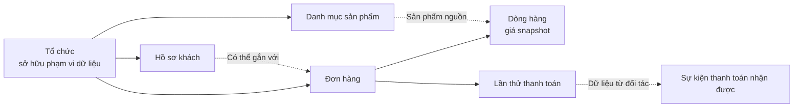
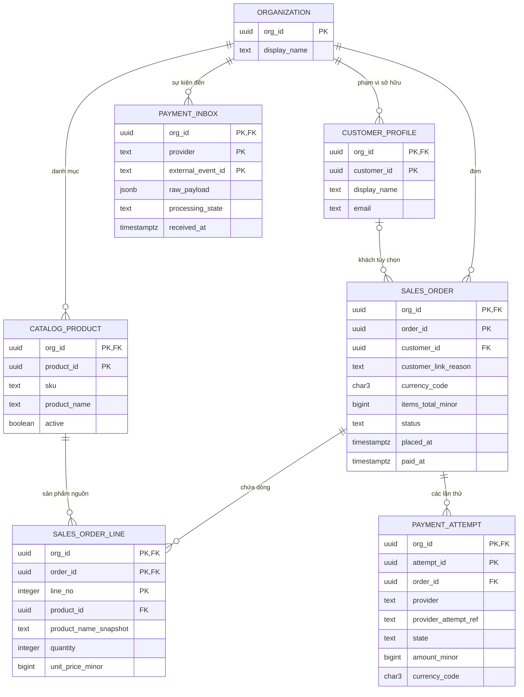
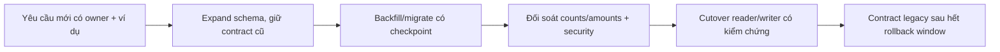

# Hoàn thiện sơ đồ, từ điển dữ liệu, quyết định thiết kế và bộ kiểm chứng

Một mô hình dữ liệu không hoàn thành chỉ vì có sơ đồ ERD đẹp hoặc chạy được câu lệnh `CREATE TABLE`. Người tiếp nhận thiết kế phải hiểu **mỗi hàng đại diện điều gì, vì sao khóa được chọn, ý nghĩa các thuộc tính và trạng thái, hệ nào sở hữu dữ liệu, những ràng buộc nào được database bảo vệ, những ràng buộc nào thuộc ứng dụng**, và quan trọng hơn: **có bằng chứng nào chứng minh mô hình đáp ứng yêu cầu**?

Bài thực hành tổng hợp này kết nối toàn bộ vòng đời thiết kế: đọc yêu cầu → xác định **grain, thực thể, quan hệ** → xây **mô hình logic/vật lý** → hoàn thiện **từ điển dữ liệu** → ghi **quyết định và đánh đổi (ADR)** → tạo **bộ kiểm chứng** → lập kế hoạch tiến hóa và bàn giao. Người học vừa giải quyết một tình huống giả lập, vừa có **bản tham chiếu** để so sánh phương án của mình.

Bài thuộc chương **Thực hành tổng hợp** của module **DATABASE_DATA_MODELING**. Đúng với mục tiêu của module, bài yêu cầu chuyển bài toán nghiệp vụ thành mô hình dữ liệu có thể kiểm chứng, từ thực thể, quan hệ, chuẩn hóa, khóa, chỉ mục tới lược đồ vật lý; đồng thời giải thích vì sao trong tình huống này nên dùng quan hệ thay vì document, đồ thị hoặc kho phân tích cho nghiệp vụ giao dịch chính.

> **Phạm vi:** Toàn bộ tên tổ chức, quy tắc và con số dưới đây là **dữ liệu tình huống giả lập**. SQL sử dụng PostgreSQL; không phải schema của một công ty có thật. Những quy tắc bảo mật, retention và thanh toán được nêu như **yêu cầu thực hành**, không phải lời khẳng định về luật hoặc quy trình của một đơn vị cụ thể.

## 1. Đích đến: một bộ hồ sơ thiết kế có thể bàn giao

Khi hoàn thành, người học có thể đưa cho một đồng nghiệp **sáu phần liên kết với nhau**:

| Phần bàn giao | Câu hỏi phải trả lời | Bằng chứng hoàn thành |
| --- | --- | --- |
| **1. Yêu cầu và ma trận truy vết** | Mô hình giải quyết quy tắc và truy vấn nào? | Mã yêu cầu → entity/field/constraint → test |
| **2. Sơ đồ khái niệm, logic và vật lý** | Thực thể, cardinality, khóa và ranh giới ở đâu? | ERD có chú giải, grain, PK/FK và optionality |
| **3. Từ điển dữ liệu** | Từng trường có ý nghĩa gì, đơn vị nào, nguồn nào? | Định nghĩa, NULL, ownership, bảo mật, thời gian, ví dụ |
| **4. Nhật ký quyết định (ADR)** | Vì sao chọn cách này, không chọn cách kia? | Context, alternatives, consequences, review trigger |
| **5. Bộ kiểm chứng** | Làm sao phát hiện sai dữ liệu hoặc truy cập sai? | Unit/integration/SQL/negative/performance tests và expected outcome |
| **6. Kế hoạch triển khai và tiến hóa** | Có thể rollout, giám sát và thay đổi an toàn không? | Migration, compatibility, đối soát, quyền, vận hành và rollback |

Điều quan trọng là **các phần phải nhất quán**. Nếu từ điển nói một dòng hàng phải có đơn cha thì schema cần FK hoặc một cơ chế thực thi có bằng chứng. Nếu ADR tuyên bố khóa mang scope tổ chức, SQL JOIN và test phải dùng đầy đủ `org_id`. Nếu định nghĩa tổng tiền gồm thuế nhưng lược đồ không có nguồn thuế, đó là **lỗ hổng thiết kế**, không phải chi tiết viết tài liệu.

## 2. Đề bài: nền tảng bán hàng đa tổ chức

Một sản phẩm SaaS cho phép các doanh nghiệp độc lập quản lý khách hàng, danh mục sản phẩm và đơn hàng. Một người dùng có thể là nhân viên của nhiều doanh nghiệp nhưng phải **chọn và được cấp quyền trong đúng tổ chức** trước khi đọc/ghi dữ liệu.

Quy trình phiên bản đầu:

1. Nhân viên tạo đơn **DRAFT** thuộc một tổ chức, có thể gắn khách hàng đã có hồ sơ hoặc đánh dấu đơn **khách vãng lai**.
2. Thêm từng **dòng hàng** với sản phẩm thuộc cùng tổ chức, số lượng, đơn giá tại thời điểm đặt và ảnh chụp tên sản phẩm.
3. Chỉ xác nhận đơn **CONFIRMED** khi có ít nhất một dòng hợp lệ và tổng dòng đã được tính/đối soát.
4. Hệ thống gửi yêu cầu thu tiền qua đối tác; đối tác phát sự kiện **AUTHORIZED**, **CAPTURED** hoặc **DECLINED**. **AUTHORIZED không đồng nghĩa đã thu tiền**.
5. Trong bài tập này, mỗi đơn có tối đa **một lần thu thành công toàn bộ**. Đơn chỉ được sang **PAID** sau khi xác minh bằng chứng capture đúng đơn, đúng tiền tệ và đúng tổng.
6. Đơn đã thanh toán có thể chuyển sang **SHIPPED** theo nghiệp vụ vận hành; chưa xây chi tiết giao vận.
7. Có thể hủy đơn ở trạng thái được chính sách cho phép, nhưng hủy sau capture cần một **quy trình hoàn/đảo riêng**, không được giả vờ xóa capture.
8. Nhân viên có quyền đọc danh sách đơn gần nhất theo tổ chức; bộ phận phân tích cần tổng tiền các đơn đã thanh toán theo ngày. Định nghĩa kế toán chính thức về **doanh thu ròng** và **refund** là phần mở rộng chưa được phê duyệt.

Các trường hợp cần lưu ý: đối tác có thể gửi webhook lặp, gửi đến trễ; tên và giá niêm yết sản phẩm có thể thay đổi; khách có thể yêu cầu xử lý dữ liệu cá nhân; cùng một ID bên ngoài có thể trùng ở hai tổ chức.

### 2.1. Dữ liệu và tải dự kiến

Các con số chỉ dùng để lập thử nghiệm:

| Giả định | Giá trị tình huống | Điều cần kiểm chứng |
| --- | --- | --- |
| Tổ chức hoạt động | 30 | ID và quyền truy cập độc lập |
| Tổng đơn mới | 30.000 đơn/ngày | Transaction throughput và tăng trưởng |
| Tổ chức lớn nhất | 35% đơn mới | Skew, cache và hotspot |
| Truy vấn chính | 100 đơn gần nhất trong một tổ chức | Index, thứ tự ổn định, p95/p99 |
| Mỗi đơn | Thường 1–8 dòng, có thể nhiều hơn | Grain, tổng tiền và FK |
| Webhook thanh toán | At-least-once, có thể trễ 24 giờ | Inbox, dedup, out-of-order |
| Nhu cầu báo cáo | Theo ngày, không bắt buộc realtime tức thì | Grain, metric, freshness |

Không suy rằng mô hình phải chia 64 shard hoặc cần graph database chỉ vì có số tăng trưởng. **Đo** chi phí truy vấn và giới hạn thực trước khi chọn phân tán.

## 3. Bóc tách yêu cầu thành các điều kiện kiểm chứng

Đặt mã yêu cầu để sau này truy vết được:

| Mã | Phát biểu có thể kiểm tra | Phần chịu trách nhiệm |
| --- | --- | --- |
| **R01** | Mỗi khách/sản phẩm/đơn thuộc đúng một `org_id` | PK/FK và quyền tổ chức |
| **R02** | Đơn không tham chiếu khách hoặc sản phẩm của tổ chức khác | Composite FK; negative test |
| **R03** | Mỗi dòng hàng là `(org_id, order_id, line_no)` duy nhất | PK, grain |
| **R04** | Dòng hàng lưu giá và tên sản phẩm tại thời điểm đặt | Snapshot; từ điển |
| **R05** | Số lượng dương; tiền không âm và theo một đồng tiền của đơn | CHECK + policy tiền tệ |
| **R06** | Chỉ xác nhận đơn có ít nhất một dòng, tổng đúng | Domain transaction + đối soát |
| **R07** | Mã trạng thái đơn/attempt nằm trong bộ được hỗ trợ | CHECK + versioned workflow |
| **R08** | `AUTHORIZED` không làm đơn thành `PAID` | Domain transition test |
| **R09** | Một đơn tối đa một capture thành công trong mô hình v1 | Partial unique index + idempotency |
| **R10** | Webhook lặp không tạo capture hoặc side effect lần hai | Inbox unique + handler idempotent |
| **R11** | Danh sách đơn lọc theo tổ chức và phân trang đúng | Query/index/API authorization |
| **R12** | Không gọi “tổng đơn đặt” là “doanh thu ròng đã thu” | Metric definition |
| **R13** | Có quy trình xóa/tách liên kết dữ liệu khách theo policy | Nullable reason, downstream lineage |
| **R14** | Có đường rollout và thử tương thích trước migration phá vỡ | ADR + migration plan + tests |

**Điểm cần phân biệt:** `CHECK(status IN (...))` bảo vệ **tập giá trị**; nó **không tự kiểm tra** đường đi `DRAFT → CONFIRMED → PAID`. R06, R08, R10 và nhiều phần của R13 cần code, transaction hoặc integration workflow có kiểm chứng ngoài DDL.

## 4. Hoạt động 1 — Vẽ mô hình khái niệm trước khi đụng SQL

Hãy tự trả lời:

- Một **Order** khác **PaymentAttempt** ở điểm nào? Một lần authorization có phải tiền đã thu?
- Một khách hàng có thể thuộc nhiều tổ chức không? Định danh có được tái sử dụng?
- Một sản phẩm đổi tên có làm dòng hàng lịch sử đổi theo không?
- Có thể có đơn **0 dòng** khi đang DRAFT không? Khi CONFIRMED thì sao?
- Một payment webhook tới trước khi mapping với đơn sẵn sàng phải xử lý thế nào?

### 4.1. Sơ đồ khái niệm tham khảo



Đường nét đứt biểu diễn **liên kết nghiệp vụ hoặc tham chiếu qua dữ liệu tích hợp**, chưa khẳng định có FK vật lý. Bản khái niệm cần nói được các từ “đơn”, “dòng hàng”, “lần thử thu tiền” và “sự kiện đối tác” **không phải cùng một thực thể**.

### 4.2. Grain và key: một bảng lập trước

| Thực thể | Grain | Khóa dùng để định danh | Có thể nhận nhiều lần? |
| --- | --- | --- | --- |
| Organization | Một tổ chức | `org_id` | Không theo key đó |
| Customer | Một hồ sơ khách trong một tổ chức | `(org_id, customer_id)` | Không theo PK |
| Product | Một sản phẩm trong danh mục tổ chức | `(org_id, product_id)` | Không theo PK |
| SalesOrder | Một đơn trong tổ chức | `(org_id, order_id)` | Không theo PK |
| OrderLine | Một dòng của một đơn | `(org_id, order_id, line_no)` | Không theo PK |
| PaymentAttempt | Một lần thử thanh toán được theo dõi | `(org_id, attempt_id)` | Mỗi attempt duy nhất, trạng thái có thể đổi |
| PaymentInbox | Một webhook được định danh bởi hợp đồng nguồn | `(org_id, provider, external_event_id)` | **Có thể nhận lại**, không tạo dòng mới |

Grain của PaymentInbox là **một sự kiện nguồn duy nhất được tiếp nhận và nhận diện**, còn số lần *delivery/retry* có thể được đo riêng. Nếu nguồn cho phép tái sử dụng event ID trong một namespace nhỏ hơn, khóa inbox phải bao gồm namespace đó; không thể tự khẳng định provider luôn phát ID duy nhất toàn cầu.

## 5. Hoạt động 2 — Hoàn thiện ERD logic và vật lý

### 5.1. Quyết định cardinality

| Quan hệ | Phía con | Phía cha | Ràng buộc thêm |
| --- | --- | --- | --- |
| Organization → Customer | Một customer thuộc đúng một org | Một org có 0..n customer | Không lẫn scope |
| Organization → Product | Một product thuộc đúng một org | Một org có 0..n product | SKU chỉ duy nhất trong org |
| Organization → Order | Một order thuộc đúng một org | Một org có 0..n order | Người gọi phải có quyền org |
| Customer → Order | Order có 0 hoặc 1 customer | Customer có 0..n order | `NULL` có **lý do** GUEST/ERASED |
| Order → OrderLine | Mỗi line thuộc đúng một order | Order có 0..n line **về cấu trúc** | **CONFIRMED yêu cầu ≥1**, do domain kiểm |
| Product → OrderLine | Mỗi line tham chiếu một product | Product có 0..n line | Snapshot tên/giá không bị sửa theo product |
| Order → PaymentAttempt | Mỗi attempt thuộc đúng một order | Order có 0..n attempt | Tối đa 1 captured ở v1 |

Đừng dùng ký hiệu 1..n cho **mọi** đơn nếu database cho phép tạo DRAFT 0 dòng. Có thể ghi hai tầng: **cardinality vật lý 0..n**, **business invariant ≥1 tại thời điểm xác nhận**.

### 5.2. ERD vật lý tham khảo



**Chú giải:** Đây là sơ đồ trình bày khóa và quan hệ; chưa hiển thị toàn bộ constraint/index của phần SQL. `PAYMENT_INBOX` cố ý **không có FK trực tiếp tới PaymentAttempt**, vì webhook có thể tới trước khi mapping được tạo. Liên kết qua `provider_attempt_ref` được giải quyết trong application/integration layer và phải có test, không vẽ nét liền giả như một FK đã được thực thi.

**Bài tự làm:** Hãy bổ sung nhãn cho mọi khóa composite, phân biệt quan hệ có FK với quan hệ chỉ được application diễn giải. Giải thích vì sao `org_id` lặp trong OrderLine/PaymentAttempt là một lựa chọn bảo vệ ranh giới tenant chứ không mặc định “dữ liệu dư thừa cần chuẩn hóa bỏ đi”.

## 6. Hoạt động 3 — Lược đồ PostgreSQL tham khảo

DDL dưới đây là **một phương án đáp ứng tình huống**, không phải lời giải duy nhất. Nó thể hiện những invariant có thể ép bằng database; những invariant vượt qua nhiều hàng hoặc phụ thuộc trạng thái nghiệp vụ sẽ được kiểm ở tầng ứng dụng và bộ SQL phía sau.

### 6.1. Tổ chức, khách hàng và danh mục

```sql
CREATE TABLE organization (
    org_id UUID PRIMARY KEY,
    display_name TEXT NOT NULL
        CHECK (length(btrim(display_name)) > 0)
);

CREATE TABLE customer_profile (
    org_id UUID NOT NULL
        REFERENCES organization(org_id),
    customer_id UUID NOT NULL,
    display_name TEXT NOT NULL
        CHECK (length(btrim(display_name)) > 0),
    email TEXT,
    PRIMARY KEY (org_id, customer_id)
);

CREATE TABLE catalog_product (
    org_id UUID NOT NULL
        REFERENCES organization(org_id),
    product_id UUID NOT NULL,
    sku TEXT NOT NULL
        CHECK (length(btrim(sku)) > 0),
    product_name TEXT NOT NULL
        CHECK (length(btrim(product_name)) > 0),
    active BOOLEAN NOT NULL DEFAULT TRUE,
    PRIMARY KEY (org_id, product_id),
    UNIQUE (org_id, sku)
);
```

Phần này dùng `customer_id`/`product_id` do hệ thống cấp trong scope tổ chức. `email` không là business key tự nhiên: email có thể thay đổi, bị dùng chung hoặc được xóa theo policy. `sku` được thống nhất là duy nhất theo `org_id` trong tình huống; nếu sản phẩm thực có nhiều SKU/alias phải đổi mô hình thay vì nới constraint tùy tiện.

### 6.2. Đơn hàng và dòng hàng

```sql
CREATE TABLE sales_order (
    org_id UUID NOT NULL
        REFERENCES organization(org_id),
    order_id UUID NOT NULL,
    customer_id UUID,
    customer_link_reason VARCHAR(12) NOT NULL,
    currency_code CHAR(3) NOT NULL
        CHECK (currency_code ~ '^[A-Z]{3}$'),
    items_total_minor BIGINT NOT NULL DEFAULT 0
        CHECK (items_total_minor >= 0),
    status VARCHAR(12) NOT NULL DEFAULT 'DRAFT'
        CHECK (status IN (
            'DRAFT', 'CONFIRMED', 'PAID',
            'SHIPPED', 'CANCELLED'
        )),
    placed_at TIMESTAMPTZ NOT NULL DEFAULT now(),
    paid_at TIMESTAMPTZ,
    PRIMARY KEY (org_id, order_id),
    FOREIGN KEY (org_id, customer_id)
        REFERENCES customer_profile(org_id, customer_id),
    CONSTRAINT ck_customer_link_reason CHECK (
        (
            customer_id IS NOT NULL
            AND customer_link_reason = 'KNOWN'
        )
        OR
        (
            customer_id IS NULL
            AND customer_link_reason IN ('GUEST', 'ERASED')
        )
    ),
    CONSTRAINT ck_paid_time CHECK (
        (
            status IN ('PAID', 'SHIPPED')
            AND paid_at IS NOT NULL
            AND paid_at >= placed_at
        )
        OR
        (
            status NOT IN ('PAID', 'SHIPPED')
            AND paid_at IS NULL
        )
    )
);

CREATE TABLE sales_order_line (
    org_id UUID NOT NULL,
    order_id UUID NOT NULL,
    line_no INTEGER NOT NULL CHECK (line_no > 0),
    product_id UUID NOT NULL,
    product_name_snapshot TEXT NOT NULL
        CHECK (length(btrim(product_name_snapshot)) > 0),
    quantity INTEGER NOT NULL CHECK (quantity > 0),
    unit_price_minor BIGINT NOT NULL
        CHECK (unit_price_minor > 0),
    PRIMARY KEY (org_id, order_id, line_no),
    FOREIGN KEY (org_id, order_id)
        REFERENCES sales_order(org_id, order_id),
    FOREIGN KEY (org_id, product_id)
        REFERENCES catalog_product(org_id, product_id)
);
```

**Chú ý tính đúng:**

- Một `SALES_ORDER` có thể DRAFT với 0 dòng; khi chuyển sang CONFIRMED, ứng dụng phải xác minh **ít nhất một dòng**.
- `items_total_minor` trong phiên bản này được định nghĩa **chính xác bằng tổng `quantity × unit_price_minor`**. Thuế, phí giao, voucher, hoàn trả **chưa nằm trong phạm vi**. Nếu nghiệp vụ mở rộng, phải đổi định nghĩa và schema theo version; không tự coi `items_total_minor` là doanh thu ròng.
- `currency_code` của đơn quy định tiền tệ cho tất cả dòng; các giá snapshot của dòng đã ở **đơn vị nhỏ nhất của đồng tiền ấy**. Conversion từ bảng giá hoặc nguồn khác phải được kiểm tra **trước khi lưu**; DDL không thể tự suy nguồn tỷ giá.
- `customer_link_reason='ERASED'` là lý do đã gỡ tham chiếu; **không** chứng minh tên/email trong file, log hoặc payment payload đã được xóa.
- `paid_at >= placed_at` là giả định workflow của bài; khi tích hợp hệ cũ hoặc event có clock không đáng tin, phải xem lại chính sách thời gian thay vì ép dữ liệu giả cho qua CHECK.

### 6.3. Lần thử thanh toán và webhook inbox

```sql
CREATE TABLE payment_attempt (
    org_id UUID NOT NULL,
    attempt_id UUID NOT NULL,
    order_id UUID NOT NULL,
    provider TEXT NOT NULL
        CHECK (length(btrim(provider)) > 0),
    provider_attempt_ref TEXT NOT NULL
        CHECK (length(btrim(provider_attempt_ref)) > 0),
    state VARCHAR(12) NOT NULL
        CHECK (state IN (
            'CREATED', 'AUTHORIZED', 'CAPTURED', 'DECLINED'
        )),
    amount_minor BIGINT NOT NULL CHECK (amount_minor > 0),
    currency_code CHAR(3) NOT NULL
        CHECK (currency_code ~ '^[A-Z]{3}$'),
    attempted_at TIMESTAMPTZ NOT NULL,
    state_updated_at TIMESTAMPTZ NOT NULL,
    PRIMARY KEY (org_id, attempt_id),
    FOREIGN KEY (org_id, order_id)
        REFERENCES sales_order(org_id, order_id),
    UNIQUE (org_id, provider, provider_attempt_ref)
);

-- Nghiệp vụ phiên bản đầu: một đơn có tối đa một
-- attempt ở trạng thái CAPTURED tại một thời điểm.
CREATE UNIQUE INDEX ux_one_capture_per_order
    ON payment_attempt (org_id, order_id)
    WHERE state = 'CAPTURED';

CREATE TABLE payment_inbox (
    org_id UUID NOT NULL
        REFERENCES organization(org_id),
    provider TEXT NOT NULL
        CHECK (length(btrim(provider)) > 0),
    external_event_id TEXT NOT NULL
        CHECK (length(btrim(external_event_id)) > 0),
    payload_sha256 CHAR(64) NOT NULL
        CHECK (payload_sha256 ~ '^[0-9a-f]{64}$'),
    raw_payload JSONB NOT NULL,
    occurred_at TIMESTAMPTZ,
    received_at TIMESTAMPTZ NOT NULL DEFAULT now(),
    processing_state VARCHAR(16) NOT NULL
        CHECK (processing_state IN (
            'RECEIVED', 'DEFERRED', 'REJECTED', 'APPLIED'
        )),
    reason_code TEXT,
    PRIMARY KEY (org_id, provider, external_event_id)
);

CREATE INDEX ix_payment_inbox_pending
    ON payment_inbox (processing_state, received_at)
    WHERE processing_state IN ('RECEIVED', 'DEFERRED');

CREATE INDEX ix_orders_recent
    ON sales_order (
        org_id, placed_at DESC, order_id DESC
    );

CREATE INDEX ix_orders_status
    ON sales_order (org_id, status, placed_at DESC, order_id DESC);

CREATE INDEX ix_lines_by_product
    ON sales_order_line (org_id, product_id);
```

**Giới hạn cần nói rõ:** Partial unique index chỉ chặn **hai payment_attempt hiện cùng `CAPTURED` trong một đơn**, không chứng minh capture đúng giá trị hay ngăn đối tác thu tiền hai lần bên ngoài database. `payment_inbox` ngăn ghi trùng một event ID theo namespace nhưng không tự chứng minh consumer không phát side effect hai lần sau crash. Phải phối hợp transaction, idempotent handler và reconciliation.

Không tạo FK từ inbox sang attempt vì **sự kiện có thể đến trước mapping**. `DEFERRED` là kết quả hợp lệ khi thiếu dependency có thể bổ sung, không phải lý do tự tạo một attempt hoặc order mới theo dữ liệu đối tác không xác minh.

## 7. Đánh giá chuẩn hóa và dư thừa có chủ đích

Trong schema tham khảo, một vài dữ liệu lặp có lý do:

| Thành phần | Có vẻ dư thừa? | Lý do tồn tại | Điều kiện kiểm soát |
| --- | --- | --- | --- |
| `org_id` trong line/attempt | Đã biết org từ order | Composite FK và đường truy vấn giữ tenant scope | FK ghép, query lọc đủ key |
| `product_name_snapshot` | Đã có `catalog_product.product_name` | Tên tại thời điểm đặt phải bất biến dù catalog đổi | Ghi snapshot trong transaction tạo line |
| `unit_price_minor` | Có thể tra bảng giá | Giá thực tế giao dịch có thể khác niêm yết | Lưu currency/source/price rule khi cần |
| `items_total_minor` | Có thể SUM dòng | Đọc nhanh, đối soát với payment | Application cập nhật nguyên tử; quality query |
| `raw_payload` trong inbox | Có normalized state | Audit/reprocess khi hợp đồng nguồn thay đổi | Quyền, PII minimization, retention |

Chuẩn hóa không có nghĩa **xóa mọi bản sao**. Bản sao được phép khi có **định nghĩa riêng, nguồn cập nhật, ràng buộc và kiểm thử nhất quán**. Ngược lại, nếu trùng dữ liệu mà không ai biết giá trị nào là nguồn sự thật, đó là dấu hiệu thiết kế thiếu rõ ràng.

Trong một schema quan hệ, `items_total_minor` là một **derived value**. Câu `CHECK` không thể tham chiếu tổng các dòng trong bảng khác bằng biểu thức đơn giản. Việc xác nhận đơn và cập nhật tổng phải nằm trong một transaction có khóa/phiên bản thích hợp để tránh tranh chấp với thao tác sửa dòng.

## 8. Hoạt động 4 — Từ điển dữ liệu ở cấp entity

Không chỉ ghi “`customer_id` là UUID”. Từ điển nên giúp người khác hiểu **bản chất, khóa, vòng đời và cách dùng dữ liệu**.

| Entity | Grain | Nguồn sự thật | Owner chức năng | Retention/PII cần xét |
| --- | --- | --- | --- | --- |
| `organization` | Một tổ chức | Dịch vụ quản trị tenant | Platform | Tên tổ chức, vòng đời tenant |
| `customer_profile` | Một hồ sơ khách trong org | Customer domain | Customer/CRM | Tên, email; quyền xóa và hạn lưu |
| `catalog_product` | Một sản phẩm trong org | Catalog domain | Catalog | SKU/giá niêm yết, deactivation |
| `sales_order` | Một đơn của org | Order domain | Order | Thông tin giao dịch, liên kết khách |
| `sales_order_line` | Một dòng đặt hàng | Order domain | Order | Snapshot tên/giá, chứng từ |
| `payment_attempt` | Một lần thử thanh toán | Payment integration + domain xác minh | Payment | ID nguồn và bằng chứng thanh toán |
| `payment_inbox` | Một event nguồn duy nhất được nhận diện | Integration inbox | Integration | Raw payload có thể chứa PII; retention riêng |

**Owner** ở đây là vai trò sở hữu *định nghĩa và thay đổi*; không hàm ý cùng service nhất thiết phải sở hữu mọi bảng vật lý. Nếu vận hành qua nhiều bounded context, các bảng có thể ở những database riêng; lúc đó FK xuyên database **không còn được một PostgreSQL duy nhất thực thi** và phải thay bằng hợp đồng/kiểm tra khác. Trong tình huống thực hành, một database giao dịch được chọn để minh họa đầy đủ constraint.

## 9. Từ điển dữ liệu ở cấp thuộc tính

Mỗi dòng từ điển phải có ít nhất: **field, kiểu, bắt buộc, nghĩa, nguồn/đơn vị, ví dụ, quyền và kiểm tra**. Với các trường tiền/thời gian, không được bỏ đơn vị hoặc loại thời điểm.

### 9.1. Organization, Customer, Product

| Bảng.trường | Kiểu / null | Định nghĩa và ví dụ | Kiểm tra/ghi chú |
| --- | --- | --- | --- |
| `organization.org_id` | UUID, NOT NULL | ID tổ chức do hệ thống cấp | PK, không tin ID client chưa được phép |
| `organization.display_name` | TEXT, NOT NULL | Tên tổ chức để hiển thị | Không rỗng, không dùng làm PK |
| `customer_profile.org_id` | UUID, NOT NULL | Scope sở hữu khách | Cùng namespace với organization |
| `customer_profile.customer_id` | UUID, NOT NULL | ID hồ sơ trong org | PK ghép, có thể trùng với org khác |
| `customer_profile.display_name` | TEXT, NOT NULL | Tên khách phục vụ nghiệp vụ | PII, quyền truy cập/retention |
| `customer_profile.email` | TEXT, NULL | Email nếu có căn cứ lưu | PII; NULL không đồng nghĩa đã xóa |
| `catalog_product.product_id` | UUID, NOT NULL | ID sản phẩm trong org | PK ghép |
| `catalog_product.sku` | TEXT, NOT NULL | SKU theo namespace tổ chức | Unique `(org_id,sku)` |
| `catalog_product.product_name` | TEXT, NOT NULL | Tên catalog hiện tại | Thay đổi không sửa lịch sử order_line |
| `catalog_product.active` | BOOL, NOT NULL | Có thể dùng để tạo dòng mới hay không | Tắt bán không đồng nghĩa xóa lịch sử |

### 9.2. Order và OrderLine

| Bảng.trường | Kiểu / null | Định nghĩa và ví dụ | Kiểm tra/ghi chú |
| --- | --- | --- | --- |
| `sales_order.org_id` | UUID, NOT NULL | Scope chủ sở hữu đơn | PK/FK đều giữ scope |
| `sales_order.order_id` | UUID, NOT NULL | ID đơn trong org | PK `(org_id,order_id)` |
| `sales_order.customer_id` | UUID, NULL | Hồ sơ khách nếu có | FK ghép, có thể detach khi xử lý xóa |
| `sales_order.customer_link_reason` | VARCHAR, NOT NULL | `KNOWN`, `GUEST` hoặc `ERASED` | CHECK khớp việc có/không có ID |
| `sales_order.currency_code` | CHAR(3), NOT NULL | Mã đồng tiền, ví dụ `VND`, `USD` | Mẫu 3 chữ in hoa; phải kiểm currency thực qua policy |
| `sales_order.items_total_minor` | BIGINT, NOT NULL | Tổng tiền **đơn vị nhỏ nhất**, bằng tổng các dòng v1 | Không dùng làm “doanh thu ròng” |
| `sales_order.status` | VARCHAR, NOT NULL | `DRAFT/CONFIRMED/PAID/SHIPPED/CANCELLED` | Workflow guard ở domain |
| `sales_order.placed_at` | TIMESTAMPTZ, NOT NULL | Thời điểm ghi nhận đơn theo contract của bài | Không nhầm event time với ingestion time |
| `sales_order.paid_at` | TIMESTAMPTZ, NULL | Thời điểm domain xác nhận thu tiền | Chỉ có khi PAID/SHIPPED trong chính sách mẫu |
| `sales_order_line.line_no` | INTEGER, NOT NULL | Số dòng dương duy nhất trong đơn | PK cùng org/order |
| `sales_order_line.product_id` | UUID, NOT NULL | Sản phẩm nguồn trong cùng org | FK ghép `(org_id,product_id)` |
| `sales_order_line.product_name_snapshot` | TEXT, NOT NULL | Tên sản phẩm lúc dòng được tạo | Không cập nhật theo tên catalog |
| `sales_order_line.quantity` | INTEGER, NOT NULL | Số lượng đơn vị sản phẩm, >0 | Định nghĩa unit nếu sản phẩm có trọng lượng |
| `sales_order_line.unit_price_minor` | BIGINT, NOT NULL | Đơn giá chốt theo currency của order, >0 | Giá tại thời điểm giao dịch, không tra giá hiện tại |

### 9.3. PaymentAttempt và Inbox

| Bảng.trường | Kiểu / null | Định nghĩa và ví dụ | Kiểm tra/ghi chú |
| --- | --- | --- | --- |
| `payment_attempt.attempt_id` | UUID, NOT NULL | ID nội bộ của một lần thử | PK ghép với org |
| `payment_attempt.order_id` | UUID, NOT NULL | Đơn đang được thanh toán | FK ghép scope |
| `payment_attempt.provider` | TEXT, NOT NULL | Namespace đối tác, ví dụ `PAYMENT_A` | Phải được xác minh từ cấu hình kết nối |
| `payment_attempt.provider_attempt_ref` | TEXT, NOT NULL | ID attempt theo đối tác | Unique trong `(org,provider)` theo contract tình huống |
| `payment_attempt.state` | VARCHAR, NOT NULL | `CREATED/AUTHORIZED/CAPTURED/DECLINED` | Không tự đồng nhất AUTHORIZED với PAID |
| `payment_attempt.amount_minor` | BIGINT, NOT NULL | Số tiền trong attempt, >0 | Phải so đúng tiền tệ và order total |
| `payment_attempt.currency_code` | CHAR(3), NOT NULL | Tiền tệ của attempt | So với order, không chỉ so số tiền |
| `payment_attempt.attempted_at` | TIMESTAMPTZ, NOT NULL | Khi hệ ghi nhận attempt | Có thể khác event time của provider |
| `payment_attempt.state_updated_at` | TIMESTAMPTZ, NOT NULL | Khi state nội bộ đổi | Không tự kết luận thứ tự event nguồn |
| `payment_inbox.external_event_id` | TEXT, NOT NULL | ID event do đối tác phát | PK gồm org/provider/event; dedup |
| `payment_inbox.payload_sha256` | CHAR(64), NOT NULL | Digest canonical/raw bytes theo contract | Phát hiện conflict khi ID trùng payload khác |
| `payment_inbox.raw_payload` | JSONB, NOT NULL | Payload nguồn để audit/replay được phép | PII, kiểm soát truy cập, retention |
| `payment_inbox.occurred_at` | TIMESTAMPTZ, NULL | Thời điểm nguồn tuyên bố event xảy ra | Thiếu timezone → không tự suy |
| `payment_inbox.received_at` | TIMESTAMPTZ, NOT NULL | Thời điểm hệ nhận webhook | Dùng để đo lag và backoff |
| `payment_inbox.processing_state` | VARCHAR, NOT NULL | `RECEIVED/DEFERRED/REJECTED/APPLIED` | Đọc được backlog |
| `payment_inbox.reason_code` | TEXT, NULL | Lý do defer/reject theo contract | Tránh log payload/PII vào reason |

Từ điển trên **chưa phải bản tài liệu chính sách hoàn chỉnh**: mỗi dự án thật cần URL tới source contract, owner xác minh, SLA, phân loại nhạy cảm, version và mốc xem lại. Nhưng nó đủ để người học thấy tại sao một danh sách tên cột từ database catalog **không thay thế được ý nghĩa nghiệp vụ**.

## 10. Hoạt động 5 — Viết quyết định thiết kế (ADR)

Một ADR tốt không chỉ ghi “chúng tôi dùng PostgreSQL”. Nó phải cho thấy **bối cảnh, lựa chọn, đánh đổi, điều kiện thay đổi**.

### ADR-001 — Dùng lược đồ quan hệ có cấu trúc thay vì bảng object/EAV vạn năng

**Context.** Hiện có tập thực thể và truy vấn ổn định: org, customer, product, order, line, payment attempt. Nhiều invariant liên quan PK, FK, UNIQUE, tiền và transaction.

**Options.**

| Phương án | Ưu điểm | Hạn chế |
| --- | --- | --- |
| PostgreSQL typed tables | PK/FK/CHECK, transaction, SQL reporting rõ | Thêm field chính cần migration |
| Một bảng EAV cho mọi object | Field động lúc runtime | FK/type và query/validation khó; nguy cơ mất nghĩa |
| Document store cho toàn bộ order | Đọc/ghi aggregate document thuận tiện ở vài workload | Liên kết tenant/product/payment, transaction/index cần đánh giá riêng |
| Graph store làm nguồn chính | Mạnh khi query traversal nhiều hop là trọng tâm | Bài toán hiện tại thiên về giao dịch và tổng hợp, không có traversal cốt lõi |

**Decision.** Chọn bảng quan hệ rõ grain và ràng buộc. Không xây EAV toàn hệ chỉ để chuẩn bị đối tượng chưa có yêu cầu. `raw_payload JSONB` chỉ nằm ở biên tích hợp, không thay entity domain.

**Consequences.** Dễ kiểm thử tính đúng và quyền scope; cần quy trình migration/version, theo dõi index/storage và sửa model khi workflow thay đổi.

**Review trigger.** Khi có yêu cầu runtime custom fields được xác minh, hoặc workload phân tích/traversal đã đo vượt giới hạn hiện tại.

### ADR-002 — Mang `org_id` qua PK/FK để cô lập tổ chức

**Context.** Một local ID có thể trùng ở hai tổ chức. Quan hệ Order–Customer, OrderLine–Product và Payment–Order không được vượt scope.

**Options.** Chỉ dùng UUID toàn cục + kiểm tra ở code; dùng khóa ghép `(org_id, local_id)`; tách database cho mỗi tenant.

**Decision.** Trong bài thực hành một database đa tenant, dùng khóa ghép và FK ghép; ứng dụng vẫn xác minh quyền principal theo org, không tin org ID client tự gửi.

**Consequences.** Query và index phải mang đủ scope; FK ngăn liên kết nhầm tenant. Không giải quyết toàn bộ authorization, search/caching hay export; cần test các đường đó.

**Review trigger.** Khi xuất hiện chia sẻ thật giữa tổ chức, yêu cầu data residency, hoặc một tenant cần tài nguyên riêng theo đo đạc; **không** lách ranh giới bằng cách bỏ cột org khỏi FK.

### ADR-003 — Snapshot dòng hàng và lưu inbox thanh toán

**Context.** Giá/tên catalog thay đổi; payment provider gửi lại hoặc gửi trễ event. Không được đổi lịch sử đơn khi giá catalog thay, và không được ghi nhận capture hai lần vì webhook lặp.

**Decision.** Dòng hàng giữ `product_name_snapshot`, `unit_price_minor`. Payment có attempt riêng; inbox có identity/hash/state, định danh nguồn được xác minh; workflow domain xác nhận capture trước khi PAID.

**Trade-off.** Snapshot cần quy tắc cập nhật nguồn; inbox chứa payload có nguy cơ PII/retention; event processing cần idempotency và xử lý out-of-order. Các yếu tố ấy **phải được kiểm chứng**, không chỉ được liệt kê.

**Review trigger.** Khi hỗ trợ partial capture/refund, giá đa tiền tệ hoặc payment provider mới có semantics khác, cần cập nhật contract/schema/tests theo phiên bản.

### ADR-004 — Chưa shard trước khi có bằng chứng

Tải giả định chưa chứng minh giới hạn scale-out. Đầu tiên đo `EXPLAIN`, index, QPS/p99, skew theo tenant, backup/restore time. Khi có bottleneck được xác nhận, thử partitioning, tenant isolation hoặc analytics projection theo query thực. Chấp nhận có thể cần migration trong tương lai, đổi lại không vận hành routing đa shard quá sớm.

**Bài tự làm:** Chọn một ADR và bổ sung **người phê duyệt, version, ngày, bằng chứng test, phương án bị loại**. Một quyết định chỉ có tên công nghệ là chưa đủ để người tiếp nhận hiểu đánh đổi.

## 11. Hoạt động 6 — Truy vấn và chỉ mục theo mẫu truy cập

### 11.1. Liệt kê đơn theo tổ chức, phân trang bằng khóa

```sql
-- $1 = org_id đã được backend xác minh quyền
SELECT
    order_id,
    status,
    items_total_minor,
    currency_code,
    placed_at
FROM sales_order
WHERE org_id = $1
ORDER BY placed_at DESC, order_id DESC
LIMIT 100;

-- Trang kế tiếp: $2 = placed_at cuối trang trước,
-- $3 = order_id cuối trang trước.
SELECT
    order_id,
    status,
    items_total_minor,
    currency_code,
    placed_at
FROM sales_order
WHERE org_id = $1
  AND (placed_at, order_id) < ($2, $3)
ORDER BY placed_at DESC, order_id DESC
LIMIT 100;
```

Index `ix_orders_recent(org_id, placed_at DESC, order_id DESC)` là ứng viên phù hợp. Tuy nhiên nếu order bị sửa/xóa hoặc xuất hiện đơn mới trong khi phân trang, kết quả có thể thay đổi; API cần công bố semantics consistency/snapshot. Không tự hứa “không bao giờ lặp/mất bản ghi” nếu không thiết kế snapshot hoặc cursor phù hợp.

### 11.2. Lấy dòng hàng của một đơn

```sql
SELECT
    l.line_no,
    l.product_id,
    l.product_name_snapshot,
    l.quantity,
    l.unit_price_minor
FROM sales_order_line AS l
WHERE l.org_id = $1
  AND l.order_id = $2
ORDER BY l.line_no;
```

PK ghép có thể hỗ trợ đường này. Không cần index riêng cho tất cả cột theo thói quen; xem execution plan thực tế.

### 11.3. Một chỉ số báo cáo có định nghĩa

**Giả lập “giá trị các đơn hiện đánh dấu PAID hoặc SHIPPED theo ngày đặt”** — đây là một metric vận hành, **không phải doanh thu ròng, không phải tổng tiền đã settlement**:

```sql
SELECT
    date_trunc(
        'day',
        placed_at AT TIME ZONE 'UTC'
    )::date AS order_day_utc,
    currency_code,
    SUM(items_total_minor::numeric) AS order_value_minor
FROM sales_order
WHERE org_id = $1
  AND status IN ('PAID', 'SHIPPED')
  AND placed_at >= $2
  AND placed_at < $3
GROUP BY 1, currency_code
ORDER BY 1, currency_code;
```

Định nghĩa rõ:

- **Grain nguồn:** một `sales_order`; không join thẳng payment attempts và lines khi SUM, tránh nhân hàng.
- **Điều kiện:** trạng thái **hiện tại** là PAID hoặc SHIPPED; một đơn bị CANCELLED sẽ không còn được tính dù từng PAID.
- **Thời gian:** ngày đặt theo UTC, **không** phải ngày capture hoặc ngày ghi nhận kế toán.
- **Đơn vị:** đồng tiền nhỏ nhất theo `currency_code`, không cộng chéo USD/VND nếu chưa có quy tắc FX.
- **Hạn chế:** refund, partial capture, lịch sử trạng thái và số liệu tài chính chuẩn **chưa được mô hình hóa**, nên không đặt tên KPI là “doanh thu thực nhận”.

Nếu yêu cầu là **dòng tiền capture theo ngày**, hãy thiết kế metric theo **payment capture event/ledger** với time semantics riêng, không âm thầm dùng trạng thái order hiện tại.

## 12. Hoạt động 7 — Ma trận kiểm chứng theo từng lớp

| Lớp | Mục tiêu | Ví dụ bằng chứng |
| --- | --- | --- |
| **Schema unit/negative** | DB từ chối sai khóa/kiểu/ràng buộc | Insert FK chéo org, quantity 0, duplicate SKU |
| **Domain unit** | Workflow chuyển trạng thái đúng | DRAFT không có line không CONFIRMED; AUTHORIZED không PAID |
| **Application integration** | Transaction, idempotency, mapping đúng | Retry webhook không tạo thêm capture |
| **Data quality SQL** | Phát hiện dữ liệu lệch dù thao tác chạy thành công | Tổng line sai, status PAID thiếu capture |
| **Authorization/security** | Người không có quyền không truy cập được | User B đoán ID A, export/caching không rò |
| **Performance** | Truy vấn đáp ứng SLO dưới tải đại diện | `EXPLAIN (ANALYZE, BUFFERS)`, p95/p99 |
| **Evolution/compatibility** | Schema mới không phá phiên bản cũ trong rollout | A0/S1, A1/S1, backfill/rollback drill |
| **Recovery/privacy** | Khôi phục và xóa dữ liệu đúng policy | Replay không tái sinh hồ sơ đã được xóa |

**Tối thiểu bộ kiểm chứng phải có test thất bại được kỳ vọng.** Một bộ test chỉ kiểm việc INSERT hợp lệ thành công không chứng minh FK, quyền và invariant được bảo vệ.

## 13. SQL kiểm thử ràng buộc: chuẩn bị fixture cô lập

Ví dụ tạo dữ liệu nhỏ với ID cố định để người học hiểu chính xác ca thử. Chạy trên **database kiểm thử riêng** sau khi tạo DDL mục 6; không chạy trực tiếp trên production.

```sql
BEGIN;

INSERT INTO organization (org_id, display_name)
VALUES
    ('10000000-0000-4000-8000-000000000001', 'Org A'),
    ('10000000-0000-4000-8000-000000000002', 'Org B');

INSERT INTO customer_profile (
    org_id, customer_id, display_name, email
)
VALUES (
    '10000000-0000-4000-8000-000000000001',
    '20000000-0000-4000-8000-000000000017',
    'Khách A', 'a@example.test'
);

INSERT INTO catalog_product (
    org_id, product_id, sku, product_name, active
)
VALUES (
    '10000000-0000-4000-8000-000000000001',
    '30000000-0000-4000-8000-000000000001',
    'SKU-01', 'Sản phẩm thử', TRUE
);

INSERT INTO sales_order (
    org_id, order_id, customer_id, customer_link_reason,
    currency_code, items_total_minor, status, placed_at
)
VALUES (
    '10000000-0000-4000-8000-000000000001',
    '40000000-0000-4000-8000-000000000001',
    '20000000-0000-4000-8000-000000000017',
    'KNOWN', 'VND', 200000, 'DRAFT',
    '2030-04-01T09:00:00+00'
);

INSERT INTO sales_order_line (
    org_id, order_id, line_no, product_id,
    product_name_snapshot, quantity, unit_price_minor
)
VALUES (
    '10000000-0000-4000-8000-000000000001',
    '40000000-0000-4000-8000-000000000001',
    1,
    '30000000-0000-4000-8000-000000000001',
    'Sản phẩm thử', 2, 100000
);

-- Các truy vấn kiểm chứng tiếp theo chạy trong transaction này.
-- ROLLBACK ở cuối để không giữ dữ liệu fixture.
```

Với dữ liệu trên, dòng hàng có `2 × 100000 = 200000` VND; trạng thái đơn đang DRAFT. Không suy rằng vì tổng đúng nên đã được phép xác nhận hay đã thanh toán.

### 13.1. Thử trường hợp sai bằng PL/pgSQL có bắt ngoại lệ

Nếu thử `INSERT` sai trong transaction bằng SQL thông thường, PostgreSQL đánh dấu transaction là **aborted** và các lệnh tiếp theo phải rollback/savepoint. Đoạn `DO` dưới đây bắt đúng ngoại lệ để bài thực hành tiếp tục:

```sql
DO $$
BEGIN
    -- Đơn của B cố trỏ tới customer chỉ tồn tại ở A.
    BEGIN
        INSERT INTO sales_order (
            org_id, order_id, customer_id, customer_link_reason,
            currency_code, items_total_minor, status, placed_at
        )
        VALUES (
            '10000000-0000-4000-8000-000000000002',
            '40000000-0000-4000-8000-000000000002',
            '20000000-0000-4000-8000-000000000017',
            'KNOWN', 'VND', 0, 'DRAFT',
            '2030-04-01T09:05:00+00'
        );
        RAISE EXCEPTION 'TEST FAILED: cross-org FK accepted';
    EXCEPTION
        WHEN foreign_key_violation THEN
            RAISE NOTICE 'PASS: cross-org FK rejected';
    END;

    -- Số lượng 0 vi phạm ràng buộc CHECK.
    BEGIN
        INSERT INTO sales_order_line (
            org_id, order_id, line_no, product_id,
            product_name_snapshot, quantity, unit_price_minor
        )
        VALUES (
            '10000000-0000-4000-8000-000000000001',
            '40000000-0000-4000-8000-000000000001',
            2,
            '30000000-0000-4000-8000-000000000001',
            'Sản phẩm thử', 0, 100000
        );
        RAISE EXCEPTION 'TEST FAILED: quantity 0 accepted';
    EXCEPTION
        WHEN check_violation THEN
            RAISE NOTICE 'PASS: invalid quantity rejected';
    END;
END;
$$;
```

Nếu test bị chặn bởi một lỗi **khác** dự kiến, đoạn này không xem đó là PASS. Các ca cần chạy trong một môi trường cô lập có schema và fixture xác định; **không được sửa test để bỏ lỗi bằng cách nới FK/CHECK**.

## 14. SQL kiểm chứng dữ liệu đã lưu

Các truy vấn dưới đây là **kiểm tra chất lượng/đối soát**, không phải constraint tự động. Trên dữ liệu mẫu, một số truy vấn cố ý trả rỗng vì chưa xác nhận đơn hoặc chưa có payment attempt.

### 14.1. Đơn xác nhận nhưng không có dòng

```sql
SELECT o.org_id, o.order_id, o.status
FROM sales_order AS o
WHERE o.status IN ('CONFIRMED', 'PAID', 'SHIPPED')
  AND NOT EXISTS (
      SELECT 1
      FROM sales_order_line AS l
      WHERE l.org_id = o.org_id
        AND l.order_id = o.order_id
  );
```

**Kỳ vọng:** 0 hàng. Nếu có hàng, invariant R06 bị phá, dù các FK đơn–dòng vẫn có thể hợp lệ.

### 14.2. Tổng đơn lệch tổng dòng

```sql
WITH line_total AS (
    SELECT
        org_id,
        order_id,
        SUM(
            quantity::numeric * unit_price_minor::numeric
        ) AS computed_minor
    FROM sales_order_line
    GROUP BY org_id, order_id
)
SELECT
    o.org_id, o.order_id,
    o.items_total_minor AS stored_minor,
    COALESCE(t.computed_minor, 0) AS expected_minor
FROM sales_order AS o
LEFT JOIN line_total AS t
  ON t.org_id = o.org_id
 AND t.order_id = o.order_id
WHERE o.status IN ('CONFIRMED', 'PAID', 'SHIPPED')
  AND o.items_total_minor::numeric
      IS DISTINCT FROM COALESCE(t.computed_minor, 0);
```

**Kỳ vọng:** 0 hàng đối với những trạng thái đã khóa dòng. DRAFT có thể ở giữa quá trình chỉnh sửa nên không được dùng kết quả chênh lệch ở DRAFT để kết luận sai dữ liệu.

Phép nhân chuyển sang `numeric` để tránh tính toán tổng bằng `BIGINT` có thể tràn số ở dữ liệu cực trị. Khi ghi tổng trở lại `BIGINT`, application vẫn phải kiểm tra phạm vi giá trị cho phép.

### 14.3. Đơn PAID/SHIPPED chưa có capture toàn phần

```sql
SELECT
    o.org_id, o.order_id,
    o.items_total_minor,
    COUNT(p.attempt_id) AS captured_count,
    COALESCE(SUM(p.amount_minor::numeric), 0)
        AS captured_minor
FROM sales_order AS o
LEFT JOIN payment_attempt AS p
  ON p.org_id = o.org_id
 AND p.order_id = o.order_id
 AND p.state = 'CAPTURED'
 AND p.currency_code = o.currency_code
WHERE o.status IN ('PAID', 'SHIPPED')
GROUP BY o.org_id, o.order_id, o.items_total_minor
HAVING COUNT(p.attempt_id) <> 1
    OR COALESCE(SUM(p.amount_minor::numeric), 0)
       <> o.items_total_minor::numeric;
```

**Kỳ vọng:** 0 hàng. Phải bổ sung query **payment captured sai currency** hoặc policy riêng nếu tích hợp thực tế cho phép multi-currency. Với schema v1, kiểm tra trên chỉ tìm các capture đúng currency; một capture sai currency sẽ khiến số đúng currency bằng 0, do đó bị phát hiện khi order PAID/SHIPPED. Nếu order còn CONFIRMED mà attempt đã CAPTURED, đó là trạng thái chuyển tiếp hoặc lỗi cần SLA/logic xử lý riêng.

### 14.4. Event nguồn chưa xử lý hoặc xung đột

```sql
SELECT
    org_id,
    provider,
    processing_state,
    reason_code,
    COUNT(*) AS event_count,
    MIN(received_at) AS oldest_received_at
FROM payment_inbox
WHERE processing_state IN (
    'RECEIVED', 'DEFERRED', 'REJECTED'
)
GROUP BY org_id, provider, processing_state, reason_code
ORDER BY oldest_received_at;
```

**Kỳ vọng:** Không nhất thiết 0 hàng. Các trạng thái này có thể hợp lệ trong xử lý bất đồng bộ, nhưng cần **SLA tuổi backlog**, alarm và cơ chế retry/quarantine. Một query trả 0 hàng cũng không tự chứng minh webhook provider không bị mất **trước khi vào inbox**.

Sau khi thực hiện các truy vấn kiểm thử bằng fixture ở mục 13, đóng transaction để **không giữ dữ liệu thử nghiệm**:

```sql
ROLLBACK;
```

Nếu muốn kiểm thử lại các truy vấn chất lượng sau khi đã rollback, hãy tạo fixture mới trong transaction riêng. Không chạy lệnh rollback này nếu đang ở transaction chứa dữ liệu công việc cần giữ; toàn bộ ví dụ giả định database kiểm thử cô lập.

## 15. Kiểm thử workflow và idempotency

Không có CHECK nào đơn lẻ chứng minh toàn bộ workflow. Hãy viết các test *Given–When–Then*:

| ID | Given | When | Then |
| --- | --- | --- | --- |
| **T01** | Đơn DRAFT không có dòng | Confirm | Từ chối; không đổi trạng thái |
| **T02** | Đơn có dòng, tổng lưu sai | Confirm | Từ chối hoặc tính/đối soát trong transaction theo policy |
| **T03** | Một payment attempt AUTHORIZED | Nhận webhook | Không chuyển order sang PAID |
| **T04** | Capture đúng order/currency/amount | Handler xác minh | Có thể chuyển CONFIRMED → PAID một lần |
| **T05** | Webhook CAPTURED được giao lặp cùng event ID | Xử lý nhiều lần | Chỉ một inbox event và không lặp side effect |
| **T06** | Cùng event ID nhưng payload hash khác | Xử lý | Báo conflict/quarantine, không overwrite lặng lẽ |
| **T07** | CAPTURED đến trước khi mapping attempt sẵn sàng | Xử lý | DEFERRED, không tự tạo order không xác minh |
| **T08** | Một order đã PAID | Cố ghi attempt CAPTURED thứ hai | Unique index chặn mô hình v1; handler reconciliation |
| **T09** | Product đổi tên sau khi order line tạo | Đọc order lịch sử | Tên snapshot không đổi |
| **T10** | Người B chỉ thuộc org B, biết ID order A | Gọi API | Không thấy/chỉnh sửa dữ liệu A |
| **T11** | Nhân viên org A bị thu hồi membership | Gọi lại API | Quyền hết hiệu lực theo chính sách |
| **T12** | Đơn với trạng thái PAID nhưng không có captured attempt | Data-quality job | Trả kết quả lỗi cần xử lý |

**Gợi ý implementation:** Handler thanh toán nên xử lý **trạng thái inbox, attempt và order** trong ranh giới transaction phù hợp khi cùng database. Nếu phát event ra broker, dùng outbox/consumer idempotent theo yêu cầu; “ghi DB thành công rồi gửi message” không tự atomic. Cần xác thực chữ ký webhook trên dữ liệu gốc trước khi tin ID/mapping, và lấy scope org từ nguồn đã được xác minh chứ không từ một field bất kỳ của payload.

### 15.1. Một ca kiểm thử xử lý cạnh tranh

Hai worker cùng nhận một event CAPTURED:

```text
Worker 1: thấy inbox RECEIVED
Worker 2: thấy inbox RECEIVED
Worker 1: cập nhật attempt, order, inbox
Worker 2: định cập nhật lại cùng order/event
```

Chỉ `SELECT` trước rồi `UPDATE` sau **không đủ** nếu không khóa/compare-and-set hoặc transaction được cấu hình phù hợp. Có thể dùng row locking, conditional update theo version, unique constraint và idempotent handler; lựa chọn cụ thể phải được kiểm thử dưới concurrency. Bằng chứng đạt là **một kết quả nghiệp vụ duy nhất** và không có trạng thái nửa vời khi crash giữa các bước.

## 16. Bộ kiểm chứng truy vết: từ yêu cầu tới test

Đây là bảng giúp người chấm tránh “sơ đồ đẹp nhưng thiếu kiểm thử”:

| Yêu cầu | Thành phần triển khai | Kiểm chứng |
| --- | --- | --- |
| R01–R02 tenant scope | Composite PK/FK, authorization | SQL negative FK, API T10/T11 |
| R03 line identity | `PRIMARY KEY(org_id,order_id,line_no)` | Duplicate line insert bị từ chối |
| R04 snapshot history | `product_name_snapshot`, `unit_price_minor` | T09, thay catalog không sửa line |
| R05 number/currency | CHECK quantity/price, currency policy | Invalid insert, test quy đổi |
| R06 confirm invariant | Domain transaction | T01/T02, SQL mục 14.1/14.2 |
| R07 status vocabulary | CHECK + state machine | Insert enum lạ, transition tests |
| R08 authorized vs paid | Domain logic | T03 |
| R09 one captured | Partial unique index | T08 |
| R10 duplicate webhook | Inbox PK/hash, handler | T05/T06/T07 |
| R11 listing performance | Index và scoped query | API test + EXPLAIN/benchmark |
| R12 metric semantics | Định nghĩa KPI mục 11.3 | Golden fixture theo currency/time |
| R13 customer deletion | Nullable reason, erasure workflow | Xóa có scope, downstream/replay drill |
| R14 schema evolution | Migration/compatibility matrix | Rolling deployment/rollback drill |

Nếu một yêu cầu không có bằng chứng, đánh dấu **NOT_VERIFIED**; đừng tự coi “được hệ thống xử lý ở code” là chứng minh nếu chưa có test hoặc nơi thực thi xác định.

## 17. Rà soát quyền truy cập và phạm vi tổ chức

Composite FK bảo vệ dữ liệu **khi ghi**, nhưng không thay authorization **khi đọc hoặc gọi API**. Xác định tối thiểu:

- Principal nào được `order:read`, `order:write`, `payment:reconcile`, `customer:erase`?
- Role được cấp trong **org nào**, còn hiệu lực không?
- Cache key, background job, export và search có mang `org_id` không?
- Một nhân viên thuộc nhiều org chọn context ra sao và có thể giả mạo org ID không?
- Dịch vụ payment được phép đọc bao nhiêu PII? Inbox/raw payload có cần redaction?

### 17.1. PostgreSQL RLS là phòng vệ thêm, không là phép xác thực

Ví dụ policy **chỉ minh họa cho bảng đơn**, áp dụng khi database role `app_runtime` đã tồn tại, không có quyền đặc biệt và backend tin cậy xác minh membership:

```sql
ALTER TABLE sales_order ENABLE ROW LEVEL SECURITY;
ALTER TABLE sales_order FORCE ROW LEVEL SECURITY;

CREATE POLICY order_org_select
ON sales_order
FOR SELECT TO app_runtime
USING (
    org_id = NULLIF(
        current_setting('app.org_id', true), ''
    )::uuid
);

CREATE POLICY order_org_insert
ON sales_order
FOR INSERT TO app_runtime
WITH CHECK (
    org_id = NULLIF(
        current_setting('app.org_id', true), ''
    )::uuid
);
```

Những cảnh báo bắt buộc:

1. Đây **chưa đủ**: UPDATE/DELETE và tất cả bảng khác cần policy/GRANT theo action; không bật SELECT/INSERT ở một bảng rồi tuyên bố hệ đa tenant an toàn.
2. `app.org_id` là một custom setting, **không phải chứng cứ xác thực**. Nếu người dùng có quyền gửi SQL tùy ý qua role này, họ có thể đặt lại setting và giả mạo scope.
3. Backend phải xác minh principal/membership, đặt `SET LOCAL` trong transaction sau khi chọn scope được phép; kiểm tra pool connection và quyền role.
4. PostgreSQL superuser hoặc role có `BYPASSRLS` có thể bỏ qua RLS; `FORCE` không vô hiệu hóa các quyền đặc biệt ấy.
5. Quyền xem từng đơn và quyền **export nhiều đơn** có thể khác nhau, không thể chỉ suy từ cùng một policy SELECT.

### 17.2. Bài kiểm thử quyền tối thiểu

Tạo hai tổ chức có cùng local `order_id` nếu mô hình cho phép; người A chỉ thuộc org A và người B chỉ thuộc org B. Thử API detail, list, export, sửa, hủy và lookup từ webhook. Xác nhận không có dữ liệu A chảy sang B qua **body, status/error message, cache, count, log hoặc file download**. Kiểm tra cả kết nối runtime không đặc quyền và đường batch có quyền cao.

## 18. Xóa dữ liệu và dữ liệu lịch sử

Một khách hàng có thể yêu cầu xử lý hồ sơ cá nhân, trong khi đơn/chứng từ giao dịch có thể phải giữ một phần theo chính sách hợp lệ. Bài này không tự đưa ra một nghĩa vụ pháp lý chung: người học phải mô tả **quy trình xác minh, phân loại và phê duyệt**.

Với schema tham khảo, sau khi có quyết định phù hợp, một transaction **có thể** gỡ liên kết khách khỏi những đơn được phép giữ, rồi xóa hồ sơ:

```sql
BEGIN;

UPDATE sales_order
SET customer_id = NULL,
    customer_link_reason = 'ERASED'
WHERE org_id = $1
  AND customer_id = $2;

DELETE FROM customer_profile
WHERE org_id = $1
  AND customer_id = $2;

COMMIT;
```

Đoạn SQL này **không đủ để kết luận đã xóa dữ liệu cá nhân**. Phải xét email/tên còn trong bảng khác, raw webhook, log, cache, search index, export, warehouse, file và backup. `ERASED` chỉ diễn tả lý do gỡ FK trong bảng này, không chứng minh dữ liệu còn lại đã ẩn danh thực sự.

Một bài kiểm chứng tốt phải yêu cầu:

1. Xác minh đúng chủ thể và scope tổ chức.
2. Có danh sách nơi lưu dữ liệu, căn cứ giữ và ngoại lệ.
3. Có cơ chế phát sự kiện xóa/đối soát downstream và kiểm tra ACK **đã áp dụng**, không chỉ đã nhận.
4. Có marker/guard hợp lý để replay/backfill từ event cũ không tái sinh dữ liệu đã xóa.
5. Có thử restore backup rồi **áp lại yêu cầu xóa trước khi mở quyền đọc**.
6. Không lưu PII vĩnh viễn trong audit/tombstone chỉ với lý do “để có thể xóa lại”.

Những yêu cầu này thuộc **chất lượng thiết kế dữ liệu**, không phải phần tùy chọn chỉ thêm sau khi sản phẩm đã có người dùng.

## 19. Test hiệu năng và lựa chọn cấu trúc vật lý

Đối với query danh sách đơn mới, người học phải thu thập:

| Chỉ số | Vì sao cần? |
| --- | --- |
| Số đơn/tenant, top tenant, tốc độ tăng | Cardinality và skew thay vì chỉ tổng row |
| QPS read/write theo endpoint | Tìm tải thực |
| p50/p95/p99 | Tail latency của người dùng |
| Số row/byte được quét, kế hoạch index | Kiểm chứng query/index có dùng được |
| Lock waits, CPU, I/O, WAL/replica lag | Phân biệt query chậm với hạ tầng chậm |
| Backup/restore time và retention | Xem chi phí vận hành thực |
| Cost/tenant và query xuyên tenant | Đánh giá isolation/partition khi cần |

Query minh họa để kiểm tra index trên môi trường **được phép và có dữ liệu mẫu đại diện**:

```sql
EXPLAIN (ANALYZE, BUFFERS)
SELECT
    order_id, status, items_total_minor, placed_at
FROM sales_order
WHERE org_id = '10000000-0000-4000-8000-000000000001'
ORDER BY placed_at DESC, order_id DESC
LIMIT 100;
```

`EXPLAIN ANALYZE` **thực thi truy vấn**, nên không chạy test nặng trên production thiếu kiểm soát. Một benchmark vài chục dòng fixture không chứng minh hệ chịu được 30.000 đơn/ngày, càng không chứng minh cần sharding. Phải tạo phân bố thử **lệch tenant**, ghi/đọc đồng thời và đo theo SLO được phê duyệt.

### 19.1. Đối chiếu các mô hình lưu trữ

| Mô hình | Có thể hữu ích ở đâu? | Vì sao không mặc định chọn cho nguồn chính? |
| --- | --- | --- |
| **RDBMS** | Đơn, dòng, payment với PK/FK/transaction | Phù hợp nguồn giao dịch của bài; vẫn phải kiểm soát tải/partition |
| **Document** | Payload webhook versioned hoặc aggregate document nếu query theo document | Không giải quyết tự nhiên mọi cross-entity FK; không thay semantic mapping |
| **Graph** | Phân tích quan hệ nhiều hop giữa khách, tổ chức, sản phẩm khi có use case thực | Bài hiện tại không có traversal quan trọng cần graph DB |
| **KV/Wide-column** | Read model key-based ở thông lượng lớn với access pattern rõ | Truy vấn/filter linh hoạt và transaction giao dịch cần thiết kế lại |
| **Columnar/warehouse** | Tổng hợp dữ liệu lớn, fact/dimension, báo cáo theo ngày | Không thay database giao dịch với workflow/invariant |

Đừng dựng nhiều hệ lưu dữ liệu chỉ để hoàn thành sơ đồ “toàn diện”. Khi có một analytics projection thật, phải định nghĩa source of truth, dedup, freshness, replay, quyền và xóa ở cả hai phía.

## 20. Kiểm chứng mô hình thời gian, tiền và fact

Một thiết kế có thể đúng PK/FK nhưng sai kết quả báo cáo. Hãy viết rõ:

| Khái niệm | Cách diễn giải trong bài | Lỗi hay gặp |
| --- | --- | --- |
| `placed_at` | Thời điểm đơn được ghi nhận | Dùng thay thời điểm capture |
| `paid_at` | Domain xác nhận thu tiền | Dùng received_at webhook làm mặc định |
| `payment_inbox.occurred_at` | Provider báo event xảy ra | Nhầm với thời điểm hệ nhận |
| `items_total_minor` | Tổng dòng, ở đơn vị nhỏ nhất theo currency | Cộng chéo tiền tệ hoặc gọi net revenue |
| `payment_attempt.amount_minor` | Tiền của attempt cụ thể | Cộng cả AUTHORIZED/DECLINED vào tiền đã thu |
| `order_line.unit_price_minor` | Đơn giá snapshot | Join giá niêm yết hiện tại và sửa lịch sử |
| `order_id` | Một đơn | Join nhiều attempts × nhiều lines rồi SUM order total lặp |

### 20.1. Một ca fan-out sai điển hình

Giả sử đơn O có **2 dòng** và **3 payment attempts**. Query:

```sql
-- SAI nếu muốn đếm hoặc SUM đúng một đơn:
SELECT o.order_id, SUM(o.items_total_minor)
FROM sales_order AS o
JOIN sales_order_line AS l
  ON l.org_id = o.org_id
 AND l.order_id = o.order_id
JOIN payment_attempt AS p
  ON p.org_id = o.org_id
 AND p.order_id = o.order_id
GROUP BY o.order_id;
```

Một đơn có thể xuất hiện **2 × 3 = 6** hàng sau join; `SUM(order_total)` bị nhân sáu. Cách sửa: xác định **grain cần tổng hợp**, tổng ở bảng `sales_order` trực tiếp hoặc aggregate line/payment theo `(org_id,order_id)` trước khi join. `SUM(DISTINCT amount)` không phải bản sửa tổng quát vì hai đơn khác nhau có thể cùng số tiền.

### 20.2. Nếu thêm data warehouse

Trong một lược đồ phân tích riêng có thể tạo:

- `fact_sales_order`: grain một đơn hoặc một state transition được định nghĩa rõ.
- `fact_payment_capture`: grain một giao dịch capture có ID nguồn ổn định.
- `dim_customer_scd2`: grain một phiên bản thuộc tính khách theo khoảng thời gian hiệu lực nếu cần lịch sử.

Mỗi fact phải có chính sách **additive/semi-additive/non-additive** rõ. Chẳng hạn tỷ lệ chuyển đổi phải được tính từ **tổng numerator / tổng denominator** theo cùng tập đủ điều kiện, không cộng hoặc lấy trung bình không trọng số các tỷ lệ đã tổng hợp.

## 21. Tiến hóa mô hình: khi yêu cầu thay đổi

Sau vài tháng, sản phẩm cần:

- **Giảm giá cấp dòng** và thuế.
- **Hoàn tiền một phần**.
- **Nhiều đơn vị tiền tệ** và quy tắc tỷ giá.
- **Nhiều shipment** trên một đơn.

Không thể “thêm vài enum” rồi cho rằng mô hình cũ vẫn đúng. Những thay đổi này ảnh hưởng **grains, invariants, tiền và báo cáo**.

| Yêu cầu mới | Cần xem lại |
| --- | --- |
| Giảm giá và thuế | Các field component, công thức tổng, rounding, test đối soát |
| Refund | Payment transaction ledger và distinction capture/refund, trạng thái đơn |
| Multi-currency | Currency/amount/FX version, tránh cộng chéo tiền |
| Nhiều shipment | `shipment` và `shipment_line` với grain và FK riêng |
| Khách có thể thay profile | SCD/history hoặc snapshot thuộc tính cần giữ ở order |

### 21.1. Expand–migrate–contract

Quy trình tham khảo:



**Rollback code không đồng nghĩa rollback dữ liệu.** Khi phiên bản mới tạo refund/discount mà phiên bản cũ không có cách biểu diễn, quay lại code cũ có thể làm sai tiền và trạng thái. Cần ma trận tương thích A0/A1 với schema/data mới, quyết định có thể roll-forward hay cần repair; không dùng `down.sql` như bằng chứng tuyệt đối.

## 22. Bài thực hành có hướng dẫn: tự tạo bộ bàn giao

Nếu làm dưới dạng bài nộp, **không cần dùng đúng schema tham khảo**. Người học có thể chọn phương án khác khi ghi rõ bằng chứng và kiểm chứng tương đương.

### Nhiệm vụ A — Đọc đề, viết yêu cầu đo được

Không chép y nguyên câu “hệ thống đa tổ chức an toàn”. Viết ít nhất **10 điều kiện** theo cấu trúc:

```text
Rxx:
  Given <trạng thái/đầu vào đã biết>
  When  <người dùng hoặc tiến trình làm hành động>
  Then  <kết quả và invariant quan sát được>
  Evidence: <test/log/query/constraint chứng minh>
```

Ví dụ: “Given nhân viên chỉ thuộc org B, When gọi ID đơn chỉ thuộc org A, Then hệ thống không trả dữ liệu hoặc thông tin suy đoán được về đơn A; Evidence: API negative test + policy DB”.

### Nhiệm vụ B — Hai sơ đồ, không trộn giả định

Vẽ:

1. Sơ đồ khái niệm dùng ngôn ngữ nghiệp vụ và liên kết logic.
2. ERD vật lý có grain, PK/FK, nullable, cardinality và chú giải rõ **FK thật** so với **logical reference**.

Chú thích ít nhất **ba quy tắc không thể tự suy từ DDL**, như “order CONFIRMED cần ≥1 line”, “AUTHORIZED không PAID”, “erasure không chỉ DELETE một bảng”.

### Nhiệm vụ C — Từ điển và quyền sở hữu

Với **mọi trường quan trọng**, bổ sung: type/null/PK/FK, business meaning, ví dụ, đơn vị, nguồn sự thật, owner, quyền/PII, retention và validation. Riêng các field tiền, thời gian, trạng thái và tenant scope **không được bỏ semantic**.

### Nhiệm vụ D — Hai ADR đầy đủ

Chọn ít nhất hai quyết định khó:

- Composite key theo `org_id` vs UUID toàn cục với authorization ở code.
- Lưu snapshot product trong order line vs chỉ join catalog hiện tại.
- Một database quan hệ vs generic EAV/document cho nguồn giao dịch.
- Inbox/idempotency vs xử lý webhook trực tiếp không lưu identity.
- Có/không phân vùng dữ liệu khi tải hiện tại chưa chứng minh bottleneck.

Mỗi ADR cần **context, options, decision, consequences, owner, test evidence và revisit trigger**.

### Nhiệm vụ E — Bộ kiểm chứng

Nộp ít nhất:

- 3 test cấu trúc/ràng buộc ở DB (có ca **bị từ chối**).
- 3 test workflow/state theo nghiệp vụ.
- 2 test multi-tenant/authorization.
- 2 test webhook duplicate/late/conflict.
- 2 query kiểm tra chất lượng và kỳ vọng kết quả.
- 1 benchmark query có giải thích **SLO, dữ liệu mẫu và giới hạn phép đo**.
- 1 test migration/rollback hoặc replay/xóa dữ liệu.

Các nhóm có thể trùng một test nhưng vẫn phải chứng minh từng yêu cầu; không tính “đã định nghĩa test” như “đã chạy test” nếu chưa có bằng chứng.

### Nhiệm vụ F — Kế hoạch thay đổi

Giả định sau ngày triển khai xuất hiện **refund** hoặc **discount**. Trình bày phiên bản schema/app cũ–mới, dữ liệu phải backfill, nguồn đối soát, rollback window và cách không làm sai số liệu cũ. Không được đánh dấu hoàn tất chỉ vì ALTER TABLE chạy thành công.

## 23. Mẫu cấu trúc hồ sơ nộp bài

Một cấu trúc **mang tính gợi ý** để tổ chức nội dung (không yêu cầu tạo các file này trong bài học):

```text
design-review/
  01-requirements.md       # use cases, invariants, traceability
  02-conceptual.mmd        # terms and logical relations
  03-physical.mmd          # PK/FK, optionality
  04-schema.sql            # DDL, indexes, constraints
  05-data-dictionary.md    # grain, fields, ownership, time, money
  06-decisions.md          # ADR with options and evidence
  07-validation.sql        # quality queries and expected outcomes
  08-test-matrix.md        # negative, integration, security, perf
  09-migration-plan.md     # expand, migrate, verify, contract
  10-review-report.md      # results, blockers, unresolved risks
```

Mỗi phần cần có **version và điểm tham chiếu qua lại**. Ví dụ R02 liên kết ERD composite FK, DDL `FOREIGN KEY(org_id,customer_id)` và negative test. Nếu chỉ lưu một ảnh ERD không có nguồn phát sinh, việc cập nhật sau migration sẽ khó kiểm soát.

## 24. Thang đánh giá và điều kiện không được bỏ qua

Thang 100 điểm gợi ý:

| Nhóm | Điểm | Tiêu chí |
| --- | ---: | --- |
| Yêu cầu, grain và traceability | 15 | Quy tắc rõ, link từ requirement tới schema/test |
| ERD logic/vật lý | 20 | Đúng PK/FK, cardinality, optionality, namespace |
| Từ điển và ngữ nghĩa | 20 | Thời gian, tiền, status, nullable, source/owner, PII |
| ADR và giải thích đánh đổi | 15 | Options, evidence, consequences, review trigger |
| Bộ kiểm chứng | 20 | Positive/negative, cross-tenant, idempotency, SQL, perf |
| Triển khai/tiến hóa và giao tiếp | 10 | Rollout, rollback, review, phần chưa xác minh |
| **Tổng** | **100** | Bằng chứng được liên kết, không chỉ lời mô tả |

Ngoài điểm số, những lỗi sau là **cờ đỏ yêu cầu sửa trước khi duyệt**:

1. Có thể truy cập hoặc tham chiếu dữ liệu **xuyên tổ chức trái policy**.
2. `AUTHORIZED` bị hiểu là đã thu tiền hoặc capture bị nhân đôi do retry.
3. Không phân biệt currency/đơn vị tiền; cộng tiền nhiều loại tùy ý.
4. Dữ liệu cá nhân được lưu không có kiểm soát hoặc xóa chỉ có lời hứa “đã DELETE bảng chính”.
5. ERD/từ điển/SQL mâu thuẫn nhưng không được ghi thành vấn đề tồn đọng.
6. Không có negative tests hoặc kết quả kiểm chứng được bịa như đã chạy.

Một mô hình điểm cao không nhất thiết tối ưu cho mọi tương lai. Nó phải **đúng phạm vi, rõ giả định và có đường tiến hóa**, đó mới là năng lực thiết kế cần đánh giá.

## 25. Cách tổ chức buổi review thiết kế

Người trình bày nên đi theo trình tự **từ nghiệp vụ đến bằng chứng**:

1. Nêu grain và 3–5 rủi ro quan trọng nhất.
2. Đi qua sơ đồ khái niệm, giải thích vì sao các thực thể khác nhau.
3. Chỉ ra PK/FK, unique, nullable và nơi invariant được thực thi.
4. Mở từ điển cho một field **tiền**, một field **thời gian**, một field **status**, một field **PII**; giải thích semantic không thấy trên ERD.
5. Giải thích ADR có lựa chọn bị loại và điều kiện đổi quyết định.
6. Chạy/đưa bằng chứng negative tests, data quality và query plan; phân biệt test chưa chạy.
7. Nêu migration/rollback window và dữ liệu có thể mất thông tin.
8. Kết bằng **open risks** và owner/thời hạn quyết định, không tuyên bố hoàn hảo.

### 25.1. Những câu hỏi phản biện hữu ích

- Grain của mỗi bảng có phải một sự kiện, một dòng giao dịch, một snapshot hay một trạng thái hiện tại?
- Một ID được cấp bởi ai, duy nhất trong namespace nào và có thể tái sử dụng không?
- Điều gì DB bảo đảm, điều gì application kiểm, điều gì **chưa được kiểm**?
- Nếu một webhook tới hai lần hoặc tới sai thứ tự, số tiền có thay đổi sai không?
- Nếu sản phẩm đổi giá, đơn lịch sử giữ dữ liệu nào?
- Khi nhân viên chuyển tổ chức hoặc khách yêu cầu xóa, scope và downstream thay đổi thế nào?
- Index được chọn do truy vấn có thật hay do “chắc sau này cần”?
- Đọc mã cũ trên dữ liệu mới sau migration có còn đúng nghĩa không?
- Nếu dashboard báo “doanh thu”, thực sự đang cộng **grain và trạng thái** nào?

## 26. Tự đánh giá: có thể bàn giao cho người chưa tham gia thiết kế?

Trước khi nộp, thử nhờ một người đọc **không tham gia cuộc họp** làm ba việc:

- **Viết query đúng:** Liệt kê 100 đơn mới nhất của một tổ chức và tính tổng giá trị đơn đã PAID/SHIPPED theo ngày UTC, không nhân hàng qua join.
- **Viết một negative test:** Cố tạo OrderLine của A dùng Product thuộc B; kỳ vọng bị chặn bởi composite FK.
- **Giải thích một quyết định:** Vì sao giữ snapshot giá ở OrderLine và không gọi trạng thái AUTHORIZED là PAID?

Nếu họ không thể làm được dù ERD rất đẹp, hồ sơ có thể đang thiếu định nghĩa, chú giải hoặc liên kết từ quyết định tới kiểm chứng.

## 27. Checklist hoàn tất

- [ ] Đã ghi rõ **phạm vi và giả định** tình huống; không biến giả định thành sự thật về production.
- [ ] Có mã yêu cầu và ma trận từ mỗi yêu cầu tới **schema/constraint/test**.
- [ ] Mọi entity có **grain**, business definition, owner và source of truth.
- [ ] Có sơ đồ khái niệm và ERD vật lý; nét FK thật khác logical reference.
- [ ] Mỗi PK/UNIQUE/FK có phạm vi duy nhất rõ, nhất là **`org_id`**.
- [ ] Cardinality phân biệt **được database cho phép** và **domain yêu cầu**.
- [ ] Dòng hàng giữ snapshot tên/giá; có test thay đổi catalog mà lịch sử không đổi.
- [ ] Tiền luôn có **currency và đơn vị**, không cộng chéo loại tiền; tính tổng không nhân hàng.
- [ ] `AUTHORIZED`, `CAPTURED`, `PAID` được định nghĩa khác nhau và test state transition.
- [ ] Webhook có dedup key theo source, xử lý payload conflict và out-of-order; không tự nhận exactly-once end-to-end.
- [ ] Từ điển ghi rõ kiểu/null/đơn vị/thời gian/PII/source/owner cho trường trọng yếu.
- [ ] ADR có phương án không chọn, đánh đổi, bằng chứng, owner và trigger xem lại.
- [ ] Có kiểm tra SQL phát hiện invariant vượt khả năng FK/CHECK.
- [ ] Có test **được phép** và test **bị từ chối**, bao gồm tenant isolation.
- [ ] Có query plan/benchmark trên dữ liệu đại diện, không suy từ fixture nhỏ.
- [ ] Đã xác định những gì **chưa được kiểm chứng** và ai chịu trách nhiệm bổ sung.
- [ ] Quy trình xóa dữ liệu xét bản sao, logs, replay và backup theo policy.
- [ ] Có kế hoạch expand–migrate–verify–contract và xác định rollback window.
- [ ] Tài liệu versioned, cập nhật theo migration/contract và có thể tái tạo sơ đồ.
- [ ] Báo cáo review phân biệt **PASS**, **FAIL**, **NOT_RUN**, **NOT_APPLICABLE** và **BLOCKED** thay vì đánh dấu hết là hoàn tất.

**Ghi nhớ:** Một thiết kế dữ liệu đủ tốt để bàn giao phải nối được **ý nghĩa nghiệp vụ → thực thể và grain → khóa/ràng buộc → cách truy vấn và lưu trữ → quyết định đánh đổi → bằng chứng kiểm thử**. Sơ đồ cho biết *cấu trúc*, từ điển cho biết *ý nghĩa*, ADR cho biết *lý do*, còn bộ kiểm chứng cho biết *mô hình có thực sự giữ được những lời hứa ấy không*. Khi bốn phần cùng truy vết được đến yêu cầu và người sở hữu, mô hình mới có cơ sở để tiến hóa an toàn.
