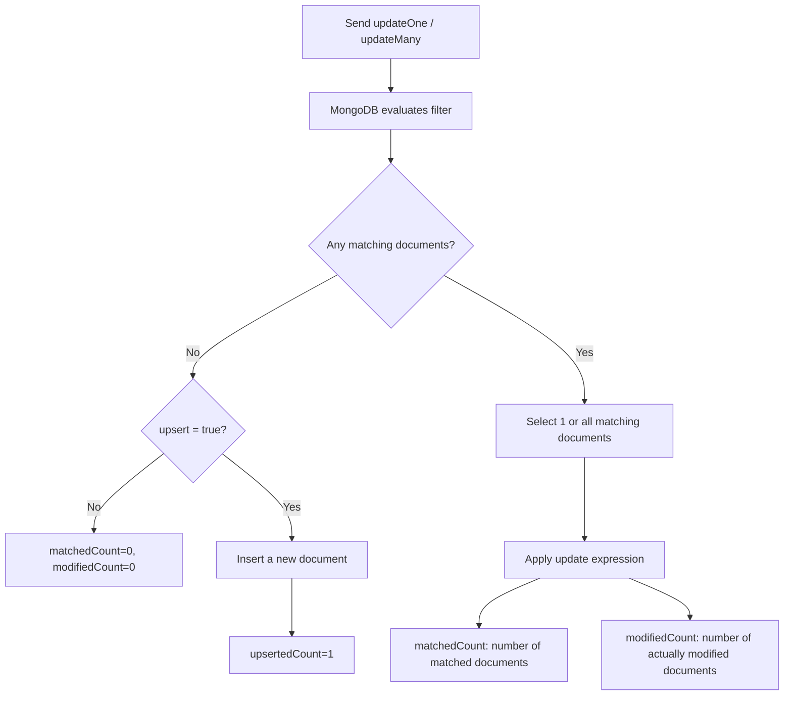

# updateOne, updateMany, and Distinguishing matchedCount from modifiedCount

> **Module:** Database Engine Document MongoDB  
> **Chapter:** Update Documents

## 1. Objectives and Practical Significance

When sending an update command to MongoDB, the application needs to know **how many documents matched the condition** and **how many documents were actually modified**. These two pieces of information are reflected via `matchedCount` and `modifiedCount` in the result of `updateOne()` or `updateMany()`.

For example, the application requests setting `processed: true` on an order. If the order already had the value `true`, MongoDB can still find the document without needing to modify the data. The result in that case is `matchedCount = 1`, `modifiedCount = 0`. That is a normal result, completely different from the case where no document is found.

This lesson helps you:

- Correctly use `updateOne()` and `updateMany()` to modify one or multiple documents.
- Write `filter` predicates and update expressions using `$set`, `$inc`, `$unset`, and `$currentDate`.
- Understand success, non-matching, no-change, and upsert results.
- Distinguish the number of modified documents from the number of modified fields or array elements.
- Use both counters to handle API responses, control concurrent updates, and design retries.
- Apply equivalent syntax in the MongoDB Java Sync Driver.

## 2. Syntax and Update Scope

In the MongoDB Shell, the two commands have the syntax:

```javascript
db.collection.updateOne(filter, update, options)
db.collection.updateMany(filter, update, options)
```

| Component | Meaning | Example |
|---|---|---|
| `filter` | Expression selecting documents to update | `{ status: "NEW" }` |
| `update` | Modification using update operators or an aggregation pipeline | `{ $set: { reviewed: true } }` |
| `options` | Additional options such as `upsert`, `collation`, and `arrayFilters` | `{ upsert: true }` |

Differences between the two methods:

| Method | Number of documents that can be updated | Typical scenario |
|---|---:|---|
| `updateOne()` | At most **1** document matching the filter | Updating a single order by `_id`, transitioning the status of one record |
| `updateMany()` | **All** documents matching the filter | Tagging all orders belonging to a group, applying a batch processing flag |

If the filter of `updateOne()` matches multiple documents, the application **must not assume** which document will be selected without specific deterministic criteria. Prefer filtering by `_id` or a field with a unique index when you need to update an exact entity.

If the filter of `updateMany()` is `{}`, the command can affect every document in the collection. Verify the filter scope before running against real data.

### 2.1. Processing Lifecycle



For an acknowledged operation that completes successfully, the number of modified documents is never greater than the number of matched documents:

```text
0 <= modifiedCount <= matchedCount

updateOne:  matchedCount can be 0 or 1
updateMany: matchedCount can be 0, 1, 2, 3, ...
```

If the operation encounters an error (for example, a unique index violation), do not interpret it as if the entire batch succeeded.

## 3. Preparing the Practice Collection

Use a MongoDB Server where you have write permissions and open `mongosh`:

```bash
mongosh "mongodb://127.0.0.1:27017"
```

Create data in a dedicated database:

```javascript
const lab = db.getSiblingDB("mongo_update_lab");
const orders = lab.getCollection("orders");

orders.insertMany([
  { _id: "ORD-001", status: "NEW",       processed: false, amount: 120, version: 1 },
  { _id: "ORD-002", status: "PAID",      processed: false, amount: 250, version: 1 },
  { _id: "ORD-003", status: "NEW",       processed: false, amount: 80,  version: 1 },
  { _id: "ORD-004", status: "NEW",       processed: false, amount: 400, version: 1 },
  { _id: "ORD-005", status: "PAID",      processed: true,  amount: 150, version: 1 },
  { _id: "ORD-006", status: "CANCELLED", processed: false, amount: 75,  version: 1 }
]);
```

Inspect the data:

```javascript
printjson(orders.find(
  {},
  { _id: 1, status: 1, processed: 1, amount: 1 }
).sort({ _id: 1 }).toArray());
```

There are 6 orders: three `NEW`, two `PAID`, and one `CANCELLED`. The examples below assume you **run them sequentially on the freshly created dataset**. If `insertMany()` reports a duplicate key because the documents already exist, use another lab database or re-prepare the data in your practice environment; never delete production data.

## 4. updateOne: Found and Modified

Transition order `ORD-001` from `NEW` to `PAID`:

```javascript
const first = orders.updateOne(
  { _id: "ORD-001", status: "NEW" },
  { $set: { status: "PAID" } }
);

printjson(first);
```

Typical result:

```javascript
{
  acknowledged: true,
  matchedCount: 1,
  modifiedCount: 1,
  upsertedCount: 0,
  upsertedId: null
}
```

Meaning:

- There is one document with `_id = "ORD-001"` **and** `status = "NEW"`.
- `$set` changes the value of the `status` field from `NEW` to `PAID`.
- Because one document matched and was actually modified, both counters equal 1.

Read it back:

```javascript
printjson(orders.findOne({ _id: "ORD-001" }));
```

### 4.1. Re-running the Same Filter: No Matching Document Left

```javascript
const second = orders.updateOne(
  { _id: "ORD-001", status: "NEW" },
  { $set: { status: "PAID" } }
);

printjson(second);
```

Result:

```javascript
{
  acknowledged: true,
  matchedCount: 0,
  modifiedCount: 0,
  upsertedCount: 0,
  upsertedId: null
}
```

This time `ORD-001` is already in the `PAID` state. It exists, but **does not satisfy the condition** `status: "NEW"`. Therefore, `matchedCount = 0` does not necessarily mean the document was deleted: the filter may simply no longer match after a previous change.

### 4.2. Document Matches but Needs No Change

Remove the status condition:

```javascript
const third = orders.updateOne(
  { _id: "ORD-001" },
  { $set: { status: "PAID" } }
);

printjson(third);
```

Typical result:

```javascript
{
  acknowledged: true,
  matchedCount: 1,
  modifiedCount: 0,
  upsertedCount: 0,
  upsertedId: null
}
```

The document selected by `_id` is still present. However, `status` is already `PAID`, and `$set` with the same value does not change the document content. Thus **matched = 1 but modified = 0**.

These two cases are easily confused:

| Scenario | `matchedCount` | `modifiedCount` |
|---|---:|---:|
| `ORD-001` is no longer `NEW`, filter still requires `NEW` | 0 | 0 |
| Select `ORD-001` by ID, re-set `status = "PAID"` which is already set | 1 | 0 |

**Practical takeaway:** Do not use `modifiedCount == 0` alone to conclude "order not found".

## 5. updateMany: Multiple Documents Match Together

After updating `ORD-001` in section 4, only `ORD-003` and `ORD-004` remain in the `NEW` state.

```javascript
const manyFirst = orders.updateMany(
  { status: "NEW" },
  { $set: { processed: true } }
);

printjson(manyFirst);
```

Expected result:

```javascript
{
  acknowledged: true,
  matchedCount: 2,
  modifiedCount: 2,
  upsertedCount: 0,
  upsertedId: null
}
```

Both selected documents had `processed: false`, so both were actually changed to `true`.

### 5.1. Re-running the updateMany Command

```javascript
const manySecond = orders.updateMany(
  { status: "NEW" },
  { $set: { processed: true } }
);

printjson(manySecond);
```

At this point:

```javascript
{
  acknowledged: true,
  matchedCount: 2,
  modifiedCount: 0,
  upsertedCount: 0,
  upsertedId: null
}
```

Both documents still have `status: "NEW"`, so they still match the filter. However, the `processed` field is already `true` in both; MongoDB does not need to modify them again.

### 5.2. Only Some Matched Documents Are Modified

In the data after the steps above, three documents are currently in the `PAID` state:

| ID | `processed` before command |
|---|---|
| `ORD-001` | `false` |
| `ORD-002` | `false` |
| `ORD-005` | `true` |

Execute:

```javascript
const mixed = orders.updateMany(
  { status: "PAID" },
  { $set: { processed: true } }
);

printjson(mixed);
```

Result:

```javascript
{
  acknowledged: true,
  matchedCount: 3,
  modifiedCount: 2,
  upsertedCount: 0,
  upsertedId: null
}
```

Three documents matched the status, but only two needed modification. `ORD-005` already had the target value, so it did not increment `modifiedCount`.

### 5.3. Comparison Table of Possibilities

| Command | Matched | Modified | Interpretation |
|---|---:|---:|---|
| `updateOne` by ID, change value | 1 | 1 | Successfully modified one document |
| `updateOne` by ID, assign existing value | 1 | 0 | No-op, document still exists |
| `updateOne` with filter matching no record | 0 | 0 | No document satisfies the filter |
| `updateMany`, all documents need change | 5 | 5 | Five documents changed together |
| `updateMany`, only some documents need change | 5 | 3 | Two documents already had the target value |
| `updateMany`, value already right in all | 5 | 0 | Five documents matched with no changes |

The counters represent the **number of documents**, not the number of modified fields. If one command changes 4 fields of the same document, `modifiedCount` is still 1.

## 6. Key Update Operators

The `update` argument is typically an object containing update operators.

| Operator | Effect | Example |
|---|---|---|
| `$set` | Assigns or creates a field | `{ $set: { status: "PAID" } }` |
| `$unset` | Removes a field | `{ $unset: { legacyStatus: "" } }` |
| `$inc` | Adds a numeric value to a field | `{ $inc: { retryCount: 1 } }` |
| `$mul` | Multiplies a numeric field by a factor | `{ $mul: { factor: 2 } }` |
| `$min` / `$max` | Updates the field only if the new value is smaller/larger | `{ $max: { highScore: 100 } }` |
| `$currentDate` | Sets the field to the current server time | `{ $currentDate: { updatedAt: true } }` |
| `$setOnInsert` | Assigns only when an insert occurs via upsert | `{ $setOnInsert: { createdAt: new Date() } }` |
| `$push` | Appends an element to an array | `{ $push: { tags: "urgent" } }` |
| `$addToSet` | Adds an element only if the array does not already contain it | `{ $addToSet: { tags: "urgent" } }` |
| `$pull` | Removes array elements matching a condition | `{ $pull: { tags: "obsolete" } }` |

Example using multiple operators in a single document update:

```javascript
const result = orders.updateOne(
  { _id: "ORD-003" },
  {
    $set: { status: "PAID" },
    $inc: { version: 1 },
    $currentDate: { updatedAt: true }
  }
);

printjson(result);
```

Within a single document, updating multiple fields with one write operation is **atomic at the document level**: the fields are changed in one operation, not three independent commands.

### 6.1. Common No-op Operations

```javascript
// If status is already "PAID": no data change
orders.updateOne(
  { _id: "ORD-001" },
  { $set: { status: "PAID" } }
);

// If obsoleteField does not exist: no field to remove
orders.updateOne(
  { _id: "ORD-001" },
  { $unset: { obsoleteField: "" } }
);

// If version is an existing number: adding 0 keeps the value unchanged
orders.updateOne(
  { _id: "ORD-001" },
  { $inc: { version: 0 } }
);
```

Depending on the document state, the commands above can produce `matchedCount = 1`, `modifiedCount = 0`. Conversely, `$currentDate` with a new timestamp or `$inc: { version: 1 }` usually actually modifies the document.

### 6.2. Incrementing Counters and Atomicity

To increment a counter, use:

```javascript
orders.updateOne(
  { _id: "ORD-004" },
  { $inc: { version: 1 } }
);
```

If two clients both read a counter, compute `oldValue + 1` on the client side, and `$set` it back, both may write values derived from a stale read, causing a lost update. `$inc` performs the increment on the server within an atomic document operation.

## 7. Upsert and the Meaning of Result Fields

By default, if the filter matches no documents, an update **does not create a new document**. The `upsert: true` option instructs MongoDB to **insert a document when no document exists to update**.

```javascript
const inserted = orders.updateOne(
  { _id: "ORD-999" },
  {
    $set: {
      status: "NEW",
      processed: false,
      amount: 500
    },
    $setOnInsert: {
      createdAt: new Date()
    }
  },
  { upsert: true }
);

printjson(inserted);
```

If `ORD-999` does not yet exist, the typical response is:

```javascript
{
  acknowledged: true,
  matchedCount: 0,
  modifiedCount: 0,
  upsertedCount: 1,
  upsertedId: "ORD-999"
}
```

**No existing document was modified.** Therefore `modifiedCount = 0`, while `upsertedCount = 1` indicates **one new document was inserted**. If the filter does not specify `_id`, MongoDB typically generates an ObjectId for the new document. `upsertedId` reflects the actual `_id` value of the inserted document.

Re-run with the same filter and `$set` values:

```javascript
const repeated = orders.updateOne(
  { _id: "ORD-999" },
  { $set: { status: "NEW", processed: false, amount: 500 } },
  { upsert: true }
);

printjson(repeated);
```

With the data created and unmodified elsewhere, the result is typically `matchedCount = 1`, `modifiedCount = 0`, `upsertedCount = 0`.

### 7.1. updateMany + upsert

If `updateMany(..., { upsert: true })` **matches no documents**, MongoDB creates **one document**, not multiple documents. If matching documents already exist, `updateMany` modifies that set of documents instead of inserting a new record per document. Do not use `updateMany + upsert` to import a list of multiple entities.

### 7.2. Notes on Concurrent Upserts

Two concurrent upsert requests may both observe that no matching record exists yet. Ensure that any business key requiring uniqueness is protected by a unique index (or `_id`). If both attempt to insert, one request may receive a duplicate key error; without an appropriate unique index, the system may create duplicate business data. Handle retries and idempotency according to the application contract rather than treating upsert as a global locking mechanism.

## 8. Reading Update Results: More Than Just Two Counters

An acknowledged result typically includes these fields:

| Field | Meaning |
|---|---|
| `acknowledged` | Whether the server/driver provided write operation acknowledgment |
| `matchedCount` | Number of documents matching the filter in the result |
| `modifiedCount` | Number of documents actually changed |
| `upsertedCount` | Number of documents **inserted** via the upsert branch; typically 0 or 1 for a single update command |
| `upsertedId` | The `_id` value of the new document from upsert, or `null` if none |

When deciding an API outcome, inspect fields in this order:

1. **Was there an error/exception?** A write that failed due to validation, duplicate key, or timeout cannot be treated as a normal no-op.
2. **Was the result acknowledged?** Without write acknowledgment, do not assume counter values are reliable.
3. **Was there an upsert?** Check `upsertedCount`/`upsertedId` before concluding no data was created.
4. **Did any document match?** Check `matchedCount`.
5. **Was any document actually modified?** Check `modifiedCount`.
6. **Does that match the business intent?** A command to "ensure reviewed" can succeed on a no-op; a command to "transition status from NEW to PAID" must evaluate the expected state.

Note that `matchedCount = 0` for a filter containing both `_id` and `version` is **not sufficient** to conclude the ID does not exist: the version may have been changed by another request.

## 9. updateOne Does Not Select Deterministically When the Filter Is Too Broad

Example:

```javascript
orders.updateOne(
  { status: "NEW" },
  { $set: { underReview: true } }
);
```

If multiple orders have `NEW`, the command modifies only one of them; the application cannot assume it will be the "first inserted" document or the one with the "smallest ID". Query plans and scan order can vary.

Solutions depending on the use case:

- Use `_id` or a unique key when selecting a known entity.
- Use `findOneAndUpdate()` with the `sort` option when you need to pick a document by priority and read the resulting document.
- On MongoDB Server/driver versions that support the sort option for `updateOne`, verify your version before using it; do not assume it is available in every version.

**Important:** Do not run this broad-filter example if you want to keep the dataset in the exact state needed for the remaining practice steps.

## 10. Multi-Document Updates and Atomicity Limits

An `updateOne()` operation modifying one document is atomic at the document level. With `updateMany()`, each individual document update remains atomic, but **the set of documents does not automatically form a single atomic transaction**.

Example:

```javascript
orders.updateMany(
  { status: "NEW" },
  { $set: { campaignCode: "NOV-2026" } }
);
```

If an error occurs or the operation is interrupted partway through, some documents may have already been modified before the command stopped. A concurrent reader may also observe the changes at different times, depending on read concern, isolation, and transaction usage.

If business logic requires **all-or-nothing across multiple documents or collections**, design a multi-document transaction on a supported deployment, evaluating its cost and limits appropriately. Do not apply transactions to every update operation simply because a single document has multiple fields.

### 10.1. Are Updates Retryable?

It depends on the update expression:

| Update | Safe to re-run with the same condition? | Reason |
|---|---|---|
| `$set: { processed: true }` | Usually yes | Assigns the same value; subsequent runs make no change |
| `$unset: { legacyField: "" }` | Usually yes | Field has already been removed |
| `$inc: { quantity: 1 }` | Not by default | Running twice increments twice |
| `$push: { tags: "urgent" }` | Not by default | May append the same value twice |
| `$addToSet: { tags: "urgent" }` | Can be suitable when avoiding duplicates | Check semantics for the element type |
| `$currentDate: { updatedAt: true }` | Value may differ each run | A new timestamp is written |

Drivers provide retryable writes within supported scopes, but **do not assume every multi-document `updateMany` operation has identical automatic retry behavior**. When implementing application-level retries, account for idempotency and partially written state.

## 11. Preventing Overwrites Under Concurrent Updates

### 11.1. Conditional State Transition

For example, transitioning order `ORD-004` only from `NEW` to `PAID`:

```javascript
const transition = orders.updateOne(
  { _id: "ORD-004", status: "NEW" },
  {
    $set: { status: "PAID" },
    $currentDate: { updatedAt: true }
  }
);

if (transition.matchedCount === 0) {
  print("No order matches the expected status.");
}
```

If another request changed the status earlier, the filter will no longer match. This is a useful concurrency control mechanism without reading a document and overwriting it unconditionally.

### 11.2. Version-Based Optimistic Locking

Suppose the client read the document at `version = 3`:

```javascript
const change = orders.updateOne(
  { _id: "ORD-004", version: 3 },
  {
    $set: { note: "New note" },
    $inc: { version: 1 }
  }
);

if (change.matchedCount === 0) {
  print("Version has changed or document does not exist; re-read required.");
}
```

Note: `version: 3` in the example is illustrative only. In practice, you must use the actual version read by the client rather than hardcoding it. If another client updated and incremented the version first, the stale filter will not match. This technique prevents lost updates in workflows editing the same entity.

### 11.3. Do Not Mechanically Infer Business Outcome from modifiedCount

A PATCH API to "mark as processed" can return success when `matchedCount = 1`, `modifiedCount = 0` because the document is already in the desired state. Conversely, an API to "perform a one-time state transition" may require returning a conflict when `matchedCount = 0` because the state has already changed.

In both cases, the counters are technical facts; **the API contract** defines what the result means to the caller.

## 12. Updating Arrays with arrayFilters

A document may contain an array of multiple objects. For example:

```javascript
const baskets = lab.getCollection("baskets");

baskets.insertOne({
  _id: "B-001",
  items: [
    { sku: "SKU-01", checked: false },
    { sku: "SKU-02", checked: false },
    { sku: "SKU-03", checked: true }
  ]
});
```

Mark an element:

```javascript
const arrayResult = baskets.updateOne(
  { _id: "B-001" },
  { $set: { "items.$[item].checked": true } },
  { arrayFilters: [{ "item.sku": "SKU-02" }] }
);

printjson(arrayResult);
```

`$[item]` represents elements satisfying `arrayFilters`. Even if 10 array elements in one document are modified, `modifiedCount` still **counts one document**. With `updateMany`, the count is the total number of matched/modified documents, **not the total number of modified array elements**.

Another example using an update pipeline to compute a field from an existing value:

```javascript
orders.updateOne(
  { _id: "ORD-006" },
  [
    { $set: { statusLabel: { $concat: ["Status: ", "$status"] } } }
  ]
);
```

A pipeline update uses aggregation stage syntax and the `"$status"` expression to reference a field. This is an alternative to update operators, while result counter semantics remain identical.

## 13. Filters, Indexes, Collation, and Write Permissions

### 13.1. Finding the Right Documents Before Updating

A filter without an appropriate index can cause MongoDB to scan many documents. In large collections, `updateMany` also generates many write operations and must maintain all affected indexes.

For example, if queries frequently use the combination of `customerId` and `status`:

```javascript
orders.createIndex(
  { customerId: 1, status: 1 },
  { name: "idx_customer_status" }
);
```

This index is only useful if the actual schema and queries use those fields. The initial lab dataset does not contain `customerId`; treat this index command strictly as a design example for an application collection with matching fields.

To inspect the filter scope before updating:

```javascript
print("Candidate documents:", orders.countDocuments({ status: "PAID" }));
printjson(orders.find(
  { status: "PAID" },
  { _id: 1, status: 1, processed: 1 }
).toArray());
```

This is a review helper step, though data can still be modified by another client between the preview query and the update operation. When race conditions must be avoided, add expected state conditions or use an appropriate transaction.

### 13.2. Collation and Case Sensitivity

By default, string comparison using `simple` collation is case-sensitive. If a business rule requires case-insensitive string matching:

```javascript
orders.updateMany(
  { status: "paid" },
  { $set: { reviewed: true } },
  { collation: { locale: "en", strength: 2 } }
);
```

Collation affects string value comparisons; it does not make `status` and `Status` the same field name. For identifier-like status systems such as enums, it is usually best to normalize values at the source and apply a consistent convention.

### 13.3. Schema Validation and Unique Indexes

If the post-update document violates the collection's validator, the server may reject it. If updating a field protected by a unique index to a value already present in another document, the operation can fail with a duplicate key error.

Do not infer a validation issue from `matchedCount = 0`; inspect the server error/exception and details. All write flows should run with least privilege and never arbitrarily bypass schema validation.

## 14. Java Sync Driver: Retrieving Both Counters Properly

The MongoDB Java Sync Driver returns `UpdateResult` for update methods. Example:

```java
import com.mongodb.client.MongoClient;
import com.mongodb.client.MongoClients;
import com.mongodb.client.MongoCollection;
import com.mongodb.client.MongoDatabase;
import com.mongodb.client.result.UpdateResult;
import org.bson.Document;

import static com.mongodb.client.model.Filters.eq;
import static com.mongodb.client.model.Updates.set;

public class UpdateDocumentDemo {
    public static void main(String[] args) {
        String uri = System.getenv("MONGODB_URI");
        if (uri == null || uri.isBlank()) {
            uri = "mongodb://127.0.0.1:27017";
        }

        try (MongoClient client = MongoClients.create(uri)) {
            MongoDatabase database = client.getDatabase("mongo_update_lab");
            MongoCollection<Document> orders =
                    database.getCollection("orders");

            UpdateResult result = orders.updateOne(
                    eq("_id", "ORD-002"),
                    set("reviewed", true)
            );

            System.out.println("acknowledged = " + result.wasAcknowledged());
            if (result.wasAcknowledged()) {
                System.out.println("matchedCount = " + result.getMatchedCount());
                System.out.println("modifiedCount = " + result.getModifiedCount());
                System.out.println("upsertedId = " + result.getUpsertedId());
            }
        }
    }
}
```

Key getters:

| API | Return Type | Content |
|---|---|---|
| `wasAcknowledged()` | `boolean` | Whether the result was acknowledged |
| `getMatchedCount()` | `long` | Number of matched documents |
| `getModifiedCount()` | `long` | Number of modified documents |
| `getUpsertedId()` | `BsonValue` or `null` | Inserted ID via upsert, if any |

If the result is **unacknowledged**, counter getters may throw `UnsupportedOperationException` because no acknowledgment metadata is available. Never assume data was written just because the client issued the command.

### 14.1. updateMany in Java

```java
import com.mongodb.client.result.UpdateResult;
import static com.mongodb.client.model.Filters.eq;
import static com.mongodb.client.model.Updates.set;

// Assuming the orders variable has been created as in the example above:
UpdateResult result = orders.updateMany(
        eq("status", "NEW"),
        set("processed", true)
);

if (result.wasAcknowledged()) {
    long matched = result.getMatchedCount();
    long modified = result.getModifiedCount();
    System.out.printf("Matched=%d, Modified=%d%n", matched, modified);
}
```

### 14.2. Upsert in Java

```java
import com.mongodb.client.model.UpdateOptions;
import com.mongodb.client.result.UpdateResult;

import static com.mongodb.client.model.Filters.eq;
import static com.mongodb.client.model.Updates.combine;
import static com.mongodb.client.model.Updates.set;
import static com.mongodb.client.model.Updates.setOnInsert;

UpdateResult result = orders.updateOne(
        eq("_id", "ORD-1000"),
        combine(
                set("status", "NEW"),
                set("processed", false),
                setOnInsert("createdBy", "lab")
        ),
        new UpdateOptions().upsert(true)
);

if (result.wasAcknowledged()) {
    if (result.getUpsertedId() != null) {
        System.out.println("Inserted: " + result.getUpsertedId());
    } else {
        System.out.printf("Matched=%d, Modified=%d%n",
                result.getMatchedCount(), result.getModifiedCount());
    }
}
```

If the application uses a strict schema validator, documents created via upsert must satisfy the validator; this example focuses solely on the driver API and result handling.

### 14.3. Mapping Counters to API Responses

Do not write:

```java
// Wrong when the API wants to report "document exists":
if (result.getModifiedCount() == 0) {
    throw new RuntimeException("Not Found");
}
```

Because `modifiedCount == 0` includes valid no-ops. Instead, decide based on business semantics:

```java
if (result.wasAcknowledged() && result.getMatchedCount() == 0) {
    // May not exist, or status/version does not match the filter.
} else if (result.wasAcknowledged()) {
    // Matching document found; modified=0 can still be an idempotent success.
}
```

If the filter includes status/version conditions, returning an accurate 404 or 409 may require re-reading the document; handle any concurrent update races between operations according to the desired consistency level.

## 15. Common Pitfalls

| Symptom | Common Cause | Resolution |
|---|---|---|
| `matchedCount = 0` | Filter does not match ID, value, status, or version | Check both predicate values and BSON types |
| `matchedCount = 1, modifiedCount = 0` | Target value already set, no-op | Do not immediately return 404 or force retries |
| `matchedCount > modifiedCount` | Some documents already had the target value | Review initial data state |
| `matchedCount = 0, upsertedCount = 1` | Insert occurred due to `upsert: true` | Read `upsertedId` |
| `updateOne` modified the "wrong" record | Filter matched multiple records | Use a unique key or a method supporting sort |
| `updateMany` modified too many records | Filter too broad or `{}` | Verify with `find()`/`countDocuments()` beforehand |
| Duplicate key error | Value violates a unique index | Handle business keys and concurrency |
| Document validation error | Post-update document fails validator | Check schema rules and update expression |
| Repeated `$inc` updates over-increment | Non-idempotent retries | Use idempotency/conditions in the workflow |
| Java driver reports unexpected counts | Data already changed, wrong URI/collection, filter type mismatch | Confirm correct namespace, query, and BSON types |
| Array update modified 5 elements but modified=1 | Counts are per document | Re-read the array when element-level statistics are needed |

### 15.1. _id BSON Type Pitfall

Example:

```javascript
{ _id: ObjectId("507f1f77bcf86cd799439011"), status: "NEW" }
```

does not match the filter:

```javascript
{ _id: "507f1f77bcf86cd799439011" }
```

because the filter uses a string while the actual field is a BSON ObjectId. When `matchedCount = 0`, check **both value and type**; do not rely solely on visually identical string representations.

### 15.2. Do Not Confuse updateOne with replaceOne

```javascript
orders.updateOne(
  { _id: "ORD-002" },
  { $set: { note: "Reviewed" } }
);
```

This command only adds/updates `note` while preserving other fields. `replaceOne()` replaces the document body with the replacement document and can remove fields omitted from it; do not use replacement when you only intend to modify one field. You cannot change the `_id` value of an existing document.

### 15.3. updateOne Does Not Return the Updated Document

`updateOne()` returns counts and metadata, not the full document. If you need the before/after document in the same operation, use `findOneAndUpdate()` with the appropriate `returnDocument` option:

```javascript
const after = orders.findOneAndUpdate(
  { _id: "ORD-002" },
  { $set: { reviewed: true } },
  { returnDocument: "after" }
);

printjson(after);
```

The return object of `findOneAndUpdate` differs from the result structure of `updateOne`; do not attempt to read `matchedCount` from a document result if the API does not provide it.

## 16. Verification Exercises

The exercises below use separate collections to avoid affecting the previous examples.

### Exercise A: Three Single-Document Scenarios

```javascript
const checks = lab.getCollection("checks");

checks.insertOne({ _id: "C-01", active: false });

const changed = checks.updateOne(
  { _id: "C-01" },
  { $set: { active: true } }
);

const unchanged = checks.updateOne(
  { _id: "C-01" },
  { $set: { active: true } }
);

const absent = checks.updateOne(
  { _id: "C-99" },
  { $set: { active: true } }
);

printjson({ changed, unchanged, absent });
```

Prediction:

| Result | matched | modified |
|---|---:|---:|
| `changed` | 1 | 1 |
| `unchanged` | 1 | 0 |
| `absent` | 0 | 0 |

### Exercise B: updateMany Matches Three, Modifies Two

```javascript
const tasks = lab.getCollection("tasks");

tasks.insertMany([
  { _id: "T-01", group: "A", done: false },
  { _id: "T-02", group: "A", done: true },
  { _id: "T-03", group: "A", done: false },
  { _id: "T-04", group: "B", done: false }
]);

const result = tasks.updateMany(
  { group: "A" },
  { $set: { done: true } }
);

printjson(result);
```

Expected result: `matchedCount = 3`, `modifiedCount = 2`. Re-running identically: `matchedCount = 3`, `modifiedCount = 0`.

### Exercise C: Upsert on the Exercise Collection

```javascript
const first = tasks.updateOne(
  { _id: "T-99" },
  { $set: { group: "C", done: false } }
);

const second = tasks.updateOne(
  { _id: "T-99" },
  { $set: { group: "C", done: false } },
  { upsert: true }
);

printjson({ first, second });
```

Explain why the first command creates no document while the second creates one; both can have `modifiedCount = 0` because the insert branch is recorded in `upsertedCount`.

### Exercise D: One-Time State Transition

```javascript
const attempt1 = tasks.updateOne(
  { _id: "T-04", done: false },
  { $set: { done: true } }
);

const attempt2 = tasks.updateOne(
  { _id: "T-04", done: false },
  { $set: { done: true } }
);

printjson({ attempt1, attempt2 });
```

The first attempt matches and modifies one document; on the second attempt `done` is already `true`, so the filter no longer matches. This is the key difference between "disallowing a second state transition" and "re-setting the same value".

### Exercise E: Distinguishing Document Count from Array Element Count

Create a `basket` document containing three unchecked items. Use `arrayFilters` to update two items. Even though two elements are modified inside one document, `modifiedCount` remains 1. Explain why based on the unit of counting being the document.

## 17. Key Principles to Remember

1. **`updateOne` modifies at most one document**, whereas **`updateMany` modifies all matching documents**.
2. **`matchedCount` indicates how many documents matched the filter**; **`modifiedCount` indicates how many documents actually changed**.
3. `matchedCount = 1, modifiedCount = 0` is a normal outcome when the document already has the target value.
4. `matchedCount = 0` can mean the document does not exist, or that a `status`/`version` condition no longer matches.
5. **New upsert inserts** are reported via `upsertedCount`/`upsertedId`, not `modifiedCount`.
6. Counts are **per document**, not per modified field or array element.
7. Update operators such as `$inc` keep operations atomic per document; `updateMany` is not automatically a transaction across the entire set.
8. APIs must interpret counters according to the business contract, accounting for retries, indexes, validation, and concurrency.

## 18. Official Documentation

- [MongoDB Manual – db.collection.updateOne()](https://www.mongodb.com/docs/manual/reference/method/db.collection.updateOne/)
- [MongoDB Manual – db.collection.updateMany()](https://www.mongodb.com/docs/manual/reference/method/db.collection.updateMany/)
- [MongoDB Manual – Update Operators](https://www.mongodb.com/docs/manual/reference/operator/update/)
- [MongoDB Manual – Atomicity and Transactions](https://www.mongodb.com/docs/manual/core/write-operations-atomicity/)
- [MongoDB Manual – Update Documents with Aggregation Pipeline](https://www.mongodb.com/docs/manual/tutorial/update-documents-with-aggregation-pipeline/)
- [MongoDB Manual – Array Filters](https://www.mongodb.com/docs/manual/reference/operator/update/positional-filtered/)
- [MongoDB Java Sync Driver – Update Documents](https://www.mongodb.com/docs/drivers/java/sync/current/crud/update/)
- [MongoDB Java API – UpdateResult](https://mongodb.github.io/mongo-java-driver/5.5/apidocs/mongodb-driver-core/com/mongodb/client/result/UpdateResult.html)

For options that vary across MongoDB Server/driver versions, consult the documentation for the specific deployment in use. Counters report technical outcomes; confirming business success requires considering the filter, update payload, and expected state.
