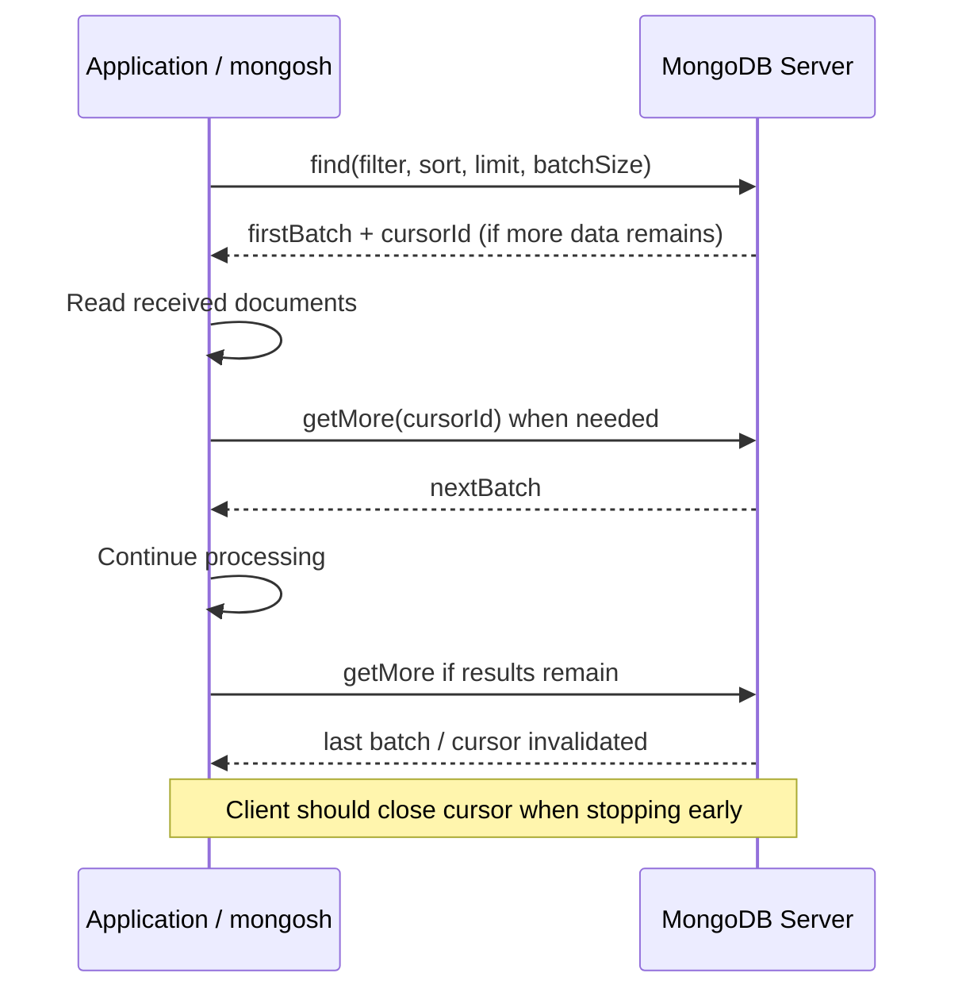

# batchSize, limit, and Their Impact on Memory and Data Transfer Count in MongoDB

> **Module:** Database Engine Document MongoDB  
> **Chapter:** Cursors and Pagination

## 1. Why Care About batchSize and limit?

A MongoDB collection can hold thousands, millions, or even more documents. When an application needs to read 20 orders to display a page, loading the entire result set into RAM is unnecessary. Conversely, when processing documents one by one to export data or generate reports, fetching a single document per request can create far too many network round trips.

MongoDB returns query results through a **cursor** (a result pointer). Two important controls are:

- **`limit(n)`** caps the **total number of documents** returned by the query.
- **`batchSize(n)`** suggests to the server **how many documents to return in each data transfer** (batch).

These two parameters govern two distinct scopes. `limit` controls the final volume of results; `batchSize` tunes the cadence of receiving data and the trade-off between fetch frequency, latency, and the amount of data buffered in memory.

For example, an API that wants to return at most 50 documents:

```javascript
db.orders.find({ status: "PAID" })
  .sort({ _id: 1 })
  .limit(50)
  .batchSize(10);
```

The query above returns **no more than 50 documents**. With small documents and normal conditions, they can be delivered across multiple batches, each aiming for up to 10 documents. It does **not** mean the result only contains 10 documents, nor does it mean the application executes a new `find` query every 10 documents.

After this lesson, you will be able to:

- Explain the lifecycle `find → first batch → getMore → exhausted/close cursor`.
- Use `batchSize()` and `limit()` in `mongosh` and the MongoDB Java Sync Driver.
- Estimate the impact of batch size on network round trips and application-side memory.
- Distinguish streaming cursors from `toArray()` and page-based pagination.
- Combine `sort`, `limit`, `projection`, `skip`, or key-based pagination intentionally.
- Recognize batch size limits, slow queries due to missing indexes, and common misconceptions.

## 2. How Does a Cursor Work?

Calling `find()` represents a query against a collection and creates a cursor. When the query executes and the client consumes results, MongoDB can send a **first batch** along with cursor metadata; if more documents remain, the client continues requesting subsequent batches using the **`getMore`** protocol command.



A cursor is **not synonymous** with an array preloaded with all documents. The driver API may hold one batch in memory and fetch a new batch when code reads past the end of the current batch. However, how much RAM the final results occupy still depends on how the application uses the cursor.

For example:

```javascript
const cursor = db.orders.find({ status: "PAID" });

while (cursor.hasNext()) {
  const order = cursor.next();
  print(order._id);
}
```

Conceptually, the loop reads documents one by one from the cursor instead of requiring the client to allocate a massive array holding every document before processing. The driver may still hold **one batch** (plus temporary objects) in its buffer.

Once results are exhausted, MongoDB closes the corresponding cursor. If the application stops processing midway, it should call `close()` on the cursor if the API supports it; do not rely solely on server-side timeouts.

### 2.1. A Single find Can Lead to Multiple Data Transfers

Suppose a query matches 250 valid documents, but the client reads only 20 documents per batch:

```text
Client                       MongoDB
  | ---- find() --------------> |
  | <--- firstBatch ~20 ------- |
  | ---- getMore() -----------> |
  | <--- nextBatch ~20 -------- |
  |            ...             |
  | ---- getMore() -----------> |
  | <--- final batch ---------- |
```

This is still **a single cursor query with multiple fetch rounds**, not 13 independent `find` queries. Connection timing, prefetch policies, document sizes, and byte limits can make the actual transfer count differ from simple division.

### 2.2. First Batch and Subsequent Batches

When the client **does not specify a batch size**, `find` commands typically receive a **default first batch of up to 101 documents**; subsequent `getMore` calls are governed by transfer size limits and related settings. A batch may contain fewer documents if the server has exhausted the results or hit the data size limit.

When the client specifies a positive `batchSize(n)`, it requests a target document count per batch, but the server still enforces response size limits. Therefore:

- `batchSize(20)` does not guarantee every batch contains exactly 20 documents.
- `batchSize(1000)` does not allow a batch to exceed the byte size limit enforced by MongoDB.
- The final batch usually has fewer documents.
- `limit` can cause the cursor to finish before receiving a full `batchSize` worth of documents.

Exact default behaviors can vary by MongoDB Server version, driver, and command type; check the documentation for the version you use when fine-tuning.

## 3. batchSize(n): Target Documents Per Fetch

Syntax in `mongosh`:

```javascript
db.collection.find(filter).batchSize(25)
```

Example:

```javascript
db.orders.find({ status: "PAID" })
  .batchSize(25);
```

The parameter `25` does not alter the filter, sort order, or total matching documents. It affects how the cursor delivers documents to the client.

### 3.1. Small Batches: Less Buffered Data, More Round Trips

Suppose you need to read 1,000 documents, each averaging about 2 KiB after transfer/decoding:

```text
batchSize = 20
Each batch ~ 20 × 2 KiB = 40 KiB
About 50 batches to read all 1,000 documents
About 49 getMore calls after the first batch
```

These numbers are only an **illustrative model** assuming all documents are similarly sized, the server always fills every batch, and no other limit shortens a batch.

Advantages of small batches:

- Reduces the number of documents received and held simultaneously in one batch.
- The application can start processing with a small initial payload.
- Useful when individual documents are large or the application processes very slowly.
- Avoids prefetching too many results if the user stops reading early.

Disadvantages:

- More `getMore` calls.
- Network latency per round trip accumulates, especially when the database is over a distant network link.
- Can increase CPU/serialization overhead, cursor management, and message count.

### 3.2. Large Batches: Fewer Round Trips, Larger Buffer Requirement

With the same 1,000 documents and batch size 500:

```text
batchSize = 500
Each batch ~ 500 × 2 KiB = 1,000 KiB
About 2 batches to read all 1,000 documents
About 1 getMore call after the first batch
```

If documents are small and the network link has high latency, large batches can improve throughput. However, the application needs enough RAM to hold, decode, and process the incoming payload. If the client specifies a very large `batchSize`, MongoDB still caps the data returned in one batch by response size; thus, the calculation "500 × size" is not an ironclad guarantee.

### 3.3. Trade-off Table

Suppose a query needs to receive **1,000 documents**, averaging **2 KiB** each, and the server sends the full requested count:

| `batchSize` | Estimated batches | `getMore` after first batch | Estimated document payload/batch |
|---:|---:|---:|---:|
| 10 | 100 | 99 | 20 KiB |
| 20 | 50 | 49 | 40 KiB |
| 100 | 10 | 9 | 200 KiB |
| 250 | 4 | 3 | 500 KiB |
| 500 | 2 | 1 | 1,000 KiB |
| 1000 | 1 | 0 | 2,000 KiB |

**Do not treat the table as an absolute network prediction:** the first and subsequent batches are still subject to byte limits, documents vary in size, and drivers may adjust consumption behavior. Actual RAM is also larger than raw BSON size because of driver objects, strings, wrappers, lists, and application data structures.

### 3.4. Is batchSize the Maximum Documents for the Query?

No. The command:

```javascript
db.orders.find({ status: "PAID" }).batchSize(10)
```

can return thousands of documents across multiple batches if many records match. To cap the **total results**, you must add `limit(n)` or apply another appropriate limiting mechanism.

## 4. limit(n): Capping Total Documents Returned

Syntax:

```javascript
db.collection.find(filter).limit(50)
```

Example:

```javascript
db.orders.find({ status: "PAID" })
  .sort({ createdAt: -1, _id: -1 })
  .limit(50);
```

Meaning: After evaluating the filter and sort order, the cursor returns **at most 50 documents**. If only 18 documents match, 18 are returned—none are fabricated to reach 50. A value of `limit(0)` on a standard cursor is interpreted as **no limit on document count**; in application code intending to paginate, pass an explicitly bounded positive value.

### 4.1. How Does limit Differ from batchSize?

| Question | `limit(n)` | `batchSize(n)` |
|---|---|---|
| Caps total documents the application receives? | **Yes** | **No** |
| Tunes documents per fetch round-trip? | Only indirectly when results are few | **Yes** |
| Reduces total data downloaded when you don't need everything? | Usually yes | Not necessarily |
| Reduces number of `getMore` calls? | Possibly, because total returned drops | Possibly, if batch size is larger |
| Affects data ordering? | No | No |
| Replaces optimal filters/indexes? | No | No |
| Can reduce RAM when using `toArray()`? | Yes, by capping total results | No guarantee |

Both settings are commonly combined because they solve two separate problems:

```javascript
db.orders.find({ status: "PAID" })
  .sort({ _id: 1 })
  .limit(100)
  .batchSize(20);
```

With small documents, expecting up to 100 documents, they can arrive in roughly 5 batches. If the filter matches only 8 documents, only 8 documents are returned, usually without needing `getMore`.

### 4.2. limit Does Not Mean the Server Only Inspects n Documents

Consider the query:

```javascript
db.orders.find({ status: "PAID" })
  .sort({ total: -1 })
  .limit(10);
```

Even though the client receives at most 10 documents, the server may have to examine many documents to find the **10 orders with the largest total**, especially without an appropriate index. Certain `sort + limit` patterns can use a top-k algorithm to reduce memory needed for sorting, but that does not replace a good index and does not guarantee only 10 documents are read.

To understand the work the server performs, inspect the query plan:

```javascript
db.orders.find({ status: "PAID" })
  .sort({ total: -1 })
  .limit(10)
  .explain("executionStats");
```

Observe metrics such as `totalDocsExamined`, `totalKeysExamined`, index scan/collection scan, and sort stages in the output appropriate to your running MongoDB version. `explain` analyzes the execution plan; it does not directly measure network round trips consumed by the client cursor.

## 5. Combining limit, batchSize, and Document Size

You can look at results in terms of three quantities:

- \(N\): total documents **actually needing to be read** after applying `limit`.
- \(B\): requested batch size.
- \(S\): average data size per document during transfer/decoding.

Ignoring per-batch byte limits and protocol overhead:

\[
\text{Approximate batches} \approx \left\lceil \frac{N}{B} \right\rceil
\]

\[
\text{Approximate getMore count} \approx \max(0, \text{Batches} - 1)
\]

\[
\text{Document payload of one batch} \approx B \times S
\]

Example of an API displaying **one page of 30 documents**, `batchSize = 10`:

```text
N = 30, B = 10
Batches ≈ ceil(30/10) = 3
getMore after firstBatch ≈ 2
```

If `batchSize = 50`, the entire page can fit into one batch with no `getMore` needed, provided the data does not exceed the batch size limit.

### 5.1. MongoDB's Byte-Level Limits

MongoDB has a BSON document size limit and a data payload limit per batch/response. A BSON document cannot exceed the server's document limit (typically **16 MiB**). Result batches are also bounded by bytes, so the server will not always return the full count requested by the client.

Suppose 40 documents are nearly 1 MiB each; then:

```javascript
db.large_documents.find({}).batchSize(40)
```

does not mean one batch is guaranteed to carry 40 MiB of data. The server caps the payload allowed in a response and will require additional batch fetches to complete the cursor.

Therefore:

- The actual number of batches may be **greater than** \(\lceil N/B \rceil\).
- Byte limits can matter more than `batchSize` when documents are large.
- BSON size over the wire is not identical to Java object size on the heap.
- Testing should consider document size, compression, network latency, and processing speed.

### 5.2. Increasing batchSize Does Not Generate New Data

If `limit(5)` and `batchSize(500)`:

```javascript
db.orders.find({ status: "PAID" })
  .limit(5)
  .batchSize(500);
```

the cursor still returns **at most 5 documents**. Batch size is only the requested size for a single fetch; it does not override the total limit.

### 5.3. Do Not Use batchSize(0) as a Pagination Mechanism

A batch size of `0` has special behavior in certain APIs/protocols (such as requesting cursor initialization with an empty first batch). It does not mean "each page returns 0 documents" and should not be used as a normal pagination option. For code choosing a batch size, validate positive values and check your driver's behavior.

## 6. Memory: Cursors, Batches, and toArray() Differ

Beginners often think: "I used `batchSize(20)`, so my program cannot use RAM for more than 20 documents." That is **false** if application code retains all results or allocates many intermediate objects.

### 6.1. Reading Sequentially Document by Document

```javascript
const cursor = db.orders.find({ status: "PAID" })
  .batchSize(20);

let processed = 0;

while (cursor.hasNext()) {
  const order = cursor.next();
  // Process each document without storing all of them in an array:
  processed += 1;
}

print("Processed: " + processed);
```

This approach suits sequential processing jobs. The driver/mongosh may still buffer documents of a batch, but the logic above **does not retain** every document in an unboundedly growing list.

### 6.2. toArray() Loads All Read Results Into Memory

```javascript
const allOrders = db.orders.find({ status: "PAID" })
  .batchSize(20)
  .toArray();
```

Even though transferred in batches of 20 documents, `toArray()` collects **every document returned by the cursor** into a client-side array. With millions of documents, that array can consume massive RAM. A small `batchSize` cannot save memory if the application ultimately retains all documents.

If you only need to display 30 documents:

```javascript
const page = db.orders.find({ status: "PAID" })
  .sort({ _id: 1 })
  .limit(30)
  .batchSize(30)
  .toArray();
```

Here `toArray()` is much more appropriate because **`limit(30)`** already bounds the total element count.

### 6.3. Server Memory and Client Memory

| Consumer | What uses RAM? | Parameters that help control it |
|---|---|---|
| **Client/driver** | Decoded BSON/objects batch, temporary variables, array elements | `batchSize`, `limit`, sequential iteration, avoiding huge `toArray()` |
| **Application business logic** | Caches, aggregated lists, object mapping, app-side join results | Streaming processing design and releasing references |
| **MongoDB Server** | Cursor state, working set, sort/aggregation stages, cache/storage engine | Indexes, filters, projections, `limit` when appropriate, pipeline structure |
| **Network** | BSON payloads, protocol overhead, TLS/compression, request/response round trips | Appropriate batch size, projection, `limit`, reducing document size |

**Important:** `batchSize` does not set a "RAM cap" for the server-side query engine. If a query has to sort many documents without an appropriate index, it can still consume memory in the sort stage even if the client receives small batches.

## 7. Projection Usually Saves Data More Effectively Than Shrinking batchSize

Suppose `orders` documents store these fields:

```javascript
{
  _id: 123,
  status: "PAID",
  createdAt: ISODate("2026-11-14T03:00:00Z"),
  total: NumberDecimal("199.00"),
  items: [/* many line items */],
  shippingAddress: {/* many fields */},
  auditTrail: [/* many events */]
}
```

A listing view may only need `_id`, `status`, `createdAt`, and `total`. Use **projection**:

```javascript
db.orders.find(
  { status: "PAID" },
  { _id: 1, status: 1, createdAt: 1, total: 1 }
)
.sort({ createdAt: -1, _id: -1 })
.limit(20)
.batchSize(20);
```

The client does not need to receive `items`, `shippingAddress`, and `auditTrail` just to render the list. Projection reduces bytes over the wire and memory retained by the client, and can also enable covered index queries when appropriate.

If you only change `batchSize(20)` while still returning huge documents with unused fields, the total data transferred for a page stays high. **An orderly optimization path** usually reduces total documents via `limit`, reduces fields via projection, uses good filters/indexes, and then tunes batch size for the workload.

## 8. Hands-On Setup: 120 Documents with Stable Ordering

To clearly see how limiting and batching behave, use a separate lab database. Run the data creation step **only once** on a collection without duplicate IDs:

```javascript
const lab = db.getSiblingDB("cursor_batch_lab");
const visits = lab.getCollection("visits");

const rows = Array.from({ length: 120 }, (_, index) => ({
  _id: index + 1,
  category: index % 3 === 0 ? "A" : "B",
  createdAt: new Date(Date.UTC(2026, 0, 1, 0, 0, index)),
  message: "Visit " + (index + 1),
  details: { source: "demo", note: "x".repeat(512) }
}));

visits.insertMany(rows);
```

Verify:

```javascript
print("Total:", visits.countDocuments({}));

printjson(
  visits.find({}, { _id: 1, category: 1 })
    .sort({ _id: 1 })
    .limit(5)
    .toArray()
);
```

The collection contains 120 documents, with `_id` integers from 1 to 120. With `sort({ _id: 1 })`, results are stable and predictable. The exercise uses no real application data.

### 8.1. Example: limit Smaller Than batchSize

```javascript
const example1 = visits.find(
    { category: "B" },
    { _id: 1, category: 1 }
  )
  .sort({ _id: 1 })
  .limit(5)
  .batchSize(30)
  .toArray();

print(example1.length); // 5
printjson(example1);
```

There are 80 documents in category `B`, yet only 5 documents are read. Batch size 30 does **not** inflate the result count to 30.

### 8.2. Example: limit Larger Than batchSize

```javascript
const example2 = visits.find(
    { category: "B" },
    { _id: 1, category: 1 }
  )
  .sort({ _id: 1 })
  .limit(23)
  .batchSize(7)
  .toArray();

print(example2.length); // 23
```

With small documents, the cursor may take roughly 4 batches to receive all 23 documents: three batches of 7 and one batch of 2. MongoDB does not promise exact per-batch counts when other technical limits apply.

### 8.3. Trying Different Batch Sizes

Keep the filter, projection, and limit fixed; change only batch size:

```javascript
const filter = { category: "B" };
const fields = { _id: 1, category: 1 };

const a = visits.find(filter, fields)
  .sort({ _id: 1 }).limit(50).batchSize(5).toArray();

const b = visits.find(filter, fields)
  .sort({ _id: 1 }).limit(50).batchSize(25).toArray();

const c = visits.find(filter, fields)
  .sort({ _id: 1 }).limit(50).batchSize(100).toArray();

print(a.length, b.length, c.length); // 50 50 50
```

**All three return the same 50 documents** when data has not changed; only the batch fetching configuration differs. If you need to measure the actual `getMore` count, enable command monitoring in the driver or use appropriate observability tools in a lab environment. `a.length` only measures total documents, not round trips.

## 9. Pagination: limit Is Page Size, batchSize Is Fetch Size

Suppose an API displays 10 visits per page. Pagination needs to determine **which slice of results belongs to the viewed page**, not merely cap a single cursor.

### 9.1. Pagination with skip + limit

Simple approach:

```javascript
const pageSize = 10;
const pageNumber = 3; // 1-based page numbering

const page = visits.find(
    {},
    { _id: 1, category: 1, createdAt: 1 }
  )
  .sort({ _id: 1 })
  .skip((pageNumber - 1) * pageSize)
  .limit(pageSize)
  .batchSize(pageSize)
  .toArray();

printjson(page);
```

Because `_id` runs from 1 to 120, page 3 corresponds to `_id` 21 through 30 in the lab dataset.

Role of each component:

- `sort({ _id: 1 })`: guarantees predictable page order.
- `skip(20)`: skips the first 20 results.
- `limit(10)`: takes at most the next 10 results.
- `batchSize(10)`: requests fetching roughly 10 documents per batch.

**Without a stable `sort`**, fetching pages can drop or duplicate results when query plans or data order shift. If sorting by `createdAt` where many documents share identical timestamps, add `_id` as a tie-breaker key.

### 9.2. The Cost of skip on Deep Pages

Page 1 with `skip(0)` is usually straightforward. However, page 10,000 with page size 20:

```text
skip = (10000 - 1) × 20 = 199980
limit = 20
```

The server may have to traverse many keys/documents before reaching the target offset. Even though the client ultimately receives only 20 documents, the query can still incur heavy CPU/I/O. `batchSize(20)` does not eliminate this skip overhead.

For large lists with "next page" navigation, consider **keyset/seek pagination**.

### 9.3. Key-Based Pagination (Seek Pagination)

If `_id` has a suitable order, first page:

```javascript
const pageSize = 10;

const firstPage = visits.find(
    {},
    { _id: 1, category: 1 }
  )
  .sort({ _id: 1 })
  .limit(pageSize)
  .batchSize(pageSize)
  .toArray();

const lastId = firstPage[firstPage.length - 1]._id;
print("Last ID:", lastId);
```

Next page:

```javascript
const nextPage = visits.find(
    { _id: { $gt: lastId } },
    { _id: 1, category: 1 }
  )
  .sort({ _id: 1 })
  .limit(pageSize)
  .batchSize(pageSize)
  .toArray();

printjson(nextPage);
```

In the lab, `lastId` of the first page is 10; the next page returns IDs 11 through 20. This avoids skipping all preceding pages.

For real-world data ordered by `createdAt DESC, _id DESC`, use a seek condition combining **both createdAt and _id**. For example, with a page token holding the last two values of the previous page:

```javascript
const next = db.orders.find({
  $or: [
    { createdAt: { $lt: lastCreatedAt } },
    { createdAt: lastCreatedAt, _id: { $lt: lastObjectId } }
  ]
})
.sort({ createdAt: -1, _id: -1 })
.limit(20)
.batchSize(20);
```

The variables `lastCreatedAt` and `lastObjectId` must be supplied from the last document of the previous page; the example above only illustrates the seek logic. An index matching the filter/sort, such as `{ createdAt: -1, _id: -1 }`, usually helps paginate efficiently. Add tenant/status predicates and adjust the index to match actual queries when applying this.

**Note on consistency:** seek pagination mitigates offset drift caused by inserts/deletes, but it does not turn multiple page requests into a single data snapshot. When you need a consistent view across multiple pages, design appropriate read concern/snapshot mechanisms or data versioning.

### 9.4. Fetching One Extra Document to Detect a Next Page

APIs often need a `hasNext` flag without running a full count query:

```javascript
const requestedPageSize = 10;

const fetched = visits.find(
    { _id: { $gt: 30 } },
    { _id: 1, category: 1 }
  )
  .sort({ _id: 1 })
  .limit(requestedPageSize + 1)
  .batchSize(requestedPageSize + 1)
  .toArray();

const hasNext = fetched.length > requestedPageSize;
const pageItems = fetched.slice(0, requestedPageSize);

printjson({ hasNext, items: pageItems });
```

The **n + 1** technique detects whether at least one subsequent document exists at query time. It does not reveal the exact total page count or document count, and does not guarantee data state won't change before the client clicks "next page".

## 10. Applying with the MongoDB Java Sync Driver

In Java, the MongoDB Sync Driver provides `FindIterable` and `MongoCursor`. The examples use the modern driver with the `org.mongodb:mongodb-driver-sync` dependency declared.

### 10.1. Sequential Reading with limit and batchSize

```java
import com.mongodb.client.MongoClient;
import com.mongodb.client.MongoClients;
import com.mongodb.client.MongoCollection;
import com.mongodb.client.MongoCursor;
import org.bson.Document;

import static com.mongodb.client.model.Filters.eq;
import static com.mongodb.client.model.Projections.fields;
import static com.mongodb.client.model.Projections.include;
import static com.mongodb.client.model.Sorts.ascending;

public class CursorBatchExample {
    public static void main(String[] args) {
        String uri = System.getenv("MONGODB_URI");
        if (uri == null || uri.isBlank()) {
            uri = "mongodb://127.0.0.1:27017";
        }

        try (MongoClient client = MongoClients.create(uri)) {
            MongoCollection<Document> visits = client
                    .getDatabase("cursor_batch_lab")
                    .getCollection("visits");

            try (MongoCursor<Document> cursor = visits
                    .find(eq("category", "B"))
                    .projection(fields(include("_id", "category", "createdAt")))
                    .sort(ascending("_id"))
                    .limit(50)
                    .batchSize(10)
                    .iterator()) {

                int processed = 0;
                while (cursor.hasNext()) {
                    Document visit = cursor.next();
                    System.out.println(visit.toJson());
                    processed++;
                }

                System.out.println("Processed: " + processed);
            }
        }
    }
}
```

Key points:

- `.limit(50)` ensures at most 50 documents pass through this cursor.
- `.batchSize(10)` hints to fetch 10 documents per batch; this is not the total result count of the query.
- `while (cursor.hasNext())` processes sequentially without deliberately retaining a list of all documents.
- `try-with-resources` closes the cursor and client when finished, which is especially helpful if the loop exits early due to errors or business logic.
- The program still uses buffers and RAM for each batch; sequential processing simply avoids unnecessary accumulation.

### 10.2. Collecting One Page into a List

For an endpoint returning JSON data for a small page:

```java
import com.mongodb.client.MongoCollection;
import org.bson.Document;

import java.util.ArrayList;
import java.util.List;

import static com.mongodb.client.model.Sorts.ascending;

public class PageReader {
    public static List<Document> loadPage(
            MongoCollection<Document> visits,
            int pageSize
    ) {
        if (pageSize < 1 || pageSize > 100) {
            throw new IllegalArgumentException(
                    "pageSize must be between 1 and 100"
            );
        }

        List<Document> page = new ArrayList<>(pageSize);

        visits.find()
                .sort(ascending("_id"))
                .limit(pageSize)
                .batchSize(pageSize)
                .into(page);

        return page;
    }
}
```

Here `into(page)` is reasonable because `pageSize` is bounded. If `limit` were omitted and results had millions of documents, the list could consume excessive RAM.

### 10.3. Driver batchSize Does Not Change HTTP Page Size

Suppose a controller returns 20 documents per HTTP response:

```text
HTTP pageSize = 20
Mongo find().limit(20).batchSize(5)
```

The API still returns at most 20 documents. The driver simply receives data from MongoDB in smaller batches while building the response. When an application needs to reduce database round trips for small pages, `batchSize(20)` can be considered, though it should be measured in a real environment.

Conversely, for a job exporting 50,000 documents, `batchSize(100)` works well for sequential reading without putting all documents into a list before writing to a file. Note that the output writer itself and any processing queues can introduce their own buffering.

### 10.4. MongoDB Reactive Driver Consumes Differently

With the Reactive Streams driver, demand/backpressure mechanics and how the publisher requests data differ from the Sync Driver, even though the server still uses batches/`getMore`. Do not infer actual buffer sizes from `batchSize` alone; account for subscriber demand, prefetching, processing queues, and schedulers. This lesson uses the Sync Driver to focus on general cursor concepts.

## 11. Choosing batchSize by Workload

There is no single optimal `batchSize` for every application. Consider three workload categories.

### 11.1. API Returning Small Pages

For example, returning 20 or 50 orders:

```javascript
db.orders.find({ customerId: "C-001" })
  .sort({ createdAt: -1, _id: -1 })
  .limit(20)
  .batchSize(20);
```

A reasonable setting for **initial testing** is a `batchSize` roughly equal to `pageSize`. It often helps reduce round trips for small documents, though it is not mandatory. With large documents or slow streaming responses, a smaller batch may be more appropriate.

### 11.2. Batch Export or ETL

Reading hundreds of thousands of documents to process one by one:

```javascript
const cursor = db.events.find(
    { eventType: "CLICK" },
    { _id: 1, eventType: 1, createdAt: 1 }
  )
  .sort({ _id: 1 })
  .batchSize(500);

let total = 0;
while (cursor.hasNext()) {
  const event = cursor.next();
  // Send event to export/transform step; do not push into an unbounded array.
  total++;
}
print("Processed:", total);
```

If you do not want to cap total records, omit `limit`. For long-running workloads, pay attention to cursor lifetime, error resumability, progress checkpoints, and consumption rate. Larger batch sizes usually cut `getMore` calls, but do not replace flow control and job retry mechanisms.

### 11.3. Large Documents or Memory-Constrained Applications

If each document holds large arrays or binary fields, `batchSize(500)` may not behave as expected due to byte limits. Start with small batches, project only strictly required fields, and measure actual process memory usage.

| Context | Priority | Initial experiment |
|---|---|---|
| 20-document UI page | Few round trips, fast response | `limit(20)`, projection, `batchSize` around 20 |
| 100-document API list | Bounded payload and memory | `limit(100)`, projection, try `batchSize` 25–100 |
| 100,000-document export | Throughput, stable RAM | Stream sequentially, test `batchSize` of a few hundred and measure |
| Large documents | Avoid RAM/response payload spikes | Small batches, projection, monitor BSON sizes |
| Database over high-latency WAN | Reduce round-trip cost | Try increasing `batchSize` in a controlled way |
| Results often stop early | Avoid over-fetching documents | Smaller batches or business-driven total limit |

The values in the last column are **starting points for benchmarking**, not rigid technical defaults or universal "best practices" for every MongoDB deployment.

## 12. Performance Measurement: What Should You Observe?

When tuning `batchSize`, keep the filter, projection, sort, limit, and test dataset stable so comparisons remain valid.

Metrics to record:

| Metric | Meaning |
|---|---|
| Total documents actually read | Establishes workload volume |
| Time to first document | Initial latency |
| Time to exhaust cursor | Throughput and total latency |
| Number of `getMore` commands | Additional cursor round trips |
| Returned payload size | Network/serialization cost |
| Peak RAM of the Java process | Checks buffering impact |
| Application/server CPU | BSON decoding, mapping, query processing |
| `totalDocsExamined` / `totalKeysExamined` | Query plan efficiency |
| Number of documents retained by app | Detects unintended data accumulation |

You can use **command monitoring** in the MongoDB Java Driver to observe `find` and `getMore` commands sent by the client. Enable it only in observable environments; do not log full queries or sensitive documents in production.

`explain("executionStats")` is useful for checking how much work the filter/index/sort costs the server, but **it is not a tool for counting `getMore` calls** during application cursor iteration. To measure round trips, observe driver/network commands at the appropriate layer.

A meaningful benchmark must keep conditions like warm cache, document size, network, concurrency, and client consumption patterns reasonably consistent. Running `toArray()` in one trial and streaming in another changes how the application uses RAM, preventing results from isolating `batchSize`.

## 13. Common Errors and Misconceptions

| Symptom / Claim | Cause or Reality | How to Handle |
|---|---|---|
| "`batchSize(10)` only returns 10 documents" | Batch size does not limit total results | Use `limit(10)` if you need at most 10 documents |
| "`limit(50)` means server reads at most 50 documents" | Filter/sort may have to inspect many more documents | Use indexes and inspect `explain()` |
| "`batchSize(1000)` always returns 1,000 docs/batch" | Server caps response size; final batch can be shorter | Do not rely on actual batch size as an invariant |
| "`batchSize(20)` ensures the program holds ≤ 20 docs" | `toArray()` or accumulating lists still retain all documents | Stream sequentially, cap total via `limit` |
| "Smaller batches are always faster" | More `getMore` calls increase round trips | Measure actual throughput and latency |
| "Larger batches are always faster" | RAM and deserialization costs rise, sometimes needlessly | Tune by document size and consumption |
| "Pagination is still stable without `sort`" | Result ordering can shift | Sort explicitly, add a unique tie-breaker key |
| "`skip(100000)` only transfers 20 results so it's cheap" | Server still has to skip through the large offset | Consider seek pagination |
| "`limit(20).batchSize(5)` creates 4 find queries" | Usually one cursor with `getMore` | Distinguish `find` and `getMore` |
| "Projection doesn't matter" | Documents may carry many large fields/arrays | Select only fields the API needs |
| "Just tune `batchSize` if a query is slow" | Query may be slow due to `COLLSCAN`, sort, index, or join | Check `executionStats` and optimize the query first |
| "Cursors close immediately when app stops reading" | Cursor can remain alive on server until closed/timed out | Close cursors explicitly via supported API |

## 14. Comprehensive Practice Exercises

Run against the `cursor_batch_lab.visits` collection created in Section 8. These exercises do not modify documents—only read data.

### Exercise A — Keep Results Constant, Vary Batch Size

Run:

```javascript
const sizes = [1, 5, 20, 50];

for (const n of sizes) {
  const result = visits.find(
      { category: "B" },
      { _id: 1 }
    )
    .sort({ _id: 1 })
    .limit(40)
    .batchSize(n)
    .toArray();

  print("batchSize=" + n + ", returned=" + result.length);
}
```

All outputs show `returned = 40` if data has not changed. Explain why all four runs return the same document count while batch/`getMore` counts can differ.

### Exercise B — Keep Batch Size Constant, Vary Limit

```javascript
for (const n of [5, 15, 50]) {
  const result = visits.find({})
    .sort({ _id: 1 })
    .limit(n)
    .batchSize(10)
    .toArray();

  print("limit=" + n + ", returned=" + result.length);
}
```

With a 120-document collection, returned counts are 5, 15, and 50 respectively. Batch size does not turn all three into 10 documents.

### Exercise C — Estimate Round Trips

Given three configurations:

| Total documents to read | Batch size | Approx. batches | Approx. `getMore` calls |
|---:|---:|---:|---:|
| 100 | 10 | 10 | 9 |
| 100 | 25 | 4 | 3 |
| 100 | 100 | 1 | 0 |

Explain why these are **estimates**, not guaranteed counts. Name at least two factors that can make actual batches smaller than requested: byte size limits and exhausted results.

### Exercise D — Compare Streaming vs. toArray

In Java code, using the same `find()` and the same `batchSize(20)`:

1. First iterate `MongoCursor` with `while (hasNext())`, process each document, and drop the reference.
2. Second use `into(new ArrayList<>())` to retain all results.
3. With bounded sample data, observe the difference in where documents are stored in the application; do not scale data to out-of-memory levels.

Explain why both use the same `batchSize` yet exhibit different memory behavior.

### Exercise E — Design an API Pagination Flow

Suppose an API needs the 20 newest results by `createdAt`:

- Choose a domain-appropriate filter.
- Sort `createdAt DESC, _id DESC` for stable ordering.
- Use `limit(20)` to cap item count.
- Use projection to select only fields needed by the UI.
- Consider `batchSize(20)` as a performance measurement starting point.
- When subsequent pages are needed on large datasets, design a token containing the last sort key instead of deep offsets.

Do not attempt to use `batchSize(20)` alone to solve pagination.

## 15. Core Principles

1. **`limit` controls the cursor's total document count**, whereas **`batchSize` controls fetch size per transfer**.
2. A cursor typically starts with `find` and fetches more data via `getMore`; smaller batches usually increase round trips.
3. Larger batch sizes can cut network overhead but increase the amount of data received/decoded at once.
4. **`batchSize` is not a RAM cap.** `toArray()` or code that accumulates results can still retain every document.
5. Servers enforce document/batch size limits and may return fewer documents than requested.
6. `limit` reduces data received by the client, though it does not necessarily eliminate full server-side filter/sort work.
7. Pagination requires **stable sorting + `limit`**, usually paired with `skip` or seek tokens; batch size is only a fetch performance tuning knob.
8. Apply projection, indexing, and measurement before tuning batch size for real workloads.
9. With the Java driver, use `try-with-resources` to close cursors when reading stops, especially in long-running jobs.

## 16. References

- [MongoDB Manual – cursor.batchSize()](https://www.mongodb.com/docs/manual/reference/method/cursor.batchSize/)
- [MongoDB Manual – cursor.limit()](https://www.mongodb.com/docs/manual/reference/method/cursor.limit/)
- [MongoDB Manual – db.collection.find()](https://www.mongodb.com/docs/manual/reference/method/db.collection.find/)
- [MongoDB Manual – cursor.skip()](https://www.mongodb.com/docs/manual/reference/method/cursor.skip/)
- [MongoDB Manual – cursor.sort()](https://www.mongodb.com/docs/manual/reference/method/cursor.sort/)
- [MongoDB Manual – Query Optimization](https://www.mongodb.com/docs/manual/core/query-optimization/)
- [MongoDB Manual – Explain Results](https://www.mongodb.com/docs/manual/reference/explain-results/)
- [MongoDB Java Sync Driver – Retrieve Data](https://www.mongodb.com/docs/drivers/java/sync/current/crud/query-documents/find/)
- [MongoDB Java Sync Driver – Configure Cursor](https://www.mongodb.com/docs/drivers/java/sync/current/crud/query-documents/cursor/)
- [MongoDB Java Sync Driver – Monitor Commands](https://www.mongodb.com/docs/drivers/java/sync/current/logging-monitoring/monitoring/)

Default first-batch behaviors, batch limits, and cursor options may differ across MongoDB Server versions and drivers. For real-world performance tasks, measure on your target version and data volume, while clearly separating server query execution cost from client result transfer cost.
