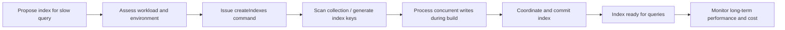
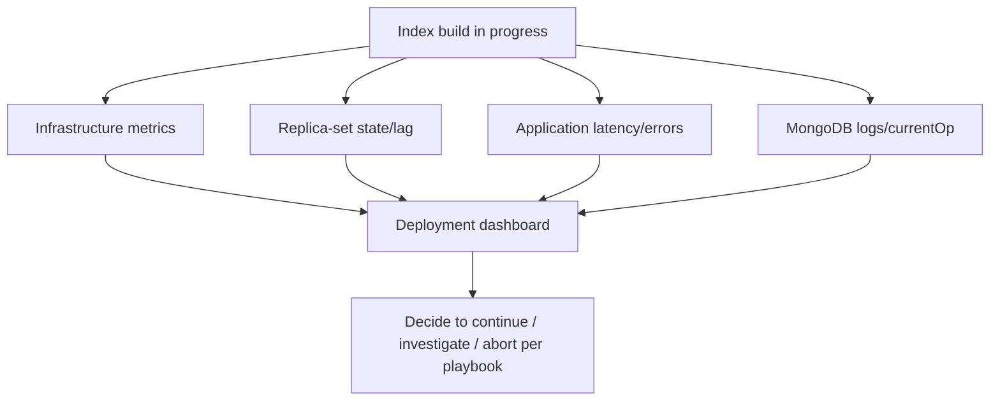

# Building Indexes on Active Systems and Monitoring Progress in MongoDB

> **Module:** MongoDB Document Database Engine  
> **Chapter:** Specialized Indexes

## 1. Real-World Problem: Adding an Index While Serving Live Traffic

An e-commerce application running on MongoDB has an `orders` collection with millions of documents. The API listing orders by store and creation timestamp becomes slow. The engineering team discovers the query is scanning too many documents and proposes an index:

```javascript
{ tenantId: 1, createdAt: -1, _id: -1 }
```

On a small test database, `createIndex()` finishes almost instantaneously. On a live production system, however, an index build must read existing data, build the index structure, process concurrent mutations occurring during the build, coordinate across nodes, and commit safely. This work competes for CPU, I/O, RAM, disk capacity, and network bandwidth with production traffic.

Therefore, the question is not just **"What is the syntax to create an index?"**—it is also:

- While building the index, can the application continue reading and writing?
- How do you tell whether the operation has started, is running, or has finished?
- How do you monitor progress without mistaking an approximate phase metric for an exact completion percentage?
- Why might an index build wait for replica set commit conditions?
- If memory, disk space, replication lag, or API latency spikes, what should operators do?
- After creation finishes, how do you verify queries actually use the index and that its read benefits justify its maintenance costs?

**Objective:** master a practical workflow from planning → index build → observation → verification → ongoing operation or rollback, with examples in MongoDB Shell and a Java application.

> This lesson presents principles for modern MongoDB Server releases. Specific index build behaviors, administrative commands, and observability metrics depend on MongoDB version, topology (standalone, replica set, sharded cluster), driver version, and user privileges. Before operating on production, always consult the documentation for your exact running server version.

## 2. What Is an Index Build and What Are Its Costs?

An **index build** is the process by which MongoDB constructs an index structure from existing data in a collection. Once the index is successfully committed, subsequent write operations must maintain the index alongside the data.

Overview diagram:



This is a conceptual model: MongoDB has finer-grained phases and internal implementations that vary across versions.

### 2.1. Costs to Anticipate

| Resource or Impact | Why Does It Increase During Build? | Consequences to Monitor |
|---|---|---|
| **CPU** | Scanning documents, extracting keys, sorting, and constructing index structures | Query/write latency rises; CPU approaches limits |
| **Read I/O** | Reading many existing documents, potentially churning cache working set | Storage latency rises; cache hit ratio drops |
| **Write I/O** | Writing index structures and temp files; applying concurrent mutations | Large disk queues; contention with normal traffic |
| **RAM** | Memory used for build/sort structures and buffers | Memory pressure; spilling temp operations to disk |
| **Disk space** | Final index plus temporary data during the build | Out-of-space errors or system instability |
| **Replication** | Replica set members execute build/commit work per version mechanics | Secondary lag; waiting on commit quorum |
| **Application** | Contended resources and brief locks at key phases | p95/p99 latency spikes, timeouts/retries |

There is no fixed ratio like "an index is always 10% of data size" or "builds always finish in a few minutes". Index size depends on document count, keys generated, key lengths, multikey arrays, index type, data distribution, and storage layout. Build duration depends on hardware, data size, concurrent write rate, and topology.

### 2.2. An Index Continues to Carry Costs After Creation

Once an index exists:

- Inserts must add entries to the index.
- Updates touching fields in the index key must update entries.
- Deletes must remove corresponding entries.
- The index consumes disk space and its working set consumes cache memory.
- Queries gain another candidate plan for the query planner to evaluate.

Therefore, **adding an index is a workload-level performance decision**, not just optimizing a single read query.

## 3. What Does "Online Index Build" Mean?

On modern MongoDB Server versions, index builds are designed to allow **read and write operations to continue during most of the build process**. This mechanism is commonly referred to as an *optimized / hybrid index build*.

However, "online" **does not mean zero blocking**:

1. MongoDB still requires brief coordination/locking points at specific phases to initialize or finalize the build.
2. Build activity can elevate latency through CPU, memory, storage, and replication contention.
3. Certain schema or administrative operations can conflict with an active index build.
4. Under resource exhaustion or overload, applications can experience timeouts even though the server permits concurrent reads/writes.

### 3.1. Stop Using `background: true` as an "Online Mode" Trick

Older MongoDB versions distinguished between **foreground** and **background** index builds. With the optimized index build mechanism in MongoDB 4.2+, the `background` option no longer switches between foreground/background modes as before and is ignored by the server.

Avoid using:

```javascript
// Do not use this flag as a guarantee of "no production impact".
db.orders.createIndex(
  { tenantId: 1, createdAt: -1 },
  { background: true }
);
```

Instead, understand the build mechanics of your running server version, manage workload timing, and monitor resources and latency throughout rollout.

### 3.2. Conceptual Index Build Phases

Depending on version, steps may include:

- Initializing the index build, recording state, and starting work.
- Scanning the existing collection to generate index keys.
- Recording and applying document mutations occurring during scanning and building.
- Finalizing the index structure and draining remaining buffered mutations.
- Performing required constraint checks (such as uniqueness).
- Coordinating commit with replica set members when required by topology.
- Making the index usable after commit completes.

Never assume "phase 3 of 6 means 50% of total time", as each phase performs different amounts of work. A build may finish scanning nearly all documents and still wait on commit quorum or draining concurrent writes before completing.

## 4. Planning Before Creating an Index on a Live System

The safest approach is treating an index build as a data-infrastructure change with an owner, scope, rollout criteria, and a rollback plan.

### 4.1. Identify Which Queries Need the Index

For example, an API runs:

```javascript
db.orders.find({
  tenantId: "shop-a",
  status: "PAID"
})
.sort({ createdAt: -1, _id: -1 })
.limit(20);
```

A candidate index following Equality → Sort:

```javascript
{ tenantId: 1, status: 1, createdAt: -1, _id: -1 }
```

Before creating the index, confirm:

- **Actual** filters, sorts, projections, and limits—not just guesses from reading code.
- Query frequency, p50/p95/p99 latency, and concurrency.
- Collection size, data distribution, and growth rate.
- Whether existing indexes already provide an equivalent prefix, partial filter, or collation.
- Whether added overhead on write operations stays within acceptable thresholds.
- Whether the index involves uniqueness, TTL, partial filters, wildcards, or other specialized semantics.

Do not create an index merely because a field appears in a filter. If the new index nearly duplicates an existing compound index, it may be unnecessary.

### 4.2. Pre-Build Health Checklist

| Item | What to Verify |
|---|---|
| MongoDB Server & Feature Compatibility | Which version? Which admin commands and behaviors are supported? |
| Topology | Standalone, replica set, or sharded cluster? |
| Replication health | Are secondaries healthy, in sync, or under maintenance? |
| CPU/RAM/I/O headroom | Is there sufficient spare capacity above current load? |
| Free disk space | Is there room for the final index **plus** temporary build files? |
| Write traffic | Are campaigns or batch imports currently elevating write load? |
| Backup/restore | Are backups and recovery procedures up to standard? |
| Observability | Are dashboards/alerts ready for disk, CPU, latency, replication lag, and server errors? |
| Change owner | Who executes, who monitors, and who decides to abort/defer? |

Never estimate build duration by "GB divided by disk throughput". Key extraction, sorting, resource contention, and commit coordination all govern total duration.

### 4.3. Prepare a Deployment Window and Recovery Plan

Even though index builds support concurrent traffic, prefer lower-traffic windows for large collections. Before starting, agree on:

1. **Goal:** which queries should improve, expected gains, and resource budgets.
2. **Stop/investigate thresholds:** e.g., API latency breaching SLO, rising replication lag, or disk approaching danger limits.
3. **Checkpoints:** pre-build, during build, immediately post-commit, and hours/days of follow-up observation.
4. **Rollback plan:** hiding the index after build to test without it, or dropping it once confirmed safe; know the cost of each action.
5. **Communication:** who is notified of the change, which dashboards are watched, and who holds operational authority.

Specific thresholds must come from your system's SLOs and capacity, not generic rules of thumb.

## 5. Safe Hands-On Practice: Creating a Dataset and Index in the Lab

> **Run only in a learning environment.** The examples below use a dedicated `index_build_lab` database and `orders` collection. Never copy index-creation commands to production without impact assessment and change management.

### 5.1. Preparing the Collection

Open `mongosh`:

```bash
mongosh "mongodb://127.0.0.1:27017"
```

Create sample data:

```javascript
const lab = db.getSiblingDB("index_build_lab");
const orders = lab.getCollection("orders");

const docs = [];

for (let i = 1; i <= 3000; i++) {
  docs.push({
    _id: i,
    tenantId: "shop-" + (i % 10),
    status: i % 4 === 0 ? "PAID" : "NEW",
    createdAt: new Date(Date.UTC(2026, 0, 1) + i * 60000),
    total: (i % 250) + 1,
    note: "lab-order-" + i
  });
}

orders.insertMany(docs);

print("Documents:", orders.countDocuments({}));
```

With only 3,000 documents, the index may build too fast to catch progress via monitoring commands. When you want to observe a longer build, use a larger test dataset on an authorized machine/cluster with adequate resources; never generate artificial load on production just to watch progress.

Because `_id` runs from 1 to 3000, re-running `insertMany()` when documents already exist will hit duplicate-key errors. Never run `dropDatabase()` to clean up unless you are certain the database is strictly your personal lab.

### 5.2. Viewing Existing Indexes

```javascript
printjson(orders.getIndexes());
```

A standard collection has the default index on `_id`. The list also shows any previously created indexes.

### 5.3. Query to Optimize

```javascript
const filter = { tenantId: "shop-1", status: "PAID" };

const result = orders.find(filter, {
    _id: 1,
    tenantId: 1,
    status: 1,
    createdAt: 1
  })
  .sort({ createdAt: -1, _id: -1 })
  .limit(20)
  .toArray();

printjson(result);
```

On a small dataset, the query already runs fast without a dedicated index. Check the plan before creating the index:

```javascript
printjson(
  orders.find(filter)
    .sort({ createdAt: -1, _id: -1 })
    .limit(20)
    .explain("executionStats")
);
```

### 5.4. Creating the Compound Index

```javascript
const name = orders.createIndex(
  { tenantId: 1, status: 1, createdAt: -1, _id: -1 },
  { name: "idx_tenant_status_created_id" }
);

print("Index:", name);
```

In `mongosh`, this command normally returns **after index creation completes**. If the build takes a long time, the prompt will block while the server works. To observe progress, use **a second `mongosh` session** or an independent monitoring channel.

Do not assume `createIndex()` returns a "job ID" and detaches asynchronously inside the same shell session; the command waits for completion per protocol semantics.

### 5.5. Verifying After the Build

After the command finishes:

```javascript
printjson(orders.getIndexes());
```

And check `explain` on the **exact same query**:

```javascript
printjson(
  orders.find(filter)
    .sort({ createdAt: -1, _id: -1 })
    .limit(20)
    .explain("executionStats")
);
```

You expect to see the new index name inside an `IXSCAN` plan (or equivalent engine stage). However, the query planner is not obliged to choose the new index if it estimates another plan is cheaper. On tiny datasets, before/after timings can be virtually identical; never treat single-millisecond differences as conclusive proof.

## 6. Observing a Running Index Build from a Second Session

The most important operational practice is separating the **build-initiating session** from the **monitoring session**.

```text
Terminal A                      Terminal B
mongosh                         mongosh
  |                                |
  | -- createIndexes ------------> MongoDB
  |       (waiting)                |
  |                                | -- $currentOp / currentOp -->
  |                                | <-- active operation info
  |                                | -- metrics / logs ---------->
  | <-- createIndexes completes    |
  |                                | -- getIndexes / explain ---->
```

### 6.1. Method 1: `db.currentOp()`

In the monitoring shell session, with appropriate privileges, try:

```javascript
const admin = db.getSiblingDB("admin");

const ops = admin.currentOp({
  "command.createIndexes": { $exists: true }
});

printjson(ops);
```

Depending on server version, index build operations may appear in `inprog` or as internal background operations. If the query returns nothing, **do not immediately conclude the build finished**: the command may have completed, the user may lack privileges, or the progress may be reported under a different operation/field structure.

You can list active operations and filter for index-related entries:

```javascript
const current = admin.currentOp({ active: true });

for (const op of current.inprog || []) {
  if (
    (op.msg && /index/i.test(op.msg)) ||
    (op.desc && /index/i.test(op.desc)) ||
    (op.command && op.command.createIndexes)
  ) {
    printjson({
      opid: op.opid,
      desc: op.desc,
      msg: op.msg,
      secs_running: op.secs_running,
      progress: op.progress,
      command: op.command
    });
  }
}
```

This is an **exploratory inspection filter**, not an API guaranteed to expose identical fields across every version. Some index build work runs in internal threads/operations; `msg`, `desc`, and `progress` are not constant across every phase.

### 6.2. Method 2: Aggregation `$currentOp`

MongoDB also provides the `$currentOp` aggregation stage to inspect server-level operations. Example in the `admin` database:

```javascript
db.getSiblingDB("admin").aggregate([
  {
    $currentOp: {
      allUsers: true,
      idleConnections: false
    }
  },
  {
    $match: {
      $or: [
        { "command.createIndexes": { $exists: true } },
        { msg: { $regex: "index", $options: "i" } },
        { desc: { $regex: "index", $options: "i" } }
      ]
    }
  },
  {
    $project: {
      opid: 1,
      desc: 1,
      msg: 1,
      secs_running: 1,
      microsecs_running: 1,
      progress: 1,
      command: 1
    }
  }
]).toArray();
```

Exact syntax and returned fields vary by version. This stage has pipeline placement and privilege restrictions; the example places it first. When monitoring through `mongos` on a sharded cluster, visible operations can differ from connecting directly to individual shard nodes. When investigating a build on a specific shard, inspect that shard's nodes directly if needed.

### 6.3. Privileges to View Other Users' Operations

Normal application accounts are usually not permitted to view all operations of all users. Monitoring commands above require administrative/monitoring privileges such as `inprog` or an appropriate built-in role. Grant least-privilege access to operators; never embed production admin credentials directly in application code solely to read progress.

If you lack permissions, use authorized monitoring dashboards or ask the DBA team for metrics—**never** disable authentication or grant broad roles to application services.

## 7. Interpreting `progress` and Index Build Details

In `currentOp` output, you may see entries shaped like:

```javascript
{
  opid: 12345,
  secs_running: 42,
  msg: "Index Build: scanning collection ...",
  progress: {
    done: 450000,
    total: 900000
  }
}
```

**This is an illustrative example of a shape that may appear**, not a mandatory output format across every MongoDB Server release.

When `progress.done` and `progress.total` exist with `total > 0`, you can compute the percentage **of the phase that `progress` represents**:

```javascript
const progress = { done: 450000, total: 900000 };

const percent = progress.total > 0
  ? (100 * progress.done / progress.total)
  : null;

print(percent === null ? "N/A" : percent.toFixed(1) + "%");
```

However, understand the limitations:

- `50%` of the collection scan phase **does not necessarily equal 50% of total build time**.
- `total` may change or not reflect all remaining work.
- Completing a scan phase can still leave draining side writes, uniqueness checks, and commit waiting.
- Not every version or phase publishes `progress`.
- On a replica set, members can progress at different speeds.

Therefore, **do not build dashboards claiming "index build guaranteed to finish in X minutes" solely from `progress.done/total`**. Combine phase info, elapsed time, system resources, replication state, and the final command result.

### 7.1. What Should You Record in a Tracking Sheet?

| Detail | Purpose |
|---|---|
| Database + collection + index name/spec | Uniquely identify the build |
| Server host/member/shard | Know which node is doing the work |
| Start time and elapsed duration | Spot abnormally long builds |
| Current phase/message (if present) | Distinguish scan, drain, and commit/wait |
| Progress (if published by server) | Track trend within the current phase |
| CPU, read/write I/O, memory | Detect resource contention |
| Free disk/temp space | Prevent out-of-space failures |
| Replication lag/health | Spot secondaries falling behind |
| API latency and error/timeout rates | Measure user-facing impact |
| Final `createIndexes` result | Confirm whether the build succeeded or failed |

### 7.2. When `currentOp` Shows No Progress Entry

Common reasons:

1. The index build finished very quickly.
2. You connected to the wrong node or wrong cluster.
3. The account lacks privileges to view the operation.
4. The operation's field names do not match your filter predicate.
5. The operation has not entered a phase that reports `progress`.
6. The build is waiting on commit or another management phase whose metadata looks different than expected.

Check the session that invoked `createIndex()`, inspect server logs and replica set status, and finally check `getIndexes()` once the command returns. Never manually alter internal metadata collections to "mark a build complete".

## 8. Monitoring via Logs and Dashboards

`currentOp` is a point-in-time snapshot. Production systems also need **time-series metrics** to see trends before, during, and after the index build.

### 8.1. MongoDB Logs

MongoDB writes index build events to the server log, which may include start, phases, progress, duration, commit, or errors. Exact messages and log components vary across server versions.

Common tools:

- MongoDB server logs on each `mongod` process.
- Monitoring UIs such as MongoDB Atlas, Cloud Manager, or Ops Manager.
- Centralized enterprise log aggregation.
- Node-level and replication metrics dashboards.

When reading logs, note the **node/host, database, collection, index name, and timestamp**. Never inspect only the primary's logs and assume all secondaries are finished.

### 8.2. Metrics to View Side by Side



Meaningful warning signals:

- CPU/IOPS/storage latency rising simultaneously with API p99 latency.
- Free disk dropping faster than budgeted.
- Secondary replication lag steadily climbing.
- A member disconnecting or changing state mid-build.
- Build running much longer than expected with no phase advancement, warranting investigation.

Always compare metrics **against a pre-build baseline**; 80% CPU may be normal for one workload yet indicate saturation for another.

### 8.3. `serverStatus` and Metric Availability

`db.serverStatus()` exposes extensive server statistics. Sections related to index builds or related activity vary across versions:

```javascript
const stats = db.getSiblingDB("admin").serverStatus();

printjson({
  host: stats.host,
  uptime: stats.uptime,
  opcounters: stats.opcounters,
  wiredTigerAvailable: Boolean(stats.wiredTiger)
});
```

Some server versions include dedicated index build counters while others do not. Never write monitoring scripts hardcoding a field without verifying it exists on your production version. Moreover, `serverStatus` reports broad server metrics and does not replace inspecting the specific index operation.

## 9. Index Builds on Replica Sets and Commit Quorum

Replica sets are more complex than standalone instances. With **simultaneous index builds** in supported MongoDB versions, the primary initiates the index build and secondaries build the index concurrently. The index must satisfy coordination/commit rules before becoming ready per topology and version behavior.

A key concept is **index build commit quorum**: the number of eligible members that must report ready before the primary commits the build.

### 9.1. Commit Quorum Is Not Write Concern

Index build **commit quorum** and write **write concern** are both durability/coordination mechanisms, yet they mean different things.

| Concept | Applies To | Goal |
|---|---|---|
| Write concern | Data/command write operations | Defines acknowledgment level required for writes per config |
| Index build commit quorum | Replica set coordination during index builds | Defines how many members must be ready before committing the index build |
| Read concern | Data reads | Defines consistency/isolation visibility of read data |

Never raise or lower commit quorum merely as a default speed hack. Changing quorum affects the safety of index commits across members and requires solid topology knowledge.

### 9.2. When Does a Build Wait a Long Time?

Common causes:

- A secondary is slower than the primary due to hardware/I/O or read workload.
- The replica set has an unavailable member, one under maintenance, or heavy lag.
- Some members have not finished earlier build phases yet.
- The configured commit quorum condition has not been met.
- An election, stepdown, or topology change occurred and follows version-specific recovery behavior.

When a build appears paused waiting to commit, do not jump to "MongoDB is hung" simply because `progress` stopped incrementing. Check replica set status and each member's logs.

### 9.3. Checking Replica Set Health

In an environment with appropriate privileges:

```javascript
rs.status();
```

From the output, inspect:

- Current primary.
- State of each secondary.
- Member health and replication timestamps.
- Any members lagging, down, recovering, or unreachable.

`rs.status()` applies when connected to a replica set; do not run it arbitrarily on a standalone node or infer from a failed command that indexes are missing.

### 9.4. Configuring `commitQuorum` When Actually Needed

The `createIndexes` command supports the `commitQuorum` option on compatible servers/versions/topologies. Illustrative syntax:

```javascript
// Replica set admin example for test environments.
// Do not run in production without evaluating topology and safety.
db.getSiblingDB("index_build_lab").runCommand({
  createIndexes: "orders",
  indexes: [
    {
      key: { tenantId: 1, status: 1, createdAt: -1 },
      name: "idx_tenant_status_created"
    }
  ],
  commitQuorum: "votingMembers"
});
```

Do not run this on standalone assuming every server accepts `commitQuorum` identically. Defaults and allowed values depend on server version. If a member cannot participate, diagnose the root cause and adjust quorum only via an approved DBA/SRE runbook.

**Warning:** lowering commit quorum or intervening on a quorum-waiting build is an administrative action affecting availability and durability; never use it as a knee-jerk trick for "slow-running commands".

## 10. Index Builds on Sharded Clusters

In a MongoDB sharded cluster:

- Applications normally connect through `mongos`.
- Collection data resides on one or more shards.
- Index creation must account for sharding layout, index definitions, and sharded-collection rules for each index type.
- Index build progress can differ across shards and across replica set members within each shard.

Monitor **all participating shards**, not just a single process.

### 10.1. Avoid Misinterpretations When Querying Through `mongos`

A `createIndex()` command issued through `mongos` coordinates operations across shards. Running `currentOp` in one place may show only part of the activity; to investigate per-shard progress, DBAs may need to connect to the relevant shard `mongod` nodes or use centralized monitoring.

Seeing one shard complete does not automatically mean the entire cluster has the index ready.

### 10.2. Unique Indexes Have Specific Constraints

On a sharded collection, unique indexes must obey rules tied to the shard key and index type. Never build a new unique index on production data before verifying existing data uniqueness and sharded-collection compatibility.

If a unique index build fails due to duplicate keys, do not "fix" it by dropping `unique` without confirming business rules. Identify why duplicates exist and execute proper data remediation.

## 11. Resource Limits and Build Risks

### 11.1. Memory for Index Builds

MongoDB bounds memory used by index builds based on configuration and version. When memory allocated for building/sorting is exhausted, the server spills temporary data to disk. Therefore:

- Increasing a memory parameter does not guarantee faster builds if overall node memory is already tight.
- Setting build memory too high can starve the storage cache, live queries, and the OS.
- When multiple index builds run concurrently, aggregate memory demand can be substantial.
- Watch RSS/working set, page faults, swap (if enabled), and disk I/O.

On supported versions, parameters such as `maxIndexBuildMemoryUsageMegabytes` govern build memory. Never tune this in production without reading your version's docs and understanding per-build vs. concurrent limits.

### 11.2. Disk Space and Temporary Files

Index builds create new structures and may write temporary sort files. Required disk headroom is not just the final committed index size; builds also consume temporary intermediate space.

Before running:

- Check free disk space and data growth rate.
- Estimate index size in a staging environment with representative data.
- Leave buffer for long builds while application writes continue.
- Watch free-disk alerts and oplog/replication impact across the topology.
- Never wait until disk is nearly full to devise a recovery plan.

### 11.3. Multikey, Text, Wildcard, TTL, and Partial Indexes

Specialized index types carry distinct build behaviors:

| Index Type | Online Build Notes |
|---|---|
| Compound B-tree | Chosen by filter/sort; cost scales with field count and key length |
| Multikey | Arrays can generate many keys per document, enlarging the index |
| Text index | Tokenizes/analyzes content; watch language rules and resource impact |
| Wildcard index | Can index many field paths; estimate key count beforehand |
| Partial index | Indexes only documents matching the predicate; queries must be compatible |
| TTL index | Once built, TTL expiration may begin deleting eligible documents |
| Unique index | Build can fail if existing data violates uniqueness |

**Especially for TTL indexes:** never treat them as harmless read optimizations. Creating a TTL index on a collection full of old data can trigger massive deletions once TTL runs. Audit eligible expired document counts and plan operations before enabling TTL.

### 11.4. Should You Build Multiple Indexes Simultaneously?

Building multiple indexes in one batch can reduce total wall-clock time on certain workloads by sharing collection scans, yet can also increase CPU/RAM/I/O contention. Concurrency is further governed by MongoDB version and server configuration.

Prioritize:

1. Determine the minimal list of truly necessary indexes.
2. Rank them by query impact and SLO priority.
3. Check deployment concurrency limits.
4. Roll out in appropriate windows while watching impact.
5. Never fire off dozens of `createIndex` calls on huge collections just to "save deployment steps".

## 12. Monitoring Progress and Responding to Incidents

Three very different situations can occur:

1. **Progress increases:** the server is actively scanning/building.
2. **No visible progress, yet system is healthy:** it may be waiting on commit/quorum or in a phase that does not publish progress.
3. **Resources or application degrade:** you may need to intervene per runbook even while the build is progressing.

### 12.1. Operational Decision Table

| Observation | What to Investigate | Action |
|---|---|---|
| High CPU, API p99 climbing | Contention from the build or another workload? | Compare against baseline, shed non-essential load, consider aborting per change plan |
| Free disk dropping fast | Temp files/index larger than estimated? | Identify where disk is consumed; perform controlled abort before hitting threshold |
| Scan progress near 100%, command not returning | Waiting on drain/commit/quorum? | Check `currentOp`, logs, and replica state across all nodes |
| Secondary lag growing | Do secondaries have sufficient I/O and health? | Monitor the whole replica set; avoid other heavy admin jobs |
| Duplicate key on unique index | Pre-existing duplicates or concurrent duplicate writes? | Inspect data, confirm business rules, run remediation plan |
| Build no longer in `currentOp` | Completed, failed, lacking privileges, or wrong node? | Check initiating session result, logs, and `getIndexes()` |
| Query still slow after build | Planner not picking index or bottleneck elsewhere? | Run `explain()`, check keys/docs examined, `SORT`, projection |
| Write latency rises after build completes | Cost of maintaining the new index | Review write workload; consider hiding/dropping index if cost outweighs read gain |

### 12.2. Should You Use `killOp` to Cancel an Index Build?

Do not treat `db.killOp()` as a universal cancel button for index builds. Aborting an index build follows strict rules depending on version, topology, and build phase; improper intervention can leave situations harder to manage.

Recommended production procedure:

- Verify the exact index, node, phase, and impact.
- Use the **mechanism supported by MongoDB for your version/topology** (such as official abort/drop index build procedures when supported).
- Coordinate with DBA/SRE following the runbook, monitoring resources and replication.
- Log every command executed and actual outcomes on every member.
- After aborting, verify the index is not left in a partial state via official APIs and logs.

Never press `Ctrl+C` in a terminal and assume the server aborted the index build: disconnecting a client does not reliably tell you the server-side operation state.

### 12.3. If the Client Command Times Out

A client can time out or lose its connection while the server is still building. Treat this as an **uncertain state**—never immediately spam retry `createIndex` commands.

Investigation order:

1. Verify you are connected to the right MongoDB deployment.
2. Check `currentOp` and relevant server logs.
3. Inspect `getIndexes()` once the operation appears finished.
4. Confirm whether the index committed, is still building, or failed.
5. Re-issue the command only after confirming current state and idempotency rules.

Submitting identical key/spec/name combinations follows specific `createIndexes` semantics; differing options or names can conflict. Never try to create "a second copy of the index" before verifying what happened to the first one.

## 13. Verifying the Index Is Complete and Being Used

Merely having `createIndex` return without error does not prove application performance improved.

### 13.1. Verify with `getIndexes`

```javascript
const lab = db.getSiblingDB("index_build_lab");
const orders = lab.getCollection("orders");

printjson(orders.getIndexes());
```

Check:

- Index name is correct.
- Key pattern has exact field order and sort directions.
- Options such as `unique`, `partialFilterExpression`, `expireAfterSeconds`, `collation`, and `hidden` match intent.
- The index appears in metadata after completion across the target topology.

Never rely on a single "completed scan" log line to conclude the index has committed on every member.

### 13.2. Verify the Query Plan

```javascript
const plan = orders.find({
    tenantId: "shop-1",
    status: "PAID"
  })
  .sort({ createdAt: -1, _id: -1 })
  .limit(20)
  .explain("executionStats");

printjson(plan);
```

Useful indicators:

| Metric / Stage | What to Check |
|---|---|
| `IXSCAN` | Does the query perform an index scan? |
| `indexName` | Is it the newly created index? |
| `COLLSCAN` | Is it still scanning the collection? |
| `SORT` | Does it perform an extra sort stage or use index order? |
| `totalKeysExamined` | Number of index keys examined |
| `totalDocsExamined` | Number of documents actually examined |
| `nReturned` | Number of documents returned |
| `executionTimeMillis` | Reported time in the explain context |

Field names and plan trees can differ between the MongoDB classic engine and Slot-Based Execution (SBE). A good index typically slashes keys/documents examined and eliminates blocking sorts, though it does not guarantee every query immediately switches to it.

### 13.3. Observe Index Usage with `$indexStats`

MongoDB provides the `$indexStats` aggregation stage to report index access metrics:

```javascript
orders.aggregate([
  { $indexStats: {} }
]).toArray();
```

Output includes access counts and the timestamp since the server/index initialized stats. Exact details depend on version, restarts, and topology.

**Never use `$indexStats` as an index build progress bar**: it tracks post-commit query usage. Observe across a long enough window accounting for hourly/daily workload cycles.

### 13.4. Before-and-After Comparison

Build a table from real workload measurements:

| Metric | Before Index | After Index | Notes |
|---|---|---|---|
| Endpoint p95 latency | Baseline | Re-measure | Same traffic and comparable conditions |
| Endpoint p99 latency | Baseline | Re-measure | Watch tail latency |
| Keys examined | Pre-build explain | Post-build explain | Compare keys scanned |
| Docs examined | Pre-build explain | Post-build explain | Check selectivity |
| Write throughput | Baseline | Re-measure | New index adds write cost |
| Write p95/p99 | Baseline | Re-measure | Detect write regressions |
| Disk usage | Baseline | Re-measure | Index storage footprint |
| Cache/CPU/I/O | Baseline | Re-measure | Observe under real traffic |

Never compare a query run right after a cold restart against one run on a warm cache and attribute the difference to the index.

## 14. Hidden Indexes: Testing Query Plans Without Dropping Immediately

On MongoDB versions supporting **hidden indexes**, you can hide an index from the query planner to test query plan impact safely.

Hide the index after building:

```javascript
const lab = db.getSiblingDB("index_build_lab");

lab.runCommand({
  collMod: "orders",
  index: {
    name: "idx_tenant_status_created_id",
    hidden: true
  }
});
```

Once hidden, the query planner will not select the index for normal queries. However:

- The index still exists and consumes storage.
- Writes must still maintain the hidden index.
- You cannot use a hidden index to measure write-overhead savings from dropping an index.
- Never treat hiding as a way to stop an in-progress build; it applies to existing indexes per version rules.

Unhide:

```javascript
lab.runCommand({
  collMod: "orders",
  index: {
    name: "idx_tenant_status_created_id",
    hidden: false
  }
});
```

This is a valuable way to compare query plans before dropping an index. Still, changing index visibility should be managed like any production deployment change.

### 14.1. When Should You Drop an Index?

Consider dropping when:

- The index no longer serves any important workload.
- Queries continue meeting SLOs while the index is hidden.
- No unique/TTL/partial constraint or business rule relies on it.
- Maintenance and storage costs outweigh read benefits.
- You have a documented rebuild plan including estimated time and resources if needed later.

Example in the **lab**:

```javascript
orders.dropIndex("idx_tenant_status_created_id");
```

This is an actual schema change, not a routine step of reading progress. In production, execute only after dependency checks and change approval; rebuilding a large index can be expensive.

## 15. Java Sync Driver Integration Example

A Java application can create indexes through the MongoDB Sync Driver. However, "calling `createIndex` on every service startup" is not an optimal strategy for large production collections. Manage index changes via controlled migration/deployment procedures with explicit ownership and scheduling.

### 15.1. Creating an Index in Java

Assuming the project includes the `org.mongodb:mongodb-driver-sync` dependency:

```java
import com.mongodb.client.MongoClient;
import com.mongodb.client.MongoClients;
import com.mongodb.client.MongoCollection;
import com.mongodb.client.MongoDatabase;
import com.mongodb.client.model.IndexOptions;
import org.bson.Document;

import static com.mongodb.client.model.Indexes.ascending;
import static com.mongodb.client.model.Indexes.compoundIndex;
import static com.mongodb.client.model.Indexes.descending;

public class BuildIndexDemo {
    public static void main(String[] args) {
        String uri = System.getenv("MONGODB_URI");

        if (uri == null || uri.isBlank()) {
            uri = "mongodb://127.0.0.1:27017";
        }

        try (MongoClient client = MongoClients.create(uri)) {
            MongoDatabase database = client.getDatabase("index_build_lab");
            MongoCollection<Document> orders =
                    database.getCollection("orders");

            String indexName = orders.createIndex(
                    compoundIndex(
                            ascending("tenantId", "status"),
                            descending("createdAt", "_id")
                    ),
                    new IndexOptions().name("idx_tenant_status_created_id")
            );

            System.out.println("Index name: " + indexName);
        }
    }
}
```

Explanation:

- `createIndex()` sends the index creation request via the driver.
- The method blocks until the server returns a response.
- Server errors (conflicting index options, duplicate keys on unique indexes, missing privileges, timeouts) must be caught and handled appropriately.
- Returning the index name does not prove query performance improved; still check `explain()` and app metrics.
- In production, avoid running long index builds inside every instance's startup readiness path without coordination; multiple instances booting together can behave unpredictably.

### 15.2. Listing Indexes After Building

```java
import com.mongodb.client.MongoCollection;
import org.bson.Document;

// Assume orders is an initialized MongoCollection<Document>:
for (Document index : orders.listIndexes()) {
    System.out.println(index.toJson());
}
```

This snippet fetches index metadata. It is not a streaming progress API for an in-flight index build.

### 15.3. Monitoring from a Separate Process

In production operations, a dedicated monitoring process or dashboard holds monitoring privileges separately from business services. If querying admin commands, use supported MongoDB Java Driver APIs, and never grant application users broad operation-viewing privileges just to inspect index build progress.

Role separation pattern:

```text
Migration/deployment job
  └── createIndexes (scheduled, with owner)

Monitoring service / DBA
  ├── currentOp / server logs
  ├── CPU, memory, disk, replication
  └── dashboards/alerts

Application service
  ├── API latency/errors
  ├── business queries
  └── never builds large indexes on live requests
```

This separation prevents HTTP service readiness from being coupled to long-running administrative operations.

## 16. Deployment Scenario on a Live System

Suppose an `orders` collection on a replica set has millions of documents and the tenant/status lookup API is slowing down.

### Phase A — Preparation

1. Collect a full business day or representative window of latency, CPU, I/O, and replication baselines.
2. Document the target query shape and candidate index.
3. Audit existing indexes to avoid duplication.
4. Check replica set member health, backups, free disk space, and low-traffic windows.
5. Test index creation and queries in staging with production-like data if feasible.
6. Confirm dashboards, operators, abort thresholds, and rollback steps.

### Phase B — Execution

1. Open an admin session with `createIndex` (or equivalent) privileges.
2. Double-check the exact URI, cluster, database, and collection.
3. Run `createIndexes` with an explicit index name.
4. From a separate session, monitor `$currentOp`/`currentOp`, logs, and dashboards.
5. Watch replica set members and commit quorum progress.
6. Track p95/p99 latency and application errors; avoid deploying other heavy changes simultaneously.

### Phase C — Verification

1. The build command returns success; do not rely solely on progress counters.
2. Verify the index appears with exact key pattern and options via `getIndexes()`.
3. Confirm replica set/sharded cluster health with no lingering anomalous builds.
4. Run `explain("executionStats")` on target queries to verify plan selection.
5. Compare latency and throughput before/after under equivalent workloads.
6. Measure write overhead and disk usage for unexpected regressions.

### Phase D — Post-Deployment Monitoring

1. Observe through at least one major business workload cycle.
2. Check index usage via `$indexStats` or monitoring tools.
3. If the index brings insufficient value, hide it before considering dropping.
4. Update index strategy/migration documentation with real measurements.
5. Close the change ticket once both read gains and write/storage costs are acceptable.

## 17. Situations to Distinguish Carefully

| Situation | Wrong Conclusion | Accurate Interpretation / Check |
|---|---|---|
| `createIndex` has not returned prompt | "MongoDB is hung" | Check `currentOp`, logs, resources, and commit quorum |
| `currentOp` shows no progress | "Build hasn't started" | Check privileges, node, phase, logs, and command state |
| Scan progress hits 100% | "Index is committed" | May still be draining writes, checking uniqueness, or waiting to commit |
| API can still read/write | "Build has zero impact" | Check p95/p99 latency, I/O, and replication lag |
| Index appears in `getIndexes` | "Every query will use it" | Check `explain()` and real workloads |
| Query uses `IXSCAN` | "Query is definitely optimal" | Check keys/docs examined, `SORT`, and latency |
| Unique index build fails | "Just re-run it" | Find duplicates and resolve business root cause |
| TTL index builds cleanly | "Only helps queries" | Check impact of deleting expired documents |
| Hiding an index | "Saves write overhead" | Hidden indexes are still maintained on writes |
| Client disconnects | "Build was definitely canceled" | Verify directly from server, logs, and metadata |
| Replica lag grows | "Only primary needs the index" | Check all members and commit quorum |
| Index build on staging was instant | "Production will be too" | Data volume, resources, write rate, and topology differ |

## 18. Practice Exercises

Exercises are for a lab environment only; never run them as tests on production.

### Exercise 1 — Designing an Index from a Query

Given query:

```javascript
db.events.find({
  tenantId: "tenant-a",
  eventType: "PURCHASE",
  createdAt: { $gte: ISODate("2026-01-01T00:00:00Z") }
})
.sort({ createdAt: -1, _id: -1 })
.limit(50);
```

Propose a compound index, explain equality/range/sort, and predict risks if `eventType` is heavily skewed. When a range predicate shares the `createdAt` sort field, recognize that the same field can satisfy both the range bound and index ordering; never mechanically repeat the same field twice in the key pattern.

### Exercise 2 — Observing an Index Build from Two Terminals

In the lab:

1. Terminal A runs `createIndex` on a collection large enough to observe the build.
2. Terminal B runs `db.currentOp()` or `$currentOp`.
3. Record `msg`, `desc`, `progress`, and `secs_running` if present.
4. Once the command finishes, verify with `getIndexes()`.

If the lab collection is too small to catch it in flight, record **"build completed before sampling"**. Never fake progress output or artificially load production.

### Exercise 3 — Separating "Phase Progress" from "Build Complete"

Suppose a dashboard reports:

```javascript
{
  msg: "Index Build: scanning collection",
  progress: { done: 900000, total: 900000 }
}
```

Answer:

- Why can you not conclude from this alone that the index is ready?
- Which phases might still remain?
- What other information besides `currentOp` do you need?

### Exercise 4 — Resource Evaluation

A hypothetical system currently has:

- High average CPU during peak hours.
- Enough free disk for normal operations, not yet accounting for the new index and temp files.
- One secondary experiencing high replication lag.
- A strict low p99 API SLO.

Would you build now, defer, or fix issues first? List at least five pre-checks and go/no-go criteria. No fixed minute estimate is required; the goal is building a **decision process**.

### Exercise 5 — Distinguishing Query Speed from Write Cost

On the lab collection, build the index and run `explain()`. Then discuss:

- Which queries use the new index?
- If only one weekly report uses it, is the index worth maintaining?
- If inserts/updates occur continuously on the collection, how can adding the index affect them?
- When testing removing the index from the query planner without losing its structure yet, what does a hidden index help with—and what does it **not** help with?

### Exercise 6 — Writing a Short Deployment Runbook

Draft a checklist covering:

- Purpose and owner.
- URI, topology, collection, and index name.
- Server version documentation reference.
- Baseline workload, disk, and replica status.
- Index creation command.
- Monitoring commands from a second connection.
- Proceed/abort criteria.
- Completion verification.
- Hide/drop rollback options where appropriate.
- Post-deployment monitoring plan.

The runbook can serve as a template for future index changes, updated each time for the specific collection and index type.

## 19. Most Important Principles

1. **Online index builds do not mean zero impact.** Reads and writes usually continue, yet resource contention and brief coordination points still occur.
2. **Plan before building:** target queries, duplicate index checks, capacity, disk, replication, backups, and SLOs.
3. **Monitor from multiple signals:** `currentOp`/`$currentOp`, MongoDB logs, node resources, replication state, and application latency.
4. **Never mistake phase progress for overall build completion.** Command completion and post-commit metadata are the final proof.
5. **On replica sets, watch commit quorum and secondary health;** on sharded clusters, watch every involved shard.
6. **Do not rely on `background: true` as a production safety switch** on modern MongoDB Server versions.
7. **Never blindly retry or abort on client timeout.** Confirm actual server state first.
8. **Unique, TTL, multikey, and partial indexes carry distinct risks;** plan specifically for each index type.
9. **After commit, check `getIndexes()` + `explain()` + app metrics.** An existing index does not automatically mean faster queries.
10. **Hide indexes only to test the query planner;** hidden indexes still consume storage and write maintenance.

## 20. Official MongoDB Documentation

- [MongoDB Manual – Index Builds on Populated Collections](https://www.mongodb.com/docs/manual/core/index-creation/)
- [MongoDB Manual – Create Indexes](https://www.mongodb.com/docs/manual/reference/method/db.collection.createIndex/)
- [MongoDB Manual – createIndexes Command](https://www.mongodb.com/docs/manual/reference/command/createIndexes/)
- [MongoDB Manual – Index Build Process](https://www.mongodb.com/docs/manual/core/index-creation/#index-build-process)
- [MongoDB Manual – Commit Quorum](https://www.mongodb.com/docs/manual/core/index-creation/#index-builds-in-replicated-environments)
- [MongoDB Manual – $currentOp](https://www.mongodb.com/docs/manual/reference/operator/aggregation/currentOp/)
- [MongoDB Manual – db.currentOp()](https://www.mongodb.com/docs/manual/reference/method/db.currentOp/)
- [MongoDB Manual – Replica Set Status](https://www.mongodb.com/docs/manual/reference/method/rs.status/)
- [MongoDB Manual – db.collection.getIndexes()](https://www.mongodb.com/docs/manual/reference/method/db.collection.getIndexes/)
- [MongoDB Manual – $indexStats](https://www.mongodb.com/docs/manual/reference/operator/aggregation/indexStats/)
- [MongoDB Manual – Hidden Indexes](https://www.mongodb.com/docs/manual/core/index-hidden/)
- [MongoDB Manual – Explain Results](https://www.mongodb.com/docs/manual/reference/explain-results/)
- [MongoDB Manual – TTL Indexes](https://www.mongodb.com/docs/manual/core/index-ttl/)
- [MongoDB Java Sync Driver – Work with Indexes](https://www.mongodb.com/docs/drivers/java/sync/current/indexes/)

**Conclusion:** Building an index on a live system is a measured change process, not just a single command. A sound workflow establishes **why the index is needed, whether the system has sufficient headroom, where the build currently stands, when it has truly committed, and whether read gains outweigh write and storage costs**. When these questions are answered with real observability and a clear operational plan, rolling out new indexes becomes far more predictable and controlled.
