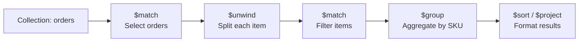

# Splitting Array Elements with $unwind and Handling Null or Empty Arrays in MongoDB

> **Module:** Database Engine Document MongoDB  
> **Chapter:** Aggregation Basics

## 1. What Is $unwind Used For?

MongoDB allows a document to contain an **array**. This is a natural way to represent order line items, user roles, events, tags, or sub-objects belonging to the same entity. During data analysis, many scenarios require turning **each array element into a separate result row** rather than continuing to process a single document containing an array.

The **`$unwind`** aggregation stage accomplishes this: for each input document, if the specified field contains an array of multiple elements, MongoDB outputs one document per element, where the array field is replaced by that specific element. All other fields of the document are preserved.

Initial example:

```javascript
{
  _id: "ORD-001",
  customerId: "C01",
  items: [
    { sku: "PEN", quantity: 2 },
    { sku: "BOOK", quantity: 1 }
  ]
}
```

After the stage:

```javascript
{ $unwind: "$items" }
```

produces **two result documents**:

```javascript
{
  _id: "ORD-001",
  customerId: "C01",
  items: { sku: "PEN", quantity: 2 }
}
{
  _id: "ORD-001",
  customerId: "C01",
  items: { sku: "BOOK", quantity: 1 }
}
```

Core points:

- `$unwind` **multiplies the number of result rows** according to the number of array elements.
- This is an **aggregation pipeline transformation**; it does not automatically update the source collection.
- Output rows can share the same `_id` because they originate from the same source document. Do not treat them as newly stored documents with unique `_id` values.
- For **empty arrays, null, and missing fields**, the default behavior is to **emit zero rows**; this can be changed with `preserveNullAndEmptyArrays`.
- For **non-array values that are neither null nor missing**, MongoDB treats the value as a single-element array.

This lesson focuses on those exact behaviors, how to use `includeArrayIndex`, how to count results accurately, and how to avoid skewing reports when data structures are inconsistent.

## 2. Where Does $unwind Sit in an Aggregation Pipeline?

An aggregation pipeline is a sequence of stages processing a document stream. The output of one stage becomes the input to the next stage.



Example:

```javascript
db.orders.aggregate([
  { $match: { status: "PAID" } },
  { $unwind: "$items" },
  {
    $group: {
      _id: "$items.sku",
      totalQuantity: { $sum: "$items.quantity" }
    }
  },
  { $sort: { totalQuantity: -1 } }
]);
```

Meaning:

1. Feed only paid orders into processing.
2. Split each `items` element into a separate row.
3. Group rows by SKU.
4. Sum the quantities sold.
5. Sort by highest-selling SKU first.

If you omit `$unwind`, the path `$items.sku` in many contexts represents array data rather than an individual SKU value per row. To aggregate per SKU, flatten the array level at the right place.

**Note:** `$unwind` only processes the exact field path specified in a single stage. It does not recursively flatten every nested array in a document.

## 3. Two Syntaxes of $unwind

MongoDB supports both a shorthand form and an expanded form.

### 3.1. Shorthand Syntax: Field Path

```javascript
{ $unwind: "$items" }
```

`"$items"` is a **field path expression**, prefixed with `$` to reference the `items` field in the document.

This form is suitable when:

- The field holds an array with data and you **only want to keep documents with at least one element**.
- You do not need the element's positional index.
- You do not need to retain documents whose field is null, missing, or an empty array.

For null, missing, and empty arrays, the shorthand syntax has the same default effect as configuring `preserveNullAndEmptyArrays: false`.

### 3.2. Expanded Syntax: Configuration Document

```javascript
{
  $unwind: {
    path: "$items",
    preserveNullAndEmptyArrays: true,
    includeArrayIndex: "itemIndex"
  }
}
```

Options:

| Field | Type | Role |
|---|---|---|
| `path` | Field path string | Field to unwind, prefixed with `$` |
| `preserveNullAndEmptyArrays` | Boolean | Whether to keep documents when the field is null, missing, or an empty array; defaults to `false` |
| `includeArrayIndex` | String | Name of the new field storing the element's array index in output; does not start with `$` |

Example adding only the index without keeping empty cases:

```javascript
{
  $unwind: {
    path: "$items",
    includeArrayIndex: "itemIndex"
  }
}
```

Example keeping empty documents without needing an index:

```javascript
{
  $unwind: {
    path: "$items",
    preserveNullAndEmptyArrays: true
  }
}
```

**Warning:** `includeArrayIndex` adds a field to the output document. Choose a name that does not collide with existing fields, such as `unwindItemIndex`, to avoid overwriting existing pipeline data.

## 4. Practice Dataset Used Throughout

To fully understand `$unwind` behavior, create documents representing multi-element arrays, single-element arrays, empty arrays, null, missing fields, and non-array values.

Open MongoDB Shell connected to your practice database:

```bash
mongosh "mongodb://127.0.0.1:27017"
```

Create an isolated database/collection:

```javascript
const lab = db.getSiblingDB("aggregation_unwind_lab");
const orders = lab.getCollection("orders");

orders.insertMany([
  {
    _id: "O1",
    customerId: "C1",
    status: "PAID",
    items: [
      { sku: "PEN", quantity: 2, unitPrice: 100 },
      { sku: "BOOK", quantity: 1, unitPrice: 50 }
    ]
  },
  {
    _id: "O2",
    customerId: "C2",
    status: "DRAFT",
    items: []
  },
  {
    _id: "O3",
    customerId: "C3",
    status: "DRAFT",
    items: null
  },
  {
    _id: "O4",
    customerId: "C4",
    status: "NEW"
    // The items field does not exist.
  },
  {
    _id: "O5",
    customerId: "C1",
    status: "PAID",
    items: [
      { sku: "PEN", quantity: 3, unitPrice: 90 }
    ]
  },
  {
    _id: "O6",
    customerId: "C5",
    status: "PAID",
    items: { sku: "LEGACY", quantity: 1, unitPrice: 70 }
  },
  {
    _id: "O7",
    customerId: "C6",
    status: "DRAFT",
    items: "unknown"
  }
]);

print("Original order count:", orders.countDocuments({}));
```

The result is **7 original documents**. This collection is designed for learning how to handle heterogeneous data; in a real business model, `items` should normally be enforced as a schema-compliant array.

> **Safety scope:** These commands are only meant for your practice database. If these `_id` values already exist, `insertMany()` will fail with a duplicate key error. Use another lab database or reset the data within your authorized scope; do not drop production collections to run exercises.

Initial dataset table:

| `_id` | Value of `items` | Data type | Element count if array |
|---|---|---|---:|
| `O1` | Two objects: PEN, BOOK | Array | 2 |
| `O2` | `[]` | Empty array | 0 |
| `O3` | `null` | Null | N/A |
| `O4` | Missing `items` field | Missing | N/A |
| `O5` | One object: PEN | Array | 1 |
| `O6` | One LEGACY object | Object, **not an array** | N/A |
| `O7` | String `"unknown"` | String, **not an array** | N/A |

Row count examples in subsequent sections assume the dataset has not been altered and has no extra documents.

## 5. Default $unwind: Empty Arrays, Null, and Missing Fields Are Excluded

Run:

```javascript
const defaultRows = orders.aggregate([
  { $unwind: "$items" },
  {
    $project: {
      _id: 1,
      customerId: 1,
      items: 1
    }
  },
  { $sort: { _id: 1, "items.sku": 1 } }
]).toArray();

printjson(defaultRows);
print("Row count after unwind:", defaultRows.length);
```

You will get **5 rows**:

| Output `_id` | `items` field after unwind | Origin |
|---|---|---|
| `O1` | `{ sku: "BOOK", quantity: 1, unitPrice: 50 }` | Second element of O1 |
| `O1` | `{ sku: "PEN", quantity: 2, unitPrice: 100 }` | First element of O1 |
| `O5` | `{ sku: "PEN", quantity: 3, unitPrice: 90 }` | Single-element array |
| `O6` | `{ sku: "LEGACY", quantity: 1, unitPrice: 70 }` | Non-array object treated as one element |
| `O7` | `"unknown"` | Non-array string treated as one element |

The display order in the table reflects the query's `$sort` stage. To preserve the actual position within the array, use `includeArrayIndex`; that index is distinct from the sort order in the table above.

Why is the row count 5?

```text
O1: 2-element array        → 2 rows
O2: []                     → 0 rows
O3: null                   → 0 rows
O4: missing items          → 0 rows
O5: 1-element array        → 1 row
O6: non-[] object          → 1 row
O7: non-[] string          → 1 row
                             -------
Total                        5 rows
```

**By default, `$unwind` drops a document from the output if the specified field is missing, null, or an empty array.** This is the expected default behavior and does not mean documents were deleted from the database.

To count using aggregation:

```javascript
printjson(
  orders.aggregate([
    { $unwind: "$items" },
    { $count: "unwoundRows" }
  ]).toArray()
);

// [{ unwoundRows: 5 }] on this dataset.
```

The `$count` command counts **pipeline rows after unwind**, not original documents. When there are zero output rows, the `$count` stage may return no result document at all rather than returning a document with 0.

## 6. preserveNullAndEmptyArrays: Keeping Documents When the Array Has No Elements

When building reports, you sometimes need to keep orders **without items**, for instance to find empty orders or reconcile total order counts. Use the expanded syntax:

```javascript
const preservedRows = orders.aggregate([
  {
    $unwind: {
      path: "$items",
      preserveNullAndEmptyArrays: true
    }
  },
  { $sort: { _id: 1 } }
]).toArray();

printjson(preservedRows);
print("Row count:", preservedRows.length);
```

On the original dataset, the result has **8 rows**.

| Source document | Rows with preserve=true | Behavior |
|---|---:|---|
| `O1` with 2 items | 2 | Still split into two rows |
| `O2` with `[]` | 1 | Keeps document; empty array field has no element to put in output |
| `O3` with `items: null` | 1 | Keeps document, null value |
| `O4` missing `items` | 1 | Keeps document, field stays missing |
| `O5` with 1 item | 1 | One row |
| `O6` with object | 1 | Object is treated as one element |
| `O7` with string | 1 | String is treated as one element |
| **Total** | **8** | |

```text
Without preserve:  2 + 0 + 0 + 0 + 1 + 1 + 1 = 5
With preserve:     2 + 1 + 1 + 1 + 1 + 1 + 1 = 8
```

### 6.1. A Crucial Detail: Empty Array Differs from Null and Missing

With `preserveNullAndEmptyArrays: true`:

- **Empty array `[]`:** MongoDB can emit the document without the `items` field, because there is no element to substitute into the field.
- **Field is `null`:** the document still retains `items: null`.
- **Field does not exist:** the document is retained while still missing `items`.

After unwind, looking solely at the `items` field in the output document makes it hard to tell an **empty array** apart from a **missing field**. If analysis needs to know the cause before unwinding, add a classification field in an earlier stage.

Example:

```javascript
orders.aggregate([
  {
    $set: {
      originalItemsType: { $type: "$items" },
      originalItemsWasArray: { $isArray: "$items" }
    }
  },
  {
    $unwind: {
      path: "$items",
      preserveNullAndEmptyArrays: true
    }
  },
  {
    $project: {
      _id: 1,
      items: 1,
      originalItemsType: 1,
      originalItemsWasArray: 1
    }
  },
  { $sort: { _id: 1 } }
]);
```

Before unwinding:

- `$type` on a missing field returns `"missing"` in an aggregation expression.
- `$type` on `null` returns `"null"`.
- `$type` on an array returns `"array"`, even for an empty array.
- `$isArray` returns `true` when the value is an array and `false` otherwise.

Combine with a **conditional** `$size` if you need to distinguish empty arrays from populated arrays.

### 6.2. When Should You Enable Preserve?

| Need | Should you use it? | Reason |
|---|---|---|
| Calculate revenue only from populated items | Usually unnecessary | Orders without items are not needed |
| List all orders along with items if any | **Yes** | Do not drop orders that lack items yet |
| Reconcile the count of entered orders | **Yes**, but count carefully | Keep empty orders so none are missed |
| Analyze per-item quantities | Possibly no | Preserved rows do not represent real items |
| Emulate a left join after `$lookup` | **Yes** to retain source records | Keeps documents even with zero joined matches |
| Distinguish missing from empty | Classify **before** unwinding | Source info can be lost after unwinding |

## 7. includeArrayIndex: Knowing Where an Element Was Positioned

When a document holds multiple items, original ordering sometimes matters: order line sequence, processing step order, or survey answer order.

Use `includeArrayIndex`:

```javascript
const withIndex = orders.aggregate([
  { $match: { _id: { $in: ["O1", "O5", "O6", "O7"] } } },
  {
    $unwind: {
      path: "$items",
      includeArrayIndex: "lineIndex"
    }
  },
  {
    $project: {
      _id: 1,
      "items.sku": 1,
      items: 1,
      lineIndex: 1
    }
  },
  { $sort: { _id: 1, lineIndex: 1 } }
]).toArray();

printjson(withIndex);
```

Notable result shapes:

| Document | Field after unwind | `lineIndex` |
|---|---|---:|
| `O1` | PEN | 0 |
| `O1` | BOOK | 1 |
| `O5` | PEN | 0 |
| `O6` | Non-array LEGACY object | null |
| `O7` | Non-array `"unknown"` string | null |

For array elements, indices start at **0**, just like JavaScript/Java. MongoDB represents the index using the appropriate BSON integer type. For non-array values treated as a single element, `lineIndex` is `null`, because there is no true array position.

**Do not rely on `lineIndex = null` to conclude the original field was null**: it can also appear for non-array scalars. For documents preserved via `preserveNullAndEmptyArrays`, the index field may be absent or not indicate a valid position; if you need to tell them apart, store the original type/length before unwinding.

### 7.1. Array Position Differs from Output Order

`includeArrayIndex` records an element's position in the **original array**, but does not replace sorting in later steps. Example:

```javascript
orders.aggregate([
  { $match: { _id: "O1" } },
  {
    $unwind: {
      path: "$items",
      includeArrayIndex: "lineIndex"
    }
  },
  { $sort: { "items.sku": 1 } },
  { $project: { _id: 1, lineIndex: 1, "items.sku": 1 } }
]);
```

Sorting by SKU puts BOOK ahead of PEN, while BOOK's `lineIndex` remains 1. That is expected: the index tracks the source position, while sort dictates report order.

## 8. Non-Array Field Behavior: Objects or Scalars Can Still Pass Through

A common wrong assumption: "`$unwind` only works if the field is an array; if the field is an object or string, MongoDB always throws an error."

In many cases, for a field that is **present, non-null, and not an array**, `$unwind` treats that value as a single-element array.

On the practice dataset:

```javascript
printjson(
  orders.aggregate([
    { $match: { _id: { $in: ["O6", "O7"] } } },
    { $unwind: "$items" },
    { $project: { _id: 1, items: 1 } }
  ]).toArray()
);
```

Both documents are kept:

- `O6.items` is an **object** with SKU LEGACY.
- `O7.items` is a **string** `"unknown"`.

This helps compatibility with some historical data, yet can also mask schema bugs. If downstream code always expects `$items.sku`, document `O7` will lack that path; an aggregation pipeline might skip it or put it in an unintended group.

### 8.1. Processing Only Documents Where items Is an Array

If the data contract requires `items` to be an array, check beforehand:

```javascript
orders.aggregate([
  {
    $match: {
      items: { $type: "array" }
    }
  },
  { $unwind: "$items" },
  {
    $project: {
      _id: 1,
      items: 1
    }
  }
]);
```

On the lab dataset, the match passes `O1`, `O2`, and `O5` (all having array items); default unwind drops empty `O2`. The result is **3 rows**: two from O1 and one from O5.

**Distinction:** filtering out schema-violating values in a report **does not fix historical data**. Investigate why `O6` and `O7` exist, and consider schema validation at the collection/API/ETL level.

### 8.2. Normalizing Before Unwinding

To unify input so downstream stages do not encounter unexpected objects/strings:

```javascript
orders.aggregate([
  {
    $set: {
      normalizedItems: {
        $cond: [
          { $isArray: "$items" },
          "$items",
          []
        ]
      }
    }
  },
  {
    $unwind: {
      path: "$normalizedItems",
      preserveNullAndEmptyArrays: true
    }
  },
  {
    $project: {
      _id: 1,
      customerId: 1,
      normalizedItems: 1
    }
  }
]);
```

Here:

- If `items` is an array, keep it intact.
- If `items` is null, missing, a single object, or a string, replace it with an empty array in the **pipeline output**.
- When unwinding with preserve=true, each document without elements still produces one row.

This is a **normalization policy chosen for the report**, not a mandatory rule. It can erase the distinction between valid legacy objects and corrupt data, so if auditing is needed, save `originalItemsType` before normalizing or route bad documents to an inspection stream.

## 9. Accurately Counting Source Documents vs. Item Rows After Unwind

This is a very common source of reporting bugs. After unwind, a single order document can appear multiple times. If you use `$sum: 1`, you are counting **post-unwind rows**, not unique orders.

### 9.1. Counting Rows from Arrays

```javascript
const totalRows = orders.aggregate([
  { $unwind: "$items" },
  { $count: "rows" }
]).toArray();

printjson(totalRows); // rows = 5
```

The count 5 includes both O6's object and O7's string because they are treated as singletons.

### 9.2. Counting Unique Orders That Produced Rows After Unwind

```javascript
orders.aggregate([
  { $unwind: "$items" },
  {
    $group: {
      _id: null,
      itemRows: { $sum: 1 },
      orderIds: { $addToSet: "$_id" }
    }
  },
  {
    $project: {
      _id: 0,
      itemRows: 1,
      ordersWithOutput: { $size: "$orderIds" }
    }
  }
]);
```

On the sample dataset:

- `itemRows = 5`.
- `ordersWithOutput = 4`, namely `O1`, `O5`, `O6`, `O7`.

If business logic wants to count **only orders with valid item arrays**, filter by array type before unwinding; the result will be 2 source documents (O1, O5) and 3 item rows.

### 9.3. Counting by Customer Without Multiplying Order Counts

```javascript
orders.aggregate([
  { $unwind: "$items" },
  {
    $group: {
      _id: "$customerId",
      outputRows: { $sum: 1 },
      orderIds: { $addToSet: "$_id" }
    }
  },
  {
    $project: {
      outputRows: 1,
      uniqueOrders: { $size: "$orderIds" }
    }
  },
  { $sort: { _id: 1 } }
]);
```

For customer `C1`:

- O1 has 2 items → 2 rows.
- O5 has 1 item → 1 row.
- Total **3 item rows** but only **2 unique orders**.

If a dashboard claims "C1 has 3 orders" due to using `$sum: 1` after unwind, that is a business metric bug. Clearly define the counting unit for every metric: source document, item row, distinct SKU, or item quantity.

### 9.4. How Does preserve=true Change Counting Units?

After:

```javascript
{
  $unwind: {
    path: "$items",
    preserveNullAndEmptyArrays: true
  }
}
```

orders O2, O3, and O4 also emit one row each, even though they have **no actual items**. Therefore:

- `$sum: 1` after this stage is not "item count."
- `$count` after this stage is not "source document count" (O1 still expands to two rows).
- To count valid items, check that items are schema-valid objects or normalize/count arrays before unwinding.
- To count source documents, use `countDocuments()` on source conditions or group by `_id` after unwinding as needed.

## 10. Aggregating Revenue by SKU Using $unwind and $group

A common use of `$unwind` is collecting line items across multiple orders to compute total quantities and amounts.

On the dataset:

- O1: PEN qty 2, unitPrice 100; BOOK qty 1, unitPrice 50.
- O5: PEN qty 3, unitPrice 90.
- O6: LEGACY qty 1, unitPrice 70 (stored as an object instead of an array).
- O7: string `"unknown"`, no valid SKU/quantity/unitPrice.

Illustrative pipeline:

```javascript
const revenue = orders.aggregate([
  { $unwind: "$items" },
  {
    $match: {
      "items.sku": { $type: "string" },
      "items.quantity": { $type: "number" },
      "items.unitPrice": { $type: "number" }
    }
  },
  {
    $group: {
      _id: "$items.sku",
      totalQuantity: { $sum: "$items.quantity" },
      lineRevenue: {
        $sum: {
          $multiply: [
            "$items.quantity",
            "$items.unitPrice"
          ]
        }
      },
      orderIds: { $addToSet: "$_id" }
    }
  },
  {
    $project: {
      _id: 0,
      sku: "$_id",
      totalQuantity: 1,
      lineRevenue: 1,
      ordersCount: { $size: "$orderIds" }
    }
  },
  { $sort: { sku: 1 } }
]).toArray();

printjson(revenue);
```

Expected calculations:

| SKU | Total quantity | Line revenue | Orders count |
|---|---:|---:|---:|
| BOOK | 1 | 50 | 1 |
| LEGACY | 1 | 70 | 1 |
| PEN | 5 | 470 | 2 |

PEN breakdown: `2 × 100 + 3 × 90 = 470`. Because each order item becomes its own row, `$group` easily sums quantities and revenue per SKU.

**Limitations to understand:**

- This is a simple arithmetic exercise omitting currency, tax, discounts, returns, and payment status.
- For monetary data, choose a consistent numeric type/scale (e.g., Decimal128 or minor units), never mixing strings and numbers arbitrarily.
- This pipeline **accepted O6** because the LEGACY object unwound as a singleton with valid field types. If business rules allow arrays only, validate the type **before** the unwind stage.
- `$type: "number"` in the query condition matches BSON numeric types; it does not prove monetary amounts are valid by business rules.

### 10.1. Aggregating Revenue Only from Schema-Valid Arrays

Add an initial stage:

```javascript
orders.aggregate([
  { $match: { items: { $type: "array" } } },
  { $unwind: "$items" },
  { $match: { "items.sku": { $type: "string" } } },
  {
    $group: {
      _id: "$items.sku",
      quantity: { $sum: "$items.quantity" }
    }
  }
]);
```

On the current dataset, O6 and O7 do not enter aggregation, while O2 with an empty array produces no item row. SKU quantities will include only PEN and BOOK.

Which approach is right depends on the data contract: **accepting legacy singletons** or **accepting valid arrays only** must be an intentional decision.

## 11. $match Before vs. After $unwind Can Yield Different Results

Stage order is part of aggregation semantics.

Consider O1, which has two items: PEN and BOOK. The following two pipelines look similar but are **not equivalent**.

### 11.1. Matching an Array Field Before Unwind

```javascript
orders.aggregate([
  { $match: { "items.sku": "PEN" } },
  { $unwind: "$items" },
  { $project: { _id: 1, "items.sku": 1 } }
]);
```

The pre-unwind `$match` selects **source documents containing at least one item with SKU PEN**. Because O1 contains PEN, O1 enters the unwind stage and **both PEN and BOOK are split out**. O5 is included too.

The result from O1 contains both a PEN row and a BOOK row. In other words, the initial filter **selects orders**, not individual elements after splitting.

### 11.2. Matching a Field After Unwind

```javascript
orders.aggregate([
  { $unwind: "$items" },
  { $match: { "items.sku": "PEN" } },
  { $project: { _id: 1, "items.sku": 1 } }
]);
```

Here `items` in each row is **one object or scalar**, so the SKU condition applies to the unwound element. O1's BOOK row is dropped; only PEN rows from O1 and O5 remain.

### 11.3. Combining Both to Limit Unnecessary Data

```javascript
orders.aggregate([
  { $match: { status: "PAID", "items.sku": "PEN" } },
  { $unwind: "$items" },
  { $match: { "items.sku": "PEN" } },
  {
    $group: {
      _id: "$items.sku",
      totalQuantity: { $sum: "$items.quantity" }
    }
  }
]);
```

The first stage filters out irrelevant orders; the later stage selects the exact item rows. With appropriate indexes on the matched fields, early filtering reduces how many documents pass into unwind.

However, never mechanically push a `$match` ahead of unwind if you need to preserve the semantics of selecting **individual elements**. MongoDB's aggregation optimizer may reorder certain stages when the transformation is equivalent; when analyzing performance, inspect `explain` on the actual pipeline.

## 12. Performance Consequences: Fan-Out Multiplies Row Counts

If one document has a 100-element array, `$unwind` can produce 100 intermediate documents. If 100,000 documents each have 100 elements:

```text
100,000 source documents × 100 elements
≈ 10,000,000 rows after $unwind
```

That is aggregation **fan-out**.

Increasing row counts forces downstream stages like `$group`, `$sort`, `$lookup`, or `$project` to process far more elements. At scale, query duration and intermediate memory usage can grow substantially.

### 12.1. Estimation Examples

| Input documents | Avg items | Approximate rows after unwind |
|---:|---:|---:|
| 100 | 2 | 200 |
| 10000 | 5 | 50000 |
| 100000 | 20 | 2000000 |
| 1000000 | 50 | 50000000 |

This multiplication assumes all documents have populated arrays. On real data:

- Empty/null/missing arrays reduce row counts under default settings.
- `preserveNullAndEmptyArrays: true` emits one row per empty/null/missing document.
- Non-null scalars contribute one row despite not being arrays.
- `$match` stages before/after unwind reduce row counts.

Therefore, measure actual array length distributions and real filter selectivity rather than applying an arbitrary average.

### 12.2. Ways to Reduce Cost

1. **Filter irrelevant documents early:** e.g., by `tenantId`, status, or time range before unwinding.
2. **Project only needed fields:** use projection to avoid carrying large payloads across every multiplied row.
3. **If only specific array elements are needed, consider `$filter` before unwinding:** reduces fan-out when conditions are clear.
4. **If only counting elements, avoid unwind + count:** use `$size` paired with `$isArray` or suitable logic.
5. **If only needing the first element, avoid expanding all rows:** consider `$arrayElemAt` or array operators.
6. **Position `$group` and `$sort` purposefully:** avoid sorting millions of rows when equivalent grouping/filtering can happen earlier.
7. **Inspect explain and actual metrics:** check documents read, index usage, blocking stage memory, and output row count.
8. **Chunk large export jobs:** a driver cursor reads in batches, yet aggregation still incurs server-side costs.

### 12.3. If You Only Need Item Counts, Skip $unwind

Example computing each order's item count under the contract that `items` is an array:

```javascript
orders.aggregate([
  {
    $project: {
      _id: 1,
      itemCount: {
        $cond: [
          { $isArray: "$items" },
          { $size: "$items" },
          0
        ]
      }
    }
  },
  { $sort: { _id: 1 } }
]);
```

Result:

| Order | itemCount |
|---|---:|
| O1 | 2 |
| O2 | 0 |
| O3 | 0 |
| O4 | 0 |
| O5 | 1 |
| O6 | 0 |
| O7 | 0 |

For O6's object, this expression counts 0 because it is **not an array**; that is a clear policy per the data contract. To accept legacy objects as one item, add a dedicated branch.

**Why `$isArray` is necessary:** applying `$size` directly to a non-array field causes an aggregation error. With flexible data, guard the type first.

### 12.4. If You Only Need SKU PEN, Filter the Array First

Example using `$filter` to keep only item objects with SKU PEN, on validated array inputs:

```javascript
orders.aggregate([
  { $match: { items: { $type: "array" } } },
  {
    $set: {
      penItems: {
        $filter: {
          input: "$items",
          as: "item",
          cond: { $eq: ["$$item.sku", "PEN"] }
        }
      }
    }
  },
  { $unwind: "$penItems" },
  { $project: { _id: 1, penItems: 1 } }
]);
```

Here `$filter` does not create new rows; it builds a sub-array, and `$unwind` then splits only matching elements. Depending on the MongoDB optimizer and workload, the benefit varies; do not assume `$filter` is always faster than `$match` after unwind. Benchmark on your actual pipeline.

## 13. Nested Arrays: Multiple $unwind Stages Needed

An order has items, and each item has multiple options:

```javascript
{
  _id: "O-NESTED",
  items: [
    {
      sku: "SHIRT",
      options: [
        { color: "red", size: "M" },
        { color: "blue", size: "L" }
      ]
    },
    {
      sku: "CAP",
      options: [
        { color: "black", size: "FREE" }
      ]
    }
  ]
}
```

To get one row per **option**:

```javascript
db.orders.aggregate([
  { $match: { _id: "O-NESTED" } },
  { $unwind: "$items" },
  { $unwind: "$items.options" },
  {
    $project: {
      _id: 1,
      sku: "$items.sku",
      option: "$items.options"
    }
  }
]);
```

The first step turns each item into a document; the next step turns each option into a document. For this example, the result is 3 option rows.

If an item has `options: []`, the second unwind stage drops that item row by default. If business logic requires keeping items with no options, use:

```javascript
{
  $unwind: {
    path: "$items.options",
    preserveNullAndEmptyArrays: true
  }
}
```

### 13.1. Multi-Level Fan-Out

With nested arrays, row counts equal the total number of inner elements across all items, or multiply dramatically across deeper levels. When a pipeline uses multiple `$unwind` stages:

- Ask whether you are counting **orders**, **items**, or **options**.
- Preserve the source `_id` and optionally add position indices at each level.
- Plan for null/empty arrays at **each level**.
- Avoid grouping at the wrong level and double-counting metrics.
- Monitor memory and row counts after each major step.

### 13.2. Saving Indices at Both Levels

```javascript
db.orders.aggregate([
  { $match: { _id: "O-NESTED" } },
  {
    $unwind: {
      path: "$items",
      includeArrayIndex: "itemIndex"
    }
  },
  {
    $unwind: {
      path: "$items.options",
      includeArrayIndex: "optionIndex"
    }
  },
  {
    $project: {
      _id: 1,
      itemIndex: 1,
      optionIndex: 1,
      sku: "$items.sku",
      option: "$items.options"
    }
  }
]);
```

The path `items.options` is unwound after `items` has already become a single object. Output data captures the positions of both the item and the option.

## 14. $lookup + $unwind: Relationship to Left Join and Inner Join

`$lookup` typically produces a join result array. Suppose the `orders` collection has `customerId` and the `customers` collection has matching `_id` values:

```javascript
db.orders.aggregate([
  {
    $lookup: {
      from: "customers",
      localField: "customerId",
      foreignField: "_id",
      as: "customer"
    }
  }
]);
```

With simple `$lookup`, `customer` is an array:

- One matching customer → single-element array.
- No matching customer → empty array.
- Multiple matching records on a non-unique field → multi-element array.

If you use:

```javascript
{ $unwind: "$customer" }
```

orders with `customer: []` are dropped from the result, closely resembling **inner join** semantics with respect to unmatched rows.

If you use:

```javascript
{
  $unwind: {
    path: "$customer",
    preserveNullAndEmptyArrays: true
  }
}
```

orders without a matching customer are still kept, resembling **left outer join** semantics.

This matters greatly when a report must still show orders missing customer info, e.g., to investigate inconsistent data. Dropping rows by default can silently omit unmatched records from statistics.

### 14.1. Choosing Preserve According to Business Requirements

| Requirement | Common pattern |
|---|---|
| Take only orders with a matching customer | `$lookup` followed by default `$unwind` |
| Keep all orders even when customer is missing | `$lookup` followed by unwind with `preserveNullAndEmptyArrays: true` |
| Customer might have multiple matches | Check fan-out and uniqueness in source data |
| Need an array of customers rather than a scalar | Do not unwind; keep the array from `$lookup` |

`$lookup` joins only within supported MongoDB rules and configurations; the example above does not create the `customers` collection automatically. To run in practice, matching data and appropriate key indexes must exist.

## 15. Distinguishing Null, Missing, Empty Array, and No Match

Four concepts easily conflated:

| Input state | Example | Default `$unwind` | preserve=true |
|---|---|---:|---:|
| 2-element array | `items: [a, b]` | 2 rows | 2 rows |
| 1-element array | `items: [a]` | 1 row | 1 row |
| Empty array | `items: []` | 0 rows | 1 row |
| Null | `items: null` | 0 rows | 1 row |
| Missing field | No `items` | 0 rows | 1 row |
| Non-array object | `items: {sku: "A"}` | 1 row | 1 row |
| Non-array string | `items: "A"` | 1 row | 1 row |

In aggregations combining `$lookup` and `$unwind`, "no match" is represented by an **empty array** produced by `$lookup`. However, null and missing in the source collection are distinct data states, and you should not infer one from the other.

### 15.1. Null Does Not Equal Missing in Every Query

MongoDB query syntax `{ items: null }` typically matches both documents with `items: null` and documents lacking the `items` field. When you need to separate them:

```javascript
// Field does not exist:
orders.find({ items: { $exists: false } });

// Field exists with BSON null:
orders.find({ items: { $type: "null" } });

// Field has array type (including []):
orders.find({ items: { $type: "array" } });
```

To identify empty arrays, a clear approach in aggregation is combining `$isArray` with a conditional `$size`. Never apply `$size` directly to null/missing/scalar values.

### 15.2. Safely Extracting Data Types and Element Counts

```javascript
orders.aggregate([
  {
    $project: {
      _id: 1,
      itemsType: { $type: "$items" },
      isArray: { $isArray: "$items" },
      arrayLength: {
        $cond: [
          { $isArray: "$items" },
          { $size: "$items" },
          null
        ]
      }
    }
  },
  { $sort: { _id: 1 } }
]);
```

Expected table:

| Order | itemsType | isArray | arrayLength |
|---|---|---|---:|
| O1 | array | true | 2 |
| O2 | array | true | 0 |
| O3 | null | false | null |
| O4 | missing | false | null |
| O5 | array | true | 1 |
| O6 | object | false | null |
| O7 | string | false | null |

This is especially useful for profiling data before deciding whether to enable preserve or normalize.

## 16. $unwind Does Not Modify Source Data

After running:

```javascript
orders.aggregate([
  { $unwind: "$items" }
]);
```

the source document O1 remains:

```javascript
printjson(orders.findOne({ _id: "O1" }));
```

It still contains the two-element `items` array. The aggregation stage produces **intermediate result rows**, not updates like `$set`/`updateOne()`.

Only when a pipeline or application uses an explicit write operation—such as `$merge`/`$out` in aggregation under applicable rules or writing results through a driver—is stored data affected. Distinguish those cases from running a standard read pipeline.

### 16.1. Why Duplicate _id Values in Output Are Normal

In the unwind output, O1 produces two rows carrying `_id: "O1"`. This **does not violate the collection's unique index**, because the two rows are pipeline results, not two newly inserted documents.

However, if you insert each output row verbatim into a new collection while keeping the old `_id`, the write will hit a duplicate key error. If business logic requires storing each item as a separate document, design a unique item identifier, such as combining orderId and lineIndex or a stable item ID.

## 17. Grouping Back After Unwind: Preserving Array Semantics

Sometimes a pipeline needs to filter items and rebuild the array structure. For example, keeping only PEN items:

```javascript
orders.aggregate([
  { $match: { items: { $type: "array" } } },
  { $unwind: "$items" },
  { $match: { "items.sku": "PEN" } },
  {
    $group: {
      _id: "$_id",
      customerId: { $first: "$customerId" },
      penItems: { $push: "$items" }
    }
  }
]);
```

On the sample dataset, the output includes O1 and O5, each containing a `penItems` array.

**Limitations:**

- Orders without a PEN item are dropped because the post-unwind match leaves zero rows to group.
- `$push` collects items in the order documents enter the group stage; if original array order matters, retain `includeArrayIndex` and sort/group accordingly.
- `$group` is a blocking stage and can use substantial memory when collecting many items.
- Rebuilding an array does not guarantee retaining original metadata or types if the pipeline dropped those fields.

If the goal is solely filtering an array while keeping each document once, using `$filter` directly on the array is usually simpler than unwinding and re-grouping.

## 18. Java Sync Driver: Building Pipelines with Aggregates.unwind

The MongoDB Java Sync Driver supports stages via builder APIs, including `Aggregates.unwind()` and `UnwindOptions`.

Example reading all output with preserve=true:

```java
import com.mongodb.client.MongoClient;
import com.mongodb.client.MongoClients;
import com.mongodb.client.MongoCollection;
import com.mongodb.client.MongoCursor;
import com.mongodb.client.model.Aggregates;
import com.mongodb.client.model.UnwindOptions;

import org.bson.Document;
import org.bson.conversions.Bson;

import java.util.Arrays;
import java.util.List;

public class UnwindExample {
    public static void main(String[] args) {
        String uri = System.getenv("MONGODB_URI");

        if (uri == null || uri.isBlank()) {
            uri = "mongodb://127.0.0.1:27017";
        }

        try (MongoClient client = MongoClients.create(uri)) {
            MongoCollection<Document> orders = client
                    .getDatabase("aggregation_unwind_lab")
                    .getCollection("orders");

            List<Bson> pipeline = Arrays.asList(
                    Aggregates.unwind(
                            "$items",
                            new UnwindOptions()
                                    .preserveNullAndEmptyArrays(true)
                                    .includeArrayIndex("lineIndex")
                    )
            );

            try (MongoCursor<Document> cursor =
                         orders.aggregate(pipeline)
                                 .batchSize(25)
                                 .iterator()) {
                while (cursor.hasNext()) {
                    Document row = cursor.next();
                    System.out.println(row.toJson());
                }
            }
        }
    }
}
```

Here:

- `Aggregates.unwind("$items")` corresponds to `{ $unwind: "$items" }`.
- `UnwindOptions.preserveNullAndEmptyArrays(true)` keeps O2/O3/O4 in the output.
- `includeArrayIndex("lineIndex")` adds the element index when an array position exists.
- `aggregate(pipeline)` sends the pipeline to MongoDB Server for execution.
- `batchSize(25)` tunes the cursor fetch size; **it does not change the number of rows generated by unwind**.
- `try-with-resources` closes the cursor when finished or stopped early.

### 18.1. Unwinding Only Filtered Documents

```java
import com.mongodb.client.model.Aggregates;
import com.mongodb.client.model.UnwindOptions;
import org.bson.conversions.Bson;

import java.util.Arrays;
import java.util.List;

import static com.mongodb.client.model.Filters.eq;

List<Bson> pipeline = Arrays.asList(
        Aggregates.match(eq("customerId", "C1")),
        Aggregates.unwind(
                "$items",
                new UnwindOptions().includeArrayIndex("itemIndex")
        )
);
```

With O1 and O5, the pipeline returns three item rows total. Placing `$match` on `customerId` before unwind is usually sensible because it removes irrelevant documents before row multiplication. In production systems, an index on the filtered field can speed up the early match stage.

### 18.2. Java Mapping for Documents After Unwind

Before unwind, `items` may be a `List<Document>`; after unwind, `items` is typically a `Document` for each object element. If you reuse the same Java POJO with a `List<Item> items` field for **both input and post-unwind output**, the codec/mapping can become incompatible.

Two strategies:

1. Use `Document` in the pipeline and map output to a dedicated DTO representing **one item row**.
2. Use a `$project` stage to flatten the result into clear fields like `orderId`, `sku`, `quantity`, and `lineIndex`, then map to a corresponding Java record/POJO.

Projection example:

```javascript
orders.aggregate([
  { $match: { items: { $type: "array" } } },
  {
    $unwind: {
      path: "$items",
      includeArrayIndex: "lineIndex"
    }
  },
  {
    $project: {
      _id: 0,
      orderId: "$_id",
      customerId: 1,
      sku: "$items.sku",
      quantity: "$items.quantity",
      lineIndex: 1
    }
  }
]);
```

The output fits a DTO like:

```java
public record OrderItemRow(
        String orderId,
        String customerId,
        String sku,
        Integer quantity,
        Long lineIndex
) {}
```

The exact Java type for the index must match the codec/representation returned by the driver, and fields may be missing/null in some preserve or scalar scenarios. Do not assume every output row has non-null `items.sku` or `lineIndex`.

## 19. Common Errors and How to Handle Them

| Symptom | Common cause | Resolution |
|---|---|---|
| Orders without items disappear after unwind | `preserveNullAndEmptyArrays` defaults to `false` | Set to `true` if orders must be retained |
| Output has more rows than original orders | One document contains multiple array elements | Clarify whether counting item rows or unique orders |
| Output includes scalars from the unwound field | Non-null, non-array values are treated as singletons | Check `$isArray` or schema before unwinding |
| Report overcounts orders | Used `$sum: 1` after unwind | Use distinct `_id` or group by the proper unit |
| `$size` throws an error | Field is null, missing, or scalar | Guard with `$isArray` |
| `$lookup` then unwind drops orders with no customer | Join result array is empty | Use preserve=true for left-join semantics |
| Enabling preserve inflates item counts | Preserved rows do not represent real items | Filter/count schema-valid items |
| Original item order lost after sort | Element index was not saved | Use `includeArrayIndex` and sort by position when needed |
| Pipeline slows down after unwind | Long arrays cause large fan-out | Match early, project, filter elements, inspect explain |
| Java codec fails after unwind | Array field turned into an object/scalar | Use a separate output DTO or projection |
| Inserting output into another collection hits duplicate _id | Unwound rows retain the original `_id` | Design a unique ID for each item output document |
| Missing non-PEN items vs unexpected PEN items after pre-match | Array match selects documents, not individual item rows | Match after unwind to filter exact elements |
| Cannot distinguish [] from missing after unwind | Empty array field may be omitted in preserved output | Save original type/length before unwinding |

### 19.1. Do Not Use $unwind to Edit items in the Collection

`$unwind` is an aggregation stage. If the goal is to **remove elements from an array in stored documents**, use an appropriate update operator such as `$pull`, or a controlled update workflow. If the goal is to **add elements**, use `$push`/`$addToSet` as appropriate. Do not confuse read transformations with data-modifying updates.

### 19.2. Do Not Treat preserve=true as Data Validation

`preserveNullAndEmptyArrays: true` only means "do not drop documents without elements during unwind." It **does not fix** `items` being a string or an object that violates the contract. You may need MongoDB schema validation (`$jsonSchema`) or application-level validation to prevent malformed types in the future.

## 20. Practice Exercises

All exercises use the `aggregation_unwind_lab` database created in section 4. You do not need to modify or delete source data.

### Exercise A — Predicting Row Counts

With the 7 source documents:

1. Run `{ $unwind: "$items" }`.
2. Run `{ $unwind: { path: "$items", preserveNullAndEmptyArrays: true } }`.
3. Count the rows produced by each pipeline.
4. Explain how many rows each document from O1 to O7 contributes.

Expected results:

- Default: **5** rows.
- preserve=true: **8** rows.

### Exercise B — Saving Element Positions

```javascript
orders.aggregate([
  { $match: { _id: "O1" } },
  {
    $unwind: {
      path: "$items",
      includeArrayIndex: "idx"
    }
  },
  { $project: { _id: 1, idx: 1, "items.sku": 1 } }
]);
```

Explain why PEN gets `idx = 0` and BOOK gets `idx = 1`. Then add `$sort: { "items.sku": 1 }` and check whether the original indices change.

### Exercise C — Detecting Schema Violations

Use:

```javascript
orders.aggregate([
  {
    $project: {
      _id: 1,
      itemsType: { $type: "$items" },
      isArray: { $isArray: "$items" }
    }
  }
]);
```

Identify:

- Which document has an empty array?
- Which document has null?
- Which document is missing the field?
- Which documents have a non-array object or string?

Then write a pipeline that unwinds only documents where `items` is a valid array.

### Exercise D — Comparing Pre/Post $match

For SKU PEN:

```javascript
const before = orders.aggregate([
  { $match: { "items.sku": "PEN" } },
  { $unwind: "$items" },
  { $project: { _id: 1, "items.sku": 1 } }
]).toArray();

const after = orders.aggregate([
  { $unwind: "$items" },
  { $match: { "items.sku": "PEN" } },
  { $project: { _id: 1, "items.sku": 1 } }
]).toArray();

printjson({ before, after });
```

Analyze why the `before` pipeline also includes the BOOK row from O1, whereas the `after` pipeline only includes PEN.

### Exercise E — Counting Orders vs. Counting Items

Write an aggregation summarizing by `customerId`:

- Row count after unwind.
- Number of distinct source orders contributing data.
- Total quantity of valid items.

From O1 and O5, customer C1 has **2 orders** yet **3 item rows**; total quantity across PEN and BOOK is **6** (2 + 1 + 3). When grouping, ensure you do not mistakenly sum fields from preserved non-item rows.

### Exercise F — Designing a Report That Still Shows Empty Orders

Requirement: the report displays every order, including O2, O3, and O4; if it has valid items, display each item; if not, display one row labeled "no items."

Hints:

1. Save the initial state using `$type`/`$isArray`.
2. Decide policy for non-array O6/O7.
3. Normalize to an array if needed.
4. Unwind with `preserveNullAndEmptyArrays: true`.
5. Use `$project` to build a status/display label column.

Clearly document that "no items" differs from "malformed items type"; never silently merge the two if business requires data investigation.

### Exercise G — Limiting Fan-Out on Large Arrays

Suppose 50,000 documents each contain 200 events. Estimate the row count after default unwind if there are no empty arrays, then propose ways to reduce load if you only need event counts:

- Do you need unwind, or should you use `$size`?
- Can you filter by tenant/time beforehand?
- Do you need large payload fields in the output?
- If looking for only one event type, does `$filter` before unwind reduce rows?
- Does configuring cursor/batch size on the client eliminate all server-side cost?

The goal is to distinguish **intermediate volume on the server** from **how the client consumes results**.

## 21. Principles to Remember

1. **`$unwind` splits one array into multiple rows**, one row per element while retaining other document fields.
2. **By default, null, missing, and empty arrays produce 0 rows**; enable `preserveNullAndEmptyArrays: true` to keep one row per such document.
3. **Present, non-null, non-array values** are treated as single-element arrays. Check types if strict schema compliance is required.
4. **`includeArrayIndex` stores the element's position index**, 0-based for actual array elements. It does not replace sorting.
5. **After unwind, row count no longer equals source document count.** Every count or sum must specify the exact unit.
6. **Placing `$match` before vs. after unwind can change semantics:** selecting documents containing an item differs from selecting the item itself after splitting.
7. **preserve=true is essential for reports that must retain documents without elements**, such as after `$lookup`.
8. **Multi-level unwinds can cause massive fan-out**; filter early, project, use `$filter`/`$size`, and monitor memory per workload.
9. **Aggregation does not modify data in the source collection.** Persisting results requires an explicit write operation.
10. **Data quality matters:** do not use singleton scalar unwinding as an excuse to skip schema validation and input checks.

## 22. Official MongoDB Documentation

- [MongoDB Manual – $unwind (full syntax and behavior)](https://www.mongodb.com/docs/manual/reference/operator/aggregation/unwind/)
- [MongoDB Manual – Aggregation Pipeline](https://www.mongodb.com/docs/manual/core/aggregation-pipeline/)
- [MongoDB Manual – $match](https://www.mongodb.com/docs/manual/reference/operator/aggregation/match/)
- [MongoDB Manual – $group](https://www.mongodb.com/docs/manual/reference/operator/aggregation/group/)
- [MongoDB Manual – $project](https://www.mongodb.com/docs/manual/reference/operator/aggregation/project/)
- [MongoDB Manual – $lookup](https://www.mongodb.com/docs/manual/reference/operator/aggregation/lookup/)
- [MongoDB Manual – $isArray](https://www.mongodb.com/docs/manual/reference/operator/aggregation/isArray/)
- [MongoDB Manual – $size](https://www.mongodb.com/docs/manual/reference/operator/aggregation/size/)
- [MongoDB Manual – $filter](https://www.mongodb.com/docs/manual/reference/operator/aggregation/filter/)
- [MongoDB Manual – $type (aggregation)](https://www.mongodb.com/docs/manual/reference/operator/aggregation/type/)
- [MongoDB Java Sync Driver – Aggregation](https://www.mongodb.com/docs/drivers/java/sync/current/aggregation/)

**Conclusion:** `$unwind` is very useful for turning arrays into data rows for filtering, aggregation, and joins. However, choosing whether to keep or drop **null/missing/empty arrays**, handling **non-array scalars**, and **counting accurately after row multiplication** are decisions just as important as syntax. A sound pipeline produces accurate results per the data contract, avoids losing records unintentionally, and avoids unnecessary intermediate cost.