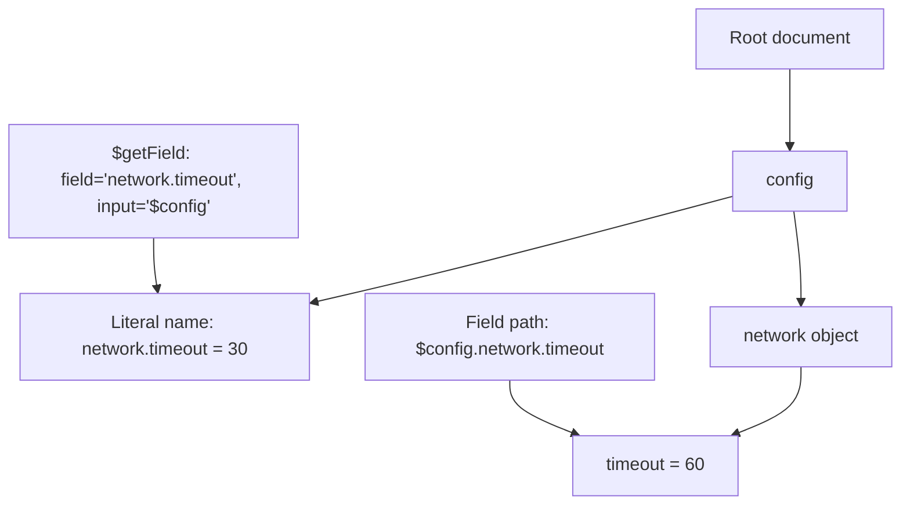

# Reading and Writing Dynamic Fields with $getField and $setField by Supported Version

> **Module:** MongoDB Document Database Engine  
> **Chapter:** Aggregation Expressions

## 1. Why Read and Write Dynamically Named Fields?

MongoDB stores data as BSON documents. Normally, fields have fixed names:

```javascript
{
  _id: 1,
  deviceId: "sensor-a",
  temperature: 28,
  humidity: 67
}
```

Accessing a known field name is straightforward:

```javascript
{
  $project: {
    deviceId: 1,
    temp: "$temperature"
  }
}
```

However, in configuration data, telemetry, reports, or external system feeds, field names may:

- **Be determined at runtime**, based on another field's value, e.g., `selectedKey: "cpu.user"`.
- **Contain a period `.`** such as `"cpu.user"`, whereas MongoDB dots normally represent nested field paths.
- **Start with a `$` character** such as `"$budget"`, whereas a string starting with `$` in aggregation is normally interpreted as a field reference or expression.
- Vary by data source, such as `metrics` emitted by different sensor types.

Example:

```javascript
{
  _id: 1,
  selectedKey: "cpu.user",
  newValue: 81,
  metrics: {
    "cpu.user": 75,
    "$budget": 120,
    plain: 20
  }
}
```

This document has two easily confused fields:

- `metrics["cpu.user"]` is **a single field** whose name contains a period.
- `metrics.cpu.user` would be the **nested path** `metrics → cpu → user`, not the field above.

On MongoDB Server versions that support them, the two aggregation expressions **`$getField`** and **`$setField`** solve reading and writing fields by exact literal name, including names containing periods or dollar signs.

This lesson explains syntax, version support, dynamic expressions, null/missing edge cases, usage in aggregation and update pipelines, and fallback strategies for older versions.

## 2. First: Distinguish Field Name from Field Path

Given the document:

```javascript
{
  _id: 100,
  config: {
    "network.timeout": 30,
    network: {
      timeout: 60
    }
  }
}
```

Two values have completely different meanings:

| Reference | Value | Meaning |
|---|---:|---|
| Literal field `"network.timeout"` inside `config` | 30 | Field name containing a period |
| Path `config.network.timeout` | 60 | `timeout` field inside the `network` object |
| Literal field `"config.network.timeout"` at root document | Absent | A completely different field name |

In aggregation, the expression:

```javascript
"$config.network.timeout"
```

is interpreted as the path to the value **60**, not the literal field `"network.timeout"`.

To read the literal name:

```javascript
{
  $getField: {
    input: "$config",
    field: "network.timeout"
  }
}
```

reads **30**.

**Important rule:** `$getField` and `$setField` operate on fields **at the immediate top level of the `input` object** and do not automatically interpret periods in field names as nested paths.



## 3. Support by MongoDB Server Version

This is a decisive factor when designing expressions. **Supporting a fixed literal field name** and **computing a field name from document data at runtime** are not the same capability.

| MongoDB Server | `$getField`, `$setField` | Value of `field` parameter | Notes |
|---|---|---|---|
| Before **5.0** | Expressions not supported | N/A | Consider `$objectToArray`/`$arrayToObject` if supported by version, or handle in the application |
| **5.0–7.0** | Yes | Expression must evaluate to a **constant string**; cannot pick arbitrary field names from the document at runtime | Reads/writes literal fields such as `"price.usd"` and `"$fee"` |
| **7.2 and later** | Yes | Can use any valid expression evaluating to a **string**, including field references or dynamic string-building expressions | E.g., `field: "$selectedKey"` or `field: { $concat: [...] }` |

Key feature introduced in **MongoDB 7.2**: the `field` parameter of `$getField`/`$setField` is no longer restricted to constant string expressions as in prior versions; it can be an expression resolving the field name during document evaluation.

**Do not confuse driver version with server version:** the Java driver can transmit a BSON command containing the expression, yet MongoDB Server must support the corresponding operator and semantics. MongoDB Atlas deployments or cluster nodes must also meet version/feature compatibility requirements before enabling new syntax.

### 3.1. Checking the Connected Server Version

In `mongosh`:

```javascript
print("MongoDB Server version:", db.version());

printjson(
  db.getSiblingDB("admin").runCommand({ buildInfo: 1 }).version
);
```

In cluster/sharded environments, member versions and **featureCompatibilityVersion (FCV)** can affect feature rollout during upgrades. Never check a single connection and assume every node across the cluster is in the same state.

To inspect FCV (requires appropriate administrative privileges):

```javascript
db.getSiblingDB("admin").runCommand({
  getParameter: 1,
  featureCompatibilityVersion: 1
});
```

Some deployments, Atlas tiers, or roles do not permit reading this parameter. When privileges are lacking, rely on deployment administration metadata instead of granting broad admin privileges to applications.

### 3.2. Deploying Across Multiple Versions Simultaneously

You may need to support both MongoDB 6.0 and 7.2 during a transition period. Do not send an expression with `field: "$selectedKey"` to a 6.0 server expecting it to behave like 7.2.

Appropriate strategy:

1. Identify the minimum supported MongoDB Server version.
2. If only **constant** field names are needed, use `$getField`/`$setField` syntax compatible from 5.0 onward.
3. If **fully dynamic** field names are needed, require server 7.2+ or use a fallback strategy with `$objectToArray`/`$arrayToObject`.
4. Write integration tests against every deployed server version branch.
5. When upgrading a cluster, verify FCV and member status before adopting new capabilities.

## 4. $getField: Reading a Literal Field in an Object

`$getField` is an **aggregation expression**, not a standalone pipeline stage.

Two common usage forms:

```javascript
// Shorthand form: select field by constant literal name
{ $getField: "fieldName" }

// Full form: specify the object to read from
{
  $getField: {
    field: "fieldName",
    input: "$someObject"
  }
}
```

In the full form:

| Property | Role |
|---|---|
| `field` | Name of field to read; constant string on MongoDB 5.0–7.0, string-evaluating expression from MongoDB 7.2 |
| `input` | Expression returning the object containing the field; if omitted, uses the current document (`$$CURRENT`) |

Example document:

```javascript
{
  _id: 1,
  metrics: {
    "cpu.user": 75,
    plain: 20
  }
}
```

Reading literal field `"cpu.user"`:

```javascript
db.readings.aggregate([
  {
    $project: {
      _id: 1,
      cpuUser: {
        $getField: {
          field: "cpu.user",
          input: "$metrics"
        }
      }
    }
  }
]);
```

Result includes `cpuUser: 75`.

If you only use:

```javascript
{ $getField: "cpu.user" }
```

the expression looks for `"cpu.user"` on the **current document**, not inside the `metrics` object. To read inside `metrics`, pass `input: "$metrics"`.

### 4.1. input Defaults to $$CURRENT

An expression omitting `input`:

```javascript
{
  $project: {
    value: {
      $getField: "plain"
    }
  }
}
```

reads `plain` from the current document. In a multi-stage pipeline, `$$CURRENT` may already be a transformed document, not necessarily identical to the original document read from the collection. To reduce ambiguity, explicitly specifying `input` is a clearer practice.

### 4.2. input Can Be the Result of Another Expression

It does not have to be a plain field path. Example:

```javascript
{
  $getField: {
    field: "rate",
    input: {
      $mergeObjects: [
        { rate: 10 },
        "$overrides"
      ]
    }
  }
}
```

The `input` expression constructs an intermediate object, and `$getField` reads the literal field `rate` from that object.

If `$overrides` is not a valid object for `$mergeObjects`, an error may occur. When receiving inconsistent data, validate types or normalize inputs beforehand.

## 5. Reading Fields Whose Names Start with $

This is a frequent cause of syntax errors.

Suppose:

```javascript
{
  _id: 1,
  metrics: {
    "$budget": 120
  }
}
```

If you pass:

```javascript
field: "$budget"
```

in aggregation, a string starting with `$` is interpreted as a **field path expression** rather than the literal field name `"$budget"`. To read a key starting with a dollar sign, wrap it with `$literal`:

```javascript
db.readings.aggregate([
  {
    $project: {
      _id: 1,
      budget: {
        $getField: {
          field: { $literal: "$budget" },
          input: "$metrics"
        }
      }
    }
  }
]);
```

Result includes `budget: 120`.

Distinguish:

| Expression in `field` | Meaning |
|---|---|
| `"cpu.user"` | Constant string, literal key `cpu.user` |
| `{ $literal: "$budget" }` | Literal key `$budget` |
| `"$selectedKey"` on 7.2+ | Reads the value of `selectedKey` and uses that string as the key to look up |
| `{ $concat: ["cpu", ".user"] }` on 7.2+ | Computes the key name via expression, yielding `cpu.user` |

**Note:** In the table, `field: "$selectedKey"` acts as a dynamic key only when MongoDB Server supports expression-evaluated `field` parameters, i.e., MongoDB 7.2+. On 5.0–7.0, do not treat it as compatible syntax.

## 6. $setField: Adding, Updating, or Removing a Field

`$setField` is an **aggregation expression** returning a **new object** with the specified field modified. It is not a standalone pipeline stage and not a standard update operator using `{$set: ...}` syntax.

Syntax:

```javascript
{
  $setField: {
    field: "fieldName",
    input: "$someObject",
    value: <expression>
  }
}
```

Where:

| Property | Role |
|---|---|
| `field` | Literal field name or dynamic expression depending on version |
| `input` | Object to modify |
| `value` | New value; can be an expression or `$$REMOVE` to delete the field |

Example creating a new object from `metrics` and setting `cpu.user`:

```javascript
db.readings.aggregate([
  {
    $project: {
      _id: 1,
      updatedMetrics: {
        $setField: {
          input: "$metrics",
          field: "cpu.user",
          value: 90
        }
      }
    }
  }
]);
```

If `metrics` originally is:

```javascript
{
  "cpu.user": 75,
  "$budget": 120,
  plain: 20
}
```

then `updatedMetrics` in the pipeline result is:

```javascript
{
  "cpu.user": 90,
  "$budget": 120,
  plain: 20
}
```

Other fields are preserved. **Running an aggregation like this alone does not update the stored document** in the collection.

### 6.1. Setting a Field Starting with $

Just like `$getField`, wrap the key in `$literal`:

```javascript
{
  $setField: {
    input: "$metrics",
    field: { $literal: "$budget" },
    value: 180
  }
}
```

Here `"$budget"` is the **key name to replace**. Meanwhile, if you want the new value itself to be a string starting with `$`, also prevent it from being interpreted as a field path expression:

```javascript
{
  $setField: {
    input: "$metrics",
    field: "note",
    value: { $literal: "$manual-review" }
  }
}
```

The result contains `note: "$manual-review"`.

### 6.2. Removing a Field with $$REMOVE

`$setField` can remove a field when `value` is the system variable `$$REMOVE`:

```javascript
{
  $setField: {
    input: "$metrics",
    field: "plain",
    value: "$$REMOVE"
  }
}
```

If `plain` exists, it is omitted from the output object; if it does not exist, the object remains without that field.

MongoDB also provides **`$unsetField`** (introduced alongside this operator family in MongoDB 5.0), which is a shorter equivalent to `$setField` with `$$REMOVE`:

```javascript
{
  $unsetField: {
    input: "$metrics",
    field: "plain"
  }
}
```

Note that `$unsetField` here is an **aggregation expression**, not the `$unset` stage or `$unset` update operator which have different syntax.

### 6.3. When the Field Does Not Yet Exist in the Object

`$setField` with a normal `value` can add a new key:

```javascript
{
  $setField: {
    input: "$metrics",
    field: "new.metric",
    value: 42
  }
}
```

The created key is a **literal** name `"new.metric"`, not a nested object `new: {metric: 42}`.

With `value: "$$REMOVE"`, no field is created; the operation removes the field from the output object.

## 7. Do Not Mistake Periods for Nested Paths

Consider the object:

```javascript
{
  metrics: {
    "location.zone": "north",
    location: {
      zone: "east"
    }
  }
}
```

Two updates behave differently.

**A. Updating the literal key `"location.zone"`:**

```javascript
{
  $setField: {
    input: "$metrics",
    field: "location.zone",
    value: "south"
  }
}
```

Result:

```javascript
{
  "location.zone": "south",
  location: { zone: "east" }
}
```

**B. Updating the nested field `location.zone`:**

Using an update pipeline and standard dot path:

```javascript
db.readings.updateOne(
  { _id: 1 },
  [
    {
      $set: {
        "metrics.location.zone": "south"
      }
    }
  ]
);
```

Approach B targets the nested path, **not** the literal dotted key.

If you want to use `$setField` for a nested object, build from the inside out: read the `location` object, update `zone` inside it, and place the modified `location` object back into `metrics`. Given an object input, `$setField` does not traverse multiple levels automatically.

### 7.1. Nesting Multiple $setField Expressions

Example using nested object expressions:

```javascript
{
  $setField: {
    input: "$metrics",
    field: "location",
    value: {
      $setField: {
        input: "$metrics.location",
        field: "zone",
        value: "south"
      }
    }
  }
}
```

This expression updates `metrics.location.zone` **along the nested structure**. It does not touch the sibling literal key `"location.zone"` inside `metrics`.

If `metrics.location` is missing or null, choose an appropriate default-object policy before nesting `$setField`.

### 7.2. Nesting Multiple $getField Expressions

Reading a nested field with two `$getField` calls:

```javascript
{
  $getField: {
    field: "zone",
    input: {
      $getField: {
        field: "location",
        input: "$metrics"
      }
    }
  }
}
```

This is equivalent to reading `"$metrics.location.zone"` when the levels have the expected structure, while expressing each object-level step explicitly.

## 8. Complete Practice Dataset

Open `mongosh` connected to MongoDB Server **5.0 or later** for constant field name examples. For dynamic expressions reading key names from documents, **7.2 or later** is required.

```bash
mongosh "mongodb://127.0.0.1:27017"
```

Create the lab collection:

```javascript
const lab = db.getSiblingDB("aggregation_dynamic_field_lab");
const readings = lab.getCollection("readings");

readings.insertMany([
  {
    _id: 1,
    deviceId: "sensor-a",
    selectedKey: "cpu.user",
    newValue: 81,
    metrics: {
      "cpu.user": 75,
      "$budget": 120,
      plain: 20,
      location: { zone: "east" }
    }
  },
  {
    _id: 2,
    deviceId: "sensor-b",
    selectedKey: "$budget",
    newValue: 180,
    metrics: {
      "cpu.user": 60,
      "$budget": 150,
      plain: 40
    }
  },
  {
    _id: 3,
    deviceId: "sensor-c",
    selectedKey: "new.metric",
    newValue: 42,
    metrics: {}
  },
  {
    _id: 4,
    deviceId: "sensor-d",
    selectedKey: "cpu.user",
    newValue: 70,
    metrics: null
  },
  {
    _id: 5,
    deviceId: "sensor-e",
    selectedKey: "cpu.user",
    newValue: 65
    // Missing metrics field.
  },
  {
    _id: 6,
    deviceId: "sensor-f",
    selectedKey: "cpu.user",
    newValue: 99,
    metrics: "bad-schema"
  },
  {
    _id: 7,
    deviceId: "sensor-g",
    selectedKey: "cpu.user",
    newValue: 51,
    metrics: {
      "cpu.user": null
    }
  }
]);

print("Documents:", readings.countDocuments({}));
```

The dataset has **7 documents** and intentionally includes null, missing, and wrong-type cases to illustrate expression behavior.

> **Lab data note:** run `insertMany()` once on an empty collection. If data already exists, duplicate `_id` errors will occur. Use a separate lab database to re-run; never drop a real application collection just to test examples.

## 9. Example 1: Reading a Constant Key Containing a Period (MongoDB 5.0+)

Select only documents where `metrics` is an object to avoid wrong-type input errors:

```javascript
const constantRead = readings.aggregate([
  {
    $match: {
      metrics: { $type: "object" }
    }
  },
  {
    $project: {
      _id: 1,
      deviceId: 1,
      cpuUser: {
        $getField: {
          input: "$metrics",
          field: "cpu.user"
        }
      }
    }
  },
  { $sort: { _id: 1 } }
]).toArray();

printjson(constantRead);
```

Interpretation on the sample data:

| ID | Result `cpuUser` | Reason |
|---|---|---|
| 1 | 75 | Object has key `cpu.user` |
| 2 | 60 | Object has key `cpu.user` |
| 3 | Field absent | Empty object, key does not exist |
| 7 | null | Key exists with BSON null value |

Documents 4, 5, and 6 are excluded by `$match` to focus on object inputs. For document 3, when the key does not exist, `$getField` returns **missing**; in the `$project` output, the target field is omitted rather than appearing as `cpuUser: null`.

### 9.1. Reading Literal "$budget"

```javascript
readings.aggregate([
  { $match: { _id: 1 } },
  {
    $project: {
      _id: 1,
      budget: {
        $getField: {
          input: "$metrics",
          field: { $literal: "$budget" }
        }
      }
    }
  }
]);
```

Expected output:

```javascript
{ _id: 1, budget: 120 }
```

On MongoDB 5.0–7.0, both examples above use **constant** literal field names, so they do not require the dynamic-name feature of 7.2.

## 10. Example 2: Reading Dynamic Field Names from Data (MongoDB 7.2+)

In document 1, `selectedKey` is `"cpu.user"`. In document 2, it is `"$budget"`. We want **a single pipeline** to read each document's target key without hardcoding the key list.

```javascript
const dynamicRead = readings.aggregate([
  {
    $match: {
      metrics: { $type: "object" },
      selectedKey: { $type: "string" }
    }
  },
  {
    $project: {
      _id: 1,
      selectedKey: 1,
      selectedValue: {
        $getField: {
          input: "$metrics",
          field: "$selectedKey"
        }
      }
    }
  },
  { $sort: { _id: 1 } }
]).toArray();

printjson(dynamicRead);
```

In **MongoDB 7.2+**, the expression `field: "$selectedKey"` reads the string from the document's `selectedKey` field and uses it as the **literal** key in `metrics`.

Results on the lab data:

| ID | `selectedKey` | `selectedValue` |
|---|---|---|
| 1 | `cpu.user` | 75 |
| 2 | `$budget` | 150 |
| 3 | `new.metric` | Missing, omitted from projection |
| 7 | `cpu.user` | null |

Key point: the **value** `"$budget"` read from the document is expression data. It is not parsed a second time as a field path expression. The distinction is:

- `field: { $literal: "$budget" }`: requests the fixed key `$budget`.
- `field: "$selectedKey"`: requests reading the string in `selectedKey` and using that string as the key (7.2+).

### 10.1. Constructing a Dynamic Field Name with $concat

Suppose a document has `metricName: "cpu"` and `metricPart: "user"`:

```javascript
{
  $getField: {
    input: "$metrics",
    field: {
      $concat: [
        "$metricName",
        ".",
        "$metricPart"
      ]
    }
  }
}
```

MongoDB 7.2+ computes `"cpu.user"` as the key if both inputs are valid strings. If either component is null/missing, `$concat` returns null and `field` no longer satisfies the string requirement. Validate or provide intentional fallbacks.

### 10.2. Never Use Dynamic Keys with Uncontrolled Input

If a key comes from a user request, restrict:

- The allowlist of accessible metric names.
- Key type and length.
- Tenant/role authorization.
- Sensitive fields that must not be read/written by a generic API.
- Total number of keys created, preventing unbounded object/collection growth.

The ability to compute field names from data does not mean any client should access arbitrary fields.

## 11. Example 3: Writing a Constant Field with $setField (MongoDB 5.0+)

### 11.1. Producing a New Object Only in Aggregation

```javascript
readings.aggregate([
  { $match: { _id: 1 } },
  {
    $project: {
      _id: 1,
      before: "$metrics",
      after: {
        $setField: {
          input: "$metrics",
          field: "cpu.user",
          value: 88
        }
      }
    }
  }
]);
```

The `after` result has `"cpu.user": 88` instead of `75`. The stored `metrics` field in the collection **is not modified** because this is only a read aggregation.

### 11.2. Persisting Changes via an Update Pipeline

To modify documents in the collection, use `updateOne()` with an **aggregation pipeline update**:

```javascript
const writeResult = readings.updateOne(
  { _id: 1 },
  [
    {
      $set: {
        metrics: {
          $setField: {
            input: "$metrics",
            field: "cpu.user",
            value: 88
          }
        }
      }
    }
  ]
);

printjson(writeResult);
printjson(readings.findOne({ _id: 1 }));
```

Explanation:

1. `updateOne()` receives an **array of stages**, making it a pipeline update.
2. The `$set` stage instructs MongoDB to rewrite `metrics` on the root document.
3. The `$setField` expression returns a new `metrics` object with literal key `cpu.user` updated.
4. MongoDB writes that object as the value of `metrics` for `_id: 1`.
5. The command returns a normal update result, including `matchedCount` and `modifiedCount`.

**Do not confuse** the `$setField` expression with an update command like:

```javascript
// This targets a nested path, not the literal key "cpu.user":
readings.updateOne(
  { _id: 1 },
  { $set: { "metrics.cpu.user": 88 } }
);
```

The second command creates a nested `metrics.cpu.user` object, altering the document structure unexpectedly.

### 11.3. $setField Is Not a Pipeline Stage

The following syntax is **invalid**:

```javascript
// Wrong: $setField is an expression, not a standalone stage.
db.readings.aggregate([
  { $setField: { field: "x", input: "$metrics", value: 1 } }
]);
```

Embed it inside a valid stage such as `$project`, `$set`, or `$replaceWith` depending on your goal. For update examples, the `$set` stage in section 11.2 is the clean pattern.

## 12. Example 4: Writing Dynamic Keys per Document (MongoDB 7.2+)

Suppose each document determines which field to update based on `selectedKey`, taking the new value from `newValue`.

First preview the result **without writing**:

```javascript
readings.aggregate([
  {
    $match: {
      _id: { $in: [1, 2, 3] },
      metrics: { $type: "object" }
    }
  },
  {
    $project: {
      _id: 1,
      selectedKey: 1,
      before: "$metrics",
      after: {
        $setField: {
          input: "$metrics",
          field: "$selectedKey",
          value: "$newValue"
        }
      }
    }
  },
  { $sort: { _id: 1 } }
]);
```

On MongoDB 7.2+, `field: "$selectedKey"` is an expression, not a literal field name. Expected results:

| ID | Selected key | Before | After |
|---|---|---:|---:|
| 1 | `cpu.user` | 75 | 81 |
| 2 | `$budget` | 150 | 180 |
| 3 | `new.metric` | Absent | 42 |

To **write to the collection**:

```javascript
const updated = readings.updateMany(
  {
    _id: { $in: [1, 2, 3] },
    metrics: { $type: "object" },
    selectedKey: { $type: "string" }
  },
  [
    {
      $set: {
        metrics: {
          $setField: {
            input: "$metrics",
            field: "$selectedKey",
            value: "$newValue"
          }
        }
      }
    }
  ]
);

printjson(updated);
```

This command writes dynamically keyed updates **per document**. Even though the first document has `cpu.user`, the second has `$budget`, and the third needs a new key `new.metric`, the pipeline does not need three separate update branches.

**Practice order note:** if you already ran the command in section 11.2, document 1 currently has `cpu.user = 88`; this dynamic update will change it to `81`. The initial "Before" values assume a freshly created dataset with no prior updates run.

### 12.1. Writing Values from an Expression

`value` can also be an aggregation expression:

```javascript
{
  $setField: {
    input: "$metrics",
    field: "$selectedKey",
    value: {
      $add: ["$newValue", 1]
    }
  }
}
```

Ensure `newValue` is numeric; if it is a string or malformed data, `$add` may error or yield unexpected semantics.

### 12.2. Removing a Field by Dynamic Name

In MongoDB 7.2+, you can use:

```javascript
{
  $setField: {
    input: "$metrics",
    field: "$selectedKey",
    value: "$$REMOVE"
  }
}
```

This removes whichever literal key `selectedKey` points to. The same applies to `$unsetField` when your server version supports dynamic expressions for `field`.

**Never pass client-supplied field names directly into a deletion pipeline** without authorization checks; it could delete critical data.

## 13. Handling Null, Missing, and Wrong-Type Inputs Safely

Understanding how `$getField` and `$setField` behave on invalid `input` values is essential:

| State of `input` | `$getField` | `$setField` |
|---|---|---|
| Object containing key | Returns key's value | Returns new object after setting/removing key |
| Object missing key | Returns **missing** | Adds key if `value` is a normal value; removal creates no key |
| Input is `null` | Returns `null` | Returns `null` |
| Input is missing/undefined | Returns `null` per input semantics | Returns `null` |
| Input is number, string, array, or non-object | Throws error instead of treating as object | Throws error instead of treating as object |

Specifically: **`$setField` does not automatically create an object when `input` is null/missing.** To add a field into a new object, supply a default object.

### 13.1. Conditioning input Before Reading

The lab dataset has:

- ID 4: `metrics: null`.
- ID 5: missing `metrics`.
- ID 6: `metrics: "bad-schema"`.

If the requirement is to read only when `metrics` is an object, use `$cond`:

```javascript
readings.aggregate([
  {
    $project: {
      _id: 1,
      safeValue: {
        $getField: {
          field: "cpu.user",
          input: {
            $cond: [
              { $eq: [{ $type: "$metrics" }, "object"] },
              "$metrics",
              {}
            ]
          }
        }
      }
    }
  },
  { $sort: { _id: 1 } }
]);
```

For non-objects, the expression selects an empty object, so `$getField` evaluates to missing instead of throwing an error. When a report wants an explicit `null`, wrap with `$ifNull`:

```javascript
{
  $ifNull: [
    {
      $getField: {
        input: {
          $cond: [
            { $eq: [{ $type: "$metrics" }, "object"] },
            "$metrics",
            {}
          ]
        },
        field: "cpu.user"
      }
    },
    null
  ]
}
```

With `$ifNull`, missing and null collapse to `null` per reporting policy. If business logic must distinguish **absent key** from **key with null value**, represent those states separately rather than merging them with `$ifNull`.

### 13.2. Conditioning input Before Writing

To create a new object when `metrics` is null/missing, without silently accepting strings:

```javascript
readings.aggregate([
  {
    $match: {
      _id: { $in: [4, 5] }
    }
  },
  {
    $project: {
      _id: 1,
      after: {
        $setField: {
          field: "cpu.user",
          input: { $ifNull: ["$metrics", {}] },
          value: 45
        }
      }
    }
  }
]);
```

On IDs 4 and 5, `$ifNull` returns an empty object, so `$setField` produces an object containing the literal field `"cpu.user"`.

**Important:** `$ifNull` only handles null/missing; it does not fix string inputs like ID 6. To normalize **any** non-object to an empty object, use `$cond` with `$type`, though replacing data is a business policy that must be approved—never silently erase legacy information.

### 13.3. Distinguishing a Missing Field from a Field with null

In ID 3, `cpu.user` does not exist; in ID 7, the key exists with `null`.

A read operation may yield missing or null, causing differences in projections/aggregations. To represent presence explicitly, convert the object into an array of key/value pairs:

```javascript
readings.aggregate([
  {
    $match: {
      _id: { $in: [3, 7] }
    }
  },
  {
    $project: {
      _id: 1,
      foundCpuKey: {
        $in: [
          "cpu.user",
          {
            $map: {
              input: { $objectToArray: "$metrics" },
              as: "kv",
              in: "$$kv.k"
            }
          }
        ]
      }
    }
  }
]);
```

In this dataset both IDs 3 and 7 have `metrics` as an object, so `$objectToArray` is valid:

- ID 3: `foundCpuKey = false`.
- ID 7: `foundCpuKey = true`.

This differs from reading the value and applying `$ifNull`, because `null` is a **real value** held by an existing key.

## 14. MongoDB 5.0–7.0 Compatibility: Dynamic Reads via $objectToArray

On MongoDB 5.0–7.0, `$getField` can read **constant** literal keys, yet a field name from `selectedKey` is not a constant string for the `field` parameter. One workaround is converting the object into an array of pairs:

```javascript
{
  "cpu.user": 75,
  "$budget": 120
}
```

to the logical form:

```javascript
[
  { k: "cpu.user", v: 75 },
  { k: "$budget", v: 120 }
]
```

The **`$objectToArray`** operator returns an array of `k` (key) and `v` (value). We can filter for elements where `k == selectedKey` without dynamic `$getField`.

Example:

```javascript
readings.aggregate([
  {
    $match: {
      _id: { $in: [1, 2, 3] },
      metrics: { $type: "object" }
    }
  },
  {
    $project: {
      _id: 1,
      selectedKey: 1,
      matchedEntries: {
        $filter: {
          input: { $objectToArray: "$metrics" },
          as: "entry",
          cond: {
            $eq: ["$$entry.k", "$selectedKey"]
          }
        }
      }
    }
  }
]);
```

On the dataset:

- ID 1: `matchedEntries` contains `{ k: "cpu.user", v: 75 }`.
- ID 2: `{ k: "$budget", v: 150 }`.
- ID 3: empty array, because `new.metric` does not exist.

### 14.1. Extracting the Matched Value Directly

Combine `$first` and `$let`:

```javascript
readings.aggregate([
  {
    $match: {
      _id: { $in: [1, 2, 3] },
      metrics: { $type: "object" }
    }
  },
  {
    $project: {
      _id: 1,
      selectedValue: {
        $let: {
          vars: {
            entry: {
              $first: {
                $filter: {
                  input: { $objectToArray: "$metrics" },
                  as: "kv",
                  cond: { $eq: ["$$kv.k", "$selectedKey"] }
                }
              }
            }
          },
          in: "$$entry.v"
        }
      }
    }
  }
]);
```

This pattern **supports dynamic key names without requiring 7.2's new `field` syntax**. However, converting the entire object to an array and filtering has overhead; it may be unsuitable for very large objects or high-frequency queries.

### 14.2. Limitations of Converting Objects to Arrays

- Converts only **direct top-level fields** of the input object; does not recursively descend into nested objects.
- Requires verifying the input is an object.
- To distinguish missing from null, inspect the count of elements in `matchedEntries` instead of only reading the value.
- Evaluating expressions is not equivalent to an indexed lookup; benchmark against real workloads.
- Works neatly when `{k,v}` pairs are useful downstream, though the code is more verbose than `$getField` on 7.2+.

## 15. MongoDB 5.0–7.0 Compatibility: Dynamic Writes via $arrayToObject

If the server does not yet support dynamic expressions for `$setField.field`, you can rebuild a new object from an array of key/value pairs.

Idea:

1. `$objectToArray` converts the old object into `{k,v}` pairs.
2. `$filter` removes any pair whose key matches the key being updated.
3. `$concatArrays` appends a new pair `{k: selectedKey, v: newValue}`.
4. `$arrayToObject` turns the pairs back into an object.

Preview-only example:

```javascript
readings.aggregate([
  {
    $match: {
      _id: { $in: [1, 2, 3] },
      metrics: { $type: "object" },
      selectedKey: { $type: "string" }
    }
  },
  {
    $project: {
      _id: 1,
      selectedKey: 1,
      updatedMetrics: {
        $arrayToObject: {
          $concatArrays: [
            {
              $filter: {
                input: { $objectToArray: "$metrics" },
                as: "kv",
                cond: { $ne: ["$$kv.k", "$selectedKey"] }
              }
            },
            [
              { k: "$selectedKey", v: "$newValue" }
            ]
          ]
        }
      }
    }
  }
]);
```

This approach accepts dynamic keys like `cpu.user`, `$budget`, and `new.metric` because keys are carried as **string values inside the `k` field**.

### 15.1. Writing via an Update Pipeline

Place the same expression inside a `$set` stage:

```javascript
readings.updateMany(
  {
    _id: { $in: [1, 2, 3] },
    metrics: { $type: "object" },
    selectedKey: { $type: "string" }
  },
  [
    {
      $set: {
        metrics: {
          $arrayToObject: {
            $concatArrays: [
              {
                $filter: {
                  input: { $objectToArray: "$metrics" },
                  as: "kv",
                  cond: { $ne: ["$$kv.k", "$selectedKey"] }
                }
              },
              [
                { k: "$selectedKey", v: "$newValue" }
              ]
            ]
          }
        }
      }
    }
  ]
);
```

With the same input data, this serves as a write fallback for MongoDB 7.2+'s dynamic `$setField`. **Do not run both write methods back-to-back if you want to observe a single change**, as both mutate the data.

### 15.2. Removing a Dynamic Key in Older Versions

To **delete** a key instead of writing a new value, simply filter out the pair with that key and convert back to an object:

```javascript
readings.aggregate([
  {
    $match: {
      _id: 2,
      metrics: { $type: "object" }
    }
  },
  {
    $project: {
      withoutSelectedKey: {
        $arrayToObject: {
          $filter: {
            input: { $objectToArray: "$metrics" },
            as: "kv",
            cond: { $ne: ["$$kv.k", "$selectedKey"] }
          }
        }
      }
    }
  }
]);
```

If ID 2 selects `$budget`, the output no longer contains the literal key `"$budget"`.

### 15.3. Trade-Offs of the Fallback Solution

| Criterion | Dynamic `$setField` on 7.2+ | `$objectToArray` + `$arrayToObject` |
|---|---|---|
| Expression clarity | Concise and direct | Longer; must filter and reassemble key/value pairs |
| Requires MongoDB 7.2+ | Yes, if `field` is dynamic | No, provided component operators are supported |
| Names with `.` or `$` | Literal access supported | Carried via `k` value |
| Very large objects | Avoids converting the whole object into an array in expression code | Can generate substantial intermediate data |
| Null/missing/wrong type | Requires input policy | Requires input policy |
| Checking key existence | `$getField` + extra logic | Inspect matched array or pair count |
| Maintainability | Generally better | More complex; needs thorough edge-case testing |

When targeting older versions, confirm the exact minimum supported version for every operator used, especially on legacy deployments. Within MongoDB 5.0–7.0, `$objectToArray`, `$filter`, `$first`, `$concatArrays`, and `$arrayToObject` are all standard aggregation tools.

## 16. $setField at the Root Document Level with $replaceWith

Sometimes you need to modify a literal field on the **root document** rather than inside `metrics`.

Example document:

```javascript
{
  _id: 10,
  "audit.note": "old",
  name: "device-10"
}
```

Expression:

```javascript
{
  $setField: {
    field: "audit.note",
    input: "$$ROOT",
    value: "reviewed"
  }
}
```

returns the entire new document, retaining `_id` and `name` while updating the literal key `"audit.note"`.

In aggregation, use `$replaceWith`:

```javascript
db.example.aggregate([
  {
    $replaceWith: {
      $setField: {
        input: "$$ROOT",
        field: "audit.note",
        value: "reviewed"
      }
    }
  }
]);
```

Here `db.example` is a hypothetical collection containing matching documents, not the lab collection created earlier. `$$ROOT` references the current stage's input document; `$replaceWith` replaces the document flowing through the pipeline with the object returned by `$setField`.

To persist changes to the source collection, place `$replaceWith` inside an **update pipeline** on a supporting server:

```javascript
db.example.updateOne(
  { _id: 10 },
  [
    {
      $replaceWith: {
        $setField: {
          input: "$$ROOT",
          field: "audit.note",
          value: "reviewed"
        }
      }
    }
  ]
);
```

**Caution:** never accidentally omit `_id` or change `_id` to another value when replacing an existing document. `$setField` above preserves all other fields from `$$ROOT`, making it suitable for updating a single literal key.

## 17. How Do $getField/$setField Differ from $set, $unset, and $addFields?

Several names are easy to confuse:

| Syntax | Kind | Purpose |
|---|---|---|
| `{$getField: ...}` | Aggregation expression | Reads a literal/dynamic key inside an object |
| `{$setField: ...}` | Aggregation expression | Returns a new object with a literal/dynamic key added/updated/removed |
| `{$unsetField: ...}` | Aggregation expression | Returns a new object without a literal/dynamic key |
| `{$set: {a: ...}}` in pipeline | Aggregation stage | Adds/sets fields on documents in the pipeline |
| `{$addFields: {a: ...}}` | Aggregation stage | Equivalent stage syntax for adding fields |
| `{$unset: "a"}` in pipeline | Aggregation stage | Removes fields using stage syntax |
| `{$set: {a: 1}}` in update document | Update operator | Updates fields using update semantics, distinct from pipeline syntax |
| `{$replaceWith: ...}` | Aggregation stage | Replaces the entire intermediate document with an object expression |

Example of two similar-looking syntaxes:

```javascript
// Update via update operator:
db.readings.updateOne(
  { _id: 1 },
  { $set: { "metrics.plain": 10 } }
);

// Update via aggregation pipeline:
db.readings.updateOne(
  { _id: 1 },
  [
    {
      $set: {
        metrics: {
          $setField: {
            input: "$metrics",
            field: "plain",
            value: 10
          }
        }
      }
    }
  ]
);
```

For a normal field `plain`, both achieve the same result. Yet when the field name contains a literal period, `$setField` avoids interpreting the period as a nested path.

### 17.1. Protecting String Expressions in Update Pipelines

Inside a pipeline, to store a literal string starting with `$`, use `$literal`. Example:

```javascript
db.readings.updateOne(
  { _id: 1 },
  [
    {
      $set: {
        comment: { $literal: "$needs-review" }
      }
    }
  ]
);
```

Do not write `comment: "$needs-review"` if you intend to store the string verbatim, as it will be interpreted as a field reference.

## 18. Dynamic Fields Do Not Replace Good Data Modeling

Even though MongoDB permits dynamic keys, not all data should be modeled with endlessly varying field names.

The following two models store the same metrics idea yet differ in scalability and queryability.

### 18.1. Dynamic-Key Object Model

```javascript
{
  deviceId: "sensor-a",
  metrics: {
    "cpu.user": 75,
    "cpu.system": 22,
    "$budget": 120
  }
}
```

Advantages:

- Reading a known key is direct and compact.
- Document shape resembles raw payloads from certain systems.
- Avoids array-of-objects overhead when each document has a small, stable set of metrics.

Challenges:

- Keys varying by source make schema contracts hard to standardize.
- Querying, filtering, and indexing dynamic metrics can become complex.
- Mixed values and types complicate schema validation.
- Unbounded key names can bloat documents and hurt observability and maintainability.
- Fields containing `.`/`$` face restrictions in certain operations, indexes, exports, and tools depending on MongoDB version.

### 18.2. `{name, value}` Array Model

```javascript
{
  deviceId: "sensor-a",
  metrics: [
    { name: "cpu.user", value: 75 },
    { name: "cpu.system", value: 22 },
    { name: "$budget", value: 120 }
  ]
}
```

Advantages:

- Metric names live in a uniformly structured `name` field.
- Can filter with `$elemMatch` and use multikey indexes by design.
- Easy to attach per-metric metadata such as unit, source, and timestamp.

Trade-offs:

- More array elements; consider multikey fan-out and array updates.
- Fetching one metric by name requires array filtering syntax.
- Overkill if business logic needs fast, stable lookups on a small, rarely changing set of keys.

**Design rule:** choose dynamic objects when they match the data and access patterns; never choose them solely because `$getField`/`$setField` makes the syntax convenient.

### 18.3. Security When Users Control Key Names

Never treat field names as an implicit authorization boundary. If an API accepts:

```json
{
  "selectedKey": "salary",
  "newValue": 0
}
```

and maps it directly into `$setField` on an object containing internal fields, callers can modify unauthorized data. The server merely executes expressions; **authorization checks must happen in the application**.

Safeguards:

1. Allowlist permitted keys by role and domain.
2. Validate key type, length, and permitted namespace/prefix.
3. Bound the number of distinct keys per document.
4. Enforce schema validation in both the database and application.
5. Verify tenant authorization before reading or writing.
6. Audit high-impact changes.
7. Never store sensitive system fields and client-editable metrics together in one unrestricted map.

## 19. Dynamic Keys and Query Performance

`$getField`/`$setField` are **expressions**; they do not create indexes and do not guarantee efficient index usage in queries.

Example retrieving documents where literal key `cpu.user` exceeds 70:

```javascript
readings.aggregate([
  {
    $match: {
      $expr: {
        $gt: [
          {
            $getField: {
              input: "$metrics",
              field: "cpu.user"
            }
          },
          70
        ]
      }
    }
  }
]);
```

The condition is expressed with `$expr`. Index utilization depends on MongoDB version, index type, field structure, query planner, and expression shape; never assume it performs identically to a standard equality/range predicate on a fixed field.

Things to consider:

- If a specific metric is queried very frequently, store a normalized fixed field or design a dedicated index model.
- Before optimizing, run `explain("executionStats")` to inspect `COLLSCAN`, `IXSCAN`, keys/docs examined, and execution time.
- `$objectToArray` on objects with many keys builds intermediate data; avoid running it on every document when an initial filter can eliminate most documents.
- With update pipelines using `$arrayToObject`, objects are reconstructed; test write costs under heavy update workloads.
- Never use an arbitrary dynamic path as a shard key or partition key without evaluating data and MongoDB constraints.

### 19.1. Separate Standard Filters from Dynamic-Key Expressions

Suppose you only need to analyze one tenant:

```javascript
db.readings.aggregate([
  { $match: { tenantId: "tenant-a" } },
  {
    $set: {
      chosenValue: {
        $getField: {
          input: "$metrics",
          field: "$selectedKey"
        }
      }
    }
  }
]);
```

This example requires MongoDB 7.2+ and a collection with an appropriate `tenantId` field. An index on `tenantId` lets the `$match` stage filter early, so the expression runs only on the remaining documents. Because the current lab dataset lacks `tenantId`, this pipeline illustrates query organization rather than running directly against the 7-document lab set.

### 19.2. Do Not Assume Dotted Keys Are Supported Like Nested Paths

Indexes, updates, JSON Schema, sharding, and import/export tools have specific constraints on field names containing `.` or starting with `$`. Before placing them into a long-lived data model, read **Field Names with Periods and Dollar Signs** in the official documentation for your MongoDB version.

Being able to **read/write via expressions** does not mean every administrative feature treats those field names like ordinary fields.

## 20. Using the Java Sync Driver with $getField and $setField

The MongoDB Java Sync Driver can send aggregation pipelines as BSON `Document` instances. This is useful even when a driver version does not yet expose a dedicated builder method for a newer expression: **the server ultimately determines whether the syntax is supported**.

### 20.1. Reading a Constant Field Containing a Period

Example using `org.mongodb:mongodb-driver-sync`:

```java
import com.mongodb.client.MongoClient;
import com.mongodb.client.MongoClients;
import com.mongodb.client.MongoCollection;
import com.mongodb.client.MongoDatabase;

import org.bson.Document;
import org.bson.conversions.Bson;

import java.util.List;

public class GetFieldExample {
    public static void main(String[] args) {
        String uri = System.getenv("MONGODB_URI");
        if (uri == null || uri.isBlank()) {
            uri = "mongodb://127.0.0.1:27017";
        }

        try (MongoClient client = MongoClients.create(uri)) {
            MongoDatabase db = client.getDatabase("aggregation_dynamic_field_lab");
            MongoCollection<Document> readings = db.getCollection("readings");

            Bson project = new Document("$project",
                new Document("_id", 1).append(
                    "cpuUser",
                    new Document("$getField",
                        new Document("field", "cpu.user")
                            .append("input", "$metrics")
                    )
                )
            );

            for (Document result : readings.aggregate(List.of(
                    new Document("$match",
                        new Document("metrics",
                            new Document("$type", "object")
                        )
                    ),
                    project
            ))) {
                System.out.println(result.toJson());
            }
        }
    }
}
```

This uses `$getField` with a **constant field name**, so it requires MongoDB Server 5.0 or later.

### 20.2. Reading Dynamic Keys on MongoDB 7.2+

Replace the expression in Java:

```java
Document dynamicGetField = new Document("$getField",
    new Document("field", "$selectedKey")
        .append("input", "$metrics")
);
```

Note that `"$selectedKey"` is a field path expression evaluated by the server per document. It acts as a dynamic key under the new semantics only on MongoDB Server 7.2 or later.

To specify the **literal key `"$budget"`** in Java, use:

```java
Document literalBudget = new Document("$getField",
    new Document("field",
        new Document("$literal", "$budget")
    ).append("input", "$metrics")
);
```

### 20.3. Writing Dynamic Keys via an Update Pipeline in Java

MongoDB 7.2+ example:

```java
import com.mongodb.client.MongoCollection;
import com.mongodb.client.result.UpdateResult;
import org.bson.Document;
import org.bson.conversions.Bson;

import java.util.List;

import static com.mongodb.client.model.Filters.eq;

// Assumes readings is an initialized MongoCollection<Document>:
Document setField = new Document("$setField",
    new Document("input", "$metrics")
        .append("field", "$selectedKey")
        .append("value", "$newValue")
);

Bson stage = new Document("$set",
    new Document("metrics", setField)
);

UpdateResult result = readings.updateOne(
    eq("_id", 2),
    List.of(stage)
);

if (result.wasAcknowledged()) {
    System.out.println("Matched: " + result.getMatchedCount());
    System.out.println("Modified: " + result.getModifiedCount());
}
```

Key points:

- The driver sends a **list of stages** for the update pipeline.
- `$setField` is placed **inside** the value expression for `metrics`.
- `field: "$selectedKey"` requires server 7.2+.
- `modifiedCount = 0` does not mean the document was not found: the value may already match.
- If `metrics` has the wrong type, the server may reject the expression; validate before writing.

### 20.4. Preparing DTOs and Constraining Input

In a Java application receiving API requests:

```java
import java.util.Set;

public record MetricUpdateRequest(
        String selectedKey,
        Number newValue
) {
    private static final Set<String> ALLOWED_KEYS =
        Set.of("cpu.user", "$budget", "plain");

    public void validate() {
        if (selectedKey == null || !ALLOWED_KEYS.contains(selectedKey)) {
            throw new IllegalArgumentException("Metric key is not allowed");
        }
        if (newValue == null) {
            throw new IllegalArgumentException("newValue is required");
        }
    }
}
```

This only illustrates constraining **allowed key names**, not full validation. Production systems must also validate metric types, value domains, units, user/tenant permissions, concurrency, and audit logging policies.

## 21. Common Errors and Misconceptions

| Symptom / Assumption | Cause or Reality | How to Handle |
|---|---|---|
| MongoDB reports unknown `$getField` | Server is too old or command is outside an aggregation expression context | Check server version; requires 5.0+ |
| `field: "$selectedKey"` fails on MongoDB 6.0 | Dynamic field expressions are not yet supported | Use constant name or `$objectToArray` fallback |
| Reading `"cpu.user"` via `"$metrics.cpu.user"` returns nothing | Period is interpreted as a nested path | Use `$getField` with input object and literal key |
| Reading `"$budget"` is treated as a field reference | Missing `$literal` for constant key starting with `$` | Use `field: { $literal: "$budget" }` |
| `$getField` returns missing | Key does not exist in object | Distinguish from null; use `$ifNull` when needed |
| `$setField` does not create an object on null input | Null/missing input yields null | Provide default object if business rules permit |
| Expression errors on non-object input | Input field is a string/array/number | Enforce schema validation or check `$type` first |
| `$setField` does not update stored documents | Used only in a read aggregation | Use an update pipeline or other write operation when needed |
| Writing `metrics.cpu.user` creates a nested object | Used dot notation instead of literal key | Embed `$setField` inside an update pipeline |
| Updating `$budget` via value expression misbehaves | String value starting with `$` is parsed as field path | Use `$literal` for strings meant to be stored verbatim |
| Queries using `$expr` are slow | Expression does not leverage indexes as expected | Inspect `explain`; reconsider data model or index |
| `$objectToArray` fallback loses missing vs. null distinction | Extracts first value and applies `$ifNull` | Check the matched pairs array count |
| Java driver sends new syntax yet server rejects it | Syntax support depends on server version | Adjust pipeline per version and add integration tests |
| Using dynamic keys directly from clients | Can read/write unauthorized fields | Allowlist and enforce authentication/authorization |

### 21.1. How to Diagnose a Runtime Error

Suppose code raises an error in a stage using `$getField`:

1. Verify you are connected to the intended cluster and server version.
2. Confirm the expression sits inside a valid stage such as `$project` or `$set`.
3. Verify `field` actually evaluates to a valid string.
4. Check whether keys starting with `$` require `$literal`.
5. Check whether `input` is an object, null, missing, or a scalar/array.
6. Check if the failing document has a different schema than the rest.
7. Narrow the pipeline down to one lab document, then scale back up to real data.

Never bulk-modify production data just because one expression failed; first clarify the contract and inspect the non-conforming documents.

## 22. Comprehensive Practice Exercises

Use the `aggregation_dynamic_field_lab` database with the 7 documents created in section 8. Only exercises marked **MongoDB 7.2+** use truly dynamic field-name expressions.

### Exercise A — Distinguishing Literal Fields from Nested Paths

Given:

```javascript
{
  metrics: {
    "network.timeout": 30,
    network: { timeout: 60 }
  }
}
```

Write two expressions to:

1. Retrieve `30` from the literal key `"network.timeout"`.
2. Retrieve `60` from the nested path `metrics.network.timeout`.
3. Explain why both expressions differ even though both contain a period.

Hint: use `$getField` for the literal key; standard field path for nested.

### Exercise B — Reading a Key Starting with $

Write a pipeline reading `"$budget"` for ID 1 and ID 2:

```javascript
readings.aggregate([
  { $match: { _id: { $in: [1, 2] } } },
  {
    $project: {
      _id: 1,
      budget: {
        $getField: {
          input: "$metrics",
          field: { $literal: "$budget" }
        }
      }
    }
  }
]);
```

Explain the role of `$literal`. Expect results `120` and `150` respectively if no data-modifying updates were run yet.

### Exercise C — Dynamic getField (7.2+)

```javascript
readings.aggregate([
  { $match: { _id: { $in: [1, 2, 3] } } },
  {
    $project: {
      _id: 1,
      key: "$selectedKey",
      value: {
        $getField: {
          field: "$selectedKey",
          input: "$metrics"
        }
      }
    }
  }
]);
```

Predict the values for IDs 1, 2, and 3. For ID 3, try using `$ifNull` to display a fallback such as `"NOT_FOUND"`, then state the trade-off when a key exists with a `null` value.

### Exercise D — Dynamic setField (7.2+)

Build a pipeline that only **simulates** the new object via `$project`:

```javascript
readings.aggregate([
  { $match: { _id: { $in: [1, 2, 3] } } },
  {
    $project: {
      _id: 1,
      before: "$metrics",
      after: {
        $setField: {
          input: "$metrics",
          field: "$selectedKey",
          value: "$newValue"
        }
      }
    }
  }
]);
```

Explain why ID 3 receives a literal key `"new.metric"` rather than a nested `new.metric`.

After verifying the result, convert it to an update pipeline on your lab database if you wish to practice actual writes.

### Exercise E — Removing a Literal Key

Write two ways to remove the `plain` field inside `metrics`:

1. Using `$setField` with `value: "$$REMOVE"`.
2. Using `$unsetField`.

If removing `"$budget"`, how must the `field` parameter be written? Explain why `$literal` is required for constant keys starting with `$`.

### Exercise F — Distinguishing null, missing, and Wrong-Type Inputs

For documents ID 4, 5, and 6:

- Use `$type` to identify the type of `metrics`.
- Explain `$getField`'s result when input is `null` or `missing`.
- Explain why the string input on ID 6 can cause an error.
- Use `$cond` to supply an empty object when the type is not `"object"`.
- Write a data policy: should non-objects be replaced with `{}` or routed into an error-handling workflow?

### Exercise G — Writing an Equivalent for MongoDB 6.0

Assuming an environment running MongoDB 6.0:

1. Write a pipeline reading the value for `selectedKey` using `$objectToArray` + `$filter`.
2. Write a pipeline building the new object with `{k, v}` pairs via `$arrayToObject`.
3. Compare complexity with dynamic `$getField.field`/`$setField.field` in 7.2+.
4. Explain why you cannot simply pass `"$selectedKey"` as the dynamic field name on 6.0.

### Exercise H — Designing a Safe API

An application accepts requests:

```json
{
  "deviceId": "sensor-a",
  "metricName": "cpu.user",
  "value": 80
}
```

Propose:

- Which metric names are allowed to be written.
- Value type, unit, and valid range rules.
- How to match the right tenant/device document.
- How to update on MongoDB 7.2+.
- How to maintain compatibility if MongoDB 6.0 must be supported.
- How to handle `metrics` when it is not an object.
- How to verify results and audit changes.
- Which metrics to monitor to detect document bloat from excessive dynamic keys.

## 23. Key Takeaways

1. **`$getField` reads and `$setField` writes fields at the direct level of the `input` object**, by literal name, without treating periods as nested paths.
2. **MongoDB 5.0** introduced this expression family; on **5.0–7.0**, the `field` parameter must evaluate to a **constant string**.
3. **MongoDB 7.2+** supports `field` as an expression evaluating to a string **at runtime**, such as `"$selectedKey"`.
4. If a constant key name starts with `$`, use **`$literal`** so it is not interpreted as a field path.
5. **`$setField` is an expression**, not an aggregation stage; to update a collection, embed it inside an **update pipeline** or another valid write mechanism.
6. **`$$REMOVE`** in `$setField.value` deletes a key; `$unsetField` expresses the same intent.
7. **Missing differs from null**. When an input object lacks a key, `$getField` returns missing; null/missing `input` has specific behavior that must be handled.
8. **Wrong-type inputs can cause errors**; inspect `$type` or normalize intentionally rather than silently discarding bad data.
9. On servers without dynamic field expressions, use **`$objectToArray`, `$filter`, and `$arrayToObject`** to manipulate dynamic keys as name/value pairs.
10. Dynamic fields require **authorization, schema, key-count, and performance controls**; expressive operators do not replace sound data modeling and indexing.

## 24. Official Reference Documentation

- [MongoDB Manual – $getField](https://www.mongodb.com/docs/manual/reference/operator/aggregation/getField/)
- [MongoDB Manual – $setField](https://www.mongodb.com/docs/manual/reference/operator/aggregation/setField/)
- [MongoDB Manual – $unsetField](https://www.mongodb.com/docs/manual/reference/operator/aggregation/unsetField/)
- [MongoDB Manual – $literal](https://www.mongodb.com/docs/manual/reference/operator/aggregation/literal/)
- [MongoDB Manual – $objectToArray](https://www.mongodb.com/docs/manual/reference/operator/aggregation/objectToArray/)
- [MongoDB Manual – $arrayToObject](https://www.mongodb.com/docs/manual/reference/operator/aggregation/arrayToObject/)
- [MongoDB Manual – $filter](https://www.mongodb.com/docs/manual/reference/operator/aggregation/filter/)
- [MongoDB Manual – $type (aggregation expression)](https://www.mongodb.com/docs/manual/reference/operator/aggregation/type/)
- [MongoDB Manual – $replaceWith](https://www.mongodb.com/docs/manual/reference/operator/aggregation/replaceWith/)
- [MongoDB Manual – Updates with Aggregation Pipeline](https://www.mongodb.com/docs/manual/tutorial/update-documents-with-aggregation-pipeline/)
- [MongoDB Manual – Field Names with Periods and Dollar Signs](https://www.mongodb.com/docs/manual/core/dot-dollar-considerations/)
- [MongoDB Manual – MongoDB 7.2 Release Notes](https://www.mongodb.com/docs/manual/release-notes/7.2/)
- [MongoDB Java Sync Driver – Aggregation](https://www.mongodb.com/docs/drivers/java/sync/current/aggregation/)

**Conclusion:** `$getField` and `$setField` allow reading and writing fields directly by **literal name**, including names containing `.` or `$`. On **MongoDB 7.2 and later**, field names can also be **computed from expressions** per document. When deploying across versions, keep these two capabilities distinct, verify server versions, handle missing/wrong-type inputs, and govern dynamic data for both security and performance.
