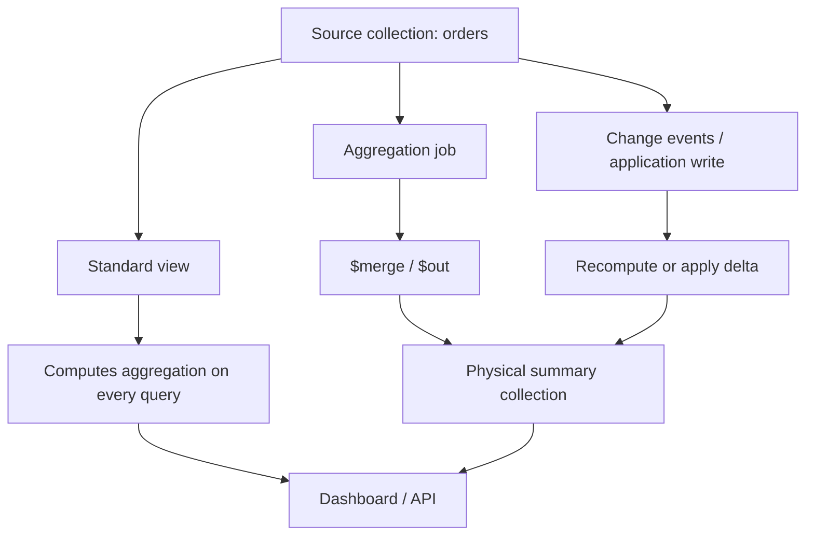
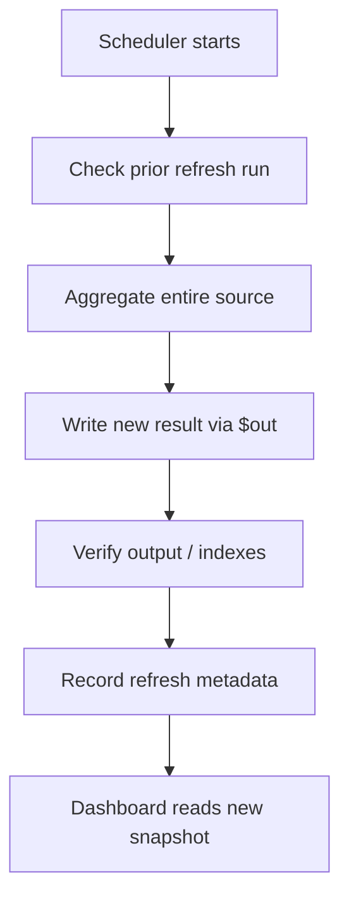
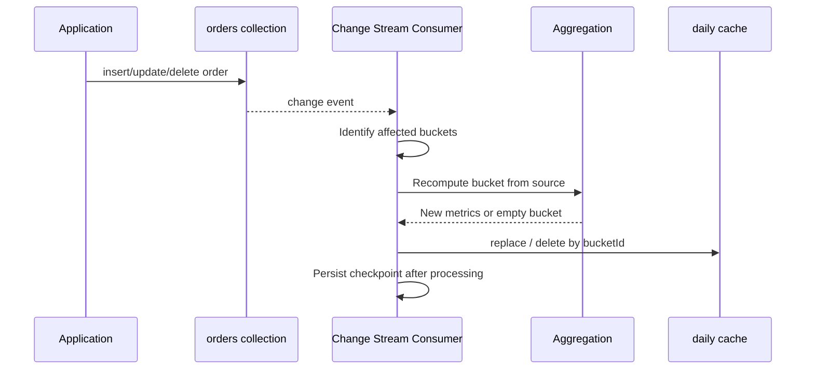

# Aggregation Views, Precomputed Data, and Refresh Strategies in MongoDB

> **Module:** Database Engine Document MongoDB  
> **Chapter:** Advanced Aggregation

## 1. Problem: Summary Reports Read Continuously

Suppose a system has an `orders` collection holding millions of orders. Admin dashboards constantly need to show:

- Paid order revenue per store per day.
- Successful order counts per day.
- Revenue chart over the last 30 days.
- Aggregated dashboard statistics per tenant.
- Periodic reports without re-scanning every order on every page load.

A direct aggregation query can be written as:

```javascript
db.orders.aggregate([
  { $match: { status: "PAID" } },
  {
    $group: {
      _id: "$tenantId",
      paidOrders: { $sum: 1 },
      revenueCents: { $sum: "$totalCents" }
    }
  }
]);
```

This returns accurate results for the data queried at execution time, yet running it continuously over huge datasets forces the database to repeat filtering, grouping, and summing. In such cases, consider **views** and **precomputed/materialized data**.

There are three main approaches:

1. **Standard view:** stores the *query definition*; MongoDB computes results on every read.
2. **On-demand materialized view:** stores *aggregation results* in a physical collection, typically refreshed using `$merge` or `$out`.
3. **Application-managed computed data:** the application or event pipeline updates summary documents whenever source data changes.

The hard part is not `$sum`, but deciding **when to recompute**, **which scope to recompute**, **how late-arriving or edited/deleted data is handled**, and **how much staleness readers can tolerate**.

After this lesson, you will be able to:

- Distinguish a standard view from a collection holding precomputed results.
- Create an aggregation view with `createView()` and query it like a read-only collection.
- Build materialized summaries via `$merge`/`$out` and index the output collection.
- Choose among full refresh, incremental refresh, affected-bucket refresh, event-driven updates, or synchronous write-time updates.
- Handle canceled orders, amount edits, date/store changes, and buckets dropping to empty.
- Design checkpoints, idempotency, freshness monitoring, and reconciliation.
- Evaluate trade-offs among read cost, write cost, latency, and consistency.

## 2. Mental Model: Compute on Read or Precompute?

You can visualize the options as follows:



### 2.1. Quick Comparison Table

| Criterion | Standard View | Precomputed Summary Collection |
|---|---|---|
| Stores result data | **No**; stores pipeline definition | **Yes**; stores physical documents |
| Computation on read | Yes | Mostly reads already-computed data |
| Data freshness | Reflects live execution and read concern | Depends on refresh schedule/mechanism |
| Indexes on results | Cannot create indexes directly on standard views | Can create indexes on the result collection |
| Cost of repeated reads | Can be high if aggregation is heavy | Usually low when output is compact |
| Maintenance cost | Relatively simple | Requires jobs, syncing, retries, correctness checks |
| Direct writes to view | Disallowed | Target collection can be written by jobs or apps |
| When source changes | Next read recomputes from source | Stored results must be refreshed |
| Operational complexity | Lower | Higher, especially for incremental updates |
| Best suited for | Moderate queries needing fresh data | High-traffic dashboards, costly aggregations, tolerable freshness lag |

**Key takeaway:** The word "view" does not mean "persisted results." A MongoDB standard view is a *query definition*, whereas a materialized view is **a physical collection storing precomputed results maintained by a refresh workflow**.

## 3. Standard View: Stores Pipeline Definition, Computes on Query

A **standard view** in MongoDB is a logical read-only object backed by a source collection or another view. When queried, MongoDB runs the stored pipeline combined with permitted query predicates. Views do not store materialized rows like a separate collection.

Example:

```javascript
db.createView(
  "paid_orders_view",
  "orders",
  [
    { $match: { status: "PAID" } },
    {
      $project: {
        tenantId: 1,
        createdAt: 1,
        totalCents: 1,
        status: 1
      }
    }
  ]
);
```

Then query it:

```javascript
db.paid_orders_view.find({
  tenantId: "shop-a"
}).sort({ createdAt: -1 }).limit(20);
```

Conceptually, MongoDB combines the view definition with the additional filter to locate `PAID` orders for `shop-a`. Every execution still accesses the source data or matching source indexes; **a view is not a result cache**.

### 3.1. Can a View Contain `$group`?

Yes. For example, a view summarizing revenue by tenant:

```javascript
db.createView(
  "tenant_paid_totals_view",
  "orders",
  [
    { $match: { status: "PAID" } },
    {
      $group: {
        _id: "$tenantId",
        paidOrderCount: { $sum: 1 },
        revenueCents: { $sum: "$totalCents" }
      }
    }
  ]
);
```

On every read:

```javascript
db.tenant_paid_totals_view.find();
```

MongoDB recomputes the aggregation over source data. No summary documents are cached merely because the pipeline includes `$group`.

### 3.2. Can You Write Directly to a Standard View?

No. Standard views are **read-only**. `insertOne()`, `updateOne()`, and `deleteMany()` cannot mutate data through a view.

To edit orders, update the source `orders` collection. To change reporting logic, update the view definition using supported administrative commands such as `collMod` after verifying privileges and dependencies.

### 3.3. Does a Standard View Have Its Own Indexes?

You cannot create indexes **directly on a standard view** as you do on a physical collection. View queries benefit from indexes on the **source collection** when the query planner can leverage filters, sorts, and pipeline optimizations.

For instance, if the view always filters `status: "PAID"` and callers filter by `tenantId` and sort by `createdAt`, a source index helps:

```javascript
db.orders.createIndex({
  status: 1,
  tenantId: 1,
  createdAt: -1
});
```

Still, a good index only speeds up **the underlying source access**. It does not convert a heavy aggregation into precomputed physical rows.

### 3.4. Limitations to Know

- Views are **read-only**.
- Standard view pipelines cannot use output stages such as `$out`/`$merge` to turn the view into a physical collection.
- Views depend on the underlying collection/view; schema changes or dropping the source breaks view queries.
- Access control and data exposure through views must be designed intentionally; do not assume a view automatically acts as a security boundary without proper roles and authorization.
- Not every stage/command is permitted inside a view definition; restrictions depend on version and context.
- When an aggregation includes expensive `$group`/`$sort` stages, those costs recur on every read.

Views fit well when you want to **reuse aggregation logic** and avoid duplicating pipelines across APIs, not necessarily to eliminate compute cost.

## 4. Materialized Views: Collections Holding Precomputed Results

MongoDB supports **on-demand materialized views** by running an aggregation over a source collection and writing output into another collection, typically via:

- **`$merge`:** inserts/merges/replaces output documents into a target collection by matching key.
- **`$out`:** writes full output to a target collection and, when the target exists in supported contexts, replaces the target collection upon completion.

Conceptual flow:

```text
orders
  ↓ $match status = PAID
  ↓ $group by tenant + day
  ↓ $sum order count and revenue
  ↓ $merge
daily_paid_sales_cache  ← API reads precomputed results
```

**Difference from a standard view:** `daily_paid_sales_cache` stores **real physical documents** that can be queried directly, indexed, and persisted across reads.

**Accompanying responsibility:** When orders are created, edited, deleted, or canceled, the summary collection **does not auto-update** merely because `$merge` or `$out` ran once. You must build an explicit refresh strategy.

## 5. Practice Data: Daily Revenue

Use a modern MongoDB Server supporting `$dateTrunc` (MongoDB 5.0+) and aggregation output stages. Open `mongosh`:

```bash
mongosh "mongodb://127.0.0.1:27017"
```

Create a dedicated lab database:

```javascript
const lab = db.getSiblingDB("aggregation_views_lab");
const orders = lab.getCollection("orders");

orders.insertMany([
  {
    _id: "O1", tenantId: "shop-a", status: "PAID",
    createdAt: ISODate("2026-11-01T10:00:00Z"), totalCents: 10000
  },
  {
    _id: "O2", tenantId: "shop-a", status: "PAID",
    createdAt: ISODate("2026-11-01T14:00:00Z"), totalCents: 25000
  },
  {
    _id: "O3", tenantId: "shop-a", status: "NEW",
    createdAt: ISODate("2026-11-01T15:00:00Z"), totalCents: 7000
  },
  {
    _id: "O4", tenantId: "shop-a", status: "PAID",
    createdAt: ISODate("2026-11-02T09:00:00Z"), totalCents: 5000
  },
  {
    _id: "O5", tenantId: "shop-b", status: "PAID",
    createdAt: ISODate("2026-11-01T12:00:00Z"), totalCents: 12000
  },
  {
    _id: "O6", tenantId: "shop-b", status: "CANCELLED",
    createdAt: ISODate("2026-11-02T11:00:00Z"), totalCents: 9000
  },
  {
    _id: "O7", tenantId: "shop-b", status: "PAID",
    createdAt: ISODate("2026-11-02T13:00:00Z"), totalCents: 20000
  },
  {
    _id: "O8", tenantId: "shop-a", status: "PAID",
    createdAt: ISODate("2026-11-02T17:00:00Z"), totalCents: 15000
  },
  {
    _id: "O9", tenantId: "shop-a", status: "PAID",
    createdAt: ISODate("2026-11-03T08:00:00Z"), totalCents: 3000
  },
  {
    _id: "O10", tenantId: "shop-a", status: "CANCELLED",
    createdAt: ISODate("2026-11-03T16:00:00Z"), totalCents: 10000
  }
]);

print("Source orders:", orders.countDocuments({}));
```

The dataset has **10 orders**, of which only `PAID` orders count toward revenue. `totalCents` represents **minor units of a hypothetical currency** so integer summation stays clean. Production apps must standardize currency, rounding rules, refunds, and taxes; never sum different currencies into an unlabeled total.

> **Never run these sample inserts on a production database.** If `_id` values already exist, `insertMany()` throws duplicate key errors. Use a separate lab database or dedicated test environment—never delete someone else's data to reset.

### 5.1. Business Aggregation Rules

We define:

- **Qualifying order:** `status = "PAID"`.
- **Revenue day:** UTC day from `createdAt`.
- **Group key:** `tenantId + UTC day`.
- **Order count:** +1 per PAID order.
- **Revenue:** sum of `totalCents` across PAID orders.

These are **illustrative rules**, not a complete accounting model. Real payment systems may use `paidAt` instead of `createdAt`, partial/full refunds, multiple currencies, adjustment events, and accounting cutoff rules.

Expected group results:

| Tenant | UTC Day | PAID Orders | Total `totalCents` |
|---|---|---:|---:|
| shop-a | 2026-11-01 | 2 | 35,000 |
| shop-a | 2026-11-02 | 2 | 20,000 |
| shop-a | 2026-11-03 | 1 | 3,000 |
| shop-b | 2026-11-01 | 1 | 12,000 |
| shop-b | 2026-11-02 | 1 | 20,000 |

There are **5 tenant/day groups** in total.

## 6. Shared Aggregation Pipeline

Use `$dateTrunc` to snap timestamps to UTC day boundaries, then `$group`.

```javascript
const dailyPipeline = [
  { $match: { status: "PAID" } },
  {
    $group: {
      _id: {
        tenantId: "$tenantId",
        day: {
          $dateTrunc: {
            date: "$createdAt",
            unit: "day",
            timezone: "UTC"
          }
        }
      },
      orderCount: { $sum: 1 },
      revenueCents: { $sum: "$totalCents" }
    }
  },
  { $sort: { "_id.tenantId": 1, "_id.day": 1 } }
];

printjson(orders.aggregate(dailyPipeline).toArray());
```

Each output document looks like:

```javascript
{
  _id: {
    tenantId: "shop-a",
    day: ISODate("2026-11-01T00:00:00.000Z")
  },
  orderCount: 2,
  revenueCents: 35000
}
```

### 6.1. Why Use an Object `_id` Containing `tenantId` and `day`?

Results need a **stable identifier** per bucket. Using:

```javascript
_id: {
  tenantId: "$tenantId",
  day: { $dateTrunc: { date: "$createdAt", unit: "day", timezone: "UTC" } }
}
```

gives every `(tenantId, day)` pair a unique composite group key. When writing via `$merge` on `_id`, an existing bucket is replaced instead of inserting duplicate business rows.

This is a design choice for this lesson. Production apps may also use deterministic string keys or flat `tenantId`/`day` fields backed by a unique index. Regardless of representation, **the key must match the exact data grain**: what does one document represent?

### 6.2. `$dateTrunc` and Timezones

With `timezone: "UTC"`, days start at 00:00 UTC. If your business reports by local days such as `"Asia/Ho_Chi_Minh"`, apply that timezone consistently across every aggregation and refresh:

```javascript
{
  $dateTrunc: {
    date: "$createdAt",
    unit: "day",
    timezone: "Asia/Ho_Chi_Minh"
  }
}
```

Dates are stored as BSON Date (absolute instants), so inspecting them in UTC shows the UTC timestamp corresponding to local midnight. Never mix UTC buckets and local-timezone buckets in the same summary collection without explicit timezone metadata and keys.

### 6.3. Input Data Must Be Clean

If documents lack `createdAt`, `tenantId`, or have mistyped `totalCents`, aggregations produce unexpected buckets or inaccurate totals.

Before materializing, enforce appropriate schema/validation:

- `tenantId` is a valid non-empty identifier.
- `createdAt` is a BSON Date.
- `status` belongs to allowed states.
- `totalCents` has a consistent numeric type.
- Refund and adjustment rules are clearly defined.

A regularly refreshed cache will still be **consistently wrong** if the pipeline computes over dirty source data.

## 7. Creating a Daily Summary Standard View

From the shared pipeline, create a standard view. For readability, define it without a fixed `$sort`; callers can sort on read.

```javascript
lab.createView(
  "daily_paid_sales_live",
  "orders",
  [
    { $match: { status: "PAID" } },
    {
      $group: {
        _id: {
          tenantId: "$tenantId",
          day: {
            $dateTrunc: {
              date: "$createdAt",
              unit: "day",
              timezone: "UTC"
            }
          }
        },
        orderCount: { $sum: 1 },
        revenueCents: { $sum: "$totalCents" }
      }
    }
  ]
);
```

Reading the view:

```javascript
const liveView = lab.getCollection("daily_paid_sales_live");

printjson(
  liveView.find({ "_id.tenantId": "shop-a" })
    .sort({ "_id.day": 1 })
    .toArray()
);
```

**Important point:** This is merely a named handle to re-run the aggregation. If O8 changes from PAID to CANCELLED, the next view query reads the updated source and excludes O8, subject to the query's read concern/isolation.

### 7.1. Does a View Guarantee Strict Snapshot Consistency?

Do not infer that simply from using a view. Views execute under your MongoDB deployment's active read concern, isolation, and topology rules. Under concurrent writes, choose read consistency levels appropriate to business requirements; if strict snapshots are required, design explicit read concern/transaction boundaries and understand their limits.

### 7.2. Inspecting View Metadata

```javascript
printjson(
  lab.getCollectionInfos({ name: "daily_paid_sales_live" })
);
```

The metadata confirms the object's type is `view` along with its pipeline definition. Querying a standard view never turns it into a materialized collection; you must build a separate target collection for that.

## 8. Creating Precomputed Data with `$merge`

`$merge` is an aggregation stage that **writes pipeline results into a target collection**. When grouping by a stable key, the common pattern is:

- If the bucket does not yet exist: **insert**.
- If the bucket already exists: **replace** the entire summary document with the newly computed values.

Example:

```javascript
orders.aggregate([
  { $match: { status: "PAID" } },
  {
    $group: {
      _id: {
        tenantId: "$tenantId",
        day: {
          $dateTrunc: {
            date: "$createdAt",
            unit: "day",
            timezone: "UTC"
          }
        }
      },
      orderCount: { $sum: 1 },
      revenueCents: { $sum: "$totalCents" }
    }
  },
  {
    $merge: {
      into: "daily_paid_sales_cache",
      on: "_id",
      whenMatched: "replace",
      whenNotMatched: "insert"
    }
  }
]);
```

This pipeline **writes output**; do not expect it to return a 5-bucket array like a normal read aggregation. Query the target collection:

```javascript
const cache = lab.getCollection("daily_paid_sales_cache");

printjson(
  cache.find()
    .sort({ "_id.tenantId": 1, "_id.day": 1 })
    .toArray()
);
```

On the sample dataset, `cache` now holds 5 summary documents.

### 8.1. Meaning of `$merge` Parameters

| Parameter | Role | In This Example |
|---|---|---|
| `into` | Target namespace: collection name or `{ db, coll }` object | `daily_paid_sales_cache` |
| `on` | Field(s) used to match the target document | `"_id"` |
| `whenMatched` | Action when a target document already matches `on` | `"replace"` |
| `whenNotMatched` | Action when no target document matches | `"insert"` |

Other `whenMatched` modes such as `merge`, `keepExisting`, `fail`, or an update pipeline fit other use cases. For a **full bucket recomputation**, `replace` is clean because `orderCount`/`revenueCents` represent **new absolute totals**, not deltas to add.

### 8.2. Unique Indexes and the `$merge` Key

For `$merge` to match target documents by `on`, the target collection must satisfy MongoDB's unique-index and `on`-field rules. Using `on: "_id"`, the collection's built-in unique `_id` index satisfies this requirement.

If using flat fields like `on: ["tenantId", "day"]`, create the **corresponding unique index** and follow version/topology rules, especially on sharded collections. Never pick an arbitrary `on` key assuming MongoDB enforces uniqueness without an index.

### 8.3. `$merge` Does Not Refresh the Whole Collection

Suppose yesterday the cache held bucket `shop-a / 2026-11-02`. Today zero PAID orders remain in that bucket. The source aggregation **emits no document for that bucket**, so `$merge` **does not delete the stale cache document**.

This is a critical distinction between:

- *Upserting emitted buckets*: what `$merge` does.
- *Replacing the entire result set and removing vanished buckets*: requires full replacement, bucket deletion/zeroing, or explicit reconciliation.

Ignoring buckets that drop to zero leaves "ghost" revenue on dashboards even while the refresh job keeps succeeding.

## 9. Creating a Precomputed Collection with `$out`

`$out` is an alternative when you want to **rebuild the entire result set**. In supported environments, it builds the new output and swaps it into the target collection upon completion.

```javascript
orders.aggregate([
  { $match: { status: "PAID" } },
  {
    $group: {
      _id: {
        tenantId: "$tenantId",
        day: {
          $dateTrunc: {
            date: "$createdAt",
            unit: "day",
            timezone: "UTC"
          }
        }
      },
      orderCount: { $sum: 1 },
      revenueCents: { $sum: "$totalCents" }
    }
  },
  { $out: "daily_paid_sales_cache" }
]);
```

Then:

```javascript
printjson(
  cache.find()
    .sort({ "_id.tenantId": 1, "_id.day": 1 })
    .toArray()
);
```

### 9.1. When Does `$out` Fit Better Than `$merge`?

- The aggregated result set is small enough to rebuild comfortably.
- Periodic refreshes are acceptable instead of instant per-change updates.
- Buckets that **no longer exist** in the source must be removed automatically.
- You want a complete periodic reporting snapshot.
- The target collection and topology satisfy `$out` constraints.

### 9.2. `$out` Is Not Free

A full refresh still scans much or all of the source collection, builds temporary output, writes every document, and rebuilds/maintains target indexes during replacement. On large collections under heavy write traffic, this cost can be substantial.

Keep in mind:

- `$out` has restrictions on target collection types and topologies, notably sharded outputs; check your server version's documentation.
- Replacing the target collection affects indexes, permissions, and watchers; verify exact version behavior.
- Never use `$out` for a small single-bucket update when other buckets must remain intact.
- Complex cutover requirements may warrant explicit staging collections and application-level pointer switching.
- In production, a full refresh is a **real operational workload**, not negligible just because its syntax is short.

### 9.3. Comparing `$merge` and `$out`

| Criterion | `$merge` | `$out` |
|---|---|---|
| Partial result updates | Ideal | Unsuitable if other rows must remain |
| Insert/replace groups by key | Yes | Not via key-based upsert |
| Bucket disappears from source | **Does not delete** old bucket | Full replacement drops vanished groups |
| Write cost when few groups change | Potentially low | Rebuilds entire output |
| Whole-snapshot consistency | Must be designed separately across keys | Better suited for full snapshots within supported semantics |
| Sharded target collection | Supported with proper constraints | Restricted / not supported for typical sharded outputs |
| Large-scale periodic refresh | Yes, when scoped and stale rows are handled | Can be resource-intensive |
| Needs correctness and freshness management | Yes | Yes |

**Choose based on refresh semantics rather than stage speed myths:** *upsert emitted groups* vs. *replace the entire result set*.

## 10. Trade-Offs Among Speed, Freshness, and Correctness

A materialized collection makes dashboards fast, yet "fast" is never the only property to measure.

Three key dimensions:

1. **Freshness:** How far behind the source can the cache lag?
2. **Correctness:** Once a job finishes, do numbers match definitions and handle reversals properly?
3. **Availability / latency:** Do dashboards read consistently within target SLOs?

Example dashboard requirements:

- Must load in under a few hundred milliseconds.
- Can tolerate 5-minute data lag.
- Must reconcile accurately at end of day.

A 5-minute refresh job paired with end-of-day reconciliation fits much better here than updating synchronously on every single order. Conversely, account balances or credit limits cannot rely on an eventually consistent cache as the source of truth for transaction authorization.

### 10.1. Freshness Must Have a Measurable Definition

Instead of saying "near real-time," specify:

- Refreshes at least once every X minutes.
- Most source updates appear within Y seconds/minutes.
- On refresh failure, dashboards display the timestamp of the last successful snapshot.
- If a snapshot grows too stale, the API warns users or suppresses misleading figures.

Store metadata such as `computedAt`, `sourceWatermark`, or a `refresh_runs` collection to track this. Timestamps must reflect the **source data horizon covered**, not simply the clock time when a reader queried the cache.

## 11. Strategy 1: Scheduled Full Refresh

**Full refresh** runs the source aggregation and rebuilds the entire output on a schedule, e.g., nightly or hourly.

Workflow:



Pros:

- Simple, reproducible logic.
- Naturally handles edits, cancellations, and deletes: the next refresh recomputes cleanly from source.
- Empty groups disappear automatically via full replacement.
- Less fragile than processing every individual mutation event accurately.

Cons:

- Re-reads and recalculates huge source data even when only a few orders changed.
- Worst-case freshness lag approaches refresh interval plus job runtime.
- Heavy jobs can compete with application traffic for CPU and I/O.
- Requires overlap protection, retries, and long-running job alerts.

### 11.1. Illustrative `$out` Command

```javascript
orders.aggregate([
  { $match: { status: "PAID" } },
  {
    $group: {
      _id: {
        tenantId: "$tenantId",
        day: {
          $dateTrunc: {
            date: "$createdAt",
            unit: "day",
            timezone: "UTC"
          }
        }
      },
      orderCount: { $sum: 1 },
      revenueCents: { $sum: "$totalCents" }
    }
  },
  { $out: "daily_paid_sales_cache" }
], { allowDiskUse: true });
```

`allowDiskUse` helps memory-heavy stages spill to disk when server/version permits; it **does not** eliminate performance bottlenecks or make full refreshes free.

### 11.2. When Not to Run Frequent Full Refreshes

If the source holds hundreds of millions of rows and only a few thousand orders change daily, scanning everything every minute is wasteful. Switch to incremental refreshes or a hybrid split between settled history and hot recent days.

## 12. Strategy 2: Time-Window Incremental Refresh

**Incremental refresh** recomputes only a recent slice—such as today and the last few days—and `$merge`s those buckets into the cache.

Example covering PAID orders created from the start of 2026-11-02 up to 2026-11-04:

```javascript
const from = ISODate("2026-11-02T00:00:00Z");
const until = ISODate("2026-11-04T00:00:00Z");

orders.aggregate([
  {
    $match: {
      status: "PAID",
      createdAt: { $gte: from, $lt: until }
    }
  },
  {
    $group: {
      _id: {
        tenantId: "$tenantId",
        day: {
          $dateTrunc: {
            date: "$createdAt",
            unit: "day",
            timezone: "UTC"
          }
        }
      },
      orderCount: { $sum: 1 },
      revenueCents: { $sum: "$totalCents" }
    }
  },
  {
    $merge: {
      into: "daily_paid_sales_cache",
      on: "_id",
      whenMatched: "replace",
      whenNotMatched: "insert"
    }
  }
]);
```

This saves substantial work compared to a full refresh when the window is narrow and backed by a matching source index.

### 12.1. When Incremental by `createdAt` Is Not Enough

Suppose an order was created **last month**, yet today transitions from NEW to PAID or has its amount adjusted. If the job only scans orders with `createdAt` in the last 3 days, **last month's order is never reflected**.

Conversely, if you filter by `updatedAt` to select "recently modified documents" and `$group` only those modified documents, the result is **not the full bucket total**—it only sums the recently modified subset. Writing that with `whenMatched: "replace"` corrupts the bucket total.

**Rule:** When `$merge` uses `replace`, each bucket's metrics must be **recomputed from all qualifying source documents currently belonging to that bucket**, not just newly modified events.

### 12.2. Incremental Must Separate "Identifying Affected Buckets" from "Computing Bucket Totals"

A safer workflow:

1. Identify **which buckets need refreshing** from recent updates, schedule, or events.
2. For each affected bucket, query **all current source documents belonging to that bucket**.
3. Recompute `orderCount` and `revenueCents` for the bucket.
4. Overwrite the summary document by bucket key.
5. If the bucket **has zero qualifying records left**, delete it or write 0 per contract.
6. Record checkpoint/freshness after successful completion.

Never confuse *detecting which group changed* with *computing the group's exact total*.

### 12.3. Special Case: Append-Only Data

If source data is **strictly append-only**—no updates, no deletes, no tenant/day/status changes—incremental updates over new records are simpler. Even then, you still need:

- Reliable identification of new records.
- Prevention of double-processing the same record.
- Handling duplicate/retried events.
- Trustworthy checkpoint watermarks.
- Periodic reconciliation to catch cumulative drift.

Append-only is a domain guarantee, not a built-in MongoDB collection property.

## 13. Crucial Pitfall: Buckets Dropping to Zero Are Not Deleted by `$merge`

Follow this on the lab dataset **after creating the initial cache**.

### 13.1. First Scenario: One Order Canceled

On 2026-11-02, `shop-a` initially had two PAID orders:

- O4: 5,000.
- O8: 15,000.

Cache stores:

```javascript
{
  _id: {
    tenantId: "shop-a",
    day: ISODate("2026-11-02T00:00:00Z")
  },
  orderCount: 2,
  revenueCents: 20000
}
```

Now update the source:

```javascript
orders.updateOne(
  { _id: "O8", status: "PAID" },
  { $set: { status: "CANCELLED" } }
);
```

Querying the standard view immediately shows:

```text
orderCount = 1
revenueCents = 5000
```

Yet the physical cache **still shows 2 and 20000** until refreshed.

### 13.2. Second Scenario: Bucket Loses All PAID Orders

Now also cancel O4:

```javascript
orders.updateOne(
  { _id: "O4", status: "PAID" },
  { $set: { status: "CANCELLED" } }
);
```

Now `shop-a / 2026-11-02` has **zero PAID documents**.

Re-run the full pipeline with `$merge`:

```javascript
orders.aggregate([
  { $match: { status: "PAID" } },
  {
    $group: {
      _id: {
        tenantId: "$tenantId",
        day: {
          $dateTrunc: {
            date: "$createdAt",
            unit: "day",
            timezone: "UTC"
          }
        }
      },
      orderCount: { $sum: 1 },
      revenueCents: { $sum: "$totalCents" }
    }
  },
  {
    $merge: {
      into: "daily_paid_sales_cache",
      on: "_id",
      whenMatched: "replace",
      whenNotMatched: "insert"
    }
  }
]);
```

**Trap:** The aggregation no longer emits this bucket; `$merge` only upserts emitted documents, so the stale bucket stays in the cache with outdated numbers.

To fix this, use one of these approaches:

- Full refresh via `$out` (when appropriate).
- Per-bucket recompute that **deletes** the cache document when no valid source records remain.
- Maintain a complete roster of expected buckets, emitting 0-count documents for empty ones before replacing.
- Diff cache keys against source keys within a safe scope and remove vanished keys.

**Note:** Never think of `$merge` as a "self-maintaining materialized view." It is a write stage, not a full bucket-lifecycle manager.

## 14. Refreshing One Bucket via Recompute-and-Replace

For tenant-and-day dashboards, a clean, controllable strategy is:

1. Identify the affected bucket.
2. Read all PAID orders in that bucket.
3. Recompute `orderCount` and `revenueCents` from scratch.
4. If non-empty, `replaceOne(..., {upsert: true})` into the cache.
5. If empty, `deleteOne()` the cache document (or write 0 per contract).

Example `mongosh` helper for a UTC day bucket:

```javascript
const lab = db.getSiblingDB("aggregation_views_lab");
const orders = lab.getCollection("orders");
const cache = lab.getCollection("daily_paid_sales_cache");

function refreshUtcDay(tenantId, year, month, day) {
  // month is 1..12; Date.UTC expects 0-based month.
  const start = new Date(Date.UTC(year, month - 1, day));
  const end = new Date(Date.UTC(year, month - 1, day + 1));

  const bucketId = {
    tenantId: tenantId,
    day: start
  };

  const result = orders.aggregate([
    {
      $match: {
        tenantId: tenantId,
        status: "PAID",
        createdAt: { $gte: start, $lt: end }
      }
    },
    {
      $group: {
        _id: {
          tenantId: "$tenantId",
          day: {
            $dateTrunc: {
              date: "$createdAt",
              unit: "day",
              timezone: "UTC"
            }
          }
        },
        orderCount: { $sum: 1 },
        revenueCents: { $sum: "$totalCents" }
      }
    }
  ]).toArray();

  if (result.length > 0) {
    cache.replaceOne(
      { _id: bucketId },
      result[0],
      { upsert: true }
    );
    return { action: "replace", bucketId: bucketId };
  }

  cache.deleteOne({ _id: bucketId });
  return { action: "delete", bucketId: bucketId };
}

// Example: after canceling O4 and O8, this bucket has no PAID orders left.
printjson(refreshUtcDay("shop-a", 2026, 11, 2));
```

This helper **recomputes absolute totals** instead of adding guessed event deltas, and deletes the stale document when the bucket empties.

### 14.1. Atomicity Note

This function is **not a single transaction** spanning source read, aggregation, and cache write. Between reading and writing, new orders may arrive; if two workers refresh the same bucket concurrently, a slower worker holding older data can overwrite a newer worker.

Under high concurrency, add safeguards such as:

- Ensuring **at most one worker refreshes a given bucket** at a time.
- Using leases/locks and refresh generation numbers.
- Rejecting stale commits using watermarks or versions.
- Using change stream checkpoints so subsequent refreshes catch up on concurrent edits.
- Using transactions/coordination where domain contracts require and MongoDB limits allow.

Never claim "per-bucket refresh is globally atomic" just because `replaceOne()` itself is atomic on a single document.

### 14.2. Identify Both Old and New Buckets

If an order changes:

- `tenantId` from `shop-a` to `shop-b`;
- `createdAt` from day 01 to day 02;
- `status` from `PAID` to `CANCELLED`;

you may need to refresh **both the old bucket and the new bucket**. Inspecting only the post-update document cannot reveal the old bucket once prior values are overwritten.

Capture before/after fields from the application, domain events, or change stream pre-images (when enabled/supported) so all affected buckets are refreshed.

## 15. Strategy 3: Event-Driven Refresh via Change Streams

MongoDB **change streams** allow applications to watch mutations across a collection, database, or cluster on supported deployments (typically replica sets or sharded clusters), serving as an event trigger for cache refreshes.



### 15.1. Watching Changes in `mongosh`

For **replica set / sharded deployments**, not standalone nodes:

```javascript
const stream = lab.getCollection("orders").watch(
  [
    {
      $match: {
        operationType: {
          $in: ["insert", "update", "replace", "delete"]
        }
      }
    }
  ],
  {
    fullDocument: "updateLookup"
  }
);

while (stream.hasNext()) {
  const event = stream.next();

  printjson({
    operationType: event.operationType,
    documentKey: event.documentKey,
    resumeToken: event._id,
    fullDocument: event.fullDocument
  });

  // In production: identify old/new buckets, refresh, then checkpoint.
}
```

This infinite loop is purely illustrative for lab use; always manage cursor shutdown cleanly and never deploy a naive loop directly as a production worker.

### 15.2. Change Streams Do Not Automatically Include Prior State in Every Event

Important behavior:

- For inserts, the new document is usually enough to identify the target bucket.
- For updates, `updateDescription` lists changed fields, not guaranteed full prior state.
- With `fullDocument: "updateLookup"`, MongoDB fetches the current document after the update; under concurrency, it may reflect an even newer mutation than the event itself.
- For deletes, events carry `documentKey` without automatically including the deleted document.
- **Pre-images** require explicit configuration and retention lifecycle on supported deployments to read pre-mutation values.

Consequently, when an order changes tenant/date/status or is deleted, identifying the old bucket requires pre-images or domain events carrying before/after values—otherwise supplement with periodic reconciliation rather than guessing.

### 15.3. Resume Tokens and Checkpoints

Every change event carries a **resume token**. Consumers store this token to resume from where they left off across restarts while within history retention.

Follow this strict order:

1. Receive event.
2. Identify all affected buckets.
3. Successfully recompute/update the cache.
4. **Afterward**, durably persist the checkpoint / resume token.
5. On restart, resume from the committed token.

Checkpointing **before** updating the cache risks permanently skipping events on crash. Updating the cache and crashing **before checkpointing** causes replay on restart.

That is why **idempotency** (or coordinated transactions) is essential. Recompute-and-replace per bucket key tolerates replays far better than unconditional delta increments.

### 15.4. Resume History Limits

Change streams rely on the deployment's oplog/change history retention. If a consumer stays offline too long and its token expires, resuming fails.

Recovery plan:

- Run full reconciliation or rebuild missing spans.
- Reset the checkpoint to a safe new position after catching up.
- Monitor consumer lag against source write rate.
- Never treat a change stream as permanent event storage.

## 16. Strategy 4: Delta Increment at Write Time

Some systems maintain summary collections directly on the application write path.

Example: inserting a 10,000-cent PAID order and incrementing:

```javascript
db.daily_paid_sales_cache.updateOne(
  {
    _id: {
      tenantId: "shop-a",
      day: ISODate("2026-11-01T00:00:00Z")
    }
  },
  {
    $inc: {
      orderCount: 1,
      revenueCents: 10000
    }
  },
  { upsert: true }
);
```

Pros:

- Avoids re-scanning the bucket on every new order.
- Updates summaries with very low latency.
- `$inc` on a single target document is atomic at the document level.

Yet **this is also the easiest strategy to corrupt without strong safeguards**.

### 16.1. Why Can Retries Double-Count?

Suppose the client sends `$inc: { revenueCents: 10000 }`, the server commits it, and the network drops before the client gets the ack. If the app re-issues the increment as a fresh operation without deduplication, the total gets incremented **twice**.

Driver retryable writes only cover transient network retries within MongoDB's protocol scope; they do not replace **business-event deduplication** when messages are replayed, sent twice, or handled by multiple consumers.

### 16.2. Handling All Source Transitions

| Order Mutation | Delta to Apply |
|---|---|
| NEW → PAID, total 10000 | +1 order, +10000 to target bucket |
| PAID → CANCELLED, total 10000 | -1 order, -10000 from old bucket |
| PAID, total 10000 → 12000 | +2000 revenue in same bucket |
| PAID moves from day A to day B | Subtract full order from A, add to B |
| PAID moves from tenant A to tenant B | Subtract from tenant A bucket, add to tenant B bucket |
| Delete PAID order | Subtract from prior bucket |
| Duplicate event delivery | Must **not** apply twice |

To compute deltas accurately, the app needs **before and after state** or well-defined state-transition events. Missing even one edge case accumulates silent drift over time.

### 16.3. Stronger Safeguards

Consider:

- Giving every event a **unique `eventId`** backed by a processed-events collection.
- Enforcing a unique index on `eventId` to block duplicate processing.
- Recording the event marker and updating counters inside a **transaction** when cross-document atomicity is needed and supported.
- Using the outbox pattern to persist state changes and emit events atomically.
- Running periodic recomputation/reconciliation to fix drift.
- Or having consumers **recompute the bucket from source** instead of applying deltas, so duplicate events converge to the exact same final state.

Without these safeguards, never use precomputed counters as the sole source of truth for critical financial decisions.

## 17. Strategy 5: Hybrid — Settled History Plus Hot Recent Data

Many dashboards follow a distinct data lifecycle:

- Older months rarely change.
- Recent days or weeks change constantly.
- Users need both historical trends and fresh today numbers.

A hybrid architecture can:

1. **Precompute settled historical months**.
2. **Refresh recent days frequently**.
3. **Recompute individual buckets** if rare historical adjustments occur.
4. Combine both at read time without double-counting the boundary.

Example:

```text
Through end of last month:
    cached finalized buckets

From start of current month:
    near-real-time refresh or live aggregation

Report:
    history cache + current-period results
```

### 17.1. Avoid Double-Counting at the Boundary

If the cache holds 2026-11-01 and live aggregation also starts at 2026-11-01, summing both **double-counts that day's revenue**.

Define a crisp cutover boundary:

- Cached portion covers days strictly **before** the cutover date.
- Live portion covers days **on or after** the cutover date.
- Both portions share identical grain, timezone, currency, and status rules.
- When advancing the cutover date, verify the newly settled period is fully refreshed before shifting the live start date.

### 17.2. History Is Not Always Immutable

Refunds, chargebacks, data fixes, regulatory edits, or accounting adjustments can touch closed periods. Never claim "old months never change" unless the domain strictly enforces it. Keep a backfill/reconciliation path ready when history mutates.

## 18. Choosing a Refresh Strategy by Freshness Requirement

Decision matrix:

| Need | Typically Suitable Strategy | Trade-offs |
|---|---|---|
| Small reports needing live source accuracy | **Standard view** or direct aggregation | Repeated compute cost on reads |
| High-traffic reports tolerating hourly/daily lag | **Full refresh** with `$out` | Rebuild cost on each run |
| Mostly append-only data, small active window | **Incremental refresh** | Needs scope, checkpoint, and idempotency control |
| Frequent source edits/cancellations | **Affected-bucket recompute** | Needs before/after bucket tracking and concurrency control |
| Near real-time updates on replica set / sharded cluster | **Change stream + refresh** | Consumer operations, checkpoints, replay, lag |
| Instant consistency inside business transactions | **Write-time computed data** | Higher write latency and transaction complexity |
| Stable history with volatile recent days | **Hybrid** | Boundary cutover and historical backfill complexity |

No single strategy wins everywhere. Prioritize correctness and freshness SLAs first, then tune read/write cost.

## 19. Indexing Source and Materialized Collections

Standard views cannot hold their own indexes, whereas both source collections and materialized summary collections can be indexed.

### 19.1. Indexes on Source

If refresh jobs frequently recompute PAID orders for a tenant over a date range, a candidate index is:

```javascript
orders.createIndex(
  { tenantId: 1, status: 1, createdAt: 1 },
  { name: "idx_refresh_tenant_status_date" }
);
```

Filter:

```javascript
{
  tenantId: "shop-a",
  status: "PAID",
  createdAt: {
    $gte: ISODate("2026-11-01T00:00:00Z"),
    $lt: ISODate("2026-11-02T00:00:00Z")
  }
}
```

has equality on tenant/status and a date range, allowing the index to narrow the scan.

For full refreshes scanning most of the collection, an index helps less than for selective queries, and every index adds write overhead to `orders`. Measure on realistic workloads.

### 19.2. Indexes on the Materialized Collection

In our example, the cache's `_id` is an object:

```javascript
{
  _id: {
    tenantId: "shop-a",
    day: ISODate("2026-11-01T00:00:00Z")
  },
  orderCount: 2,
  revenueCents: 35000
}
```

APIs commonly filter on subfields of `_id` and sort by date:

```javascript
cache.find({
  "_id.tenantId": "shop-a",
  "_id.day": {
    $gte: ISODate("2026-11-01T00:00:00Z"),
    $lt: ISODate("2026-12-01T00:00:00Z")
  }
}).sort({ "_id.day": 1 });
```

Add a dedicated index:

```javascript
cache.createIndex(
  {
    "_id.tenantId": 1,
    "_id.day": 1
  },
  { name: "idx_cache_tenant_day" }
);
```

The default `_id` index enforces uniqueness of the whole `_id` object, **not efficient subfield range/sort access** for `"_id.tenantId"` + `"_id.day"`. Check `explain` on your actual read queries.

### 19.3. Do Not Over-Index Before Knowing Query Patterns

A cache holding a few thousand buckets rarely needs a dozen indexes. When refreshes replace many buckets often, extra secondary indexes slow down cache writes. Keep only indexes serving proven read patterns.

## 20. Reducing Source Aggregation Cost

Even a materialized pipeline can be expensive. Apply these practices:

- `$match` early when semantics remain unchanged.
- `$project` only needed fields if shrinking intermediate payload matters.
- `$group` at the exact required grain.
- Use consistent timezones in `$dateTrunc`.
- Avoid unnecessary `$lookup` or `$unwind` fan-out when source documents already hold required fields.
- Index source filter predicates properly.
- Consider `allowDiskUse` for memory-intensive blocking stages.
- Limit incremental refreshes to affected buckets.
- Watch refresh duration vs. schedule interval so jobs do not pile up.

### 20.1. Explain on the Source Pipeline

In `mongosh`:

```javascript
printjson(
  orders.explain("executionStats").aggregate([
    { $match: { status: "PAID" } },
    {
      $group: {
        _id: "$tenantId",
        revenueCents: { $sum: "$totalCents" }
      }
    }
  ])
);
```

Inspect version-appropriate metrics such as docs/keys examined, `IXSCAN`/`COLLSCAN`, blocking stages, and execution time.

Plans differ between the classic engine and Slot-Based Execution; never expect identical JSON explain trees across versions.

### 20.2. Do Not Benchmark on 10 Lab Documents

The lab dataset is far too small to prove whether `$merge` beats `$out` or how slow a standard view gets. Benchmark on representative data volume, document sizes, tenant skew, read/write rates, and production-like topology.

## 21. Consistency When Refreshing Multiple Buckets

`$merge` writes document by document; **never assume multiple updated buckets form an atomic snapshot for concurrent readers**.

Suppose a job refreshes 1,000 buckets:

- Bucket 1 has already been replaced.
- Buckets 2 through 1,000 still hold old values.
- A dashboard reading mid-job sees a mix of old and new buckets.

Per-bucket correctness does not guarantee **whole-report consistency**.

### 21.1. Version / Generation Pattern

An advanced pattern tags each materialization run with a `generationId`:

```javascript
{
  generationId: "run-2026-11-14-01",
  tenantId: "shop-a",
  day: ISODate("2026-11-01T00:00:00Z"),
  orderCount: 2,
  revenueCents: 35000
}
```

Workflow:

1. Write all output documents for the new generation (or into a staging collection).
2. Verify completeness, scope, and indexes.
3. Atomically flip the **active generation pointer**.
4. API queries always filter by the active generation within a request.
5. Garbage-collect old generations once no active readers remain.

This prevents mixing buckets across refresh runs when readers respect the active generation. Trade-offs include extra storage, complexity, cutover/rollback management, and still needing a source watermark/snapshot strategy during build.

### 21.2. Do Not Confuse Output Snapshots with Source Snapshots

When a job scans a live collection while orders mutate, the output reflects the read semantics chosen, not necessarily a single frozen point in time unless explicit snapshot reads are used.

For reports requiring exact period-end cutoffs, design:

- Snapshot reads/transactions where supported and suitable.
- Or event-time watermarks over closed time windows.
- Or versioned/frozen source cutoffs.
- Plus final reconciliation between source and materialized output.

## 22. Refresh Metadata, Idempotency, and Retries

A small metadata collection tracking job runs is very helpful:

```javascript
{
  _id: "daily_paid_sales_cache",
  lastSuccessfulRunId: "run-2026-11-14-01",
  lastSuccessfulAt: ISODate("2026-11-14T05:00:00Z"),
  sourceWatermark: ISODate("2026-11-14T04:59:00Z"),
  strategy: "full",
  status: "READY"
}
```

This is a **metadata design example**, not something MongoDB maintains automatically. Manage these fields explicitly.

### 22.1. When Should Metadata Be Updated?

Update `lastSuccessfulAt` only after:

1. Aggregation output writes completed cleanly.
2. Required validation/consistency checks passed.
3. Any generation pointer flip succeeded.
4. Serving readiness steps finished.

Never mark "last successful" when the scheduler starts the job; if the job fails, dashboards would falsely think stale data is fresh.

### 22.2. Retries Must Preserve Semantics

- **Full refresh** from source: safely re-runnable per runbook when overlap is prevented.
- **Recompute + replace** per bucket: idempotent given the same source state and cutoff.
- **`$merge` replace** of absolute totals: converges to current source state on retry.
- **`$inc` delta**: **not** idempotent without event deduplication.
- **Delete stale bucket**: idempotent on exact key, yet an old delayed job could accidentally delete a newer job's valid bucket without fencing/generation checks.

Production pipelines need run IDs, job states, retry policies, concurrency locks, checkpoints, and recovery runbooks.

## 23. Handling Cancellations, Edits, Bucket Moves, and Deletes

Daily summaries are frequently affected by non-insert mutations:

| Source Mutation | Affected Buckets | Refresh Requirement |
|---|---|---|
| Insert PAID on day D | D | Increment/recompute bucket D |
| Insert NEW on day D | Does not yet affect PAID revenue | Exclude from PAID |
| NEW → PAID | Order's day bucket | Add contribution |
| PAID → CANCELLED | Order's day bucket | Remove contribution; bucket may drop to 0 |
| PAID updates `totalCents` | Same bucket | Apply difference or recompute |
| PAID moves `createdAt` from D1 to D2 | D1 and D2 | Remove from D1, add to D2 |
| PAID moves `tenantId` from A to B | Tenant A and B buckets | Remove from A, add to B |
| Delete PAID | Prior bucket | Remove contribution or recompute |
| Late-arriving event | Historical bucket | Backfill/recompute old bucket |
| Refund after period close | Depends on revenue definition | Intentional adjustment model |

### 23.1. Do Not Collapse Business Transitions into Naive Data Tweaks

An order paid today and refunded days later may be modeled via status, refund events, ledger entries, or adjustment documents. Depending on the domain, **revenue** may be attributed to payment date, refund date, or accounting close date.

Never let a technical cache dictate accounting definitions; lock down business rules before choosing pipelines and refresh strategies.

## 24. Reconciling and Auditing Precomputed Data

Whenever materialized caches drive business decisions, run **reconciliation** comparing source vs. cache.

Example checking bucket `shop-a / 2026-11-01`.

### 24.1. Query Source Directly

```javascript
const dayStart = ISODate("2026-11-01T00:00:00Z");
const nextDay = ISODate("2026-11-02T00:00:00Z");

const sourceAggregate = orders.aggregate([
  {
    $match: {
      tenantId: "shop-a",
      status: "PAID",
      createdAt: { $gte: dayStart, $lt: nextDay }
    }
  },
  {
    $group: {
      _id: null,
      orderCount: { $sum: 1 },
      revenueCents: { $sum: "$totalCents" }
    }
  }
]).toArray();

printjson(sourceAggregate);
```

### 24.2. Query Cache

```javascript
const cached = cache.findOne({
  _id: {
    tenantId: "shop-a",
    day: dayStart
  }
});

printjson(cached);
```

If source returns empty, the contract expects either **0 or an absent bucket**; apply that same rule in reconciliation. Never iterate only over existing cache keys—that misses uncreated new buckets and orphaned stale buckets.

### 24.3. What to Compare

- Set of bucket keys in source vs. cache.
- `orderCount` per bucket.
- `revenueCents` per bucket and overall window.
- Source watermark covered.
- Counts of newly appeared vs. vanished buckets.
- Schema/missing/mistyped data checks.
- Status of recent refresh runs, especially mid-flight failures.

Reports may tolerate small transient discrepancies while a refresh is actively running. Define **acceptable lag thresholds** and reconciliation timing to avoid false alarms during normal refresh windows.

## 25. Monitoring a Materialized View System

An operational dashboard should track at least:

| Metric | Meaning |
|---|---|
| Last successful refresh | Most recent successful completion |
| Refresh duration | Whether jobs are slowing down vs. baseline |
| Source watermark | How far source data is reflected |
| Freshness lag | Delay between source changes and cache visibility |
| Number of affected buckets | Detects unexpected refresh scope spikes |
| Insert/replace/delete counts | Breakdown of cache write operations |
| Error/retry/dead-letter count | Unprocessed events or failed refreshes |
| Change stream consumer lag | Whether consumers keep pace with source writes |
| Cache query p95/p99 | Reader performance |
| Source query p95/p99 | Refresh impact on the source collection |
| Disk/index size | Storage footprint of precomputed collections |
| Reconciliation mismatch | Drift between cache and source |

### 25.1. Alerting on Stale Data

Suppose an API forbids serving a snapshot whose `sourceWatermark` is more than 15 minutes behind for a sensitive screen. Once exceeded:

- Display "Data updated as of ..." clearly.
- Or fall back to live aggregation if volume and SLOs permit.
- Or return an appropriate error rather than presenting stale numbers as current.

Never slap a "real-time" label onto a UI without measurable freshness telemetry.

## 26. Using from the MongoDB Java Sync Driver

The Java Sync Driver can issue `createView` commands or execute pipelines ending in `$merge`/`$out`. The example below demonstrates materialization in a lab setting without a built-in scheduler.

### 26.1. Executing `$merge` from Java

Assuming dependency `org.mongodb:mongodb-driver-sync`:

```java
import com.mongodb.client.MongoClient;
import com.mongodb.client.MongoClients;
import com.mongodb.client.MongoCollection;
import com.mongodb.client.MongoDatabase;

import org.bson.Document;
import org.bson.conversions.Bson;

import java.util.List;

public class RefreshDailySales {
    public static void main(String[] args) {
        String uri = System.getenv("MONGODB_URI");
        if (uri == null || uri.isBlank()) {
            uri = "mongodb://127.0.0.1:27017";
        }

        try (MongoClient client = MongoClients.create(uri)) {
            MongoDatabase database =
                    client.getDatabase("aggregation_views_lab");

            MongoCollection<Document> orders =
                    database.getCollection("orders");

            Bson match = new Document("$match",
                    new Document("status", "PAID"));

            Document trunc = new Document("$dateTrunc",
                    new Document("date", "$createdAt")
                            .append("unit", "day")
                            .append("timezone", "UTC"));

            Document groupId = new Document("tenantId", "$tenantId")
                    .append("day", trunc);

            Bson group = new Document("$group",
                    new Document("_id", groupId)
                            .append("orderCount", new Document("$sum", 1))
                            .append("revenueCents",
                                    new Document("$sum", "$totalCents")));

            Bson merge = new Document("$merge",
                    new Document("into", "daily_paid_sales_cache")
                            .append("on", "_id")
                            .append("whenMatched", "replace")
                            .append("whenNotMatched", "insert"));

            List<Bson> pipeline = List.of(match, group, merge);

            // Write-output pipeline; toCollection() executes it to completion.
            orders.aggregate(pipeline)
                    .allowDiskUse(true)
                    .toCollection();

            System.out.println("Daily sales refresh completed.");
        }
    }
}
```

Notes:

- `$dateTrunc` requires MongoDB Server 5.0+.
- `toCollection()` is how the Sync Driver executes aggregation pipelines ending in `$merge`/`$out`.
- Print "completed" only after the command finishes cleanly. In real services, catch exceptions, record job status, and never advance checkpoints on failure.
- `$merge` still does not delete vanished buckets; the Java code above does not replace cleanup/reconciliation.
- Never run long aggregations inside synchronous HTTP request handlers if SLOs do not allow it.

### 26.2. Reading the Precomputed Collection from Java

```java
import com.mongodb.client.MongoCollection;
import org.bson.Document;

import static com.mongodb.client.model.Filters.eq;
import static com.mongodb.client.model.Sorts.ascending;

// Assumes database is open inside try-with-resources.
MongoCollection<Document> cache =
        database.getCollection("daily_paid_sales_cache");

for (Document row : cache.find(eq("_id.tenantId", "shop-a"))
                         .sort(ascending("_id.day"))
                         .limit(30)) {
    System.out.println(row.toJson());
}
```

The API reads precomputed rows without running `$group`. Still, results reflect only the **last refreshed snapshot**; publish and monitor refresh timestamps separately.

### 26.3. Separating Scheduler and API Responsibilities

A clean deployment architecture:

```text
Scheduler / batch worker
  ├── determines refresh scope
  ├── executes aggregation
  ├── updates cache
  ├── validates results / removes stale rows
  └── records checkpoints and metrics

API service
  ├── reads cache by tenant/day
  ├── checks freshness against requirements
  └── returns data or snapshot status

Monitoring
  ├── refresh errors / duration
  ├── lag / watermark
  └── reconciliation mismatches
```

Separating these roles avoids triggering full refreshes on API reads, at the cost of running background jobs and freshness tracking.

## 27. Common Mistakes

| Mistake | Why It Is Wrong | Fix |
|---|---|---|
| "Views always speed up queries because data is precomputed." | Standard views store no results | Use a materialized collection to store results |
| "You can create indexes directly on a standard view." | Views have no separate physical indexes | Index the source or materialized collection |
| "`$merge` updates all buckets and deletes vanished ones." | Only processes documents emitted by pipeline | Delete stale buckets, zero them, or use full `$out` |
| "Incremental `$group` on recently `updatedAt` docs then replace bucket." | Sum of changed docs is not the full bucket total | Identify affected buckets, then recompute full bucket |
| "A single `$inc` guarantees exactly-once processing." | Events can duplicate or replay | Use dedup, idempotency, or transactions |
| "Only refresh the new bucket when an order changes date/tenant." | Old bucket keeps stale contribution | Refresh both old and new buckets |
| "Delete change events always include the prior `fullDocument`." | Usually only key is included; pre-images require config | Domain events, pre-images, or reconciliation |
| "Change streams can resume regardless of downtime duration." | Change history retention is finite | Monitor lag, checkpoint, rebuild on history loss |
| "Finishing a `$merge` job guarantees an atomic table-wide snapshot." | Readers can mix old and new buckets mid-run | Use generation/cutover or explicit consistency strategy |
| "Use `createdAt` to catch all mutations." | Old orders can be modified today | Track mutations / affected buckets |
| "You can insert/update into a view like a collection." | Standard views are read-only | Mutate the source collection |
| "`$out` works well for every sharded cache." | Has target/topology restrictions | Check version docs, consider `$merge` |
| "If refresh succeeds, the numbers are guaranteed right." | Business rules or schemas may still be wrong | Reconcile and validate logic |
| "New indexes never slow down writes." | Every index adds maintenance cost | Monitor write latency and storage |
| "The cache is the source of truth for everything." | Caches can be stale or incomplete | Separate source of truth, freshness, and fallbacks |

### 27.1. Diagnosing Stale Cache Results

If the view reports `shop-a` day 02 revenue as 0 while cache still shows 20,000, check:

1. When did the last job complete?
2. Did a refresh run after O4/O8 were canceled?
3. Did the job use `$merge` or `$out`?
4. If `$merge`, are vanished source buckets deleted?
5. Are multiple workers/generations overwriting one another?
6. Is there consumer lag or a lost checkpoint?
7. Do UTC date rules and `PAID` status rules match on both sides?

Never immediately issue a manual `$inc: -20000` before finding the root cause; manual patches often worsen drift when automated jobs re-run.

## 28. Comprehensive Practice Exercises

Exercises use `aggregation_views_lab` created in Section 5. If you ran the status mutations in Section 13, results will differ from the original dataset. Use a fresh lab database or record the starting state for independent exercises.

### Exercise A — Distinguishing View and Cache

1. Create standard view `daily_paid_sales_live` per Section 7.
2. Create collection `daily_paid_sales_cache` via `$merge` per Section 8.
3. Query both and compare the 5 initial buckets.
4. Change O8 from PAID to CANCELLED.
5. Re-read both **without refreshing the cache**.

**Question:** Why does the view reflect the change while the cache does not? When is accepting a stale cache reasonable?

### Exercise B — Refreshing a Bucket That Becomes Empty

1. Also change O4 to CANCELLED.
2. Re-run the full `$merge` pipeline.
3. Inspect `shop-a / 2026-11-02`.
4. Call `refreshUtcDay("shop-a", 2026, 11, 2)`.
5. Verify the empty bucket disappears from the cache when no PAID orders remain.

**Goal:** Understand and properly handle `$merge` not deleting un-emitted buckets.

### Exercise C — Comparing `$merge` and `$out`

On the lab dataset:

- Run `$merge` from the grouping aggregation.
- Mutate source data so one bucket vanishes.
- Run `$merge` and observe the stale row.
- Run a full `$out` refresh into an appropriate test collection.
- Observe the refreshed bucket set.

**Question:** Why is `$out` better for full replacement while `$merge` fits partial bucket refreshes?

### Exercise D — Proposing Indexes

The API primarily runs:

```javascript
cache.find({
  "_id.tenantId": "shop-a",
  "_id.day": {
    $gte: ISODate("2026-11-01T00:00:00Z"),
    $lt: ISODate("2026-12-01T00:00:00Z")
  }
}).sort({ "_id.day": 1 });
```

Propose an index on `cache`, a candidate index on `orders` for tenant/status/day refreshes, and explain the write cost of maintaining them. Run `explain("executionStats")` in the lab to inspect plans without drawing production conclusions from 10 documents.

### Exercise E — Designing Incremental Refresh Properly

Suppose a PAID order changes:

```text
Before:
  tenant = shop-a
  date = 2026-11-01
  total = 10000

After:
  tenant = shop-b
  date = 2026-11-02
  total = 12000
```

List the **two buckets that must be recomputed**, explain why before/after data is needed, and describe the bug if only the new bucket is refreshed. Then outline a recompute-and-replace implementation.

### Exercise F — Duplicate Event Handling

Suppose a consumer receives the event "order O11 PAID for 5000" twice.

1. If each delivery runs `$inc: { revenueCents: 5000 }`, how is the total corrupted?
2. If each delivery recomputes the bucket from source and replaces it, why does the result converge?
3. What prevents an older worker from overwriting a newer recompute?
4. How should resume tokens/checkpoints be persisted to avoid losing events after crashes?
5. What should you do if change stream history expires?

### Exercise G — Building Metadata and Freshness Alerts

Design a `refresh_runs` collection or metadata document for `daily_paid_sales_cache` tracking:

- Run ID.
- Status (`running`/`failed`/`succeeded`).
- `startedAt`/`finishedAt`.
- Source watermark.
- Date/tenant scope.
- Counts of refreshed/inserted/deleted buckets.
- Error details and retry count.
- Reconciliation status.

Define a "stale" threshold and how the API behaves once data grows too old.

### Exercise H — Architectural Decisions

Consider three systems:

1. A report read a few times per day over a small source, needing current data.
2. A dashboard read hundreds of times per second over a large source, tolerating 5-minute lag.
3. Transaction credit-limit checks tolerating zero seconds of stale balance.

Choose among standard view, materialized snapshot, event-driven refresh, write-time computation, or consistent source queries. Explain why an eventually consistent materialized cache cannot serve as the source of truth for every decision.

## 29. Principles to Remember

1. **Standard views store pipeline definitions, not result rows;** computation runs on read.
2. **Materialized views in MongoDB are physical result collections** maintained by pipelines/jobs using `$merge` or `$out`.
3. **`$merge` upserts emitted buckets but does not automatically delete vanished buckets.**
4. **`$out` fits full replacements better**, subject to topology, resource, and version semantics.
5. **Incremental refreshes must recompute full bucket scope**, never replacing an entire bucket total with the sum of only recently modified rows.
6. **Change streams are triggers, not automatic cache correctness guarantees**; pair them with before/after tracking, checkpoints, replay handling, and idempotency.
7. **Delta increments are fast yet error-prone under retries, edits/deletes, and bucket moves.**
8. **Recompute-and-replace** is easier to reason about than deltas, provided concurrency is coordinated so older runs never overwrite newer snapshots.
9. **Define explicit freshness contracts:** max lag, displayed timestamp, and stale-data behavior.
10. **Source and cache indexes differ**; both carry write costs and must match real query patterns.
11. **Reconcile precomputed data against source**, especially for financial metrics and business decisions.
12. **Never confuse a performance cache with the business source of truth.** Pick consistency guarantees matching the use case.

## 30. Official MongoDB Documentation

- [MongoDB Manual – Views](https://www.mongodb.com/docs/manual/core/views/)
- [MongoDB Manual – Create a View](https://www.mongodb.com/docs/manual/core/views/create-view/)
- [MongoDB Manual – db.createView()](https://www.mongodb.com/docs/manual/reference/method/db.createView/)
- [MongoDB Manual – On-Demand Materialized Views](https://www.mongodb.com/docs/manual/core/materialized-views/)
- [MongoDB Manual – $merge](https://www.mongodb.com/docs/manual/reference/operator/aggregation/merge/)
- [MongoDB Manual – $out](https://www.mongodb.com/docs/manual/reference/operator/aggregation/out/)
- [MongoDB Manual – $group](https://www.mongodb.com/docs/manual/reference/operator/aggregation/group/)
- [MongoDB Manual – $dateTrunc](https://www.mongodb.com/docs/manual/reference/operator/aggregation/dateTrunc/)
- [MongoDB Manual – Update Documents with Aggregation Pipeline](https://www.mongodb.com/docs/manual/tutorial/update-documents-with-aggregation-pipeline/)
- [MongoDB Manual – Change Streams](https://www.mongodb.com/docs/manual/changeStreams/)
- [MongoDB Manual – Change Stream Pre- and Post-Images](https://www.mongodb.com/docs/manual/changeStreams/#change-streams-with-document-pre--and-post-images)
- [MongoDB Manual – Explain Results](https://www.mongodb.com/docs/manual/reference/explain-results/)
- [MongoDB Java Sync Driver – Aggregation](https://www.mongodb.com/docs/drivers/java/sync/current/aggregation/)
- [MongoDB Java Sync Driver – Watch for Changes](https://www.mongodb.com/docs/drivers/java/sync/current/logging-monitoring/change-streams/)

**Conclusion:** Aggregation views standardize query definitions; precomputed data eliminates repeated read cost. In return, the system must manage **refreshes, removing empty buckets, late-arriving data, duplicate updates, freshness tracking, and reconciliation**. Only when those mechanisms are designed clearly does a materialized collection become a reliable optimization layer rather than a copy of stale numbers.
