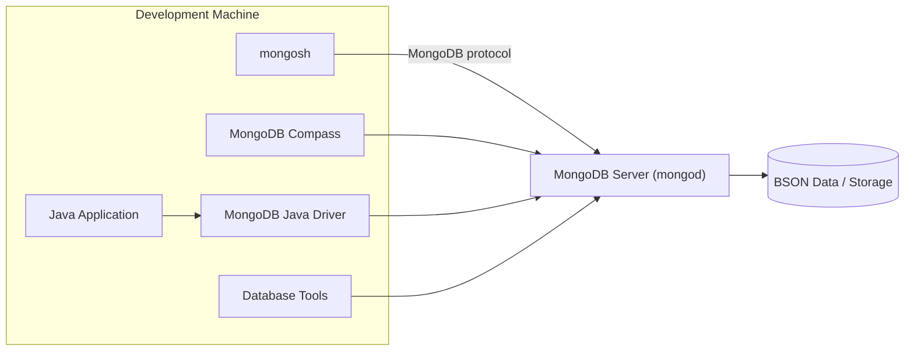

# Installing MongoDB and Checking Server, Tool, and Driver Versions

> **Module:** Database Engine Document MongoDB  
> **Chapter:** Practice Environment

## 1. Objectives and Big Picture

Before practicing queries, indexing, or document design, you need a running MongoDB Server and a way to connect to it. This lesson guides you through setting up an environment on a personal machine using Docker or direct installation on Windows, Ubuntu, and macOS; then independently verifying the versions of the **server**, **MongoDB Shell**, **Database Tools**, and **driver** used by your application.

After completing this practice, you will be able to:

- Choose a way to run MongoDB suitable for your machine and persist data across restarts.
- Connect to MongoDB using `mongosh` or MongoDB Compass and confirm that the server actually responds.
- Distinguish between the `mongod` binary version, the connected server version, and external tool versions.
- Add the MongoDB Java Sync Driver to a Maven/Gradle project, verify the resolved dependency version, and run a Java program to test connectivity.
- Diagnose common root causes when commands are missing, the service is not running, or the driver cannot connect.

### 1.1. Components Frequently Confused with One Another

| Component | Role | Where Is It Installed? | How to Check |
|---|---|---|---|
| **MongoDB Server** (`mongod`) | Process that stores data, processes queries, and manages BSON data | Server, container, or managed service | `mongod --version` checks the binary; `db.version()` checks the connected server |
| **MongoDB Shell** (`mongosh`) | Command-line client for sending commands to the server | Learner's machine or container | `mongosh --version` |
| **MongoDB Database Tools** | Backup, restore, import, and export utilities such as `mongodump`, `mongorestore`, `mongoimport`, `mongoexport` | Can be installed separately | `mongodump --version` |
| **MongoDB Compass** | Graphical desktop application to connect, inspect collections, and run queries | Learner's machine | **About** menu in the application |
| **MongoDB Driver** | Java, Node.js, Python, etc. library that application code calls to communicate with the server | Dependency of each application | Maven/Gradle/npm/pip, depending on the language |



These are **components with independent release lifecycles**. For example, the server may be version `8.0.x`, the shell `2.x`, Database Tools `100.x`, and the Java driver `5.x`. Never conclude an environment is broken just because these four version numbers do not match; check the official **compatibility matrix**.

## 2. Preparation and Choosing a Deployment Method

You need a 64-bit machine supported by MongoDB or a suitable Docker host, software installation privileges, internet access to download packages, and a terminal. If you will use the Java driver, prepare a JDK and Maven or Gradle; `java -version` and `mvn -version` / `gradle -version` help verify your build environment.

| Approach | Choose When | Things to Know |
|---|---|---|
| **Docker (recommended for practice)** | You want identical commands across Windows/macOS/Linux and easy environment isolation | Requires Docker Engine or Docker Desktop; data should live in a Docker volume |
| **Direct Installation** | You want to learn how to manage OS processes, services, data directories, and config files | Each OS has its own installation procedure and support requirements |
| **MongoDB Atlas** | You do not want to self-operate a server locally | Server runs in the cloud; you still need shell/Compass/driver, an account, and network access rules |

The examples below consistently use **MongoDB Community 8.0** as a practice baseline. This is a version **selected for instructional purposes**, not a claim that it is the latest version. If you choose another release line, substitute the corresponding version tag and read the matching documentation before installing. Do not run two servers occupying port `27017` on the host simultaneously.

> **Security Boundary:** A sample environment without authentication enabled is only suitable for learning on a personal machine and must only accept connections from loopback (`127.0.0.1`). Do not expose port `27017` to the internet, and do not use this configuration in production. Real deployments require authentication, least privilege, network controls, and proper TLS.

## 3. Method A — Running MongoDB with Docker

This approach fits if Docker is already installed and running:

```bash
docker version
docker info
```

If `docker info` cannot reach the Docker daemon, start Docker Desktop or the Docker service first.

### 3.1. Create Container and Volume

Run these commands from the **host machine** terminal (PowerShell, CMD, Terminal, or Bash):

```bash
docker pull mongo:8.0
docker run --name mongodb-lab -d -p 127.0.0.1:27017:27017 -v mongodb-lab-data:/data/db mongo:8.0
docker ps --filter "name=mongodb-lab"
```

Meaning:

- `mongo:8.0`: MongoDB image tracking the 8.0 branch; the actual patch number may change as the image is updated.
- `mongodb-lab`: container name used in subsequent verification commands.
- `127.0.0.1:27017:27017`: publishes the container port only to the host's loopback address. Use `mongodb://127.0.0.1:27017` to connect from applications running on the **host**.
- `mongodb-lab-data:/data/db`: Docker named volume so data persists when the container is stopped or recreated using the same volume.

Inspect startup logs:

```bash
docker logs --tail 40 mongodb-lab
```

A container in `Up` status is a good sign, but **does not prove the server is ready to process queries**. Test by sending a `ping` command:

```bash
docker exec mongodb-lab mongosh --quiet --eval "db.adminCommand({ ping: 1 })"
```

A result containing `ok: 1` confirms that MongoDB Server inside the container is responding. If the command fails right after startup, read the logs to see whether the server has finished initializing.

### 3.2. Check Versions Inside the Container

```bash
docker exec mongodb-lab mongod --version
docker exec mongodb-lab mongosh --version
docker exec mongodb-lab mongosh --quiet --eval "db.version()"
docker exec mongodb-lab mongosh --quiet --eval "db.adminCommand({ buildInfo: 1 }).version"
```

The first two commands read the **executable versions inside the container**; the last two query the **server that the shell is connected to**. To test from the host machine, install `mongosh` on the host and run:

```bash
mongosh "mongodb://127.0.0.1:27017" --quiet --eval "db.version()"
```

Installing `mongosh` on the host is optional if you only use `docker exec`; however, a host shell is useful for connecting to both local servers and MongoDB Atlas.

### 3.3. Stopping, Restarting, and Data Persistence Notes

```bash
docker stop mongodb-lab
docker start mongodb-lab
docker ps --filter "name=mongodb-lab"
```

Stopping the container does not delete the `mongodb-lab-data` volume. If you replace the container and attach the **same existing volume**, the data remains intact. Never delete the volume while it holds data you want to keep. If host port `27017` is already in use, change the **left-hand port** in the mapping, e.g., `127.0.0.1:27018:27017`, and use URI `mongodb://127.0.0.1:27018`.

## 4. Method B — Installing MongoDB Directly on the OS

Choose **one** subsection matching your machine. The instructions below are examples for version 8.0, accompanied by official documentation links to verify OS requirements and updated installation steps.

### 4.1. Windows

This guide applies to 64-bit Windows 11 or Windows Server editions supported by MongoDB 8.0.

1. Download **MongoDB Community Server**, select version `8.0`, platform Windows, and the `msi` package from the [MongoDB Download Center](https://www.mongodb.com/try/download/community).
2. Run the MSI. For typical practice machines, select **Complete** and **Install MongoD as a Service**. Note the service name (default `MongoDB`).
3. You may install **MongoDB Compass** during the wizard if you want a graphical UI.
4. Install **MongoDB Shell (mongosh) separately**: the Windows server MSI does not install `mongosh` automatically. Download it from [MongoDB Shell](https://www.mongodb.com/try/download/shell) and open a new terminal window.
5. If you need `mongodump`, `mongoimport`, etc., check first; if missing, download [Database Tools](https://www.mongodb.com/try/download/database-tools).

In **PowerShell**, check the service:

```powershell
Get-Service -Name MongoDB
```

If the service is in `Stopped` state, start it from an elevated PowerShell prompt:

```powershell
Start-Service -Name MongoDB
```

After installation, open a new terminal and verify:

```powershell
Get-Command mongod -ErrorAction SilentlyContinue
Get-Command mongosh -ErrorAction SilentlyContinue
mongosh --version
mongosh "mongodb://127.0.0.1:27017" --quiet --eval "db.version()"
```

If `Get-Command mongod` returns empty even though the service is running, the server's `bin` directory may not be in `PATH`; try invoking the executable directly by its install path, such as `C:\Program Files\MongoDB\Server\8.0\bin\mongod.exe`. The actual directory depends on choices made in the MSI. Distinguish a `PATH` issue from the server not having started.

Documentation: [Install MongoDB Community on Windows](https://www.mongodb.com/docs/v8.0/tutorial/install-mongodb-on-windows/).

### 4.2. Ubuntu Linux

The example below applies to Ubuntu LTS releases **supported by MongoDB 8.0** (such as 20.04, 22.04, and 24.04 on supported architectures). Use the official `mongodb-org` repository; avoid confusing it with the unmaintained `mongodb` package in Ubuntu's default repositories.

Identify your Ubuntu release:

```bash
cat /etc/os-release
uname -m
```

Install prerequisites and import the package signing key:

```bash
sudo apt-get update
sudo apt-get install -y curl gnupg
curl -fsSL https://pgp.mongodb.com/server-8.0.asc | sudo gpg --dearmor -o /usr/share/keyrings/mongodb-server-8.0.gpg
```

Add the repository based on your current Ubuntu `VERSION_CODENAME`:

```bash
. /etc/os-release
echo "deb [ arch=amd64,arm64 signed-by=/usr/share/keyrings/mongodb-server-8.0.gpg ] https://repo.mongodb.org/apt/ubuntu $VERSION_CODENAME/mongodb-org/8.0 multiverse" | sudo tee /etc/apt/sources.list.d/mongodb-org-8.0.list
sudo apt-get update
sudo apt-get install -y mongodb-org
```

Proceed only if `VERSION_CODENAME` matches a MongoDB-supported release; if using another distro, follow its corresponding documentation. Start and check status:

```bash
sudo systemctl start mongod
sudo systemctl status mongod
mongod --version
mongosh --version
mongosh "mongodb://127.0.0.1:27017" --quiet --eval "db.adminCommand({ ping: 1 })"
```

Typically, configuration lives at `/etc/mongod.conf`, data at `/var/lib/mongodb`, and logs at `/var/log/mongodb/mongod.log`. You can use `sudo journalctl -u mongod -n 50 --no-pager` to inspect service logs if startup fails. To enable the service at boot, run `sudo systemctl enable mongod`.

Documentation: [Install MongoDB Community on Ubuntu](https://www.mongodb.com/docs/v8.0/tutorial/install-mongodb-on-ubuntu/).

### 4.3. macOS

On macOS meeting MongoDB 8.0 support requirements (per 8.0 docs: macOS 15 or later, supported 64-bit Intel or Apple Silicon), prepare [Homebrew](https://brew.sh/). Then run:

```bash
brew tap mongodb/brew
brew trust mongodb/brew
brew update
brew install mongodb-community@8.0
brew services start mongodb-community@8.0
```

Check status and versions:

```bash
brew services list
mongod --version
mongosh --version
mongosh "mongodb://127.0.0.1:27017" --quiet --eval "db.version()"
```

Homebrew also installs MongoDB Database Tools alongside the corresponding MongoDB Community package. Homebrew configuration files typically reside in the `etc` directory under `brew --prefix`; the exact path differs between Apple Silicon and Intel Macs.

Documentation: [Install MongoDB Community on macOS](https://www.mongodb.com/docs/v8.0/tutorial/install-mongodb-on-os-x/).

### 4.4. If Using MongoDB Atlas

Atlas runs MongoDB Server in the cloud. On your development machine, you only need to install the appropriate clients (`mongosh`, Compass, Java driver, etc.), create a deployment, and configure database users along with network access rules in Atlas.

In Atlas, copy the provided connection string by choosing **Connect with MongoDB Shell** or **Connect your application**. Example format:

```text
mongodb+srv://<cluster-host>/<database>?retryWrites=true&w=majority
```

The host here is a placeholder; use the host issued by Atlas. Have applications read credentials/URIs from environment variables or a secret manager rather than committing them to source code, docs, or Git. A successful Atlas connection does not mean `mongod` is installed locally: the server runs on a remote cluster.

## 5. Checking Versions at the Right Layer

A common diagnostic mistake is running `mongod --version` and assuming you now know the version of the server your application connects to. That command only reads the binary version found on **the machine where you typed the command**. If your application connects to Docker, Atlas, or another host, you must query that specific connection.

### 5.1. Server Binary Version

```bash
mongod --version
```

Output includes a line like `db version v8.0.x` along with build details. If using Docker, run it via `docker exec mongodb-lab mongod --version`. The server does not need to be running to execute `mongod --version`.

### 5.2. Currently Connected Server Version

From a terminal on a machine with `mongosh`:

```bash
mongosh "mongodb://127.0.0.1:27017" --quiet --eval "db.version()"
mongosh "mongodb://127.0.0.1:27017/admin" --quiet --eval "db.adminCommand({ buildInfo: 1 }).version"
mongosh "mongodb://127.0.0.1:27017/admin" --quiet --eval "db.adminCommand({ ping: 1 })"
```

- `db.version()`: queries the version of the MongoDB Server at the connected endpoint.
- `buildInfo.version`: retrieves version info from the `buildInfo` server command (may be restricted by policies/permissions in managed environments).
- `ping`: verifies that the server responds; when user/password auth is enabled, the command requires valid credentials.

Inside an interactive `mongosh` session, you can run:

```javascript
db.version()
db.adminCommand({ buildInfo: 1 })
db.adminCommand({ ping: 1 })
```

To record what you are actually connected to, inspect the URI used, hostname, port, and connection mechanism (local, container, Atlas). Never rely solely on a version string to prove you are working on the intended database.

### 5.3. Shell and Administrative Tool Versions

The following commands run in your **OS terminal**, not inside the `mongosh` prompt:

```bash
mongosh --version
mongodump --version
mongorestore --version
mongoimport --version
mongoexport --version
```

If a tool reports `command not found` / `is not recognized`, there are two main possibilities: **not installed** or **the executable directory is not in `PATH`**. Check the executable path using `Get-Command mongodump` in PowerShell or `command -v mongodump` on Linux/macOS.

Since MongoDB 4.4, **MongoDB Database Tools are released separately** on a `100.x` version branch and do not need to match the server's `8.0.x`. Check the compatibility documentation for the exact Tools version you have. The `mongo` command belongs to the legacy shell; for modern workflows, use `mongosh`.

Documentation: [MongoDB Shell](https://www.mongodb.com/docs/mongodb-shell/) and [MongoDB Database Tools](https://www.mongodb.com/docs/database-tools/).

### 5.4. MongoDB Compass Version

Open Compass and go to **About** (menu placement varies by OS or version) to read the application version. On the connection screen, enter URI `mongodb://127.0.0.1:27017`, click **Connect**, and browse databases/collections once connected. Compass's version is the **GUI client** version, independent of the server version. If Compass fails to connect while `mongosh` succeeds, compare the URI, authentication, and TLS settings before suspecting MongoDB Server.

## 6. Hands-On Connection and First Data Operation

Before testing with Java, confirm that your newly installed server can actually write and read documents. This example uses a local server without authentication enabled. Open the shell:

```bash
mongosh "mongodb://127.0.0.1:27017"
```

In the shell, run sequentially:

```javascript
use mongo_lab

db.environment_check.updateOne(
  { _id: "installation-smoke-test" },
  {
    $set: {
      component: "MongoDB Server",
      message: "Connection and write succeeded",
      checkedAt: new Date()
    }
  },
  { upsert: true }
)

db.environment_check.findOne({ _id: "installation-smoke-test" })

db.environment_check.deleteOne({ _id: "installation-smoke-test" })
```

The `updateOne(..., { upsert: true })` command inserts or updates the test document, `findOne` reads it back, and `deleteOne` cleans up that exact test document. Seeing the query return the newly created `_id` confirms that connectivity, read/write permissions, and basic querying work. To exit `mongosh`, type `exit`.

**Note:** the `mongo_lab` database and `environment_check` collection names are for lab exercises; never test write/delete commands on a production cluster without proper authorization and controlled data.

## 7. Installing and Verifying the MongoDB Driver for a Java Application

A driver is a **library inside the application**, not a MongoDB process, and is not installed automatically just because `mongod` or `mongosh` is present. For synchronous Java applications, the example uses artifact **`org.mongodb:mongodb-driver-sync`**. For reproducibility, this lesson uses version `5.13.0`; when creating a new project, check currently supported versions and the compatibility matrix before upgrading.

### 7.1. Maven

Add the dependency to `pom.xml`:

```xml
<dependencies>
    <dependency>
        <groupId>org.mongodb</groupId>
        <artifactId>mongodb-driver-sync</artifactId>
        <version>5.13.0</version>
    </dependency>
</dependencies>
```

If `pom.xml` already has a `<dependencies>` block, only add the corresponding `<dependency>` tag inside the existing block.

Verify the version actually resolved by Maven:

```bash
mvn dependency:tree -Dincludes=org.mongodb
```

Look for the line `org.mongodb:mongodb-driver-sync:jar:5.13.0` (or the version declared/managed by your project). The driver also pulls in transitive dependencies such as `mongodb-driver-core` and `bson`; observe the **resolved** version rather than just reading `pom.xml` if your project uses dependency management.

### 7.2. Gradle

If the project uses Gradle Groovy DSL (`build.gradle`):

```groovy
dependencies {
    implementation 'org.mongodb:mongodb-driver-sync:5.13.0'
}
```

If using Gradle Kotlin DSL (`build.gradle.kts`):

```kotlin
dependencies {
    implementation("org.mongodb:mongodb-driver-sync:5.13.0")
}
```

Inspect the actual dependency on the runtime classpath:

```bash
./gradlew dependencyInsight --dependency mongodb-driver-sync --configuration runtimeClasspath
```

On Windows, replace `./gradlew` with `.\gradlew.bat` if using PowerShell. When a project uses a Spring Boot BOM or version catalog, manage versions from a single source of truth; `dependencyInsight` confirms which version Gradle selected after resolving version conflicts.

### 7.3. Java Smoke Test: Querying Server Version via the Driver

The example below uses Java 17+ and MongoDB Java Sync Driver 5.13.0. Create `CheckMongoEnvironment.java` in the Java source set of a project that has the dependency configured:

```java
import com.mongodb.client.MongoClient;
import com.mongodb.client.MongoClients;
import org.bson.Document;

public class CheckMongoEnvironment {
    public static void main(String[] args) {
        String uri = System.getenv("MONGODB_URI");
        if (uri == null || uri.isBlank()) {
            uri = "mongodb://127.0.0.1:27017";
        }

        try (MongoClient client = MongoClients.create(uri)) {
            Document ping = client.getDatabase("admin")
                    .runCommand(new Document("ping", 1));

            Document buildInfo = client.getDatabase("admin")
                    .runCommand(new Document("buildInfo", 1));

            System.out.println("ping.ok = " + ping.get("ok"));
            System.out.println("server.version = " + buildInfo.getString("version"));
        }
    }
}
```

To connect to another environment, set the `MONGODB_URI` variable on the **application runtime process** to the URI provided by that environment. Do not put real passwords directly in source code. If `ping` returns `ok = 1.0` (or equivalent numeric value) and prints the version, the driver is on the classpath and the application successfully queried the server.

The Maven/Gradle commands in the previous two sections verify the **driver version**; `server.version` printed by the Java program verifies the **connected server version**. These two numbers answer two different questions. If the account is not permitted to invoke `buildInfo`, you can still use `ping` as a connectivity check and inspect the server version using an appropriately privileged tool.

### 7.4. Drivers in Other Languages

If the application does not use Java, verification follows the same principle:

```bash
# Python: run after installing pymongo into the target Python environment
python -m pip show pymongo

# Node.js: run inside the project directory with the mongodb package installed
npm ls mongodb
```

This reports the client library version in that exact environment/project. When using virtual environments, application containers, or dependency lock files, run the command **inside the actual execution environment**, because a globally installed package version may differ from what the application loads.

Documentation: [MongoDB Java Sync Driver](https://www.mongodb.com/docs/drivers/java/sync/current/) and [Client Library Compatibility](https://www.mongodb.com/docs/drivers/compatibility/?driver-language=java&java-driver-framework=java-sync).

## 8. Checking Compatibility Before Upgrading

Distinguish three types of questions:

1. **Is the expected version installed?** Check the package manager, binary, or dependency resolver.
2. **Is the target server actually running and accepting connections?** Use `ping` / `db.version()` against the specific URI.
3. **Does that driver/tool version support your server and runtime?** Check the official compatibility matrix, then run a minimal connection test.

Never infer compatibility solely from matching major numbers. Java Sync Driver `5.x` and Server `8.x` belong to different version lines. MongoDB's compatibility matrix distinguishes full support, partial support, and incompatibility; you must also factor in JDK version, OS, CPU architecture, driver framework, and the features used by the application.

For Java applications in multi-module projects, record the **actual version inventory** using the structure below so environments are easy to reproduce:

| Item to Record | Verification Command or Source | Value Recorded in Personal Notes |
|---|---|---|
| OS / Architecture | `uname -m`, Windows/macOS About | OS name, release, CPU |
| Connected Server | `mongosh <URI> --eval "db.version()"` | e.g., `8.0.x` |
| Local Server Binary | `mongod --version` / `docker exec ...` | e.g., `8.0.x` |
| Shell | `mongosh --version` | e.g., `2.x` |
| Database Tools | `mongodump --version` | e.g., `100.x` |
| Java Driver | `mvn dependency:tree` / `gradlew dependencyInsight` | e.g., `5.13.0` |
| Java Runtime | `java -version` | e.g., `21.x` |
| Target URI (no secrets) | Application configuration | Local/Atlas, host, port, db |

In documentation or issue logs, **redact usernames, passwords, tokens, and connection strings containing secrets** before sharing.

## 9. Common Installation and Connection Errors

| Symptom | How to Identify Cause | Remediation |
|---|---|---|
| `mongosh: command not found` or PowerShell does not recognize `mongosh` | Shell was not installed separately or `PATH` has not been updated | Install `mongosh`, open a new terminal, check executable location |
| `mongod --version` works, but connection fails with `ECONNREFUSED 127.0.0.1:27017` | Binary exists locally, but the service/container is not running or listens on another port | Check `systemctl status mongod`, `Get-Service MongoDB`, or `docker ps`; check logs and URI |
| Docker reports port `27017` is already allocated | Another process/container is already binding the host port | Identify the service using the port; map another host port such as `27018` if appropriate |
| `Authentication failed` | Wrong credentials, `authSource`, or role; endpoint has auth enabled | Use the correct account, authentication database, and mechanism for the deployment; never disable auth to bypass errors in real environments |
| `mongodump` missing even though `mongosh` works | Database Tools is a separate package or not in `PATH` | Install Tools for your platform and verify `mongodump --version` |
| Compass connects, but Java times out | URI, DNS, TLS, network policy, proxy, or environment differs between the two clients | Compare redacted URIs; test connectivity from the exact host/container running Java |
| `MongoTimeoutException` / server selection timeout | Client could not find a usable server within the timeout window | Check service status, host/port, Docker network, Atlas IP access list, and DNS |
| Driver protocol/API errors after server upgrade | Driver may be too old or only partially supports new server features | Check the compatibility matrix and resolved dependency version, then upgrade per documentation |
| `Permission denied` when running service | Incorrect permissions on data/log directory or service account | Read logs and ensure the user running `mongod` owns/has access to data and log directories |

**Layered troubleshooting:** command not found → installation/`PATH`; TCP connection refused → process/network; connected but auth failed → credentials/roles; connected but app fails → dependency/API/operation permissions. This layered approach prevents confusing shell or Java driver issues with database engine failures.

## 10. Comprehensive Practice Exercise

Suppose you have Docker and a Java project using Maven or Gradle:

1. Create container `mongodb-lab` with image `mongo:8.0` and a named volume, then use `docker exec` to verify `ping` and `db.version()`.
2. Connect using `mongosh` from the host (or inside the container), create a test document in `mongo_lab.environment_check`, read it back, and delete that document.
3. Record the versions of the server, shell, and Database Tools if installed. If any tool is missing, clearly distinguish "not installed" from "server broken".
4. Add `mongodb-driver-sync` to your project, inspect the resolved dependency version with Maven/Gradle, and run `CheckMongoEnvironment` to observe `ping.ok` and `server.version`.
5. Stop and restart the container and reconnect. Stopping/starting does not wipe data stored in a named volume.

Once all steps above succeed, you have a working environment ready to learn documents, collections, CRUD, queries, indexes, and other MongoDB features in the upcoming lessons.

## 11. Official Documentation

- [MongoDB Community Server — Download](https://www.mongodb.com/try/download/community)
- [Install MongoDB 8.0 on Windows](https://www.mongodb.com/docs/v8.0/tutorial/install-mongodb-on-windows/)
- [Install MongoDB 8.0 on Ubuntu](https://www.mongodb.com/docs/v8.0/tutorial/install-mongodb-on-ubuntu/)
- [Install MongoDB 8.0 on macOS](https://www.mongodb.com/docs/v8.0/tutorial/install-mongodb-on-os-x/)
- [Install and Upgrade MongoDB Shell](https://www.mongodb.com/docs/mongodb-shell/install/)
- [MongoDB Database Tools — Installation](https://www.mongodb.com/docs/database-tools/installation/)
- [MongoDB Java Sync Driver](https://www.mongodb.com/docs/drivers/java/sync/current/)
- [Driver/Server compatibility matrix](https://www.mongodb.com/docs/drivers/compatibility/?driver-language=java&java-driver-framework=java-sync)

Installation pages have release-specific instructions. When switching to a different MongoDB Server version, select the matching documentation version and verify OS, architecture, tool, and driver support before proceeding.
