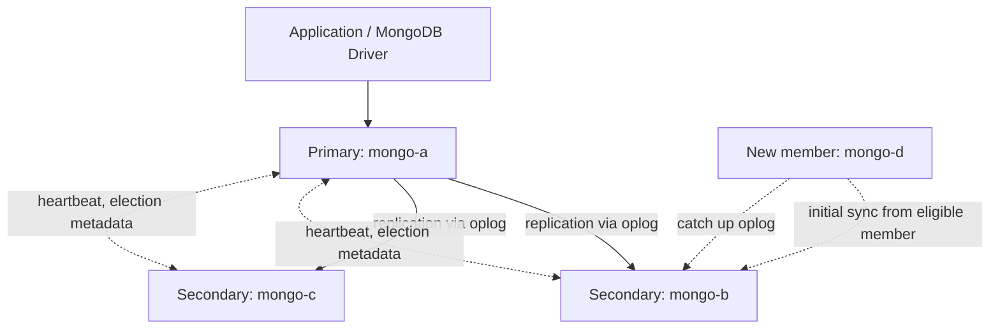
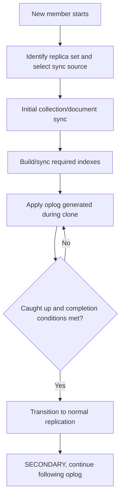
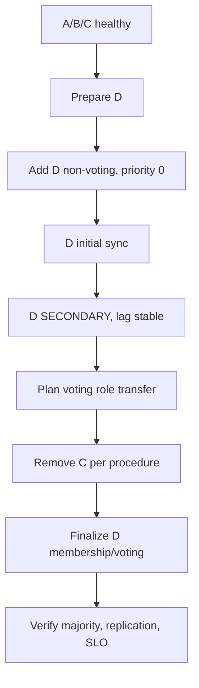

# Initial Sync and Adding or Replacing Members in a MongoDB Replica Set

> **Module:** Database Engine Document MongoDB  
> **Chapter:** Replica set

## 1. Lesson Objectives

A MongoDB replica set stores multiple copies of data across `mongod` processes to support fault tolerance and primary election mechanisms. When adding a machine to a replica set, that machine **does not automatically have all the data** of the running members. It must be synchronized to become a member ready to serve according to its configured role.

The process of building initial data on a new member is called **initial sync**. This is a core step when:

- Expanding a replica set to increase availability or add read copies.
- Bringing a new secondary into the cluster.
- Replacing a failed server or upgrading hardware.
- Recovering a member whose data can no longer keep up via the oplog.
- Rebuilding a secondary's data in an authorized environment with a controlled plan.

This lesson explains how initial sync works, conditions for successful synchronization, impact on primary/secondaries, how to add or replace members, reading status, preventing quorum loss, and handling common issues.

After studying, you will be able to:

1. Explain the relationship between **primary, secondary, oplog, initial sync, and steady-state replication**.
2. Recognize states such as `STARTUP2`, `RECOVERING`, `SECONDARY`, and `PRIMARY`.
3. Know where a new member pulls data from and why the **oplog window** matters.
4. Use `rs.add()`, `rs.status()`, `rs.conf()`, `rs.remove()`, and `rs.reconfig()` for their proper purposes.
5. Plan member additions without accidentally breaking majority maintenance.
6. Choose procedures for replacing a healthy secondary, a failed secondary, or a primary.
7. Monitor initial sync via member states, replication lag, resources, and server logs.
8. Distinguish **completing initial sync** from **reaching consistency and business readiness**.

> **Scope:** Examples interact directly with self-managed replica sets, primarily on modern MongoDB Server. MongoDB Atlas has its own management workflows; do not arbitrarily run direct member modification commands on Atlas-managed clusters. Specific behavior regarding progress, sync sources, and configuration depends on the MongoDB version.

## 2. Review: How Does a Replica Set Work?

A replica set consists of members sharing the same replica set name. In a typical configuration:

- **Primary** accepts normal write operations from the application.
- **Secondaries** replicate and apply operations from the oplog stream of a source member.
- Eligible **voting** members participate in primary elections.
- Some members may have `priority: 0` so they cannot be elected primary.
- An **arbiter** can participate in voting but **holds no user data**; an arbiter is not a secondary for backup or data initial sync purposes.

Simple diagram:



In practice, a secondary can choose another eligible member as its **sync source**, rather than always pulling directly from the primary. This helps distribute replication load depending on topology and member capabilities.

### 2.1. What Is the Oplog?

The **oplog** (*operations log*) is a special collection in the `local` database, typically `local.oplog.rs`, recording operations that other members must replay under the replication mechanism. It is the foundational mechanism enabling secondaries to keep up with the primary.

Visualization:

```text
Primary has data at T0
    |
    +-- T1: insert order A
    +-- T2: update order B
    +-- T3: delete order C

Secondary is at T1
    |
    +-- reads and applies T2, T3 from oplog
    |
    +-- reaches newer point in time
```

A secondary does not need to reload the entire collection every time the primary receives an update. Once it has initial data, it normally continues via **steady-state replication** through the oplog.

### 2.2. Initial Sync Differs from Steady-State Replication

| Criterion | Initial sync | Steady-state replication |
|---|---|---|
| Goal | Build a full initial copy of data on the member | Keep the member caught up with ongoing changes |
| Data source | Collection/index data and needed change history | Subsequent oplog entries |
| When it occurs | New/empty member or resyncing from scratch | After initial synchronization succeeds |
| Cost | Typically high: data cloning, indexes, I/O, and network | Depends on incoming write volume |
| State | May show STARTUP2/RECOVERING and specific progress | SECONDARY when operating normally |
| Primary risks | Insufficient oplog window, source changes, low disk, disconnect | Lagging too far behind, old oplog evicted before apply |

**Key point:** A member running initial sync **is not yet considered a ready secondary** merely because the `mongod` process has started and its port is open.

## 3. When Is Initial Sync Needed?

A member without a valid dataset requires initial sync to enter the replica set as a data-bearing member.

Common scenarios:

### 3.1. Adding a Brand-New Member

You start a new `mongod` with:

- The correct replica set name.
- A dedicated, empty, valid data directory for syncing.
- Compatible network, internal authentication, and TLS settings.
- A MongoDB version supported by the current topology.

Then an administrator adds this host to the replica set configuration from the primary. The new member performs initial sync.

### 3.2. Replacing a Failed Member

A secondary loses a disk and cannot reliably recover data. The operator prepares a replacement machine and adds it to the replica set configuration so it builds a new copy from a healthy member.

Do not interpret "replacement" as merely changing an IP address/hostname in the application connection string. **The new node's membership and data must be handled within the replica set.**

### 3.3. A Member Lagging Too Far Behind

A secondary is shut down too long or fails to keep up with the primary. If the required oplog entries have been evicted from the retention window, the secondary no longer has enough history to continue normal replication.

In this case, you may need to **resync from scratch** following an appropriate procedure: re-preparing the member's data and running initial sync. Do not delete `dbPath` before confirming the root cause and having a recovery plan.

### 3.4. Temporarily Disconnected Members Do Not Necessarily Need Initial Sync

If a secondary stops briefly while the required oplog entries are still retained, it can resume replication upon reconnecting. Not every restart or network flap leads to initial sync.

Distinguishing these two cases properly avoids unnecessarily transferring terabytes of data.

## 4. Conceptual Steps of Initial Sync

MongoDB Server can use different initial sync methods depending on version, edition, and deployment features. The common method is **logical initial sync**: reading data from a sync source, creating data/indexes on the new member, and applying changes generated during the copy.

Conceptual workflow:



This diagram explains the **baseline data phase and ongoing changes phase**. Exact ordering, log phases, and copy/index mechanisms vary across versions; do not treat this diagram as a byte-level protocol specification.

### 4.1. Choosing a Sync Source

The member needs a sync source with suitable data and oplog to serve synchronization. A member can pick another secondary instead of the primary, provided replication rules are satisfied.

From an operational perspective, note:

- The sync source must be capable of serving heavy data reads.
- When too many new members sync from one node simultaneously, that node can overload.
- Topology changes can cause a member to switch sync sources.
- Do not assume initial sync always pulls data directly from the primary.

### 4.2. Cloning Existing Data

The new member needs the corresponding collections and documents as of sync time, plus metadata and indexes per the server's mechanism.

Clone load typically involves:

- Disk reads on the sync source.
- Network traffic between source and new member.
- Disk writes on the new member.
- CPU for processing BSON, indexes, and the storage engine.
- Concurrent application read/write load on the same cluster.

If the source is a secondary serving heavy read traffic, initial sync can increase latency for those read requests.

### 4.3. Changes During the Clone Must Not Be Missed

A multi-hour clone cannot freeze all application writes. Meanwhile, the primary may continue accepting inserts/updates/deletes, generating new oplog entries.

The new member must catch up on relevant changes after the appropriate sync point. Therefore, **having what looks like full collections does not mean initial sync is complete**.

### 4.4. Transitioning to Steady State

When initial sync finishes according to server criteria, the member transitions to an appropriate state to continue reading and applying the oplog as a normal secondary.

On some versions you may observe intermediate states like `STARTUP2` or `RECOVERING`. Only when the member reaches `SECONDARY` with healthy replication should it be considered a data member ready for deployment purposes.

### 4.5. Initial Sync Variants

Some versions/editions/deployments support **file-copy-based initial sync** or other optimizations alongside logical initial sync. Do not assume which method your cluster uses solely from the phrase "initial sync."

When planning operations, verify:

- MongoDB Server version/edition.
- Storage engine.
- Managed vs. self-managed deployment type.
- Features and initial sync methods actually supported.
- Usage constraints and monitoring tools for that method.

Regardless of the method used, the shared goal remains obtaining **a consistent data copy eligible for replication and able to keep up with changes**.

## 5. Oplog Window: A Vital Condition for Initial Sync

A new member clones data while writes continue. To catch up on changes generated during cloning, it must still have access to **sufficient oplog history**.

The **oplog window** is the duration of change history still retained in the oplog. It varies with oplog capacity and write rate.

Visualization:

```text
Time → 

T0             T1                     T2
|--------------|----------------------|
Initial sync   Clone data            Catch up

Required oplog from appropriate point ─────►
If old entries are evicted before the new member applies them:
    Initial sync may fail and have to restart.
```

### 5.1. Example of Retention Window

Suppose the sync job needs to apply changes starting from 08:00. During cloning, a heavy write workload causes the oplog to retain only entries from 09:00 onward before the secondary finishes cloning.

The member cannot reconstruct all changes from 08:00 to 09:00 solely from the remaining entries. Without an appropriate history recovery option, initial sync may have to restart.

This shows initial sync **depends not only on data size**, but also on source write rate and oplog capacity.

### 5.2. Monitoring the Oplog

In `mongosh` on an appropriate member with required privileges:

```javascript
rs.printReplicationInfo();
```

This helper typically shows oplog size and the time span currently covered by the oplog. Field names/output can differ across versions.

You can inspect oplog collection stats with proper privileges:

```javascript
db.getSiblingDB("local").getCollection("oplog.rs").stats();
```

Do not directly modify `local.oplog.rs`. It is system data managed by MongoDB.

### 5.3. When Should Oplog Adjustment Be Considered?

If write workload is high and the oplog window is too short relative to how long a replica member may stay offline/syncing, evaluate:

- Current oplog capacity and free disk space.
- Peak hourly oplog generation rate.
- Time for a new member to clone and catch up on representative data.
- Expected maintenance durations.
- Additional retention settings/limits depending on version.
- Impact on storage and backups.

MongoDB provides admin commands/mechanisms to resize the oplog in supported versions, yet this is a **production change requiring a runbook**, not a default step to run blindly before every `rs.add()`.

### 5.4. Signs a Member Is Not Keeping Up

- Replication lag keeps increasing.
- Member stays in catch-up phase for a very long time.
- Logs show missing required oplog entries, unsuitable sync source, or initial sync restarts.
- Source change rate exceeds replication and apply capacity.
- Network/disk on the new member is saturated.

Do not treat a brief `lag = 0` reading as proof the node is completely healthy; check state, errors, stability duration, and relevant read/write concerns.

## 6. Prerequisites Before Adding a New Member

Before running `rs.add()` in production, verify multiple layers.

### 6.1. Topology and Quorum

| Question | Why It Matters |
|---|---|
| How many voting members does the replica set currently have? | Majority changes when configured vote count changes |
| Which member is primary? | Configuration change commands are normally executed on the primary |
| Is any member down/RECOVERING? | Majority may be thin or healthy sync sources lacking |
| Do secondaries have large replication lag? | Can affect resilience and catch-up |
| Is another membership change underway? | Avoid concurrent changes causing conflicts and instability |
| What `votes`/`priority` will the new member have? | Determines impact on elections/quorum |
| Does the cluster span multiple availability zones? | Fault tolerance must be distributed appropriately |

A replica set can have many data-bearing members, yet **at most 7 voting members** under standard MongoDB replica set limits. Do not add extra voters merely because you want more read copies.

### 6.2. Hostnames and Networking

The new member must have an address reachable by other members **and appropriate clients** as advertised by the topology.

Check:

- Stable DNS hostname resolvable from all machines in the replica set.
- Correct `mongod` port, firewall permitting required traffic.
- Never use `localhost` to configure a replica set spanning multiple real machines.
- Addresses declared in `rs.conf()` match hostnames/TLS certificates.
- Time synchronization and network infrastructure are stable.

With modern MongoDB Server, pay attention to checks involving **hostnames instead of direct IP configs**, especially in multi-host/split-horizon environments. A single-machine `localhost` lab differs completely from a multi-host replica set.

### 6.3. Security

If the replica set uses:

- Keyfile authentication between members.
- X.509 internal authentication.
- TLS/SSL for internal/application connections.
- Operator authentication and authorization.

then the new member must be configured compatibly. Do not disable authentication/TLS in production merely to "let the node join."

For example, a new machine with the same `replSetName` but missing the right keyfile or having an invalid certificate will fail to communicate with the rest. This is a configuration error, not something wiping data can fix.

### 6.4. Capacity and Performance

The new member needs:

- Disk for current data **plus growth headroom**.
- Space for indexes, oplog, journal, and metadata.
- Sufficient CPU/RAM for cloning and applying the oplog.
- Sufficient network throughput to finish syncing before oplog history runs out.
- Sufficient disk IOPS to write data and build indexes concurrently.
- Resource and log monitoring enabled.

The sync source must also have enough CPU/I/O/network headroom to serve the clone without severely impacting production.

### 6.5. Software Version

Do not add a `mongod` of an arbitrary version to a cluster. MongoDB enforces **upgrade/downgrade, wire compatibility, and feature compatibility version** rules; a new member must run a version compatible with the replica set at that point.

Before replacing hardware or installing anew, confirm the exact binary version and storage engine configuration supported by the deployment.

## 7. Distinguishing Votes, Priority, and Member Roles

A member can hold data without participating in votes or being eligible to become primary.

| Configuration | Meaning |
|---|---|
| `votes: 1, priority: 1` | Member can vote and can be elected primary when eligible |
| `votes: 1, priority: 0` | Member has a vote but **cannot be elected primary** |
| `votes: 0, priority: 0` | Data member does not vote and cannot become primary |
| `hidden: true, priority: 0` | Member hidden from normal secondary read selection, cannot become primary |
| Arbiter | Voting member that holds no user data and does not serve data initial sync |

Constraints:

- A **non-voting** member must have `priority: 0`.
- Do not increase voter count without recalculating majority.
- A new member undergoing initial sync cannot yet be treated as a ready copy merely because its config has `votes: 1`.
- Modern MongoDB versions include mechanisms to manage newly added members during addition to limit quorum impact before initial sync finishes; do not manually manipulate internal fields like `newlyAdded`.

### 7.1. Example Adding a Secondary Not Yet Intended to Vote

In scenarios where you want sync to finish before deciding its role:

```javascript
rs.add({
  host: "mongo-d.example.net:27017",
  votes: 0,
  priority: 0
});
```

Member D still holds data after initial sync, yet does not contribute a vote yet. Once synced and once topology decisions are made, the DBA can consider reconfiguring `votes`/`priority`.

**Do not assume by default** every member must be added with `votes: 0`. This choice depends on scaling goals, majority requirements, and configuration change strategy.

## 8. Hands-On Example: Building a Replica Set on One Machine

This section uses **one lab machine**, multiple `mongod` processes, and different ports. This is not a production configuration with host-level fault tolerance: when the physical machine stops, the entire replica set stops.

> **Safety:** The commands below use `--bind_ip localhost` without authentication enabled to reduce lab complexity. Never deploy this way on network-exposed machines or production systems. In real operations, always use authentication, TLS, and proper network configuration.

### 8.1. Prepare Directories

Windows example with PowerShell:

```powershell
New-Item -ItemType Directory -Force "C:\mongo-rs-lab\rs1"
New-Item -ItemType Directory -Force "C:\mongo-rs-lab\rs2"
New-Item -ItemType Directory -Force "C:\mongo-rs-lab\rs3"
```

Each process must use a **separate `dbPath`**. Never point two running `mongod` processes at the same data directory.

### 8.2. Start the First Member

Terminal 1:

```powershell
mongod --replSet rsTraining --port 27101 --dbpath "C:\mongo-rs-lab\rs1" --bind_ip localhost
```

Terminal 2:

```powershell
mongod --replSet rsTraining --port 27102 --dbpath "C:\mongo-rs-lab\rs2" --bind_ip localhost
```

Terminal 3:

```powershell
mongod --replSet rsTraining --port 27103 --dbpath "C:\mongo-rs-lab\rs3" --bind_ip localhost
```

Keep the `mongod` windows running. All processes share the replica set name `rsTraining`, while each process has an independent port and `dbPath`.

### 8.3. Initialize a Single-Member Replica Set

Open Terminal 4:

```powershell
mongosh "mongodb://localhost:27101/?directConnection=true"
```

In the shell:

```javascript
rs.initiate({
  _id: "rsTraining",
  members: [
    { _id: 0, host: "localhost:27101" }
  ]
});
```

Verify:

```javascript
rs.status();
db.hello().isWritablePrimary;
```

Wait for the first node to be elected primary per the lab's election mechanism. `isWritablePrimary` becomes true on the current primary. If you connect before the election completes, observe status again; do not immediately treat this wait as an error.

**Note:** In MongoDB drivers and many commands, member addresses must match the exact hostname declared in the replica set. The lab above uses the same hostname `localhost` for all three processes because they run on **one machine**.

### 8.4. Create Source Data Before Adding a Secondary

In the shell connected to the primary:

```javascript
const lab = db.getSiblingDB("replica_initial_sync_lab");
const events = lab.getCollection("events");

const documents = Array.from({ length: 10000 }, (_, i) => ({
  _id: i + 1,
  tenantId: "tenant-" + (i % 20),
  eventType: i % 3 === 0 ? "PURCHASE" : "VIEW",
  createdAt: new Date(Date.UTC(2026, 0, 1) + i * 1000),
  payload: "demo-" + (i + 1)
}));

events.insertMany(documents);
events.createIndex({ tenantId: 1, createdAt: -1 });

print("Count:", events.countDocuments({}));
```

Creating data and an index upfront ensures the new member must sync them. A 10,000-document dataset is quite small, so initial sync may finish too quickly to observe detailed intermediate progress.

### 8.5. Add the Second Secondary with `rs.add()`

In the shell **connected to the primary**:

```javascript
rs.add("localhost:27102");
```

This step instructs the replica set to add the process running on port 27102 to membership. The new node has an empty `dbPath` and will perform initial sync.

Observe:

```javascript
rs.status();
```

Briefly you may see the new node in `STARTUP2` or an intermediate state; once complete and stable, it becomes `SECONDARY`.

### 8.6. Add the Third Secondary

Once the second member is healthy:

```javascript
rs.add("localhost:27103");
```

Check configuration:

```javascript
rs.conf();
```

Once all three members finish syncing and are healthy, the lab has a replica set of three data-bearing processes, typically one primary and two secondaries.

**Do not equate a single-machine demo with real 3-node production:** there are three processes, yet only one physical failure domain.

### 8.7. Verify Data on a Secondary

From another window:

```powershell
mongosh "mongodb://localhost:27102/?directConnection=true"
```

In `mongosh` on the secondary, use an appropriate read preference when reading:

```javascript
db.getMongo().setReadPref("secondary");

const lab = db.getSiblingDB("replica_initial_sync_lab");

print("Secondary count:", lab.events.countDocuments({}));
printjson(lab.events.getIndexes());
```

If initial sync has finished and the member is caught up, the document count reflects source data as of query time. Under continuous write workloads, secondary reads can reflect lag behind the primary; do not treat document count comparisons at two different moments as absolute proof of consistency.

**Never run normal write operations directly on a secondary** to "fix" missing data. Investigate replication and only write through the primary via MongoDB-supported mechanisms.

## 9. Monitoring Initial Sync Progress

In production, monitor both the **new member** and **members serving the sync**.

### 9.1. Observe Status from the Primary

```javascript
const status = rs.status();

printjson(
  status.members.map(member => ({
    name: member.name,
    stateStr: member.stateStr,
    health: member.health,
    optimeDate: member.optimeDate,
    syncSourceHost: member.syncSourceHost
  }))
);
```

Fields `syncSourceHost`/`optimeDate` may not appear in every state or version. This example reads info when available, not a contract that all fields are non-null.

Key states:

| State | General Meaning |
|---|---|
| `STARTUP` | Member is starting up |
| `STARTUP2` | May be preparing/executing initial sync |
| `RECOVERING` | Not yet ready to serve as a normal secondary; may be catching up |
| `SECONDARY` | Data member in secondary role, continuing replication |
| `PRIMARY` | Member holding primary role |
| `ARBITER` | Voting member with no user data |
| `DOWN` or `health: 0` in another view | Member unreachable from the observing node's perspective |

**Do not use state alone as complete proof.** A secondary can be in state SECONDARY while still experiencing significant lag.

### 9.2. Inspect the Syncing Member Directly

Connect to the new node's host/port with `directConnection=true`:

```powershell
mongosh "mongodb://localhost:27102/?directConnection=true"
```

In the new member's shell:

```javascript
db.getSiblingDB("admin").runCommand({
  replSetGetStatus: 1
});
```

`replSetGetStatus` output can include initial sync state entries, collection/index progress, or elapsed time depending on server version and phase. Some versions expose details via fields like `initialSyncStatus`.

If output lacks the exact progress field seen in an online example, that **does not by itself prove the member is broken**. Check logs, state, and infrastructure metrics together.

### 9.3. `mongod` Logs Are a Crucial Observation Source

On the member undergoing initial sync, watch logs for:

- Starting initial sync, selecting sync source.
- Cloning databases/collections/indexes.
- Oplog apply batches, catch-up.
- Retries, disconnects, collection/index errors.
- Out-of-disk, network errors, authentication/TLS errors.
- Initial sync completion or conditions forcing a restart.

Do not rely on a specific log string like `"initial sync 50%"`, since log messages and structures change across versions.

### 9.4. Monitor Replication Lag

From the primary:

```javascript
rs.printSecondaryReplicationInfo();
```

This helper displays secondary replication info in supported environments. If the command is unavailable, its output fields differ, or it is disallowed, use `rs.status()`/logs and your deployment's monitoring system.

Notes:

- Lag reflects delay relative to an observed replication point, not overall initial sync progress.
- With uneven write workloads, some time-based lag calculations can be misleading.
- Whether a member is fit to serve application traffic also depends on read concern, read preference, tolerable latency, and current health.

### 9.5. What Should a Dashboard Include?

| Category | Metrics |
|---|---|
| New member | State, health, uptime, initial sync progress if available |
| Replication | Sync source, optime, lag, oplog window |
| Network | Throughput between sync source and new member, connection errors |
| Disk | Free space, read/write, IOPS, latency, temp files |
| Memory/CPU | RAM usage, CPU, cache pressure |
| Source member | CPU, disk reads, p95/p99 of read/write workloads |
| Application | Error rate, timeouts, latency, throughput |
| Replica set | Primary, elections, healthy voting members, majority |
| Logs | Retries, initial sync fail/restart, keyfile/TLS errors |
| End outcome | Member reaches SECONDARY, stable replication, matching data/indexes |

**Progress of one phase is not percentage of total elapsed time.** Like index builds, initial sync can spend substantial effort catching up or handling issues after main data cloning is nearly done.

## 10. Adding a Member in Production: A Controlled Procedure

Suppose a replica set has:

- `mongo-a.example.net:27017` — PRIMARY.
- `mongo-b.example.net:27017` — SECONDARY.
- `mongo-c.example.net:27017` — SECONDARY.

You want to add `mongo-d.example.net:27017`.

### Step 1 — Pre-Change Health Check

From the primary:

```javascript
rs.status();
rs.conf();
rs.printReplicationInfo();
```

Confirm:

- Primary is stable and has majority.
- Remaining secondaries are healthy with acceptable lag.
- Oplog window is sufficient for the sync plan.
- No other member/reconfig change is underway.
- Disk, CPU, and network have headroom.
- You are connected to the right replica set and environment.

### Step 2 — Prepare Member D

Configure the new `mongod`:

- Matching `replSetName`.
- Valid DNS hostname reachable by peers.
- Compatible TLS/keyfile/internal auth settings.
- Dedicated `dbPath` suitable for fresh initial sync.
- Sufficient disk and compute resources.
- Compatible MongoDB binary.
- Monitoring and logging enabled per policy.

Never copy an arbitrary data directory from a live node into production and assume MongoDB will automatically recognize it as consistent.

### Step 3 — Add the Member

If you want to add a data-bearing node without immediately changing voting majority:

```javascript
rs.add({
  host: "mongo-d.example.net:27017",
  priority: 0,
  votes: 0
});
```

If the target is a voting secondary with default settings, you can use:

```javascript
rs.add("mongo-d.example.net:27017");
```

**Choose only one of these two approaches** per your topology plan. Do not add the same host twice or try command variants without verifying current configuration.

### Step 4 — Monitor Initial Sync

Watch:

- `rs.status()` from the primary.
- `replSetGetStatus`/logs from the new member.
- Sync source health.
- Oplog window, replication lag.
- Network/disk/CPU and application latency.

Do not change multiple things at once: upgrading binaries, altering voting topology, and building large indexes concurrently makes troubleshooting difficult when issues arise.

### Step 5 — Verify Member Health

The new member should reach `SECONDARY`, continue replicating stably, and have expected data/indexes.

With non-sensitive verification data, you can compare counts and indexes. Remember:

- Counts from primary and secondary can differ while lag exists.
- Secondary reads under default read concern may reflect changes with a delay.
- Do not scan entire collections just to "compare every document" in production.
- Consistency expectations must be defined by read/write concerns and business SLOs.

### Step 6 — Adjust Role If Needed

If D was added with `votes:0, priority:0`, once ready it can be reconfigured to become a voting/electable member per your quorum plan.

**Illustrative controlled operation example**:

```javascript
const config = rs.conf();

const member = config.members.find(
  m => m.host === "mongo-d.example.net:27017"
);

if (!member) {
  throw new Error("Member D not found");
}

member.votes = 1;
member.priority = 1;

// Run only after the DBA confirms topology/quorum safety.
rs.reconfig(config);
```

Do not treat the snippet above as mandatory after initial sync. It changes voter count, majority, and election behavior; in larger setups it can hit the voting member limit.

## 11. Majority and Risks of Changing Member Count

**Majority** is the number of votes needed to establish/maintain election conditions and related guarantees, computed over voting members per MongoDB rules.

Common examples:

| Voting members | Majority |
|---:|---:|
| 1 | 1 |
| 2 | 2 |
| 3 | 2 |
| 4 | 3 |
| 5 | 3 |
| 6 | 4 |
| 7 | 4 |

The simple formula for majority votes is:

\[
\text{majority}=\left\lfloor\frac{\text{voting members}}{2}\right\rfloor+1
\]

However, write concern details, data-bearing member availability, and arbiter configurations follow specific rules; **do not treat the majority table as the sole formula for whether every write concern can succeed**.

### 11.1. Why Can Adding a Voter Temporarily Increase Risk?

If a replica set has 3 voters, majority is 2. Adding a fourth voter raises majority to 3 once the vote config stabilizes. If the new member is not yet synced or an existing member goes down, quorum maintenance can shift unexpectedly.

Modern MongoDB versions manage newly added members to avoid changing voting power prematurely before initial sync completes, yet operators still must:

1. Know the true state of each voting member.
2. Time configuration changes carefully.
3. Never expect a member undergoing initial sync to serve quorum/durability like a healthy secondary.
4. Evaluate both primary elections and application write concerns.

### 11.2. Do Not Reconfig Multiple Voters at Once

Modern MongoDB versions restrict voting configuration changes under specific rules; safe practice is to **add or remove only one voting member at a time**, waiting for the configuration to apply and stabilize before taking the next step.

Do not batch multiple vote changes into one big config merely to "save commands." For production, consult `rs.reconfig()` docs and supported workflows for your server version.

### 11.3. Never Use Force Reconfig as Routine Operation

`rs.reconfig(config, { force: true })` is a recovery tool for exceptional situations, **not a routine way to bypass majority errors**.

Forced reconfiguration carries severe risks for data consistency and rollbacks, especially when multiple members are lost. Use it only under an official recovery procedure after fully understanding oplog state, data state, and write concern requirements.

## 12. Replacing a Healthy Secondary: Step-by-Step Approach

Scenario: 3-member replica set A/B/C, all healthy. C is a secondary and needs replacement with machine D due to hardware upgrade.

One way to minimize time with fewer copies is **adding D, syncing it, and only then removing C**, when topology and capacity allow.



**Key takeaway:** Keep C until D has a synced copy of the data. Removing C too early reduces cluster fault tolerance throughout the time D is cloning.

### 12.1. Step 1 — Add D as Non-Voting

On the primary:

```javascript
rs.add({
  host: "mongo-d.example.net:27017",
  votes: 0,
  priority: 0
});
```

Adding D this way avoids increasing voter count upfront. It prepares the new data copy before altering quorum.

### 12.2. Step 2 — Wait and Verify D Has Synced

```javascript
rs.status();
```

Check D:

- State is SECONDARY.
- Good health.
- Replication lag within threshold.
- Expected data/indexes synced.
- No prolonged initial sync retry errors.
- Stable resources.

Do not merely see D in `rs.conf()` and assume it is ready.

### 12.3. Step 3 — Transfer Membership from C to D

Exact transition steps depend on version and quorum. Conceptually:

1. D is ready as a data-bearing secondary.
2. Execute membership/vote changes one step at a time per runbook.
3. Remove C or lower/remove C's vote per plan.
4. Promote D to voting/electable role if required.
5. Verify majority and health after **every step**.

Example removing C:

```javascript
rs.remove("mongo-c.example.net:27017");
```

Once topology is verified and you want D to become a voter, use a separate reconfig as illustrated in section 10. Never fire commands back-to-back without waiting for the previous reconfiguration to apply successfully.

**Important note:** A brief window with 2 voters after removing C (and before promoting D to voter) has majority 2; if one remaining voter fails, the replica set could lose write capability. Schedule a short cutover, monitor closely, and sequence changes based on actual topology/version to minimize risk.

### 12.4. Step 4 — Stop C After Removing It from the Replica Set

Once C is no longer a member and you have confirmed applications/monitoring no longer depend on it:

- Stop the `mongod` process on C per procedure.
- Do not reuse that data directory for another replica set without a clear data plan.
- Do not delete disk/data if retention, backup, or forensics require keeping it.
- Update inventory, dashboards, alerts, backup scope, network rules, and operational docs.

`rs.remove()` **does not delete physical data on machine C** and does not automatically stop C's OS process.

## 13. Replacing a Failed or Unreachable Secondary

Scenario: A is primary, B is secondary, C is secondary, but C suffers disk failure or prolonged outage. You want to bring in D as replacement.

### 13.1. Confirm Majority Conditions First

If A/B remain healthy and C is unavailable, a standard 3-voter replica set still has a 2/3 majority. However, fault tolerance is reduced; losing A or B next could prevent the cluster from maintaining a primary.

Therefore, replacing a failed member is a task to **prioritize restoring fault tolerance**, though you still must not skip resource and sync checklists.

### 13.2. Prepare D

- Use a distinct hostname and `dbPath` if it is a new machine.
- Configure auth/TLS/version properly.
- Ensure sufficient disk and network.
- If reusing C's hostname, confirm C is completely stopped with no DNS/process conflict.
- Never run an old node and a new node simultaneously with the same `host:port` identity in the replica config.

### 13.3. Transition Configuration per Runbook

A controlled approach is adding D as non-voting to sync, if version/topology and member count limits permit:

```javascript
rs.add({
  host: "mongo-d.example.net:27017",
  votes: 0,
  priority: 0
});
```

Once D is healthy, remove C and step D into its intended role one step at a time. If config limits or cluster state prevent adding first, follow a DBA-specific recovery procedure; do not assume every cluster permits adding non-voting members upfront.

### 13.4. Can C's Exact Hostname Be Reused?

Some server repair/replacement procedures retain the exact hostname/port. However, distinguish:

- Has the **old process completely stopped**?
- Is the old data directory still valid and consistent, or lost?
- Does DNS/IP for the hostname already point to the new machine?
- Are TLS certificates and internal identities configured compatibly?
- Does the replica set config still list member C at that host?

If the member config keeps the same hostname and the replacement machine uses an empty `dbPath`, initial sync can proceed as the member rejoins; yet **never treat same-name replacement as exempt from checking membership and data state**.

When uncertain, prefer replacement with a fresh hostname per official guidance and system runbooks.

## 14. Replacing the Primary: Requires Controlled Election Step

Replacing the primary differs from replacing a secondary because the primary handles active write traffic.

Suppose A is PRIMARY, B/C are SECONDARY; you want to replace A with D.

An overview procedure:

1. Ensure B/C are healthy, caught up, and include eligible primary candidates.
2. Prepare and add D; wait for initial sync to finish.
3. Verify write concern, read preference, failover, and replication.
4. Transfer the primary role off A following a supported maintenance procedure.
5. Verify a healthy new primary is elected.
6. Perform membership changes to remove A step by step.
7. Adjust D's votes/priority to the target topology and inspect all members.
8. Monitor latency, elections, rollbacks, and applications after cutover.

### 14.1. Stepping Down the Primary Proactively

During certain maintenance windows, a DBA may use:

```javascript
rs.stepDown(60);
```

This example asks the primary to step down for a duration per command/version semantics. It can disconnect clients from the old primary and trigger an election; never run it casually in production.

Before stepdown:

- Ensure an eligible secondary can be elected as the new primary.
- Check majority and replication lag.
- Applications must use a replica set connection string and drivers with appropriate retry/failover handling.
- Prepare monitoring for write errors/election duration.
- Confirm SLO tolerates brief disruption during primary switchover.

After stepdown:

```javascript
rs.status();
```

Verify the new primary. Do not infer outcome solely from the `stepDown` return value, because the client connection may drop right during role transition.

### 14.2. Do Not Set Priority to Blindly "Force" Elections

Changing `priority` affects primary selection and stability. Repeated reconfigs to force a specific host to become primary can trigger unnecessary elections or disruptions.

If the goal is merely hardware replacement, what matters is **having a ready primary and eligible data copies**, not keeping a particular hostname as primary.

## 15. Handling a Member Too Far Behind to Catch Up via Oplog

Suppose C was offline for days. After restarting, C reports insufficient oplog history to resume replication.

### 15.1. Do Not Immediately Wipe Data

Before resetting a member:

- Confirm it is genuinely the member needing resync, not the primary.
- Confirm the rest of the replica set holds healthy copies and meets write concerns.
- Check what logs say: missing oplog, data corruption, network, or auth?
- Review backups/snapshots that might need to be preserved.
- Confirm replica set config and the member's role.
- Plan disk/network capacity for fresh initial sync.

Accidentally deleting `dbPath` on the primary or the last remaining secondary with good data can cause severe data loss.

### 15.2. Recovery Options

- **Full resync:** re-prepare a clean data directory for that member and let MongoDB run initial sync.
- **Replace member:** add a new host, sync it, and remove the failed member per procedure.
- **Restore from snapshot/backup:** only when following MongoDB-supported procedures and guaranteeing backup consistency, `replSet` config, and matching oplog/replication metadata.

Never hot-copy the WiredTiger directory of a running `mongod`, open it on another machine, and treat it as a valid secondary. Filesystem snapshot/backup-based methods require strict conditions for consistency.

### 15.3. Initial Sync May Have to Restart

If initial sync encounters a fatal error during execution—such as missing oplog history or an unrecoverable clone error—the server may retry per version policy or exit with an error requiring intervention.

When logs show repeated initial sync restarts, do not merely raise client timeouts. Check:

- Whether the sync source has sufficient oplog.
- Oplog generation rate vs. clone speed.
- Whether the new member's disk/network is too slow.
- Topology changes, elections, or unstable sync source.
- Authentication/TLS errors or data/index build failures.
- Sufficient disk space/free inodes/resources.

## 16. Modifying Configuration with `rs.reconfig`: Understanding Scope

`rs.reconfig()` replaces the replica set configuration with the configuration you supply. This is an administrative operation that can affect elections, membership, and write concern.

Example viewing configuration:

```javascript
const cfg = rs.conf();

printjson(
  cfg.members.map(m => ({
    _id: m._id,
    host: m.host,
    votes: m.votes,
    priority: m.priority,
    hidden: m.hidden
  }))
);
```

When modifying a member, start from the current `rs.conf()` and edit only intended fields—never build a minimal new object with just a few fields and accidentally drop settings.

### 16.1. Deliberate Priority/Votes Adjustment

For example, a member currently at `votes: 0, priority: 0` has completed initial sync; you want it to vote without becoming primary yet:

```javascript
const cfg = rs.conf();
const m = cfg.members.find(
  item => item.host === "mongo-d.example.net:27017"
);

if (!m) {
  throw new Error("Target member was not found");
}

m.votes = 1;
m.priority = 0;

// Call only after evaluating quorum and version limits.
rs.reconfig(cfg);
```

Later, if you want D to be eligible for primary, consider raising `priority` > 0 in a separate change step when appropriate.

### 16.2. Things Not to Do

- Never edit internal membership config files on disk in place of `rs.reconfig`.
- Never arbitrarily change member `_id` values.
- Never assign duplicate `host:port` to two members.
- Never exceed the voting member limit.
- Never set `priority > 0` on a non-voting member.
- Never use `force: true` just to bypass ordinary errors.
- Never run multiple reconfigs without waiting for majority/replication to stabilize.

Some commands may be temporarily rejected due to another active reconfiguration, pending write concerns, or insufficient quorum. Read the server error and resolve the actual state.

## 17. Hidden, Delayed, and Arbiter: Roles Related to Initial Sync

### 17.1. Hidden Secondary

A member with `hidden: true` and `priority: 0` still stores data and still requires initial sync when added. It is commonly used for specialized workloads or layouts where you do not want drivers to select it for normal secondary reads.

Hidden secondary does **not** mean "hidden from replication" or exempt from copying data.

Illustrative configuration example:

```javascript
rs.add({
  host: "mongo-analytics.example.net:27017",
  priority: 0,
  hidden: true,
  votes: 0
});
```

Depending on system goals, a hidden member may or may not hold a vote under MongoDB constraints. Do not choose `votes` solely from the word "hidden."

### 17.2. Delayed Secondary

A delayed secondary applies changes after a configured delay, serving certain recovery/history-retention needs. It is still a data-bearing secondary and still needs initial data.

A delayed secondary is not a complete replacement for backups. Intentional lag, oplog retention, failure domains, and recoverability must be designed separately.

### 17.3. Arbiter

An arbiter participates in voting but stores no application data, creates no backup copy, and does not run initial sync of user collections like a data secondary.

**Never add an arbiter to "increase data copies."** Having an arbiter affects majority write concern semantics, durability, and risk in certain setups. In many situations, a data-bearing secondary is preferable if infrastructure permits.

## 18. Indexes and Initial Sync

A new secondary needs both data state **and matching index structures** to serve replication and queries. Logical initial sync typically includes building/syncing required indexes.

Key points:

- Indexes on large collections can add significant duration to initial sync.
- Multikey/wildcard/text indexes can generate large numbers of index entries.
- Unique indexes must remain consistent with source data.
- Index builds compete for disk/CPU with cloning and oplog application.
- Impact must be monitored on both the new member and the sync source.

### 18.1. Can You Drop Indexes to Sync Faster?

Do not arbitrarily drop or disable necessary indexes in production to "speed up initial sync." Some member/index configurations have specific rules and limits, yet that is not a general trick for every replica set.

If indexes slow down sync, investigate index types, versions, hardware, RAM/disk capacity, and suitable build mechanisms. Never break unique constraints or business data to shorten synchronization.

## 19. Read/Write Concern After Adding a Member

Once a new member finishes initial sync, the replica set has an additional data copy. Yet whether applications can read from secondaries or write successfully still depends on:

- **Read preference:** primary/secondary/secondaryPreferred... determines which node handles reads.
- **Read concern:** consistency level of read data.
- **Write concern:** write acknowledgment level, e.g., `w: "majority"` in appropriate contexts.
- **Replication lag:** a secondary may not have received or applied the newest changes yet.
- **Elections and availability:** primary can change when a member fails.

Example application connection string for a replica set (illustrative hostnames):

```text
mongodb://mongo-a.example.net:27017,mongo-b.example.net:27017,mongo-c.example.net:27017/?replicaSet=rsProduction
```

Modern drivers discover replica set members from advertised topology. However, every advertised hostname must be resolvable/reachable by clients; you cannot fix DNS issues merely by adding IPs to the seed list.

### 19.1. Secondary Reads Seeing Lagging Data

If an API reads with `secondaryPreferred` to offload the primary, immediately after a write it may read from a lagging secondary depending on read concern and consistency requirements.

Do not assume "member D was added" means every read hitting D will instantly see a write just acknowledged on the primary. Read-your-writes/causal consistency requirements must be designed via driver/sessions and appropriate workloads.

### 19.2. Never Fix a Secondary via Direct Writes

If a secondary counts fewer documents than the primary:

- It may be catching up.
- Reads may be hitting different points in time.
- Queries may use different read concerns.
- Initial sync may not have finished.
- Or a replication issue needs investigation.

Never open a direct connection and try writing missing documents to a secondary to make counts match the primary. That violates the normal replication model and can corrupt consistency.

## 20. Java Sync Driver: Connecting and Observing Membership

The MongoDB Java Sync Driver connects applications to a replica set using a seed list and replica set name. In real environments, passwords/TLS must be managed via secure configuration, never hard-coded in source.

### 20.1. Connecting to a Replica Set from Java

Example on a single-machine lab:

```java
import com.mongodb.client.MongoClient;
import com.mongodb.client.MongoClients;
import com.mongodb.client.MongoCollection;
import com.mongodb.client.MongoDatabase;
import org.bson.Document;

public class ReplicaSetReadExample {
    public static void main(String[] args) {
        String uri = "mongodb://localhost:27101,localhost:27102,"
                + "localhost:27103/?replicaSet=rsTraining";

        try (MongoClient client = MongoClients.create(uri)) {
            MongoDatabase db = client.getDatabase("replica_initial_sync_lab");
            MongoCollection<Document> events = db.getCollection("events");

            System.out.println("Event count: " + events.countDocuments());
        }
    }
}
```

The driver uses topology appropriate to the replica set and default read preference. This example demonstrates **connecting after the replica set is ready**, not how to add a new member.

### 20.2. Intentional Secondary Reads

```java
import com.mongodb.ReadPreference;
import com.mongodb.client.MongoCollection;
import org.bson.Document;

// Assuming db was created from a suitable MongoClient:
MongoCollection<Document> events = db.getCollection("events")
        .withReadPreference(ReadPreference.secondaryPreferred());

long count = events.countDocuments();
System.out.println("Secondary-preferred count: " + count);
```

`secondaryPreferred()` prefers an eligible secondary when available, yet can fall back to the primary if none is selected. If business rules mandate reading from a secondary or mandate latest data, configure appropriate read preference/read concern/sessions instead of assuming defaults satisfy every requirement.

### 20.3. Querying Status via Admin Command

Example **for operational tooling with appropriate privileges only**, never using day-to-day API service accounts:

```java
import com.mongodb.client.MongoClient;
import com.mongodb.client.MongoClients;
import org.bson.Document;

public class ReplicaSetStatusExample {
    public static void main(String[] args) {
        String uri = System.getenv("MONGODB_ADMIN_URI");

        if (uri == null || uri.isBlank()) {
            throw new IllegalArgumentException("MONGODB_ADMIN_URI is required");
        }

        try (MongoClient client = MongoClients.create(uri)) {
            Document status = client.getDatabase("admin")
                    .runCommand(new Document("replSetGetStatus", 1));

            System.out.println(status.toJson());
        }
    }
}
```

This snippet reads replica set info; it does **not** run `rs.add()`, `rs.remove()`, or `reconfig`. Separating monitoring privileges prevents granting high administrative permissions to entire application services.

### 20.4. Why Application Startup Should Not Call `rs.add()`

Membership is a cluster topology decision:

- Changing voter counts affects majority.
- Adding members incurs heavy initial sync cost.
- Multiple application instances booting together could issue conflicting admin requests.
- Applications do not necessarily know the health of all members/backups.
- Requires change windows, logging, auditing, and clear ownership.

Therefore, adding/replacing members belongs to DBA/SRE operations or the MongoDB management platform, not inside application request/startup paths.

## 21. Common Errors When Adding Members

| Symptom | Possible Cause | Resolution Direction |
|---|---|---|
| `rs.add()` rejected | Not connected to primary, insufficient privileges, reconfig in progress | Verify role, primary, config, and error message |
| New member does not appear healthy | Wrong hostname/port/firewall or process not running | Check DNS, TCP, logs, `rs.status()` |
| Stuck in `STARTUP2` too long | Slow clone/index build or resource bottleneck | Monitor progress/logs/disk/network |
| Member keeps restarting initial sync | Insufficient oplog, unstable sync source, or clone error | Check oplog window, sync source, logs |
| Authentication error between members | Mismatched keyfile/X.509/TLS config | Fix security config properly; never disable security |
| Secondary has fewer records than primary | Initial sync/catch-up in progress or lag | Wait/observe replication; never write directly |
| Replication lag not shrinking | Slow disk/network/CPU, oplog growing too fast | Measure throughput, workload, and window |
| Cluster loses primary capability after reconfig | Unsafe majority/votes change | Recover per runbook; avoid arbitrary force |
| New member consumes large disk space | Cloned data, indexes, journal/oplog | Plan capacity and free disk upfront |
| Application fails to connect to new member | Advertised hostname fails DNS/TLS check | Fix DNS, certificates, and replica config per procedure |
| Added arbiter yet gained no data copy | Arbiters hold no user data | Use a data-bearing secondary when a copy is needed |
| Removed C yet C's process still runs | `rs.remove()` only changes membership | Stop/decommission the process separately after verifying |
| Client timeout during operation | Network, election, or waiting admin command | Verify server state before retrying |
| Primary change causes temporary write errors | Stepdown/election and client retries | Monitor elections; use driver URI and proper retry logic |

## 22. Analyzing Difficult Scenarios

### 22.1. Initial Sync Almost Finished Cloning, Yet Oplog Window Is Too Short

Node D syncs 800 GB from B over many hours. Meanwhile, the application generates oplog entries rapidly. D needs entries from the start of cloning, yet those entries are no longer retained.

**The problem is not simply "only 1% of data remains to copy."** Cloning 99% cannot skip 1% of change history.

Resolution direction:

1. Inspect logs on D and B/primary.
2. Measure oplog window, write rate, resources, and sync throughput.
3. Evaluate how to improve initial sync completion chances via supported procedures (low-write window, compute/network capacity, oplog retention/capacity).
4. Restart initial sync only after fixing root conditions; otherwise it will likely repeat the same failure.

### 22.2. New Secondary Is Healthy Yet Increases Sync Source Latency

D runs initial sync from B. B already serves heavy read queries under secondary read preference. As D clones data, B's disk reads spike and API p99 latency climbs.

Resolution direction:

- Confirm B is indeed the sync source.
- Correlate before/after latency with CPU, network, and disk I/O.
- Temporarily reduce non-essential read workloads if possible.
- Consider sync timing, load distribution, or infrastructure adjustments per MongoDB-supported options.
- Do not assume manually switching sync source is always better: source selection also depends on data freshness, oplog, and topology.

### 22.3. Replacing a Failed Member with Only Two Healthy Voters Left

In replica set A/B/C, C is down. A/B retain a 2/3 majority. Adding D to replace C requires hours of data transfer.

Risks:

- While D is not yet ready, if A or B also goes down, the replica set may fail to maintain a primary.
- Misconfiguring voter counts could adversely shift majority.
- If the sync source is one of the two healthy nodes, initial sync load increases overload risk.

Therefore, prioritize protecting A/B and watch quorum closely during recovery, avoiding multiple independent deployments concurrently.

### 22.4. Added D, Could D Be Elected Primary Too Early?

While D is running initial sync, it is not in a state to become primary. Once sync completes, if configuration allows (appropriate votes/priority), it can become an election candidate subject to other conditions.

When replacing hardware or adding read-only nodes, use `priority: 0` to prevent becoming primary if that is the design goal. Never assume every new secondary needs to be electable.

### 22.5. Is Data Difference on a Secondary Due to Lag an Error?

Not necessarily. Replica set replication progresses over time. A secondary may not yet see the latest write if read right after a write. When stronger consistency is required, design appropriate read concern, write concern, and session/causal consistency.

**Data differences from lag** and **unrecoverable state due to missing oplog** are two very different issues. Use status/logs to tell them apart.

## 23. Standard Operational Procedure for Member Replacement

A practical runbook can be divided into four phases.

### Phase A — Preparation

1. Identify which member is added/replaced, reason, and owner.
2. Save snapshots of `rs.conf()` and `rs.status()` per organizational policy.
3. Verify backups, recovery objectives, and data to retain.
4. Assess majority, data-bearing members, elections, and write concern.
5. Check version, FCV, and configuration compatibility.
6. Verify DNS/TLS/keyfile/firewalls/ports.
7. Ensure sync source and new member have adequate resources.
8. Check oplog window and peak write periods.
9. Define rollback/abort/recovery plans and alert thresholds.
10. Lock in an appropriate deployment window.

### Phase B — Execution

1. Start the new `mongod` with the proper configuration.
2. From the primary, add the member via `rs.add()` with suitable votes/priority.
3. Do not issue another reconfig immediately before state stabilizes.
4. Monitor initial sync on the new node and sync source health.
5. Follow the runbook if disk/network/oplog/auth errors occur.

### Phase C — Verification

1. Member reaches SECONDARY state.
2. Member continues replicating and lag stays within thresholds.
3. Data/indexes are consistent per authorized verification methods.
4. Replica set has a healthy primary and majority per target topology.
5. API latency/errors/write concerns show no abnormal regression.
6. No ongoing initial sync retries or disk pressure errors.

### Phase D — Cutover and Completion

1. If replacing an old member, perform controlled step-by-step reconfiguration/removal.
2. Re-verify `rs.conf()` and `rs.status()` after each change.
3. Stop/decommission the old member only when no longer needed and sufficient copies exist.
4. Update monitoring, backups, DNS, inventory, and topology docs.
5. Monitor post-change over a representative workload cycle.
6. Record completion milestone, any deviations, and operational lessons.

## 24. Hands-On Practice

Execute on the lab replica set from section 8. Never run member add/remove exercises in production without authorization and a maintenance plan.

### Exercise A — Distinguish Initial Sync and Normal Replication

Explain the flow for two scenarios:

1. New node N with an empty `dbPath` is added to a replica set holding 10,000 documents.
2. Node S already has data, goes offline for 30 seconds, then reconnects while the oplog still retains everything.

Which scenario requires cloning from scratch? Which can simply continue applying the oplog? What conditions could force S to undergo initial sync again?

### Exercise B — Observe States When Adding a Node

In the lab:

1. Start rs1 and create a one-member replica set.
2. Populate source data.
3. Start rs2 with the same `replSetName` and a separate `dbPath`.
4. From primary, run `rs.add("localhost:27102")`.
5. Watch `rs.status()` and rs2 logs.
6. Once rs2 becomes SECONDARY, check counts and indexes.
7. Record observed states and explain why some phases finish too fast to catch.

### Exercise C — Calculate Majority

For configurations with 3, 4, and 5 voting members, calculate majority. Suppose one voter is down—how many additional failures can the cluster tolerate before losing majority? Note that majority answers **do not replace** data durability/write concern analysis.

### Exercise D — Add D Without Changing Quorum Immediately

A replica set has healthy voting members A/B/C. You want to add D strictly as an analytics secondary, ineligible for primary and not yet needing a vote.

Write the `rs.add({...})` syntax for D, explaining `votes: 0` and `priority: 0`. Once D finishes initial sync, what purposes can it serve? What step is needed when you later want D to become a voter?

### Exercise E — Replace Secondary C with D

Given:

```text
A = PRIMARY
B = SECONDARY
C = SECONDARY, needs replacement for machine upgrade
D = new machine, no data yet
```

Propose the sequence:

1. Preflight.
2. Add D.
3. Monitor initial sync.
4. Verify D is SECONDARY.
5. Change C/D voting membership.
6. Remove and decommission C.
7. Post-change topology verification.

State at least two risks if C is removed before D has synced data.

### Exercise F — Oplog Window Incident

Suppose:

- Oplog retains 2 hours of history.
- An initial sync needs changes from 5 hours ago.
- Write workload continues and needed entries have been evicted.

Explain why data cloning alone is insufficient, why initial sync can restart, and what resource/oplog checks must happen before retrying.

### Exercise G — Losing Primary

A is PRIMARY and needs maintenance. B/C are healthy.

Explain:

- Why you must verify eligibility to elect a new primary first.
- Effect and risks of `rs.stepDown(60)`.
- Why drivers must use a replica set URI rather than pointing to a single host.
- Which metrics to watch during the election.
- Why A's data must not be deleted merely because A stepped down.

### Exercise H — Test Java Connectivity

Write or run the Java Sync Driver example:

1. Connect using a three-node seed list and `replicaSet=rsTraining`.
2. Count documents in the `events` collection.
3. Try `secondaryPreferred()` to understand read preference.
4. Use a separate tool with monitor privileges to run `replSetGetStatus`.
5. Explain why an API service should not call `rs.reconfig()` on its own.

### Exercise I — Analyze Runbook Readiness

A team plans to replace a production secondary, yet:

- Oplog window is unknown.
- New member's disk is nearly full.
- Sync source currently has high CPU.
- Another secondary is already lagging.
- No membership monitoring dashboard exists yet.

Should they proceed immediately or resolve conditions first? Build a preflight checklist and go/no-go criteria, without guessing completion time.

## 25. Principles to Remember

1. **Initial sync builds a new member's initial dataset**; afterward, the member stays current via normal oplog replication.
2. **Initial sync is more than copying collections**: it must bring the member to a consistent state and catch up on concurrent changes.
3. **The oplog window is critical**. If required history is evicted before the member applies it, initial sync can fail or restart.
4. **Do not assume the sync source is always the primary**; it can be another eligible secondary.
5. **Seeing a member in `rs.conf()` does not mean it is ready**. Verify state, health, lag, logs, and required data/indexes.
6. **Adding or changing voters affects majority**. Change only step by step under control, especially on a degraded cluster.
7. **`votes` and `priority` have different meanings**; a non-voting secondary still holds data, whereas an arbiter does not.
8. **Replacing a healthy member should consider adding and syncing the new node before removing the old one**, when topology permits.
9. **Replacing the primary must account for elections and write disruption**, not just swapping hostnames.
10. **Never wipe `dbPath`, force reconfig, or copy data files arbitrarily** to fix initial sync errors without knowing cluster state.
11. **Monitor the new member, sync source, and applications**; cloning can increase production latency.
12. **Separate replica set admin privileges from applications**. Membership belongs to DBA/SRE operations or management platforms.
13. **Secondary reads can lag**; design read/write concerns to match business consistency requirements.
14. **Every completed step must be re-verified** against actual replica set status and readiness conditions.

## 26. Official MongoDB Documentation

- [MongoDB Manual – Replica Set Data Synchronization](https://www.mongodb.com/docs/manual/core/replica-set-sync/)
- [MongoDB Manual – Replica Set Oplog](https://www.mongodb.com/docs/manual/core/replica-set-oplog/)
- [MongoDB Manual – Add Members to a Replica Set](https://www.mongodb.com/docs/manual/tutorial/expand-replica-set/)
- [MongoDB Manual – Replace a Replica Set Member](https://www.mongodb.com/docs/manual/tutorial/replace-replica-set-member/)
- [MongoDB Manual – Remove Members from Replica Set](https://www.mongodb.com/docs/manual/tutorial/remove-replica-set-member/)
- [MongoDB Manual – Resync a Member of a Replica Set](https://www.mongodb.com/docs/manual/tutorial/resync-replica-set-member/)
- [MongoDB Manual – rs.add()](https://www.mongodb.com/docs/manual/reference/method/rs.add/)
- [MongoDB Manual – rs.remove()](https://www.mongodb.com/docs/manual/reference/method/rs.remove/)
- [MongoDB Manual – rs.reconfig()](https://www.mongodb.com/docs/manual/reference/method/rs.reconfig/)
- [MongoDB Manual – rs.status()](https://www.mongodb.com/docs/manual/reference/method/rs.status/)
- [MongoDB Manual – replSetGetStatus](https://www.mongodb.com/docs/manual/reference/command/replSetGetStatus/)
- [MongoDB Manual – Replica Set Elections](https://www.mongodb.com/docs/manual/core/replica-set-elections/)
- [MongoDB Manual – Replica Set Member Configuration](https://www.mongodb.com/docs/manual/reference/replica-configuration/)
- [MongoDB Manual – Read Preference](https://www.mongodb.com/docs/manual/core/read-preference/)
- [MongoDB Manual – Write Concern](https://www.mongodb.com/docs/manual/reference/write-concern/)
- [MongoDB Java Sync Driver – Connect to MongoDB](https://www.mongodb.com/docs/drivers/java/sync/current/connection/)

**Conclusion:** Adding or replacing a replica set member is the process of bringing a new data copy into the system while preserving **quorum, writability, and consistency**. Initial sync requires source data, sufficient oplog history, and adequate resources; safe operation follows the sequence **check topology → prepare member → add config → monitor initial sync → confirm SECONDARY → adjust membership → monitor post-cutover**. Upholding these principles turns member replacement into an observable, controlled change rather than a risky production gamble.
