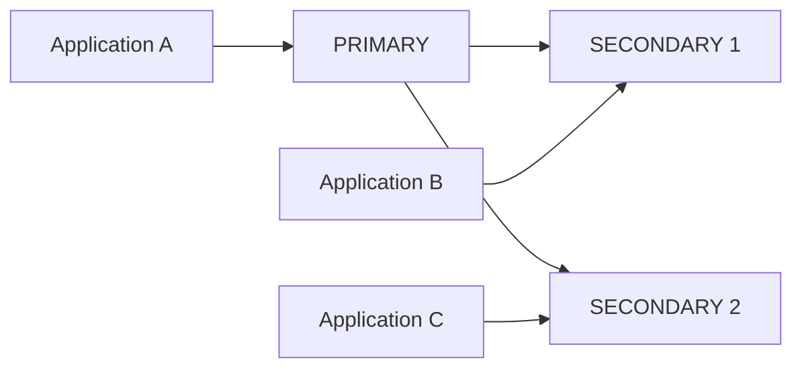
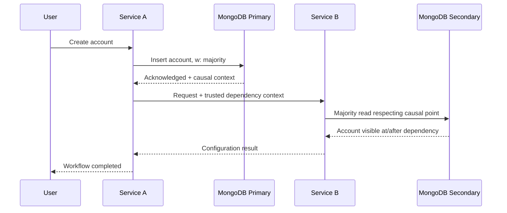

# Logical sessions, causal consistency, and causally ordered operations in MongoDB

> **Module:** Database Engine Document MongoDB  
> **Chapter:** Read and Write Consistency

## 1. The problem: why is a write not immediately visible on a subsequent read?

Suppose a social media application uses a MongoDB replica set. A user just posted a note:

```javascript
db.notes.insertOne({
  _id: "N-100",
  authorId: "alice",
  content: "New note",
  createdAt: new Date()
});
```

The write command is processed successfully by the primary. Immediately afterward, the application navigates to the list view and **reads from a secondary** to offload the primary.

A secondary may not have applied the latest operation yet because replication has latency. Result: the user just saw a "post published" notification, yet the list does not show the newly created note. This phenomenon does not necessarily mean the record was lost; the application may have read from a lagging replica.

Similar situations appear across many business workflows:

- Creating an order, then opening the order details immediately afterward.
- Updating profile information, then reloading it from a secondary.
- Writing payment status, then reading the status to decide the next step.
- Reading a new configuration, then writing a record that **depends** on the configuration just read.
- One service updates state, and another service must observe that change before proceeding.

MongoDB provides **logical sessions** and **causal consistency** to express relationships between causally linked operations. With appropriate read/write concerns and proper session usage, the system can ensure operations in the same causal chain are not observed as if they occurred out of order.

**Key distinction:** causal consistency does not require all clients to always see the latest data at the exact same instant. It primarily preserves relationships of the form **"A happened before B, so B must respect A's outcome/order."**

After this lesson, you will:

1. Understand logical sessions, session IDs, and their relationship with drivers.
2. Distinguish `operationTime`, `clusterTime`, and wall-clock time.
3. Explain the four guarantees of causal consistency.
4. Know why `readConcern: "majority"` and `writeConcern: "majority"` are critical conditions for full guarantees.
5. Use explicit sessions with `mongosh` and the MongoDB Java Sync Driver.
6. Identify causally related operations versus independent/concurrent operations.
7. Understand how ordering is preserved when reading from secondaries or during failover.
8. Distinguish sessions, causal consistency, transactions, snapshot isolation, and linearizability.
9. Avoid improperly sharing sessions across threads and services.
10. Design testing, observability, and error handling appropriate for distributed systems.

## 2. Replica sets, replication lag, and differing client views

In a simple replica set:



The primary accepts normal writes and secondaries apply operations via replication. A change can appear on the primary before becoming available on secondaries.

Look at this illustrative timeline:

| Time | Primary | Secondary 1 | Secondary 2 |
|---|---|---|---|
| T0 | Has profile version v1 | v1 | v1 |
| T1 | Writes profile v2 | v1 | v1 |
| T2 | v2 | v2 | v1 |
| T3 | v2 | v2 | v2 |

If the application reads at T2:

- From primary: can see v2.
- From secondary 1: can see v2.
- From secondary 2: may still see v1.

This table illustrates only **replication lag**; what a client is actually permitted to see also depends on read concern, write concern, read preference, commit status, and session usage.

### 2.1. Read preference differs from read concern

**Read preference** tells the driver which member type to read from:

- `primary`: prefers/routes reads to the primary.
- `secondary`: selects eligible secondaries only.
- `secondaryPreferred`: prefers secondaries, may fall back to primary.
- Other modes like `primaryPreferred` or `nearest` have their own selection rules.

**Read concern** determines the consistency level of read data, such as `local`, `majority`, `snapshot`, or `linearizable` in supported contexts.

The two settings answer two different questions:

| Setting | Question |
|---|---|
| Read preference | Read from **which node**? |
| Read concern | Read data at **which consistency level**? |
| Write concern | When writing, **which acknowledgment level** is needed to consider it successful? |
| Causal session | Which **dependency order** must related operations preserve? |

You cannot guarantee read-your-writes from secondaries merely by setting `readPreference: secondary`.

### 2.2. Majority-committed does not mean "latest on every node"

A record acknowledged with `writeConcern: "majority"` has been accepted under the replica set's majority rules. However, a chosen secondary may still lag behind applying a given majority-committed operation.

Reading with `readConcern: "majority"` ensures reading data that has met the corresponding majority commit condition, **without automatically anchoring the read timestamp to the exact operation a specific client just wrote**.

That is why causal sessions matter: they tie the subsequent read to a causal milestone previously observed or produced.

## 3. What is a logical session?

A **logical session** is a context used by MongoDB drivers and servers to associate operations within the same unit of work. A session is neither a physical TCP connection nor a transaction by default.

Example of a request:

```text
User creates order
    │
    ├─ insert order
    ├─ read newly created order
    └─ update next status
         ↑
    Same logical session
```

Drivers typically manage sessions and attach session metadata to commands sent to MongoDB Server.

### 3.1. Session ID (`lsid`)

In commands sent to the server, a logical session is typically identified by the **`lsid`** (*logical session identifier*) field. You can observe this field in command monitoring or logs depending on context:

```javascript
{
  find: "orders",
  filter: { _id: "O-100" },
  lsid: {
    id: UUID("...")
  }
}
```

This is only an **illustrative shape**, not a requirement for applications to manually construct BSON commands and send session IDs by hand. The driver manages sessions, tokens, and protocol metadata.

`lsid` associates operations with a session, **but is not an authentication credential or data access permission**. MongoDB still enforces authentication/authorization by user, role, and command.

### 3.2. Sessions do not pin a single physical connection

In a replica set, the driver can route operations within the same session to different nodes depending on operation type and read preference.

For example:

- Write → primary.
- Read with `secondaryPreferred` → secondary.
- After failover → new primary.

To preserve causal relationships, the driver passes logical clock/session context across commands; **it does not need to stay on a single socket forever**.

A session also does not mean the server maintains a private copy of all documents for it.

### 3.3. Explicit and implicit sessions

**Implicit session:** the driver may automatically manage a session for standalone operations. Applications generally do not directly control reusing the exact same causal context across multiple operations.

**Explicit session:** the application explicitly creates a `ClientSession` and passes the same session to related operations.

For a workflow needing a guaranteed causal `insert → read → update` sequence, an explicit session is the explicit way to express it.

In Java:

```java
try (ClientSession session = mongoClient.startSession()) {
    collection.insertOne(session, document);
    Document readBack = collection.find(session, filter).first();
}
```

Both operations receive the `session` object. If you omit `session` on the read, the program may inadvertently execute an operation detached from the write's causal context.

### 3.4. Lifecycle and timeout

Clients should close explicit sessions when finished. Drivers may reuse session resources via internal pooling.

Logical sessions have server-configured expiration limits and activity tracking. MongoDB documentation typically references a default session timeout in minutes (commonly 30 minutes of inactivity in standard setups), though specifics depend on version/deployment and how drivers maintain sessions.

Do not keep a single `ClientSession` alive indefinitely for all users. Do not serialize Java session objects into a database to reuse after a process restart.

## 4. Causal consistency: "if B depends on A, B must see A"

In a distributed system, the **happens-before** relation describes operations that have a causal dependency.

Example:

1. User publishes post A.
2. Application receives write acknowledgment for A.
3. User opens the detail view for post A.
4. The detail screen reads data and expects to see A created.

Relationship:

```text
Write(A)  ──────causes──────>  Read(A)
```

If the read is served by a lagging secondary without causal ordering enforcement, the user can observe state moving backward relative to their own experience.

**Causal consistency** requires related operations to be observed in an order compatible with their causal relationships.

### 4.1. An intuitive example

User A performs:

```text
(1) Update new shipping address
              │
              ▼
(2) Re-read address to verify
              │
              ▼
(3) Create order using observed address
```

In this flow:

- (2) depends on (1): requires **read-your-writes**.
- (3) depends on (2): requires **writes-follow-reads**.
- If subsequent reads follow, they should not revert to observing an older state than previously seen along the causal chain.

### 4.2. Causal consistency does not order all operations

Two users do not communicate and independently create two unrelated posts:

```text
Client A: Write(A)  ─────>
Client B:       Write(B) ─────>
```

If there is no causal relationship between the two operations, causal consistency **does not force all clients to agree on a single global order** between A and B.

This differs from linearizability or stronger serialization models. Causal consistency is a **partial order** model based on causal dependencies.

## 5. Four guarantees of causal consistency

MongoDB describes the commonly used causal consistency guarantees as:

1. **Read your writes.**
2. **Monotonic reads.**
3. **Monotonic writes.**
4. **Writes follow reads.**

To obtain these full guarantees per MongoDB documentation, operations in a causally consistent session must use **majority read concern** and **majority write concern** as required.

### 5.1. Read your writes — seeing your own writes

```text
Session S:
    Write(profile = v2)
         ↓
    Read(profile)  → does not revert to v1
```

Example:

- Write profile update with `w: "majority"`.
- Read profile with `readConcern: "majority"` in the same session.
- The driver propagates the write's causal dependency to the read; if the chosen secondary has not reached the required point, the read must not return state older than that causal milestone under supported semantics.

**Caution:** This does not guarantee another client cannot overwrite the document afterward. If someone else legitimately writes profile v3, the read may see v3. The guarantee emphasizes not observing a state that *regresses* before the write your session already performed.

### 5.2. Monotonic reads — reads do not move backward

```text
Session S:
    Read(account v5)
         ↓
    Read(account)  → does not revert to v3 or v4
```

For example, the first read hits an up-to-date secondary, and the next read hits a lagging secondary. The causal session maintains a logical time floor so it does not return data older than the previously observed causal point.

Do not assume a field's numeric value **can only increase**: a valid subsequent write can decrease a value per business logic. "Monotonic reads" refers to the observation order of versions/operations, not numerical monotonicity of field values.

### 5.3. Monotonic writes — writes preserve session order

```text
Session S:
    Write(status = "APPROVED")
         ↓
    Write(audit = "Approved by Alice")
```

A later write related to an earlier write in the same session must not be ordered before the operation that established its causal foundation.

This guarantee **does not turn multiple writes into a transaction**. If the second write fails, the first write may still have committed.

### 5.4. Writes follow reads — later writes respect previously read data

```text
Session S:
    Read(policyVersion = 7)
         ↓
    Write(decision based on version 7)
```

The subsequent write must not be placed in causal history before the state it read.

However, causal consistency **does not prevent lost updates by itself**. If two clients both read policy v7 and both write based on v7, you still need version-conditional updates, unique constraints, or transactions if business rules demand them.

### 5.5. Summary table

| Guarantee | Relationship | What does it prevent observing? | What does it NOT guarantee on its own? |
|---|---|---|---|
| Read your writes | Write → Read | Reading state prior to an acknowledged write | Preventing overwrites by another client |
| Monotonic reads | Read → Read | Reading from an older causal point than a prior read | Numerically increasing field values |
| Monotonic writes | Write → Write | Later write ordered before earlier write in the chain | Multi-document atomicity |
| Writes follow reads | Read → Write | Write occurring prior to the state it depends on | Avoiding races between two writers |

## 6. Critical condition: majority read concern and majority write concern

This is the part frequently overlooked when merely enabling `causallyConsistent(true)`.

An explicit session can be marked causal, yet **to rely on MongoDB's full four causal consistency guarantees**, you must execute reads with `readConcern: "majority"` and writes with `writeConcern: "majority"` per applicable requirements for related operations.

### 6.1. Write concern majority

Example write command:

```javascript
db.notes.insertOne(
  { _id: "N-101", content: "Hello" },
  { writeConcern: { w: "majority", wtimeout: 10000 } }
);
```

`w: "majority"` requests acknowledgment from a majority of eligible data-bearing/voting members per replica set configuration. Exact member counts depend on topology and configuration (especially with arbiters).

Primary meaning: the write is acknowledged at the majority level per MongoDB mechanics, reducing rollback risk compared to writes acknowledged only by a primary before that primary fails.

`wtimeout` does not mean "MongoDB cancels the write if time runs out": timing out waiting for write concern can leave the write state **uncertain to the client**, even if the operation was applied. For critical operations, implement proper retry/idempotency rather than blindly issuing compensating writes.

### 6.2. Read concern majority

Example via command:

```javascript
db.runCommand({
  find: "notes",
  filter: { _id: "N-101" },
  readConcern: { level: "majority" }
});
```

Read concern majority restricts reads to majority-committed state that the node can serve. However, if a secondary has not caught up to a recent write, an **independent** majority read can still see older state.

Causal sessions combine logical clocks and causal ordering so subsequent reads satisfy the known causal milestone.

### 6.3. What if only `w:1` and `readConcern: "local"` are used?

In many simple tests, reads may still observe recent writes. However, if a write is acknowledged only by the primary and then rolled back during failover, relying on the full four causal consistency guarantees lacks the foundation provided by majority read/write concerns.

Do not document in business specs that "enabling causal sessions guarantees data can never be lost" while the application still uses insufficient concerns.

### 6.4. Causal consistency does not replace quorum

If a majority of the replica set is unavailable, a `w: "majority"` write may wait or time out. Causal consistency does not conjure new nodes or magically bypass network/quorum failures.

Trade-offs among availability, latency, and consistency must align with business SLAs. Switching to `w:1` just for "fast responses" can void the guarantees a workflow depends on.

## 7. `operationTime`, `clusterTime`, and logical clocks

MongoDB uses logical time metadata to express progress and relationships among operations. Two related concepts are:

- **`operationTime`:** the logical timestamp associated with an observed/executed operation.
- **`clusterTime`:** cluster-wide logical clock info propagated across commands/nodes by protocol.

In drivers, a session retains or updates these timestamps upon receiving server responses.

### 7.1. This is not server UTC wall-clock time

Example comparing two timestamps:

```text
UTC wall clock: 2026-11-14T12:00:01Z
Logical operation time: Timestamp(1794657601, 7)
```

This example only distinguishes data formats; never fabricate such a value for production operations.

A MongoDB BSON Timestamp has a time component and an oplog/cluster logical increment; it is **not an accurate wall-clock timer for measuring millisecond latency**.

Do not compute "causal wait duration" by subtracting two `operationTime` values like subtracting two Dates. To measure real latency, use application and server timers/metrics.

### 7.2. Relationship between `operationTime` and `afterClusterTime`

In a causally consistent session, once the client has observed an operation at logical time T, subsequent related reads can send a constraint like:

```javascript
readConcern: {
  level: "majority",
  afterClusterTime: Timestamp(/* T */)
}
```

This is an **illustrative representation of the mechanism**, not a command you manually construct in application code. Drivers automatically manage causal milestones and attach the appropriate constraint to commands.

Meaning: **do not serve the read from a state whose relevant milestone is older than T**. If the secondary has not caught up, the server may wait until the condition is satisfied, or return an error/timeout if it cannot complete within operation limits.

### 7.3. `clusterTime` is shared cluster context

Drivers can pass `$clusterTime` on commands to synchronize logical clock state. This is protocol metadata, not an arbitrary field for applications to set to "current time."

Key characteristics to remember:

- `clusterTime` is not a session ID and does not uniquely represent a single transaction.
- `operationTime` and `clusterTime` are related but not synonymous.
- Causally linked operations require propagating the appropriate milestones across steps.
- Drivers manage this metadata; applications generally **do not edit it directly** on raw BSON commands.
- In multi-service distributed architectures, causal context does not automatically follow an HTTP request unless you explicitly design controlled context propagation.

### 7.4. A timeline example

```text
Client Session S          PRIMARY              SECONDARY
       |                    |                     |
       |--- write A ------->|                     |
       |<-- ack majority ---|                     |
       |   operationTime=T1 |                     |
       |                    |------ replicate --->|
       |--- read A (secondary, causal context T1)--|
       |                    |                     |
       |                    |   if lagging: wait  |
       |<------------------- document A -----------|
       |                    |                     |
```

This explains read-your-writes: the client never receives a result from a secondary that precedes the required replication of an operation already completed in the same causal chain.

## 8. Causal ordering is a partial order, not everything in one single line

Consider three operations:

- A: user updates address.
- B: user creates order using that address.
- C: another user updates their avatar.

Relationships:

```text
A ─────> B

C  (independent)
```

Causal consistency requires B to respect A. However, C has no relationship with A/B; the system does not force all clients to agree whether C occurred before or after A/B.

### 8.1. Sources of causal relationships

A relationship can arise from:

1. **Program order:** the same program executes A, then B.
2. **Read-from:** B reads a result produced by A.
3. **Message passing:** service X sends an event/response regarding A, and service Y uses that result to perform B.
4. **Transitivity:** if A precedes B and B precedes C, then A also precedes C.

However, machine timestamps or isolated application logs do not always prove causality between two independent requests.

### 8.2. Causal consistency does not prevent all concurrency anomalies

Suppose two independent clients both read stock level 1:

```text
Client A: Read(stock=1)         Client B: Read(stock=1)
Client A: Write(stock=0)        Client B: Write(stock=0)
```

Separate causal sessions for A and B do not detect that two customers bought the same single unit of inventory.

To avoid overselling, use an **atomic conditional update**, for example:

```javascript
db.products.updateOne(
  { _id: "P1", stock: { $gte: 1 } },
  { $inc: { stock: -1 } }
);
```

Then check `matchedCount`. This is a concurrency control requirement distinct from preserving causal read/write ordering within a session.

## 9. Lab setup: a replica set with secondaries

To observe the benefits of causal reads from secondaries, practice on a **replica set with at least one healthy secondary**. On standalone or primary-only setups, examples still demonstrate the session API, but cannot fully reproduce reading from a lagging replica.

Lab prerequisites:

- MongoDB Server supporting logical sessions and the read/write concerns discussed above.
- Active replica set with healthy primary/secondaries.
- User with read and write privileges on the lab database.
- Client URI containing `replicaSet=...` when connecting to a replica set, with topology-accurate hostnames.
- Never alter production read/write concerns just to run examples.

Connect via `mongosh`:

```bash
mongosh "mongodb://mongo-a.example.net:27017,mongo-b.example.net:27017,mongo-c.example.net:27017/?replicaSet=rsTraining"
```

The hostnames in the example are **lab placeholders**. Replace them with the actual hosts of an authorized deployment.

### 9.1. Create data in a dedicated database

```javascript
const lab = db.getSiblingDB("causal_session_lab");

lab.getCollection("notes").createIndex({
  authorId: 1,
  createdAt: -1
});

printjson(lab.getCollectionInfos({ name: "notes" }));
```

Large datasets are unnecessary to understand causal consistency. This lesson focuses on **relationships between operations**, not throughput benchmarking.

## 10. Using explicit sessions in `mongosh`

In `mongosh`, start a session from the current connection:

```javascript
const session = db.getMongo().startSession({
  causalConsistency: true
});
```

Obtain the database bound to the session:

```javascript
const sdb = session.getDatabase("causal_session_lab");
```

**Important:** For operations to belong to the same causal chain, they must actually run through the session-bound handle like `sdb`. If you later accidentally call `db.getSiblingDB("causal_session_lab")` on the regular connection, you execute an operation detached from the explicit session you just created.

### 10.1. Example: majority write followed by majority read

Complete example:

```javascript
const session = db.getMongo().startSession({
  causalConsistency: true
});

try {
  const sdb = session.getDatabase("causal_session_lab");
  const id = "N-" + Date.now();

  const writeResult = sdb.runCommand({
    insert: "notes",
    documents: [
      {
        _id: id,
        authorId: "alice",
        content: "Created in causal session",
        createdAt: new Date()
      }
    ],
    writeConcern: {
      w: "majority",
      wtimeout: 10000
    }
  });

  if (writeResult.ok !== 1) {
    throw new Error("Insert failed: " + tojson(writeResult));
  }

  const readResult = sdb.runCommand({
    find: "notes",
    filter: { _id: id },
    readConcern: { level: "majority" },
    batchSize: 5
  });

  if (readResult.ok !== 1) {
    throw new Error("Find failed: " + tojson(readResult));
  }

  printjson(readResult.cursor.firstBatch);
} finally {
  session.endSession();
}
```

Operation pipeline:

1. Create an explicit causal session.
2. Insert a document with majority write concern.
3. Run a read command with majority read concern using the same session-bound database.
4. Driver/`mongosh` manages causal context.
5. End the session in `finally`.

**Illustration limitation:** Read preference in this example does not explicitly request a secondary, so the read defaults to primary. The example demonstrates passing sessions and concerns; to observe behavior when reading from a lagging secondary, use the Java Sync Driver in the next section or configure read preference accordingly for your lab session.

### 10.2. Do not confuse `endSession` with rollback

`session.endSession()` releases client/session context. It **does not revert** committed writes.

If you want multiple writes or multiple collections to commit/roll back together as a unit, that is a **transaction**, not the behavior of ending a session.

### 10.3. Do not use fast lab results to dismiss causal ordering

In small replica sets on fast networks, secondaries may catch up almost instantaneously; you might never observe missing data even if you omit the session.

"Testing 5 times and seeing fresh data every time" does not prove the application will retain read-your-writes when latency spikes, failovers occur, or the driver picks a different secondary. Rely on driver/server contracts and controlled testing.

## 11. MongoDB Java Sync Driver: standard causal session setup

In Java, the MongoDB Sync Driver provides:

- `MongoClient.startSession(...)`: creates an explicit session.
- `ClientSessionOptions.builder().causallyConsistent(true).build()`: enables causal consistency.
- Overloads such as `insertOne(session, document)` and `find(session, filter)`: binds operations to the session.
- `ReadConcern.MAJORITY` and `WriteConcern.MAJORITY`: specifies concerns.
- `ReadPreference.secondary()`: routes reads to a secondary to observe replication semantics.

### 11.1. Complete Java example: write primary, read secondary

Example using dependency `org.mongodb:mongodb-driver-sync`:

```java
import com.mongodb.ClientSessionOptions;
import com.mongodb.ReadConcern;
import com.mongodb.ReadPreference;
import com.mongodb.WriteConcern;
import com.mongodb.client.ClientSession;
import com.mongodb.client.MongoClient;
import com.mongodb.client.MongoClients;
import com.mongodb.client.MongoCollection;
import com.mongodb.client.MongoDatabase;
import org.bson.Document;

import java.time.Instant;

import static com.mongodb.client.model.Filters.eq;

public final class CausalSessionExample {

    public static void main(String[] args) {
        String uri = System.getenv("MONGODB_URI");
        if (uri == null || uri.isBlank()) {
            throw new IllegalArgumentException("Set MONGODB_URI for replica set");
        }

        try (MongoClient client = MongoClients.create(uri)) {
            MongoDatabase database =
                    client.getDatabase("causal_session_lab");

            MongoCollection<Document> writer = database
                    .getCollection("notes")
                    .withWriteConcern(WriteConcern.MAJORITY);

            MongoCollection<Document> secondaryReader = database
                    .getCollection("notes")
                    .withReadPreference(ReadPreference.secondary())
                    .withReadConcern(ReadConcern.MAJORITY);

            ClientSessionOptions options = ClientSessionOptions.builder()
                    .causallyConsistent(true)
                    .build();

            try (ClientSession session = client.startSession(options)) {
                String id = "java-" + Instant.now().toEpochMilli();

                Document newNote = new Document("_id", id)
                        .append("authorId", "alice")
                        .append("content", "Created in a causal session")
                        .append("createdAt", java.util.Date.from(Instant.now()));

                writer.insertOne(session, newNote);

                Document observed = secondaryReader
                        .find(session, eq("_id", id))
                        .first();

                if (observed == null) {
                    throw new IllegalStateException(
                            "Expected note not observed in causal chain"
                    );
                }

                System.out.println(observed.toJson());
            }
        }
    }
}
```

Meaning:

1. `writer` writes with `WriteConcern.MAJORITY`.
2. `secondaryReader` requests a secondary and `ReadConcern.MAJORITY`.
3. Both insert and find receive the **same `ClientSession`**.
4. The driver propagates causal context from write to read.
5. Reading from the secondary may wait if the selected node has not yet reached the causal milestone.
6. `try-with-resources` closes the session and client when done.

**Runtime requirements:** The replica set must have an eligible secondary. If no secondary exists, `ReadPreference.secondary()` causes the command to fail due to server selection, not because causal consistency broke. If you want the application to fall back to the primary, consider `secondaryPreferred()`; the test uses `secondary()` to make the scenario explicit.

### 11.2. Why must `session` be passed to every operation?

Compare:

```java
writer.insertOne(session, newNote);

// Wrong for causal workflows: session omitted.
Document disconnected = secondaryReader
        .find(eq("_id", id))
        .first();
```

The second read is no longer attached to the explicit session. Even if the driver creates an implicit session for it, that implicit session does not inherit the causal context of the prior operation as intended.

Correct way:

```java
writer.insertOne(session, newNote);

Document connected = secondaryReader
        .find(session, eq("_id", id))
        .first();
```

### 11.3. Where to configure read concern and write concern?

Concerns can be configured at:

- URI/connection settings depending on driver capabilities.
- `MongoDatabase.withReadConcern(...)` / `withWriteConcern(...)`.
- `MongoCollection.withReadConcern(...)` / `withWriteConcern(...)`.
- Certain operation APIs supporting dedicated options.

In Java, collection-level configuration makes the example explicit: the same collection name with two distinct handles carrying their respective concerns/read preferences.

**Do not rely on defaults** when business logic requires explicit majority guarantees. Different deployments may have different defaults or DBA-configured overrides.

## 12. Sessions and multi-threaded safety

The MongoDB Java Sync Driver `ClientSession` **is not an object meant for arbitrary concurrent access across threads**. A session represents an ordered sequence of operations; if two threads use the same session concurrently, causal semantics and driver behavior can become undefined or violate the API contract.

### 12.1. Anti-pattern example

```java
ClientSession session = client.startSession();

// Do NOT use as a standard pattern:
threadPool.submit(() -> collection.insertOne(session, docA));
threadPool.submit(() -> collection.insertOne(session, docB));
```

The two operations lack an application-defined sequential order, whereas sessions must be used according to driver semantics.

### 12.2. Safer approaches

- If two operations are causally related: **execute sequentially** on the same session.
- If two operations are independent: use **two separate sessions** or let the driver manage implicit sessions.
- If an operation must merge results and depend on both: wait for both to finish, then propagate causal context cleanly.
- Never share one singleton `ClientSession` across an entire web application.
- Never pass the same session into concurrent HTTP requests without explicit serialization and clear scoping.

### 12.3. Session scope should align with workflow boundaries

A practical pattern:

```text
HTTP request "Create and verify order"
  └── ClientSession S
      ├── insert order (majority)
      ├── read order (majority)
      └── close S
```

However, if a workflow spans multiple requests or multiple services, design explicit causal context forwarding; never assume a Java session object remains alive and valid across arbitrary requests.

## 13. `operationTime` and `clusterTime` in Java

The Java driver allows reading and advancing logical time milestones on a session using corresponding APIs. Common methods include:

- `session.getOperationTime()`.
- `session.getClusterTime()`.
- `session.advanceOperationTime(...)`.
- `session.advanceClusterTime(...)`.

Example inspecting values after an operation:

```java
import org.bson.BsonDocument;
import org.bson.BsonTimestamp;

BsonTimestamp operationTime = session.getOperationTime();
BsonDocument clusterTime = session.getClusterTime();

System.out.println("Operation time: " + operationTime);
System.out.println("Cluster time: " + clusterTime);
```

One or both values can be `null` if the session has not yet received sufficient command feedback or depending on driver/server context. Do not fabricate timestamps to make a read look "newer."

### 13.1. Propagating causal context to another session

When causal relationships must pass from one workflow to another, the API-level mechanism can look like:

```java
// Producer finished a relevant operation.
BsonTimestamp knownOperationTime = producerSession.getOperationTime();
BsonDocument knownClusterTime = producerSession.getClusterTime();

// Consumer starts its own session and receives validated context.
try (ClientSession consumerSession = client.startSession(
        ClientSessionOptions.builder().causallyConsistent(true).build()
)) {
    if (knownClusterTime != null) {
        consumerSession.advanceClusterTime(knownClusterTime);
    }

    if (knownOperationTime != null) {
        consumerSession.advanceOperationTime(knownOperationTime);
    }

    // Then run related majority read/write operations
    // using consumerSession, without parallel calls on this session.
}
```

This illustrates **API-level causal context propagation** between two sessions in the same program. Across service/process boundaries, you must also address BSON serialization, source authentication, driver/server versions, metadata spoofing risks, and authorization; never accept raw session IDs or arbitrary logical clock blobs from public clients into MongoDB.

### 13.2. Why not just pass a wall-clock timestamp?

A message such as:

```json
{
  "createdAt": "2026-11-14T10:00:00Z"
}
```

is insufficient for MongoDB to understand the causal dependency of a majority-committed operation. Machine clocks suffer from drift, clock skew, and different granularity than BSON logical timestamps.

To establish causality between service X and service Y, use a properly designed protocol built on causal metadata/transactions/events rather than comparing HTTP date headers.

## 14. Causal consistency across multiple services

Suppose:

- Service A creates an account.
- Service A calls Service B to initialize configuration based on the newly created account.
- Service B reads MongoDB from a secondary.
- B must see the created account before configuring it.



For reasonable assurance, Service A and Service B must have a way to forward **dependency context** and apply it when B reads. Two services using two independent sessions without passing any context do not automatically share a causal chain simply because both talk to MongoDB.

### 14.1. Design strategies

| Scenario | Choice |
|---|---|
| Same request within one process | One explicit session with sequential operations |
| Independent, unrelated requests | Separate sessions, no ordering forced |
| Later request depends on earlier request | Pass authenticated context or enforce a strong enough read mechanism |
| Asynchronous event from service A to B | Carry event ID, dependency/version, and ordering/dedup handling |
| Business logic needing instant consistency for sensitive decisions | Consider transactions, primary/linearizable reads, or another suitable design |
| Eventual consistency is acceptable | No need to maintain causal chains across every service |

### 14.2. Causal context does not replace authorization

If Service B is asked to read another tenant's data, receiving a higher `operationTime` from A **grants zero permission** for B to access that data. Tenant, user, and role checks must remain independent.

Do not place raw `lsid`, credentials, or MongoDB clock metadata in public URLs without clear justification and protection.

### 14.3. Idempotency and business ordering

Causal consistency governs observation order of operations. It **does not guarantee each message is processed exactly once**.

If Service A sends a "Create invoice" event twice due to retries, Service B can still create two invoices unless guarded by:

- A unique business ID.
- Unique indexes/constraints.
- Processed-event checks.
- Appropriate transactions or atomic conditional writes.
- Idempotent retry strategies.

Causal sessions and idempotency are complementary requirements.

## 15. Relationship between causal consistency and transactions

These are two concepts with different scopes.

### 15.1. A session is not a transaction

```javascript
// Same session, but does NOT automatically provide multi-operation atomicity.
sessionDb.orders.insertOne(orderA);
sessionDb.audit.insertOne(auditA);
```

If inserting `audit` fails after inserting `order` succeeds, the `order` document may already be persisted. Causal consistency does not roll back both operations.

### 15.2. Transactions use sessions while adding atomic commit/abort

In Java:

```java
try (ClientSession session = client.startSession()) {
    session.startTransaction();

    try {
        orders.insertOne(session, orderDocument);
        audit.insertOne(session, auditDocument);

        session.commitTransaction();
    } catch (RuntimeException error) {
        session.abortTransaction();
        throw error;
    }
}
```

This snippet illustrates transaction structure. Production code must handle error-label retries, unknown commit outcomes, transaction options (read/write concern), timeouts, and MongoDB limits.

**Core distinction:**

- Causal consistency: guarantees **ordering and visibility relationships** across a sequence of operations when using appropriate concerns.
- Transaction: allows a group of operations to **commit/abort as an atomic unit**, subject to supported limits and isolation semantics.

You may need both or only one depending on the workflow.

### 15.3. Snapshot isolation differs from causal ordering

Read concern `snapshot` in supported contexts provides a consistent view at a snapshot point in time. Causal consistency preserves the relationship *once A is observed, B must not precede A*.

A snapshot may represent a consistent point in time that is **not the latest**. A causal read may enforce a minimum milestone without **holding a single global snapshot of every collection across multiple operations**.

Do not use the terms "snapshot" and "causal" interchangeably.

## 16. Causal consistency versus linearizability and strong consistency

Many people see "causal consistency" on a session and call it "strongly consistent." That phrasing is overly broad and leads to flawed designs.

| Model/property | Focus | What NOT to infer |
|---|---|---|
| Eventual consistency | Replicas converge once writes stop and system is healthy | Users always see their own writes immediately |
| Causal consistency | Preserves order of causally related operations | All clients see a single global total order |
| Read concern majority | Reads majority-committed data per supported semantics | Reads always reflect the latest state at the current instant |
| Snapshot isolation | Groups reads/transactions under a consistent snapshot | Prevents all write skew/business race anomalies |
| Linearizable read | Under supported conditions, stronger real-time ordering on qualifying data | Arbitrary multi-document queries automatically become transactions |
| Transaction | Atomic commit/abort of operations inside transaction scope | Automatically solves all uncontrolled business races |

MongoDB offers `linearizable` read concern for supported scenarios with primary read preference/majority write concern requirements; it is distinct from causal consistency. Choose consistency levels based on business needs and overhead/availability trade-offs, not because a name sounds "stronger."

### 16.1. Why not pick the strongest level for everything?

Stronger consistency levels can introduce:

- Longer waits for replication/commit.
- Errors/timeouts when majority is unavailable or nodes go down.
- Topology and operation-type restrictions.
- Different resource costs.

Conversely, choosing too weak a level can break workflow correctness. The goal is **meeting business requirements at acceptable cost**, not maximizing every setting.

## 17. Causal consistency during failover

A replica set can elect a new primary when the current primary becomes unavailable.

Example:

```text
T0: A = PRIMARY, B/C = SECONDARY
T1: Client writes X with w: majority, acknowledged
T2: A loses connectivity
T3: B is elected PRIMARY
T4: Client reads X using the same causal session, r: majority
```

When write X was majority-acknowledged and causal context is properly preserved, the subsequent read respects causality with X. The driver discovers the new topology and routes operations to the appropriate member.

However, distinguish carefully:

- **Majority-acknowledged writes:** carry stronger survival guarantees across failover.
- **`w: 1` writes acknowledged only by the old primary:** risk rollback and cannot be relied upon to promise lasting read-your-writes across elections.
- **In-flight operations during network failures:** the client may not know whether the write committed. Inspect idempotency and retry mechanisms.
- **Insufficient majority:** new operations may block or fail; causal consistency cannot heal a degraded cluster by itself.

### 17.1. Retryable writes and causal consistency complement each other

Drivers can support **retryable writes** under corresponding configurations. Retryable writes handle certain network/primary-transition failures for eligible write operations, utilizing logical sessions.

Causal consistency addresses **operation ordering relationships**, a different goal from retryable writes. Do not confuse "enabling `retryWrites=true`" with "every read has causal ordering."

### 17.2. Wait time when secondaries lag behind

If a read requests a causal milestone newer than what a secondary can serve, it may:

- Wait for the secondary to catch up.
- Succeed once the condition is met.
- Time out or return an error if the condition is not met within limits.
- Fail with a server selection error if no eligible secondary exists.

This is a **latency trade-off to preserve correctness**. Applications must have deliberate timeouts, retries, and error handling—never silently drop causal requirements just to reduce wait times.

## 18. Even with sessions, workflow boundaries must be managed

Suppose an HTTP endpoint opens a session to insert an order, returns a response, and closes the session. A few seconds later, the client sends a new HTTP request to another application instance to read the order.

From the application's side:

```text
Request 1 → Pod A → Session S1 → insert order
Request 2 → Pod B → Session S2 → read order
```

S1 and S2 are two separate sessions. S2 **does not automatically know** S1's `operationTime`.

Options:

1. For critical "read immediately after write" steps, consolidate the workflow into the same server-side request/session.
2. Read from the primary with an appropriate concern if business semantics permit.
3. Design forwarding of causal context across requests/services through secure, supported mechanisms.
4. Return the successfully created payload directly in the write response so the client does not need an immediate re-query.
5. Accept eventual consistency and show a "syncing" state if the product allows it.

Not every endpoint needs a long-lived explicit session. Design according to **relationships between operations**, not mechanically per HTTP request count.

## 19. Causal consistency and pagination, aggregation, change streams

Logical sessions can involve various read/write operations, though each API has distinct rules.

### 19.1. Multi-request pagination

A user views page 1, then page 2 of a list. A causal session can help avoid reading backward prior to causally observed operations.

However, causal consistency **does not freeze the entire dataset** between pages:

- New documents can be inserted.
- Old documents can be deleted.
- Sort field values can change.
- Offset pagination can encounter duplicates or skipped items as data mutates.

If you need a stable snapshot across pages, design explicitly using snapshot semantics, versioning, or keyset pagination within appropriate bounds; do not treat a causal session as a dataset-wide snapshot cursor.

### 19.2. Aggregation

When running aggregations with the Java driver, overloads accept a session:

```java
try (ClientSession session = client.startSession(
        ClientSessionOptions.builder().causallyConsistent(true).build()
)) {
    List<Document> results = collection
            .withReadConcern(ReadConcern.MAJORITY)
            .aggregate(session, pipeline)
            .into(new ArrayList<>());
}
```

The pipeline may contain `$match`, `$project`, `$group`; read concern and session are applied per operation/deployment support.

**Do not assume** aggregations containing write stages like `$merge`/`$out` share the exact same session/read concern rules as read-only aggregations. Verify command, version, and topology limits before relying on guarantees.

### 19.3. Change streams

Change streams utilize logical sessions in driver mechanics and rely on change-history metadata. However:

- A change stream resume token **is not** a session ID.
- Resuming after a crash is a checkpoint/history retention concern.
- Causal consistency does not guarantee subscribers process every event exactly once.
- Consumers need idempotency, resume-token management, and domain-accurate ordering.

Do not use causal sessions alone to replace an event-processing architecture with retry/deduplication handling.

## 20. Practicing "read then write" order (writes-follow-reads)

Suppose a `policies` collection holds a document:

```javascript
{
  _id: "checkout-policy",
  version: 7,
  maxDiscountPercent: 15
}
```

A workflow:

1. Read policy v7 with majority in session S.
2. Compute discount approval based on the read policy.
3. Write the decision in the same session S with majority write concern.

Java example:

```java
try (ClientSession session = client.startSession(
        ClientSessionOptions.builder().causallyConsistent(true).build()
)) {
    MongoCollection<Document> policies = database
            .getCollection("policies")
            .withReadConcern(ReadConcern.MAJORITY);

    MongoCollection<Document> decisions = database
            .getCollection("decisions")
            .withWriteConcern(WriteConcern.MAJORITY);

    Document policy = policies
            .find(session, eq("_id", "checkout-policy"))
            .first();

    if (policy == null) {
        throw new IllegalStateException("Policy not found");
    }

    Integer version = policy.getInteger("version");

    decisions.insertOne(session,
            new Document("_id", "decision-100")
                    .append("policyVersion", version)
                    .append("status", "APPROVED"));
}
```

This illustrates a **subsequent write causally dependent on recently read data**.

### 20.1. Business trap: the policy can change after the read

Another client could update the policy to v8 between the two operations. Causal consistency does not force the decision to rely on the **latest policy at write time**.

If business logic requires "approve only if the policy is still v7," enforce a version check in a conditional update or wrap read/write in an appropriate transaction.

An optimistic concurrency pattern:

```javascript
db.policies.updateOne(
  { _id: "checkout-policy", version: 7 },
  {
    $set: { lastDecision: "APPROVED" },
    $inc: { version: 1 }
  }
);
```

Check `matchedCount` to verify the precondition still held. This is a complementary control; using a causal session alone does not replace version checks.

## 21. A comparison demo with and without sessions

Suppose an application performs:

**Flow A — without passing causal context:**

```text
1. Insert (w:majority) on primary.
2. New independent request reads (r:majority) from secondary.
3. Secondary may not have reached the write point yet.
4. May observe stale data or miss the document.
```

**Flow B — same explicit causal session:**

```text
1. Insert (w:majority) on primary, session S.
2. Read (r:majority) from secondary, session S.
3. Server/driver preserves the insert's causal milestone.
4. Read never returns state older than the dependency milestone;
   may wait until secondary catches up or error/time out.
```

The difference may not always be obvious in a short test because secondaries are often very fast. A proper test should observe:

- Whether commands actually carry `lsid`.
- Exact concerns on each operation.
- Exact read preference.
- Presence of `afterClusterTime`/causal metadata in supported commands.
- Read duration when a secondary lags.
- Behavior when majority is unavailable.

Never induce network partitions in production just to demonstrate a behavior already specified by drivers/servers.

## 22. Monitoring and debugging logical sessions

When investigating causal workflow issues, examine the **sequence of operations**, not just an isolated slow query.

### 22.1. Information to collect

| Information | Goal |
|---|---|
| Workflow/request correlation ID | Correlate logs for the same business action |
| Whether session was passed to operations | Detect dropped context |
| Effective read/write concerns | Confirm majority requirements |
| Read preference and selected server | Identify which primary/secondary served the read |
| Operation type and order | Distinguish Write → Read vs. Read → Write |
| Write result/exception | Verify whether the write was acknowledged |
| Command latency | Detect reads waiting for replicas to catch up |
| Replication lag, elections, majority health | Find root cause of waits/timeouts |
| `OperationTime`/`clusterTime` where needed and safe | Verify logical clock progression |
| Server version, driver version | Explain API/semantics differences |

### 22.2. Java Driver command monitoring

The MongoDB Java Driver supports **command monitoring** to observe commands sent to servers. In authorized environments, listeners can log details like command name, server address, and latency.

However:

- Raw commands can contain query filters, sensitive data, session metadata, and authentication-related information.
- Do not enable full BSON command logging in production without security controls.
- Drivers may redact/suppress sensitive command payloads depending on command type.
- Do not repurpose displayed `lsid` shapes as business session tokens.
- Correlate events with application request IDs for accurate diagnostics.

### 22.3. A debugging checklist

If a user reports "I created an order successfully, yet reading back from a secondary didn't find it":

1. Did the write truly succeed, or did it time out waiting for `w: "majority"`?
2. Which server did the read hit?
3. Was read concern set to `majority`?
4. Did read and write share the **same explicit session**, or was causal context propagated properly?
5. Did the read create a new implicit session detached from the write?
6. Were two different HTTP requests/pods/services involved?
7. Is the secondary experiencing replication lag or errors?
8. Did an election/failover happen between the two steps?
9. Did another client modify/delete the document after the write?
10. Is there a bug in the filter, `tenantId`, read preference, or projection?
11. Is an open transaction holding uncommitted data?
12. Did a timeout/retry mask the outcome of the original operation?

Do not blame causal consistency for every "document not found" error when query filters or authorization can also produce empty results.

## 23. Important limitations of causal sessions

| Limitation | Correct understanding |
|---|---|
| Not a transaction | Multiple operations do not automatically commit/roll back as a single unit |
| No global total order | Only preserves causal relationships; imposes no order across independent clients |
| Does not span HTTP requests automatically | Must preserve or propagate dependency context explicitly |
| Does not prevent lost updates automatically | Requires conditional updates, versioning, unique constraints, or transactions |
| Does not guarantee exactly-once automatically | Requires deduplication, idempotent retries, and event-processing safeguards |
| Does not alter replication topology | Secondaries can still lag; causal reads may wait |
| Does not guarantee availability when majority is lost | Reads/writes may time out or fail |
| Does not turn majority reads into latest reads | Independent majority reads can still lag behind the absolute latest state |
| Do not use concurrently without coordination | Driver `ClientSession` must follow its contract, typically sequential |
| Does not replace read concern `snapshot` | Sessions do not lock a single snapshot across all operations automatically |
| Does not replace application authorization | Causal metadata grants no access permissions |
| Does not define business consistency alone | Invariants must be modeled, enforced, and tested independently |

## 24. Practice questions: identifying causally related operations

Examine the following sequences.

### Scenario A — Posting and reading back

```text
Client A:
    Write(post P)
    Read(post P)
```

Has a `Write → Read` relationship. Primary guarantee: **read-your-writes**.

### Scenario B — Reading profile from two secondaries

```text
Client A:
    Read(profile v5) from secondary 1
    Read(profile) from secondary 2
```

Has a `Read → Read` relationship. Primary guarantee: **monotonic reads**. The session does not force both secondaries to return exactly v5 if a newer valid write occurred, but requires not regressing prior to the already observed state.

### Scenario C — Writing two audit steps

```text
Client A:
    Write(order status = PAID)
    Write(audit event = payment-approved)
```

Has a `Write → Write` relationship. Primary guarantee: **monotonic writes**. If both writes must be atomic, use a transaction or another data model.

### Scenario D — Reading a rule then writing a decision

```text
Client A:
    Read(rule version = 9)
    Write(decision based on version 9)
```

Has a `Read → Write` relationship. Primary guarantee: **writes-follow-reads**. If the rule can change and the decision is valid only while the rule remains version 9, use optimistic concurrency/transactions.

### Scenario E — Two users create two independent posts

```text
Client A: Write(P)
Client B: Write(Q)
```

If there is no communication between A and B and the operations are independent, causal consistency establishes no strict order of P before Q or Q before P from causality alone.

## 25. Comprehensive practice exercises

The following exercises are intended for replica set labs; never alter network configurations or disconnect production secondaries just to create replication lag.

### Exercise 1 — Creating an explicit session

In `mongosh`:

1. Create a session with `causalConsistency: true`.
2. Bind the session to database `causal_session_lab`.
3. Insert a document with `writeConcern: "majority"`.
4. Read the document with `readConcern: "majority"` using the same session.
5. End the session in `finally`.

**Question:** What could differ if the read did not use the session-bound database handle?

### Exercise 2 — Java Sync Driver secondary read

Using the Java example in Section 11:

1. Connect to a replica set with secondaries.
2. Create a collection writer with `WriteConcern.MAJORITY`.
3. Create a reader with `ReadPreference.secondary()` and `ReadConcern.MAJORITY`.
4. Pass the same `ClientSession` to insert/find.
5. Observe results while replicas are healthy.

**Question:** Why does a `MongoTimeoutException` due to finding no secondary not mean the data was lost?

### Exercise 3 — Identifying the four guarantees

Complete the table:

| Operation sequence | Appropriate guarantee |
|---|---|
| Insert X → read X | Read your writes |
| Read v4 → read again | Monotonic reads |
| Write A → write B same session | Monotonic writes |
| Read rule → write decision | Writes follow reads |

For each row, explain one anomaly the session helps avoid and one anomaly the session **does not solve on its own**.

### Exercise 4 — Majority concern

Suppose a system uses `w:1` for writes and `readConcern: "local"` for reads:

- When the primary fails before the write replicates to a majority, what can happen?
- Why is enabling `causallyConsistent(true)` alone insufficient to rely on the four full guarantees?
- If majority becomes unavailable, what happens to a `w: "majority"` write?
- Why does increasing timeouts fail to recover a replica set that lost quorum?

### Exercise 5 — Two separate services

Service A writes an account; Service B reads from a secondary to create a profile.

Design:

- Which causal relationship must be preserved?
- Can one in-process session be used directly?
- Across separate processes, how is dependency context safely forwarded?
- Which concerns must Service B use?
- If the event is delivered twice, what mechanism prevents creating two profiles?

### Exercise 6 — Sessions and optimistic concurrency

Two users both read `stock = 1` in two independent sessions. Both want to buy one item.

- Does causal consistency prevent selling twice?
- Why can `updateOne({ stock: { $gte: 1 } }, { $inc: { stock: -1 } })` be a suitable solution?
- When is a multi-collection transaction needed?
- Why must `matchedCount` be checked?

### Exercise 7 — Distinguishing causal and snapshot

An API reads a list across multiple pages:

- Page 1 read at 10:00.
- A new document is added at 10:01.
- Page 2 read at 10:02.

Does a causal session guarantee both pages belong to the exact same snapshot? If not, what design would you use to keep pagination/snapshots stable per product needs?

### Exercise 8 — Debugging a production session

You receive a report: "After updating a profile, the API returns the old profile for about 2 seconds."

Write an investigation runbook checking:

1. Write concern of the update.
2. Read concern of the read API.
3. Read preference.
4. Whether the same session/context is used.
5. Replica lag and topology.
6. Trace/correlation ID across services.
7. Timeouts, retries, and other concurrent writes.
8. Root cause conclusion and proposed changes aligned with SLAs.

Do not assume the fault lies in MongoDB; external caches, CDNs, or application layers can also serve stale data.

## 26. Process for designing a safe causal workflow

A concise process to apply:

### Step 1 — Map dependencies

Example:

```text
A: create account
    ↓
B: read account
    ↓
C: create profile with accountId
```

Confirm B truly depends on A, and C depends on B's result.

### Step 2 — Define the consistency contract

Answer:

- Must users always see their own writes?
- Is reading a fixed snapshot required?
- Is an atomic commit across multiple collections needed?
- How long can reads wait for secondaries to catch up?
- When majority is lost, should the system fail or allow degraded semantics?
- Can writes be retried/duplicated?

### Step 3 — Choose MongoDB APIs

For sequential workflows needing only causal ordering:

- Explicit `ClientSession`.
- `causallyConsistent(true)`.
- Majority write concern.
- Majority read concern.
- Pass `session` to **every** related operation.
- Appropriate read preference, handling unavailable secondaries.

If multi-operation atomicity is needed, consider transactions. If race protection is needed, consider conditional updates/versioning. If only eventual consistency is needed, do not add sessions simply because the feature exists.

### Step 4 — Organize scope and lifecycle

- Open the session when the workflow starts.
- Run related operations in clear sequential order.
- Never let multiple threads use the same session concurrently.
- Close the session promptly.
- For cross-service workflows, design safe context propagation rather than storing/holding a single long-lived session object.

### Step 5 — Test and monitor

- Test with healthy primary/secondaries.
- Test under controlled secondary lag.
- Test failover and majority unavailability if an appropriate test cluster is available.
- Monitor timeouts, replication lag, and server selection.
- Verify all relevant operations carry the right session/concerns.
- Evaluate p95/p99 latency and UX impact.
- Distinguish timeouts where "write outcome is unknown" from "write definitely failed."

## 27. Official references

- [MongoDB Manual – Causal Consistency and Read and Write Concerns](https://www.mongodb.com/docs/manual/core/causal-consistency-read-write-concerns/)
- [MongoDB Manual – Client Sessions](https://www.mongodb.com/docs/manual/reference/server-sessions/)
- [MongoDB Manual – Read Concern](https://www.mongodb.com/docs/manual/reference/read-concern/)
- [MongoDB Manual – Read Concern "majority"](https://www.mongodb.com/docs/manual/reference/read-concern-majority/)
- [MongoDB Manual – Write Concern](https://www.mongodb.com/docs/manual/reference/write-concern/)
- [MongoDB Manual – Read Preference](https://www.mongodb.com/docs/manual/core/read-preference/)
- [MongoDB Manual – Replica Set Data Synchronization](https://www.mongodb.com/docs/manual/core/replica-set-sync/)
- [MongoDB Manual – Transactions](https://www.mongodb.com/docs/manual/core/transactions/)
- [MongoDB Manual – Read Concern "snapshot"](https://www.mongodb.com/docs/manual/reference/read-concern-snapshot/)
- [MongoDB Manual – Read Concern "linearizable"](https://www.mongodb.com/docs/manual/reference/read-concern-linearizable/)
- [MongoDB Manual – Retryable Writes](https://www.mongodb.com/docs/manual/core/retryable-writes/)
- [MongoDB Java Sync Driver – Transactions and Sessions](https://www.mongodb.com/docs/drivers/java/sync/current/crud/transactions/)
- [MongoDB Java Sync Driver – Read and Write Concern](https://www.mongodb.com/docs/drivers/java/sync/current/connection/specify-connection-options/)

## 28. Summary of principles to remember

1. **A logical session is a client/driver operation context**, not a pinned TCP connection, and does not turn a command sequence into a transaction.
2. **Causal consistency preserves causal relationships**, without imposing a global total order across all independent operations.
3. The four guarantees are **read-your-writes, monotonic reads, monotonic writes, and writes-follow-reads**.
4. To rely on MongoDB's full causal consistency guarantees, use **majority read concern and majority write concern** per applicable rules.
5. **`operationTime`/`clusterTime` are logical clocks**, not wall-clock time and not session IDs.
6. Drivers generally manage causal metadata/`afterClusterTime` automatically; applications need not invent arbitrary timestamps.
7. **Secondaries can lag**; causal reads may wait or time out rather than returning state older than the dependency milestone.
8. **Explicit sessions must be passed to every related operation**; an operation omitting the session does not inherit causal context.
9. **Never share the same `ClientSession` concurrently across threads.** Use sessions sequentially or create separate sessions for independent tasks.
10. **Causal consistency does not replace transactions, optimistic concurrency, unique constraints, idempotency, or authorization.**
11. **Two independent requests/services do not automatically share a causal chain**; preserve/propagate dependency context when required.
12. **Design around workflows and SLAs**: enforce desired correctness, accept appropriate replication wait costs, and monitor real failures.

**Conclusion:** Logical sessions allow MongoDB drivers to track relationships across operations. When causal consistency is enabled with appropriate read/write concerns, systems can uphold **"I just wrote this, so the next operation must respect it"** even when reading from different replica set members. The value of this mechanism lies in preserving **dependency order**, not in promising that every client at every instant sees identical state or that operations automatically become transactional.
