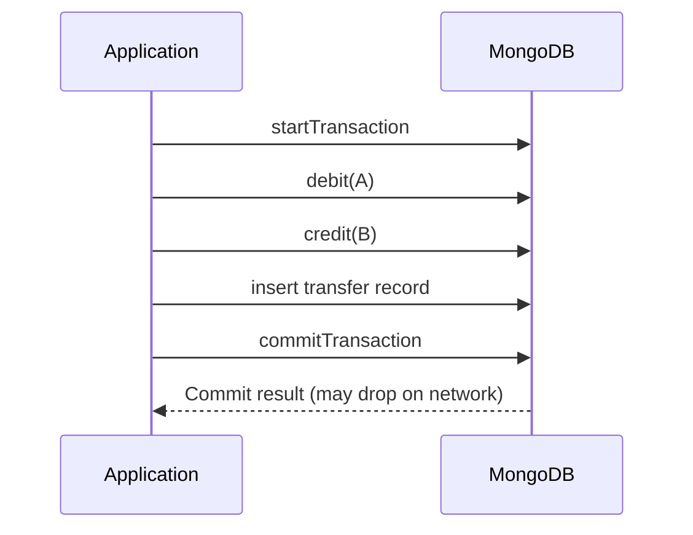
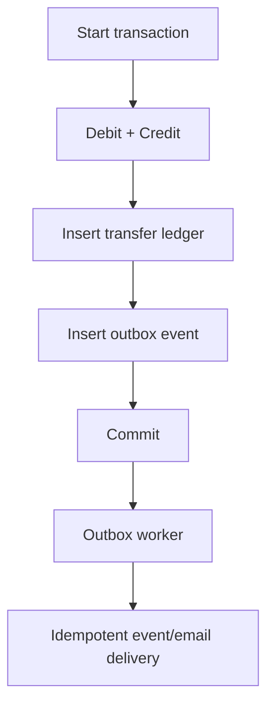

# Verifying Data Integrity When Transactions Fail or Applications Lose Connection in MongoDB

> **Module:** Database Engine Document MongoDB  
> **Chapter:** Transactions

## 1. Real-World Problem: The App Returned an Error—Was Data Half-Written?

An e-wallet service uses MongoDB to store two accounts:

```javascript
{
  _id: "A",
  owner: "alice",
  balanceCents: NumberLong("100000")
}
{
  _id: "B",
  owner: "bob",
  balanceCents: NumberLong("50000")
}
```

A user requests transferring **20,000 minor currency units** from A to B. The operation involves at least three data writes:

1. Deduct 20,000 from A.
2. Add 20,000 to B.
3. Insert a transfer record with a unique `transferId`.

If executed as three independent commands without a multi-document transaction, the application could disconnect after step 1. The result: A loses money while B receives nothing, violating the invariant of an internal transfer.

MongoDB supports **multi-document transactions** so changes commit or abort as a unit. Yet another question remains: **when a client times out or loses connection during commit, does the client know whether the transaction succeeded?**

Separate three concepts:

- **Data atomicity:** MongoDB guarantees writes inside a transaction commit together or do not commit per supported semantics.
- **Client-observed outcome:** the client may receive success, a deterministic failure, or an **unknown commit outcome**.
- **Business correctness on retry:** the application must never transfer money twice by processing one timed-out request twice.

This lesson explains how to **verify and recover data integrity** across all three cases using transactions, idempotency keys, invariant checks, consistent reads, error-label handling, logging, and reconciliation.

After this lesson, you will be able to:

1. Distinguish **confirmed aborts** from **unknown commit results**.
2. Understand `TransientTransactionError` and `UnknownTransactionCommitResult`.
3. Explain why losing connection after sending `commitTransaction` **does not mean rollback**.
4. Design transactions with balance predicates and deduplicating business records.
5. Use `mongosh` and the MongoDB Java Sync Driver to test commits/aborts in a lab.
6. Verify balances via an appropriate snapshot read rather than reading multiple documents at different instants and drawing wrong conclusions.
7. Choose the right strategy between transaction retry and commit retry.
8. Distinguish MongoDB atomicity from business-level exactly-once execution.
9. Verify system state after timeouts, failovers, or service restarts.
10. Build an investigation runbook for a transaction with an undetermined outcome.

## 2. Define Integrity Before Writing Code

You cannot verify whether state is valid without defining **data invariants**.

For the A → B transfer example, assume:

- Storage uses integer **cents** to avoid binary floating-point money errors.
- Transfers are internal only, with **zero fees** and no external deposits or withdrawals.
- Accounts A and B both exist.
- Transfer amount `amountCents > 0`.
- Negative balances are disallowed.
- Each business request carries a unique `transferId`.
- If a transfer succeeded, exactly one transfer record exists.
- Balance updates and the transfer record commit inside **the same MongoDB transaction**.

A valid transfer must then satisfy:

\[
A_{\text{after}} = A_{\text{before}} - \text{amount}
\]

\[
B_{\text{after}} = B_{\text{before}} + \text{amount}
\]

\[
A_{\text{after}} + B_{\text{after}} = A_{\text{before}} + B_{\text{before}}
\]

Starting from initial values:

```text
Before transfer:
    A = 100000
    B =  50000
    Total = 150000

Transfer 20000 succeeds:
    A =  80000
    B =  70000
    Total = 150000

Transaction aborts:
    A = 100000
    B =  50000
    Total = 150000
```

In this lesson, the total 150,000 is an invariant only for **two sample accounts with no external changes**. Real wallet systems involve multiple transaction types, fees, deposits/withdrawals, refunds, and ledgers; never apply a naive formula across an entire system without a proper accounting model.

### 2.1. Why Is an Unchanged Total Not Enough?

Consider an erroneous state:

```text
A =  60000
B =  90000
Total = 150000
```

The sum still matches, yet **40,000** was transferred instead of 20,000. One request may have executed twice.

Therefore, verify **simultaneously**:

- Total balance per the invariant.
- Individual account balances or permitted deltas.
- The transfer record by `transferId`.
- How many times the business operation applied.
- Consistency between transfer status and balance changes.

**Atomicity does not automatically guarantee idempotency.** Two completely atomic transactions can both execute the same business transfer if deduplication is missing.

## 3. ACID: What Do Transactions Protect?

MongoDB is atomic at the single-document level for eligible write operations. When a group of operations across multiple documents/collections must commit or abort together, use a **multi-document transaction** on a supported deployment.

Four ACID properties:

| Property | Meaning in Example | Key Caveat |
|---|---|---|
| **Atomicity** | Debit A, credit B, and insert transfer commit or abort together | Prevents a *committed* state with only half the transfer |
| **Consistency** | Post-commit data satisfies business constraints | MongoDB does not inherently know “non-negative balance”; code/filters/constraints must enforce it |
| **Isolation** | Concurrent operations observe state per transaction isolation rules | Does not make every business race disappear automatically |
| **Durability** | Committed state persists per write concern and deployment guarantees | Requires understanding majority and rollback risk under weak concerns |

### 3.1. A Transaction Is Not Two Standalone Commands

To protect a transfer, it is insufficient to write:

```javascript
db.accounts.updateOne(
  { _id: "A" },
  { $inc: { balanceCents: -20000 } }
);

db.accounts.updateOne(
  { _id: "B" },
  { $inc: { balanceCents: 20000 } }
);
```

These are two independent operations; one can succeed while the other fails. Issuing them sequentially **does not form a transaction**.

You must open a `ClientSession`, start a transaction, pass the session to every involved operation, and commit or abort properly.

### 3.2. Server Commit Success Does Not Guarantee the Response Reaches the Client

Even after every document commits on the server, the connection can drop before the client receives confirmation. Never equate:

```text
"Application received timeout"
               =
"MongoDB definitely rolled back"
```

That equality is **false**.

## 4. Four Failure Points to Distinguish

Visualize a transaction:



Four scenarios can happen.

### 4.1. Failure Before Starting the Transaction

For instance, validation finds `amountCents <= 0` or a missing account before touching the server. No transaction containing business writes ever ran.

Verification: no state changed from **that request**. If the request might be an external retry of an earlier call, still check `transferId` to prevent duplicate execution.

### 4.2. Failure Mid-Transaction, Before Sending Commit

For instance, debit A runs inside the transaction, then credit B fails or the app decides to abort.

If the transaction **does not commit**, its writes never become committed data. The app should call `abortTransaction()` when possible and close the session.

However, if the connection drops, the client's inability to send abort **does not prove the server freed the transaction instantaneously**. The server uses lifetime/cleanup limits for unfinished transactions; during investigations, inspect server state rather than relying solely on the disconnect.

### 4.3. Error During Commit Where Outcome Is Determined

Certain errors let the driver/server determine the transaction cannot commit per error semantics. Depending on error labels, the operation may require retrying **the whole transaction** or handling a business failure.

No single rule like “catch any `MongoException` and re-run the whole business workflow” is safe in every scenario.

### 4.4. Disconnect or Timeout After Sending Commit: Outcome Unknown

This is the hardest case:

```text
Client                   Network                   MongoDB
  |---- commitTransaction --->|----------------------->|
  |                           |                        |
  |                           |     Server commit OK   |
  |                           |<------ response -------|
  |<------ X packet lost -----|                        |
  |
  +-- Client sees timeout
      yet transaction MAY HAVE COMMITTED
```

Alternatively, the server may not have committed due to another error. **The client lacks enough evidence to conclude success or failure from a timeout alone**.

The MongoDB driver may attach the **`UnknownTransactionCommitResult`** error label to flag an uncertain commit outcome. While preserving valid transaction context, the proper action is retrying **commit of the same transaction**, never immediately re-running debit/credit.

If the process crashed and session context is gone, the app must **reconcile by `transferId` and majority-committed state**, or drive recovery via an appropriate idempotent protocol.

## 5. State Matrix: Server Data vs. Application Observation

| What the App Observes | Possible Server State | Handling Approach |
|---|---|---|
| Validation fails before writes | No business transaction started | Return input error; if a retry, still check idempotency key |
| Transaction callback throws, abort confirmed | Transaction aborted | Return business error; no half-written entries |
| Driver reports `TransientTransactionError` during execution | Transaction must restart per retry mechanics | Retry **entire transaction** within policy; avoid external side effects |
| Commit confirmed successful | Transaction committed per configured write concern | Return success; do not re-run same transfer |
| Commit returns `UnknownTransactionCommitResult` | May have committed or not | Retry **commit of the same transaction** while session/context lasts |
| Client timed out and process restarted | Outcome uncertain to client | Reconcile `transferId`, check invariants, idempotent recovery |
| Transfer record exists yet balances do not match | Possible design bug, out-of-transaction write, or later mutation | Investigate; never manually adjust balances without proof |
| Transfer not visible right after timeout | Insufficient proof of abort, especially if in-flight/unobserved | Wait/reconcile within bounds; guard retries via unique key |

**Key mindset:** Server data state and client knowledge are two separate axes. Atomicity protects data integrity when a transaction resolves; idempotency and recovery handle client uncertainty.

## 6. Prerequisites for Practicing Transactions

Multi-document transactions require a supported MongoDB deployment:

- Replica set (MongoDB 4.0+).
- Sharded cluster (MongoDB 4.2+ with applicable version features/constraints).
- Driver supporting sessions and transactions.
- Account with sufficient privileges on target collections.
- Appropriate read/write concern settings.

The following examples target a **lab replica set or dedicated test environment**. Never run test transfers, database drops, or fault injection on production to test hypotheses.

### 6.1. Why Is Standalone Unsuitable?

A standard standalone `mongod` lacks the replica set mechanisms for multi-document transactions. On a single lab machine, configure it as a **single-node replica set** to study transactions rather than running standalone.

A single-node replica set lets you exercise commit/abort syntax, though it does not reproduce multi-node majorities, replication lag, or production failovers.

### 6.2. Checking Topology

In `mongosh`:

```javascript
printjson(db.hello());
```

On a replica set, you see set name, role, and member details. Write transactions require routing to the primary.

In Atlas, use the cluster and permissions assigned to your test account. Never alter managed deployment replica set configurations via unsupported admin commands.

## 7. Preparing the Lab Dataset

Open `mongosh` connected to an authorized lab replica set:

```bash
mongosh "mongodb://localhost:27101,localhost:27102,localhost:27103/?replicaSet=rsTraining"
```

The URI is an example; substitute your lab's hosts, ports, and replica set name.

Seed data in a dedicated database:

```javascript
const lab = db.getSiblingDB("transaction_integrity_lab");
const accounts = lab.getCollection("accounts");
const transfers = lab.getCollection("transfers");

accounts.insertMany([
  {
    _id: "A",
    owner: "alice",
    balanceCents: NumberLong("100000")
  },
  {
    _id: "B",
    owner: "bob",
    balanceCents: NumberLong("50000")
  }
]);

transfers.createIndex(
  { requestedBy: 1, createdAt: -1 },
  { name: "idx_transfers_requester_date" }
);

printjson(accounts.find().sort({ _id: 1 }).toArray());
```

The default unique index on `transfers._id` protects **one committed record per `transferId`**.

> **Note:** Run the seed script once on a fresh lab collection. Re-running `insertMany()` when A and B already exist triggers a duplicate key error. Never run `dropDatabase()` on a database outside your test environment.

### 7.1. Why Use `NumberLong`?

`NumberLong("100000")` represents a 64-bit BSON integer. For money, a consistent integer/decimal representation avoids binary floating-point rounding drift.

In Java, use `long` or a `Decimal128` strategy aligned with business precision. Guard against arithmetic overflow when sums approach numeric bounds.

### 7.2. Business-Level Deduplication Key

Each new user-initiated transfer gets its own `transferId`, such as:

```javascript
{
  _id: "T-001",
  from: "A",
  to: "B",
  amountCents: NumberLong("20000"),
  state: "APPLIED",
  createdAt: ISODate("2026-11-14T00:00:00Z")
}
```

When an application retries **the same request** after a timeout, it must reuse **the exact same `transferId`**, never generating a new ID.

If retries generate a fresh UUID, the unique index cannot recognize that both requests represent the same transfer.

## 8. Successful Transaction in `mongosh`

We transfer 20,000 from A → B inside one explicit session.

### 8.1. Transaction Code

```javascript
const session = db.getMongo().startSession();
const sdb = session.getDatabase("transaction_integrity_lab");
const sAccounts = sdb.getCollection("accounts");
const sTransfers = sdb.getCollection("transfers");

const transferId = "T-001";
const amountCents = NumberLong("20000");

try {
  session.startTransaction({
    readConcern: { level: "snapshot" },
    writeConcern: { w: "majority" },
    readPreference: { mode: "primary" }
  });

  sTransfers.insertOne({
    _id: transferId,
    from: "A",
    to: "B",
    amountCents: amountCents,
    state: "APPLIED",
    createdAt: new Date()
  });

  const debit = sAccounts.updateOne(
    {
      _id: "A",
      balanceCents: { $gte: amountCents }
    },
    {
      $inc: { balanceCents: NumberLong("-20000") }
    }
  );

  if (debit.matchedCount !== 1) {
    throw new Error("Source account missing or insufficient funds");
  }

  const credit = sAccounts.updateOne(
    { _id: "B" },
    { $inc: { balanceCents: amountCents } }
  );

  if (credit.matchedCount !== 1) {
    throw new Error("Destination account missing");
  }

  session.commitTransaction();
  print("Transaction commit acknowledged.");
} catch (e) {
  // Didactic example: if an error occurred near/at commit,
  // never conclude definite abort from catch alone.
  print("Transaction requires classification: " + e.message);

  try {
    session.abortTransaction();
  } catch (abortError) {
    print("Abort also needs interpretation: " + abortError.message);
  }

  throw e;
} finally {
  session.endSession();
}
```

This example demonstrates the **happy path** and best-effort aborting. The `catch` block **is not a complete production handler** for unknown commit errors: once `commitTransaction()` was sent to the server and its outcome is unknown, calling abort afterward does not turn it into a rollback. Proper error-label handling and retries appear in later sections.

### 8.2. Expected Outcome

Once commit is acknowledged:

```javascript
printjson(
  lab.accounts.find().sort({ _id: 1 }).toArray()
);

printjson(
  lab.transfers.findOne({ _id: "T-001" })
);
```

Balances:

```text
A =  80000
B =  70000
Total = 150000
transfer T-001 = APPLIED
```

All three updates belonged to the same transaction. Once committed, the collection must never expose a committed state of “A debited while B was not credited”.

### 8.3. Why Insert the Transfer Record in the Same Transaction?

If you insert the transfer record **after** commit:

```text
Transaction debit A + credit B → commit succeeds
Application crashes before inserting transfer record
```

Upon restart, the app finds no `transferId`, assumes the transfer never happened, and debits/credits again.

Putting the **transfer record and balance updates in the same transaction** gives them a shared commit/abort fate, forming a solid foundation for idempotent recovery.

## 9. Post-Commit Verification: Never Read Only One Account

A weak check:

```javascript
printjson(lab.accounts.findOne({ _id: "A" }));
```

Seeing A at 80,000 only proves A changed at that read instant. You know nothing about B, the transfer record, or concurrent changes.

Minimum verification must ask:

1. Did A decrease by the exact amount?
2. Did B increase by the exact amount?
3. Was the pre/post total conserved?
4. Is there exactly one `transferId` in the ledger?
5. Do the transfer record's `from`/`to`/`amount` match?
6. Did the verification reads use an appropriate consistency level?

### 9.1. Lab Case Without Concurrent Writes

When you are certain only one transaction ran, reading documents sequentially after commit and comparing numbers works as a simple confirmation exercise—**it does not prove a reconciliation design is safe under concurrent production writes**.

### 9.2. Under Concurrent Writes, Use a Consistent Snapshot

If you read A and then B in separate queries while other transfers keep committing, the two balances can belong to **two different points in time**.

Example:

```text
T1: read A = 80000
T2: another transfer A→B of 10000 commits
T3: read B = 80000

Sum A(T1) + B(T3) = 160000 → false alarm
```

In reality, no transaction ever produced a sum of 160,000; the verification mixed readings from different snapshots.

To verify cross-document invariants in a live write-heavy system, use a **read-only transaction with `readConcern: "snapshot"`** (where supported and appropriate) or an equivalent snapshot/cutoff mechanism. Keep snapshot scope and duration tight to avoid resource strain.

### 9.3. Snapshot Read Example in `mongosh`

```javascript
const readSession = db.getMongo().startSession();
const readDb = readSession.getDatabase("transaction_integrity_lab");

try {
  readSession.startTransaction({
    readConcern: { level: "snapshot" },
    writeConcern: { w: "majority" },
    readPreference: { mode: "primary" }
  });

  const pair = readDb.accounts.find({
    _id: { $in: ["A", "B"] }
  }).sort({ _id: 1 }).toArray();

  const transfer = readDb.transfers.findOne({ _id: "T-001" });

  printjson({ pair, transfer });

  readSession.commitTransaction();
} catch (e) {
  try {
    readSession.abortTransaction();
  } catch (_) {}

  throw e;
} finally {
  readSession.endSession();
}
```

Here A and B are observed inside one snapshot read transaction. Still, **snapshots do not replace business accounting**: if A and B also receive other valid transaction types, your invariant formula must account for those flows.

## 10. Verifying an Intentionally Aborted Transaction

This is a safe way to simulate failure in a lab: make updates, explicitly abort, and inspect state outside the transaction.

### 10.1. Perform Changes and Abort

Assuming T-001 already succeeded, attempt another transfer T-002 without **committing**:

```javascript
const session = db.getMongo().startSession();
const sdb = session.getDatabase("transaction_integrity_lab");

try {
  session.startTransaction({
    readConcern: { level: "snapshot" },
    writeConcern: { w: "majority" }
  });

  sdb.accounts.updateOne(
    { _id: "A", balanceCents: { $gte: NumberLong("10000") } },
    { $inc: { balanceCents: NumberLong("-10000") } }
  );

  sdb.accounts.updateOne(
    { _id: "B" },
    { $inc: { balanceCents: NumberLong("10000") } }
  );

  sdb.transfers.insertOne({
    _id: "T-002",
    from: "A",
    to: "B",
    amountCents: NumberLong("10000"),
    state: "APPLIED",
    createdAt: new Date()
  });

  // Intentionally abort to simulate an uncommitted transaction.
  session.abortTransaction();
  print("T-002 aborted intentionally.");
} finally {
  session.endSession();
}
```

There is no `commitTransaction()` call here. Confirming the abort verifies atomicity in a simple lab setting.

### 10.2. Verify After Abort

```javascript
printjson(
  lab.accounts.find().sort({ _id: 1 }).toArray()
);

printjson(
  lab.transfers.findOne({ _id: "T-002" })
);
```

If only T-001 had previously succeeded:

```text
A = 80000
B = 70000
T-002 does not exist in transfer ledger
```

T-002's provisional changes were discarded. Executing an update **inside a transaction** does not make it committed data.

**Do not confuse** this with losing connection after sending commit: in that case, missing a response never proves an abort.

## 11. Business Errors vs. Infrastructure Errors: Handle Differently

Not every exception inside a transaction should be retried.

### 11.1. Deterministic Business Errors

Examples:

- A has insufficient funds.
- Account B does not exist.
- Amount is zero or negative.
- `transferId` was already processed with a different payload.
- Caller lacks permission to transfer.

These are application rule rejections. Never infinitely retry an insufficient-funds request; abort and return a clear rejection.

### 11.2. Transient Errors

Examples:

- Write conflict with another transaction.
- Primary changed during execution.
- Certain network/server errors carrying appropriate labels.

MongoDB drivers may attach **`TransientTransactionError`** to the exception. Depending on operation and phase, the driver indicates you can retry **the entire transaction**.

### 11.3. Unknown Commit Errors

Examples:

- Server committed, yet the response was lost.
- Network timeout right around commit.
- Commit acknowledgment not received per protocol.

Drivers may attach **`UnknownTransactionCommitResult`**. Handling differs: **retry commit for the same transaction**, rather than immediately re-running the updates.

### 11.4. Quick Decision Table

| Error Type | Meaning | Usual Action |
|---|---|---|
| Insufficient funds | Business precondition failed | Abort; never retry as if it were a network glitch |
| Duplicate `transferId` | Request may already be applied or ID reused | Reconcile ledger/payload; never blindly write again |
| `TransientTransactionError` in body | Transaction hit retryable transient fault | Retry transaction body under bounded policy |
| `UnknownTransactionCommitResult` at commit | Client does not know commit outcome | Retry **commit of same transaction** if context remains |
| Client process crash | Prior execution loop gone | Recover via idempotency key and authoritative state query |
| Majority unavailable | Commits/reads may block or time out | Monitor topology; never drop concerns recklessly |
| Transaction lifetime exceeded | Transaction stayed open too long | Shrink transaction scope; investigate locks/resources |
| Unique index violation | Data/business key conflict | Classify genuine duplicate; never retry infinitely |

**Note:** Not every error carries one of these two labels. Some are identified via codes, server state, or driver contracts. Write error handlers using driver APIs and version docs rather than matching substrings like `"timeout"`.

## 12. `TransientTransactionError`: Retry the Entire Transaction

When a transient fault happens **before commit resolves**, the transaction may need to restart from the beginning.

Illustration:

```text
Attempt #1
    startTransaction
    insert transfer
    debit A
    write conflict
    abort / transaction failed

Attempt #2
    startTransaction
    insert transfer
    debit A
    credit B
    commit
```

Because Attempt #1 did not commit, Attempt #2 can safely re-run **if the callback contains only retry-safe operations with no external side effects**.

### 12.1. Why Can the Body Run Multiple Times?

Drivers offering callback transaction APIs implement built-in retries for retryable errors. That means code inside the callback can execute multiple times for a single business request.

Never write:

```java
session.withTransaction(() -> {
    accounts.updateOne(session, debitFilter, debitUpdate);
    emailService.sendTransferSucceededEmail(); // Unsafe!
    accounts.updateOne(session, creditFilter, creditUpdate);
    return null;
});
```

If the body retries after sending the email, the user gets duplicate emails—or a success email even when the transaction ultimately fails.

**Rule:** Keep non-rollbackable side effects like sending emails, charging external payment gateways, or publishing external events **out of retryable transaction callbacks**.

### 12.2. Transactional Outbox

A solid design:

1. Inside the transaction, update accounts.
2. Inside the same transaction, insert the transfer ledger entry.
3. Inside the same transaction, insert an outbox event with a unique ID.
4. Commit.
5. An out-of-transaction worker reads committed outbox entries and dispatches notifications or events.
6. The worker tracks progress with its own deduplication/idempotency.



An outbox binds event-emission intent atomically to committed DB state. It does not automatically provide exactly-once delivery in external systems; consumers/senders still need deduplication.

## 13. `UnknownTransactionCommitResult`: Retry Commit, Never Blindly Re-Run Business Logic

A transaction whose commit hit a network error could be in one of three states:

- Already committed successfully.
- Did not commit.
- Outcome currently indeterminable by the client.

Dangerous action:

```text
commit timeout
    ↓
Generate a NEW transferId
    ↓
Debit A a second time
```

If the first attempt actually committed, this creates a double transfer.

### 13.1. While Session and Transaction Context Remain Valid

When the driver reports `UnknownTransactionCommitResult` in a supported scenario, standard handling is retrying **`commitTransaction` of that exact transaction**.

Retrying commit of the same transaction differs from starting a new transaction and repeating debit/credit. Driver and server track transaction identity within the logical session to handle commit retries properly.

### 13.2. When the Process Crashed or Session Context Is Lost

If the process died, the original callback stack and `ClientSession` are gone:

1. Keep the request's `transferId` unchanged.
2. Never assume failure just because the client missed a response.
3. Read the transfer ledger with an appropriate read concern.
4. If an `APPLIED` record exists with a matching payload, treat the request as **already completed** and do not debit again.
5. If absent, do not immediately declare “never committed” if an attempt might still be in flight or reads lack sufficient consistency.
6. Drive recovery/retries under a controlled **idempotency protocol** (unique ID, duplicate handling, single-worker ownership per request).
7. Reconcile balances and events against committed records.

### 13.3. Why Is “`findOne` Didn't Find the Transfer” Not Absolute Proof?

There is a timing window:

```text
T1: client sends commit
T2: client loses connection
T3: recovery service queries ledger
T4: old transaction finishes committing
```

At T3, not seeing the record does not guarantee the transaction will not commit at T4. Therefore, **never generate a new `transferId`** and avoid unguarded retries.

Using a unique `transferId` forces competing attempts to contend on one key; once one attempt commits, a second attempt cannot commit under that same key per unique index semantics, provided every path respects the full transaction boundary.

## 14. Java Sync Driver: Using `withTransaction()`

The MongoDB Java Sync Driver provides the `ClientSession.withTransaction()` callback API to coordinate start/commit/abort and retry eligible transaction errors per driver capabilities.

The example below uses:

- `accounts` and `transfers` collections.
- `transferId` as the transfer's `_id`, guarded by the default unique index.
- One transaction inserting the transfer record, debiting A, and crediting B.
- `readConcern: snapshot` and `writeConcern: majority`.
- `primary` read preference.

### 14.1. Complete Java Example

```java
import com.mongodb.ReadConcern;
import com.mongodb.ReadPreference;
import com.mongodb.TransactionOptions;
import com.mongodb.WriteConcern;
import com.mongodb.client.ClientSession;
import com.mongodb.client.MongoClient;
import com.mongodb.client.MongoClients;
import com.mongodb.client.MongoCollection;
import com.mongodb.client.MongoDatabase;
import com.mongodb.client.result.UpdateResult;
import org.bson.Document;

import java.time.Instant;
import java.util.Date;

import static com.mongodb.client.model.Filters.and;
import static com.mongodb.client.model.Filters.eq;
import static com.mongodb.client.model.Filters.gte;
import static com.mongodb.client.model.Updates.inc;

public final class TransferTransactionExample {

    public static void main(String[] args) {
        String uri = System.getenv("MONGODB_URI");
        if (uri == null || uri.isBlank()) {
            throw new IllegalArgumentException("MONGODB_URI is required");
        }

        String transferId = "T-JAVA-001";
        String fromId = "A";
        String toId = "B";
        long amount = 20000L;

        if (amount <= 0 || fromId.equals(toId)) {
            throw new IllegalArgumentException("Invalid transfer");
        }

        try (MongoClient client = MongoClients.create(uri)) {
            MongoDatabase database =
                    client.getDatabase("transaction_integrity_lab");

            MongoCollection<Document> accounts =
                    database.getCollection("accounts");

            MongoCollection<Document> transfers =
                    database.getCollection("transfers");

            TransactionOptions options = TransactionOptions.builder()
                    .readPreference(ReadPreference.primary())
                    .readConcern(ReadConcern.SNAPSHOT)
                    .writeConcern(WriteConcern.MAJORITY)
                    .build();

            try (ClientSession session = client.startSession()) {
                session.withTransaction(() -> {
                    // Unique _id prevents the same transferId from committing twice.
                    transfers.insertOne(
                            session,
                            new Document("_id", transferId)
                                    .append("from", fromId)
                                    .append("to", toId)
                                    .append("amountCents", amount)
                                    .append("state", "APPLIED")
                                    .append("createdAt",
                                            Date.from(Instant.now()))
                    );

                    UpdateResult debit = accounts.updateOne(
                            session,
                            and(
                                    eq("_id", fromId),
                                    gte("balanceCents", amount)
                            ),
                            inc("balanceCents", -amount)
                    );

                    if (debit.getMatchedCount() != 1) {
                        throw new IllegalStateException(
                                "Insufficient funds or source missing"
                        );
                    }

                    UpdateResult credit = accounts.updateOne(
                            session,
                            eq("_id", toId),
                            inc("balanceCents", amount)
                    );

                    if (credit.getMatchedCount() != 1) {
                        throw new IllegalStateException(
                                "Destination account missing"
                        );
                    }

                    return null;
                }, options);
            }

            System.out.println(
                    "Transfer commit was acknowledged: " + transferId
            );
        }
    }
}
```

**Important:** Initial lab data had A=100000 and B=50000. If T-001 succeeded earlier and you then run T-JAVA-001, balances change **again** because this is a different business transfer. Do not run both examples and still expect balances to remain 80000/70000.

### 14.2. At What Level Do Transaction Options Apply?

`readConcern: SNAPSHOT` sets transaction read semantics where supported. `writeConcern: MAJORITY` applies at **transaction commit**; do not configure separate write concerns on individual updates inside the transaction.

Operations inside the callback must pass **the same `ClientSession`**. Omitting `session` on one operation:

```java
// CRITICAL TRANSACTION BOUNDARY BUG:
accounts.updateOne(eq("_id", fromId), inc("balanceCents", -amount));
```

executes that operation outside the open transaction, allowing it to commit independently and breaking multi-document atomicity.

### 14.3. Why Check `matchedCount`?

In the debit example:

```java
gte("balanceCents", amount)
```

prevents negative balances when funds are short. Then:

```java
if (debit.getMatchedCount() != 1) {
    throw new IllegalStateException(...);
}
```

If the account is missing or underfunded, the transaction body throws and never proceeds to commit. This expresses business constraints directly in the update predicate.

**Concurrency note:** If another transaction modifies the account concurrently, MongoDB can detect a write conflict, fail the attempt, and retry per error labels. Combine conditional filters, transactions, and retry policies instead of reading balances outside the transaction and subtracting from stale values.

### 14.4. `withTransaction()` Does Not Solve Every Scenario Automatically

Even though the callback API handles driver-defined retries, the application must still address:

- Idempotency across HTTP requests and business retries.
- Handling duplicate `transferId` collisions.
- Timeouts at API, load balancer, or message queue layers.
- Application crashes after commit and before returning the user response.
- Side effects outside MongoDB.
- Non-retryable errors or exhausted retry budgets.
- Transaction resource and lifetime limits.
- Verification, reconciliation, and alerts when invariants break.

Never treat `withTransaction()` as a blanket guarantee of “exactly-once transfers across all crash scenarios”.

## 15. Classifying MongoDB Errors in Java

MongoDB exceptions expose **error labels**. Classify by label rather than matching exception message strings.

Example helper:

```java
import com.mongodb.MongoException;

public final class TransactionErrorLabels {
    public static void describe(MongoException error) {
        if (error.hasErrorLabel(
                MongoException.UNKNOWN_TRANSACTION_COMMIT_RESULT_LABEL)) {
            System.err.println("Commit result is uncertain.");
        }

        if (error.hasErrorLabel(
                MongoException.TRANSIENT_TRANSACTION_ERROR_LABEL)) {
            System.err.println("Transaction may be retried.");
        }
    }
}
```

Constant names and APIs can vary across driver versions; match your deployed dependency version and official docs. Where a constant is absent in a specific version, drivers also support string-based label checks such as `hasErrorLabel("UnknownTransactionCommitResult")`.

### 15.1. Error Interpretation Table

| Error Label | Typical Phase | Guidance |
|---|---|---|
| `TransientTransactionError` | Inside transaction body or cases needing full restart | Controlled retry of the entire transaction |
| `UnknownTransactionCommitResult` | Commit outcome uncertain | Retry commit of the same transaction; do not immediately restart debit/credit |
| Neither label present | Business rejection, duplicate key, resource limit, configuration, or other | Inspect error code/exception and operation rules before deciding |

Never turn error labels into “if any label is present, loop forever”. Enforce retry limits, latency monitoring, circuit breakers where appropriate, and escalation for persistent errors.

### 15.2. When Must You Implement Retries Manually?

If you use the **core transaction API** (`startTransaction()`, `commitTransaction()`, `abortTransaction()`) directly, you generally must build transaction/commit retry loops per driver rules.

If you use the **`withTransaction()` callback API**, the driver handles supported retries. Never wrap the callback in an unbounded outer business retry loop without an idempotency key.

Application-level retries may still be needed for orchestration faults, provided you distinguish:

- Retrying a commit operation on the same transaction.
- Retrying an uncommitted transaction attempt.
- Retrying a **business request** when you do not know whether the prior attempt committed.

Each of the three has distinct boundaries and safeguards.

## 16. Verifying Behavior When the App Crashes Before Commit

Suppose:

```text
T1: startTransaction
T2: debit A
T3: credit B
T4: insert transfer T-003
T5: process crashes — commit never sent
```

Under transaction semantics, without a successful commit, these writes never become committed data. Still:

- The server may keep the transaction open briefly until cleanup/timeout/abort triggers.
- The dead client cannot reliably send abort.
- The server resolves the transaction's fate.
- Recovery processes must not guess state just because “the last logged line was insert”.

**In a lab**, simulate this path using `abortTransaction()` rather than actually killing servers; it tests atomic abort deterministically and safely.

### 16.1. What to Check After a Crash?

1. Replica set health and primary status.
2. Whether a committed transfer record exists for that `transferId`.
3. Balances and related invariants using a proper snapshot read.
4. Application logs: had the attempt entered the commit step or not?
5. Server logs and transaction metrics if needed; never assume logs alone reconstruct every state.
6. Whether any retry worker is concurrently processing the same `transferId`.
7. Whether any event/outbox record committed.

Never treat an application log written **before commit** as final proof. That log only shows the application **attempted** the step.

## 17. Verifying Behavior When the App Crashes During/After Commit

This is the most critical recovery flow.

### 17.1. Never Return “Transaction Failed” Immediately on Timeout

If the client loses connection during commit, an honest response might say:

```text
Request received. Transaction outcome is being verified.
Transaction ID: T-004.
```

Never report definite “failed” without proof of rollback/abort, nor definite “succeeded” until commit is confirmed.

### 17.2. Recovery by `transferId`

A recovery worker can:

1. Take `transferId` T-004.
2. Read the transfer record with an appropriate read concern (usually `majority`) from an authoritative source.
3. If `state: "APPLIED"` exists with matching payload, treat the operation as completed and return an idempotent success.
4. If it exists with a different payload, return an **idempotency key conflict** error.
5. If absent, assess whether an attempt might still be in flight or late-committing; coordinate retries per protocol.
6. When starting a new attempt, reuse **T-004**—never issue T-005 for the same request.
7. Reconcile balances and transfer records to catch discrepancies.

### 17.3. Why Is a Unique Key Crucial?

Suppose the original attempt is committing T-004 while a recovery worker launches a new transaction also inserting T-004.

With a unique index on `transfers._id`, two transactions cannot both commit valid T-004 records under the same key. Provided every transaction **always writes T-004 together with debit/credit**, the unique key prevents one business request from producing two committed transfers.

Mandatory conditions:

- Every transfer code path shares the same invariant and transaction boundary.
- No code path writes debit/credit **outside a transaction**.
- Retries for the same request always keep the same `transferId`.
- When `transferId` exists, verify the payload rather than checking mere presence.
- Interpret duplicate keys as reconciliation signals, never as reasons to invent a new ID.

### 17.4. A “Not Found” Status May Still Require Waiting

Right after a timeout, the server/replica set may still be resolving commit. A single read returning nothing is insufficient proof that the previous attempt never committed.

A production recovery protocol combines:

- Time-bounded request state and worker ownership.
- Single-worker processing per business request ID.
- Result polling timeouts and backoff retries.
- Unique constraints blocking double commits.
- Majority reads during reconciliation.
- Fallback for lingering unknowns: keep waiting or escalate for manual review.

No single `findOne()` call solves every network partition edge case.

## 18. Consistent Reads During Reconciliation

Reading individual collections or accounts at separate instants can assemble a combination of values that **never existed** as a global committed state.

### 18.1. Pitfall: Verifying Across Disconnected Reads

```javascript
const a = lab.accounts.findOne({ _id: "A" });
const b = lab.accounts.findOne({ _id: "B" });
const t = lab.transfers.findOne({ _id: "T-004" });
```

If concurrent transfers keep running, these three queries observe three different points in time. Summing them can trigger a false alarm.

### 18.2. Better: Snapshot Read Transaction

Use a read session/transaction:

```javascript
const session = db.getMongo().startSession();
const sdb = session.getDatabase("transaction_integrity_lab");

try {
  session.startTransaction({
    readConcern: { level: "snapshot" },
    writeConcern: { w: "majority" }
  });

  const a = sdb.accounts.findOne({ _id: "A" });
  const b = sdb.accounts.findOne({ _id: "B" });
  const t = sdb.transfers.findOne({ _id: "T-004" });

  printjson({ a, b, transfer: t });

  session.commitTransaction();
} finally {
  session.endSession();
}
```

This shows the happy path for consistent reads. Production code still needs exception handling and aborting on error branches.

Snapshot read concern provides a consistent view per supported semantics. When guaranteeing a snapshot of majority-committed data, account for write concern/transaction commit rules and MongoDB prerequisites.

### 18.3. When Is a Majority Read Alone Enough?

If you only need to verify one transfer record after commit without correlating multiple documents into one invariant, `readConcern: "majority"` may suffice.

When summing across multiple documents amid concurrent writes, snapshot/cutoff reads are far safer. Match consistency strength to the invariant being verified.

### 18.4. Watch Out for Sharded Clusters

In sharded deployments, transactions can span multiple shards. Out-of-transaction reads with weak concerns may observe changes becoming visible at slightly different times across shards; never expect separate `local` reads to see a single cluster-wide instant.

If business logic needs global snapshot reconciliation, use supported snapshot read concerns/mechanisms and respect version/topology constraints.

## 19. Transactions Are Atomic, Yet Applications Can Still Break Invariants

A transaction commits writes synchronously together, but does not inherently know which business rules are valid.

### 19.1. Missing Balance Condition

Example:

```javascript
db.accounts.updateOne(
  { _id: "A" },
  { $inc: { balanceCents: NumberLong("-200000") } }
);
```

If A holds only 100,000, this makes the balance negative without validation/filtering. Running inside a transaction does not make it “wrong and auto-rolled-back”; MongoDB commits it if code throws no error and no DB constraint fails.

Always include a filter such as:

```javascript
{
  _id: "A",
  balanceCents: { $gte: NumberLong("200000") }
}
```

and inspect `matchedCount`.

### 19.2. Missing Destination

If updating B matches zero documents yet code proceeds to commit, A gets debited without crediting B—**even though the transaction remained atomic** for the writes that actually matched.

Atomicity ensures executed writes commit together; it does not ensure every intended write found a target document. Checking `matchedCount` at every step is mandatory.

### 19.3. Logic Outside the Transaction

If the audit record writes outside the transaction while debit/credit run inside, an abort can leave an audit entry reading “transfer succeeded” when no money moved—or vice versa.

List every document and collection participating in the invariant, then verify **every write needing atomicity shares the same session** inside the right transaction boundary.

### 19.4. Separate Transactions Can Still Violate Business Rules

Suppose two requests carry different `transferId` values despite being retries of one user action. Each transaction is atomic, yet two transfers still execute.

A stable idempotency key from the originating request is required alongside ACID.

## 20. Transaction Retries Can Duplicate External Side Effects

This is a classic trap when spanning multiple systems:

```text
MongoDB transaction body:
    debit A
    call Payment Provider
    credit B
    send email
    commit MongoDB
```

If the body must retry, the Payment Provider call and email can execute again even though the first MongoDB transaction attempt aborted.

**A MongoDB transaction cannot roll back an action already executed on an external service** without a separate distributed protocol.

Alternatives:

- **Transactional outbox:** write event inside transaction, worker publishes post-commit.
- **Provider idempotency keys:** external provider receives the same key for the same request.
- **Saga/compensation:** when atomic transactions across systems are impossible, design explicit steps and compensating actions.
- **State machine:** transition strictly through `PENDING / APPLIED / FAILED / REVIEW_REQUIRED`.
- **Reconciliation:** verify consistency across database, provider, and ledger.

Never promise end-to-end exactly-once simply by wrapping MongoDB writes in `withTransaction()`.

## 21. Audit and Ledger: Stronger Proof Than an HTTP Response

Financial systems need an authoritative audit trail, such as a transfer ledger containing:

```javascript
{
  _id: "T-100",
  requestedBy: "user-42",
  from: "A",
  to: "B",
  amountCents: NumberLong("20000"),
  state: "APPLIED",
  createdAt: ISODate("2026-11-14T00:00:00Z"),
  requestHash: "hash-of-canonical-business-payload"
}
```

Purpose:

- `_id` acts as the idempotency key.
- `from`/`to`/`amountCents` capture business parameters.
- `requestHash` detects key reuse with altered payloads.
- `state` and timestamps support traceability.
- The transaction ensures `APPLIED` never appears independently of the balance updates it describes.

**Never write `state: "APPLIED"` in one collection outside the transaction and update balances in another transaction** if you plan to treat that state as proof the commit happened.

### 21.1. Append-Only Ledgers and Derived Balances

Advanced systems may use an immutable append-only ledger and derive balances from journal entries. There, the invariant might be “sum of debits and credits across entries equals zero” with balance caches reconciled against the ledger.

Though architecturally different from two balance fields, the verification principles remain identical:

1. Define the source of truth.
2. Record coupled entries atomically within supported boundaries.
3. Enforce idempotency keys.
4. On unknown commit outcomes, inspect committed entries.
5. Periodically reconcile caches and derived state.

Never rely solely on a mutable balance table as accounting proof when strict auditability is required without a trustworthy ledger.

### 21.2. Never Manually Patch Balances Simply Because of a Timeout

When the UI reports a timeout, an operator running:

```javascript
// DO NOT do this before verifying whether the transaction committed:
db.accounts.updateOne(
  { _id: "A" },
  { $inc: { balanceCents: NumberLong("20000") } }
);
```

can introduce a brand-new bug: if the original transaction aborted, this adds free money; if it committed and B received funds, “reverting” only one side breaks the invariant.

Recovery must rely on committed records, audit trails, business rules, and dedicated audited adjustment entries—never intuition from HTTP errors.

## 22. Observing In-Flight Transaction State

When investigating a stalled or slow transaction, DBAs/SREs inspect:

- `db.currentOp()` or `$currentOp` within allowed privileges.
- MongoDB server logs.
- Replica set status and replication lag.
- Transaction metrics in `serverStatus()` where supported by version.
- Driver command monitoring with appropriate redaction.
- Application and network latency/timeout metrics.

Example pulling general server stats in a lab:

```javascript
const stats = db.getSiblingDB("admin").serverStatus();

printjson({
  host: stats.host,
  transactions: stats.transactions,
  opcounters: stats.opcounters
});
```

Fields under `transactions` depend on server version. They are operational metrics, **not an API for checking the business outcome of an individual `transferId`**.

### 22.1. Caveat About `currentOp`

A transaction not appearing in `currentOp` at query time does not prove whether it aborted or committed.

Possible reasons:

- The transaction already finished.
- No operation is currently active.
- You queried the wrong node.
- Your account lacks privileges.
- Server/driver state did not match your filter criteria.
- The request finished before you checked.

To establish business truth, reconcile data and the transfer ledger rather than relying solely on active operations.

### 22.2. Preserve Essential Observability Data

Recommended log fields:

| Category | Fields |
|---|---|
| Business | `transferId`, `requestId`, `from`/`to` (masked if sensitive), `amount` |
| Transaction | `attemptNumber`, `phase` (`STARTED` / `BODY` / `COMMITTING` / `DONE`) |
| Driver | exception class, error code, error labels |
| Cluster | cluster ID/host, primary election/version if relevant |
| Timing | start, commit sent, response/timeout, retry count |
| Recovery | ledger check result, snapshot invariant, final classification |
| Audit | operator/process deciding to retry or compensate |

Never log passwords, credentialed URIs, or full personal user payloads unnecessarily.

## 23. Transaction Lifetime and Resources

Transactions pin snapshots and resources while active. Long transactions impact:

- WiredTiger cache and old version retention.
- Lock contention and write conflicts.
- Oplog and storage pressure.
- Replication and checkpoints.
- Timeouts and lifetime limits.
- Latency of peer queries.

MongoDB limits transaction lifespan via parameters like `transactionLifetimeLimitSeconds` on supporting versions. Defaults in many deployments are around one minute, though you should never hardcode assumptions across environments.

### 23.1. Never Call External APIs While Holding a Transaction

Anti-pattern:

```text
start transaction
   ├── update accounts
   ├── HTTP call to external system, waits 20 seconds
   ├── wait for user OTP confirmation
   └── commit
```

Holding resources throughout network/user waits spikes timeout and write-conflict risks.

Instead:

1. Collect and validate business inputs beforehand.
2. Keep the transaction strictly to MongoDB operations needing atomicity.
3. Commit quickly.
4. Execute external side effects via outbox/separate workflows.
5. For multi-step long processes, use a state machine / saga instead of holding a transaction open.

### 23.2. Retries Must Not Create Infinite Loops

If a cluster loses majority or hits a prolonged network partition, continuous retries overload an already degraded cluster.

Retry policies should include:

- Attempt caps or deadlines.
- Exponential backoff with jitter where appropriate.
- True error classification.
- Alerting when errors cross thresholds.
- Recovery via idempotency keys.
- Reporting unknown/pending status to clients when needed.

## 24. Safe Fault Injection in Test Environments

To prove system integrity when transactions fail, run controlled, observable failure tests.

### 24.1. Test 1 — Intentional Abort

- Seed two lab accounts with fixed balances.
- Start transaction, debit, and credit.
- Call `abortTransaction()`.
- Read a snapshot and confirm balances and transfer ledger are unchanged.

This is the foundational atomicity test—no server killing needed.

### 24.2. Test 2 — Business Precondition Failure

- Request transferring 200,000 from A when A has only 100,000.
- Debit filter enforces `balanceCents >= amount`.
- Verify `matchedCount = 0`.
- Throw exception and abort.
- Confirm B did not increase and no `APPLIED` transfer record exists.

### 24.3. Test 3 — Duplicate `transferId`

- Commit transfer T-010 successfully.
- Resend the exact same `transferId` T-010 and payload.
- Unique index blocks a second record.
- Reconcile the existing transfer and return idempotent success without debiting/crediting again.

Distinguish **retrying the same request** from **a brand-new transfer that happens to have identical amounts/accounts**. A new transfer must carry a distinct business ID.

### 24.4. Test 4 — Client Timeout After Commit

In integration tests, inject a simulated failure layer so the application **misses the response** even though the lab transaction committed.

Verification goals:

1. The system retains `transferId`.
2. The response to the client simulates a timeout.
3. The client resends the same `transferId`.
4. The server reconciles against the committed ledger.
5. Balances are not modified a second time.

No need to physically break network cables or kill production primaries. Use a fault-injection framework, fake transport, or authorized test proxy, documenting exactly where the fault was injected.

### 24.5. Test 5 — Failover in a Dedicated Lab

If operating a **multi-node test replica set** with proper permissions:

- Seed data and transaction fixtures.
- Trigger a controlled stepdown/failover per test plan.
- Verify driver label handling and retries.
- Reconcile final state once election completes.
- Confirm unique `transferId` blocked any double transfer.

Never step down primaries, partition networks, or kill `mongod` in production just to practice a lesson.

## 25. Expected Test Outcome Matrix

| Test | Final Data State | Transfer Ledger | Conclusion |
|---|---|---|---|
| T-001 commits successfully | A decreases, B increases by exact amount | T-001 `APPLIED` exactly once | Valid |
| T-002 aborts | A/B unchanged compared to pre-T-002 | No T-002 | Valid |
| Insufficient funds | No debit or credit | No `APPLIED` transfer | Valid |
| Retry same committed `transferId` | No extra debit/credit | Still one record for that ID | Valid |
| Timeout after successful commit | Balances changed once | Record exists | Recovery returns completed result |
| Timeout before commit then abort | Balances unchanged | No record | Recovery handles via idempotent protocol |
| Two independent requests with same ID, different payload | Must not treat as same operation | Payload conflict | Return error / alert |
| Transfer record exists yet only one account changed | Invariant broken or non-snapshot read mix-up | Needs investigation | Must not accept as valid if check fails |

This matrix applies in controlled tests or under consistent snapshot reads. If concurrent business transactions ran alongside, expected balances must account for all valid transactions rather than comparing against initial fixtures blindly.

## 26. Idempotency Protocol for a Transfer Endpoint

An API might accept:

```json
{
  "transferId": "T-101",
  "from": "A",
  "to": "B",
  "amountCents": 20000
}
```

Processing design:

### 26.1. Receiving the Request

- Authenticate user, tenant, and account permissions.
- Validate amount and account IDs.
- Canonicalize payload for comparison on retries.
- Require a stable `transferId` for the same business intent.
- Look up the ledger by `transferId` with appropriate read concern when needed.

### 26.2. If `transferId` Is Already `APPLIED`

- Compare `from`/`to`/`amount`/`requestHash`.
- If matching, return the **already-processed** result.
- If differing, return an error for key reuse with a different payload.
- Never re-run debit/credit.

### 26.3. If No Transfer Record Exists Yet

- Never assume an earlier attempt definitely aborted right after an unknown commit.
- Coordinate request ownership if multiple workers run.
- Run a new transaction with the same `transferId` and unique key.
- If a duplicate key error occurs, **reconcile** the record rather than generating a new ID.
- If commit outcome is unknown, transition to verification/recovery state.

### 26.4. What Should the API Return While Commit Is Unknown?

Return a status representing **`PENDING_VERIFICATION`**, along with `transferId` so the client can query status later.

Example:

```json
{
  "transferId": "T-101",
  "status": "PENDING_VERIFICATION",
  "message": "The transaction outcome is being verified."
}
```

Never immediately return `FAILED` after an uncertain timeout. Instruct clients **not to generate a new `transferId` for the same intent**.

### 26.5. Limits of a Unique Index

A unique `transferId` guards one crucial dimension, yet if another code path skips the transfer record or misuses transaction boundaries, invariants can still break.

Beyond unique constraints, maintain:

- Clear contracts across services.
- Automated tests across all code paths.
- Periodic reconciliation.
- Alerts for discrepancies.
- Audit trails for manual adjustments.
- Runbooks for handling anomalous data.

## 27. Verification via Periodic Reconciliation

A reconciliation job can run on a schedule or upon detecting uncertain outcomes.

Checks to run:

1. **Ledger uniqueness:** no `transferId` appears twice.
2. **Payload consistency:** transfer record matches original source, destination, and amount.
3. **Balance invariant:** total debits/credits balance per accounting rules.
4. **Orphan detection:** `APPLIED` transfer missing corresponding entries, or vice versa.
5. **Pending timeout:** requests stuck in uncertain status too long.
6. **Outbox consistency:** emitted events match committed transactions.
7. **Snapshot consistency:** reconciliation does not mix readings from different instants.
8. **Recovery audit:** every retry/compensation decision is attributable to a process or operator.

### 27.1. Reconciliation Does Not Mean Blindly Auto-Fixing Every Skew

A job detects:

```text
transferId = T-300
ledger = APPLIED
account A debit = 20000
account B credit = 0
```

If confirmed real from a trustworthy snapshot, investigate root cause:

- Did a write bypass the transaction?
- Was a `matchedCount` check missing?
- Did duplicate event handling or faulty compensation run?
- Did an external system mutate the account directly?
- Did a cache serve stale values?

Never blindly credit B by 20,000 just because one report shows a deficit, unless the runbook and source of truth dictate an audited compensating entry.

### 27.2. Anchor Reconciliation to a Consistent Data Point

When reconciling a period with concurrent writes, establish an explicit cutoff/watermark or snapshot.

Reading A at 10:00 and B at 10:01 can raise false alarms even while MongoDB transactions work flawlessly. That is a **verification methodology bug**, not an atomicity failure.

## 28. Consistency Across Replica Sets and Sharded Clusters

### 28.1. Replica Sets

A majority-committed transaction survives failovers more durably than primary-only acknowledgment per deployment semantics.

Still:

- Secondaries can lag.
- `local` reads or reads lacking causal context may be unsuitable for immediate verification.
- Reading documents at separate times does not form a shared snapshot.
- During primary elections, clients may hit timeouts or server selection errors until drivers connect to the new primary.

For verification, pick matching read concerns and topologies. For multi-document verification reads, snapshot transactions are usually far easier to reason about than disconnected queries.

### 28.2. Sharded Clusters

Transactions can span multiple shards; MongoDB coordinates distributed commits per supported mechanics.

Points to weigh:

- Latency and complexity can exceed single-shard transactions.
- Network/shard state changes can raise retryable errors.
- Out-of-transaction reads with weak consistency may see updates across shards at staggered times.
- Limits around DDL, sharding, transaction lifetime, and read/write concerns depend on server version.

Never drop needed transactions just because “cross-shard is slower” when the business requires atomicity; instead evaluate data modeling, shard key locality, and invariant scope.

### 28.3. When Do You Need Consistency Beyond One Transaction?

Multi-document transactions protect writes inside MongoDB. When a business workflow spans external banks, message brokers, Redis caches, or third-party services, use cross-system consistency mechanisms like outboxes, sagas, and reconciliation.

MongoDB cannot roll back a payment already settled by an external payment gateway.

## 29. Dangerous Misconceptions

| Claim | Why It Is Wrong | Correct Thinking |
|---|---|---|
| “The app timed out, so the transaction definitely rolled back” | Commit may have succeeded while the response dropped | Classify unknown outcomes and reconcile |
| “No OK response—just re-run the transfer with a new ID” | Risks transferring money twice | Keep `transferId` and enforce idempotency |
| “A session automatically creates a transaction” | A session is only an execution context | Start a transaction and pass the session |
| “`withTransaction` guarantees everything is exactly-once” | Callbacks can retry; external side effects do not roll back | Use outboxes, deduplication, and idempotency |
| “Atomic `$inc` is enough for transferring between two documents” | Each update is atomic only within one document | Use a multi-document transaction |
| “Writing the transfer record outside the transaction is fine” | Balances can commit without a ledger record | Keep ledger and balances in the same transaction when coupled |
| “Majority commit means every secondary sees it immediately” | Secondaries can lag | Use proper read concern/snapshot/causal mechanisms |
| “Reading A then B forms a snapshot” | Two separate reads can hit two points in time | Use a snapshot read transaction when needed |
| “If a transfer record exists, any payload with that ID is fine” | Could be an ID reuse conflict | Verify payload / request hash |
| “Not seeing the transfer = definitely didn't commit” | Prior commit may still be in flight or unobservable | Coordinate retries, unique keys, and recovery |
| “A transaction automatically prevents negative balances” | Server does not know business rules automatically | Use conditional updates and `matchedCount` checks |
| “All errors retry the exact same way” | Business rejections, transient faults, and unknown commits differ | Classify by error code and labels |
| “Calling abort in catch undoes a committed transaction” | Committed transactions cannot be undone via abort | Resolve commit status and issue audited compensation if needed |
| “Logs saying Started/Commit Sent prove it committed” | Logs only record what the app attempted | Verify commit outcomes and majority-committed data |
| “DB transactions roll back emails/payment APIs” | External systems sit outside MongoDB | Outbox / saga / idempotency |
| “Reconciliation only needs to sum both accounts” | Totals still match even after a duplicate transfer | Check ledger, payloads, and application count too |

## 30. Hands-On Exercises

All exercises use `transaction_integrity_lab` or a fresh lab database. **Never attempt killing primaries, deleting data, or disrupting networks on production.**

### Exercise A — Proper Commit and Invariant Check

1. Seed A=100,000 and B=50,000 in the lab.
2. Record T-A transferring 20,000 from A to B inside a transaction.
3. Commit.
4. Read a snapshot containing A, B, and T-A.
5. Verify A=80,000, B=70,000, total=150,000, and T-A exists.
6. Explain why seeing `matchedCount = 1` on debit alone does not prove the transfer succeeded.

### Exercise B — Mid-Transaction Abort

1. Start transaction T-B.
2. Execute debit on A.
3. Inject an intentional error **before commit**.
4. Call abort.
5. Read balances and ledger.
6. Explain why writes executed inside the transaction do not appear in committed state.

### Exercise C — Missing Destination Account

Suppose A has enough funds, yet account Z does not exist.

- Transaction debits A, then `updateOne()` on Z yields `matchedCount = 0`.
- How should code handle this?
- If code ignores `matchedCount` and commits, is the invariant broken?
- Does MongoDB atomicity automatically treat this as a business error?

### Exercise D — Retry with the Same ID

1. Commit T-C transferring 10,000 from A to B.
2. Resend the request with **the same** T-C.
3. How does the unique index on `transferId` respond?
4. Reconcile the payload and return an idempotent result.
5. Count how many times A was actually debited.

### Exercise E — `UnknownTransactionCommitResult`

Suppose the driver sends commit for T-D, the server commits, yet the response drops.

Answer:

1. Should the client mark T-D failed immediately?
2. If the session remains alive, should it retry **commit** or the entire body?
3. If the process restarted, which record must be inspected?
4. If T-D is not immediately visible, why must you not issue a new ID?
5. Which mechanism guarantees one `transferId` cannot apply twice?

### Exercise F — Snapshots and False Alarms

Given:

```text
T1: A=80000, B=70000
T2: app reads A=80000
T3: another transfer A→B of 10000 commits
T4: app reads B=80000
```

Compute the sum if combining the two separate reads. Why does the check raise a false error? Propose a consistent read approach to reconcile multiple documents while writes continue.

### Exercise G — Error Labels

Explain the differences among:

- `TransientTransactionError`.
- `UnknownTransactionCommitResult`.
- Duplicate key error on `transferId`.
- Insufficient funds.

For each, state whether to retry the full transaction, retry commit, reconcile, or return a business error.

### Exercise H — Outbox

Design post-transfer state transitions involving:

- MongoDB accounts and transfer ledger.
- `TransferApplied` event.
- Email/SMS notification.
- Workers that may restart.
- A message broker that may deliver duplicate events.

Propose a transactional outbox and idempotent consumer. Explain why sending email inside the `withTransaction` callback can produce duplicate notifications.

### Exercise I — Runbook After Connection Loss

An API logs 200 transfer requests timing out during a primary election.

Build a runbook:

1. Gather `requestId`/`transferId`.
2. Separate determined vs. undetermined commit outcomes.
3. Inspect topology, majority, and replication.
4. Reconcile the transfer ledger.
5. Verify invariants via snapshot reads.
6. Retry only under deduplication safeguards.
7. Audit every recovery step.
8. Escalate cases that cannot resolve automatically.
9. Check whether faults affected external providers or outboxes.
10. Report status by ID rather than relying on the initial HTTP timeout.

## 31. Verification Runbook When Transaction Outcomes Are Uncertain

A production-grade procedure can be organized into phases.

### Phase 1 — Incident Intake

- Identify the time window and scope of affected requests.
- Identify the database/cluster and topology.
- Collect `transferId`, `requestId`, and canonicalized payloads.
- Determine whether errors occurred in `BODY`, `COMMIT`, `AFTER_COMMIT`, or unknown phase.
- Collect driver error codes and error labels.
- Never declare failures on requests whose outcomes remain unknown.

### Phase 2 — Stabilize the Platform

- Check primary, majority health, replication lag, and elections.
- Identify network partitions, DNS issues, or application-layer timeouts.
- Never downgrade write concern to force traffic through if the domain requires majority.
- Never let multiple retry workers write the same `transferId` concurrently without coordination.
- Throttle retry load so the cluster can recover.

### Phase 3 — Reconcile Data

- Read the transfer ledger under a consistent read policy.
- Verify payloads and committed statuses.
- Check balance/ledger invariants using matching snapshot/cutoff reads.
- Detect `APPLIED` transfers missing entries or showing skewed balances.
- Separate real write bugs from non-simultaneous read artifacts.

### Phase 4 — Controlled Recovery

- If committed: return idempotent success without re-writing.
- If confirmed uncommitted: retry with the same `transferId` per policy.
- If still unknown: keep pending status and continue backoff reconciliation.
- If genuine discrepancy found: open an incident, establish source of truth, and apply audited adjustment entries per runbook.
- If events/emails are missing: recover from outbox rather than resending unguardedly.

### Phase 5 — Closure

- Record final classification per `transferId`.
- Confirm zero negative balances or duplicate ledger entries per invariants.
- Verify updates appear accurately in dashboards and reconciliation reports.
- Track transaction error, timeout, and unknown-outcome rates.
- Update retry budgets, alerts, and fault-injection tests.
- Perform root-cause analysis (failover, network, session misuse, or out-of-transaction bug).

## 32. Principles to Remember

1. **Atomicity protects committed state**, yet never guarantees the app always receives the commit response.
2. **Losing connection at commit can leave an unknown result**. Never equate timeouts with rollbacks.
3. **`TransientTransactionError` and `UnknownTransactionCommitResult` need different retries**: full transaction vs. commit of the same transaction.
4. **A business request must keep the same idempotency key across retries**; never invent a new ID after a timeout.
5. **Keep the transfer ledger and balance changes in the same transaction** for consistent commit/abort evidence.
6. **A unique index is essential but insufficient** if other code paths bypass the transaction boundary.
7. **Always check `matchedCount` and business invariants**, since transactions do not automatically treat “insufficient funds” or “missing destination” as abort triggers.
8. **Use snapshot reads when verifying multiple documents under concurrent writes**; summing disconnected reads can falsely flag broken invariants.
9. **Commit with an appropriate write concern**, typically `majority` for sensitive data; never downgrade concern just to mask timeouts.
10. **Never perform external side effects inside a retryable transaction callback**. Use outbox/idempotency/sagas when needed.
11. **If a process crashes, recover from committed data and `transferId`**, never solely from application logs.
12. **Reconciliation and auditing are integral to correctness** in financial systems and multi-service workflows.
13. **Never fault-inject production** to learn transaction semantics; use test clusters and controlled fault simulation.
14. **Separate “DB atomic” from “business exactly-once”**. Both must be explicitly designed and tested.

## 33. Official MongoDB Documentation

- [MongoDB Manual – Transactions](https://www.mongodb.com/docs/manual/core/transactions/)
- [MongoDB Manual – Transactions Production Considerations](https://www.mongodb.com/docs/manual/core/transactions-production-consideration/)
- [MongoDB Manual – Transactions and Read/Write Concern](https://www.mongodb.com/docs/manual/core/transactions/#transactions-and-read-concern)
- [MongoDB Manual – Session.startTransaction()](https://www.mongodb.com/docs/manual/reference/method/Session.startTransaction/)
- [MongoDB Manual – Session.commitTransaction()](https://www.mongodb.com/docs/manual/reference/method/Session.commitTransaction/)
- [MongoDB Manual – Session.abortTransaction()](https://www.mongodb.com/docs/manual/reference/method/Session.abortTransaction/)
- [MongoDB Manual – Retry Transactions](https://www.mongodb.com/docs/manual/core/transactions-in-applications/)
- [MongoDB Manual – Retryable Writes](https://www.mongodb.com/docs/manual/core/retryable-writes/)
- [MongoDB Manual – Read Concern "snapshot"](https://www.mongodb.com/docs/manual/reference/read-concern-snapshot/)
- [MongoDB Manual – Write Concern](https://www.mongodb.com/docs/manual/reference/write-concern/)
- [MongoDB Manual – Atomicity and Transactions](https://www.mongodb.com/docs/manual/core/write-operations-atomicity/)
- [MongoDB Java Sync Driver – Transactions](https://www.mongodb.com/docs/drivers/java/sync/current/crud/transactions/)
- [MongoDB Java Sync Driver – Data Consistency](https://www.mongodb.com/docs/drivers/java/sync/current/connection/specify-connection-options/)

**Conclusion:** When a transaction fails or an application loses connection, the crucial question is not just “did the command throw an error?” but **“What data committed, were business invariants preserved, and could retries execute the same request multiple times?”** A reliable design combines atomic transactions, unique idempotency keys, accurate error-label handling, snapshot reads for reconciliation, an outbox for side effects, and recovery procedures for uncertain commit results. That way, network glitches or failovers never silently turn into a second debit or a half-completed state.
