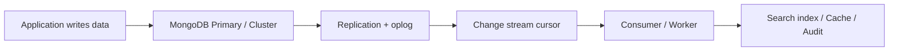
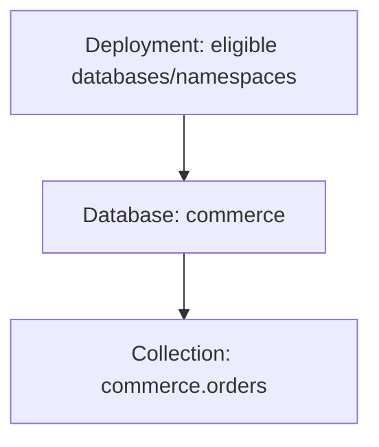
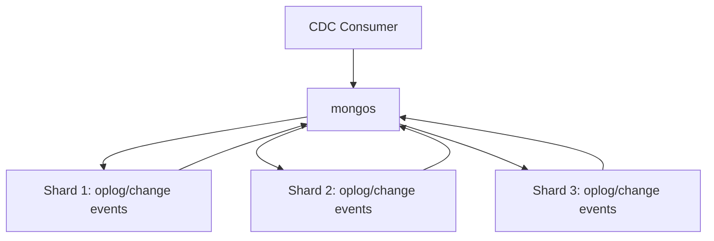

# Watching a Collection, Database, or Deployment by Supported Scope Using Change Streams in MongoDB

> **Module:** Database Engine Document MongoDB  
> **Chapter:** Change stream

## 1. The Problem: Detecting Data Changes Without Continuous Polling

An e-commerce system uses MongoDB to store the following collections:

- `orders`: customer orders.
- `payments`: payment transactions.
- `customers`: customer details.
- `inventory`: stock levels.

When an order transitions from `NEW` to `PAID`, multiple components may need to know:

1. A worker creates a warehouse picking/dispatch slip.
2. A notification service sends a status update.
3. A search service updates the indexed document.
4. A dashboard receives the event to update metrics.
5. An audit system records that a change occurred.

A straightforward approach is to periodically run:

```javascript
db.orders.find({
  updatedAt: { $gt: lastCheckTime }
});
```

However, **polling by updatedAt** has several drawbacks: it generates repeated queries, introduces interval-based latency, easily misses updates if the application forgets to update `updatedAt`, struggles to detect deletes, and gets complicated when timestamps collide or clocks skew.

MongoDB provides **Change Streams** so applications can subscribe to a stream of change events from the database. Instead of repeatedly scanning a collection, the application opens a **change stream cursor** and receives events under MongoDB's supported semantics.

Not every application needs to watch the same scope. There are three common levels:

1. **Collection-level:** watch only a single collection.
2. **Database-level:** watch eligible collections within a single database.
3. **Deployment-level:** watch eligible namespaces across the entire replica set or sharded cluster.

Each level differs in API, access permissions, event scope, and operational impact.

**Lesson goal:** choose the right `watch()` scope, know how to open a stream, filter events, manage tokens, and handle limitations—without mistaking a Change Stream for a message broker that stores events indefinitely.

## 2. What Is a Change Stream?

A Change Stream is a mechanism for reading **changes recorded by MongoDB that are eligible for emission** as event documents.

An illustrative event:

```javascript
{
  _id: { _data: "..." },
  operationType: "insert",
  clusterTime: Timestamp(1794600000, 1),
  ns: {
    db: "commerce",
    coll: "orders"
  },
  documentKey: {
    _id: "O-101"
  },
  fullDocument: {
    _id: "O-101",
    customerId: "C-1",
    status: "NEW",
    totalCents: 120000
  }
}
```

Key fields to remember:

| Field | Meaning |
|---|---|
| `_id` | **Resume token** of the change event; treat it as an opaque value |
| `operationType` | Change type: `insert`, `update`, `replace`, `delete`, or other applicable event types |
| `clusterTime` | Logical timestamp of the event, not a wall-clock time for measuring absolute latency |
| `ns.db` | Database containing the changed namespace |
| `ns.coll` | Collection containing the changed namespace, if the event targets a specific collection |
| `documentKey` | Identifier key of the changed document, typically including `_id` |
| `fullDocument` | Document contents in cases/options supported by MongoDB |
| `updateDescription` | Describes modified fields in an `update` event |

A stream is a **long-lived cursor**: the application opens the cursor and receives events as data changes, waiting when no events are currently available.



This diagram shows only the conceptual flow. In a sharded cluster, MongoDB processes the stream across shards and routing components; it is not simply one consumer reading a single oplog directly.

### 2.1. Change Streams vs. Polling vs. Message Brokers

| Characteristic | Change Stream | Collection Polling | Message Broker |
|---|---|---|---|
| Detection method | Cursor reading MongoDB's change stream | Periodic queries | Publisher pushes events to the broker |
| Detects deletes | Yes, via appropriate events | Requires custom mechanism | Depends on event publisher |
| Infinite history retention | **No** | No | Depends on broker retention |
| Checkpoint | Resume token | Application-designed timestamp/ID | Broker offset/ack |
| Complete business event | Not always | Not always | Possible, if designed by publisher |
| Near real-time integration | Yes | Yes, though often query-heavy | Yes |
| Retry/idempotency handling | Application must still implement | Application must still implement | Consumer must still implement |

A Change Stream tells you **what changed in the database**. It does not automatically turn a technical update into a complete business event like `OrderPaid` unless the application has designed appropriate data or messaging contracts.

## 3. Support Prerequisites: Not Every MongoDB Setup Can Be Watched

### 3.1. Topology

Change Streams are designed for:

- A **replica set** on a MongoDB Server supporting Change Streams.
- A **sharded cluster** under the corresponding supported versions and conditions.
- Managed deployments such as MongoDB Atlas when the active tier/features/configuration support them.

**A standard standalone `mongod` does not support Change Streams the way a replica set does.** On a learning machine, you can start a **single-node replica set** to practice the API, though it does not fully simulate failover and load distribution of a multi-node deployment.

Change Streams are tied to replication history and **majority-committed changes**. Operations that have not yet met the deployment's commit semantics may not yet be emitted to consumers.

### 3.2. Server Version

Key milestones:

- **Collection-level** Change Streams appeared in MongoDB **3.6** on supported topologies.
- **Database-level** and **deployment-level** watching became available in MongoDB **4.0+** subject to version scope and limits.
- Advanced features such as **pre-/post-images**, **expanded DDL events**, or specific resume options require newer server versions.

Thus, `watch()` syntax may look similar across versions, but **the allowed set of operation types and options** is not necessarily identical.

When writing code using `MongoClient.watch()` against an older cluster or special managed deployment, verify your server version documentation and provider capabilities.

### 3.3. Storage, Namespaces, and Other Limitations

Change Streams are not an arbitrary tool for inspecting every internal system detail:

- **Standard views** are not direct change targets like physical collections.
- **System collections** and internal namespaces have specific restrictions.
- Internal databases such as `admin`, `local`, and `config` have restrictions on direct watching or emitted events; do not treat a deployment-level stream as unrestricted access to all internal metadata.
- Special collection types, including time series, have conditions/event sets dependent on MongoDB version.
- Users need the **`changeStream` privilege and appropriate read privileges** on the target resource/scope.
- Some options only take effect when pre-images or corresponding features are enabled.
- A Change Stream cursor can be affected when a collection or database is dropped or renamed.

**This lesson focuses on application data in regular collections** to keep the scope clear. When applying Change Streams to time series, system namespaces, or managed deployments, consult the current documentation for that deployment type.

### 3.4. Preliminary Deployment Checks

In `mongosh`:

```javascript
print("Server version:", db.version());
printjson(db.hello());
```

On a replica set, `hello` typically reports the replica set name and role. For a sharded cluster, connect through `mongos` as supported by the topology. Do not infer that the entire cluster is on the same version from a single member during a rolling upgrade.

For Atlas or managed services, inspect cluster/tier/feature details via the management platform rather than altering internal configuration just to enable watching.

## 4. Three `watch()` Scopes: Comparison Table

We can represent them as three concentric scopes:



| Criterion | Collection-level | Database-level | Deployment-level |
|---|---|---|---|
| `mongosh` | `db.orders.watch()` | `db.watch()` | `db.getMongo().watch()` |
| Java Sync Driver | `MongoCollection.watch()` | `MongoDatabase.watch()` | `MongoClient.watch()` |
| Scope | One selected collection | Eligible collections in one database | Eligible namespaces across the deployment |
| Receives events from other collections in same DB? | No | Yes | Yes |
| Receives events from other databases? | No | No | Yes |
| Meaning of `ns` field | Collection usually known upfront | Must inspect `ns.coll` to route | Must inspect both `ns.db` and `ns.coll` |
| Potential event volume | Lowest if only one collection matters | Higher | Potentially highest |
| Required permissions | Narrowest when business logic allows | Database-scoped | Broader, cluster/deployment-scoped |
| Best fit | Order-processing worker | Single-domain/database consumer | Multi-database CDC platform/observability |
| Risk | Misses other collections if domain needs them | Accidentally consumes unrelated events | Higher load and broader observable data surface |

**Rule of thumb:** Choose the **narrowest scope sufficient for the requirement**. Never open a deployment-level watch merely because the API seems "more powerful."

### 4.1. A Concrete Scenario

Suppose a deployment contains:

```text
Deployment rsCommerce
├── commerce
│   ├── orders
│   ├── payments
│   └── customers
├── logistics
│   ├── shipments
│   └── warehouses
└── analytics
    ├── daily_sales
    └── metrics
```

In this setup:

- `commerce.orders.watch()` watches only `commerce.orders`.
- `commerce.watch()` can watch `orders`, `payments`, `customers`, and other eligible collections in that database.
- `Mongo.watch()` can watch `commerce`, `logistics`, and `analytics` according to supported scopes and namespaces.

An event emitted at a broad scope **does not mean it should be processed**. Consumers must filter and route by `ns`, `operationType`, and business intent.

## 5. Preparing the Lab Environment

Examples use the `change_stream_scope_lab` database.

### 5.1. Connecting to the Lab Replica Set

Example:

```bash
mongosh "mongodb://localhost:27101,localhost:27102,localhost:27103/?replicaSet=rsTraining"
```

If you only have a single lab node, it must run as an appropriate single-node replica set, not a standalone `mongod`.

To practice watching, it is best to open **two terminal windows**:

- **Terminal A** opens the change stream and waits for events.
- **Terminal B** writes data to generate events.

Running a `while (stream.hasNext())` loop in a single shell blocks waiting for events and prevents you from typing insert commands there simultaneously.

### 5.2. Creating Lab Collections and Initial Data

In Terminal B, use a dedicated database:

```javascript
const lab = db.getSiblingDB("change_stream_scope_lab");

lab.createCollection("orders");
lab.createCollection("payments");
lab.createCollection("customers");

lab.orders.insertOne({
  _id: "O-001",
  customerId: "C-001",
  status: "NEW",
  totalCents: 25000,
  createdAt: new Date()
});

lab.customers.insertOne({
  _id: "C-001",
  displayName: "Alice"
});

print("Collections prepared.");
```

These data creation operations occur **before opening the stream** if you follow the order above. Normally, a new stream does not replay past history unless you explicitly request starting/resuming from a valid point.

> **Safety:** Use a dedicated lab database. Never drop or rename production collections just to observe Change Streams. If collections or documents already exist, creation commands may fail; use fresh lab data rather than disrupting someone else's data.

### 5.3. Generating Changes After the Watch Is Ready

Run in Terminal B after Terminal A has started watching:

```javascript
const lab = db.getSiblingDB("change_stream_scope_lab");

lab.orders.insertOne({
  _id: "O-002",
  customerId: "C-001",
  status: "NEW",
  totalCents: 50000,
  createdAt: new Date()
});

lab.orders.updateOne(
  { _id: "O-002" },
  {
    $set: {
      status: "PAID",
      paidAt: new Date()
    }
  }
);

lab.payments.insertOne({
  _id: "P-002",
  orderId: "O-002",
  status: "AUTHORIZED",
  amountCents: 50000
});

lab.customers.updateOne(
  { _id: "C-001" },
  { $set: { displayName: "Alice Nguyen" } }
);

lab.orders.deleteOne({ _id: "O-002" });
```

Observed watch results will vary depending on the scope chosen in the sections below.

## 6. Collection-level: Watching One Collection with `collection.watch()`

This is the easiest scope to start with and is usually the best fit for a worker handling a single document type.

In Terminal A:

```javascript
const lab = db.getSiblingDB("change_stream_scope_lab");
const stream = lab.orders.watch();

try {
  while (stream.hasNext()) {
    const event = stream.next();

    printjson({
      operationType: event.operationType,
      ns: event.ns,
      documentKey: event.documentKey,
      clusterTime: event.clusterTime
    });
  }
} finally {
  stream.close();
}
```

Once the watch is open, generate changes in Terminal B.

### 6.1. Which Events Will Be Observed?

In this example:

- Inserting `O-002` in `orders` → emits an `insert` event.
- Updating `O-002` → emits an `update` event.
- Deleting `O-002` → emits a `delete` event.
- Inserting `payments.P-002` → **not in the `orders` collection**.
- Updating `customers.C-001` → **not in the `orders` collection**.

That is the core semantics of the collection scope.

One way to filter only desired change types:

```javascript
const stream = lab.orders.watch([
  {
    $match: {
      operationType: {
        $in: ["insert", "update", "replace", "delete"]
      }
    }
  }
]);
```

Here, `$match` filters the **change event** after MongoDB generates it—not an `orders.find()` query returning existing documents.

### 6.2. `Collection.watch()` Is Not `find()`

Compare:

```javascript
// Capture part of current state:
lab.orders.find({ status: "PAID" });

// Watch subsequent changes:
lab.orders.watch([
  { $match: { operationType: "update" } }
]);
```

`find()` returns documents currently matching the filter. `watch()` returns **the change stream starting from a valid stream position** and waits for new changes.

To build a search index or cache from scratch, you typically need:

1. An **initial snapshot/backfill** of existing data.
2. A **Change Stream** to capture subsequent changes.
3. A synchronization protocol aligning the snapshot cutoff with the stream so no events are lost between the two steps.

Simply calling `watch()` does not feed existing historical documents to the consumer.

### 6.3. When Is Collection Scope a Good Choice?

- A worker only needs to know when `orders` changes.
- A service maintains a cache for a single collection.
- Synchronizing one document type to a search index.
- A domain has clean collection boundaries.
- You want narrow read/change-stream permissions.

There is no reason to escalate to database or deployment watch when every event outside `orders` would simply be discarded.

## 7. Database-level: Watching Multiple Collections in the Same Database

If a workflow needs to observe orders, payments, and customers within the same database, you can open a stream at the database level:

```javascript
const lab = db.getSiblingDB("change_stream_scope_lab");

const stream = lab.watch();

try {
  while (stream.hasNext()) {
    const event = stream.next();

    printjson({
      operationType: event.operationType,
      namespace: event.ns,
      documentKey: event.documentKey
    });
  }
} finally {
  stream.close();
}
```

With Terminal B's operations, the database stream can receive CRUD events from:

- `change_stream_scope_lab.orders`.
- `change_stream_scope_lab.payments`.
- `change_stream_scope_lab.customers`.

It does not receive events from another application database just because it resides on the same replica set.

### 7.1. Filtering by Collection in a Database Stream

You can restrict which events are delivered:

```javascript
const stream = lab.watch([
  {
    $match: {
      "ns.coll": {
        $in: ["orders", "payments"]
      },
      operationType: {
        $in: ["insert", "update", "replace", "delete"]
      }
    }
  }
]);
```

This opens **one database-level stream**, while the pipeline forwards only events matching those collections and operation types. This helps when one worker needs both `orders` and `payments`.

**Note:** Stream filtering **does not replace authorization**. A service allowed to open a database-level watch generally requires broader privileges than a service limited to one collection, even if the pipeline filters out most events.

### 7.2. Using `ns.coll` for Routing

A worker can dispatch by collection name:

```javascript
function handleDatabaseEvent(event) {
  const collectionName = event.ns && event.ns.coll;

  if (collectionName === "orders") {
    print("Order event:", event.operationType);
    return;
  }

  if (collectionName === "payments") {
    print("Payment event:", event.operationType);
    return;
  }

  print("Ignored collection:", collectionName);
}
```

When using a broad scope, never ignore `ns.coll`. A `delete` event on `payments` and a `delete` event on `orders` can share the exact same `documentKey._id` string while carrying **completely different meanings**.

### 7.3. Can a Database-level Watch Replace Two Collection Streams?

Yes, if:

- The worker shares the same SLA/retention/retry behavior across event types.
- A single component owns the processing logic.
- You want to avoid managing multiple cursors.
- Database-wide event volume is manageable for the consumer.

However, if `orders` and `payments` have very different security policies or criticality, two separate collection streams can make error/load isolation and access control cleaner.

There is no universal rule that "one stream is always faster than two streams" for every workload. Measure both MongoDB and consumer resources.

## 8. Deployment-level: Watching Multiple Databases with `Mongo.watch()`

When a CDC platform needs to observe multiple application databases within the same deployment, it can open a deployment-level stream:

```javascript
const conn = db.getMongo();
const stream = conn.watch();

try {
  while (stream.hasNext()) {
    const event = stream.next();

    printjson({
      operationType: event.operationType,
      namespace: event.ns,
      documentKey: event.documentKey
    });
  }
} finally {
  stream.close();
}
```

In the Java Sync Driver, the corresponding method is `MongoClient.watch()`, covered later.

### 8.1. What Does Deployment Scope Actually Include?

A deployment-level stream can receive changes from **eligible databases and collections** across the replica set/sharded cluster depending on server version and privileges. It does not imply unrestricted visibility into all internal namespaces, views, and system collections.

A CDC platform might want:

```text
commerce.orders
commerce.payments
logistics.shipments
identity.profiles
```

from the same cluster. A deployment-level watch provides a single entrypoint and lets you filter/route by `ns.db` + `ns.coll`.

### 8.2. Filtering by Database and Collection

Example interested only in `commerce.orders` and `logistics.shipments`:

```javascript
const stream = db.getMongo().watch([
  {
    $match: {
      $or: [
        {
          "ns.db": "commerce",
          "ns.coll": "orders"
        },
        {
          "ns.db": "logistics",
          "ns.coll": "shipments"
        }
      ],
      operationType: {
        $in: ["insert", "update", "replace", "delete"]
      }
    }
  }
]);
```

This is a namespace-filter example; it does not require `commerce`/`logistics` databases to exist in your lab setup. In the lab, substitute your actual database names.

### 8.3. Why Does Deployment Scope Carry Higher Risk?

- It may receive many unrelated events.
- Increases server/cursor resources and network/consumer throughput.
- A bug in one consumer can affect multiple domains.
- Grants broader change-stream privileges, violating least privilege for many services.
- Harder to enforce different SLAs per collection.
- Must handle databases/collections being created, renamed, or dropped under supported event semantics.
- In a sharded cluster, merging streams across many shards has distinct overhead and ordering rules.

**Rule of thumb:** Use deployment-level watching only for components explicitly responsible for multi-database observation, such as dedicated CDC infrastructure with explicit permissions. A worker serving `orders` alone should prefer collection scope.

## 9. Comparing Scopes with an Experiment

Suppose we open three separate streams in three windows/consumers:

1. `change_stream_scope_lab.orders.watch()`.
2. `change_stream_scope_lab.watch()`.
3. `db.getMongo().watch()`.

Then run:

```javascript
const lab = db.getSiblingDB("change_stream_scope_lab");

lab.orders.insertOne({
  _id: "O-100",
  status: "NEW"
});

lab.payments.insertOne({
  _id: "P-100",
  orderId: "O-100",
  status: "CREATED"
});

db.getSiblingDB("another_lab").getCollection("logs").insertOne({
  _id: "L-100",
  message: "Something changed"
});
```

Expected results:

| Event | Collection watch `orders` | Database watch `lab` | Deployment watch |
|---|---|---|---|
| Insert `change_stream_scope_lab.orders` | Yes | Yes | Yes |
| Insert `change_stream_scope_lab.payments` | No | Yes | Yes |
| Insert `another_lab.logs` | No | No | Yes, if namespace is eligible |
| Update `change_stream_scope_lab.customers` | No | Yes | Yes |
| Delete `another_lab.logs` | No | No | Yes, if namespace is eligible |

This table assumes the streams were opened **before the operations ran**, no pipeline filters out the events, and the deployment supports the respective scopes.

### 9.1. Why Open the Watch Before Writing?

A new stream starts at a position determined by the server/driver when opened. By default, it does not replay prior history.

If you create events first and open the watch afterward without a valid resume token or start point, you will miss earlier events. That is not a CRUD bug; it is a matter of **stream starting position**.

## 10. Inside the Event: insert, update, replace, delete

Consumers must understand the differences across operation types.

### 10.1. Insert

With:

```javascript
lab.orders.insertOne({
  _id: "O-200",
  status: "NEW",
  totalCents: 25000
});
```

An event typically contains:

```javascript
{
  operationType: "insert",
  ns: { db: "change_stream_scope_lab", coll: "orders" },
  documentKey: { _id: "O-200" },
  fullDocument: {
    _id: "O-200",
    status: "NEW",
    totalCents: 25000
  },
  _id: { /* opaque resume token */ }
}
```

`fullDocument` is normally included for `insert` events. This is an illustrative event document; additional metadata fields depend on server version and options.

### 10.2. Update

With:

```javascript
lab.orders.updateOne(
  { _id: "O-200" },
  {
    $set: { status: "PAID" },
    $unset: { obsoleteField: "" }
  }
);
```

An `update` event typically contains:

```javascript
{
  operationType: "update",
  documentKey: { _id: "O-200" },
  updateDescription: {
    updatedFields: {
      status: "PAID"
    },
    removedFields: ["obsoleteField"]
  }
}
```

An `update` event does not include the full document by default like `insert`. If a consumer needs the full updated document state, consider `fullDocument: "updateLookup"` or supported post-image options.

### 10.3. Replace

With:

```javascript
lab.orders.replaceOne(
  { _id: "O-200" },
  {
    _id: "O-200",
    status: "SHIPPED",
    totalCents: 25000
  }
);
```

The event will be `replace` and include `fullDocument` representing the replacement document.

Never write business logic assuming every change to `status` emits an `update` event. Calling `replaceOne()` produces a different `operationType`.

### 10.4. Delete

With:

```javascript
lab.orders.deleteOne({ _id: "O-200" });
```

A `delete` event normally contains `documentKey` to identify the deleted document, **not the pre-delete document content by default**.

If a consumer needs `tenantId`, `customerId`, or pre-delete state when those values are absent from `documentKey`, you may need:

- Change stream pre-images enabled and supported.
- A business/outbox event carrying sufficient context.
- A correlated lookup/cache storing pre-delete attributes.
- Or an alternative design avoiding hard deletes without audit traces.

### 10.5. Changes That Do Not Emit Events

Not every update statement produces a meaningful event. For example, an update setting a field to its already-present value may not cause an actual data modification that emits an observable event. Likewise, an update matching no documents emits no CRUD event for non-existent documents.

Never treat the number of sent commands as the exact number of events that must arrive.

## 11. `fullDocument: "updateLookup"` and Post-Update Data Limitations

When the full document is needed after an update, you can open:

```javascript
const stream = lab.orders.watch(
  [
    {
      $match: {
        operationType: {
          $in: ["insert", "update", "replace"]
        }
      }
    }
  ],
  {
    fullDocument: "updateLookup"
  }
);
```

For `update` events, the server looks up the current document and returns `fullDocument`.

**Keep in mind:** `updateLookup` **does not guarantee an exact point-in-time snapshot as of the update event** if other changes occurred afterward. It may reflect a newer state, or the document may no longer exist when the lookup executes.

Example:

```text
T1: update status NEW → PAID
T2: update status PAID → SHIPPED
T3: change stream looks up document for event T1

fullDocument on event T1 may reflect SHIPPED,
not necessarily the PAID state right after T1.
```

Therefore:

- To know **which fields changed in event T1**, inspect `updateDescription`.
- To obtain the exact state **immediately after that event**, use post-images where supported by server version and configured.
- If you only need to sync a cache to **the latest state**, `updateLookup` may be reasonable depending on requirements.
- Never treat `fullDocument: "updateLookup"` as an immutable snapshot of the event.

### 11.1. What Can a Null `fullDocument` Mean?

If the document was deleted before the lookup completed or could not be retrieved under current conditions, `fullDocument` may be null/missing. Consumers must handle null/missing values instead of dereferencing blindly.

## 12. Pre-Images and Post-Images: When Before/After State Is Needed

Modern MongoDB versions support **change stream pre- and post-images** when configured appropriately, notably starting in MongoDB **6.0**.

- **Pre-image:** the document before the change operation.
- **Post-image:** the document after the change operation.
- **updateDescription:** describes only the delta, not necessarily enough to reconstruct prior state.

For example, an application reassigns an order from tenant A to tenant B:

```text
Before:
  tenantId = "A"
  status = "PAID"

After:
  tenantId = "B"
  status = "PAID"
```

A consumer updating per-tenant reports must know both the old bucket and the new bucket. With only the current `fullDocument`, it might not know to subtract revenue from tenant A.

### 12.1. Enabling Pre-/Post-Image Storage on a Collection (Supported Versions)

Example on a supporting MongoDB Server:

```javascript
db.getSiblingDB("change_stream_scope_lab").runCommand({
  collMod: "orders",
  changeStreamPreAndPostImages: {
    enabled: true
  }
});
```

This modifies collection configuration, requires appropriate administrative privileges, and carries storage impact. Perform it in labs or in production following a runbook. Not every deployment or version supports the same configuration.

### 12.2. Requesting a Pre-Image When Opening a Stream

Example:

```javascript
const stream = lab.orders.watch(
  [],
  {
    fullDocumentBeforeChange: "whenAvailable"
  }
);
```

Supported option values can include:

- `"whenAvailable"`: returns the pre-image if available without failing if missing.
- `"required"`: requires the pre-image and raises an error when unavailable.

Options for post-images also depend on version and configuration. Consult the exact documentation for your MongoDB Server version.

### 12.3. Important Retention Notes

- Enabling pre-/post-images **does not retroactively reconstruct images for past events** that occurred before enabling.
- Retention and cleanup have limits; never assume images are kept forever.
- Images can become unavailable once required history expires.
- Images increase storage/I/O overhead and may contain sensitive data.
- Event/image read permissions must align with data governance policies.
- If a workflow strictly requires a pre-image to compute deltas, plan how to handle missing images.

## 13. Resume Tokens: Continuing a Stream After a Restart

A worker rarely runs forever without restarting. It may:

- Be redeployed.
- Crash.
- Lose connectivity.
- Hit a timeout.
- Experience an election/failover.
- Be stopped for maintenance.

Change Streams support resuming from a previously read position using a **resume token**.

### 13.1. Where Is the Token Located?

Inside a change event:

```javascript
{
  _id: {
    _data: "..."
  },
  operationType: "insert",
  ...
}
```

Here, **`event._id` is the resume token**, not the ID of the modified document.

Meanwhile:

```javascript
event.documentKey._id
```

is normally the ID of the source document.

**These are two completely different values.**

### 13.2. Resuming from a Token

Illustrative example:

```javascript
const savedToken = /* BSON resume token saved from a prior event */;

const stream = lab.orders.watch(
  [],
  {
    resumeAfter: savedToken
  }
);
```

In real deployments, the token must be stored in its exact BSON representation for reuse. Do not concatenate `_data` strings manually, do not substitute `Date.now()` for a token, and do not modify bytes inside the token.

### 13.3. Correct Checkpointing Order

A simple processing flow:

```text
Receive event E
    ↓
Process E idempotently
    ↓
Commit result successfully
    ↓
Save E's resume token
    ↓
Read next event
```

If you save the token **before processing the event** and the worker crashes, the next startup may skip E without doing the required work.

If you process E and crash **before saving the token**, E may be delivered again on restart. Thus, consumers must implement **idempotency/deduplication** or coordinate checkpoints and side effects consistently.

### 13.4. Tokens Can Lose Resumability

Change Streams depend on change history retained in MongoDB. If a worker stays down too long, the required oplog entries may fall out of the retention window.

In that case, resuming from the old token fails. Do not infinitely retry an expired token.

You should:

1. Detect unrecoverable resume errors.
2. Assess the missed data gap.
3. Run a full reconciliation/backfill.
4. Establish a fresh starting point/checkpoint after syncing.
5. Monitor lag and retention window to reduce recurrence risk.

### 13.5. Do Not Store Only `clusterTime` Instead of the Resume Token

`clusterTime` is a logical timestamp; the resume token encodes server-generated stream position state. They are not equivalent.

MongoDB also provides start options like `startAtOperationTime` or `startAfter` in applicable versions/scenarios. Those are distinct mechanisms; never replace `resumeAfter` with a timestamp guessed from an application clock.

## 14. `resumeAfter`, `startAfter`, and `startAtOperationTime`

These three options are easily confused.

| Option | Meaning | Typical Use Case |
|---|---|---|
| `resumeAfter` | Start after a valid resume token | Worker restarts and continues after an already processed event |
| `startAfter` | Start after a token, including continuing past `invalidate` where supported | Open a new stream after collection rename/drop or lifecycle event |
| `startAtOperationTime` | Start at a supported logical operation time | Start CDC/backfill from a system-managed logical timestamp |

Do not specify mutually exclusive start options simultaneously on the same stream.

### 14.1. Why Can't `resumeAfter` Be Used After `invalidate`?

For a **collection stream**, operations like drop or rename can emit an `invalidate` event, rendering the stream invalid for the old namespace.

After `invalidate`, `resumeAfter` is not a supported way to continue that stream. When opening a new stream after an `invalidate` event on supporting versions, you can use **`startAfter`** per the documentation.

However, do not treat `startAfter` as an automatic way to "follow a newly renamed collection" without rethinking namespace semantics. After a rename or drop, the original target might no longer be the collection the application intends to watch.

### 14.2. A Cursor May Emit Zero Events

Even an idle stream can have its resume state updated by the driver/server via empty batches in supported versions. Some cursor APIs allow retrieving the latest resume token rather than only the last event's token.

Do not fabricate a "synthetic" token to write checkpoints while idle.

### 14.3. Tokens Are Bound to Scope and Pipeline

A token generated from a stream carries context about the cluster, namespace, and time. Never assume you can take a token from `orders.watch()` and reuse it arbitrarily on `MongoClient.watch()` with a different pipeline, especially across namespace or major configuration changes.

When changing scope or modifying filters in ways that alter visible events, plan a checkpoint/backfill migration rather than copying the old token.

## 15. Drop, Rename, and Invalidate Differ by Watch Scope

Collection/database administrative commands directly affect stream lifecycles.

### 15.1. Collection-level

Suppose you are watching `commerce.orders`, and then `orders` is dropped or renamed.

These operations typically cause a collection-level change stream to receive the corresponding lifecycle event and **`invalidate`**. The cursor cannot keep running indefinitely as though the original namespace never changed.

### 15.2. Database-level

If only one collection in the database is dropped, a database-level stream has broader scope and can continue receiving events for other collections under version semantics.

If the **watched database itself** is dropped, the database-level stream may be invalidated.

### 15.3. Deployment-level

A deployment-level stream covers multiple eligible namespaces. Dropping or renaming one collection does not necessarily halt the entire stream across all databases; however, consumers must still handle emitted lifecycle events and namespace changes per version semantics.

### 15.4. Why Not Hardcode a Single Blanket Rule?

Some events appear only when **expanded events** are enabled or on certain server versions. The `ns` and `operationType` fields of DDL events can also differ from standard CRUD events.

**Operational rules:**

- For collection streams, build an `invalidate` handling branch.
- For database/deployment streams, handle namespace changes properly for your scope.
- Do not delete checkpoints immediately upon seeing `drop` before determining the recovery plan.
- On rename, update routing/ACLs/collection names according to business design.
- Never assume an invalidated stream can continue calling `next()` forever.

## 16. Expanded Events: Detecting DDL Changes When Supported

Beyond CRUD, modern MongoDB versions can emit events for schema/namespace changes, such as collection creation, index operations, or metadata modifications where permitted.

Some expanded events are emitted only when **`showExpandedEvents`** is enabled on supporting versions (notably MongoDB 6.0+).

Illustrative example:

```javascript
const stream = lab.watch(
  [],
  {
    showExpandedEvents: true
  }
);
```

**Do not assume every server or managed deployment accepts this option.** Verify server version and namespace support first.

### 16.1. Why Are DDL Events Useful?

A CDC platform tracking dynamic databases may need to know when:

- A new collection is created.
- A collection is dropped.
- A collection is renamed.
- Indexes are created/dropped if supported.
- Certain collection options change.

However, regular document-sync consumers should explicitly filter for `insert/update/replace/delete` so DDL events are not routed into document handlers.

### 16.2. DDL Events Are Not Full Auditing

Change Streams do not replace MongoDB's full auditing system, especially for security configurations, logins, permission changes, or internal administrative commands. If you need access or security-configuration auditing, use the dedicated audit mechanisms supported by your deployment.

## 17. Change Streams on Sharded Clusters

A sharded cluster distributes documents across multiple shards. Applications typically connect through **`mongos`** to run queries and Change Streams at the appropriate scope.



This diagram illustrates routing/stream merging conceptually, not every internal cursor structure.

### 17.1. Why Connect Through `mongos`?

When watching a collection or database across a sharded cluster, `mongos` provides the cluster entrypoint. Connecting directly to a single shard member and opening a stream **cannot replace** cluster-wide watching across all shards.

A deployment-level stream opened on a sharded cluster must account for:

- Merging/ordering changes across shards per server semantics.
- Wait latency needed to ensure eligible changes are not missed.
- `mongos` and shard resource consumption.
- Shard membership changes and data migrations.
- Stream resume tokens after failovers or topology changes.

### 17.2. Event Order Is Not an Arbitrary "Global Business Order"

Change Streams deliver an event stream according to MongoDB's guarantees and conditions, but applications should not assume:

- Events from different services share exact wall-clock ordering.
- Every document mutation is a complete business event.
- Two events on different shards are causally related simply because they appeared sequentially in consumer logs.
- A batch of events always corresponds to one application transaction.

If business logic requires strict ordering for an order lifecycle, maintain an explicit event version/sequence or state machine.

### 17.3. Shard Keys and `documentKey`

In a sharded collection, `documentKey` may include shard key fields alongside `_id` per server and sharding rules. Never assume it only contains `_id` in all topologies.

Use `event.getDocumentKey()` or its BSON equivalent and handle the stream's actual schema.

### 17.4. Pre-/Post-Images and Cross-Shard Transactions

When a distributed transaction updates multiple collections or shards, Change Streams emit events corresponding to committed operations. Consumers must decide whether processing each event independently suffices or whether events must be grouped into a transaction/business event.

If downstream systems require "all-or-nothing" semantics, a series of separate CRUD events **does not automatically create downstream atomicity**. You may need an outbox/business event or staging with commit markers.

## 18. Security and Scope-Based Access Control

Opening a broad-scope stream is a security decision, not merely a method choice.

### 18.1. Principle of Least Privilege

A consumer syncing only `commerce.orders` should ordinarily have permissions scoped to that collection rather than cluster-wide privileges.

Permissions to review include:

- `changeStream` action on the appropriate resource.
- Read/`find` privileges on the required scope.
- Pre-/post-image read privileges if options/deployments require separate controls.
- Target namespace privileges when using database or deployment scope.
- Write privileges to a dedicated checkpoint/outbox collection if the consumer persists progress.

Exact built-in roles and privilege assignments can vary across versions/deployments; review access-control documentation and organizational policies.

### 18.2. Filters Are Not a Security Boundary

Example:

```javascript
db.getMongo().watch([
  { $match: { "ns.db": "commerce" } }
]);
```

The pipeline filters events to `commerce`, yet the service may already hold broad watch privileges. A code change or bug could expose additional namespaces.

**Security must live in database roles/permissions and service boundaries**, not solely in a `$match` stage that the service itself can edit.

### 18.3. Multi-Tenant Environments

Suppose multiple tenants share an `orders` collection, each document tagged with `tenantId`.

- A collection-level watch still receives events for all tenants.
- Filtering on `fullDocument.tenantId` can fail for deletes or updates without `fullDocument`.
- If tenant routing is required, ensure reliable metadata in `documentKey`/event payloads or use a secure lookup mechanism.
- Never grant an untrusted consumer a stream capable of exposing other tenants' data while hoping application-side filtering never fails.
- If `tenantId` can change, know both old and new tenants to update downstream projections accurately.

## 19. Java Sync Driver: Three Matching `watch()` APIs

The Java Sync Driver exposes direct APIs on three objects:

- `MongoCollection.watch()`.
- `MongoDatabase.watch()`.
- `MongoClient.watch()`.

All three return a `ChangeStreamIterable` yielding `ChangeStreamDocument<T>` events by default.

### 19.1. Full Example: Watching One Collection

```java
import com.mongodb.client.ChangeStreamIterable;
import com.mongodb.client.MongoChangeStreamCursor;
import com.mongodb.client.MongoClient;
import com.mongodb.client.MongoClients;
import com.mongodb.client.MongoCollection;
import com.mongodb.client.MongoDatabase;

import com.mongodb.client.model.changestream.ChangeStreamDocument;
import com.mongodb.client.model.changestream.FullDocument;

import org.bson.Document;

public final class CollectionWatchExample {

    public static void main(String[] args) {
        String uri = System.getenv("MONGODB_URI");
        if (uri == null || uri.isBlank()) {
            throw new IllegalArgumentException("MONGODB_URI is required");
        }

        try (MongoClient client = MongoClients.create(uri)) {
            MongoDatabase database =
                    client.getDatabase("change_stream_scope_lab");

            MongoCollection<Document> orders =
                    database.getCollection("orders");

            ChangeStreamIterable<Document> iterable = orders
                    .watch()
                    .fullDocument(FullDocument.UPDATE_LOOKUP);

            try (MongoChangeStreamCursor<ChangeStreamDocument<Document>>
                         cursor = iterable.cursor()) {

                while (!Thread.currentThread().isInterrupted()
                        && cursor.hasNext()) {

                    ChangeStreamDocument<Document> event = cursor.next();

                    System.out.println(
                            "op=" + event.getOperationType()
                                    + ", ns=" + event.getNamespace()
                                    + ", key=" + event.getDocumentKey()
                    );

                    Document after = event.getFullDocument();
                    if (after != null) {
                        System.out.println(after.toJson());
                    }
                }
            }
        }
    }
}
```

Here:

1. `orders.watch()` watches only the `orders` collection.
2. `fullDocument(UPDATE_LOOKUP)` requests post-update lookup where applicable.
3. The cursor is closed via `try-with-resources`.
4. `hasNext()` can **block** when no events are available.
5. `getDocumentKey()` is the document key, not the resume token.
6. Do not treat this snippet as production-ready without retry, checkpointing, and monitoring.

### 19.2. Watching an Entire Database

Simply switch the entrypoint:

```java
MongoDatabase database =
        client.getDatabase("change_stream_scope_lab");

ChangeStreamIterable<Document> changes = database.watch();

try (MongoChangeStreamCursor<ChangeStreamDocument<Document>>
             cursor = changes.cursor()) {

    while (cursor.hasNext()) {
        ChangeStreamDocument<Document> event = cursor.next();

        System.out.println(
                event.getNamespace() + " : " + event.getOperationType()
        );
    }
}
```

Results can arrive from `orders`, `payments`, `customers`, and other eligible collections in that database.

### 19.3. Watching an Entire Deployment

At the `MongoClient` level:

```java
ChangeStreamIterable<Document> changes = client.watch();

try (MongoChangeStreamCursor<ChangeStreamDocument<Document>>
             cursor = changes.cursor()) {

    while (cursor.hasNext()) {
        ChangeStreamDocument<Document> event = cursor.next();

        System.out.println(
                event.getNamespace() + " : " + event.getOperationType()
        );
    }
}
```

**Crucial distinction:** `client.watch()` does not watch only whatever database you happened to pass to `client.getDatabase(...)` elsewhere. It watches the deployment scope supported by MongoDB for that connection.

### 19.4. Filtering CRUD with a Java Pipeline

```java
import com.mongodb.client.model.Aggregates;
import com.mongodb.client.model.Filters;
import org.bson.conversions.Bson;

import java.util.List;

List<Bson> pipeline = List.of(
    Aggregates.match(
        Filters.in(
            "operationType",
            "insert",
            "update",
            "replace",
            "delete"
        )
    )
);

// Can be used with collection.watch(pipeline),
// database.watch(pipeline), or client.watch(pipeline)
// depending on desired scope and server support.
ChangeStreamIterable<Document> changes =
        database.watch(pipeline);
```

Pipeline stages operate on **event documents**; common filters on `operationType`, `ns.db`, and `ns.coll` reduce traffic sent to the consumer.

### 19.5. Do Not Mix Up `ChangeStreamDocument` and Source Documents

In Java:

- `ChangeStreamDocument<Document> event`: the **change event** object.
- `event.getFullDocument()`: the source document when provided by MongoDB.
- `event.getDocumentKey()`: the key of the source document.
- `event.getResumeToken()`: the stream's resume token.

Saving `getDocumentKey()` as a checkpoint and passing it to `resumeAfter(...)` uses the wrong data type. Resume tokens must come from the driver-provided token field/accessor.

## 20. Java: Checkpointing and Resume Tokens

A real-world worker must resume from its persisted progress after restarts.

### 20.1. Example: Saving Tokens in a Checkpoint Collection

A simple document design:

```javascript
{
  _id: "orders-cdc-worker",
  scope: "change_stream_scope_lab.orders",
  token: { _data: "..." },
  updatedAt: ISODate("2026-11-14T05:00:00Z")
}
```

In Java, the token is a `BsonDocument` and should be stored as valid BSON in the collection without serialization/deserialization that strips type metadata.

Illustrative logic skeleton:

```java
import org.bson.BsonDocument;
import com.mongodb.client.MongoCollection;
import com.mongodb.client.model.UpdateOptions;

import static com.mongodb.client.model.Filters.eq;
import static com.mongodb.client.model.Updates.combine;
import static com.mongodb.client.model.Updates.set;

void saveCheckpoint(
        MongoCollection<Document> checkpoints,
        String workerId,
        BsonDocument token) {

    checkpoints.updateOne(
        eq("_id", workerId),
        combine(
            set("resumeToken", token),
            set("updatedAt", new java.util.Date())
        ),
        new UpdateOptions().upsert(true)
    );
}
```

This snippet illustrates writing a checkpoint, not a complete consumer. If the checkpoint resides in a different database or replica set, select appropriate consistency/durability and token storage mechanisms.

### 20.2. Resuming from a Saved Token

```java
BsonDocument token = /* load valid token from checkpoint */;

ChangeStreamIterable<Document> changes = orders
        .watch()
        .resumeAfter(token);
```

Never synthesize a token from `event.getClusterTime()` or `documentKey` fields.

### 20.3. Preserving Processing and Checkpoint Order

Pseudo-flow:

```text
cursor.next()
    ↓
processEvent(event)  // idempotent
    ↓
commit side effect
    ↓
saveCheckpoint(event.resumeToken)
    ↓
next event
```

When processing concurrently, **never checkpoint past an earlier event that has not yet completed**. For example, if event 5 finishes before event 4, saving token 5 may skip event 4 after a crash.

Approaches include:

- A sequential worker per partition.
- A processing-status/sequence table.
- A "highest contiguous processed" watermark.
- Partitioning by `documentKey` when business semantics permit.
- Transactions when both side effects and checkpoints live in MongoDB and can commit atomically.

Never fan out a stream across threads and checkpoint whichever event completes fastest.

### 20.4. Saving Progress When No Events Arrive

When a stream is idle, the driver and server can provide updated resume tokens across empty batches depending on version/API. This preserves stream position even without matching business events.

In Java, certain cursor APIs expose `getResumeToken()` to read the current token. Check the exact API of your driver version. Never fabricate a token from a wall clock or namespace.

## 21. Distinguishing Retryable Errors from Errors Requiring Rebuild

A Change Stream consumer may encounter:

- Transient network errors.
- MongoDB primary elections.
- Server selection timeouts.
- Resumable errors handled/reopened by the driver where supported.
- Expired tokens due to insufficient oplog history.
- Stream invalidation when a namespace is dropped/renamed.
- Authorization/authentication errors.
- Invalid pipelines or unsupported options.

### 21.1. Do Not Infinitely Retry Configuration Errors

If the server reports `showExpandedEvents` is unsupported or the user lacks `changeStream` privileges, reopening the cursor thousands of times solves nothing.

Classification:

| Error | Handling Strategy |
|---|---|
| Transient network error | Retry/backoff per driver and runbook |
| Brief failover | Resume/reselect server where supported |
| Resume token too old | Rebuild/reconcile and establish a new checkpoint |
| Collection stream invalidated | Handle lifecycle, open new stream per scope/version |
| Unauthorized | Fix role/credentials per security policy |
| Unsupported topology | Run on a valid replica set/sharded cluster |
| Unsupported option | Check server version and apply fallback |
| Consumer event-processing failure | Dead-letter/retry per event; do not checkpoint past failed events |
| Downstream unavailable | Apply backpressure, queue, or pause safely; monitor lag |

### 21.2. When a Cursor Closes, Understand Why

A stream can close due to an error or invalidation. Never treat `hasNext() == false` or a closed cursor as "all events forever processed."

Change Streams are typically designed as **continuous background services**. Systems require restart lifecycles, checkpointing, observability, and safe shutdown paths.

## 22. Change Streams and Initial Load: Avoiding Gaps Between Snapshot and Watch

A newly deployed CDC pipeline often needs to copy existing data into a downstream system.

If you do:

```text
1. Read the entire collection to backfill.
2. Take several hours.
3. Open watch afterward.
```

then changes occurring between the start of the backfill and opening the watch may be lost.

If you do the reverse:

```text
1. Open watch.
2. Backfill the collection.
3. Capture events overlapping backfilled documents.
```

then the consumer must handle duplicates/ordering and reconcile the snapshot cutoff with the stream.

A production protocol requires:

1. Establishing a reliable **stream starting point**.
2. Persisting the initial checkpoint.
3. Executing the backfill with a suitable snapshot/cutoff.
4. Applying change events from the starting point with proper idempotency and ordering.
5. Transitioning to steady-state CDC once caught up.
6. Reconciling source and downstream before declaring completion.

**There is no universal silver bullet** using raw `watch()` and `find()` alone that guarantees zero missed events under arbitrary concurrency. For large-scale CDC systems, prefer connectors/frameworks with battle-tested snapshot/stream coordination.

## 23. Namespace Isolation and Idempotency Keys

When using a database or deployment stream, never use `documentKey._id` alone as the unique key downstream.

Suppose:

```text
commerce.orders._id = "123"
commerce.payments._id = "123"
logistics.shipments._id = "123"
```

Three distinct documents share the same `_id`. The consumer must qualify by namespace.

A downstream resource key might look like:

```text
deploymentId + database + collection + documentKey
```

An **event deduplication** key can use the resume token or a safely designed event identity:

```text
streamIdentity + resumeToken
```

The two keys serve two purposes:

- **Document identity**: locate the target record to update/delete.
- **Event identity**: detect a replayed event.

Do not conflate the two, and never decode an opaque resume token to infer order or namespace.

### 23.1. Apply Latest State or Apply Deltas?

If a consumer syncs a search index to **the latest state**, it can upsert the full document by ID and delete on delete events.

If a consumer maintains delta-based counters, event replay can double-count updates. That requires event deduplication or recomputation from source plus strict ordering.

If `updateLookup` returns a state newer than the event, computing deltas from `fullDocument` can yield wrong numbers. Rely on exact event semantics, pre-/post-images, or proper business events.

## 24. Scope-Aware Monitoring and Capacity Planning

### 24.1. Core Metrics

| Metric | Why Track It |
|---|---|
| Open cursor count | Detect leaks and excessive consumer count |
| Event throughput | Events/second by collection/database |
| Bytes/second | Estimate network and BSON payload cost |
| Consumer processing latency | Time taken per event by the worker |
| Event-to-processing lag | Delay from source commit to downstream application |
| Checkpoint age | Time since the last reliable checkpoint |
| Resume errors | Stale/invalid tokens or restart failures |
| Oplog window | Downtime tolerance before losing resumability |
| Downstream error rate | Identify workers stalled by sink errors |
| Backlog / queue depth | Whether consumers keep pace with workload |
| `fullDocument` lookup cost | Extra read query overhead from `updateLookup` |
| Pre-/post-image storage | Storage cost of before/after images |
| `mongos` and shard CPU/memory | Crucial for deployment streams on sharded clusters |

Do not use `clusterTime` as an absolute wall-clock timestamp to compute event-to-processing latency. If an event includes an applicable wall-clock field by server version or the source document carries a reliable timestamp, use it alongside properly monitored clocks.

### 24.2. Deployment Watch Is Usually Heavier

A deployment-wide stream can receive far more events than a collection stream and may require routers to merge events across shards.

However, **opening one broad stream is neither universally better nor universally worse than multiple narrow streams**. Measure:

- Mutation rate per collection.
- Cursor and connection count.
- Pipeline filtering efficiency.
- Router/shard resource usage.
- Event size and `fullDocument` options.
- Downstream processing speed.
- Permission governance and failure isolation.

### 24.3. Batch Size and Max Await Time

Change Stream cursors expose options controlling batch retrieval and wait times:

- `batchSize`: caps events per batch under driver/server semantics.
- `maxAwaitTimeMS`: how long the server waits when no matching events are immediately available in a batch request.

Example:

```javascript
const stream = lab.orders.watch(
  [],
  {
    batchSize: 100,
    maxAwaitTimeMS: 1000
  }
);
```

This configuration is illustrative; exact option names/support depend on `mongosh`/driver version.

**Do not confuse:**

- A larger batch size does not cause MongoDB to generate more events.
- `maxAwaitTimeMS` is not a guarantee that events arrive within 1 second.
- Reading smaller cursor batches does not fix a slow consumer or an overly short oplog window.

### 24.4. Never Hold Cursors Indefinitely Without Shutdown Controls

Production applications need:

- Cancellation/closure on shutdown.
- Retry and resume on disconnects.
- Graceful shutdown after checkpointing.
- Memory/queue bounds and backpressure.
- Health checks distinguishing "valid idle wait" from "dead worker."
- Alerts when checkpoint age or lag exceeds thresholds.

## 25. Common Design Mistakes

| Mistake | Consequence | Fix |
|---|---|---|
| Calling `watch()` on standalone | Unsupported command | Use a replica set or sharded cluster |
| Watching one collection while expecting events from another | Missed events due to wrong scope | Use database/deployment scope or multiple collection streams |
| Using deployment watch for a single-collection service | Unnecessary privileges and load | Choose collection-level |
| Ignoring `ns` in a database/deployment stream | Confusing events with matching `_id` across namespaces | Route by database + collection |
| Expecting `watch()` to return all existing documents | Missing historical data | Run a checkpointed backfill/snapshot |
| Saving `documentKey._id` as the resume token | Cannot resume properly | Save `event._id`/driver resume token |
| Checkpointing before processing | Lost events on crash | Commit side effects before checkpointing, with idempotency |
| Processing then checkpointing without idempotency | Replays cause duplicate effects | Deduplicate/enforce idempotency or coordinate transactions |
| Infinitely retrying an expired token | Consumer permanently stuck | Reconcile/rebuild and set a fresh starting point |
| Reading only `fullDocument` on `update` events | May be null or newer than the event | Inspect `updateDescription` or use pre-/post-images |
| Assuming `delete` carries `fullDocument` | Missing tenant/fields to clean up or compute deltas | Use `documentKey`, pre-images, or an outbox |
| Ignoring drop/rename | Stream invalidation or broken routing | Handle lifecycle events and restart/migrate scope |
| Using `$match` as a security boundary | Service still holds broad scope privileges | Enforce authorization/least privilege |
| Processing concurrently and checkpointing the newest event | Older unfinished events may be skipped | Checkpoint only up to the contiguous completed watermark |
| Failing to monitor the oplog window | Long downtime breaks resumability | Monitor lag, retention, and maintain a backfill plan |
| Treating a Change Stream as a cross-system transaction | Sinks may apply partial updates | Use outbox, idempotency, and reconciliation |
| Enabling `fullDocument: "updateLookup"` unnecessarily | Extra read overhead and race conditions | Use only when needed; evaluate post-images |
| Ignoring event schema versions | Consumer breaks when documents evolve | Version, validate, and provide fallbacks |
| Changing scope while reusing old checkpoint tokens | Resume token no longer matches context | Plan checkpoint migration/backfill |
| Treating an idle stream as an error | Pointless restart loops | Make health checks aware of cursor awaiting behavior |
| Treating every change event as a unique business event | Retries, multiple updates, or technical writes muddy logic | Emit explicit business events/IDs |

## 26. Architecture Examples: Three Consumers with Different Scopes

### 26.1. Order Search Index Sync Worker

**Goal:** update the search index on every change to `commerce.orders`.

Scope:

```javascript
db.getSiblingDB("commerce").orders.watch([
  {
    $match: {
      operationType: {
        $in: ["insert", "update", "replace", "delete"]
      }
    }
  }
]);
```

Design:

- Collection-level.
- Use `documentKey` as the index document ID.
- For updates, choose an appropriate strategy using `updateDescription`, lookup, or re-fetch.
- Checkpoint the token after idempotent index updates.
- If the token expires, reindex and reconcile.

No visibility into `logistics.shipments` is needed.

### 26.2. Order-Payment Consistency Worker

**Goal:** observe both `orders` and `payments` within the `commerce` database.

Scope:

```javascript
db.getSiblingDB("commerce").watch([
  {
    $match: {
      "ns.coll": { $in: ["orders", "payments"] },
      operationType: {
        $in: ["insert", "update", "replace", "delete"]
      }
    }
  }
]);
```

Design:

- Database-level.
- Route handlers by `ns.coll`.
- Do not infer that an order update event means a payment already exists.
- If workflows span both collections, use a business state machine or outbox.
- Scope permissions to the database and monitor the consumer properly.

### 26.3. Multi-Team CDC Platform

**Goal:** synchronize data from multiple databases on the cluster to an event-processing platform.

Scope:

```javascript
db.getMongo().watch([
  {
    $match: {
      $or: [
        { "ns.db": "commerce" },
        { "ns.db": "logistics" },
        { "ns.db": "identity" }
      ],
      operationType: {
        $in: ["insert", "update", "replace", "delete"]
      }
    }
  }
]);
```

Design:

- Deployment-level.
- Dedicated service account, scoped permissions, and auditing.
- Namespace routing, schema registry, dead-letter queues, and checkpointing.
- Per-collection snapshot/backfill strategies.
- Isolation so one slow or failing source does not stall the entire consumer.
- Retention policies and recovery runbooks for expired tokens.
- Never assume deployment watch automatically creates clean business events per domain.

## 27. Practice Exercises

The exercises below use an authorized lab replica set. Perform drop/rename actions only on recreatable lab collections.

### Exercise A — Predicting Events by Scope

Given:

```text
shop.orders: insert O1
shop.payments: insert P1
crm.customers: update C1
shop.orders: delete O1
```

Determine which events appear in:

1. `db.getSiblingDB("shop").orders.watch()`.
2. `db.getSiblingDB("shop").watch()`.
3. `db.getMongo().watch()`.

Explain why a stream not seeing `crm.customers` is not necessarily malfunctioning.

### Exercise B — Two-Terminal Hands-On

1. Open a collection stream on `change_stream_scope_lab.orders`.
2. In another terminal, insert a new order.
3. Update `status` from `NEW` → `PAID`.
4. Delete the order.
5. Inspect `operationType`, `documentKey`, and `ns`.
6. Insert a payment and verify whether the collection stream receives it.

### Exercise C — Filtered Database Watch

Write a pipeline that receives only:

- Inserts from `orders`.
- Updates from `payments`.

Hint: use `$or` pairing `ns.coll` + `operationType`; avoid two separate conditions if they make the filter broader than intended.

```javascript
const pipeline = [
  {
    $match: {
      $or: [
        { "ns.coll": "orders", operationType: "insert" },
        { "ns.coll": "payments", operationType: "update" }
      ]
    }
  }
];

const stream = db
  .getSiblingDB("change_stream_scope_lab")
  .watch(pipeline);
```

### Exercise D — Deployment Watch

1. Open a deployment stream in a supporting lab.
2. Generate an event in `change_stream_scope_lab.orders`.
3. Generate an event in `another_lab.logs`.
4. Inspect `ns.db`/`ns.coll`.
5. Add a filter keeping only the `change_stream_scope_lab` database.
6. Explain the cost and security risks of deployment scope.

### Exercise E — Distinguishing Resume Token and Document ID

Given the event:

```javascript
{
  _id: { _data: "opaque" },
  documentKey: { _id: "O-123" },
  operationType: "insert"
}
```

Answer:

- Which value is the resume token?
- Which value identifies the order?
- Should you parse/concatenate strings from `_data` to sort tokens?
- Why must checkpoints preserve exact BSON types?

### Exercise F — Crash After Processing an Event

A worker receives event E:

1. Updates the search index.
2. Has not yet saved the resume token.
3. Process crashes.
4. Restarts and receives E again.

Describe how idempotent upsert/delete prevents E from corrupting state, and why "just save the token before indexing" is dangerous.

### Exercise G — Delete Event Missing Information

A worker must subtract revenue from a per-tenant bucket after a `PAID` order is deleted, but the delete event contains only `documentKey`.

List at least three solutions:

- Pre-image.
- Outbox/domain event carrying sufficient before-state.
- Recomputing the bucket from source with a way to identify the old bucket.
- Or designing soft deletes/domain ledgers.

Explain why `fullDocument: "updateLookup"` does not directly solve retrieving a deleted document.

### Exercise H — Initial Snapshot and CDC

A dataset has 10 million documents. Backfilling takes two hours, during which hundreds of thousands of updates occur.

Design the workflow:

1. Capture/establish a stream starting point.
2. Backfill according to a snapshot/cutoff.
3. Consume/replay events.
4. Deduplicate and preserve ordering.
5. Verify downstream matches source.
6. Transition to steady-state.
7. Recover when the resume token expires.

Do not propose "backfill first, then open watch" without addressing the gap of missed data.

### Exercise I — Changing a Watched Collection

In the lab:

1. Open `orders.watch()`.
2. Drop or rename a test collection as permitted.
3. Observe the lifecycle event and cursor state.
4. Explain `invalidate`.
5. Distinguish `resumeAfter` from `startAfter`.
6. Propose how an application safely switches to a new namespace after a rename.

### Exercise J — Three Scopes in Java

Write or adapt Java Sync Driver code so that:

- One service uses `MongoCollection.watch()` for `orders`.
- One service uses `MongoDatabase.watch()` for `commerce`.
- One platform uses `MongoClient.watch()` for the deployment.

Add appropriate `$match`, `try-with-resources`, namespace logging, and token persistence. Explain why multiple consumers do not necessarily share a single `ClientSession`.

### Exercise K — Resume Failure Runbook

A consumer was offline for two days and fails to resume from its old token upon restart.

Draft a plan to:

- Identify the oplog-window-related error.
- Inspect source data and checkpoint state.
- Pause side effects that could produce wrong outcomes.
- Reconcile/backfill missed data.
- Establish a valid new resume point.
- Monitor lag/retention to prevent recurrence.

### Exercise L — Permission Design

Three components require different data:

- An indexer reads only `commerce.orders`.
- A billing auditor needs `commerce.orders` and `commerce.payments`.
- A CDC platform needs multiple databases.

Select the minimal watch scope for each component, the required privileges, and how to protect tenant data. Explain why a `$match` pipeline does not replace MongoDB-level permissions.

## 28. Scope-Driven Change Stream Design Process

A practical checklist:

### Step 1 — Identify Event Sources

- One collection or multiple collections?
- Are those collections in a single database?
- Are multiple databases on the same cluster needed?
- Which namespaces are restricted or system-internal?
- Do DDL/rename/drop events need tracking?

### Step 2 — Verify Support

- MongoDB Server version.
- Replica set or sharded cluster.
- Managed deployment/tier.
- `changeStream` and read privileges.
- Pre-/post-images and expanded events if needed.
- Topology connecting via `mongos` where applicable.

### Step 3 — Choose the API

- Single collection → `collection.watch()`.
- Single database → `db.watch()` or `MongoDatabase.watch()`.
- Multiple databases in deployment → `Mongo.watch()` or `MongoClient.watch()`.

Widen scope only when necessary.

### Step 4 — Define Event Semantics

- Which operation types do handlers accept?
- Do you need `fullDocument` or `updateDescription`?
- Are pre-images needed for deletes or group moves?
- Are DDL events needed?
- How are namespaces and document identities normalized?
- Which business events must be constructed from CRUD events?

### Step 5 — Build Recovery

- Where are resume tokens stored?
- In what order are checkpoints persisted after side effects?
- Is processing idempotent?
- How is state rebuilt if a token expires?
- If a collection is invalidated, what scope/namespace do you transition to?
- How does the system respond if the consumer crashes or downstream slows down?

### Step 6 — Monitoring and Security

- Lag, oplog window, checkpoint age.
- Throughput, queue depth, p95 event processing time.
- Cursor leaks, retries, resume failures.
- Least privilege, redaction, tenant boundaries.
- Alerts for stalled states even while cursors remain open.
- Lab testing for restarts, failovers, and drops.

## 29. Frequently Asked Questions

### Can I open a Change Stream on an empty collection?

Yes, an empty collection can still be watched within supported scopes. A stream does not require pre-existing events to function. When opened prior to writes, the consumer receives subsequent changes.

A separate question is **a non-existent collection** and create/namespace-lifecycle event behavior; this depends on server version, scope, and how the stream is created—do not extrapolate solely from the empty-collection case.

### Does a database watch automatically cover collections created after the stream opens?

At the database scope for eligible namespaces, the stream tracks changes across the database under server semantics rather than freezing a static list of collection names at startup. However, whether you **observe collection creation as a distinct DDL event** depends on version/options. Do not equate "observing CRUD events on newly created collections" with "always receiving every kind of DDL event."

### Does deployment watch mean seeing every secret in every database?

No. Namespace restrictions and security roles still apply. However, if a service account holds broad watch privileges, **the surface of observable application data widens**, so follow least privilege.

### Can Change Streams replace backups?

No. Change Streams do not store a full copy of the database and do not guarantee infinite resumability. Backups/snapshots/restores remain a separate mechanism.

### Can Change Streams be treated as exactly-once delivery?

No. Consumers can receive duplicate events on retry/resume, especially if side effects complete before checkpointing. Design for at-least-once delivery with application-level idempotency or coordinated transactions.

### Why didn't my stream emit an event even though I just ran an update?

Possible reasons:

- The stream opened **after** the operation.
- The update matched no documents.
- The update caused no actual data modification requiring an event.
- A `$match` pipeline filtered out the event.
- You are watching the wrong database or collection.
- You connected to the wrong deployment.
- The write/commit has not yet met emission criteria.
- The consumer is blocked or errored out.
- Permission or topology issues.
- You expected an `update` event, but the operation was actually a `replace`.

Verify each item before concluding MongoDB dropped an event.

### Should I use Change Streams to directly trigger payment emails?

They can detect changes, but you should not fire emails directly in non-idempotent logic solely upon seeing `status: "PAID"`. If an event is replayed or `status` is updated repeatedly, users may receive duplicate emails.

Using a business event/outbox with an `eventId`, consumer deduplication, and explicit business state is usually far safer.

## 30. Key Principles to Remember

1. **Collection-level** watches a single collection and is usually the right default when a service cares about one document type.
2. **Database-level** watches multiple eligible collections in one database; use `ns.coll` for routing.
3. **Deployment-level** watches eligible namespaces across the entire replica set/sharded cluster; use both `ns.db` and `ns.coll`.
4. Corresponding APIs are `collection.watch()`, `db.watch()`, and `Mongo.watch()` in `mongosh`, and `MongoCollection/MongoDatabase/MongoClient.watch()` in Java.
5. Change Streams require a **supported MongoDB topology** and proper privileges; standard standalone instances do not qualify.
6. A stream returns **change events**, not a list of all existing documents. Syncing from scratch requires an initial snapshot/backfill.
7. **`event._id` is the resume token**, whereas `documentKey._id` is the document identifier; never confuse them.
8. Checkpoint **after** processing events successfully; handle replays via idempotency or coordinated mechanisms.
9. **The oplog has finite retention**; stale tokens may fail to resume, requiring reconciliation/rebuild.
10. Dropping or renaming a collection can **invalidate** a stream; `startAfter` serves a different role from `resumeAfter` in supported cases.
11. `fullDocument: "updateLookup"` does not guarantee a point-in-time post-image at the moment of the event. Pre-/post-images require specific server versions and configuration.
12. `$match` event filtering does not replace access control. Broader scopes demand stricter security and monitoring.
13. Change Streams **do not guarantee exactly-once delivery**, do not replace cross-system transactions, and do not replace backups.
14. Choose scope, pipeline, checkpointing, and SLAs based on **consumer requirements**, not on which method looks most encompassing.

## 31. Official MongoDB Documentation

- [MongoDB Manual – Change Streams](https://www.mongodb.com/docs/manual/changeStreams/)
- [MongoDB Manual – Change Streams Introduction](https://www.mongodb.com/docs/manual/changeStreams/#change-streams)
- [MongoDB Manual – Change Events](https://www.mongodb.com/docs/manual/reference/change-events/)
- [MongoDB Manual – db.collection.watch()](https://www.mongodb.com/docs/manual/reference/method/db.collection.watch/)
- [MongoDB Manual – db.watch()](https://www.mongodb.com/docs/manual/reference/method/db.watch/)
- [MongoDB Manual – Mongo.watch()](https://www.mongodb.com/docs/manual/reference/method/Mongo.watch/)
- [MongoDB Manual – Change Streams Resume](https://www.mongodb.com/docs/manual/changeStreams/#resume-a-change-stream)
- [MongoDB Manual – Change Stream Pre- and Post-Images](https://www.mongodb.com/docs/manual/changeStreams/#change-streams-with-document-pre--and-post-images)
- [MongoDB Manual – Change Stream Pipeline Restrictions](https://www.mongodb.com/docs/manual/changeStreams/#modify-change-stream-output)
- [MongoDB Manual – Replica Set Oplog](https://www.mongodb.com/docs/manual/core/replica-set-oplog/)
- [MongoDB Manual – Change Stream Access Control](https://www.mongodb.com/docs/manual/changeStreams/#access-control)
- [MongoDB Java Sync Driver – Watch for Changes](https://www.mongodb.com/docs/drivers/java/sync/current/logging-monitoring/change-streams/)
- [MongoDB Java Sync Driver – Change Streams API](https://www.mongodb.com/docs/drivers/java/sync/current/monitoring-and-logging/change-streams/)

**Conclusion:** Change Streams enable applications to observe MongoDB changes at the exact **scope required**: a single collection, a single database, or an entire deployment. Scope selection governs event volume, namespace routing, permission requirements, and operational cost. A reliable CDC system does not stop at `watch()`; it requires **resume tokens, post-processing checkpoints, idempotency, drop/rename handling, backfill capability, and oplog/consumer-lag monitoring**. When these pieces are designed properly, Change Streams provide a solid foundation for near-real-time data synchronization and event processing without continuous polling.
