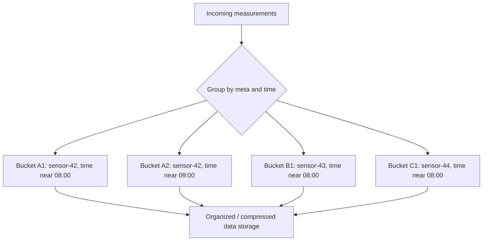
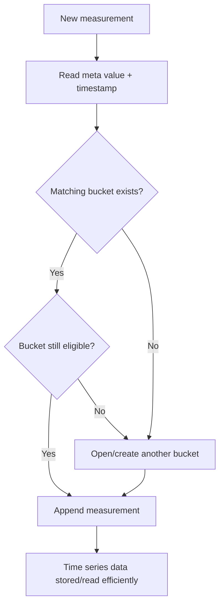

# Bucket Organization and the Impact of High-Cardinality Metadata in MongoDB Time Series

> **Module:** Database Engine Document MongoDB  
> **Chapter:** Time Series Data

## 1. Problem to Solve

Suppose an IoT system receives temperature readings from thousands of devices. Every few seconds, a device sends a document:

```javascript
{
  ts: ISODate("2026-11-14T08:00:00Z"),
  meta: {
    tenantId: "factory-01",
    sensorId: "sensor-42"
  },
  temperatureC: 28.6,
  humidityPct: 65
}
```

A MongoDB **time series collection** is designed to efficiently store timestamped records. From the application's perspective, each document is a **measurement** at a point in time. Internally, MongoDB can store multiple measurements inside **internal buckets**, rather than organizing all data as independent records in a regular collection.

The bucket model is highly sensitive to your **`metaField`** choice. If metadata is stable and multiple measurements from the same source arrive close together in time, MongoDB can pack them into relatively full buckets. If every measurement carries distinct metadata—such as placing a unique `requestId` inside `meta`—data fragments into many tiny buckets, forfeiting part of the compression and grouped read/write benefits.

Both designs below appear reasonable at first glance:

**Approach A – stable metadata**

```javascript
{
  ts: ISODate("2026-11-14T08:00:00Z"),
  meta: { tenantId: "factory-01", sensorId: "sensor-42" },
  requestId: "req-001",
  temperatureC: 28.6
}
```

**Approach B – placing `requestId` in metadata**

```javascript
{
  ts: ISODate("2026-11-14T08:00:00Z"),
  meta: {
    tenantId: "factory-01",
    sensorId: "sensor-42",
    requestId: "req-001"
  },
  temperatureC: 28.6
}
```

In Approach B, `requestId` differs on every record, so **the `meta` value is no longer identical across measurements** from the same sensor. This is high cardinality caused by metadata design, typically producing many sparse buckets.

This lesson explains:

1. How time series buckets are created, opened, closed, and read.
2. How `timeField`, `metaField`, measurements, and series differ.
3. What **metadata cardinality** is, and its impact on bucket counts and bucket catalog memory.
4. Why frequently changing metadata causes bucket fragmentation, degrades compression, and increases index/storage overhead.
5. When high cardinality is natural and acceptable.
6. How to select metadata that both **stably identifies series** and supports queries.
7. How to choose granularity/time span without misusing granularity to mask metadata problems.
8. How to measure with `collStats`, `serverStatus().bucketCatalog`, and `explain()`.
9. A `mongosh` experiment comparing the two designs.
10. How to create and query a time series collection using the MongoDB Java Sync Driver.

## 2. Fundamental Concepts

### 2.1. Measurement

A **measurement** is a document recording data at a point in time.

Example:

```javascript
{
  ts: ISODate("2026-11-14T08:00:00Z"),
  meta: { sensorId: "S-1" },
  temperatureC: 24.7,
  batteryPct: 91
}
```

Here:

- `ts` is when the event occurred or was recorded.
- `meta` identifies the measurement stream, such as a sensor.
- `temperatureC` and `batteryPct` are measured values.

A sensor sending 1 measurement per minute produces 60 measurements in an hour, assuming no data loss.

### 2.2. `timeField`

`timeField` is the name of the field holding the **BSON Date** timestamp of the measurement.

When creating the collection:

```javascript
db.createCollection("sensor_readings", {
  timeseries: {
    timeField: "ts",
    metaField: "meta",
    granularity: "seconds"
  }
});
```

MongoDB knows documents will be organized around the `ts` field. The value of `ts` must be a valid Date type, not an arbitrary ISO string or a numeric Unix timestamp.

### 2.3. `metaField`

`metaField` is the field carrying **metadata that identifies the source or a meaningful group of measurements**.

It can be a scalar:

```javascript
meta: "sensor-42"
```

or an object:

```javascript
meta: {
  tenantId: "factory-01",
  sensorId: "sensor-42",
  metricType: "environment"
}
```

Ideal metadata:

- Does not change, or changes rarely, across measurements in the same series.
- Meaningfully distinguishes real sources/series.
- Contains attributes frequently used in query filters.
- Does not carry per-measurement unique IDs that do not identify a series.

**Key distinction:** the configuration field name `metaField: "meta"` is fixed at collection creation; the **values** of `meta` across documents can vary. Differences among `meta` values govern how MongoDB groups buckets.

### 2.4. Series

A **series** is a stream of measurements sharing stable identifying attributes, for example:

```text
Series A: factory-01 / sensor-42
    08:00 → 28.6 °C
    08:01 → 28.7 °C
    08:02 → 28.6 °C

Series B: factory-01 / sensor-43
    08:00 → 31.2 °C
    08:01 → 31.0 °C
    08:02 → 31.1 °C
```

When `metaField` identifies the sensor, Series A and B have **different `meta` values** and are organized into buckets corresponding to each series and time interval.

### 2.5. Bucket

A **bucket** is an internal storage unit capable of holding multiple measurements grouped by MongoDB based on:

1. **Identical** `metaField` values.
2. **Nearby** `timeField` timestamps within bucketing limits.

This is the most important takeaway of the lesson. A bucket is neither simply "every measurement in the same hour" nor "every measurement from the same sensor across years".

## 3. Logical Structure of a Bucket

Suppose three sensors stream readings continuously.



An internal bucket holds metadata, time bounds, and measurement data in a MongoDB-optimized layout. Applications never manually construct bucket documents.

When running:

```javascript
db.sensor_readings.find({
  "meta.sensorId": "sensor-42",
  ts: {
    $gte: ISODate("2026-11-14T08:00:00Z"),
    $lt: ISODate("2026-11-14T09:00:00Z")
  }
});
```

MongoDB returns **measurement documents** matching the query, without requiring the application to read or decode buckets manually.

### 3.1. Buckets Are a Storage Detail, Not a Business API

Do not design applications assuming:

- A bucket always spans exactly 1 hour.
- A bucket always holds exactly 1,000 measurements.
- One `meta` value maps to exactly one bucket.
- Bucket count equals sensor count.
- Bucket behavior never changes across server versions.

MongoDB may open a new bucket when `meta` differs, timestamps fall outside bounds, a bucket hits size/count limits, memory pressure occurs, or other internal conditions arise.

### 3.2. One Series May Span Multiple Buckets

Even when `meta` never changes, 100,000 measurements from the same sensor will not sit in a single bucket forever. Once a bucket reaches capacity or the time span shifts, MongoDB creates subsequent buckets for that series.

Therefore:

\[
\text{bucket count} \neq \text{distinct meta count}
\]

A more accurate mental model is:

\[
\text{bucket count}
\approx
\sum_{\text{series}}
\text{buckets required by the series' time span, size, point count, and write pattern}
\]

This is a conceptual model, **not a formula to predict MongoDB's exact bucket count**.

## 4. How MongoDB Organizes Buckets on Insert

When a new measurement is inserted:

1. MongoDB reads its metadata value and timestamp.
2. It checks whether an active/eligible bucket matches that metadata and time span.
3. If one exists and still satisfies bucket limits, the server can append the measurement to that bucket.
4. Otherwise, the server opens/creates a new bucket.
5. Buckets are closed, archived, or reopened according to server limits and mechanics.
6. On query, the server leverages metadata and time bounds to prune buckets, then returns measurement documents.



### 4.1. Conditions for Opening a New Bucket

A new bucket may be needed when:

- The metadata value does not match an existing eligible bucket.
- The timestamp falls outside the span acceptable to existing buckets.
- The bucket has hit its measurement count or byte limit.
- Memory pressure or internal policies caused the previous bucket to close.
- Schema variations or concurrent operations force a bucket rollover.

Exact state transitions inside the **bucket catalog** depend on the MongoDB version and workload. Never build application logic relying on exact bucket counts after each insert.

### 4.2. Bucket Limits

Current MongoDB documentation describes typical upper bounds: **1,000 measurements or 125 KiB of data per bucket, whichever is reached first**. With high-cardinality metadata, the server may enforce lower thresholds to fit the working set in memory. Always verify specific thresholds and behaviors against your MongoDB Server version.

**Do not misunderstand:** 1,000 is an **upper bound**, not a target count the server guarantees every bucket will reach.

A bucket holding only 2 measurements is still valid, though generally less efficient than a fuller bucket—especially across millions of similar buckets.

### 4.3. Why Fuller Buckets Help

With many measurements in the same series:

- Metadata and bucket headers are shared across many measurements.
- Nearby timestamps and readings tend to compress well.
- MongoDB can process multiple measurements within the same storage unit.
- Meta/time queries can skip out-of-range buckets.
- Fewer storage/index entries are needed for the same data volume.

Compression ratios do **not** depend solely on measurements per bucket: they also depend on schema, field order, data types, measurement variance, document size, and server version.

## 5. What Is Metadata Cardinality?

**Metadata cardinality** is the count of **distinct `metaField` values** across a set of measurements within a defined scope and time window.

Example:

```text
10000 measurements
- sensor-1: 5000 measurements
- sensor-2: 3000 measurements
- sensor-3: 2000 measurements

Cardinality(meta) = 3
```

Conversely:

```text
10000 measurements
- each measurement has a distinct requestId
- requestId is inside meta

Cardinality(meta) can reach 10000
```

Adding fields to the `meta` object can multiply the number of distinct combinations rapidly.

### 5.1. Cardinality Multiplies Across Value Combinations

Suppose metadata includes:

- 100 tenants.
- 100 sensors per tenant.
- 5 sensor channel types stored as separate series.

If every combination occurs:

\[
C_{\mathrm{meta}} = 100 \times 100 \times 5 = 50{,}000
\]

If you add `firmwareBuild`, which changes 10 times per sensor/channel inside the same historical window, directly into `meta`:

\[
C_{\mathrm{meta}} \leq 50{,}000 \times 10 = 500{,}000
\]

This is a **combinatorial upper bound**. Actual cardinality equals the combinations that actually occur, not necessarily the full Cartesian product of theoretical domains.

### 5.2. Total Cardinality vs. Active Cardinality

A collection holding 5 years of history may contain millions of sensor IDs that **stopped transmitting long ago**. That is very different from a system with millions of sensors **actively transmitting within the same minute**.

Two useful measures:

- **Historical cardinality:** distinct `meta` values across all stored history.
- **Active cardinality:** distinct `meta` values generating measurements in a recent window.

Concurrently active series strongly drive pressure on **open buckets**; historical cardinality drives accumulated bucket, index, and storage counts.

Do not inspect `countDistinct(meta)` across the whole collection and immediately conclude current memory is insufficient.

### 5.3. Per-Series Measurement Density Also Matters

Two systems both with 100,000 `meta` values can behave completely differently:

**System A**

```text
Each sensor sends 1 measurement/second
100000 sensors active continuously
```

**System B**

```text
Each sensor sends 1 measurement/month
100000 sensors report sporadically
```

Both have similar historical `meta` counts, yet differ drastically in ingestion rate, working set, bucket fill, bucket lifetime, and query patterns.

To evaluate a design, examine **cardinality + per-series ingest rate + arrival timing + measurement shape**, not a single isolated number.

## 6. How High-Cardinality Metadata Impacts the System

### 6.1. More Buckets

Because buckets group measurements with identical metadata, many distinct `meta` values create many groups that cannot share buckets.

Example with 3,000 measurements in the same time window:

| Design | Distinct `meta` values | Points per `meta` (avg) | Expected outcome |
|---|---:|---:|---|
| Stable per-sensor meta, 3 sensors | 3 | 1000 | Opportunity for relatively full buckets |
| 30 sensors | 30 | 100 | More groups, potentially sparser buckets |
| Per-measurement `requestId` in `meta` | 3000 | 1 | Very many groups, often single-point buckets |

**Note:** physical bucket counts also depend on time spans, sizes, open/close/reopen cycles, and internal policies. The table does not claim bucket count always equals cardinality.

### 6.2. Sparse Buckets and Poor Compression

A bucket holding 1–2 measurements has too few points to amortize metadata/bucket overhead or exploit similarity across readings. The ratio of useful payload to bucket overhead worsens.

If each message gets its own series via `meta.requestId`, the system still stores every measurement but **loses the ability to group readings from the same sensor**.

Typical consequences:

- Disk usage rises compared to stable metadata.
- Compression ratio drops.
- More buckets and auxiliary structures accumulate.
- Wide time-range queries must process more buckets.
- Batch/append efficiency falls.

Exact impact must be **benchmarked on real data**; there is no universal rule like "10x cardinality always means 10x disk usage".

### 6.3. Bucket Catalog Pressure

MongoDB maintains an in-memory **bucket catalog** to track managed buckets and coordinate time series writes.

It tracks details such as:

- The bucket's metadata value.
- The time span covered by the bucket.
- Measurement count and byte size.
- Active writers and write state.
- State needed to decide when to open, close, or reopen buckets.

When many series interleave writes, many buckets remain open or managed simultaneously, increasing memory pressure and coordination overhead.

### 6.4. Frequent Bucket Closing and Reopening

If active cardinality is high and memory budget is finite, MongoDB may close, archive, or recycle buckets under version-specific memory management rules.

When subsequent data arrives for that series, the server may have to locate/reopen an eligible bucket or create a new one.

This explains why a moderate-throughput workload with **too many scattered series** can still incur substantial overhead.

### 6.5. Reduced Query Efficiency

A query:

```javascript
db.sensor_readings.find({
  "meta.sensorId": "S-42",
  ts: { $gte: from, $lt: to }
});
```

can be optimized by MongoDB using metadata and time predicates to narrow candidate buckets.

However, if `meta` embeds continuously changing fields, data from the same sensor fragments across many metadata groups, multiplying managed buckets and potentially degrading filtering and read efficiency.

Always inspect `explain()` on your target version to see which index is used, how many buckets/measurements are examined, and whether scans occur.

### 6.6. Increased Index and Sharding Complexity

Embedding a volatile field inside `meta` means:

- Whole-object `meta` equality queries become harder.
- Distinct key/value entries proliferate.
- Query filters typically use only a subset of `meta`, while buckets fragment across every subfield.
- Metadata-based shard keys can suffer from skewed cardinality and write distribution.

**High cardinality is not inherently bad for sharding**: a shard key needs sufficient cardinality to distribute data. The mistake is **putting volatile, non-series-identifying attributes into the bucket key**, not trying to artificially minimize valid series counts.

## 7. Good vs. Bad Metadata Examples

### 7.1. Good: Stable `sensorId`

```javascript
{
  ts: ISODate("2026-11-14T08:00:00Z"),
  meta: {
    tenantId: "factory-1",
    sensorId: "S-42"
  },
  temperatureC: 28.1,
  humidityPct: 66
}
```

When the sensor transmits continuously, many measurements share the same `meta`. This fits per-sensor series grouping well.

### 7.2. Bad: Putting Timestamps in Metadata

```javascript
{
  ts: ISODate("2026-11-14T08:00:00Z"),
  meta: {
    sensorId: "S-42",
    timestampKey: "2026-11-14T08:00:00Z"
  },
  temperatureC: 28.1
}
```

Because `timestampKey` varies on every sample, `meta` varies on every sample even though `sensorId` is constant.

**Better:** keep the timestamp in `timeField: "ts"` instead of duplicating it into `meta` to identify individual measurements.

### 7.3. Bad: Unique `requestId` or `traceId`

```javascript
{
  ts: ISODate("2026-11-14T08:00:00Z"),
  meta: {
    sensorId: "S-42",
    requestId: "req-9f27..."
  },
  temperatureC: 28.1
}
```

`requestId` traces **a single submission**, not a series. Move it to a measurement field:

```javascript
{
  ts: ISODate("2026-11-14T08:00:00Z"),
  meta: { sensorId: "S-42" },
  requestId: "req-9f27...",
  temperatureC: 28.1
}
```

Moving `requestId` outside `meta` does not automatically make `requestId` lookups fast; it simply prevents blowing up the cardinality of the **bucket grouping key**.

### 7.4. Consider Carefully: `firmwareVersion`

```javascript
meta: {
  sensorId: "S-42",
  firmwareVersion: "3.4.1"
}
```

When firmware upgrades from 3.4.1 to 3.4.2, `meta` changes, so readings across the two versions no longer share buckets by metadata.

This may be acceptable if `firmwareVersion` **truly defines a series dimension**, is frequently filtered, and changes rarely. Conversely, if firmware changes continuously during testing or embeds per-build hashes, it can spawn many sparse buckets.

Options:

- Keep `sensorId` in `meta`, and store `firmwareVersion` as a measurement field.
- Maintain a separate device-configuration history collection if firmware history needs independent querying.
- Put firmware in `meta` **only when** query patterns and change cadence justify it.

### 7.5. Consider Carefully: `location`

For stationary factory sensors:

```javascript
meta: {
  sensorId: "S-42",
  siteId: "plant-hcm"
}
```

If `siteId` rarely changes and is commonly filtered, it makes good metadata.

For GPS tracking on moving vehicles:

```javascript
meta: {
  vehicleId: "truck-1",
  latitude: 10.762622,
  longitude: 106.660172
}
```

Latitude and longitude change almost continuously; placing them in `meta` generates huge numbers of distinct values.

Usually prefer:

```javascript
{
  ts: ISODate("2026-11-14T08:00:00Z"),
  meta: { vehicleId: "truck-1" },
  latitude: 10.762622,
  longitude: 106.660172,
  speedKmh: 42
}
```

If queries primarily filter by geographic regions, consider geospatial indexes or a separate data model; **do not automatically put every location field inside `meta`**.

### 7.6. Extremely Bad: Per-Measurement UUID

```javascript
meta: {
  sensorId: "S-42",
  measurementId: UUID("...")
}
```

If every measurement gets a fresh UUID, cardinality approaches total measurement count. `meta` stops being a series label and turns into a per-point primary key.

## 8. Too Few Metadata Values Also Causes Problems

Do not misapply a naive rule that "fewer `meta` values is always better".

For example:

```javascript
meta: {
  tenantId: "factory-1"
}
```

when `factory-1` has 100,000 sensors and every document keeps `sensorId` outside `meta`.

This can cause:

- Unrelated sensors to be grouped under the same metadata when timestamps are close.
- Per-`sensorId` queries to miss the series-identity benefit of `meta`.
- Lack of effective partitioning by measurement source.
- Buckets mixing sources with dissimilar measurement distributions.
- Index and shard key designs misaligned with per-sensor queries.

Seek balance:

\[
\text{good metadata}
\approx
\text{stable series identity}
+
\text{useful filter attributes}
-
\text{unnecessary volatile dimensions}
\]

No single cardinality number is ideal for all systems.

### 8.1. Metadata Decision Examples

| Field | Changes per sample? | Used to identify/filter series? | Recommendation |
|---|---|---|---|
| `tenantId` | Rarely | Yes | Usually fits well in `meta` |
| `sensorId` | Rarely | Yes | Usually an excellent fit |
| `metricType` | Model-dependent | Yes, if each metric is its own series | Consider placing in `meta` |
| Static `siteId` | Rarely | Yes | Can be placed in `meta` |
| `firmwareVersion` | Occasionally | Query-dependent | Evaluate carefully |
| Mobile `gpsLatitude`/`gpsLongitude` | Very frequently | Unstable | Usually measurement fields |
| `temperatureC` | Every sample | Measured value | Never put in `meta` |
| `requestId` | Every request | No | Never put in `meta` |
| `timestamp` | Every sample | Time axis | Belongs in `timeField` |
| `traceId` | Every event | No | Never put in `meta` |
| Dynamic `status` | Frequently | Domain-dependent | Usually a measurement field |
| `deviceModel` | Rarely | Possibly | Decide by query patterns |

## 9. When `meta` Is an Object: Keep Values and Types Consistent

MongoDB allows `meta` to be an object, yet grouping depends on **metadata values**, not merely the presence of familiar fields.

These two documents have different `meta` values:

```javascript
// 1
meta: { tenantId: "t1", sensorId: "S-1" }

// 2
meta: { tenantId: "t1", sensorId: "S-1", region: "south" }
```

If one ETL service adds `region` to `meta` while another omits it, the same sensor splits across separate bucket groups.

### 9.1. Numbers and Strings Are Distinct Types

```javascript
meta: { sensorId: 42 }
```

and:

```javascript
meta: { sensorId: "42" }
```

do not represent the same stable identifier. Normalize ID types and casing before insertion.

### 9.2. Standardize Object Shape

If the `meta` object represents tenant, sensor, and metric type, define a consistent schema:

```javascript
meta: {
  tenantId: "t1",
  sensorId: "S-42",
  metricType: "climate"
}
```

Do not intermittently add `firmware`, drop `metricType`, or flip `tenantId` to a number unless it is an intentional, migration-managed change.

### 9.3. Field Order in Objects

BSON preserves document field order; MongoDB may normalize metadata objects internally during storage. Whole-object equality queries can be sensitive to field ordering and representation.

**Best practice:** filter explicitly on scalar subfields:

```javascript
db.sensor_readings.find({
  "meta.tenantId": "factory-1",
  "meta.sensorId": "S-42"
});
```

rather than relying on whole-object equality:

```javascript
db.sensor_readings.find({
  meta: { sensorId: "S-42", tenantId: "factory-1" }
});
```

Additionally, keeping schema and field order **consistent** from drivers helps compression; never rely on the server to clean up source inconsistencies.

### 9.4. Arrays Inside `meta`

An array such as:

```javascript
meta: {
  sensorId: "S-42",
  labels: ["cold-chain", "warehouse"]
}
```

is order-sensitive. If a later write produces:

```javascript
meta: {
  sensorId: "S-42",
  labels: ["warehouse", "cold-chain"]
}
```

do not assume MongoDB treats them as identical metadata. MongoDB documentation warns that using arrays in metadata can cause unexpected behavior because equality depends on element order.

If `labels` are merely searchable tags that change or reorder often, move them to measurement fields or a separate metadata collection rather than using them in the bucket key.

## 10. Bucket Catalog: Observing High-Cardinality Pressure

The **bucket catalog** is an internal in-memory structure MongoDB uses to manage buckets and coordinate time-series writes.

Depending on your MongoDB version, `serverStatus` may expose metrics such as:

- `numBuckets`.
- `numOpenBuckets`.
- `numIdleBuckets`.
- `memoryUsage`.
- `numBucketInserts`.
- `numBucketUpdates`.
- `numBucketsOpenedDueToMetadata`.
- `numBucketsClosedDueToCount`.
- `numBucketsClosedDueToSize`.
- `numBucketsClosedDueToTimeForward` / `numBucketsClosedDueToTimeBackward`.
- `numBucketsClosedDueToMemoryThreshold`.
- `numBucketsReopened`.
- Other metrics depending on version and storage engine.

### 10.1. Example: Reading Metrics

On an instance with appropriate monitoring privileges:

```javascript
const admin = db.getSiblingDB("admin");
const server = admin.serverStatus();

printjson(server.bucketCatalog);
```

Not every version returns all metrics listed above; if `bucketCatalog` is absent or field names differ, check the documentation for your version.

### 10.2. Interpreting Selected Metrics

| Metric | Meaning |
|---|---|
| `numOpenBuckets` | Number of currently open buckets at observation time, within metric scope |
| `memoryUsage` | Memory used by the bucket catalog as defined by the server |
| `numBucketsOpenedDueToMetadata` | Events opening a bucket because metadata required a separate bucket, per version stats |
| `numBucketsClosedDueToCount` | Buckets closed after reaching measurement count limit |
| `numBucketsClosedDueToSize` | Buckets closed after reaching byte size limit |
| `numBucketsClosedDueToMemoryThreshold` | Signal that buckets closed due to memory threshold pressure |
| `numBucketsClosedDueToTimeForward` | Buckets no longer eligible for forward timestamps |
| `numBucketsReopened` | Server reopened a bucket under supported mechanics |

**Crucial note:** Several metrics are **cumulative counters** since process startup, not instantaneous rates. To compute events per minute, take deltas between two samples within the same process lifetime and guard against restarts/resets.

### 10.3. Server-Wide Metrics Are Not Always Per-Collection

`serverStatus().bucketCatalog` is typically server/process-scoped, **not automatically isolated to `sensor_readings` alone**.

If multiple workloads run concurrently, counters mix together. An A/B experiment claiming causality needs an isolated environment and proper before/after measurement steps.

### 10.4. Many Buckets Alone Are Not Automatically a Bug

With millions of legitimate sensors writing continuously, many buckets are a natural consequence. Evaluate:

- Are resources and throughput sufficient?
- Do bucket packing and compression suit the workload?
- Does query latency meet SLOs?
- Is there excessive memory pressure or close/reopen churn?
- Is `meta` varying needlessly?

High bucket count **from many real series** is completely different from high bucket count **caused by stuffing `requestId` into `meta`**.

## 11. A/B Experiment in `mongosh`

Goal: generate the exact same set of measurements under **two `meta` designs**:

- **Good:** stable `meta` using `tenantId + sensorId`.
- **Bad:** `meta` adding a unique `eventId` per sample.

Timestamps, sensors, temperatures, and document counts are identical between both collections.

### 11.1. Creating Both Time Series Collections

Requires MongoDB 5.0+ with compatible Feature Compatibility Version.

In `mongosh` connected to the lab database:

```javascript
const lab = db.getSiblingDB("ts_bucket_cardinality_lab");

lab.createCollection("readings_good", {
  timeseries: {
    timeField: "ts",
    metaField: "meta",
    granularity: "seconds"
  }
});

lab.createCollection("readings_bad", {
  timeseries: {
    timeField: "ts",
    metaField: "meta",
    granularity: "seconds"
  }
});
```

**Run once on an empty database.** If the collections already exist, `createCollection` errors out; never run `dropDatabase()` on non-lab environments to retry.

### 11.2. Generating Identical Measurement Data

Simulate:

- 3 sensors.
- 600 measurements per sensor.
- 1 minute between measurements.
- 1,800 measurements total.
- Each sample carries a unique `eventId`.

```javascript
const good = lab.getCollection("readings_good");
const bad = lab.getCollection("readings_bad");

const start = ISODate("2026-11-14T00:00:00.000Z");
const goodDocs = [];
const badDocs = [];

for (let sensor = 1; sensor <= 3; sensor++) {
  const sensorId = "S-" + sensor;

  for (let n = 0; n < 600; n++) {
    const ts = new Date(start.getTime() + n * 60 * 1000);
    const eventId = sensorId + "-" + n;
    const value = 20 + sensor + (n % 20) / 10;

    goodDocs.push({
      ts: ts,
      meta: {
        tenantId: "factory-1",
        sensorId: sensorId
      },
      eventId: eventId,
      temperatureC: value
    });

    badDocs.push({
      ts: ts,
      meta: {
        tenantId: "factory-1",
        sensorId: sensorId,
        eventId: eventId
      },
      eventId: eventId,
      temperatureC: value
    });
  }
}

good.insertMany(goodDocs, { ordered: true });
bad.insertMany(badDocs, { ordered: true });

print("Good documents:", good.countDocuments({}));
print("Bad documents:", bad.countDocuments({}));
```

Both hold **1,800 logical measurements**. Document counts alone do not reveal exact bucket counts.

### 11.3. Computing Cardinality in the Lab

Count distinct `meta` values via aggregation:

```javascript
function countMetaValues(coll) {
  const result = coll.aggregate([
    { $group: { _id: "$meta" } },
    { $count: "cardinality" }
  ]).toArray();

  return result.length === 0 ? 0 : result[0].cardinality;
}

print("Good meta cardinality:", countMetaValues(good));
print("Bad meta cardinality:", countMetaValues(bad));
```

On the lab dataset:

- `readings_good` has **3** `meta` values (corresponding to 3 sensors).
- `readings_bad` has **1,800** `meta` values (each sample has a distinct `eventId`).

This figure is the **logical cardinality of `meta` on the generated data**, not the physical bucket count from storage.

### 11.4. Inspecting Logical and Storage Sizes

```javascript
const goodStats = good.stats();
const badStats = bad.stats();

printjson({
  good: {
    count: goodStats.count,
    size: goodStats.size,
    storageSize: goodStats.storageSize,
    totalIndexSize: goodStats.totalIndexSize
  },
  bad: {
    count: badStats.count,
    size: badStats.size,
    storageSize: badStats.storageSize,
    totalIndexSize: badStats.totalIndexSize
  }
});
```

Reference notes:

- `count` is the measurement count reported by MongoDB for the collection.
- `size`, `storageSize`, and `totalIndexSize` carry semantics dependent on collection type, version, and storage engine.
- Always compare on the same server/version using the same measurement method.

**Do not extrapolate compression ratios from `storageSize / count` on a 1,800-document test**: the sample is too small, and file preallocation, caches, and index overhead add heavy noise. Measurements on a realistically sized dataset are far more reliable.

### 11.5. Observing the Bucket Catalog in the Lab

```javascript
const bucketStats = lab.getSiblingDB("admin").serverStatus().bucketCatalog;

printjson(bucketStats);
```

If your database user lacks `serverStatus` privileges or your server version omits a field, use properly authorized monitoring; **admin privileges are not needed to prove logical cardinality**.

To compare bucket open/close counts between workloads, run each workload **in isolation** and measure counters before and after, rather than inserting both `good` and `bad` and taking one combined snapshot.

### 11.6. Valid Conclusions from the Lab

What you can state with certainty from the sample data:

1. Both collections hold equal numbers of measurements.
2. Different `meta` designs produce drastically different logical cardinality: 3 vs. 1,800.
3. MongoDB cannot group two measurements with differing `meta` values into the same bucket under bucketing rules.
4. `readings_bad` risks creating far more sparse buckets.

Claims you must **not** make without measuring:

- "Good definitely has exactly 3 buckets."
- "Bad definitely has exactly 1,800 physical buckets."
- "Bad uses 600x more RAM."
- "Bad reads 600x slower."

Actual numbers also depend on timestamps, document sizes, compression, bucket limits, memory state, and MongoDB version.

## 12. Bucket Density Estimation Model

A rough pre-benchmark estimate:

Let:

- \(N\): total measurements in the window under consideration.
- \(C\): number of distinct `meta` values occurring in the window.
- \(\bar n = N/C\): average measurements per `meta` value.

If:

\[
N = 1{,}800,\quad C = 3
\]

then:

\[
\bar n = 600
\]

If:

\[
N = 1{,}800,\quad C = 1{,}800
\]

then:

\[
\bar n = 1
\]

\(\bar n\) is not strictly measurements/bucket, since one series can span multiple time windows or hit bucket limits earlier.

However, when \(\bar n\) equals 1 within an active time window, there is virtually no opportunity to pack multiple measurements for the same `meta` value inside that window.

### 12.1. Adding the Time Dimension

A more informative metric is:

\[
\bar n_{\mathrm{series,window}}
=
\frac{\text{measurements within a time window}}
     {\text{active meta values in that window}}
\]

For instance, with the same 1,800 measurements:

- If all arrive within 10 minutes from 3 sensors, per-series density is high.
- If they span 10 years with each sensor sending once a month, density inside each bucket time window is low.

Therefore, measuring cardinality across all history alone is insufficient.

### 12.2. Skewed Distributions

Two datasets with identical \(N\) and \(C\) can behave very differently:

- Dataset 1: every series has 100 measurements.
- Dataset 2: one series has 9,900 measurements, and 99 series each have 1 measurement.

Averages hide skew. Measure percentiles/skew of **measurements per series per time window** and concurrently active series.

## 13. What `granularity` Helps With—and What It Cannot Fix

When creating a time series collection, MongoDB accepts `granularity`:

```javascript
db.createCollection("readings_minutes", {
  timeseries: {
    timeField: "ts",
    metaField: "meta",
    granularity: "minutes"
  }
});
```

Standard values:

- `"seconds"`.
- `"minutes"`.
- `"hours"`.

Idea: match `granularity` to **per-series measurement cadence** and expected queries. It governs the bucket's time span limits.

### 13.1. `granularity` Does Not Round Timestamps

Setting `granularity: "minutes"` **does not round `ts`** to the top of the minute in application documents or strip seconds from measurements.

It is a time-based bucket-organization setting, not an aggregation `$dateTrunc`.

### 13.2. Cannot Fix Divergent Metadata

Suppose every sample carries a `requestId` in `meta`:

```javascript
meta: {
  sensorId: "S-42",
  requestId: "req-unique-on-every-sample"
}
```

Changing `granularity` from `seconds` to `hours` **never makes two distinct `meta` values equal**. MongoDB still enforces metadata boundaries.

Fix **`metaField` selection** before expecting `granularity` tuning to cure bucket fragmentation.

### 13.3. Wider Bucket Windows Are Not Always Better

An overly wide window can:

- Produce buckets covering wide time spans, hurting selective time-range queries.
- Hold more measurements while still remaining capped by size/count limits.
- Shift trade-offs between packing and pruning.
- Perform poorly with late arrivals or very sparse cadences.

Measure against real query patterns and ingestion data.

### 13.4. Custom Bucket Span and Rounding

On MongoDB **6.3+**, `bucketMaxSpanSeconds` and `bucketRoundingSeconds` can replace `granularity` in supported configurations:

```javascript
db.createCollection("readings_custom_span", {
  timeseries: {
    timeField: "ts",
    metaField: "meta",
    bucketMaxSpanSeconds: 300,
    bucketRoundingSeconds: 300
  }
});
```

Both parameters must obey your MongoDB version's bounds and equality rules. Do not specify `granularity` alongside the custom pair as shown above.

**Operational note:** when modifying granularity/bucket parameters via `collMod` where supported, MongoDB enforces **increase-only** bucket span transitions. Never change production settings without reading version docs and testing migrations.

## 14. Indexing on Metadata and Time

A key benefit of time series collections is optimizing queries over metadata and time.

### 14.1. Well-Structured Sample Query

```javascript
const from = ISODate("2026-11-14T08:00:00Z");
const until = ISODate("2026-11-14T09:00:00Z");

db.sensor_readings.find({
  "meta.tenantId": "factory-1",
  "meta.sensorId": "S-42",
  ts: { $gte: from, $lt: until }
}).sort({ ts: 1 });
```

Filtering by stable series identifiers and a bounded time range lets the query planner prune unnecessary buckets.

### 14.2. Default Indexes and Server Versions

Starting in **MongoDB 6.3**, newly created time series collections with `metaField` and `timeField` receive a default compound index managed per version behavior.

**Do not assume every time series collection across all versions has identical default indexes.** Inspect with:

```javascript
db.sensor_readings.getIndexes();
```

If queries predominantly filter by metadata subfields, consider a matching index:

```javascript
db.sensor_readings.createIndex({
  "meta.tenantId": 1,
  "meta.sensorId": 1,
  ts: 1
});
```

Do not add an index merely because it appears in an example. Indexes consume storage and slow writes; the query planner may already favor another index.

### 14.3. `explain` on Time Series

```javascript
db.sensor_readings.find({
  "meta.sensorId": "S-42",
  ts: {
    $gte: ISODate("2026-11-14T08:00:00Z"),
    $lt: ISODate("2026-11-14T09:00:00Z")
  }
}).explain("executionStats");
```

Observe according to your version:

- Documents and index keys examined.
- Whether an index scan or collection scan occurred.
- Stages related to buckets and measurement unpacking.
- Execution time and returned counts.
- Whether filters pushed down to the bucket level.

Do not hardcode assumptions that a stage name like `$_internalUnpackBucket` appears identically across all MongoDB versions.

### 14.4. Value Queries vs. Metadata Queries

Example:

```javascript
db.sensor_readings.find({
  temperatureC: { $gte: 35 }
});
```

Filtering solely by measurement value without `meta` or time bounds may scan far more buckets. If the business frequently needs "every sensor across all history exceeding 35°C", consider:

- Bounding the query to a reasonable time window.
- Indexes supported on time series in your MongoDB version.
- Precomputed summary or alert collections.
- A complementary data model for value-based queries.

Never stuff `temperatureC` into `meta` to "speed up queries"—it varies on every sample and shatters bucket grouping.

## 15. `metaField` in Multi-Tenant Environments

Multi-tenant systems typically require:

- Querying data scoped by tenant.
- Preventing cross-tenant data leaks.
- Balanced workload distribution.
- Stable per-sensor/device series.

A sensible `meta` design:

```javascript
meta: {
  tenantId: "tenant-a",
  deviceId: "device-1001"
}
```

If device IDs are unique only within a tenant, combining both fields forms a sound logical identity.

### 15.1. Keep Sensitive or Highly Volatile Fields Out of `meta`

Example:

```javascript
meta: {
  tenantId: "tenant-a",
  deviceId: "device-1001",
  sessionToken: "very-dynamic-sensitive-token"
}
```

This both inflates cardinality and unnecessarily embeds sensitive data in metadata.

Never treat the `meta` object as a catch-all bag for request context. Include only attributes that genuinely **identify the series** and support stable filters.

### 15.2. Onboarding New Tenants

When a tenant adds sensors, growth in distinct `meta` values is completely natural. It is not a design flaw as long as each sensor produces sufficient readings and queries filter by tenant/sensor.

Capacity plan using:

- Tenant count.
- Sensors per tenant.
- Average and peak measurement rates.
- Concurrently active series.
- Measurement document size.
- Retention duration.
- Distribution of large vs. small tenants.

### 15.3. Multi-Tenant Security vs. Bucketing

Adding `tenantId` to `meta` **does not enforce tenant access control**. The application must still apply authorization and inject tenant filters using your system's role/tenant isolation model.

Choosing `meta.tenantId` for storage/query efficiency never implies callers may pass arbitrary `tenantId` values in requests.

## 16. Changing Metadata: Preserving History Properly

A device may change:

- Display name.
- Installation site.
- Firmware.
- Owner/team.
- Active/inactive status.
- Alert group.

Three common design patterns exist.

### 16.1. Keep Only Immutable Identifiers in `meta`

```javascript
{
  ts: ISODate("2026-11-14T08:00:00Z"),
  meta: { deviceId: "D-1" },
  temperatureC: 28.2
}
```

Device configuration lives in a separate collection:

```javascript
{
  _id: "D-1",
  displayName: "Freezer A",
  siteId: "HCM-1",
  firmware: "2.3.7"
}
```

Advantage: series never fragment when display names or firmware change.

Trade-off: if you need "data by site **at the historical measurement time**", joining against current configuration alone can be wrong. You will need effective-dated metadata history or the relevant attribute stored on measurements.

### 16.2. Store Volatile Attributes on Measurements

```javascript
{
  ts: ISODate("2026-11-14T08:00:00Z"),
  meta: { deviceId: "D-1" },
  firmware: "2.3.7",
  location: { lat: 10.76, lon: 106.66 },
  temperatureC: 28.2
}
```

Advantages:

- Values reflect **state at measurement time**.
- Does not inflate `meta` cardinality.
- Easy to aggregate over time with clear queries.

Trade-off: repeats attributes across measurements and may require extra indexes or read models for querying those fields.

### 16.3. Intentionally Splitting Series When a Dimension Truly Changes Semantics

For instance, one device has two independent channels `"temperature"` and `"pressure"`, with distinct cadences and queries routinely separating metric types.

You may choose:

```javascript
meta: {
  deviceId: "D-1",
  channel: "temperature"
}
```

This creates **intentional** separate series rather than wasteful cardinality. When a channel defines a distinct stream of measurements, splitting buckets by channel is worthwhile.

## 17. `metaField` Option Cannot Be Changed Arbitrarily After Creation

When creating a time series collection:

```javascript
db.createCollection("readings", {
  timeseries: {
    timeField: "ts",
    metaField: "meta"
  }
});
```

`timeField` and `metaField` option names are set at collection creation; you cannot later rename `metaField` from `"meta"` to `"tags"` in place on the same collection.

This is distinct from modifying the **value** of `meta` inside documents (which is subject to version-dependent update limits).

If an existing collection uses overly granular metadata, the durable fix is typically:

1. Design the new `meta` schema.
2. Create a **new time series collection** with proper settings.
3. Backfill/migrate historical data into the new collection.
4. Route new application writes using the new schema.
5. Reconcile counts, time ranges, sensor identities, and measurement values.
6. Cut over read traffic.
7. Decommission the old collection per retention and rollback plans.

Do not assume a `collMod` command can switch `metaField` directly without migration.

### 17.1. Updates on Time Series Documents Are Restricted

Time series collections do not support all regular-collection update, delete, and transaction operations, and exact capabilities depend on server version.

Current documentation lists restrictions such as:

- Updates may only match and modify fields inside `metaField` under supported conditions.
- Arbitrary document-body updates are not broadly supported.
- Certain transaction/write and indexing operations have dedicated constraints.
- Standard unique indexes cannot be created on time series collections.

Therefore, do not rely on "in-place updating `meta` across billions of measurements" as a default strategy to change bucket grouping. Plan migrations/backfills within your server version's limits.

## 18. Late Arrivals and Out-of-Order Measurements

A sensor may go offline and later upload yesterday's readings. MongoDB must locate a matching bucket by metadata and timestamp rather than appending strictly to the newest bucket.

Example:

```javascript
{
  ts: ISODate("2026-11-13T20:00:00Z"),
  meta: { sensorId: "S-42" },
  temperatureC: 27.4
}
```

inserted after the system has already ingested measurements from the 14th.

Potential impact:

- Buckets for the older interval may already be closed.
- The server must locate/reopen or allocate another bucket per supported mechanics.
- Compression/packing may differ from in-order arrivals.
- Ingestion throughput may drop if large volumes arrive far out of order.

**Do not solve out-of-order arrivals by putting timestamps into `meta`.** That inflates cardinality and fragments buckets even worse.

### 18.1. Deciding Which Timestamp Is `timeField`

If a device has:

- `observedAt`: when the sensor actually measured.
- `ingestedAt`: when the server received it.

Choose the time axis the business analyzes:

```javascript
{
  observedAt: ISODate("2026-11-13T20:00:00Z"),
  ingestedAt: ISODate("2026-11-14T08:00:00Z"),
  meta: { sensorId: "S-42" },
  temperatureC: 27.4
}
```

If reports analyze temperature by actual occurrence time, `observedAt` is usually `timeField`. If the workload primarily analyzes event ingestion rate, an ingestion-time model may be needed.

Choosing the time axis is a business decision, not merely a bucket-density tweak.

## 19. Can Retention and TTL Solve High Metadata Cardinality?

Time series collections support TTL, for example:

```javascript
db.createCollection("readings_retained", {
  timeseries: {
    timeField: "ts",
    metaField: "meta",
    granularity: "seconds"
  },
  expireAfterSeconds: 86400 * 30
});
```

This enforces time-based retention (30 days in this illustration), helping cap historical storage volume.

However, TTL **does not let distinct `meta` values share buckets**. If a unique `requestId` sits in `meta`, the 30-day window can still generate countless sparse buckets.

### 19.1. TTL Does Not Delete Measurements to the Exact Millisecond

In time series collections, expiration ties to bucket organization and background cleanup; do not expect a measurement to vanish at the exact nanosecond its TTL expires.

For strict compliance or hard retention SLAs, verify the exact semantics of your MongoDB version and your deletion/security architecture.

## 20. Java Sync Driver: Creating a Time Series Collection and Inserting Data

The MongoDB Java Sync Driver can issue collection creation with `timeseries`. The example below uses `runCommand` to show the exact BSON options explicitly without coupling to a specific driver version's convenience builder.

### 20.1. Creating the Collection

Example using `org.mongodb:mongodb-driver-sync` and a MongoDB Server supporting time series:

```java
import com.mongodb.client.MongoClient;
import com.mongodb.client.MongoClients;
import com.mongodb.client.MongoDatabase;
import org.bson.Document;

public final class CreateTimeSeriesExample {
    public static void main(String[] args) {
        String uri = System.getenv("MONGODB_URI");
        if (uri == null || uri.isBlank()) {
            uri = "mongodb://127.0.0.1:27017";
        }

        try (MongoClient client = MongoClients.create(uri)) {
            MongoDatabase database =
                    client.getDatabase("ts_bucket_cardinality_java_lab");

            Document options = new Document("timeField", "ts")
                    .append("metaField", "meta")
                    .append("granularity", "seconds");

            Document create = new Document("create", "sensor_readings")
                    .append("timeseries", options);

            database.runCommand(create);
            System.out.println("Time series collection created.");
        }
    }
}
```

Run once in the lab database when the collection does not yet exist. Never invoke unconditional creation repeatedly without error handling.

### 20.2. Inserting Multiple Measurements Sharing Metadata

```java
import com.mongodb.client.MongoCollection;
import org.bson.Document;

import java.time.Instant;
import java.util.ArrayList;
import java.util.Date;
import java.util.List;

// Assume database has been created using an appropriate MongoClient.
MongoCollection<Document> readings =
        database.getCollection("sensor_readings");

List<Document> batch = new ArrayList<>();
Instant start = Instant.parse("2026-11-14T08:00:00Z");

for (int minute = 0; minute < 60; minute++) {
    Document metadata = new Document("tenantId", "factory-1")
            .append("sensorId", "S-42");

    batch.add(
            new Document("ts", Date.from(start.plusSeconds(minute * 60L)))
                    .append("meta", metadata)
                    .append("eventId", "S-42-" + minute)
                    .append("temperatureC", 25.0 + (minute % 10) / 10.0)
    );
}

readings.insertMany(batch);
```

Here:

- `meta` shares the same `tenantId`/`sensorId` across the entire batch.
- `eventId` varies, but sits **outside `meta`**.
- `ts` increments minute by minute.
- MongoDB can group measurements into appropriate buckets by `meta` and `time`.

### 20.3. Querying by Metadata and Time

```java
import com.mongodb.client.MongoCollection;
import org.bson.Document;

import java.time.Instant;
import java.util.Date;

import static com.mongodb.client.model.Filters.and;
import static com.mongodb.client.model.Filters.eq;
import static com.mongodb.client.model.Filters.gte;
import static com.mongodb.client.model.Filters.lt;
import static com.mongodb.client.model.Sorts.ascending;

Date from = Date.from(Instant.parse("2026-11-14T08:00:00Z"));
Date until = Date.from(Instant.parse("2026-11-14T09:00:00Z"));

for (Document row : readings.find(and(
        eq("meta.tenantId", "factory-1"),
        eq("meta.sensorId", "S-42"),
        gte("ts", from),
        lt("ts", until)
)).sort(ascending("ts"))) {
    System.out.println(row.toJson());
}
```

### 20.4. Avoiding Volatile Metadata in Java

Wrong:

```java
Document meta = new Document("sensorId", sensorId)
        .append("eventId", eventId);
```

If `eventId` changes on every sample, the `meta` value changes constantly.

Right for a stable per-sensor design:

```java
Document meta = new Document("tenantId", tenantId)
        .append("sensorId", sensorId);

Document reading = new Document("ts", timestamp)
        .append("meta", meta)
        .append("eventId", eventId)
        .append("value", measurementValue);
```

When receiving API payloads in the driver layer, normalize the `meta` object, strip unnecessary volatile fields, and enforce tenant authorization before inserting.

## 21. Time Series Collections and Sharding

Sharding distributes data across shards, yet it cannot rescue a poorly chosen metadata schema.

MongoDB documentation recommends considering **`metaField`** as the basis for distributing time series data. Stable, well-distributed metadata supports a stronger shard key.

### 21.1. Do Not Mechanically Pick `timeField`-Only Shard Keys

If a shard key relies solely on monotonically increasing time, incoming writes concentrate on a single key range/chunk.

Modern MongoDB versions enforce specific rules on time series shard keys. Notably, starting in **MongoDB 8.0**, including `timeField` in a time series collection's shard key is **deprecated**; consult version docs before designing new deployments.

### 21.2. Bucketing Cardinality vs. Sharding Cardinality

A `meta` with 100,000 sensor IDs can be a strong choice:

- Each sensor is a real series.
- Queries commonly filter by `sensorId`.
- Sensor IDs and data volume distribute reasonably across shards.

Conversely, a `meta` holding 100 million individual request UUIDs gives plenty of values to shard on, yet wrecks bucketing and misaligns with query patterns.

**Legitimate high cardinality** is not the same as **gratuitous high cardinality**.

### 21.3. Monitor Write Distribution

In a sharded cluster:

- High-volume and low-volume sensors may have vastly different ingest rates.
- A few "hot sensors" can dominate write throughput.
- Hashed vs. ranged shard keys carry trade-offs.
- `tenantId`-only keys can create hot tenants under skewed workloads.
- Combining `tenantId`/`sensorId` can improve spread, subject to query shape and version support.

Never choose a shard key solely from the count of distinct `meta` values; inspect real throughput and query shapes.

## 22. How to Measure Metadata Design Effectiveness

A benchmark plan can be structured in three parts.

### 22.1. Input Workload Metrics

Record:

- Measurements/second.
- Historical `meta` value count.
- Active `meta` values per minute/hour.
- Measurements per active series in the same window.
- Average and percentile document sizes.
- Percentage of out-of-order / late-arriving data.
- Percentage of measurements with schema variations.
- Tenant, sensor, and metric channel counts, plus hot/cold skew.

### 22.2. Server Metrics

Depending on version and monitoring stack:

- `bucketCatalog.numOpenBuckets`.
- `bucketCatalog.memoryUsage`.
- Bucket open/close counters and rates.
- Storage size, data size, index size.
- CPU, WiredTiger cache, disk IOPS/latency.
- Write throughput, write p95/p99.
- Replication lag and cache pressure.
- Query p95/p99, documents/keys examined.
- Number of buckets unpacked by query plans (where exposed).

### 22.3. Application Performance Metrics

A benchmark measuring only `insertMany()` of a few thousand documents is insufficient. Test:

1. Write-heavy ingestion.
2. Single-sensor short-window queries.
3. Multi-sensor queries within one tenant.
4. Per-minute/hour/day aggregations.
5. Wide time-range scans.
6. Historical backfills.
7. TTL/retention cleanup rates.
8. Mixed read/write workloads.

A `metaField` that optimizes writes while making core product queries unacceptably slow is still a flawed design.

## 23. Computing Cardinality Over Time via Aggregation

### 23.1. Counting Distinct `meta` Values in a Day

On the `good` collection:

```javascript
const dayFrom = ISODate("2026-11-14T00:00:00Z");
const dayUntil = ISODate("2026-11-15T00:00:00Z");

db.readings_good.aggregate([
  {
    $match: {
      ts: { $gte: dayFrom, $lt: dayUntil }
    }
  },
  {
    $group: {
      _id: "$meta"
    }
  },
  {
    $count: "activeMetaValues"
  }
]);
```

With very large `meta` counts, `$group` can consume substantial memory and CPU; run this in test environments or scheduled observability jobs rather than as a per-second health check.

### 23.2. Measurement Distribution by `meta`

```javascript
db.readings_good.aggregate([
  {
    $group: {
      _id: "$meta",
      measurements: { $sum: 1 },
      firstTs: { $min: "$ts" },
      lastTs: { $max: "$ts" }
    }
  },
  { $sort: { measurements: -1 } },
  { $limit: 20 }
]);
```

Reveals which series are "hottest", showing whether traffic concentrates in a few series or spreads evenly.

### 23.3. Counting Active Series per Hour

Simple example:

```javascript
db.readings_good.aggregate([
  {
    $group: {
      _id: {
        hour: {
          $dateTrunc: {
            date: "$ts",
            unit: "hour",
            timezone: "UTC"
          }
        },
        meta: "$meta"
      },
      measurements: { $sum: 1 }
    }
  },
  {
    $group: {
      _id: "$_id.hour",
      activeSeries: { $sum: 1 },
      totalMeasurements: { $sum: "$measurements" }
    }
  },
  { $sort: { _id: 1 } }
]);
```

`$dateTrunc` requires MongoDB 5.0+. This pipeline tracks hourly active cardinality—far better than a single historical total when evaluating bucket catalog pressure.

### 23.4. Computing Average Hourly Density

You can append a stage:

```javascript
{
  $addFields: {
    avgMeasurementsPerActiveSeries: {
      $cond: [
        { $gt: ["$activeSeries", 0] },
        { $divide: ["$totalMeasurements", "$activeSeries"] },
        0
      ]
    }
  }
}
```

Placed after the second `$group` stage above. This measures **hourly per-series density**, not exact per-bucket density.

## 24. Special Schema Cases

### 24.1. Omitting `metaField`

`metaField` is optional at collection creation. In a collection **without `metaField`**, MongoDB organizes buckets by time and other internal conditions, but lacks a metadata dimension for direct per-sensor grouping and pruning.

If you configured `metaField: "meta"` yet some measurements omit `meta` or set `meta: null`, verify semantics and enforce consistent schemas. Do not assume missing, `null`, empty object, and populated objects form one series.

### 24.2. Multiple Metrics in One Measurement

Example:

```javascript
{
  ts: ISODate("2026-11-14T08:00:00Z"),
  meta: { sensorId: "S-42" },
  temperatureC: 24.1,
  humidityPct: 60,
  pressureHpa: 1011
}
```

Storing multiple metrics at the same timestamp in one measurement works well if the system genuinely samples them together, reducing document count and keeping schemas compact.

Conversely, if temperature arrives every second while pressure arrives once an hour, splitting measurements or series by channel may be cleaner. Base the choice on sampling synchronization and query patterns, not field count alone.

### 24.3. Very Large Metadata Objects

If `meta` carries tens of kilobytes of repeated configuration, even low cardinality creates overhead and bloated schemas.

Keep only compact, stable IDs/labels in `meta`; store large configuration details in a separate collection or metadata service.

### 24.4. Heterogeneous Nested Measurement Fields

For example, when measurements use varying metric structures or nested field ordering:

```javascript
// A
{ metrics: { temperature: 25.1, humidity: 62 } }

// B
{ metrics: { humidity: 63, temperature: 25.2 } }
```

This can degrade compression and complicate queries. Keep schema and field order consistent where possible without sacrificing domain correctness just for compression.

### 24.5. `_id` and Uniqueness

Time series collections differ from regular collections in indexing rules. For instance, MongoDB does not automatically build a unique `_id` index in the same way as standard collections, and does not support standard unique indexes across many current versions.

Never assume "giving each measurement a unique `_id` causes the server to deduplicate automatically" without checking version-specific time series semantics. When retries can happen and duplicates are unacceptable, use an external idempotency layer, key/order design, or staging pattern.

Putting a unique ID into `meta` to "deduplicate" misuses `meta` and risks cardinality explosion.

## 25. Common Misconceptions

| Claim | Why it is inaccurate | Accurate understanding |
|---|---|---|
| "One sensor = one bucket" | Buckets are bounded by time, point count, and size | One sensor spans many buckets over time |
| "One bucket always holds 1,000 measurements" | 1,000 is a typical upper bound | Buckets can close early and stay sparse |
| "`granularity: hours` merges differing `meta` values" | Does not alter `meta` equality rules | Distinct `meta` values do not share buckets |
| "Adding `requestId` to `meta` speeds up event lookups" | Can explode `meta` values and buckets | Keep `requestId` outside `meta` and design dedicated queries |
| "High cardinality is always bad" | May reflect many legitimate series | Evaluate active cardinality, ingest rate, and queries |
| "Lowest cardinality is always best" | Mixes unrelated sensors, loses pruning | Choose true series identity |
| "`metaField` holds all document metadata" | It is a series-grouping key | Never dump full request context into `meta` |
| "`firmwareVersion` rarely changes so it is always safe" | Can change per rollout or hourly | Evaluate change cadence and queries |
| "Tag arrays with the same elements share `meta`" | Array order affects equality | Normalize or keep outside `meta` |
| "Metadata only needs matching `sensorId`" | Other `meta` subfields can still differ | Keep the `meta` schema uniform |
| "Bucket catalog metrics are per-collection" | `serverStatus` is typically process-scoped | Isolate workloads and understand metric scope |
| "`storageSize` on 1,800 docs benchmarks production compression" | Too small; allocation/index noise dominates | Benchmark with representative datasets |
| "Time series has a unique `_id` index like regular collections" | Not guaranteed by default | Review index/uniqueness limitations |
| "Just rename `metaField` with `collMod`" | `metaField` name is fixed at creation | Plan a migration to a new collection |
| "TTL cures high cardinality" | TTL only caps retention window | Fix the metadata schema |
| "Adding shards makes buckets fuller" | Bucketing still depends on `meta`/`time` | Fix `meta` first; shard to scale |
| "Late data is invalid data" | Often valid in business terms | Support out-of-order arrivals per policy |
| "Put `temperatureC` in `meta` to filter fast" | Measured values change constantly | Keep metrics as measurement fields |
| "`meta` object equality and field order never matter" | BSON/object equality can be order-sensitive | Query scalar subfields and standardize shape |

## 26. Runbook When Storage or Write Latency Spikes

Suppose after adding `requestId` to `meta`, production exhibits:

- Rapid storage growth.
- Rising p99 insert latency.
- Elevated `bucketCatalog.memoryUsage`.
- Shifting bucket close/reopen counters.
- Slower per-`sensorId` queries.

Investigation workflow:

### Step 1 — Identify What Changed

- Did a deployment alter the `meta` schema?
- Did a sensor/tenant spike suddenly?
- Did ingest rate or measurement size change?
- Were `granularity`, indexes, or MongoDB version changed?
- Did bulk late arrivals or replays occur?

### Step 2 — Measure Cardinality

- Total historical `meta` values.
- Active series over 5-minute and 1-hour windows.
- Measurements per `meta` value.
- Hot/cold series skew.
- Ratio of new `meta` values to total measurements.

If active series count jumps close to measurement count, audit volatile metadata fields.

### Step 3 — Inspect Buckets and Storage

- `bucketCatalog.memoryUsage` and open buckets.
- Bucket open/close/reopen rates.
- Collection storage and index sizes.
- Insert throughput and latency.
- WiredTiger cache utilization and disk IOPS.
- Query `explain` for representative `meta`/`time` filters.

### Step 4 — Propose Remediation

If `requestId` inside `meta` is the root cause:

1. Move `requestId` to a measurement field in a revised schema.
2. Keep series identity stable.
3. Create a new collection if schema/config changes span large scale.
4. Plan migration and backfill.
5. Reconcile data, queries, and retention.
6. Cut over with a rollback plan.

Never attempt bulk in-place document updates without verifying time series update restrictions.

### Step 5 — Verify with Metrics

Compare before and after:

- Active cardinality.
- Average measurements per active series.
- Storage size for equivalent data volume.
- Bucket catalog pressure.
- Write p95/p99.
- Query p95/p99 and `explain` plans.
- Correctness of measurement, timestamp, and tenant data.

If storage improves while critical business queries slow significantly, tune indexes or the data model; never optimize one metric in isolation.

## 27. Practice Exercises

Use `ts_bucket_cardinality_lab` from Section 11 or another lab database.

### Exercise A — Classify Fields

Given:

```javascript
{
  ts: ISODate("2026-11-14T08:00:00Z"),
  tenantId: "t1",
  sensorId: "S-1",
  firmware: "2.8.0",
  requestId: "r-123",
  latitude: 10.76,
  longitude: 106.66,
  temperatureC: 28.4
}
```

Propose:

- `timeField`.
- `metaField` object.
- Measurement fields.
- Fields suited to a separate metadata collection.

Explain why mobile GPS coordinates should not become per-sample series identifiers.

### Exercise B — Predict Cardinality

One tenant has 200 sensors. Each sensor sends 1,000 points/day.

**Design 1:**

```javascript
meta: { tenantId: "t1", sensorId: "S-n" }
```

**Design 2:**

```javascript
meta: { tenantId: "t1", sensorId: "S-n", eventId: "unique" }
```

Estimate distinct `meta` values per day in both designs. Explain why you cannot conclude exact physical bucket counts equal those numbers.

### Exercise C — Compare Good vs. Bad

1. Create `readings_good` and `readings_bad`.
2. Insert 1,800 measurements as shown.
3. Count cardinality.
4. Inspect `stats()`.
5. Run queries by sensor and time range.
6. Explain the difference in bucketing opportunities.
7. List reasons why 1,800 docs are insufficient for benchmarking.

### Exercise D — Compute Active Cardinality

Write an aggregation returning:

- Distinct `meta` values per hour.
- Total measurements per hour.
- Density in measurements/series/hour.
- Top 10 series by sample count.

Explain why active cardinality matters more than total historical cardinality for open-bucket pressure.

### Exercise E — Changing Metadata

A sensor logs:

```text
08:00 firmware = 1.0
08:01 firmware = 1.0
08:02 firmware = 1.1
08:03 firmware = 1.1
```

If `firmware` is in `meta`, how many distinct `meta` values arise? If moved outside `meta`, what changes? When is intentionally keeping `firmware` in `meta` reasonable?

### Exercise F — Inspect Bucket Catalog

In an environment with privileges:

```javascript
db.getSiblingDB("admin").serverStatus().bucketCatalog;
```

Explain the role of `numOpenBuckets`, `memoryUsage`, `numBucketsClosedDueToCount`, and `numBucketsClosedDueToMemoryThreshold`.

Why is a single counter snapshot insufficient to determine per-minute trends?

### Exercise G — Choose `granularity`

Three sensors:

1. Temperature sensor reporting every 2 seconds.
2. Power meter reporting every 15 minutes.
3. Accounting report emitted once per day.

Recommend candidate `granularity` or custom spans to benchmark, then explain why changing `granularity` cannot fix metadata containing unique UUIDs.

### Exercise H — Location History

A truck travels across 1,000 coordinates in one hour. Construct a sample document using:

- `meta: { vehicleId }`.
- `latitude`/`longitude` as measurement fields.

Explain the consequence of putting lat/lon in `meta`, and outline a model supporting geospatial region queries while preserving bucketing.

### Exercise I — Multi-Tenant Scale

100 tenants, each with 5,000 sensors, each sensor sending 1 sample/5 minutes.

Estimate:

- Logical series count.
- Total samples/hour.
- Concurrently active series if all sensors transmit steadily.
- Factors to track for bucket catalog capacity planning.

Explain why a large series count does not automatically imply a flawed schema.

### Exercise J — Migration

An existing collection uses:

```javascript
meta: {
  sensorId: "S-42",
  requestId: "req-unique"
}
```

Design a migration to:

```javascript
meta: {
  sensorId: "S-42"
},
requestId: "req-unique"
```

Include creating the new collection, backfilling, controlled dual-write/cutover, count/time-range reconciliation, queries, monitoring, rollback plan, and TTL on the old collection.

### Exercise K — Java Sync Driver

1. Create `sensor_readings` with `timeField: "ts"` and `metaField: "meta"`.
2. Insert 60 measurements sharing the same `meta`.
3. Query by `meta.sensorId` and time range.
4. Test a variant placing `eventId` in `meta` in a separate lab.
5. Compare cardinality and explain expected impact.

### Exercise L — Schema from Queries

An application has three primary queries:

- Read the latest 1 hour for one sensor.
- Compare 50 sensors within the same tenant.
- Find all sensors that ever exceeded 60°C over 30 days.

Propose `meta`, candidate indexes, aggregation/summary collections if needed, and trade-offs between bucket pruning and measurement-value queries.

## 28. Practical Design Rules

When choosing `metaField`, ask:

1. **What defines a real series?** Sensor ID, device, tenant, measurement channel?
2. **Does that attribute change per measurement?**
3. **Is changing `meta` splitting one real series into multiple artificial series?**
4. **Which attributes does the application filter on most often?**
5. **Are there high-variance metadata fields never used in filters?**
6. **How many active `meta` values occur within a time window?**
7. **How many measurements per series land inside the expected bucket window?**
8. **Does data arrive in order or frequently out-of-order/backfilled?**
9. **Does the `meta` object maintain stable schema, types, and field order?**
10. **Have you inspected bucket catalog and `explain` on a representative workload?**
11. **Do you need sharding and a metadata-based shard key?**
12. **How are retention, migration, and historical data handled?**

The answers usually lead to a **compact, stable, series-identifying `meta` object**, rather than an object stuffed with every piece of request context.

## 29. Key Takeaways

1. MongoDB time series organizes measurements into **buckets** by **identical `metaField`** and **nearby timestamps**.
2. `timeField` is a BSON Date; `metaField` should represent a stable series label.
3. **Cardinality** is the count of distinct `meta` values; adding volatile fields to `meta` accelerates cardinality growth.
4. Metadata containing `requestId`, `traceId`, timestamps, or continuously changing GPS values typically generates many **sparse buckets**.
5. Sparse buckets can degrade compression, inflate storage/index overhead, and pressure the bucket catalog.
6. Buckets are also bounded by time, size, measurement count, and memory; **there is no one-to-one mapping between `meta` and buckets**.
7. **Active cardinality** and **measurements per series/time window** are crucial metrics—not just historical cardinality.
8. High cardinality is **not inherently bad** when it reflects many real series under a matching workload.
9. Overly coarse `meta` mixes unrelated sensors and undermines series-level pruning.
10. `granularity` tunes time-based bucketing; **it never merges distinct `meta` values**.
11. Queries should filter on scalar metadata subfields and time ranges whenever possible.
12. Use `serverStatus().bucketCatalog`, collection stats, and `explain()` to observe behavior instead of guessing bucket counts from document counts.
13. `timeField`/`metaField` names are fixed at collection creation; major strategy changes usually require migration.
14. Respect version-specific limits on time series updates, indexes, transactions, and sharding.
15. Put **stable, query-relevant identity** in `meta`; keep measured values and per-event IDs outside `meta`.

## 30. Official MongoDB References

- [MongoDB Manual – Time Series Collections](https://www.mongodb.com/docs/manual/core/timeseries-collections/)
- [MongoDB Manual – About Time Series Data and Bucketing](https://www.mongodb.com/docs/manual/core/timeseries/timeseries-bucketing/)
- [MongoDB Manual – Time Series Collection Considerations](https://www.mongodb.com/docs/manual/core/timeseries/timeseries-considerations/)
- [MongoDB Manual – Time Series Best Practices](https://www.mongodb.com/docs/manual/core/timeseries/timeseries-best-practices/)
- [MongoDB Manual – Create and Query Time Series Collections](https://www.mongodb.com/docs/manual/core/timeseries/timeseries-procedures/)
- [MongoDB Manual – Time Series Collection Limitations](https://www.mongodb.com/docs/manual/core/timeseries/timeseries-limitations/)
- [MongoDB Manual – Set Granularity for Time Series Data](https://www.mongodb.com/docs/manual/core/timeseries/timeseries-granularity/)
- [MongoDB Manual – serverStatus and bucketCatalog Metrics](https://www.mongodb.com/docs/manual/reference/command/serverStatus/)
- [MongoDB Manual – Time Series Indexes](https://www.mongodb.com/docs/manual/core/timeseries/timeseries-index/)
- [MongoDB Manual – Time Series Sharding](https://www.mongodb.com/docs/manual/core/timeseries/timeseries-shard-collection/)
- [MongoDB Java Sync Driver – Time Series Collections](https://www.mongodb.com/docs/drivers/java/sync/current/data-formats/time-series/)

**Conclusion:** In MongoDB Time Series, `metaField` is not a dumping ground for convenient metadata; it is part of the **bucket organization key**. Stable metadata lets measurements from the same series pack into fuller buckets and filter efficiently over time. When metadata varies continuously, cardinality rises and buckets fragment, lowering compression efficiency and raising memory and I/O costs. Sound design evaluates **series identity, active cardinality, measurement density, granularity, query patterns, and real operational metrics** together rather than chasing the lowest possible cardinality at any cost.
