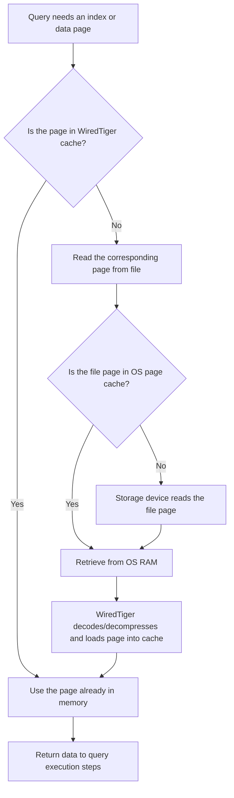

# WiredTiger Cache, Operating System Memory, and the Working Set

## 1. Why Does MongoDB Need Multiple Cache Layers?

A database may store hundreds of gigabytes or multiple terabytes of data on disk, yet at any given moment an application accesses only a subset of it. If every query had to read from the storage device, latency and I/O operations would surge sharply. MongoDB uses **WiredTiger** as its default storage engine in modern versions; WiredTiger manages data pages in memory to serve reads, handle updates, and maintain state that needs to be written to storage. At the same time, the operating system maintains its own cache for data file pages.

These two cache layers serve different purposes:

- **WiredTiger internal cache** holds data and index pages that the storage engine is actively working with, typically in uncompressed form, along with modifications and version-management structures.
- **Operating system filesystem/page cache** keeps recently read or written file pages at the OS level; for compressed WiredTiger files, the content cached at this layer is typically the compressed on-disk storage pages.

In addition, memory is consumed by the `mongod` process itself, running queries, connections, replication, the journal, OS services, and other applications. Thus, the question "How much RAM does MongoDB use?" must distinguish between **WiredTiger cache size**, **RAM actually used by the process**, and **RAM the OS can reclaim from the filesystem cache**.

> Key idea: **Database size is not the working set; WiredTiger cache is not all of MongoDB's RAM; and OS memory used as cache does not automatically mean a RAM shortage.**

## 2. Three Concepts to Distinguish

| Concept | What Does It Hold? | Who Manages It? | When Is It Useful? |
| --- | --- | --- | --- |
| WiredTiger cache | Data/index pages loaded into the storage engine, dirty state, metadata, and related structures. | WiredTiger inside `mongod`. | Reading and modifying active pages without reloading them from disk files. |
| Filesystem/page cache | Data file pages kept in RAM by the OS; usually on-disk data in compressed form. | Operating system. | Avoiding physical I/O when WiredTiger needs to reload a page from a file. |
| Working set | The portion of data and indexes frequently accessed by the workload over a given time window. | A property of the workload, not a fixed memory allocation. | Estimating memory requirements and diagnosing latency caused by disk reads. |

Another easily confused memory area is the **query plan cache**: where MongoDB can store query plan information for reuse. The plan cache does not store copies of query results and is not equivalent to the WiredTiger cache. Likewise, memory used by `sort`, `$group`, or aggregation stages is not automatically counted toward WiredTiger cache capacity.

## 3. Data Path During Reads

Consider a query looking up an order by an index:

```javascript
db.orders.findOne({ orderCode: "ORD-2026-0101" });
```

Conceptually, locating the needed page proceeds as follows:



This is a high-level model for understanding caching, not a guarantee that every read follows these exact steps. A single query may need multiple index pages and multiple data pages; WiredTiger also has different execution paths and page-loading mechanisms depending on the case.

Three notable scenarios:

1. **WiredTiger cache hit:** the page is already present in the storage engine cache. There is no need to re-read that page from file; this is generally the best case for repeated access.
2. **WiredTiger miss but OS page-cache hit:** WiredTiger must process/reload the page, but the file data is already in OS RAM, avoiding physical reads from the storage device.
3. **Miss in both layers:** the page must be read from disk or remote storage. Latency is typically higher, especially under random access or I/O contention.

A filesystem cache hit does not make loading data into WiredTiger completely free: there is still copying, decompression, and in-memory structure building overhead. Conversely, a file being cached by the OS does not mean that page is currently inside the WiredTiger cache.

### Example: Repeated Queries vs. Broad Scans

Suppose the `orders` collection has 20 million orders, yet the API primarily reads recent orders for 5,000 active users during the week. Those relevant index pages and documents can be accessed repeatedly and become "hot." A large overall dataset can still perform well with moderate RAM if the hot subset is small and queries have proper indexes.

In contrast, a reporting query scanning all historical data can pull many rarely reused pages into cache. If this scan evicts hot pages, subsequent normal requests must reload their data. This is a form of **cache pollution**: analytical access degrades cache effectiveness for transactional traffic.

## 4. How Does the WiredTiger Cache Work?

WiredTiger organizes data and indexes using page structures in search trees. Accessed pages can be loaded into cache to perform lookups, updates, and version management without constantly reading/writing every change directly to disk.

### 4.1. Clean Pages and Dirty Pages

A **clean page** is a page whose in-cache state contains no changes not yet reflected in its corresponding durable storage representation. When no longer needed and eligible for eviction from cache, WiredTiger typically does not need to rewrite clean page contents.

A **dirty page** holds in-memory modifications not yet fully persisted to data file pages. Before freeing a dirty page when writing is required, WiredTiger may need to reconcile the page's contents (*reconciliation*) and perform appropriate writes. WiredTiger's write activity also interacts with checkpoints, versioning, and the journal; do not equate a dirty page with "an unsafe/lost write."

```text
Read page -> page in WiredTiger cache
             |
             +-- Read-only -----------------> clean, can be evicted when appropriate
             |
             +-- Data modification ---------> dirty, requires write/version handling
                                             |
                                             +--> checkpoint or eviction
                                             +--> maintains necessary versions
```

The **journal** and **checkpoints** serve related but distinct goals. The journal supports recovering acknowledged changes according to durability policies after a crash; a checkpoint establishes a consistent milestone on data files. A document durably acknowledged under an appropriate write concern does not necessarily have every one of its data pages already checkpointed to disk files. Similarly, a page being evicted from cache does not mean the entire database was just checkpointed.

### 4.2. Eviction: Making Room for New Pages

Because cache capacity is finite, WiredTiger needs **eviction** to replace pages that are no longer actively needed. As utilization rises, background threads evaluate and evict eligible pages. Under heavy pressure, application threads may be forced to participate in eviction work, slowing down queries or writes.

Eviction is not as simple as deleting an entry in a key–value cache:

- A single page may hold multiple records, updates, and metadata for concurrent access.
- A dirty page may require write operations or version reconciliation before release.
- Some pages or versions are still referenced by active transactions, cursors, or other operations and cannot be evicted immediately.
- If the rate of generating dirty pages or loading new pages exceeds eviction throughput, application threads may have to wait or assist with eviction.

**Cache/eviction thresholds** exist and can be configured in certain contexts, though values and interpretations vary by version/configuration. Do not tune by copying a threshold number from another article without observing your actual workload.

### 4.3. History Store and Long-Running Transactions

MongoDB/WiredTiger must retain multiple data versions during certain concurrent read/write scenarios. WiredTiger maintains a version history mechanism (*history store*) so operations needing older snapshots can still read consistent data. Transactions or readers that stay open too long can pin versions no longer needed by the normal workload, increasing cache pressure, history store growth, and cleanup work.

For example, opening a transaction and waiting on a slow network call while many records continue to be updated creates unnecessary pressure. Good design avoids long-lived transactions, breaks large jobs into smaller batches when possible, and monitors metrics related to transactions and eviction.

## 5. Filesystem Cache: Why Doesn't MongoDB Allocate All RAM to WiredTiger?

For WiredTiger, the operating system still plays an important role in caching data file pages. A page that leaves the WiredTiger cache may still reside in the OS page cache. If accessed again, the OS can serve the read without touching physical I/O.

Therefore, **increasing the WiredTiger cache size is not always better**. Allocating more RAM to WiredTiger reduces the RAM available to the filesystem cache and other components. On a memory-constrained machine, the OS may frequently reclaim cached data, swap, or even invoke the OOM killer when resources run out.

On Linux, the "used memory" column in system tools often includes reclaimable cache memory. You should inspect `MemAvailable`, swap activity, memory pressure, and allocation failure signals. Looking solely at low `free` RAM is insufficient to conclude that MongoDB has a memory leak.

### Distinguishing Two Kinds of "Pages"

A *WiredTiger page* is a logical/storage-engine unit used to manage data and indexes in B-trees; an *OS memory page* is the operating system's unit for virtual memory and I/O management, such as 4 KiB pages on many Linux setups. These two concepts do not necessarily share the same size or boundaries.

WiredTiger can hold uncompressed representations of data pages, while the filesystem cache holds the corresponding file blocks in their on-disk format. Do not take total compressed file size and directly extrapolate how much RAM WiredTiger needs to keep all "hot" data cached. In-cache size also depends on indexes, metadata, update frequency, and page structure.

## 6. WiredTiger Cache Size and the RAM Budget

In modern MongoDB versions, the default WiredTiger cache size is typically determined from RAM available to the process or detected memory limits, reserving a substantial portion for other components. In many common MongoDB versions, the default rule is described roughly as:

```text
Default WiredTiger cache ~= max(50% x (RAM - 1 GiB), 256 MiB)
```

**The formula above is a version-dependent guideline**: container RAM detection behavior, default rules, and actual limits should be verified for the running MongoDB version. In operations, inspect the configuration and actual cache value reported by the instance rather than relying solely on a single formula.

For example, a dedicated machine with 16 GiB RAM might have a default cache of around 7.5 GiB under the rule above. The remaining RAM is **not simply "wasted RAM"**: it serves the filesystem cache, `mongod` memory outside the WiredTiger cache, the operating system, and workload-driven allocations.

An illustrative budget can be represented as:

```text
Available RAM on host/container
  |-- WiredTiger cache (configured limit)
  |-- Other mongod memory: connections, queries, replication, metadata, ...
  |-- OS filesystem/page cache (reclaimable)
  |-- Operating system and other processes
  `-- Headroom for peak load
```

This is a **categorization of memory usage**, not a formula for mechanically summing RSS measurements with OS cache: measurement tools across layers may overlap, and consumption varies over time.

### 6.1. Configuring Cache Size When Needed

One way to declare it in `mongod.conf`:

```yaml
storage:
  wiredTiger:
    engineConfig:
      cacheSizeGB: 6
```

This example only shows the syntax for allocating around 6 GiB to the cache; **it is not a general recommendation that every server should use 6 GiB**. Reasons to change the configuration must come from RAM limits, co-located processes sharing the host, and performance metrics. Setting the cache too large can starve the OS of memory; setting it too small can trigger constant page loading and eviction.

### 6.2. Container Deployments

A container has a RAM limit smaller than the physical host's RAM. Do not size the cache based on host memory if the process is constrained by cgroups. Verify whether your MongoDB version detects container memory limits as expected, and monitor `memory limit`, `memory usage`, OOM/restart events, and sidecar consumption.

For instance, if a pod/container is given 8 GiB but the cache is configured near 8 GiB, the remaining memory may be insufficient for connections, aggregations, and filesystem cache; a workload that appears healthy at baseline can still hit OOM during peak load. Leave headroom and measure under realistic load, not just at startup.

## 7. Working Set: What Really Is the "Hot" Dataset?

The **working set** is the set of data and index pages a workload needs to access within a given observation window. It is not a MongoDB setting, nor is it `db.stats().dataSize` or collection size in bytes.

For example, consider a system with:

- 400 GiB of multi-year order data.
- 60 GiB of indexes across the entire dataset.
- 90% of requests during the day looking up only recent orders and a subset of active accounts.
- A nightly aggregation report reading months of history.

The daytime workload may need a relatively small working set compared to the total 460 GiB of data and indexes. Conversely, the nightly report can pull many cold pages into cache, changing the working set during that window. You cannot rely solely on total database size to estimate required RAM.

### 7.1. Working Set Depends on the Time Window

The same system can exhibit:

| Observation Window | Frequently Accessed Data | Consequence |
| --- | --- | --- |
| Seconds | Repeatedly accessed order IDs or users. | Small hot set, easily retained. |
| Minutes | Orders, products, carts during a promotion event. | Many distinct keys; cache churn increases. |
| One day | Operational data and periodic reports. | Accessed page set can be substantially larger. |
| Weekly/monthly | Historical scans or full analytics. | Many cold pages, prone to competing with API cache. |

Therefore, saying "the working set fits in RAM" is incomplete without specifying **which workload**, **which time window**, **what latency target**, and **which cache layer** is under consideration.

### 7.2. Indexes Are Part of the Working Set

Querying by an index does not mean all needed data resides in a single index entry. MongoDB may need to read index tree pages and then access the data pages holding the corresponding documents. Queries fully satisfied from the index (*covered queries*, under suitable conditions) can avoid part of the document reads.

Example:

```javascript
db.orders.createIndex({ customerId: 1, status: 1, createdAt: -1 });

db.orders.find(
  { customerId: "C104", status: "PAID" },
  { _id: 0, customerId: 1, status: 1, createdAt: 1 }
).sort({ createdAt: -1 }).limit(20);
```

The query can leverage the compound index for filter conditions, sort order, and projected fields, depending on the actual plan. Adding a field not in the index, such as `shippingAddress`, may require the engine to access document pages. Proper index design reduces both the number of pages touched and the likelihood of reading cold data from storage.

### 7.3. When Does Cache Thrashing Occur?

**Cache thrashing** is a state where pages are loaded into cache, evicted shortly afterward, and then immediately needed again because the workload continues accessing them. Common symptoms include rising read I/O, surging page reads into cache, heavy eviction activity, and degrading query latency. On systems with many dirty pages or pinned versions, eviction has an even harder time keeping pace.

For example, a workload randomly accesses 30 GiB of active pages while the WiredTiger cache is around 6 GiB and the OS page cache is under pressure from other processes. If short-term page reuse is low, most queries pay repeated page-load costs. Increasing cache **may** help, but first verify whether collection scans, missing indexes, or inefficient access patterns are creating an artificially bloated working set.

## 8. Relationship Between Data Size, Indexes, RAM, and Latency

Consider three hypothetical systems:

| Scenario | Data on Disk | Primary Access Pattern | What to Measure |
| --- | --- | --- | --- |
| A — ID lookup API | 2 TiB | A few million recent records and corresponding indexes. | Whether hot pages fit in cache, whether p95/p99 latency stays stable. |
| B — Broad scan reports | 80 GiB | Scans nearly the entire collection per report run. | Pages read, physical read rate, impact on other APIs' cache. |
| C — High concurrent writes | 120 GiB | Heavy repeated updates on documents and indexes. | Dirty pages, eviction, write I/O, checkpoints, write conflicts. |

System A has the largest total size yet may perform smoothly if its hot subset is small; smaller System B can still hit I/O bottlenecks; System C can suffer pressure from dirty-data generation rate even when read volume is modest. There is no universal rule that "databases smaller than RAM are fast and larger than RAM are slow" across all workloads.

Similarly, well-compressed data on disk does not guarantee fitting into the WiredTiger cache. The working set in RAM can exceed the compressed footprint of those corresponding pages. Measure latency and cache metrics against real queries.

## 9. Reading WiredTiger Cache Metrics in MongoDB

`serverStatus` provides process statistics; in configurations using WiredTiger, you can inspect `wiredTiger.cache` from `mongosh`:

```javascript
const wt = db.serverStatus().wiredTiger.cache;

printjson({
  maximumBytes: wt["maximum bytes configured"],
  currentBytes: wt["bytes currently in the cache"],
  dirtyBytes: wt["tracked dirty bytes in the cache"],
  pagesReadIntoCache: wt["pages read into cache"],
  pagesWrittenFromCache: wt["pages written from cache"]
});
```

Field names and availability of individual metrics may vary across MongoDB/WiredTiger versions. When building dashboards, inspect the actual returned data, handle missing fields defensively, and document the version in use.

### How to Interpret Metric Groups

| Group | What Question Does It Help Answer? | Interpretation Notes |
| --- | --- | --- |
| Cache current/maximum bytes | How much cache is currently used relative to the limit? | A nearly full cache is normal behavior for a caching mechanism. |
| Dirty bytes or dirty percentage | How much modified data is awaiting write processing? | Correlate with write rate, checkpoints, and eviction. |
| Pages read into cache | At what rate is the engine loading new pages? | Cumulative counter; take deltas between two timestamps. |
| Pages written from cache | At what rate is the engine writing pages out? | Does not directly equal the total number of documents updated by the application. |
| Eviction activity/blocked reads | Is the cache facing pressure to free pages? | Check version-specific eviction metrics and related wait times. |
| Concurrent operations / transaction age | Are tasks holding resources for too long? | Long-running readers/transactions can block version and page reclamation. |

**Do not compute a naive cache hit ratio** simply by dividing a "pages read" counter by API request count. One request can touch many pages; read-ahead behavior, multiple page types, and different I/O paths make homemade ratios misleading. To evaluate cache health, combine page load rate, eviction metrics, physical I/O, and application latency over time.

### Example: Measuring Change Across Two Timestamps

Suppose your monitoring tool captures two samples of `pages read into cache` 60 seconds apart:

```text
12:00:00  pages read into cache = 1,240,000
12:01:00  pages read into cache = 1,246,600

Average load rate = (1,246,600 - 1,240,000) / 60
                  = 110 pages/second
```

The number 110 pages/second **does not by itself prove a bottleneck**. Compare it over the same interval against request volume, page size, OS I/O, cache eviction, and p95/p99 latency. A burst of cache loading right after startup can be normal; the same sustained rate during peak traffic with high physical I/O and rising latency can signal that the working set does not fit in memory.

## 10. Observing Operating System Memory

On Linux, you can start with common system commands:

```bash
free -h
vmstat 1
```

`free -h` gives an overview of RAM and allocatable memory (`available`); `vmstat 1` shows per-second changes such as swap in/out, CPU levels, and some I/O activity. For deeper investigation, use device I/O monitors like `iostat -x 1`, cgroup/container metrics, process RSS, and deployment environment dashboards.

Signals to examine **together as a group**:

- Prolonged drop of `MemAvailable` to very low levels, rising swap in/out, or rising memory pressure.
- Device read rate and I/O latency spiking at the exact time API latency degrades.
- WiredTiger pages read into cache rising alongside eviction and application threads forced into eviction.
- Process RSS, container memory, and connection/query counts approaching limits.
- Process OOM/restarts, or kernel/container logs recording severe memory reclaim activity.

A dashboard may show `mongod` RSS higher than the configured WiredTiger cache. That alone does not prove a RAM leak: the process holds other memory outside cache, and how allocators return pages to the OS also affects RSS. Conversely, seeing the WiredTiger cache less than full is insufficient to conclude the host has enough RAM if aggregations, connections, or other processes are consuming large amounts of memory.

> When monitoring on containers/Kubernetes, read **memory limit**, container usage, and internal `mongod` metrics together. Host RAM may be much larger than the actual cgroup limit.

## 11. Query Performance and Working Set Have a Bidirectional Relationship

A query missing an index can turn a request needing a few documents into an operation reading millions of documents, bloating the working set and pushing useful pages out of cache. Therefore, inspect query paths before adding RAM.

Example query listing a customer's orders:

```javascript
db.orders.find(
  { customerId: "C104", status: "PAID" }
).sort({ createdAt: -1 }).limit(20);

db.orders.find(
  { customerId: "C104", status: "PAID" }
).sort({ createdAt: -1 }).limit(20).explain("executionStats");
```

Fields such as `nReturned`, `totalKeysExamined`, `totalDocsExamined`, and plans like `IXSCAN`/`COLLSCAN` help determine whether too many keys/documents are being read. An index aligned with the filter and sort typically reduces the number of pages that must be loaded, easing pressure on both the WiredTiger cache and the filesystem cache.

```javascript
db.orders.createIndex({
  customerId: 1,
  status: 1,
  createdAt: -1
});
```

Do not create an index just because you see a query once: every index consumes disk space, increases write maintenance overhead, and has its own working set. Weigh query frequency, selectivity, sort behavior, index cost, and write rate before deploying.

### Ways to Reduce Cache Pressure Through Application Design

1. Query only the necessary documents and fields; apply projections where appropriate.
2. Design indexes based on real filters/sorts, monitoring `docsExamined` and actual plans.
3. Avoid scanning historical data on replicas serving latency-sensitive APIs when workloads can be cleanly separated; keep consistency trade-offs in mind when reading from secondaries.
4. Use keyset/cursor pagination on deep pagination flows instead of unnecessary large offsets.
5. Archive cold data according to business requirements; distinguish immediate operational access from long-term retention.
6. For heavy analytics, consider pre-aggregation systems or dedicated analytical storage rather than forcing OLTP workloads to scan everything.

**Projection does not always mean less I/O**: if a query still has to read the full document from disk files, dropping a few fields when returning results only shrinks returned payload size. Benefits are clearer when the query qualifies to be index-covered or when serialization/network transfer is significantly reduced.

## 12. Three Common Types of Memory Pressure

### 12.1. Random Reads Across a Large Data Region

**Symptoms:** rising page-load rate, rising random read I/O, rising p95/p99; many requests waiting on pages from storage.

**Possible causes:** working set exceeds cache capacity, missing/ineffective indexes, broad scanning queries, or background jobs pulling cold pages into cache.

**Remediation:** check `explain`, measure query paths, eliminate unnecessary scans, optimize indexes and data models. Only then evaluate increasing RAM or upgrading storage hardware if the workload genuinely requires a large hot set.

### 12.2. Heavy Writes and Dirty-Page Pressure

**Symptoms:** rising dirty bytes, aggressive eviction/checkpoint activity, slow writes, or requests forced to perform eviction.

**Possible causes:** update/insert workload outpacing storage write throughput, too many indexes to update, large documents, or transactions holding versions too long.

**Remediation:** inspect write IOPS/latency, batch appropriately, optimize indexes and document structure; eliminate unnecessarily long transactions. Evaluate storage capability, replication, and checkpoints before simply increasing cache size.

### 12.3. OS or Container Running Out of RAM

**Symptoms:** surging swap/reclaim, memory limits exceeded, OOM events, process restarts; fluctuating latency even when WiredTiger cache metrics look normal.

**Possible causes:** cache configured too large relative to actual limits, multiple processes sharing the host, spikes in aggregations or connections, or unbudgeted memory outside WiredTiger cache.

**Remediation:** verify container limits, measure process/container memory, reduce cache if needed to free RAM for the OS and other components, or increase the RAM budget once needs are verified. Monitor after making changes because shrinking cache too far can increase read I/O.

## 13. Real-World Scenario: MongoDB Reports High RAM Usage—Should Cache Be Increased or Decreased?

Suppose a 32 GiB machine runs only `mongod`, storing 300 GiB of data and indexes. Monitoring shows:

```text
Physical RAM              : 32 GiB
Configured WiredTiger cache: ~15.5 GiB
DB + index size           : 300 GiB
API p95 latency           : 35 ms (normal)
Physical read I/O         : low, stable
Swap/OOM                  : none
```

A database many times larger than RAM or a WiredTiger cache sitting near its limit **is not a problem by itself**. If APIs meet SLOs and the system exhibits no memory pressure, there is no basis to change cache settings. Keep monitoring and test for peak traffic periods.

One week later, a new reporting job runs every hour and you observe:

```text
During the 10-minute report run:
- Rate of pages read into WiredTiger cache spikes sharply
- Physical read I/O increases
- API p95 latency jumps from 35 ms to 280 ms
- After the report finishes, API stays slow for several minutes before stabilizing
```

A reasonable hypothesis is that the reporting job scanned many rarely reused pages and competed for cache with the API. Check `explain`, separate secondary reads from primary reads, and measure the impact of options: optimizing the pipeline/indexes; running reports on an isolated system; pre-aggregating data; or scaling hardware if genuinely needed. **Immediately increasing WiredTiger cache size** might just shift the problem into starving the filesystem cache or OS RAM.

Another case: cache uses only 8 GiB while the pod limit is 12 GiB, yet the pod OOMs during a large aggregation. Here the issue may lie in memory outside the WiredTiger cache; increasing cache goes in the wrong direction. Investigate the aggregation, memory limit requirements, and process usage first.

## 14. From Symptoms to Measurements

| Symptom | Check First | What Not to Conclude Hastily |
| --- | --- | --- |
| WiredTiger cache often at 90–100% of limit | API latency, eviction, read I/O, swap, and trend over time. | "A nearly full cache is definitely a bug." |
| `mongod` uses more RAM than configured cache | Process RSS, connections, aggregations, non-cache memory. | "MongoDB exceeded its cache so it has a leak." |
| `free` reports little free RAM | `MemAvailable`, filesystem cache, memory pressure. | "The operating system is out of RAM." |
| Queries slow after startup | Page load rate, read I/O, query plans, warm-up progress. | "Every query is permanently slow now." |
| Eviction spiking rapidly | Dirty bytes, pages read, long readers/transactions, I/O latency. | "Just increase the cache and it's fixed." |
| High read I/O | `explain`, indexes, scans, working set, filesystem hits. | "Large DB size is the sole cause." |
| Slow writes despite low CPU | Dirty pages, checkpoint/eviction, disk, indexes, replication. | "Low CPU means storage isn't bottlenecked." |
| Container OOM | cgroup limit, RSS, configured cache, query memory, sidecars. | "Only WiredTiger cache uses RAM." |

## 15. Safe Tuning Strategy

A practical investigation sequence:

**Step 1 — Define the goal.** For example, read p95 under 100 ms at 1,000 requests/second, zero OOMs at peak load, write acknowledgment latency below business thresholds. Do not optimize for "low cache usage" as an end in itself.

**Step 2 — Capture a baseline.** Collect MongoDB version, host RAM/container limit, current WiredTiger cache, read/write ratio, query patterns, read/write IOPS, latency, eviction, dirty bytes, and long-running transaction counts. Ensure metrics align to the same time window.

**Step 3 — Eliminate unnecessary I/O sources.** Find COLLSCANs, unindexed sorts, historical scans not serving APIs, oversized projections/aggregations, and habits of reading excessive documents. Evaluate these fixes first because they shrink the working set without adding RAM.

**Step 4 — Pick one change with a clear hypothesis.** For example, add RAM when the necessary working set is genuinely large, reduce WiredTiger cache when the container leaves too little RAM for other components, or offload reporting to a separate system if it regularly destabilizes API cache.

**Step 5 — Re-measure under a comparable workload.** Compare p95/p99, read/write IOPS, pages loaded, eviction pressure, dirty bytes, RSS/memory limit, and OOM risk. A useful change must improve application goals, not just make one cache chart look prettier.

**Step 6 — Document applicability conditions.** Record version, cache settings, index count, memory limits, access patterns, and alert thresholds. Re-evaluate previous decisions whenever workloads or data models change.

## 16. Common Misconceptions

| Misconception | Accurate Understanding |
| --- | --- |
| "MongoDB uses its own cache so the OS page cache doesn't matter." | Both layers affect read cost and compete for the RAM budget. |
| "Setting WiredTiger cache to all RAM will be fastest." | `mongod` and the OS also need RAM outside cache; oversizing causes memory pressure. |
| "A full WiredTiger cache means an imminent crash." | Cache is designed to utilize its allocated capacity and evict on demand; look for actual pressure signals. |
| "A 1 TiB DB requires at least 1 TiB of RAM." | Only the frequently accessed portion needs priority in RAM; much data may be cold. |
| "A database smaller than RAM is always fast." | Missing-index queries, scans, contention, checkpoints, and write load can still cause latency. |
| "A cache miss always causes a physical disk read." | The page may already reside in the OS filesystem cache. |
| "Indexes only use disk and don't affect RAM." | Index pages are also part of the working set and occupy cache. |
| "`mongod` RSS larger than cache size is a memory leak." | The process uses significant non-cache memory; analyze actual components and trends. |
| "Increasing cache fixes every slow query." | Poor query plans and broad scanning workloads continue generating I/O even with a larger cache. |
| "WiredTiger cache and the journal are the same thing." | Cache manages active pages; the journal and checkpoints handle distinct durability and recovery roles. |

## 17. Apply It Yourself: Choosing an Action by Workload

### Case 1 — Cache Metrics Nearly Full

**Facts:** WiredTiger cache uses 95% of configured capacity; no swap; low read I/O; normal API latency.

**Analysis direction:** insufficient evidence to alter cache settings. Retaining recently used data is what cache is built for. Continue monitoring eviction and latency during peak hours.

### Case 2 — API Slows Down After an Analytics Job

**Facts:** A reporting job runs for 5 minutes, driving up read I/O and `pages read into cache`; the API slows down and later recovers.

**Analysis direction:** inspect query scans, the job's data scope, and cache contention. Prioritize optimizing queries, pre-aggregating, or isolating workloads before increasing cache.

### Case 3 — Pod Frequently Hits OOM

**Facts:** Pod memory limit is 8 GiB; WiredTiger cache is configured at 7 GiB; workload includes aggregations and many connections.

**Analysis direction:** cache consumes too large a share of the budget; either allocate more RAM for non-cache components or lower cache size and re-measure. Inspect large aggregations and connection counts before raising the limit.

### Case 4 — ID Lookups Are Fast, Multi-Field Search Lists Are Slow

**Facts:** Fetching products by `_id` is very fast, while multi-field filtered lists frequently run COLLSCAN even with spare RAM available.

**Analysis direction:** the primary issue likely lies in access patterns/indexes, not RAM capacity. Check `explain("executionStats")`, identify common filter/sort combinations, design matching indexes, and evaluate before/after latency.

## 18. Connecting All Three Layers to Make Decisions

MongoDB memory behavior can be framed as a chain of questions:

```text
What does the workload read/write, and how frequently?
          |
          v
Which data and index pages form the working set?
          |
          v
Can the WiredTiger cache retain the required hot subset?
          |
          +-- Yes --> Are there bottlenecks from query plans, writes, locks, CPU, or network?
          |
          +-- No  --> Are reloaded pages still in the OS page cache?
                               |
                               +-- Yes --> What is the reload/decompression/eviction cost?
                               |
                               +-- No  --> Does the storage device have sufficient IOPS/throughput?
          |
          v
Is enough RAM left for the OS, queries, connections, and other processes?
          |
          v
Measure latency and resources after every change
```

The most effective choice is not always raising `cacheSizeGB`. Many systems improve far more by reducing pages read, choosing accurate indexes, curbing cold-data scans, offloading heavy reports, and avoiding long-running transactions. WiredTiger cache, OS filesystem cache, and working set only make sense when evaluated **together, within the context of the real workload and the system's actual RAM limits**.
