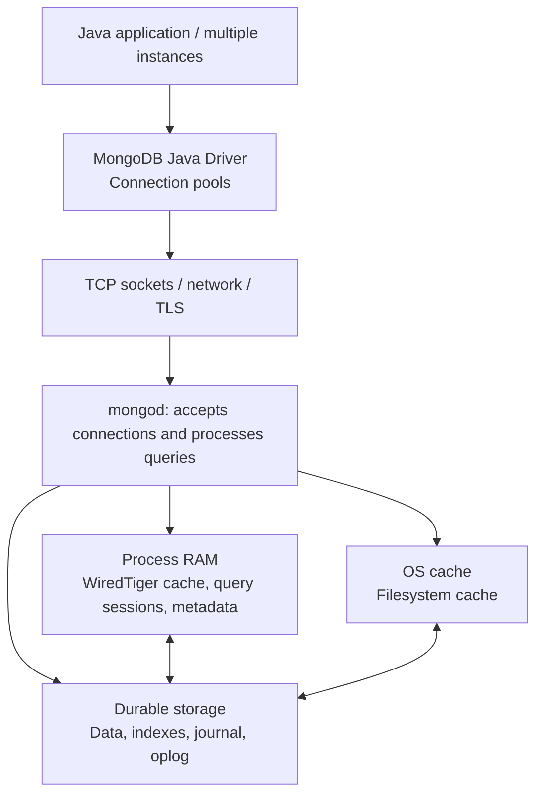
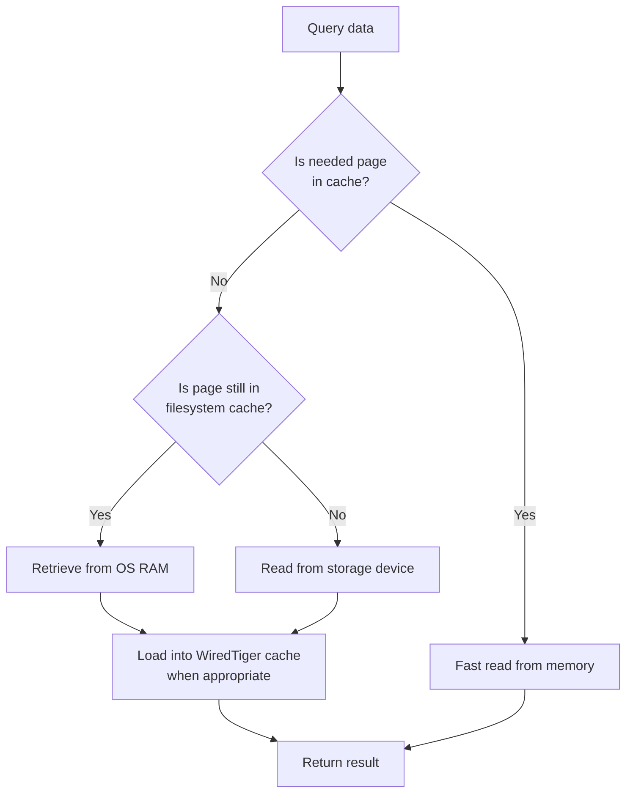
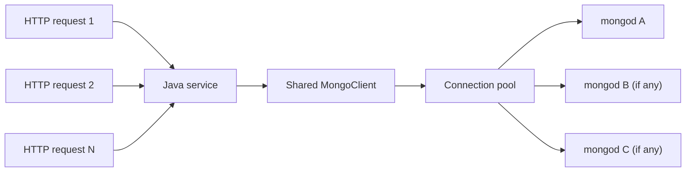

# Resource Limits: RAM, Disk, Connections, and Storage Capacity

> **Module:** MongoDB Document Database Engine  
> **Chapter:** MongoDB Architecture

MongoDB does not operate independently of host resources. Every read, write, query, sort, or index build consumes a share of **RAM**, **CPU**, **disk**, **network bandwidth**, and **connections**. Understanding the limits of each layer helps you choose configurations, estimate scalability, and troubleshoot incidents without hastily concluding "MongoDB is slow."

This lesson focuses on four closely linked aspects: memory, disk I/O capacity, connection counts, and storage capacity. Examples use MongoDB Server with the WiredTiger storage engine; specific defaults, configuration limits, and metrics should be checked against your running MongoDB version.

## 1. Which Layers Hold Resources?

In a Java application connecting to MongoDB, resources are consumed across multiple layers:



A system can hit a limit first at any layer. For instance:

- **Insufficient RAM** pushes frequently accessed data out of cache; the server must read from disk more often.
- **A disk with plenty of free GB yet low IOPS** still slows down queries or writes.
- **A saturated connection pool** forces application requests to wait to check out a connection, even when server CPU is underutilized.
- **A nearly full disk** can block writes, index builds, journal growth, or oplog retention; strong prior performance does not rule out running out of space.

Therefore, monitor **usage**, **capacity/throughput**, and **latency** simultaneously.

| Resource | Limits to Distinguish | Common Symptoms |
|---|---|---|
| RAM | Total host/container RAM; WiredTiger cache; query and other process memory | Cache misses, heavy disk reads, swap, OOM, erratic queries |
| Disk | IOPS, throughput, latency, queue depth, durability, and filesystem | Rising read/write latency, long I/O queues, slow checkpoints |
| Connections | Server accepted sockets, OS limits, pool count and pool size in the app | Connection checkout timeouts, connection refused, rising connection churn |
| Storage Capacity | Per-document limits, data, indexes, journal, oplog, temp files, growth headroom | Out of space, index creation failures, unable to write more data |

## 2. RAM: WiredTiger Cache Is Not All of MongoDB's Memory

### 2.1. What Does MongoDB Use RAM For?

In standard MongoDB versions using **WiredTiger**, RAM is shared across several needs:

1. **WiredTiger internal cache:** holds frequently accessed data and index pages, including both clean and modified data.
2. **OS filesystem cache:** keeps recent file pages, accelerating file reads; this sits outside the WiredTiger internal cache.
3. **Query and operation memory:** e.g., aggregations, sorts, hash joins, batch processing, cursors, transactions.
4. **Metadata and process overhead:** threads, connections, network buffers, memory used by libraries and co-located components.
5. **Memory of other services:** monitoring agents, backups, Docker, Java apps, or other processes sharing the host.

Thus, setting WiredTiger cache equal to total RAM is unwise: the OS and remaining components also need memory.

### 2.2. Working Set Governs Cache Effectiveness

The **working set** is the subset of data and indexes accessed frequently within a given time window. For example, a system may hold 2 TB of historical data yet continuously look up only the most recent 30 GB. In many workloads, keeping the working set in cache yields strong performance; not every byte of the database needs to live in RAM.

A read path can be pictured as:



This is a conceptual diagram; how WiredTiger and the OS cache interact in practice also depends on pages, files, read mechanisms, eviction, and workload.

If the working set exceeds useful memory, MongoDB can continue operating normally while performing more I/O. A large dataset does not automatically mean you need more RAM; first verify whether queries use proper indexes or are scanning excessive documents.

### 2.3. WiredTiger Cache Size

WiredTiger chooses its default cache size from available memory following the MongoDB version's rule. In many releases, the default is roughly **50% of (RAM minus 1 GiB)**, with a minimum floor for small systems; container memory limits can affect how MongoDB detects RAM. Do not apply this formula rigidly across every version or environment.

You can configure it explicitly, for instance:

```yaml
# mongod.conf — illustrative example; do not use without knowing your RAM budget
storage:
  wiredTiger:
    engineConfig:
      cacheSizeGB: 2
```

Or launch with `--wiredTigerCacheSizeGB 2`. This parameter sets the **WiredTiger cache**, not the maximum total RAM of the `mongod` process. When increasing cache, leave headroom for the OS, filesystem cache, and queries.

**Especially with Docker/Kubernetes:** always consider both container/pod RAM limits and host node RAM. If a container is sized too tightly, the system may terminate it with **OOMKilled** even while WiredTiger cache metrics stay below the configured cap.

### 2.4. Cache Pressure, Eviction, and Dirty Pages

WiredTiger must make room for new pages. When cache fills up, it **evicts** eligible pages; modified pages must be synced via storage mechanisms before they can be freed. Some eviction is normal operation. What warrants attention is sustained eviction accompanied by rising disk reads/writes, rising query latency, and memory exhaustion.

Useful indicators include:

- Disk read rate climbing without a corresponding rise in request rate.
- Cache holding many dirty pages with eviction struggling to keep up with write rate.
- Queries/aggregations holding large amounts of memory while concurrency rises.
- Host beginning to swap heavily or containers hitting OOM.
- High resident memory **by itself** is not enough to conclude a memory leak; MongoDB actively utilizes cache.

Examine trends over the same time window rather than inferring root causes from a single snapshot.

### 2.5. Memory Used for Sorting and Aggregation

Beyond cache, queries lacking suitable indexes may need to buffer large intermediate datasets for sorting or grouping. For example:

```javascript
db.orders.find({ customerId: "C001" })
  .sort({ createdAt: -1 })
  .limit(20)
  .explain("executionStats")
```

With index `{ customerId: 1, createdAt: -1 }`, the engine can retrieve results in index-supported order instead of sorting large volumes in memory:

```javascript
db.orders.createIndex({ customerId: 1, createdAt: -1 })
```

Building an index on a large collection costs CPU, I/O, disk space, and time; run the example above only in a practice database. Use `explain("executionStats")` to inspect the execution plan, examined documents/index keys, and any sort stage.

For aggregations, certain stages have their own memory limits. Depending on version, pipeline, and options, the engine may spill to temporary disk when exceeding limits (disk spilling), such as via `allowDiskUse`. This **does not eliminate the cost**: it trades RAM pressure for I/O and temporary disk pressure. Do not treat `allowDiskUse` as a substitute for indexes or proper query design.

## 3. Disk: Serving Speed Differs from Free Gigabytes

Two disks both having 500 GB free can deliver completely different MongoDB performance.

- **IOPS** (I/O operations per second): number of small read/write operations the device handles per second.
- **Throughput:** data read/written per second, typically measured in MB/s.
- **Latency:** time taken per I/O, especially critical for random-read queries.
- **Queue depth:** number of I/O requests waiting or in flight.
- **Durability and stability:** affects data writes, journal, checkpoints, replication, and recoverability.

MongoDB workloads frequently touch small indexes and documents, so **random I/O** and tail latency often matter far more than advertised peak MB/s numbers.

### 3.1. What Gets Written to Disk?

With WiredTiger, storage can contain:

| Component | Function | Impact on Capacity and I/O Planning |
|---|---|---|
| Collection data files | Store documents on disk (optionally compressed) | Grow with document count and size |
| Index files | Used for lookups, filtering, and sorting | Each index consumes space and adds write overhead |
| Journal | Supports durability and crash recovery | Writes I/O independently of when apps see ops finish |
| Replica set oplog | Records operations for replication | Each replica set member needs an oplog budget |
| Temporary / spill files | Intermediate data from sorts/aggregations or other ops | Can spike suddenly when workloads shift |
| Free space / internal allocation | Allocated space not currently holding live data | Not always returned immediately to the filesystem on delete |

Reads and writes are also affected by checkpoints, compaction, replication, backups, and index builds. Running a backup or index build during peak hours can shift latency even when application data volume barely grows.

### 3.2. Choosing Storage Devices and Filesystems

For production servers, prefer SSD/NVMe or storage services with latency and IOPS guaranteed to match requirements. Some operating systems/filesystems fit MongoDB better; on Linux, for example, pick a filesystem meeting your MongoDB version's recommendations and configured appropriately for WiredTiger.

Checklist items:

- Does the device retain **IOPS/throughput headroom** at peak load?
- Are logs, journal, filesystem, and data path sharing a single saturated device?
- Are there cloud volume/tier IOPS or throughput caps?
- If using containers, do volumes map to proper persistent storage?
- Do restore times and backup/restore capabilities meet requirements?

**Never choose storage on capacity alone.** A smaller volume with fast enough I/O can outperform a large volume choked by concurrent reads/writes. In the cloud, IOPS and throughput typically depend on volume type, configuration, and account/tier quotas.

### 3.3. Checking at the Operating System Level

On Linux with MongoDB installed directly:

```bash
df -h /var/lib/mongodb
df -i /var/lib/mongodb
free -h
vmstat 1
iostat -xz 1
```

- `df -h`: free capacity on the filesystem.
- `df -i`: free inodes; especially useful when a filesystem holds many small files.
- `free -h` and `vmstat 1`: overview of RAM, swap, and system activity.
- `iostat -xz 1`: observe I/O utilization, queues, and latency; `iostat` usually requires the `sysstat` package.

With Docker, e.g., a container named `mongodb-lab`:

```bash
docker stats --no-stream mongodb-lab
docker exec mongodb-lab df -h /data/db
```

`docker stats` reflects container resources per Docker's metrics; `df` inside a container does not replace monitoring the host volume or cloud storage. On Windows, use **Task Manager**, **Resource Monitor**, **Performance Monitor**, or equivalent disk monitoring tools.

## 4. Connections: Server Sockets and Client Pools Are Distinct Limits

### 4.1. What Does One Connection Consume?

A MongoDB connection typically corresponds to a TCP socket (optionally over TLS). Server and client must maintain state, buffers, and OS resources. Creating or closing connections too often also adds TCP handshake, authentication, and TLS setup overhead.

MongoDB configures a limit on incoming server connections, yet actual usable capacity also depends on **file descriptor/socket limits, RAM, OS, network configuration, proxies, `mongos`, or cloud tier limits**. Exceeding thresholds causes new connections to be refused or queued, even for simple queries.

### 4.2. Connection Pools in the Java Driver

The MongoDB Java Driver uses a **connection pool** to reuse connections across requests. An application typically creates one shared `MongoClient` for the application's lifetime rather than creating a new client per API call.



In a replica set or sharded topology, the driver can manage separate connection pools to multiple servers. Therefore, **one client's max pool size is not the absolute total connection count across the whole system**.

Example connection string for a Java application:

```text
mongodb://127.0.0.1:27017/?maxPoolSize=30&minPoolSize=0&waitQueueTimeoutMS=3000
```

- `maxPoolSize=30`: limits connections in the driver's pool to a given server per driver pooling mechanics.
- `minPoolSize=0`: does not require the pool to keep a minimum number of idle connections open.
- `waitQueueTimeoutMS=3000`: maximum time in milliseconds an operation waits to borrow an available connection from the pool.

These options are **examples only**; choose them based on concurrency, query latency, topology, instance count, and server acceptance limits. There is no single pool configuration right for every application.

A minimal Java class:

```java
import com.mongodb.client.MongoClient;
import com.mongodb.client.MongoClients;
import org.bson.Document;

public final class MongoConnectionExample {
    private MongoConnectionExample() {}

    public static void main(String[] args) {
        String uri = System.getenv("MONGODB_URI");
        if (uri == null || uri.isBlank()) {
            uri = "mongodb://127.0.0.1:27017/"
                    + "?maxPoolSize=30&minPoolSize=0&waitQueueTimeoutMS=3000";
        }

        try (MongoClient client = MongoClients.create(uri)) {
            Document ping = client.getDatabase("admin")
                    .runCommand(new Document("ping", 1));
            System.out.println(ping.toJson());
        }
    }
}
```

Real applications should create `MongoClient` once at startup and close it at shutdown; `try-with-resources` fits here only because this program runs once. With Spring, manage the client via a bean and application lifecycle.

### 4.3. Estimating Total Connections

Suppose a system deploys:

- 20 Java application instances;
- Each instance has a pool with `maxPoolSize=50`;
- Instances connect to a three-member topology.

If each instance opens nearly a full pool to each member, potential sockets can far exceed `20 × 50 = 1,000`. Multiplying **20 × 3 × 50 = 3,000** is only an illustration of a naive ceiling; actual counts depend on server roles, operations, monitoring connections, and driver behavior, so measure with real metrics.

Also note: increasing connection counts does not scale throughput infinitely. Once disk or CPU is saturated, adding more concurrent queries can make queues and latency **worse**.

### 4.4. MongoDB Server Connection Metrics

In `mongosh` connected to a server you are authorized to monitor:

```javascript
const connections = db.serverStatus().connections;

printjson({
  current: connections.current,
  available: connections.available,
  totalCreated: connections.totalCreated,
  active: connections.active
});
```

How to read them:

| Metric | Meaning |
|---|---|
| `current` | Connections currently open at the server |
| `available` | Remaining connections accepted under the active limit |
| `totalCreated` | Cumulative counter of connections created since server startup; not currently open count |
| `active` (if present) | Connections actively executing work at observation time; may not appear in every version/context |

For example, `current` rising rapidly alongside a surging `totalCreated` suggests the application is constantly creating clients or connections are being reset. High yet steady `current` with low latency may simply mean healthy pooling.

To check which limit the server enforces, inspect **`net.maxIncomingConnections`**, OS file descriptor limits, and host service configuration. On managed platforms like Atlas, read tier specs, metrics, and provider documentation. Never raise the server connection limit without understanding RAM and OS limits.

## 5. Storage Capacity: Logical Data Differs from Physical Space

### 5.1. A Single Document Cannot Grow Arbitrarily Large

MongoDB enforces a **16 MiB limit per BSON document**. This is a *per-document* limit, not total database size. Documents holding ever-growing arrays, long histories, or embedded files can hit this ceiling even when the disk has plenty of free space.

When needing to store files larger than the BSON document limit, MongoDB provides **GridFS** to split content into chunks and store metadata separately; object storage can also be chosen when product architecture fits.

Good design splits large data along query and mutation boundaries: one document for data read together, separate collections for unboundedly growing data. Avoid stuffing a user's entire history or every event into a single document.

### 5.2. Ways to Measure Size

MongoDB exposes several "size" metrics that are not synonymous:

| Concept | Basic Meaning | Notes |
|---|---|---|
| **Logical data size** | Estimated total BSON size of documents | Differs from compressed/allocated bytes on disk |
| **Storage size** | Storage space allocated by the engine for collection data | Affected by compression, fragmentation, and preallocation |
| **Total index size** | Space allocated for indexes | Adding indexes speeds reads at the cost of storage and write overhead |
| **Filesystem used/free** | Actual used/free space on the filesystem/volume | Includes other files, journal, logs, and non-database data |
| **Oplog/journal/temp** | Additional components beyond live data | Must be included in capacity and peak workload planning |

Example queries in `mongosh`, when the `orders` collection already exists:

```javascript
use shop

// Database-level stats, scaled to MiB.
db.runCommand({ dbStats: 1, scale: 1024 * 1024 })

// Stats for the orders collection, scaled to MiB.
db.runCommand({ collStats: "orders", scale: 1024 * 1024 })
```

Familiar fields in the output include `dataSize`, `storageSize`, `indexSize`, or `totalIndexSize`; field names and availability vary across commands, APIs, versions, and collection types. Always read metric descriptions along with the **scale unit** before summing or comparing.

**Do not equate `dataSize` with real GB used on the volume.** Compression can make physical data smaller than logical data; indexes, oplog, temp files, and storage allocation make total system footprint larger.

### 5.3. Deleting Documents Does Not Always Return Space to the OS Immediately

When documents are deleted, WiredTiger can reuse space inside data files for future writes. Thus, deleting a large batch of documents does not guarantee `df -h` will drop immediately.

When encountering "deleted a lot yet disk is still full," distinguish:

- Did logical document size decrease?
- Was space inside data files marked reusable?
- Did filesystem free space increase?
- Might the collection/index require maintenance, compaction, or an appropriate migration approach?

Restructuring or compacting data can consume heavy I/O, memory, and temporary space; read version-specific MongoDB guidance and schedule during maintenance windows rather than running ad hoc in production.

### 5.4. Replica Sets and Sharding Change the Math

**Replica set:** each member stores a copy of the replicated dataset and maintains its own oplog. With three members holding the same dataset, budget storage **per node**; do not sum the storage of all three nodes and treat that as live data capacity.

**Sharding:** data is partitioned across shards; each shard can itself be a replica set. Sharding scales capacity and throughput across partitions, while adding metadata, index/data distribution, cluster configuration, and the risk of hot shard keys causing uneven distribution. Size for the **most heavily utilized shard**, not merely the cluster-wide average.

**Managed services:** Atlas or cloud services may enforce storage, connection, IOPS, CPU, or tier limits that differ from self-hosted MongoDB. Each tier has its own specifications; check the provider's limit table at deployment time instead of applying a fixed number to every cluster.

## 6. Sample Resource Budget Calculation

The calculations below are estimation models, not constants of a specific MongoDB version.

### 6.1. Estimating Storage Capacity

Suppose you need to store 10 million documents averaging 1 KiB BSON each:

```text
Logical data = 10,000,000 × 1 KiB
             ≈ 9.54 GiB
```

If compression shrinks collection storage to ~6 GiB, total allocated indexes occupy 3 GiB, and oplog/journal/logs/temp reserve 4 GiB, capacity before free headroom is:

```text
6 GiB + 3 GiB + 4 GiB = 13 GiB
```

Suppose you want **25% free volume headroom** for growth and maintenance operations:

```text
Provisioned capacity ≈ 13 GiB / (1 - 0.25)
                     ≈ 17.33 GiB
```

In this model, consider provisioning a volume larger than the theoretical result, since data can grow and real compression/index sizes differ from estimates. **25% is an illustrative operational assumption**, not a fixed limit imposed by MongoDB.

For a three-member replica set, run the same budget check **on all three nodes**, and add backup/snapshot costs wherever backups are stored.

### 6.2. Estimating RAM and Working Set

If total data + indexes equals 200 GiB yet 95% of requests focus on 15 GiB of hot data/indexes, required RAM can be much smaller than 200 GiB. Still, effectiveness depends on access distribution, sequential vs. random I/O, checkpoints, indexes, and bytes returned per query.

A more practical approach:

1. Run a workload close to reality.
2. Monitor disk read rate, cache usage, eviction, query latency, and node-wide RAM.
3. Tune indexes and queries before adding RAM.
4. Scale resources incrementally, re-measuring **p95/p99 latency**, throughput, and cost.

### 6.3. Estimating Connection Counts

Suppose 12 Java instances each configure a max pool size of 40 connections to a single server endpoint:

```text
Theoretical pool capacity = 12 × 40 = 480 connections
```

This is a **pool ceiling in a simplified model**, not 480 sockets guaranteed to be open. The driver may open fewer, or more when factoring in multiple servers and topology-monitoring connections. Cross-check against `serverStatus().connections` and application metrics.

Do not pick `maxPoolSize` from total requests per second. Fast requests return connections to the pool quickly; slow queries and long transactions are what keep pools occupied.

## 7. Observing the System via MongoDB and the OS

### 7.1. Pulling Key Metrics from the Server

In `mongosh` with appropriate privileges:

```javascript
const status = db.serverStatus();
const wtCache = status.wiredTiger && status.wiredTiger.cache;

printjson({
  uptimeSeconds: status.uptime,
  connections: status.connections,
  processMemory: status.mem,
  wiredTigerCache: wtCache ? {
    configuredBytes: wtCache["maximum bytes configured"],
    currentBytes: wtCache["bytes currently in the cache"],
    dirtyBytes: wtCache["tracked dirty bytes in the cache"]
  } : "Not available on this server"
});
```

This command intentionally extracts a subset; full `serverStatus` output is huge and metric structures can change across versions or storage engines. If a metric prints `undefined`, check actual metric names in documentation for your server. On MongoDB Atlas, some monitoring commands may be restricted; use Atlas UI metrics or the Monitoring API where permitted.

### 7.2. Mapping Symptoms to Causes

| Scenario | Metrics to Inspect Together | Investigation Direction |
|---|---|---|
| Slow queries, rising disk reads | Cache occupancy/eviction, read IOPS, `explain`, query latency | Missing indexes, working set exceeds cache |
| Slow writes despite moderate CPU | Disk latency, journal/checkpoint activity, write concern, replication lag | Saturated I/O, durability overhead, or lagging secondaries |
| App timeouts while server looks idle | Pool checkout wait, current/active connections, network latency | Pool too small, connections held too long, creating too many clients |
| High server memory | Resident memory, WT cache, filesystem cache, swap, container limit | Distinguish normal cache usage from memory pressure/OOM |
| Rapid storage growth | `dbStats`/`collStats`, index size, oplog size, disk free | Data growth, new indexes, retention, oplog, temp files |
| Uneven read performance across nodes | Lag, workload, and I/O per member/shard | Load distribution, read preference, shard hotspots |

A single snapshot rarely suffices for diagnosis. Observe over a time window with **representative load**, placing application metrics alongside server and host metrics. One-minute averages can hide a multi-second saturation spike; for timeouts, also check fine-grained latency histograms and exact timestamps.

### 7.3. Four Questions When Identifying a "Limit"

1. **Where is the limit?** Server, driver, container, OS, storage volume, or cloud service?
2. **Is the limit hard or operational?** For instance, the 16 MiB BSON document cap is a hard limit; a 75–85% disk alert threshold is an administrative policy.
3. **Is the resource full or slow?** A disk at 80% free capacity with overloaded I/O is a throughput/latency bottleneck.
4. **Is concurrent background load occurring?** Backups, index builds, replication, batch jobs, or new app rollouts can make symptoms appear abruptly.

## 8. Controlled Practice: Recording Resource State

This exercise uses the local MongoDB installed in the environment setup lesson. Connect to the server via URI:

```bash
mongosh "mongodb://127.0.0.1:27017"
```

Do not run the following insert/drop commands in a production database.

### Step 1: Observe Connections and RAM

In `mongosh`:

```javascript
const before = db.serverStatus();
printjson(before.connections);

const cache = before.wiredTiger && before.wiredTiger.cache;
if (cache) {
  printjson({
    maxCacheBytes: cache["maximum bytes configured"],
    currentCacheBytes: cache["bytes currently in the cache"]
  });
}
```

Record the observation timestamp and server version using `db.version()`. If you lack permissions for `serverStatus`, use a local MongoDB instance with monitoring privileges or read metrics from an authorized management tool.

### Step 2: Create Sample Data in a Dedicated Database

```javascript
const lab = db.getSiblingDB("resource_lab");
lab.events.insertMany([
  { category: "read", size: 100, createdAt: new Date() },
  { category: "write", size: 200, createdAt: new Date() },
  { category: "read", size: 300, createdAt: new Date() }
]);

lab.events.createIndex({ category: 1, createdAt: -1 });
```

This tiny dataset is meant for understanding *how to observe*, not for generating benchmark load.

### Step 3: Inspect Data and Index Sizes

```javascript
printjson(lab.runCommand({ dbStats: 1, scale: 1024 }));
printjson(lab.runCommand({ collStats: "events", scale: 1024 }));
```

Units in the example are KiB (1024 bytes); different metrics may not share identical precision. Compare logical size, storage size, and index size; do not expect them to be equal.

### Step 4: Verify Index Usage

```javascript
lab.events.find({ category: "read" })
  .sort({ createdAt: -1 })
  .explain("executionStats");
```

Read `winningPlan` and `executionStats` to see which index the engine uses and how many documents it scans. With only three documents, the planner may choose a collection scan; that does **not** prove the index is wrong or the system has a problem.

### Step 5: Clean Up Only Practice Data

```javascript
lab.events.drop();
```

This drops only `resource_lab.events` in the lab environment; if `resource_lab` is already used by other work, check first and pick a distinct name to avoid collisions. After dropping, re-check `collStats`/`dbStats` (if the collection is dropped, only `dbStats` remains) and compare against filesystem numbers: physical file usage does not necessarily drop right away.

## 9. Techniques for Reducing Resource Pressure

### 9.1. When RAM Is Constrained

- Ensure critical queries use indexes aligned with filters and sorts.
- Fetch only needed fields via projection, paginate cleanly, and avoid pulling entire collections into the application.
- Separate hot data from historical data according to read/write needs; avoid unboundedly growing documents.
- Measure cache, OS memory, and I/O before tuning `cacheSizeGB`.
- Avoid running many concurrent aggregations that hold large intermediate datasets.

### 9.2. When I/O or Storage Space Is Constrained

- Eliminate collection scans; avoid creating excessive indexes not serving real queries.
- Provision storage with appropriate IOPS, throughput, and latency, budgeting for peak periods.
- Design retention: TTL indexes for time-bounded data, or policy-driven archival of old data.
- Leave space headroom for index builds, journal, oplog, compaction, migrations, and write bursts.
- Monitor actual volume usage per member/shard; test backups/restores periodically.

A TTL index does not delete documents at the exact instant of expiration; deletion is handled by a background TTL thread and consumes resources. Therefore, TTL is a retention tool, not a guarantee of instant space reclamation.

### 9.3. When Connections Are Constrained

- Reuse a single `MongoClient` per application instead of creating a client per request.
- Size pools to match workload, instance count, and topology; monitor checkout wait times.
- Bound concurrent requests or queue heavy tasks when the server is saturated.
- Fix slow queries and long-running transactions holding connections open.
- Check socket/file descriptor limits, load balancers, firewalls, and tier quotas before raising `net.maxIncomingConnections`.

### 9.4. When Scaling Is Needed

**Vertical scaling** (increasing a node's RAM, CPU, IOPS) can deliver immediate relief once the bottleneck is accurately identified. **Horizontal scaling** via replica sets or sharding solves different problems: replica sets primarily provide availability and data redundancy; sharding distributes data and workload by a shard key. Both increase networking, resource, observability, and operational requirements.

There is no universal "you must shard at X GB" rule for every MongoDB deployment. Base the decision on per-node size, growth rate, throughput, latency, shard key distribution, and team operational readiness.

## 10. Limits and Architectural Decisions Reference Table

| Practical Question | Guided Answer |
|---|---|
| Does MongoDB require the entire database to fit in RAM? | No. WiredTiger and filesystem caches accelerate frequently accessed data; the rest stays on disk. |
| Does `cacheSizeGB` cap total RAM used by `mongod`? | No. Queries, connections, engine internals, and process overhead still require RAM outside cache. |
| Does a disk with many free GB guarantee fast reads/writes? | No. Check IOPS, throughput, and latency under load. |
| Does raising `maxPoolSize` always process more requests? | No. Larger pools can increase concurrent queries and overload server resources. |
| Does `dataSize` equal file size on the volume? | No. Compression, indexes, journal, oplog, temp files, and storage allocation make them differ. |
| Does deleting documents immediately free physical disk space? | Not guaranteed; the engine can retain space for reuse. |
| Does a three-member replica set triple usable storage capacity? | No; each member holds a replicated copy, while replication provides availability. |
| Can a document grow without limit if the disk is large? | No. BSON documents have a 16 MiB cap; large files can use GridFS or external storage. |
| How should a bottleneck be tackled first? | Identify the constrained layer from metrics and workload; optimize queries/indexes, pool settings, or scale the right resource. |

## 11. References

- [WiredTiger Storage Engine](https://www.mongodb.com/docs/manual/core/wiredtiger/)
- [MongoDB Server Status](https://www.mongodb.com/docs/manual/reference/command/serverStatus/)
- [Database Statistics — dbStats](https://www.mongodb.com/docs/manual/reference/command/dbStats/)
- [Collection Statistics — collStats](https://www.mongodb.com/docs/manual/reference/command/collStats/)
- [MongoDB Limits and Thresholds](https://www.mongodb.com/docs/manual/reference/limits/)
- [Configuration Options — net.maxIncomingConnections and WiredTiger](https://www.mongodb.com/docs/manual/reference/configuration-options/)
- [MongoDB Monitoring](https://www.mongodb.com/docs/manual/administration/monitoring/)
- [Java Sync Driver: Connection Pools](https://www.mongodb.com/docs/drivers/java/sync/current/connection/specify-connection-options/connection-pools/)
- [GridFS](https://www.mongodb.com/docs/manual/core/gridfs/)

**Operational takeaway:** The BSON document cap is a data constraint, whereas RAM, I/O, and connections are operational limits that must be measured against your workload. Monitor resources per node, pinpoint the true bottleneck, and verify your version/tier before changing configuration.
