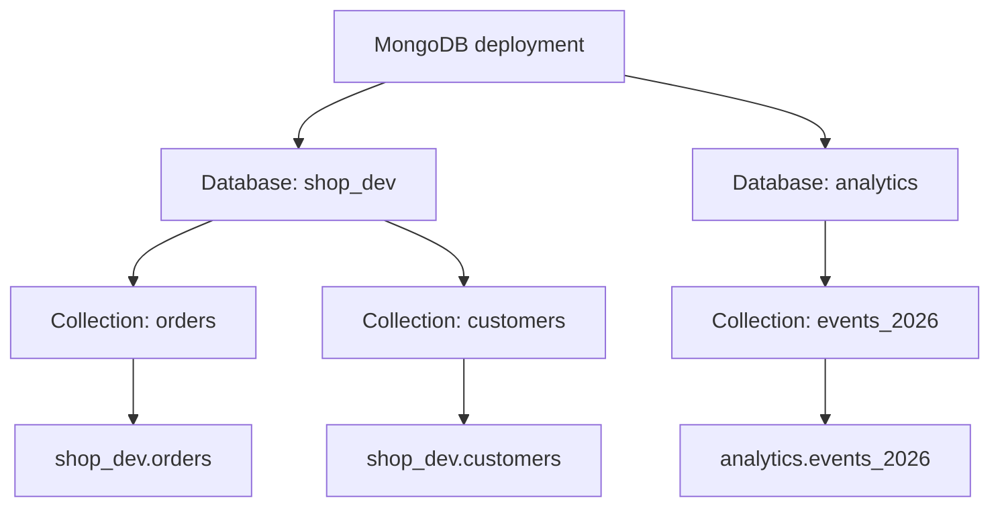

# Naming Rules, Namespaces, and Case Sensitivity in MongoDB

> **Module:** Database Engine Document MongoDB  
> **Chapter:** Databases and Collections

## 1. Why Do Database and Collection Names Affect Design?

MongoDB organizes data across layers: **deployment → database → collection → document**. Each database contains multiple collections; each collection stores BSON documents with flexible structure. Database and collection names do more than improve readability—they appear directly in queries, connection strings, access control rules, migration scripts, backups, and monitoring systems.

A mistake such as using `Orders` instead of `orders` can cause an application to read the wrong collection or silently create a new collection on write. A name that is too long or contains prohibited characters may be rejected by the server immediately upon creation. In particular, **naming rules**, **namespaces**, and **string data comparison rules (collation)** are three related but distinct concepts.

After this lesson, you will be able to:

- Write namespaces properly in `<database>.<collection>` form and distinguish them from standalone database or collection names.
- Identify invalid characters, reserved prefixes, and length limits measured in **UTF-8 bytes**.
- Understand how MongoDB handles case sensitivity for database names, collection names, field names, and **string values** during queries.
- Choose stable naming conventions for Java/MongoDB applications.
- Use `mongosh` to create, list, and access collections by exact name, and handle names containing special characters.
- Recognize the risks of renaming once source code, indexes, permissions, and data are already in place.

## 2. What Is a Namespace?

A **namespace** is the fully qualified identifier of a collection or view within a MongoDB deployment:

```text
<database-name>.<collection-name>
        │               │
        │               └── Collection/view name within the database
        └── Database name
```

Examples:

| Database | Collection | Namespace |
|---|---|---|
| `shop_dev` | `orders` | `shop_dev.orders` |
| `shop_dev` | `customers` | `shop_dev.customers` |
| `shop_prod` | `orders` | `shop_prod.orders` |
| `analytics` | `events_2026` | `analytics.events_2026` |

Two collections with the same name in **two different databases** are two distinct namespaces. Within the same database, a namespace corresponds to one collection or view of that name; a collection and a view cannot share the same name in the same database.



The dot separating the two parts of a namespace **does not mean MongoDB creates a nested folder hierarchy**. For instance, a collection named `audit.events` (where the dot is part of the collection name) inside the `shop_dev` database has the namespace `shop_dev.audit.events`; that does not create a sub-database or sub-collection.

### 2.1. Names That Look Similar but Mean Different Things

| String | Meaning |
|---|---|
| `shop_dev` | Database name only |
| `orders` | Collection name only (once the database is known) |
| `shop_dev.orders` | Full namespace |
| `orders.customerId` | Typically a field path expression in code/queries; not automatically a namespace |
| `db.orders.find()` | Shell syntax: current database object + `orders` collection + find command |
| `mongodb://127.0.0.1:27017/shop_dev` | Connection URI containing a database name in its path; not a collection namespace |

**Note:** Running `use shop_dev` in `mongosh` only switches the current database context. The database generally does not appear in listings until data or a collection is actually created.

## 3. Database Naming Rules

MongoDB enforces specific restrictions on database names that differ from collection naming rules.

### 3.1. Non-Empty and Shorter Than 64 Bytes

Database names:

- Must not be an empty string.
- Must be **less than 64 bytes** long, meaning at most **63 bytes** in UTF-8.
- Must not contain the null character (`\0`).
- Have prohibited characters depending on the operating system running the **MongoDB server**, not the OS of the machine running the shell.

Distinguish **bytes** from **visible character count**: an ASCII name like `shop_dev` has 8 characters and 8 bytes; accented Vietnamese characters or emojis often occupy multiple UTF-8 bytes. Therefore, checking character count with `name.length` is not enough to determine whether a name exceeds the byte limit.

### 3.2. Prohibited Characters by Server Operating System

According to naming restrictions in the MongoDB Database Manual:

| MongoDB Server Running On | Prohibited Characters in Database Names |
|---|---|
| **Windows** | `/`, `\`, `.`, space, `"`, `$`, `*`, `<`, `>`, `:`, `|`, `?` |
| **Unix/Linux** | `/`, `\`, `.`, space, `"`, `$` |

In addition to the list above, the null character is prohibited on all platforms. Written in an easy-to-remember form:

```text
Windows:    / \ . <space> " $ * < > : | ?
Unix/Linux: / \ . <space> " $
All:        NUL (\0), empty name, >= 64 bytes
```

**Examples:**

| Database Name | Assessment | Reason |
|---|---|---|
| `shop_dev` | Valid | Lowercase letters and underscore |
| `customer360` | Valid | Letters and digits |
| `shop-prod` | Generally valid | Hyphen is not in the prohibited character list; project teams may still avoid it for consistency |
| `customer.data` | Invalid | Dot in a **database name** |
| `shop dev` | Invalid | Contains a space |
| `sales/2026` | Invalid | Forward slash |
| `shop$dev` | Invalid | Contains dollar sign |
| `shop:dev` | Invalid on Windows | Colon is prohibited on Windows servers; discouraged even where other environments allow it |

**Practical rule to apply project-wide:** Use only ASCII lowercase letters `a-z`, digits `0-9`, and underscores `_` for database names; keep names short and meaningful. This is a **safe cross-platform convention**, not the only character set MongoDB allows.

### 3.3. Do Not Rely on Letter Case to Distinguish Two Databases

MongoDB advises **against creating or relying on two databases that differ only in letter casing**:

```text
salesData
SalesData
salesdata
```

These variants **must not be treated as three independent valid databases to operate side by side**. Once a database is created with a given casing, keep **that exact casing** across application code, scripts, connection strings, and documentation. This prevents conflicts with filesystems, administrative tools, identity mechanisms, and cross-environment migrations.

The simplest convention is to use lowercase from the start:

```text
Recommended: billing_prod, billing_dev, catalog_service
Avoid:       BillingProd, billingprod, BILLINGPROD coexisting
```

Do not test creating databases that differ only by letter case in environments containing important data.

## 4. Collection Naming Rules

The rules for collections **differ** from those for databases. MongoDB permits many collection name forms, subject to several mandatory conditions.

### 4.1. Mandatory Conditions

Collection names:

1. **Must not be empty.**
2. **Must not contain the null character `\0`.**
3. **Must not contain the dollar sign `$`.**
4. **Must not start with `system.`** because system namespaces are reserved.
5. **Must not contain `.system.`** anywhere in the name.
6. Must not cause the namespace to exceed the byte limit defined for collections or views.

MongoDB **recommends** that collection names begin with a **letter or underscore**. This is a recommendation so names are easy to access in code and the shell, not a rule that rejects every name starting with a digit.

Certain characters such as dots can appear in collection names, though they easily cause confusion when parsing namespaces or using external tools.

| Collection Name | Valid Under Core Rules? | Practical Usage |
|---|---|---|
| `orders` | Yes | Recommended |
| `order_items` | Yes | Recommended |
| `audit_logs_2026` | Yes | Recommended if time-based splitting is genuinely needed |
| `Orders` | Yes | Should keep casing consistent with code |
| `2026_orders` | Can be valid | Access via `db.getCollection("2026_orders")` |
| `order-items` | Can be valid | Must be accessed by string, not dot notation in JavaScript |
| `audit.events` | Can be valid | Easily mistaken for nested structure; prefer `audit_events` |
| `order details` | Can be valid | Discouraged because it is awkward to work with |
| `$orders` | No | Contains `$` |
| `system.orders` | No | Uses reserved `system.` prefix |
| `audit.system.logs` | No | Contains `.system.` substring |
| `""` | No | Empty string |

Characters accepted by a deployment do not guarantee the name will work smoothly across all drivers, backup tools, logging pipelines, or organizational naming conventions. Keep collection names simple and consistent.

### 4.2. The `system.*` Namespace Is Reserved for Internal Use

MongoDB uses internal collections such as `admin.system.users` and other reserved namespaces to manage users, roles, views, and operational state. Never name application collections with the `system.` prefix, and never modify system collections via routine CRUD operations.

In addition, certain managed MongoDB services maintain their own internal databases and namespaces. Application code should only operate inside its assigned database with least-privilege permissions.

### 4.3. Dots in Collection Names Do Not Create Subfolders

Suppose a collection is named `audit.events` inside the `shop_dev` database:

```javascript
const appDb = db.getSiblingDB("shop_dev");
appDb.createCollection("audit.events");

printjson(appDb.getCollectionNames());
// You will see the element "audit.events"

printjson(appDb.getCollection("audit.events").findOne());
```

Its namespace is:

```text
shop_dev.audit.events
\_______/ \__________/
 database  collection name
```

MongoDB has only **one database** `shop_dev` and **one collection** named `audit.events`. Do not assume there is an `events` collection nested inside an `audit` collection.

To avoid that misunderstanding, many teams choose `audit_events` or organize collections cleanly by domain.

## 5. Namespace Length and Measuring in UTF-8

### 5.1. The Limits

MongoDB limits the total namespace length of **collections and views**:

| Namespace Type | Maximum Limit |
|---|---:|
| Unsharded collection/view | **255 bytes** |
| Sharded collection | **235 bytes** |

This limit applies to the entire string:

```text
UTF8_BYTES(database_name) + 1 + UTF8_BYTES(collection_name)
                             ^
                     separating dot
```

For example, `shop_dev.orders`: `shop_dev` is 8 bytes, the dot is 1 byte, and `orders` is 6 bytes, totaling **15 bytes**. With the same collection name, a longer database name produces a longer namespace.

When a project might move to sharding, design namespaces from the start to stay **at or below 235 bytes** so you do not hit length limits when scaling out.

### 5.2. How Do Vietnamese Characters and Emojis Affect Byte Count?

UTF-8 does not encode uniformly by character count:

- Common ASCII characters: 1 byte.
- Many accented Vietnamese characters: 2 or 3 bytes; a single visible character may also be represented by multiple Unicode code points.
- Many common emojis: 4 bytes or more for combined sequences.

For example, two names of 40 visible characters do not necessarily consume the same number of bytes. Before generating dynamic namespaces, **measure actual UTF-8 bytes**, rather than relying solely on JavaScript string `.length`.

In JavaScript environments supporting `TextEncoder`:

```javascript
const dbName = "shop_dev";
const collectionName = "orders";
const namespace = dbName + "." + collectionName;

const bytes = new TextEncoder().encode(namespace).length;
print(namespace, "=", bytes, "UTF-8 bytes"); // 15
```

Or in Java:

```java
import java.nio.charset.StandardCharsets;

String databaseName = "shop_dev";
String collectionName = "orders";
String namespace = databaseName + "." + collectionName;

int lengthInBytes = namespace
        .getBytes(StandardCharsets.UTF_8)
        .length;

System.out.println(namespace + " -> " + lengthInBytes + " bytes");
```

**Key takeaway:** database names still carry their own **under 64 bytes** limit even when the total namespace is well below the namespace limit. Do not construct collection names by concatenating unbounded IDs, UUIDs, or untrusted user input.

## 6. Case Sensitivity: Databases, Collections, Fields, and Values

In MongoDB, the phrase "case-sensitive" might refer to **object names** or to **string values stored in documents**. Keep these separate.

| Context | Rule to Apply |
|---|---|
| **Database name** | Do not rely on names differing only in casing to create two distinct databases; use the exact casing chosen at creation consistently |
| **Collection name** | Identifiers are case-sensitive; `orders` and `Orders` are two distinct names and can lead to operating on different collections |
| **Field name** | Case-sensitive; `customerId` and `customerID` are two distinct fields |
| **String values** | Default comparison is binary under `simple` collation, which is case-sensitive |
| **Collated comparison** | Can explicitly configure case-insensitive comparison with `strength: 1` or `strength: 2` depending on language requirements |

### 6.1. Different Casing in Collection Names Leads to Split Data

Imagine a Java service writing to `orders` while a reporting API reads from `Orders`:

```javascript
const lab = db.getSiblingDB("naming_lab");
lab.getCollection("orders").insertOne({ orderNo: "A001", total: 100 });

print("orders =", lab.getCollection("orders").countDocuments({}));
print("Orders =", lab.getCollection("Orders").countDocuments({}));
printjson(lab.getCollectionNames());
```

If `Orders` did not exist beforehand, reads from it will not find the document written to `orders`. A frequent application bug is one pipeline successfully writing data while another returns empty results due to mismatched collection casing.

**Do not use this example to claim that database names can differ solely by letter case.** That rule is different from collection names.

### 6.2. Field Names Must Also Have Consistent Casing

```javascript
const lab = db.getSiblingDB("naming_lab");
lab.getCollection("profiles").insertOne({
  customerId: 101,
  customerID: 202,
  fullName: "Lan",
  fullname: "Different field"
});

printjson(lab.getCollection("profiles").findOne(
  { customerId: 101 },
  { _id: 0, customerId: 1, customerID: 1, fullName: 1, fullname: 1 }
));
```

`customerId`, `customerID`, `fullName`, and `fullname` are all distinct field names. A query:

```javascript
lab.getCollection("profiles").find({ customerID: 101 })
```

does not look up `customerId: 101`.

If your system maps BSON via Java records or POJOs, define field names consistently or configure explicit field mapping. Never change field casing casually, as doing so alters the actual stored data schema.

### 6.3. Case Sensitivity in **Values** Differs from Collection Names

Create a simple collection:

```javascript
const lab = db.getSiblingDB("naming_lab");

lab.getCollection("contacts").insertMany([
  { _id: 1, email: "Minh@example.com" },
  { _id: 2, email: "minh@example.com" },
  { _id: 3, email: "MINH@example.com" }
]);
```

On a collection without a custom collation and using default comparison:

```javascript
lab.getCollection("contacts").find(
  { email: "minh@example.com" },
  { _id: 1, email: 1 }
);
```

This matches only the exact string under standard binary comparison. If you require locale-based case-insensitive matching:

```javascript
lab.getCollection("contacts").find(
  { email: "minh@example.com" }
).collation({ locale: "en", strength: 2 });
```

This can match all three casing variants. Collation affects **string comparison on data values**; it **does not change** the `naming_lab.contacts` namespace or make `customerId` equivalent to `customerID`.

**Further distinction:** `strength: 1` ignores many diacritic and case differences at the base comparison level; `strength: 2` preserves accent differences while typically ignoring letter case. Exact results depend on the locale and Unicode rules. For fields like `email` or `username`, design an appropriate normalization and unique-index policy; do not assume all business rules are automatically case-insensitive.

### 6.4. Indexes and Collation Must Match

If the application frequently queries `email` case-insensitively, an index with a matching collation can support those queries:

```javascript
lab.getCollection("contacts").createIndex(
  { email: 1 },
  { name: "email_ci_idx", collation: { locale: "en", strength: 2 } }
);

lab.getCollection("contacts").find(
  { email: "minh@example.com" }
).collation({ locale: "en", strength: 2 });
```

Note:

- A query that wants to use a collated index for string comparison must specify a collation compatible with that index.
- With test data containing the same email once casing is ignored, **do not** set `unique: true` on this example index because those documents collide under that collation.
- Collation on field values does not make field names or collection names case-insensitive.
- Indexes for `$regex` are not automatically accelerated merely by using a case-insensitive index collation; inspect the execution plan when tuning queries.

## 7. Accessing Collections with Special Names in `mongosh`

For simple collection names that are valid JavaScript identifiers, you can write:

```javascript
use naming_lab

db.orders.findOne()
```

However, not every collection name works with dot notation. For example:

```javascript
// Exact access for a collection containing a hyphen:
db.getCollection("order-items").findOne();

// Exact access for a collection containing a dot:
db.getCollection("audit.events").findOne();

// Exact access for a collection starting with digits:
db.getCollection("2026_orders").findOne();
```

Do not write `db.order-items`, because JavaScript interprets it as subtraction; do not write `db.audit.events` if you intend to access the collection whose **full name** is `audit.events`.

Useful methods:

| Command | Meaning |
|---|---|
| `show dbs` | Lists databases the user is permitted to see that exist on the server |
| `use naming_lab` | Selects the current database in `mongosh` |
| `db.getName()` | Shows the currently selected database name |
| `show collections` | Lists existing collections/views in the database |
| `db.getCollectionNames()` | Returns an array of listable collection/view names |
| `db.getCollection("orders")` | Returns the collection object with that exact name |
| `db.getSiblingDB("naming_lab")` | Accesses another database by name without switching the current shell prompt |

To verify the **exact names actually created**, list them:

```javascript
const lab = db.getSiblingDB("naming_lab");

print("Database:", lab.getName());
printjson(lab.getCollectionNames().sort());
printjson(lab.getCollectionInfos({ name: "orders" }));
```

Listing commands are subject to access permissions: an under-privileged account may only see the subset of namespaces it has been granted.

## 8. Naming Conventions for Real Projects

MongoDB allows many name styles, yet an application needs **one consistent convention** to minimize configuration errors and simplify operations.

### 8.1. Recommended Conventions

| Object | Recommended Convention | Example |
|---|---|---|
| Database | ASCII lowercase, `snake_case`, application or domain name; add environment suffix if needed | `commerce_dev`, `commerce_prod` |
| Collection | ASCII lowercase, `snake_case`, noun reflecting the document entity | `orders`, `order_items`, `payment_attempts` |
| BSON field name | Consistently `camelCase` or `snake_case` per framework; uniform across the entire schema | `customerId`, `createdAt` |
| Index | Short name expressing the fields and purpose | `customer_id_created_at_idx` |
| Variables in Java | Centralize database/collection constants or configuration | `DATABASE_NAME`, `ORDERS_COLLECTION` |
| Business entity/ID | Store as a field in documents rather than embedding dynamic values into collection names | `tenantId` field instead of thousands of per-tenant collections |

These conventions are **design recommendations**, not mandatory MongoDB constraints. If an existing system already uses another convention, the key is applying it consistently and defining a clear migration path.

### 8.2. Choosing How to Separate Environments

You can host multiple databases on one deployment:

```text
commerce_dev.orders
commerce_test.orders
commerce_prod.orders
```

However, real production environments also require appropriate resource, network, and permission isolation. Simply appending `_prod` to a database name does not create security isolation.

In Java code, defining names in a single source of truth reduces typos:

```java
import com.mongodb.client.MongoClient;
import com.mongodb.client.MongoDatabase;
import com.mongodb.client.MongoCollection;
import org.bson.Document;

public final class Collections {
    public static final String DATABASE = "commerce_dev";
    public static final String ORDERS = "orders";

    private Collections() {}

    public static MongoCollection<Document> orders(MongoClient client) {
        MongoDatabase database = client.getDatabase(DATABASE);
        return database.getCollection(ORDERS);
    }
}
```

This example only obtains a collection reference; calling `getDatabase()` or `getCollection()` does not mean MongoDB has materialized physical data. In real applications, the database name should come from trusted deployment configuration, while collection names remain fixed by domain/code structure.

### 8.3. Never Use Raw User-Supplied Names Directly

Database and collection names are normally part of system architecture, not user business data. Avoid patterns like:

```javascript
// Discouraged if collectionName comes straight from an HTTP request:
const coll = db.getCollection(collectionName);
coll.insertOne(payload);
```

Risks include uncontrolled namespace proliferation, exceeding byte limits, permission mismatches, convention-breaking injections, and operational complexity. If you genuinely need multi-tenancy or dynamic collections, validate names strictly against an allowlist/pattern and enforce proper permissions. In many systems, keeping `tenantId` as a field is far easier to operate than separate collections per tenant.

## 9. Renaming a Collection: Impact on Namespaces

Renaming a collection changes its **namespace**. For instance, changing `commerce_dev.order` to `commerce_dev.orders` affects:

- Query and write code referencing the string `order`.
- Migrations, import/export jobs, ETL pipelines, scheduled tasks, and aggregations referencing the old name.
- Operational scripts, dashboards, and monitoring alerts.
- Permissions bound to the namespace, depending on how roles and deployments are configured.
- Views, dependent objects, or external integrations relying on the old namespace.

For standard collections within **the same database**, `renameCollection` can preserve data and indexes; however, renaming may acquire locks and cause brief disruptions to related operations. For sharded collections or renaming across databases, support and behavior depend on server version and topology; always consult the relevant documentation before running it.

In a lab, reference syntax is:

```javascript
const lab = db.getSiblingDB("naming_lab");
lab.createCollection("legacy_orders");

// Rename only within the lab database; do not overwrite the target collection:
lab.getCollection("legacy_orders").renameCollection("orders_archive");
```

If the target collection already exists, rename will not overwrite it unless the corresponding option is passed. Never use the drop-target option in a real environment without thoroughly verifying the data. For **databases**, MongoDB has no comparable simple rename-database command; you generally need a planned data-transfer workflow and application cutover.

Before renaming a namespace, audit every place using the current name, take backups, run an observable/reversible migration, and coordinate application deployments. Never treat it like a casual string edit.

## 10. Comprehensive Hands-On Practice on a Dedicated Database

> **Prerequisites:** Connected to MongoDB via `mongosh` with privileges to create collections in the practice database. The commands below only write data in `naming_lab`. Do not run them against production without authorization.

### Step 1 — Select the Database and Create Two Collections

```javascript
const lab = db.getSiblingDB("naming_lab");

lab.createCollection("orders");
lab.createCollection("order_items");

print("Current database:", lab.getName());
printjson(lab.getCollectionNames().sort());
```

When creation succeeds, the list will contain `orders` and `order_items`. Their namespaces are `naming_lab.orders` and `naming_lab.order_items`, respectively.

### Step 2 — Write and Read a Document

```javascript
lab.getCollection("orders").updateOne(
  { _id: "naming-lesson-order-001" },
  {
    $set: {
      customerId: "C001",
      status: "Created",
      createdAt: new Date()
    }
  },
  { upsert: true }
);

printjson(lab.getCollection("orders").findOne({
  _id: "naming-lesson-order-001"
}));
```

Here `status` is a field name, while `"Created"` is a string value. Querying for `status: "created"` depends on collation and may not match due to differing case.

### Step 3 — Demonstrate Case-Sensitive String Queries

```javascript
print("Default comparison:");
printjson(lab.getCollection("orders").find(
  { status: "created" }
).toArray());

print("Case-insensitive collation:");
printjson(lab.getCollection("orders").find(
  { status: "created" }
).collation({ locale: "en", strength: 2 }).toArray());
```

With the newly created `status: "Created"` document and default collection collation, binary comparison does not match `"created"`. The query with collation enables case-insensitive string value matching in this example. The field name must still be `status`, not `Status`.

### Step 4 — Inspect Namespaces and Actual Names

```javascript
print("Database:", lab.getName());

const names = lab.getCollectionNames();
for (const name of names) {
  print(lab.getName() + "." + name);
}

printjson(lab.getCollectionInfos({ name: "orders" }));
```

In a Java application, the namespace is determined by joining the configured `MongoDatabase` name and the exact `MongoCollection` name.

### Step 5 — Measure Name Length in Bytes Yourself

In a JavaScript environment supporting `TextEncoder`:

```javascript
const candidateDb = "naming_lab";
const candidateCollection = "order_items";
const candidateNamespace = candidateDb + "." + candidateCollection;

const dbBytes = new TextEncoder().encode(candidateDb).length;
const nsBytes = new TextEncoder().encode(candidateNamespace).length;

printjson({
  database: candidateDb,
  dbBytes,
  namespace: candidateNamespace,
  namespaceBytes: nsBytes,
  dbAllowed: dbBytes > 0 && dbBytes < 64,
  unshardedLengthAllowed: nsBytes <= 255,
  shardedLengthAllowed: nsBytes <= 235
});
```

This is only a **length check**; it does not validate all prohibited characters, reserved internal prefixes, or deployment constraints. Do not treat a single `true` boolean result as proof that MongoDB will accept the namespace.

### Step 6 — Clean Up Only the Test Document

```javascript
lab.getCollection("orders").deleteOne({
  _id: "naming-lesson-order-001"
});
```

Keep the collection if you plan to continue practicing. If you want to clean up the entire `naming_lab` database, first verify it only contains your lab data; `dropDatabase()` is destructive and is intentionally omitted from automated lesson command sequences.

## 11. Very Common Mistakes

| Symptom | Common Cause | Solution |
|---|---|---|
| Error creating database `shop.dev` | Dots are invalid in **database names** | Use `shop_dev` |
| Database does not appear after `use new_db` | `use` only selects context; no data/collection exists yet | Create a collection or write a valid document, then re-list |
| Reading `Orders` returns empty even though `orders` has data | Wrong casing in collection name | List with `getCollectionNames()` and fix the name in source config |
| Querying `customerID` fails to find `customerId` | Wrong casing in BSON field name | Use the exact field name and standardize mapping |
| Creating `system.logs` is rejected | Namespace uses reserved `system.` prefix | Rename to `application_logs` or `audit_logs` |
| Creating `audit.system.events` fails | Collection name contains `.system.` | Use `audit_events` |
| Namespace-too-long error | Total UTF-8 bytes of database + dot + collection exceed limit | Shorten database/collection names; budget ≤ 235 bytes if sharding may be used |
| `db.order-items.find()` errors | JavaScript parses hyphen as subtraction | Use `db.getCollection("order-items")` |
| Querying `"Created"` fails to match `"created"` | Default string comparison is case-sensitive | Choose an appropriate collation or normalize values on write |
| Query remains slow after adding collation | Index has a different collation or does not match query predicates | Check actual indexes and query plans with `explain()` |
| Works on Linux but fails on Windows | Database name uses characters allowed on Linux but forbidden on Windows | Follow portable convention: ASCII lowercase, digits, underscores |

## 12. Principles to Remember

1. **Namespace = database + "." + collection**; dots inside a collection name do not create nested levels.
2. Database names must be non-empty, **under 64 UTF-8 bytes**, and free of characters prohibited by the server OS.
3. Collection names must not be empty, must not contain null or dollar characters, and must not use the `system.` prefix or `.system.` substring.
4. Collection/view namespaces can be up to **255 bytes unsharded** and **235 bytes sharded**.
5. Never create two databases differing only by letter case; always use the exact chosen database casing consistently.
6. Collection and field names are case-sensitive. **Collation adjusts string value comparison; it does not change collection or field names.**
7. Prefer readable, consistent, concise, portable names to avoid errors across environments, drivers, and migration scripts.

## 13. Official Documentation

- [MongoDB Manual – Limits and Thresholds (Naming Restrictions and Namespaces)](https://www.mongodb.com/docs/manual/reference/limits/)
- [MongoDB Manual – Databases and Collections](https://www.mongodb.com/docs/manual/core/databases-and-collections/)
- [MongoDB Manual – System Collections](https://www.mongodb.com/docs/manual/reference/system-collections/)
- [MongoDB Manual – Collation](https://www.mongodb.com/docs/manual/reference/collation/)
- [MongoDB Manual – Case-Insensitive Indexes](https://www.mongodb.com/docs/manual/core/index-case-insensitive/)
- [MongoDB Manual – db.getCollectionNames()](https://www.mongodb.com/docs/manual/reference/method/db.getCollectionNames/)
- [MongoDB Manual – renameCollection](https://www.mongodb.com/docs/manual/reference/command/renamecollection/)

When working with a specific MongoDB Server release, always check the documentation matching your server version—especially before renaming collections or enabling sharding.
