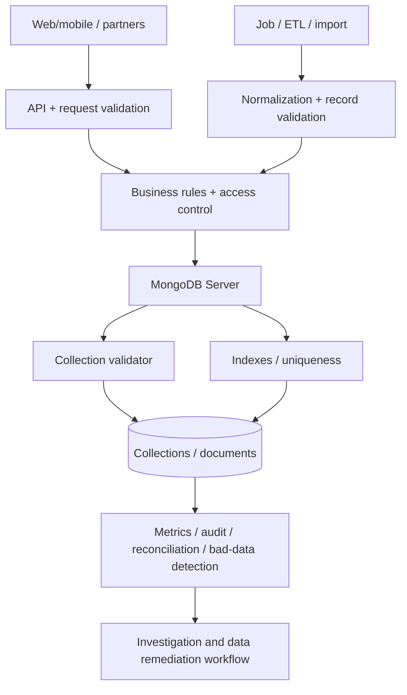
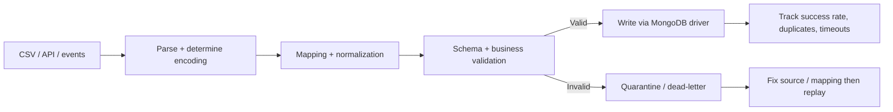

# Flexible Schema and Data Quality Responsibilities in MongoDB

> **Module:** Database Engine Document MongoDB  
> **Chapter:** Schema validation

## 1. Why "Flexible Schema" Does Not Mean "No Schema Needed"

MongoDB stores data as **BSON documents** in a collection. Unlike relational tables that typically declare their column set and data types up front, two documents in the same MongoDB collection can have different fields, and the same field name can hold different BSON types if the application does not enforce control.

For example, three documents all belonging to the `customers` collection:

```javascript
[
  { _id: 1, fullName: "Lan", loyaltyPoints: 20 },
  { _id: 2, fullName: "Minh", loyaltyPoints: 35, phone: "0900000000" },
  { _id: 3, name: "Ha", loyaltyPoints: "40" }
]
```

MongoDB can store these documents if there is no validation rule preventing it. However, the application will run into problems:

- One document uses `fullName`, while another uses `name`; an API displaying names may miss data.
- `loyaltyPoints` is sometimes a number and sometimes a string; addition, sorting, aggregation, and mapping to Java can produce unexpected results or errors.
- `phone` is present in some documents; the code needs to know whether this field is required or merely optional.
- You cannot infer that any information is business-accurate just because the document was written successfully.

**Flexible schema** means the database management system allows document shapes to evolve as needed and does not require every document to have an identical structure. It **does not eliminate** the need to define data contracts, validate inputs, enforce business rules, and handle historical data.

This lesson distinguishes between:

1. **Storability:** Will MongoDB accept the document in terms of structure, BSON types, and system limits?
2. **Data contract:** Which fields, types, values, units, relationships, and schema versions does the application expect?
3. **Data quality:** Is the data accurate, complete, valid, consistent, timely, and reliable enough for its intended use?
4. **Enforcement responsibilities:** Which rules belong in the API/application, MongoDB validators/indexes, data ingestion pipelines, and monitoring systems?

## 2. What Is a Document Schema?

In MongoDB, a schema is a description of a document's structure and rules. A schema may be a development team convention, a definition inside the application, or a **collection validator** configured on MongoDB Server.

A data contract for the `orders` collection might be described as follows:

| Field | Expected BSON Type | Required? | Rules |
|---|---|---|---|
| `orderId` | String | Yes | Non-empty; unique across the order set |
| `customerId` | String | Yes | Non-empty; references a business-valid customer |
| `status` | String | Yes | One of `NEW`, `PAID`, `CANCELLED` |
| `total` | Decimal128 | Yes | Non-negative; matches the sum of order line values |
| `items` | Array of objects | Yes | At least one line item; each item has SKU, quantity, unit price |
| `createdAt` | BSON Date | Yes | Creation timestamp per system policy |
| `note` | String | No | May be absent; content restricted by API |
| `schemaVersion` | Int32 | Policy-dependent | Document shape version to support migrations |

Note that this table includes **both structural rules and business rules**. Not every rule should or can be fully expressed using `$jsonSchema`. For example, a validator can confirm that `total` is a non-negative Decimal128, whereas verifying that the total matches promotion policies, taxes, and individual line items usually needs to be handled in the business logic layer.

### 2.1. Document Model and BSON

MongoDB uses BSON, so data types go beyond plain JSON text types. Common types include:

- `string`, `bool`, `object`, `array`.
- `int` (32-bit integer), `long` (64-bit integer), `double`, `decimal` (Decimal128).
- `date` (BSON timestamp value), `objectId`, `null`.
- Several other types for specialized needs.

The examples below look similar in terms of monetary meaning, but have different BSON types:

```javascript
{ total: "199.00" }                // string
{ total: 199.00 }                  // typically double when created from JavaScript
{ total: NumberDecimal("199.00") } // Decimal128
```

For monetary amounts requiring decimal precision, an application may choose Decimal128 or store the smallest currency unit as an integer according to an agreed-upon design. What matters is **not mixing types and units of measurement across documents**.

### 2.2. When Should You Leverage a Flexible Schema?

Flexibility is beneficial when:

- The product adds optional fields without needing to convert all existing documents immediately.
- Subtypes share a few common fields while having specialized data, such as multiple payment methods with different metadata.
- The system ingests data whose structure varies by source and then normalizes it step by step.
- A migration requires a transitional phase that accepts both old and new document versions simultaneously.

However, flexibility is **not an excuse** for arbitrary field naming, coercing every value into a string, or ignoring API stability rules. A good document model still makes required data and evolving data explicit.

## 3. Data Quality Dimensions to Control

**Schema-valid data** is only one part of **quality data**. A document can pass every type check and still have the wrong monetary amount or reference a non-existent customer.

| Quality Dimension | Question | Error Example | Appropriate Control |
|---|---|---|---|
| **Completeness** | Is all required information present? | Order missing `customerId` | `required` in validator; request DTO validation |
| **Validity** | Are types and value domains correct? | `status: "WAIT"` when only `NEW/PAID/CANCELLED` are allowed | `bsonType`, `enum`, application validation |
| **Accuracy** | Do values reflect reality/business facts? | Total lower than the actual value of the goods | Service-side calculation, source reconciliation |
| **Consistency** | Are fields or systems free of contradictions? | `status: "PAID"` while payment failed | State transition workflows, transactions when needed |
| **Uniqueness** | Are there duplicate identifier records? | Two orders sharing the same `orderId` | Unique index; idempotency key |
| **Timeliness** | Is the data fresh enough for its intended use? | Inventory status lags behind by hours | Event processing, latency tracking, and alerting |
| **Traceability** | Can we tell where data came from and when it was modified? | Corrupted document imported with unknown origin | `source`, `updatedAt`, audit/event log |
| **Conformance** | Does data comply with the published schema contract? | Consumer expects `amount`, but producer changed it to `total` | Versioned contracts, contract tests, migrations |

These dimensions sometimes overlap. For instance, a unique index prevents writing two documents with the same `orderId`, but it **does not prove** that the order corresponds to a real business transaction or that nothing was omitted.

## 4. Responsibilities Distributed Across Layers

A MongoDB system can receive writes from HTTP APIs, background jobs, operational scripts, data integrations, and administrative tools. Validating only in the user interface or a single API endpoint is insufficient, because other paths can write directly to the database.



### 4.1. Data Designers / Domain Owners

Responsible for clearly specifying:

- Which fields are required, which are optional, and which may be `null`.
- BSON types, units of measurement, timezones, value domains, and state transition rules.
- When to use embedded documents versus references.
- Uniqueness rules, data lifecycle, sensitive data, and retention policies.
- Compatibility guarantees to maintain while consumers are still on older schemas.

### 4.2. API and Application Layer

Validates requests right at the boundary:

- Return clear error messages indicating exactly which field is invalid.
- Normalize input data when business rules permit, such as trimming whitespace from business codes.
- Check permissions and relationships between entities (for example, whether the buyer is authorized to place the order).
- Compute derived values on the server—for example, calculating `total` from items rather than blindly trusting client-supplied values.
- Manage transactions, race conditions, idempotency, and state changes.

### 4.3. MongoDB Server

Provides the final guardrail for write paths:

- **Collection validation:** checks document shape and certain validity conditions.
- **Indexes:** enforce uniqueness constraints at the field/index level; support queries.
- **Roles/privileges:** restrict who can read, write, or modify schemas and configuration.
- **Transactions/atomic operations:** protect change consistency within the scope of supported transactional mechanisms.

MongoDB does not inherently understand full business semantics. Passing a validator only proves that a document satisfies **the declared conditions**.

### 4.4. Data Pipelines and Operations

Data ingestion jobs must include mapping rules, bad-record rejection/flagging, retry/idempotency handling, and anomaly detection. Operations teams need to track schema error rates, invalid record counts in legacy data, sync lag, reconciliation discrepancies, and change audit trails.

**Principle:** business rules are defined once at the contract level and **enforced at multiple appropriate layers**, preventing write paths from behaving inconsistently.

## 5. What Does MongoDB Allow Without a Validator Enabled?

In a collection without a custom schema validator, MongoDB does not force all documents to share the same fields. For example, in a practice database:

```javascript
const lab = db.getSiblingDB("schema_quality_lab");

lab.getCollection("raw_events").insertMany([
  { _id: "e1", eventType: "LOGIN", occurredAt: new Date() },
  { _id: "e2", eventType: "LOGIN", occurredAt: "2026-11-14T03:00:00Z" },
  { _id: "e3", eventType: 42, extra: { source: "legacy" } }
]);

printjson(lab.getCollection("raw_events").find().toArray());
```

Even though all three documents can be stored, problems arise when a consumer tries to sort by `occurredAt` or map it to Java's `Instant`/`Date`: the field is a BSON Date in one document, a string in another, and missing in the third. BSON type-comparison queries also follow specific rules, making results unpredictable when the business logic expects a single type.

### 5.1. Distinguishing Missing Fields, `null` Fields, and Wrong Types

Suppose you have three documents:

```javascript
[
  { _id: 1, phone: null },
  { _id: 2 },
  { _id: 3, phone: "0900000000" }
]
```

There are three distinct states:

- **Missing:** the `phone` key does not exist.
- **Explicit null:** the `phone` key has a BSON null value.
- **Present with value:** the `phone` key holds a string.

In MongoDB, an equality query `{ phone: null }` matches both documents missing the field and documents with a null value. If you need to tell them apart, you can use:

```javascript
const c = lab.getCollection("raw_contacts");

c.find({ phone: { $exists: false } });   // Missing field
c.find({ phone: { $type: "null" } });     // Field present with BSON null
c.find({ phone: { $type: "string" } });   // Field present as string
```

The code snippet above illustrates query conditions; it does not automatically create the `raw_contacts` collection. In validator design, `required` demands that the field name be present; it is **not enough** to forbid null if the field's type still permits null. It must be combined with the desired `bsonType`.

### 5.2. Duplicate Field Names by Casing

The keys `customerId` and `customerID` are distinct fields in BSON. Some producer streams might write `created_at` while a consumer only reads `createdAt`. Schema flexibility lets such bugs persist unnoticed without validators or contract tests.

Beyond structure, unit standardization is critical: is `weight` in kilograms or grams? Is `price` in the major currency unit or the minor unit? Is `createdAt` a UTC instant or a local string? These rules must be stated in the contract even if a validator cannot express all of them.

## 6. Collection Validators and `$jsonSchema`

MongoDB allows you to declare **validation rules** on a collection. A common approach is using the `$jsonSchema` operator with JSON Schema syntax supported by MongoDB, including the **`bsonType`** extension for BSON types.

Useful keywords:

| Keyword | Purpose | Example |
|---|---|---|
| `bsonType` | BSON type constraint | `"string"`, `"date"`, `"decimal"`, `"object"` |
| `required` | Field must be present | `["orderId", "status"]` |
| `properties` | Rules for each object field | `status: { bsonType: "string" }` |
| `enum` | Restrict allowed value set | `["NEW", "PAID", "CANCELLED"]` |
| `minimum` / `maximum` | Numeric bounds | `{ minimum: 0 }` |
| `minLength` / `maxLength` | String length bounds | `{ minLength: 1 }` |
| `pattern` | String regex condition | Order code pattern |
| `items` | Array element rules | Each item must be an object |
| `minItems` | Minimum array element count | `{ minItems: 1 }` |
| `additionalProperties` | Allow or reject undeclared fields | `false` when contract requires a closed schema |

**Note:** `$jsonSchema` in MongoDB is a BSON-oriented subset/variant, meaning not every feature or version of the JSON Schema standard is supported. When using a new keyword, consult the documentation for your exact MongoDB Server version.

### 6.1. Creating a Collection with a Validator Up Front

Here is an example `orders` collection for hands-on practice. Open `mongosh` and run:

```javascript
const lab = db.getSiblingDB("schema_quality_lab");

const orderValidator = {
  $jsonSchema: {
    bsonType: "object",
    required: ["orderId", "customerId", "status", "total", "items", "createdAt"],
    properties: {
      orderId: {
        bsonType: "string",
        minLength: 1,
        description: "Order ID must be a non-empty string"
      },
      customerId: {
        bsonType: "string",
        minLength: 1
      },
      status: {
        enum: ["NEW", "PAID", "CANCELLED"]
      },
      total: {
        bsonType: "decimal",
        minimum: 0
      },
      items: {
        bsonType: "array",
        minItems: 1,
        items: {
          bsonType: "object",
          required: ["sku", "quantity", "unitPrice"],
          properties: {
            sku: { bsonType: "string", minLength: 1 },
            quantity: { bsonType: "int", minimum: 1 },
            unitPrice: { bsonType: "decimal", minimum: 0 }
          }
        }
      },
      createdAt: { bsonType: "date" },
      note: { bsonType: "string" }
    }
  }
};

lab.createCollection("orders", {
  validator: orderValidator,
  validationLevel: "strict",
  validationAction: "error"
});
```

Conditions in this example:

- `status` accepts only the three defined enum values.
- `total` and `unitPrice` must be BSON Decimal128.
- `quantity` must be BSON Int32 and at least 1.
- `createdAt` must be a BSON Date, not an ISO 8601 string.
- `note` is optional, but if present, it must be a string.
- `items` must be non-empty, and each item must contain at least the three fields listed in `required`.
- The example does not set `additionalProperties: false`; undescribed fields can still appear. This is a deliberate choice to focus on core data—**MongoDB does not reject unknown fields by default**.

Create the collection once; running `createCollection("orders", ...)` again after it already exists will raise a namespace error. In an environment with existing data, inspect the current collection and rules before making changes.

### 6.2. Writing a Valid Document

```javascript
lab.getCollection("orders").insertOne({
  _id: "order-lab-001",
  orderId: "ORD-001",
  customerId: "CUST-001",
  status: "NEW",
  total: NumberDecimal("199.00"),
  items: [
    {
      sku: "SKU-01",
      quantity: NumberInt(2),
      unitPrice: NumberDecimal("99.50")
    }
  ],
  createdAt: new Date(),
  note: "Order for validator testing"
});
```

Here, `NumberDecimal(...)` and `NumberInt(...)` are used to construct the desired BSON types from `mongosh`. The `_id` field is used by MongoDB as the document identifier key; this example uses a custom string, and the validator does not specifically restrict the `_id` type.

To view the document:

```javascript
printjson(lab.getCollection("orders").findOne({ orderId: "ORD-001" }));
```

### 6.3. Attempting to Send an Invalid Document

```javascript
try {
  lab.getCollection("orders").insertOne({
    _id: "order-lab-invalid",
    orderId: "ORD-BAD",
    customerId: "",
    status: "DONE",
    total: "199.00",
    items: [],
    createdAt: "2026-11-14"
  });
} catch (error) {
  print("Write rejected: " + error.message);
}
```

This document has several issues: `customerId` is empty, `status` is outside the enum, `total` has the wrong type, `items` has zero elements, and `createdAt` is a string. With `validationAction: "error"`, the server rejects any operation that violates the validator; the client typically receives a **DocumentValidationFailure** error (code 121).

Error responses may include details explaining why the document failed the schema, though the exact detail structure depends on the server/driver version and caller privileges. In a production API, return only safe, understandable messages; do not expose sensitive data or dump entire payloads into logs.

### 6.4. Inspecting the Validator Attached to a Collection

```javascript
printjson(lab.getCollectionInfos({ name: "orders" }));
```

Collection metadata can include `options.validator`, `validationLevel`, and `validationAction`. You should verify the actual live configuration instead of assuming a migration script ran successfully.

## 7. `validationLevel` and `validationAction`

These two options answer two separate questions: **when to validate** and **what to do on violation**.

### 7.1. `validationLevel`

| Value | Meaning |
|---|---|
| `strict` | Checks inserts and updates against the validator; this is the usual default choice |
| `moderate` | Checks new inserts and updates to documents that currently pass the validator; may skip enforcing rules on updates to documents that are already invalid |

`moderate` can be useful during a schema upgrade phase when a collection still holds non-conforming historical data. However, it does not make old data valid, nor should it be used permanently just to avoid data cleanup work.

### 7.2. `validationAction`

| Value | Meaning | When to Consider? |
|---|---|---|
| `error` | Rejects write operations that violate validation | Good default for core schemas |
| `warn` | Allows the write operation while logging a warning to the MongoDB log | Observation phase to gauge validator impact before enforcing |

Newer MongoDB versions also provide additional logging-related options for failure behavior; use them only if supported by your server version. Using `warn` must be paired with log collection and review; otherwise, violations will continue entering the database unaddressed.

### 7.3. Modifying a Validator on an Existing Collection

MongoDB supports the `collMod` command:

```javascript
lab.runCommand({
  collMod: "orders",
  validator: orderValidator,
  validationLevel: "strict",
  validationAction: "error"
});
```

This must be run in a `mongosh` session where the `orderValidator` variable has already been defined, and the account needs appropriate privileges.

**Crucial point:** changing a validator does not automatically fix or remove existing documents. With `strict`, subsequent updates to invalid documents may be rejected until the data is brought into compliance. Therefore, before tightening validation, survey existing data, plan a migration, and notify producer streams.

Operations with special privileges can bypass document validation in scenarios permitted by MongoDB; therefore, never replace access control and monitoring with a validator alone.

## 8. When Do You Need Unique Indexes and Rules Beyond the Validator?

**Schema validation does not replace unique indexes.** For example, `orderId` must be a non-empty string, and two orders must not share the same `orderId`.

Creating a unique index:

```javascript
lab.getCollection("orders").createIndex(
  { orderId: 1 },
  { name: "ux_orders_order_id", unique: true }
);
```

If the collection already contains duplicate `orderId` values, building the unique index will fail; duplicates must be resolved first. Once the index exists, MongoDB enforces uniqueness even when two requests write concurrently, avoiding the race condition of the "query first to see if this ID exists, then insert" pattern.

Distinguishing the cases:

| Rule | Primary Tool |
|---|---|
| Field must exist and have the right type | Collection validator |
| Order status must be one of the defined states | Validator `enum` and service-layer state machine |
| `orderId` must not repeat in the collection | Unique index |
| `total` equals line totals after tax/discounts | Business calculation and validation in the service |
| `customerId` points to a real customer authorized to buy | Business service, data consistency workflows |
| Two collections must update consistently upon payment | Appropriate atomic/transaction design |
| Stale data from external sources needs reconciliation | Reconciliation jobs and monitoring |
| A bad record needs fixing and source tracing | Logging/audit + data remediation |

MongoDB does not automatically provide foreign keys like an RDBMS merely by declaring a `customerId` field. Cross-collection references are typically enforced by the application or redesigned using embedding where appropriate.

### 8.1. Optional Fields and Unique Indexes

If an optional field like `externalRef` needs to be unique, pay special attention to missing/null semantics. A standard single-field unique index has specific behavior regarding documents that omit the field or carry null; creating such an index on an existing collection can fail or restrict data unexpectedly.

An intentional option is a **partial unique index** that applies only to documents holding a string value:

```javascript
lab.getCollection("orders").createIndex(
  { externalRef: 1 },
  {
    name: "ux_orders_external_ref_when_string",
    unique: true,
    partialFilterExpression: {
      externalRef: { $type: "string" }
    }
  }
);
```

This solution enforces uniqueness solely over the subset of documents matching the filter. It **does not automatically require** every document to have `externalRef` or guarantee a non-empty string; those rules must be specified separately if required by business logic.

## 9. Enforcement in Java Applications and APIs

For instance, the MongoDB Java Driver can persist accurate BSON types, yet incoming HTTP requests typically start as JSON. If an application maps JSON straight into a `Document` and writes it immediately, it easily bypasses many important constraints.

A common design pattern:

1. Separate **request DTOs** from the persisted document.
2. Validate required fields, value domains, and formats at the HTTP boundary.
3. Verify business rules and user permissions.
4. Normalize data according to policy; compute derived fields like `total` on the server.
5. Convert to target BSON types and write via the driver.
6. Translate unique index/validator errors into appropriate responses; never silently ignore errors from MongoDB.

### 9.1. Java DTO Example with Jakarta Bean Validation

```java
import jakarta.validation.Valid;
import jakarta.validation.constraints.DecimalMin;
import jakarta.validation.constraints.NotBlank;
import jakarta.validation.constraints.NotEmpty;
import jakarta.validation.constraints.NotNull;
import jakarta.validation.constraints.Positive;

import java.math.BigDecimal;
import java.util.List;

public record OrderItemInput(
        @NotBlank String sku,
        @Positive int quantity,
        @NotNull @DecimalMin("0.00") BigDecimal unitPrice
) {}

public record CreateOrderRequest(
        @NotBlank String customerId,
        @NotEmpty List<@Valid OrderItemInput> items
) {}
```

With Spring MVC, request validation must be enabled—for example, using `@Valid @RequestBody` in the controller with a Bean Validation provider present in the application. Simply placing annotations on a record **does not automatically guarantee** every Java call path is validated; background jobs and internal flows must also invoke appropriate validation logic.

### 9.2. Constructing BSON with Proper Types

Once the request is validated, the service can compute the total amount and convert `BigDecimal` to `Decimal128`:

```java
import org.bson.Document;
import org.bson.types.Decimal128;

import java.math.BigDecimal;
import java.util.Date;
import java.util.List;

public class OrderMapper {
    public static Document toDocument(
            String orderId,
            CreateOrderRequest request
    ) {
        List<Document> items = request.items().stream()
                .map(item -> new Document("sku", item.sku())
                        .append("quantity", item.quantity())
                        .append("unitPrice", new Decimal128(item.unitPrice())))
                .toList();

        BigDecimal total = request.items().stream()
                .map(item -> item.unitPrice()
                        .multiply(BigDecimal.valueOf(item.quantity())))
                .reduce(BigDecimal.ZERO, BigDecimal::add);

        return new Document("orderId", orderId)
                .append("customerId", request.customerId())
                .append("status", "NEW")
                .append("total", new Decimal128(total))
                .append("items", items)
                .append("createdAt", new Date());
    }
}
```

This example only illustrates mapping core fields; a production system needs to check Decimal128 limits, currency, rounding, taxes, promotions, access permissions, ID generation, and state transition rules. Even when requests are validated, the server validator and unique indexes must still act as the final safety net when multiple producers write data.

### 9.3. Never Treat Client-Calculated Values as the Source of Truth

Suppose the client sends:

```json
{
  "customerId": "CUST-001",
  "items": [
    { "sku": "SKU-01", "quantity": 2, "unitPrice": 99.5 }
  ],
  "total": 1
}
```

If the API merely checks that `total` is a positive number and saves it, the document passes type checks while violating business accuracy. The service must decide the authoritative price source—trusted product catalog data on the server or price at order confirmation—and recalculate the total according to policy.

## 10. Schema Evolution: Adding, Renaming, and Removing Fields Without Breaking Applications

A flexible schema is especially useful when structures need to evolve over time. However, multiple application versions may be reading and writing simultaneously during a rollout.

Old contract example:

```javascript
{
  orderId: "ORD-001",
  customerName: "Lan",
  total: NumberDecimal("199.00")
}
```

New contract example:

```javascript
{
  orderId: "ORD-001",
  customer: { id: "CUST-001", displayName: "Lan" },
  total: NumberDecimal("199.00"),
  currency: "VND",
  schemaVersion: 2
}
```

Renaming `customerName` to `customer.displayName` or switching from a string to a nested object is a breaking change for consumers. You should not flip all read/write paths at once simply because MongoDB permits it.

### 10.1. The Expand → Migrate → Contract Workflow

| Phase | Actions Required | Risks to Control |
|---|---|---|
| **1. Expand** | Allow old and new shapes to coexist during transition; update consumers to read both | Legacy consumers fail to understand new fields |
| **2. Deploy new writer** | Producers write the new contract structure, with versioned logs/metrics | Multiple writers may produce inconsistent data |
| **3. Backfill/migrate** | Convert old documents via controlled scripts, in batches with checkpoints | Data loss, overwriting newer updates, overload |
| **4. Verify** | Count remaining legacy-format documents, spot-check samples and app flows | Incomplete processing of old data |
| **5. Contract** | Tighten the validator and drop legacy read branches once consumers are compatible | Tightening too early causes updates to old documents to fail |

Old and new schema versions can be distinguished with a `schemaVersion` field **when there is a clear reason**. Not every collection needs this field; minor changes can often rely on managed data contracts and migrations alone.

### 10.2. Backfills Must Be Safe and Rerunnable

A conditional update illustrates a small migration:

```javascript
const lab = db.getSiblingDB("schema_quality_lab");

// Example applied to data that actually contains these fields:
lab.getCollection("legacy_customers").updateMany(
  { phone: { $exists: false } },
  { $set: { phone: null } }
);
```

This illustrative command **changes the semantic meaning of the data**: from a missing field to an explicit null. Use it only if the new contract genuinely defines both states as equivalent. If you need to distinguish "not yet collected" from "has no phone number," do not apply this migration mechanically.

For large datasets, process in batches, track the number of processed documents, and ensure reruns do not duplicate effects. Concurrent updates from live applications must also be accounted for to avoid overwriting freshly modified data.

### 10.3. Adding a Validator to Legacy Data

When moving from a validator-less collection to a strict validator:

- Sample and measure actual field names and types in production data.
- Identify which documents fail the new contract.
- Test the validator against representative data in a staging environment.
- Choose an observation window using `warn` or a controlled rollout if needed.
- Backfill, remediate bad records, and switch to `validationAction: "error"` once ready.

Enabling `error` before understanding legacy data can break normal update flows. Leaving `warn` on indefinitely renders quality rules ineffective at preventing bad writes.

## 11. Auditing and Detecting Existing Data Quality Issues

**A collection validator primarily protects write operations**; it does not automatically scan and repair all historical documents. Operations teams therefore rely on queries to assess current state.

### 11.1. Counting Documents Missing Required Fields

```javascript
const lab = db.getSiblingDB("schema_quality_lab");

const orders = lab.getCollection("orders");

print("Missing customerId:",
  orders.countDocuments({ customerId: { $exists: false } }));

print("Explicit null customerId:",
  orders.countDocuments({ customerId: { $type: "null" } }));

print("Missing createdAt:",
  orders.countDocuments({ createdAt: { $exists: false } }));
```

These queries show checks to run; some bad documents may not exist if an active validator is already blocking invalid writes. On legacy collections without validation, these counts can uncover backlogs.

### 11.2. Inspecting Actual BSON Types in a Collection

```javascript
orders.aggregate([
  {
    $group: {
      _id: { $type: "$total" },
      count: { $sum: 1 }
    }
  },
  { $sort: { count: -1 } }
]);
```

The output shows how many documents have `total` in each type bucket, such as `decimal`, `double`, `string`, or `missing`. On large collections, this pipeline can be resource-intensive; consider running it on a sample, an appropriate secondary, or during an approved maintenance window.

### 11.3. Detecting Out-of-Domain Status Values

```javascript
orders.find({
  status: { $nin: ["NEW", "PAID", "CANCELLED"] }
});
```

This query helps spot records whose status falls outside the published set. If the collection holds legacy values allowed under earlier `schemaVersion`s, group by version so you do not misclassify valid historical records.

### 11.4. Distinguishing Technical Errors from Business Errors

An order with `status: "PAID"` and `total: NumberDecimal("199.00")` can still be wrong if the payment provider has not confirmed payment. Such errors rarely surface in `$type` or `$jsonSchema` reports; they require reconciliation against payment events, transaction states, and authoritative business sources.

Do not fix data merely to "force it past the validator." Converting `total: "199.00"` to Decimal128 may be valid if the currency unit is correct, but if the source uses cents instead of major units, changing the type without reconciliation preserves a semantic error.

## 12. Designing a Controlled Data Ingestion Pipeline

External data sources often differ from internal schemas: dates as strings, inconsistent country codes, comma decimal separators, and records with missing fields.

A resilient pipeline should follow these steps:



Essential capabilities:

- **Distinguish parse errors from validation errors:** an unreadable CSV differs from a `total` field with the wrong type.
- **Never silently drop records:** record the count and reason for every rejection.
- **Do not log secrets:** mask emails, tokens, personal data, and sensitive fields in logs.
- **Retry policy:** retry transient failures; never loop infinitely on the same schema-invalid document.
- **Idempotency:** reprocessing the same event must not create unintended duplicates.
- **Bad-data handling policy:** assign a business owner to decide whether to fix, discard, quarantine, or request a resend.
- **Versioned observability:** tracking producer, `schemaVersion`, source, and timestamp helps spot unexpected changes.

A single server-side rule cannot by itself solve every issue across ingestion streams from heterogeneous systems.

## 13. Deciding How Flexible vs. Strict a Schema Should Be

No single strictness level fits every collection. Choose based on domain stability and the impact of bad data.

| Data Category | Typical Appropriate Design | Rationale |
|---|---|---|
| Orders, financial transactions | Strict validator for core fields + unique indexes + business rules | Wrong amounts or statuses carry severe consequences |
| User profiles | Stable core fields; supplemental fields can remain optional | Needs to support profile evolution |
| Analytics events | Enforce `eventName`, `timestamp`, `source`; payload varies by versioned event type | Many event shapes share one pipeline |
| Raw staging/import data | Keep raw payload + source + processing state; validate before promoting to canonical collection | Avoids losing source information |
| Feature flags/configuration | Constrain keys/values by config type; control who can edit | A single bad value can impact the entire system |

**Design principles:**

1. **Be strict with core data:** identifiers, monetary types, timestamps, and business states.
2. **Be intentionally flexible:** optional fields or extensible sub-structures are fine, provided there is a contract.
3. **Do not ban every unknown field in every scenario:** `additionalProperties: false` helps closed schemas, but can hinder adding fields during migrations. If used, remember to include `_id` when the validator applies to top-level documents.
4. **Do not turn one collection into a dumping ground for every document type:** when subtypes differ greatly in lifecycle, indexes, and queries, consider separate collections.
5. **Optimize for query patterns:** embedding/referencing, indexes, and read/write patterns must align with the schema and business rules.
6. **Document rules under version control:** both development and operations teams need to know which structures are supported.

## 14. Comprehensive Hands-On Lab

Run these exercises in MongoDB Shell in a lab environment, using the `schema_quality_lab` database with privileges to create collections and indexes. The validator creation commands in Section 6 should be executed first.

### Exercise A — Testing Documents That Pass and Fail the Validator

1. Run the command to create `orders` with `$jsonSchema` as shown in Section 6.1.
2. Insert the valid document from Section 6.2; read it back.
3. Test the schema-invalid document from Section 6.3; observe the error.
4. Run:

   ```javascript
   printjson(lab.getCollectionInfos({ name: "orders" }));
   ```

   and confirm the collection has the validator along with `strict` / `error` settings.

### Exercise B — Preventing Duplicate Order IDs

Create the unique index on `orderId` (Section 8), then try inserting another valid document using the same `orderId: "ORD-001"`. MongoDB will reject it due to a duplicate key, even though the document's data types satisfy the validator.

Remember that **duplicate key** errors and **document validation** errors have different causes and handling paths: clients should not return the same generic error message for both.

### Exercise C — Investigating Schema Drift

On the `raw_events` collection from Section 5:

```javascript
lab.getCollection("raw_events").aggregate([
  {
    $project: {
      _id: 1,
      eventTypeBsonType: { $type: "$eventType" },
      occurredAtBsonType: { $type: "$occurredAt" }
    }
  }
]);
```

Identify which document is missing `occurredAt`, which stores it as a string, and which has a non-string `eventType`. Propose normalization rules before promoting raw events into a reporting collection.

### Exercise D — Writing a Data Contract

Choose a collection for an inventory management or e-commerce system, then specify:

- Collection name and purpose.
- Required/optional fields, BSON types, and allowed values.
- Business rules that cannot be expressed by data types alone.
- Fields needing unique indexes; fields needing indexes for queries.
- Strategy for historical documents when adding a new required field.
- Who is responsible for monitoring and remediating bad records.

The expected outcome is **a data contract ready to translate into a validator, application validation code, migrations, and integration tests**, not merely a sample JSON snippet.

## 15. Misconceptions to Avoid

| Misconception | Accurate Interpretation |
|---|---|
| "MongoDB is schemaless, so there is no schema" | MongoDB supports flexible schemas; schemas live in data, code, contracts, or server validators |
| "If a document inserts, the data is right" | A successful insert does not prove business accuracy |
| "`required` means the field cannot be null" | `required` only mandates field presence; add type constraints to exclude null |
| "`$jsonSchema` guarantees uniqueness" | Use a unique index for uniqueness constraints |
| "Enabling a validator cleans up old data" | Validators do not automatically repair historical documents |
| "Validating in the frontend is enough" | Jobs, other APIs, and direct access can still write bad data |
| "Using `validationAction: "warn"` blocks bad data" | `warn` logs warnings but does not reject operations |
| "Java DTOs alone guarantee every document is valid" | DTOs only protect paths that actually go through that validation |
| "Renaming a field needs no migration" | Consumers, indexes, queries, and historical data may still rely on the old name |
| "Converting numbers from string to Decimal128 is always safe" | You must verify units, rounding, and source semantics before converting |

## 16. Official References

- [MongoDB Manual – Schema Validation](https://www.mongodb.com/docs/manual/core/schema-validation/)
- [MongoDB Manual – Specify JSON Schema Validation](https://www.mongodb.com/docs/manual/core/schema-validation/specify-json-schema/)
- [MongoDB Manual – JSON Schema (`$jsonSchema`)](https://www.mongodb.com/docs/manual/reference/operator/query/jsonSchema/)
- [MongoDB Manual – Validation Level and Action](https://www.mongodb.com/docs/manual/core/schema-validation/specify-validation-level/)
- [MongoDB Manual – Change Schema Validation](https://www.mongodb.com/docs/manual/core/schema-validation/update-schema-validation/)
- [MongoDB Manual – Unique Indexes](https://www.mongodb.com/docs/manual/core/index-unique/)
- [MongoDB Manual – Partial Indexes](https://www.mongodb.com/docs/manual/core/index-partial/)
- [MongoDB Manual – BSON Types](https://www.mongodb.com/docs/manual/reference/bson-types/)
- [MongoDB Manual – Data Modeling](https://www.mongodb.com/docs/manual/data-modeling/)
- [MongoDB Java Sync Driver](https://www.mongodb.com/docs/drivers/java/sync/current/)

**Conclusion:** MongoDB makes it convenient to evolve document structures, yet **data quality remains an active design and operational responsibility**. Clear data contracts, application-level checks, server-side validators and indexes, controlled migrations, and live data observability are all complementary parts of the solution.
