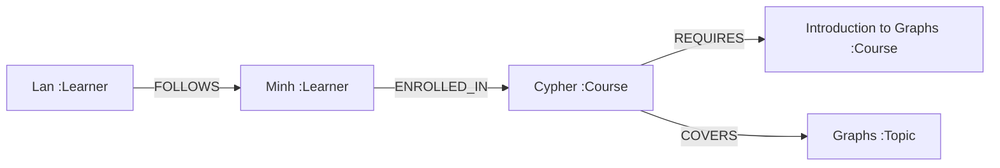
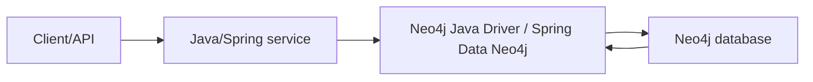

# What Is a Graph Database and What Problems Does Neo4j Solve?

> **Chapter:** Neo4j Overview  
> **Scope:** `DATABASE_ENGINE_GRAPH_NEO4J` — using Neo4j to model connected data as a *property graph* and query relationships and paths with Cypher. This provides the foundation for further study of nodes, relationships, indexes, constraints, query optimization, data import, the Java Driver, Spring Data Neo4j, and operating graph systems.

## 1. Learning Objectives

After this lesson, you will be able to:

1. Explain what a graph database is and distinguish between **node**, **relationship**, **label**, and **property**.
2. Recognize requirements where **relationships between entities are first-class objects to be queried directly**, such as multi-hop connections, dependency chains, recommendations, and detecting suspicious transaction rings.
3. Explain when a *property graph* model is better suited than relational tables or JSON documents, while recognizing its limitations.
4. Read and write basic Cypher queries to find single connections, traverse multiple hops, and determine paths.
5. Explain why **relationship direction, path length, starting point, and number of connections** affect query results and cost.
6. Identify initial design questions before introducing Neo4j into a real-world application.

## 2. When Data Is More Than Isolated Records

Suppose a learning platform stores learners, courses, topics, and course prerequisites. Simple questions such as “What is the title of course C102?” usually only require looking up a single record. However, the system also needs to answer:

- Who is a learner following, including people followed *indirectly* across one or two hops?
- Which courses have been completed by people in a learner's network that the learner has not taken yet?
- To learn Spring Data Neo4j, what prerequisite knowledge chain must be completed first?
- Through what intermediate steps are two entities connected, and which path has the fewest steps?

What these have in common is that the answer depends on **connection structure**. Each connection has its own meaning, has a direction, and sometimes carries additional data such as enrollment time, learning status, or a participant's role. When connection chains are long or their depth is not known in advance, fetching records and assembling relationship levels in application code quickly becomes complex.

A **graph database** is a type of database designed to store and query highly connected data. Instead of treating a relationship merely as a foreign key to be matched at query time, the system represents relationships as elements of the data model that queries can traverse directly.

Conceptually, a graph consists of a set of **vertices** \(V\) and a set of **edges** \(E\), commonly denoted \(G=(V,E)\). In business applications, vertices represent entities and edges represent relationships between entities. Neo4j uses a specific form of graph called a **labeled property graph**.

## 3. Property Graphs in Neo4j

A *property graph* has four core components:

| Component | Meaning | Example in a learning platform |
| --- | --- | --- |
| **Node** (vertex) | Represents an entity, object, or concept | Learner Lan; course Cypher; topic Graph |
| **Label** | Categorizes nodes; a node can have multiple labels | `:Learner`, `:Course`, `:Topic` |
| **Relationship** (edge) | Directly connects two nodes, with a **type** and **direction** | `(Lan)-[:FOLLOWS]->(Minh)` |
| **Property** | Key–value pair data attached to a node or relationship | `Learner.id`, `Course.title`, `ENROLLED_IN.status` |

Conceptual diagram:



Reading a Cypher pattern:

```cypher
(l:Learner {id: 'U1'})-[:FOLLOWS]->(m:Learner)
```

This pattern means: a node `l` with the label `Learner`, having property `id = 'U1'`, connected **in the outgoing direction** by a relationship of type `FOLLOWS` to a node `m` with the label `Learner`.

Key points to keep in mind:

- **Relationships are directed.** `(a)-[:FOLLOWS]->(b)` does not automatically imply `(b)-[:FOLLOWS]->(a)`. If a use case only cares whether a connection exists, Cypher can use an undirected pattern such as `(a)-[:RELATED_TO]-(b)`; the stored relationship data still has a direction.
- **Relationships can carry properties.** In `(u)-[e:ENROLLED_IN]->(c)`, `e.status = 'COMPLETED'` describes *u taking c*, not a fixed state of the learner or of the course.
- **Two nodes can be connected by multiple relationships.** For instance, the same person can both `FOLLOWS` and `MENTORS` another person. Business rules determine which relationship types and how many connections are allowed.
- **Labels are not SQL tables.** A node can carry multiple labels at the same time, such as `:Person:Instructor`; labels help describe and select the set of nodes to search.
- **Neo4j does not automatically understand all business rules.** A relationship name like `REQUIRES` carries meaning defined by the application; if prerequisite cycles or duplicate enrollments must be prohibited, the application must design and enforce those invariants.

### Graph Databases Are Not Synonymous with Every Other “Graph”

Neo4j's *property graph* is one graph representation tailored for applications. **RDF/knowledge graphs** typically use subject–predicate–object triples and the SPARQL query ecosystem. They overlap in the idea of linking entities, but their data models, semantic frameworks, and query languages are not identical. **Graph visualization** is only a presentation layer: a graph database remains valuable when an application returns tabular results or JSON rather than rendering a network diagram.

## 4. What Classes of Problems Does Neo4j Solve?

Neo4j is a graph database management system that uses a property graph model and the **Cypher** query language. Its standout strength is expressing complex connection patterns through readable path patterns and querying related entities across multiple hops.

| Problem Domain | Typical Nodes | Meaningful Relationships | Typical Questions |
| --- | --- | --- | --- |
| Social networks, communities | Users, groups, posts | `FOLLOWS`, `MEMBER_OF`, `LIKES` | Who is connected to me within at most two hops? |
| Content and product recommendations | Users, products, topics | `VIEWED`, `PURCHASED`, `SIMILAR_TO` | What else are users with similar behavior interested in? |
| Fraud detection | Accounts, devices, cards, transactions | `USES_DEVICE`, `TRANSFERRED_TO`, `OWNS` | Do multiple accounts share devices and money flows? |
| Dependency management | Services, libraries, courses, tasks | `DEPENDS_ON`, `REQUIRES` | How far does a failing component propagate its indirect impact? |
| Knowledge catalogs, access control | Documents, authors, groups, resources | `REFERENCES`, `MEMBER_OF`, `CAN_ACCESS` | Through which groups was this user granted permission? |
| Routing, path discovery | Stations, locations, network nodes | `CONNECTED_TO`, `ROUTE_TO` | Is there a valid path? Which path has the fewest hops? |

The deciding factor is not whether the system has a “relationships” table — most systems do. Neo4j is especially useful when **exploring chains of connections is a frequent operation or core to the product**. For example, an admin page that simply lists courses by code may not need a graph; by contrast, a system that continuously analyzes multi-layer prerequisites, generates recommendations across a learner network, and finds connecting paths between topics has a clear graph requirement.

### Example: Fraud Investigation via Shared Entities

A single transaction may not look suspicious. However, if multiple accounts that have never interacted directly all use the same device and receive funds through a group of intermediary accounts, the **connection pattern** becomes an investigative signal. Modeling accounts, devices, and transactions as nodes and relationships makes it straightforward to ask: “Which accounts are within three hops of the account under review via shared devices?”

This is an application of relationship discovery, **not an automatic conclusion that every connected cluster is fraudulent**. Results still require business rules, temporal data, risk scoring, and verification.

## 5. Comparing Data Modeling Mindsets: Relational, Document, and Graph

Suppose a relational database has the tables `learners`, `courses`, `follows`, `enrollments`, and `course_prerequisites`. For a direct one-hop connection, a SQL `JOIN` is usually clear and efficient. When tracing a prerequisite chain of unknown depth, you can use a **recursive CTE**, issue multiple queries, or process it in application code. In Neo4j, that chain can be expressed directly as a Cypher path pattern.

| Criterion | Relational DB (e.g., PostgreSQL) | Document DB (e.g., MongoDB) | Neo4j / Property Graph |
| --- | --- | --- | --- |
| Core model | Tables, rows, keys, foreign keys | Documents and nested structures | Nodes, relationships, labels, properties |
| Natural workload | Transactions, structured reporting, tabular aggregations | Reading/writing a document or aggregate cluster that travels together | Exploring relationships and paths across many entities |
| Multi-hop connections | `JOIN`, recursive CTE, or application code | References/lookups or application code | Fixed-length or variable-length relationship patterns |
| Common strengths | Constraints, SQL, and mature analytics ecosystem | Flexibility for hierarchical document data | Direct representation of domain connections and path-based queries |
| Considerations | Number of joins and query optimization | Many-to-many relationships make multi-document updates harder | Wide traversals, supernodes (high-degree nodes), whole-graph queries, operational overhead |

You cannot conclude that “Neo4j is always faster than SQL.” Relational databases have powerful indexes, join optimizers, and recursive queries; Neo4j can also be slow if a query starts too broadly or expands too many paths. The choice should be based on **actual queries, data scale, degree distribution, transactional requirements, operational capability, and benchmarks on representative data**.

A system can also use multiple technologies: for example, a relational database managing orders while Neo4j stores the dependency or connection network for search and recommendations. In that case, you must define the source of truth and a synchronization mechanism to avoid conflicting data versions.

## 6. Hands-On: Modeling a Learning Platform in Neo4j

We will build a small graph that runs in any Neo4j environment supporting Cypher. The examples use constraint syntax for **Neo4j 5.x and later**. Run each block in order on a practice database, not a production database.

### 6.1. Defining Entities and Relationships

| Type | Meaning and Direction | Typical Data |
| --- | --- | --- |
| `(:Learner)` | Learner | `id`, `name` |
| `(:Course)` | Course | `id`, `title`, `level` |
| `(:Topic)` | Knowledge topic | `code`, `name` |
| `(Learner)-[:FOLLOWS]->(Learner)` | Source learner follows target learner | Can add `since` |
| `(Learner)-[:ENROLLED_IN]->(Course)` | An enrollment, with learning status | `status` |
| `(Course)-[:REQUIRES]->(Course)` | Course at the tail **requires** course at the head | Can add `requiredLevel` |
| `(Course)-[:COVERS]->(Topic)` | Course covers topic | Can add `depth` |

For example, `(Spring Data Neo4j)-[:REQUIRES]->(Cypher)` means **Spring Data Neo4j requires knowledge of Cypher**. Direction conventions must remain consistent; reversing a single edge changes the meaning of every path query.

### 6.2. Identifying Data with Constraints

Each node has a stable business identifier (`id` or `code`). Constraints prevent duplicate nodes with the same label and identifier from being created:

```cypher
CREATE CONSTRAINT learner_id_unique IF NOT EXISTS
FOR (l:Learner) REQUIRE l.id IS UNIQUE;

CREATE CONSTRAINT course_id_unique IF NOT EXISTS
FOR (c:Course) REQUIRE c.id IS UNIQUE;

CREATE CONSTRAINT topic_code_unique IF NOT EXISTS
FOR (t:Topic) REQUIRE t.code IS UNIQUE;
```

Unique constraints like these create an index to look up nodes by the declared key. In practice, `UNIQUE` does not mean the property is required to exist on every node; if business rules require both uniqueness and existence, design the appropriate constraints for your Neo4j version and edition and verify support. **Do not use internal node IDs as durable business keys**, because they are not a stable identification contract for external systems.

### 6.3. Creating Nodes

`MERGE` matches an existing pattern or creates it if it does not exist; `SET` updates properties. Using `MERGE` on business keys makes re-running sample scripts much easier to control than creating new nodes every time.

```cypher
MERGE (lan:Learner {id: 'U1'})
SET lan.name = 'Lan';

MERGE (minh:Learner {id: 'U2'})
SET minh.name = 'Minh';

MERGE (an:Learner {id: 'U3'})
SET an.name = 'An';

MERGE (graph:Course {id: 'C101'})
SET graph.title = 'Introduction to Graphs', graph.level = 'Beginner';

MERGE (cypher:Course {id: 'C102'})
SET cypher.title = 'Cypher Queries', cypher.level = 'Intermediate';

MERGE (java:Course {id: 'C103'})
SET java.title = 'Java Fundamentals', java.level = 'Beginner';

MERGE (sdn:Course {id: 'C104'})
SET sdn.title = 'Spring Data Neo4j', sdn.level = 'Advanced';

MERGE (graphTopic:Topic {code: 'GRAPH'})
SET graphTopic.name = 'Graphs';

MERGE (javaTopic:Topic {code: 'JAVA'})
SET javaTopic.name = 'Java';
```

### 6.4. Creating Relationships

`MATCH` patterns find existing nodes; `MERGE` patterns connect them with specific relationships. Once the link is identified, place status data on the relationship to represent the status **of that course enrollment**, rather than on the learner node or course node.

```cypher
MATCH (lan:Learner {id: 'U1'}),
      (minh:Learner {id: 'U2'}),
      (an:Learner {id: 'U3'})
MERGE (lan)-[:FOLLOWS]->(minh)
MERGE (minh)-[:FOLLOWS]->(an);

MATCH (lan:Learner {id: 'U1'}),
      (minh:Learner {id: 'U2'}),
      (an:Learner {id: 'U3'}),
      (graph:Course {id: 'C101'}),
      (cypher:Course {id: 'C102'}),
      (java:Course {id: 'C103'}),
      (sdn:Course {id: 'C104'})
MERGE (lan)-[e1:ENROLLED_IN]->(graph)
SET e1.status = 'COMPLETED'
MERGE (lan)-[e2:ENROLLED_IN]->(java)
SET e2.status = 'IN_PROGRESS'
MERGE (minh)-[e3:ENROLLED_IN]->(cypher)
SET e3.status = 'COMPLETED'
MERGE (an)-[e4:ENROLLED_IN]->(sdn)
SET e4.status = 'COMPLETED';

MATCH (graph:Course {id: 'C101'}),
      (cypher:Course {id: 'C102'}),
      (java:Course {id: 'C103'}),
      (sdn:Course {id: 'C104'}),
      (graphTopic:Topic {code: 'GRAPH'}),
      (javaTopic:Topic {code: 'JAVA'})
MERGE (cypher)-[:REQUIRES]->(graph)
MERGE (sdn)-[:REQUIRES]->(cypher)
MERGE (sdn)-[:REQUIRES]->(java)
MERGE (graph)-[:COVERS]->(graphTopic)
MERGE (cypher)-[:COVERS]->(graphTopic)
MERGE (java)-[:COVERS]->(javaTopic)
MERGE (sdn)-[:COVERS]->(graphTopic)
MERGE (sdn)-[:COVERS]->(javaTopic);
```

After creating the data, the graph contains 3 learners, 4 courses, 2 topics, and their direct connections. This small model is sufficient to practice both single-hop and multi-hop queries.

### 6.5. Querying a Single Connection

Find Lan's courses and learning statuses:

```cypher
MATCH (u:Learner {id: 'U1'})-[e:ENROLLED_IN]->(c:Course)
RETURN u.name AS hoc_vien,
       c.title AS khoa_hoc,
       e.status AS trang_thai
ORDER BY c.id;
```

Expected result: Lan has completed **Introduction to Graphs** (`COMPLETED`) and is taking **Java Fundamentals** (`IN_PROGRESS`). `MATCH` finds a subgraph pattern, while `RETURN` selects the data to return — returning entire nodes is not required.

### 6.6. Querying Multi-Hop Relationships

Find learners whom Lan follows directly or indirectly within at most two hops:

```cypher
MATCH (lan:Learner {id: 'U1'})-[:FOLLOWS*1..2]->(other:Learner)
RETURN DISTINCT other.id AS id, other.name AS hoc_vien
ORDER BY id;
```

`*1..2` specifies a path length from **1 to 2 relationships**. The expected result is **Minh** (one hop) and **An** (two hops). `DISTINCT` is useful when multiple distinct paths can lead to the same node. This is a concise example of *variable-length traversal* — a common use case in graph databases.

With large datasets, you should not default to unbounded path lengths. When each node has high branching, the number of candidate paths can grow rapidly; limit traversal depth and filter relationship types appropriately for the question.

### 6.7. Recommending Courses Through a Learner Network

Requirement: “Find courses completed by learners whom Lan follows within at most two hops, that Lan has not enrolled in yet.”

```cypher
MATCH (lan:Learner {id: 'U1'})-[:FOLLOWS*1..2]->(peer:Learner)
      -[e:ENROLLED_IN]->(course:Course)
WHERE e.status = 'COMPLETED'
  AND NOT EXISTS {
    MATCH (lan)-[:ENROLLED_IN]->(course)
  }
RETURN DISTINCT course.id AS id, course.title AS goi_y
ORDER BY id;
```

Expected result: **C102 – Cypher Queries** (completed by Minh) and **C104 – Spring Data Neo4j** (completed by An). The query clearly illustrates how to combine **connected users' behavior** with an **exclusion condition** to generate recommendations. This is only a simple recommendation rule; a production system also needs ranking, prerequisite checks, and filtering out recommendations that do not match the learner's level.

### 6.8. Finding the Complete Prerequisite Knowledge Chain

Requirement: “Which courses does Spring Data Neo4j depend on directly or indirectly?”

```cypher
MATCH (target:Course {id: 'C104'})-[:REQUIRES*1..3]->(pre:Course)
RETURN DISTINCT pre.id AS id, pre.title AS kien_thuc_can
ORDER BY id;
```

Expected result: **C101 – Introduction to Graphs**, **C102 – Cypher Queries**, **C103 – Java Fundamentals**. In the sample data, C104 directly requires C102 and C103; C102 in turn requires C101, making C101 an indirect dependency. Note that the query returns a **set of prerequisite courses**, not an optimal learning sequence. Producing a valid study order requires analyzing the dependency structure and detecting/eliminating cycles if business rules forbid them.

### 6.9. Finding the Shortest Path by Hop Count

From Lan to An, find the `FOLLOWS` relationship chain with the fewest edges within a limit of five hops:

```cypher
MATCH (start:Learner {id: 'U1'}),
      (finish:Learner {id: 'U3'})
MATCH path = shortestPath((start)-[:FOLLOWS*..5]->(finish))
RETURN [n IN nodes(path) | n.name] AS duong_di,
       length(path) AS so_buoc;
```

Expected result: `['Lan', 'Minh', 'An']`, `so_buoc = 2`. In this example, `shortestPath` minimizes the **number of relationships**, and does not automatically calculate geographic distance, travel time, or weights. Weighted shortest-path problems or multi-criteria optimization require appropriate modeling and algorithms; they cannot be inferred from hop count alone.

## 7. Why How You Query a Graph Matters

Consider two queries with the same goal of finding who Lan follows:

```cypher
// Has a starting point identified by learner ID.
MATCH (lan:Learner {id: 'U1'})-[:FOLLOWS]->(peer:Learner)
RETURN peer.name;
```

```cypher
// Starts from all learners and then checks the ID.
MATCH (lan:Learner)-[:FOLLOWS]->(peer:Learner)
WHERE lan.id = 'U1'
RETURN peer.name;
```

The query planner can optimize both forms into equivalent execution plans; you cannot judge speed based solely on where `WHERE` is written. The more important principle is **having a selective starting point** (such as a node with a unique `id`), and then expanding only the required relationship types and hop counts. Without selective predicates, a query may scan many unrelated nodes or links.

To inspect rather than guess, use:

```cypher
EXPLAIN
MATCH (lan:Learner {id: 'U1'})-[:FOLLOWS*1..2]->(peer:Learner)
RETURN DISTINCT peer.name;
```

`EXPLAIN` shows the estimated execution plan without running the query; `PROFILE` executes the query and reports actual operator metrics. When reading a plan, pay attention to how starting nodes are located, relationship expansion operators, intermediate row counts, and database hits. Defining indexes and constraints helps when they align with filter predicates and query patterns.

### Factors That Make Graph Queries Expensive

- **High-degree nodes (supernodes):** an entity connected to hundreds of thousands of other entities can generate massive fan-out in a single hop.
- **Overly long or unbounded paths:** the number of candidate combinations grows rapidly when branching is high.
- **Overly broad relationship types:** traversing every edge type can mix unrelated connections into the business question.
- **Filtering too late:** generating large numbers of intermediate paths before discarding them can be costly.
- **Cyclic patterns or duplicate results:** the same node may be reached via many paths; determine whether the problem calls for distinct nodes or distinct paths.

Actual complexity and performance depend on the data, graph topology, query plan, configuration, and Neo4j version. “Traversing a relationship” does not mean every traversal runs in constant time.

## 8. Model Design: Node, Property, or Relationship?

There is no rule that every noun must be a node and every verb must be a relationship. Decide based on how the data is queried and updated.

**Use a property** for descriptive values read alongside an object, such as `Course.title` or `Learner.name`. **Use a node** when a concept has its own identity and needs to be linked, reused, or queried independently, such as a `Topic` covered by multiple courses. **Use a relationship** when what you need to express is a connection between two entities, such as `REQUIRES` or `ENROLLED_IN`; relationship properties describe that specific connection.

For example, if a learner can retake the same course multiple times, a single `ENROLLED_IN` relationship with one `status` may not be enough to distinguish separate attempts. In that case, you can model an `Enrollment` node carrying the enrollment ID, timestamp, and outcome, linked to both the learner and the course. The model should reflect **identity, history, and domain queries**, not simply minimize node count.

Before finalizing a design, answer these questions:

1. **Which entities need a stable identity?** Which properties serve as business keys?
2. **Which relationship direction matches the domain language?** Is semantic bidirectionality needed?
3. **Can a pair of entities have multiple relationships of the same type?** Do you need history or versioning over time?
4. **How many hops do typical queries traverse?** Are there selective predicates to narrow the starting point?
5. **What are the validity rules?** Are cycles, duplicate relationships, or missing required properties allowed?
6. **How frequently does the data change and where does it come from?** Does it require transactional updates, CSV imports, synchronization from other systems, or event processing?

## 9. Common Limitations and Misconceptions

**“Whenever tables have relationships, you must move to Neo4j.”** Not true. For simple lookups, structured transactions, and aggregate reporting, an RDBMS often works well. Identify which workloads benefit from a graph model and graph queries before adding another database system to your stack.

**“Graphs are schemaless, so constraints aren't needed.”** Neo4j is flexible in data shape, but application data still requires consistent type names, unique identifiers, and appropriate constraints. Lack of business-level schema control easily leads to duplicate nodes, reversed relationships, and unreliable query results.

**“A graph database automatically computes every optimal path.”** Finding the fewest-hop path, weighted shortest path, all paths matching criteria, and densely connected communities are different problems. You must choose the query or algorithm that matches the exact criterion and bound the search scope.

**“A pretty diagram proves the model is good.”** Visual diagrams help validate thinking, but they do not prove that data is accurate, queries are fast enough, or the model fits operational requirements. Validate with real queries and representative data.

**“Using a graph means skipping transactions and access control.”** Graph data still requires connection management, consistency, transactions, backups, access control, and operations. Neo4j supports transactional mechanisms; deployment configuration and feature choices depend on version, edition, and system requirements.

## 10. Neo4j in Java and Spring Applications

For systems built with Java, a typical flow looks like this:



- **Cypher** expresses what to query or update in the graph.
- **Neo4j Java Driver** provides connectivity, parameterized query execution, and unit-of-work/transaction management from Java.
- **Spring Data Neo4j** assists with mapping domain models to nodes/relationships and building repositories in Spring applications; understanding the underlying graph model and queries is still essential.
- **Indexes, constraints, and query plan analysis** help keep the system correct and performant as data grows.
- **Data import, backups, monitoring, and security** are essential operational tasks when moving from sample data to production environments.

A critical rule when invoking Cypher from an application is to **pass values via parameters** instead of concatenating user input strings into the query:

```cypher
MATCH (learner:Learner {id: $learnerId})-[:ENROLLED_IN]->(course:Course)
RETURN course.id, course.title;
```

The application supplies the value for `$learnerId` through the driver's parameter API. This separates query structure from input data and makes queries safer and easier to maintain. The Java Driver, Spring Data Neo4j, and optimization are covered in depth in dedicated lessons.

## 11. Self-Check Exercises

**Exercise 1 — Reading the model.** Given the pattern `(a:Course)-[:REQUIRES]->(b:Course)`, which course depends on which? If a query traverses in the `<-[:REQUIRES]-` direction starting from `b`, what kind of courses does it find?

**Exercise 2 — Writing a query.** Write a Cypher query to find the learner who completed course `C102` in the sample data. Who is the expected result?

**Exercise 3 — Paths.** If you add `(An)-[:FOLLOWS]->(Lan)`, what changes in the two-hop follow query starting from Lan? What issue can an unbounded-depth query run into when the graph contains cycles?

**Exercise 4 — Design.** You need to store multiple retakes of the same course and track the score for each attempt. Should you place `score` on the `Course` node, on the `ENROLLED_IN` relationship, or create a node for each enrollment attempt? Explain your decision based on historical tracking requirements.

**Exercise 5 — Technology choice.** One application only looks up products by SKU and exports monthly revenue totals. Another application continuously finds every service that indirectly depends on a service that just went down. Which application has a stronger reason to evaluate Neo4j, and what should you measure before deciding?

<details>
<summary>Answer Hints</summary>

1. `a` requires `b`; traversing backward from `b` finds the courses that depend on `b`.
2. `MATCH (u:Learner)-[e:ENROLLED_IN]->(:Course {id: 'C102'}) WHERE e.status = 'COMPLETED' RETURN u.name;` → **Minh**.
3. Lan still sees Minh and An within two hops; cycles introduce many looping traversal possibilities, so you must bound path length, define path semantics, and avoid unnecessary expansion.
4. If each attempt has its own identity, timestamp, score, and status, using a node per enrollment (such as `Enrollment`) usually captures history more cleanly; if business rules guarantee at most one enrollment per learner–course pair, properties on the relationship may suffice.
5. The multi-layer dependency analysis application has a much stronger reason to evaluate Neo4j. Measure query latency, intermediate data volume, traversal depth, node degree, update throughput, integration complexity, and operational cost on realistic data.

</details>

## 12. Key Takeaways

- Graph databases model and query **relationships** as first-class components of the data.
- Neo4j uses a *labeled property graph*: nodes, labels, directed relationships, and properties on both nodes and relationships.
- Cypher expresses connection patterns from single-hop to multi-hop traversals; `MATCH`, `RETURN`, `MERGE`, and path patterns form the core foundation.
- Network analysis, recommendations, link investigation, and dependency chains are strong candidate use cases; effectiveness must still be validated against requirements and concrete benchmarks.
- Good design starts with domain questions, stable identities, relationship direction, validity constraints, and traversal bounds — before writing application code or choosing frameworks.
