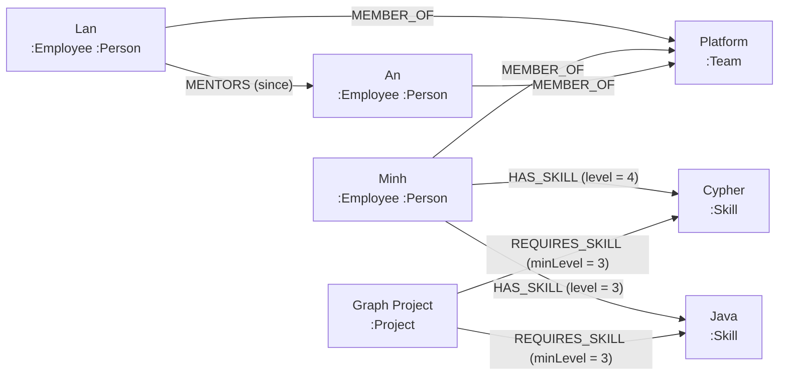
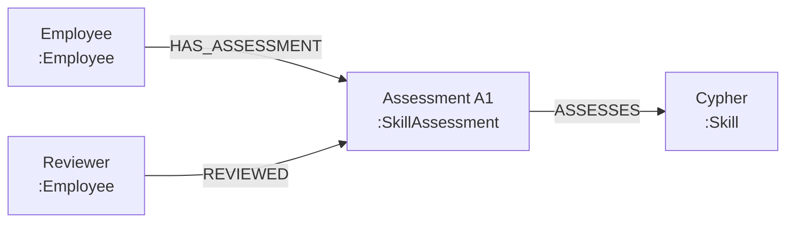

# The Property Graph Model: Nodes, Relationships, Labels, and Properties

> **Chapter:** Neo4j Overview  
> **Module:** `DATABASE_ENGINE_GRAPH_NEO4J`  
> **Focus:** How data is organized as a *labeled property graph* in Neo4j, distinguishing nodes, relationships, labels, relationship types, and properties; applying this model to read and write Cypher.
>
> This lesson lays the foundation for upcoming topics on indexes, constraints, query analysis and optimization, data import, the Java Driver, Spring Data Neo4j, and operating graph databases.

## 1. Learning Objectives

After completing this lesson, you will be able to:

1. Accurately describe the components of a **labeled property graph** and how they connect to one another.
2. Distinguish the meanings of **node**, **relationship**, **label**, **relationship type**, and **property**, including commonly confused cases.
3. Explain why a relationship in Neo4j always has a direction and exactly one type, whereas a node can carry multiple labels.
4. Choose how to represent information as a node, relationship, or property based on query requirements and data history.
5. Create a model with sample data in Cypher, query nodes, relationships, properties, two-hop paths, and check for missing data.
6. Recognize risks related to identity, edge direction, duplicate data, nulls, property types, high-degree nodes, and constraint limitations.

## 2. What Is a Property Graph?

Mathematically, a graph is typically described by a set of vertices `V` and a set of edges `E`. In graph databases, that concept is extended to represent **entities with descriptive data** and **connections carrying business meaning**.

Neo4j organizes data as a **labeled property graph**. The model has two primary element types:

- A **Node** represents an entity or concept, such as an employee, skill, project, or team.
- A **Relationship** connects a source node to a target node and expresses the nature of the connection, such as `HAS_SKILL`, `MEMBER_OF`, or `REQUIRES_SKILL`.

In addition, a **label** categorizes nodes, and a **property** stores data on a node or relationship as a key–value pair.

For example, an engineering team needs to find employees with the right skills to deliver a Neo4j project:



In this diagram, `Minh` is not just an isolated employee record. The fact that Minh *has Cypher skill at level 4* is expressed as a `HAS_SKILL` relationship to the `Cypher` node, with the property `level = 4` stored **on the relationship itself**. The project also points to that skill node, but via a `REQUIRES_SKILL` relationship with the property `minLevel = 3`. As a result, the question “Who meets the skill levels required by the project?” can be asked directly over the connections.

A Neo4j graph can hold many types of nodes and relationships within the same data space. You do not need to create a separate join table just to link two entities; however, you still need to design and enforce business rules governing those relationships.

## 3. Node: An Entity with Identity

A **node** is the unit representing an object that needs to be referenced or linked. A node can exist without labels or properties, though in real applications it usually has both to make the model clear.

Example representing an employee:

```cypher
(:Employee:Person {
  employeeId: 'E02',
  name: 'Minh',
  department: 'Platform'
})
```

Reading the structure:

- `(:Employee:Person)` is **a single node** with **two labels**: `Employee` and `Person`.
- `employeeId`, `name`, `department` are **property names**.
- `'E02'`, `'Minh'`, `'Platform'` are **property values**.
- The business key `employeeId` allows the application to recognize the same employee across multiple updates.

The syntax `(:Label {key: value})` describes a node pattern in Cypher; it does not mean the node has already been saved to the database. To create or find nodes, you must use clauses such as `CREATE`, `MERGE`, or `MATCH`.

### 3.1. A Node's Identity Is Not Its Display Content

Two employees can share the name “Minh”; the same employee can also change their name or transfer departments. Therefore, `name` and `department` should not serve as stable keys if the business domain does not guarantee their uniqueness.

A common design:

| Property | Role | Can It Change? |
| --- | --- | --- |
| `employeeId` | Business identifier | Usually needs to remain stable |
| `name` | Display data | Yes |
| `department` | Organizational info | Yes |
| `email` | Contact channel | Yes; use as a key only when guaranteed by business rules |

Neo4j provides internal element identifiers such as `elementId()`, but **they should not be used as business keys for long-term storage in external systems**. Application-managed business identifiers keep data durable across imports/exports, rebuilds, and integrations.

### 3.2. When Should a Concept Be a Node?

Information should be considered for modeling as a node when it:

- Has its **own identity** and is reused in multiple places.
- Needs to participate in **multiple relationship types**.
- Serves as the starting or ending point of traversal queries.
- Has an independent lifecycle, properties, or update rules.

For example, “Cypher” should be a `:Skill` node if many employees and projects reference this skill. If each employee merely stored a string `skillName = 'Cypher'`, it would be awkward to express the direct link between “employee has skill” and “project requires skill.”

## 4. Relationship: A Directed, Meaningful Connection

A **relationship** in Neo4j connects **exactly two nodes**: a start node and an end node. It has a **direction**, **one relationship type**, and optional properties.

```cypher
(minh:Employee)-[hs:HAS_SKILL {level: 4}]->(cypher:Skill)
```

In the pattern above:

| Component | Meaning |
| --- | --- |
| `minh` | Variable referencing the start node |
| `hs` | Variable referencing the relationship |
| `HAS_SKILL` | Relationship type |
| `level: 4` | Property of the relationship |
| `cypher` | Variable referencing the end node |
| `->` | Direction from employee to skill |

### 4.1. Direction Is Part of the Relationship Data

`(Minh)-[:HAS_SKILL]->(Cypher)` means *Minh has the Cypher skill*. Reversing it to `(Cypher)-[:HAS_SKILL]->(Minh)` no longer matches the convention. Choosing a consistent direction makes writing queries straightforward and prevents mistakes when inserting data.

When querying, you can:

```cypher
// From an employee, traverse to their skills
MATCH (e:Employee)-[:HAS_SKILL]->(s:Skill)
RETURN e.name, s.name;

 // From a skill, find the employees who have that skill
MATCH (s:Skill {code: 'CYPHER'})<-[:HAS_SKILL]-(e:Employee)
RETURN e.name;

 // Find connections without specifying a direction in the MATCH pattern
MATCH (e:Employee)-[:HAS_SKILL]-(s:Skill)
RETURN e.name, s.name;
```

In the third query, the Cypher pattern **does not constrain direction**, though the relationship in the database still has a stored direction. You should not create two opposite edges solely to support querying from both sides if the domain relationship is inherently one-way.

### 4.2. A Relationship Has Exactly One Type

A node can carry both `:Person` and `:Employee`, but a specific relationship can have only one type, such as `:HAS_SKILL` or `:MENTORS`.

A pair of nodes can have multiple relationships, of the same type or different types. For example, person A can both `MENTORS` and `COLLABORATES_WITH` person B. Neo4j **does not prohibit by default** multiple `HAS_SKILL` relationships between the same Employee–Skill pair; the application must decide between “one current state” or “multiple assessments” and write data accordingly.

Because a relationship is not a node, another relationship cannot “attach to” it as the target of a new edge. If **a connection event needs to be joined, approved, or referenced independently by others**, consider modeling that event as a node.

### 4.3. Relationship Properties Describe the Connection

Example:

```cypher
(e:Employee)-[:HAS_SKILL {
  level: 4,
  assessedAt: date('2026-11-01')
}]->(s:Skill)
```

`level` and `assessedAt` are not permanent traits of the employee or the skill. They describe the state of **this employee holding that skill at a given assessment date**. That is why relationship properties are typically suited for roles, statuses, start dates, strength, or weights.

If you need to store *the full history of assessments* along with reviewers, evidence, and approvals, a `:SkillAssessment` node with its own identity may fit better than a `HAS_SKILL` relationship overwritten each time.

## 5. Label and Relationship Type: Two Different Ways to Define Semantics

A **label** states *what category of object* a node belongs to; a **relationship type** states *how two objects are related*.

| Aspect | Label | Relationship Type |
| --- | --- | --- |
| Applies to | Node | Relationship |
| Count per element | A node can have zero, one, or many labels | Each relationship has one type |
| Pattern syntax | `(e:Employee:Person)` | `-[r:HAS_SKILL]->` |
| Purpose | Select entity groups, organize schema/indexes/constraints | Specify the exact meaning of a connection |
| Examples | `:Employee`, `:Skill`, `:Project` | `MEMBER_OF`, `MENTORS`, `REQUIRES_SKILL` |

### 5.1. Multiple Labels on One Node

An employee is both a human being (`:Person`) and staff within an organization (`:Employee`). In that case:

```cypher
MATCH (e:Employee:Person)
RETURN e.employeeId, e.name;
```

Only nodes that **carry both labels simultaneously** match this pattern. Using multiple labels is helpful for intersecting entity sets, but labels should not be treated like an OOP class inheritance hierarchy. Neo4j does not automatically infer that `Employee` is a subtype of `Person` unless the application assigns both labels.

### 5.2. Label or Relationship for a “Role”?

Suppose Lan mentors An. There are two distinct concepts:

- `(Lan:Mentor)`: Lan is categorized as someone holding a mentor role in the organization.
- `(Lan)-[:MENTORS]->(An)`: Lan **is mentoring An** in a specific relationship.

If the domain needs to ask “Who does Lan mentor, and since when?”, the `Mentor` label alone is insufficient; you need a relationship to each mentee. If you only need to group employees authorized to act as mentors, a label or role property may suffice. Both can be used together when both concepts are meaningful and synchronization is clearly managed.

### 5.3. Naming Conventions

In a Neo4j project, clear conventions keep the schema readable:

- Labels are typically PascalCase nouns: `Employee`, `Project`, `SkillAssessment`.
- Relationship types are typically uppercase verbs or action phrases with underscores: `HAS_SKILL`, `REQUIRES_SKILL`, `MEMBER_OF`.
- Properties typically use camelCase: `employeeId`, `minLevel`, `assessedAt`.

These are **design conventions**, not Cypher requirements. Label, type, and property names are case-sensitive; `:Employee` is different from `:employee`. Special names may require backticks in Cypher, though simple, stable names are preferable.

## 6. Property: Key–Value Pairs on Nodes or Relationships

Properties store attributes describing graph elements. In Cypher:

```cypher
(e:Employee {
  employeeId: 'E01',
  name: 'Lan',
  active: true,
  yearsOfExperience: 6,
  rating: 4.5,
  joinedAt: date('2022-09-01'),
  tags: ['backend', 'graph']
})
```

The example above illustrates common value types: string, boolean, integer, float, date, and list of values.

Neo4j also supports appropriate temporal and spatial value types. However, distinguish between **values Cypher can manipulate in a query** and **values allowed to be stored directly as properties**. For instance, nested maps or lists of maps are not stored directly as properties the way JSON documents are. When you need a substructure with independent relationships, consider extracting it into nodes or storing it in an external structure.

### 6.1. A Missing Property Differs from an Empty String or Zero

A node is not required to have every property. Consider three cases:

```cypher
// Field is absent on the node
MATCH (e:Employee {employeeId: 'E01'})
REMOVE e.nickname;

// Field has an empty string value
MATCH (e:Employee {employeeId: 'E01'})
SET e.nickname = '';

// SET ... = null removes the property
MATCH (e:Employee {employeeId: 'E01'})
SET e.nickname = null;
```

In Neo4j, a missing property evaluates to `null`; setting a property to `null` removes that property. Therefore, **“no data yet”** differs from `''`, `false`, or `0`. If business logic must distinguish *not entered*, *not applicable*, and *explicitly cleared*, represent that state with a dedicated property or an explicit event model.

Note: `SET e.nickname = null` on the same node removes a previously assigned `''` value. The three statements above illustrate step-by-step states, not three states existing simultaneously.

### 6.2. Property on a Node or on a Relationship?

| Question | Appropriate Property Location | Reason |
| --- | --- | --- |
| What is the employee's name? | `Employee.name` | Describes the employee |
| What is the skill's name? | `Skill.name` | Describes the shared skill |
| What level of skill B does employee A have? | `HAS_SKILL.level` | Describes the A–B pair |
| What minimum level of skill B does project P require? | `REQUIRES_SKILL.minLevel` | Describes the P–B pair |
| When did the employee join the team? | `MEMBER_OF.since` | Describes that specific membership |
| Who approved the skill assessment? | May need a `SkillAssessment` node | The assessment can have its own identity and lifecycle |

### 6.3. Property Lists Do Not Replace Every Relationship

Storing `skills: ['Java', 'Cypher']` on an employee node can be reasonable for very simple data that rarely changes and is only displayed. However, when multiple projects reference the same skill, and each skill has a canonical name, proficiency level, reviewer, and prerequisites, `:Skill` nodes plus `:HAS_SKILL` relationships express business questions much more cleanly. Base the choice on **actual query and update operations**.

## 7. Designing a Sample Model: Employees, Skills, and Projects

Let's build a small graph for practice. Context: the Platform team needs to find employees who meet the skill requirements for a graph database rollout project.

### 7.1. Node Types

| Label | Business Key | Example Properties |
| --- | --- | --- |
| `:Employee:Person` | `employeeId` | `name`, `department` |
| `:Team` | `code` | `name` |
| `:Skill` | `code` | `name` |
| `:Project` | `code` | `name`, `tags` |

### 7.2. Relationship Types

| Pattern | Meaning and Direction | Properties |
| --- | --- | --- |
| `(Employee)-[:MEMBER_OF]->(Team)` | Employee belongs to team | `role`, `since` |
| `(Employee)-[:HAS_SKILL]->(Skill)` | Employee's current skill level | `level`, `assessedAt` |
| `(Project)-[:REQUIRES_SKILL]->(Skill)` | Project requires a skill | `minLevel` |
| `(Employee)-[:MENTORS]->(Employee)` | First employee mentors second employee | `since` |

**Sample business rules:** skill levels range from 1 to 5; for each employee–skill pair, this model keeps only *one current assessment level*. If multiple assessment periods exist in practice, the design must change to retain history.

### 7.3. Constraints for Business Keys

Examples use Cypher syntax for Neo4j **5.x and later**. Run on a learning database before creating nodes:

```cypher
CREATE CONSTRAINT employee_id_unique IF NOT EXISTS
FOR (e:Employee) REQUIRE e.employeeId IS UNIQUE;

CREATE CONSTRAINT team_code_unique IF NOT EXISTS
FOR (t:Team) REQUIRE t.code IS UNIQUE;

CREATE CONSTRAINT skill_code_unique IF NOT EXISTS
FOR (s:Skill) REQUIRE s.code IS UNIQUE;

CREATE CONSTRAINT project_code_unique IF NOT EXISTS
FOR (p:Project) REQUIRE p.code IS UNIQUE;
```

These constraints prevent two nodes with the same label from sharing the same business code. They **do not** guarantee that the key property is present on every node, nor do they prohibit two relationships of the same type between the same pair of nodes. Additional constraint capabilities depend on Neo4j version/edition and system requirements.

### 7.4. Creating Nodes with MERGE

`MERGE` matches or creates a pattern; in this example we match on the **business key** inside `MERGE` and then `SET` mutable properties. Do not include the employee's name in `MERGE` identification, because changing a name should not create a new person.

```cypher
UNWIND [
  {id: 'E01', name: 'Lan', department: 'Platform'},
  {id: 'E02', name: 'Minh', department: 'Platform'},
  {id: 'E03', name: 'An', department: 'Platform'}
] AS row
MERGE (e:Employee {employeeId: row.id})
SET e.name = row.name, e.department = row.department
SET e:Person;

MERGE (t:Team {code: 'T-PLATFORM'})
SET t.name = 'Platform';

UNWIND [
  {code: 'JAVA', name: 'Java'},
  {code: 'CYPHER', name: 'Cypher'},
  {code: 'NEO4J', name: 'Neo4j'}
] AS row
MERGE (s:Skill {code: row.code})
SET s.name = row.name;

MERGE (p:Project {code: 'P-GRAPH'})
SET p.name = 'Graph Platform Rollout',
    p.tags = ['backend', 'graph'];
```

After this step, the graph has **8 nodes**: three employees, one team, three skills, and one project.

### 7.5. Creating Relationships and Their Properties

Using `MATCH` to locate both existing endpoints before `MERGE`-ing the relationship avoids accidentally creating unlabelled or incomplete nodes from an overly broad `MERGE` pattern. Production code also needs handling when an input key matches no node.

```cypher
UNWIND [
  {employeeId: 'E01', role: 'Lead'},
  {employeeId: 'E02', role: 'Member'},
  {employeeId: 'E03', role: 'Member'}
] AS row
MATCH (e:Employee {employeeId: row.employeeId})
MATCH (t:Team {code: 'T-PLATFORM'})
MERGE (e)-[m:MEMBER_OF]->(t)
SET m.role = row.role,
    m.since = date('2026-01-01');

UNWIND [
  {employeeId: 'E01', skillCode: 'JAVA', level: 4},
  {employeeId: 'E01', skillCode: 'CYPHER', level: 2},
  {employeeId: 'E02', skillCode: 'JAVA', level: 3},
  {employeeId: 'E02', skillCode: 'CYPHER', level: 4},
  {employeeId: 'E03', skillCode: 'CYPHER', level: 3},
  {employeeId: 'E03', skillCode: 'NEO4J', level: 4}
] AS row
MATCH (e:Employee {employeeId: row.employeeId})
MATCH (s:Skill {code: row.skillCode})
MERGE (e)-[h:HAS_SKILL]->(s)
SET h.level = row.level,
    h.assessedAt = date('2026-11-01');

UNWIND [
  {skillCode: 'JAVA', minLevel: 3},
  {skillCode: 'CYPHER', minLevel: 3}
] AS row
MATCH (p:Project {code: 'P-GRAPH'})
MATCH (s:Skill {code: row.skillCode})
MERGE (p)-[r:REQUIRES_SKILL]->(s)
SET r.minLevel = row.minLevel;

MATCH (lan:Employee {employeeId: 'E01'})
MATCH (an:Employee {employeeId: 'E03'})
MERGE (lan)-[m:MENTORS]->(an)
SET m.since = date('2026-09-01');
```

Expected result: **12 relationships**:

- 3 `MEMBER_OF`.
- 6 `HAS_SKILL`.
- 2 `REQUIRES_SKILL`.
- 1 `MENTORS`.

This script can be re-run idempotently on the sample data thanks to `MERGE` on resolved node pairs. Even so, **`MERGE` is no substitute for key design or global uniqueness enforcement on relationships**, especially under concurrent write sessions.

## 8. Reading the Model with Cypher

The following queries use the sample data from section 7. Pay attention to the difference between **finding a node by label** and **traversing relationships of known type and direction**.

### 8.1. Selecting Nodes by Label and Property

```cypher
MATCH (e:Employee {department: 'Platform'})
RETURN e.employeeId AS ma, e.name AS ten
ORDER BY ma;
```

Expected result: **Lan, Minh, An**. All three belong to `:Employee` and have `department = 'Platform'`.

To find nodes that carry both `Employee` and `Person` labels:

```cypher
MATCH (e:Employee:Person)
RETURN e.name AS ten, labels(e) AS nhan
ORDER BY ten;
```

The `labels(e)` function returns the node's labels; do not rely on element ordering in the label list in business logic.

### 8.2. Traversing a Relationship and Reading Edge Properties

```cypher
MATCH (e:Employee {employeeId: 'E02'})
      -[h:HAS_SKILL]->(s:Skill)
RETURN e.name AS nhan_vien,
       s.name AS ky_nang,
       h.level AS muc_do,
       h.assessedAt AS ngay_danh_gia
ORDER BY s.code;
```

Minh has **Cypher level 4** and **Java level 3**. This is a direct example of why `level` belongs on the `HAS_SKILL` relationship, since the same skill can have different proficiency levels for each employee.

### 8.3. Querying from the Target Side in Reverse Direction

```cypher
MATCH (s:Skill {code: 'CYPHER'})
      <-[h:HAS_SKILL]-(e:Employee)
WHERE h.level >= 3
RETURN e.name AS nhan_vien, h.level AS muc_do
ORDER BY muc_do DESC, nhan_vien;
```

Result: **Minh (4)** and **An (3)**. The expression `<-[:HAS_SKILL]-` traverses from the skill *against the arrow direction* to find employees possessing that skill. The stored data is not reversed; only the starting point in the query pattern changes.

### 8.4. Two-Hop Relationship Traversal

Question: “Who is Lan mentoring, and what skills does that person currently have?”

```cypher
MATCH (lan:Employee {employeeId: 'E01'})
      -[:MENTORS]->(mentee:Employee)
      -[h:HAS_SKILL]->(skill:Skill)
RETURN mentee.name AS nguoi_duoc_huong_dan,
       skill.name AS ky_nang,
       h.level AS muc_do
ORDER BY skill.code;
```

Expected result: **An — Cypher 3**, **An — Neo4j 4**. A path is formed by two consecutive relationships, each step carrying distinct business meaning.

### 8.5. Matching Project Requirements Against Employee Capabilities

Question: “Which employees satisfy **all** required skills for project P-GRAPH, at a current level no lower than required?”

```cypher
MATCH (p:Project {code: 'P-GRAPH'})
MATCH (e:Employee)
WHERE NOT EXISTS {
  MATCH (p)-[required:REQUIRES_SKILL]->(skill:Skill)
  WHERE NOT EXISTS {
    MATCH (e)-[known:HAS_SKILL]->(skill)
    WHERE known.level >= required.minLevel
  }
}
RETURN e.employeeId AS ma, e.name AS phu_hop
ORDER BY ma;
```

Result: **Minh**. Lan has Java 4 but Cypher 2, which is below the required 3; An has Cypher 3 but no `HAS_SKILL` link to Java. The graph model allows comparing **two different relationship types pointing to the same skill node**, each carrying its own attributes.

The double-negation structure reads as: *there exists no required skill that the employee fails to satisfy*. If a project has no `REQUIRES_SKILL` relationships at all, this condition evaluates to true for every employee under vacuous truth; a real system should define how to handle projects with no declared requirements.

### 8.6. Checking for Missing Information

To check whether An has declared the Java skill:

```cypher
MATCH (an:Employee {employeeId: 'E03'})
OPTIONAL MATCH (an)-[h:HAS_SKILL]->(s:Skill {code: 'JAVA'})
RETURN an.name AS nhan_vien,
       s.name AS ky_nang,
       h.level AS muc_do;
```

Result: **An** is still returned, while `ky_nang` and `muc_do` are `null`. `OPTIONAL MATCH` preserves the row when the relationship pattern does not match. This **does not prove An does not know Java in real life**; it only indicates that the graph does not store a matching relationship.

### 8.7. Inspecting Element Structure

```cypher
MATCH (e:Employee {employeeId: 'E02'})
      -[h:HAS_SKILL]->(s:Skill {code: 'CYPHER'})
RETURN labels(e) AS node_labels,
       keys(e) AS node_property_keys,
       properties(e) AS node_properties,
       type(h) AS relationship_type,
       properties(h) AS relationship_properties;
```

These functions help inspect the model during data exploration:

- `labels(node)`: list of labels on the node.
- `keys(element)`: property names currently present on the node or relationship.
- `properties(element)`: map of existing properties.
- `type(relationship)`: relationship type.

`properties()` returns a **map in Cypher query results**; that does not mean you can store an arbitrary nested map as a single node property.

## 9. Important Modeling Decisions

A good graph model begins with **query patterns**, **identities**, and **update rules**.

### 9.1. Do You Need a Node for an Event?

The `(Employee)-[:HAS_SKILL {level, assessedAt}]->(Skill)` model suffices to store current state. If each employee has multiple assessments of the same skill across quarters, overwriting `level` destroys history.

History can be turned into a node:



A `SkillAssessment` node has `assessmentId`, `score`, and `assessedAt`, and can be approved, commented on, or linked to evidence. This model introduces more elements, but preserves domain structure when assessments genuinely have their own lifecycle.

### 9.2. Do You Need Bidirectional Relationships?

Suppose `(e)-[:MEMBER_OF]->(t)` already expresses that an employee belongs to a team. To find members from the team's side, use `(t)<-[:MEMBER_OF]-(e)`. There is no need to add `(t)-[:HAS_MEMBER]->(e)` if both edges merely repeat the same fact. Duplicate inverse edges easily drift out of sync during updates.

If *both directions genuinely represent independent meanings* — such as A following B and B following A — two opposite `FOLLOWS` relationships can exist, because they represent two separate actions.

### 9.3. Should a Value Be a Property or a Shared Node?

If `department` is only used to display a department name, a property on the employee may be enough. However, if a department has a manager, budget, merger history, and projects, there is good reason to extract a `:Department` node and use `MEMBER_OF`/`ASSIGNED_TO`. No single model fits every system; a change in query requirements can change how nodes and relationships are partitioned.

### 9.4. Controlling Connection Cardinality

A node with tens of thousands or millions of relationships (often called a supernode / high-degree node) can cause a traversal to fan out across huge numbers of branches. Patterns like “all paths across all relationship types, with unbounded depth” are rarely a good starting point. Define the **starting node**, **relationship type**, **direction**, **depth**, and **filter predicates** before querying.

In dedicated optimization lessons, you can use `EXPLAIN`/`PROFILE` to inspect query plans and actual costs. Using a property graph does not guarantee every traversal is fast.

## 10. Common Mistakes and How to Avoid Them

| Mistake | Consequence | Approach |
| --- | --- | --- |
| Using `name` as a unique key even when duplicates can occur | Merging distinct entities or creating duplicates | Use stable business identifiers and appropriate constraints |
| Reversing `MEMBER_OF` direction inconsistently when inserting data | Queries return missing results | Define direction conventions and enforce them consistently |
| Placing `HAS_SKILL.level` on `Skill.level` | Every employee shares the same level | Place properties on the exact subject they describe |
| Using a `Mentor` label instead of a “who mentors whom” relationship | Cannot answer queries linking two specific people | Use `MENTORS` between two employees |
| Assuming every `Employee` node always has `email` | Unexpected `null` results, broken app logic | Check for missing data and enforce appropriate constraints |
| Seeing `MERGE` and assuming it never creates duplicate relationships | Can fail when keys or concurrent writes are uncontrolled | Manage uniqueness explicitly per business rules |
| Storing full history in an overwritten property | Past versions are lost | Model independent event/assessment nodes when needed |
| Trying to store nested JSON as a property | Incompatible with property storage types | Extract nodes or remodel the structure |
| Traversing relationships too broadly | Exploding path counts and query latency | Bound types, directions, starting points, and hop counts |

### A Note on Schema and Correctness

Neo4j permits flexible data shapes, but that does not mean an application needs no schema. At a minimum, standardize labels/types, identifiers, business-required properties, relationship directions, valid uniqueness rules, and missing-data handling.

Indexes and constraints assist node lookups and enforce certain rules. They **do not automatically understand** full domain semantics: for example, they do not know that `HAS_SKILL.level = 2` fails `REQUIRES_SKILL.minLevel = 3`. That logic must still be expressed in queries or the business layer.

## 11. Practice Exercises

**Exercise 1 — Identifying components.** Classify the parts in the following pattern into labels, relationship types, and properties:

```cypher
(a:Employee:Person {employeeId: 'E03'})
  -[r:MEMBER_OF {role: 'Member'}]->
(t:Team {code: 'T-PLATFORM'})
```

**Exercise 2 — Relationship direction.** Write Cypher to retrieve the name of the team Minh belongs to. Then write Cypher starting from the `Team` node to retrieve the names of employees in the team without creating any extra relationships.

**Exercise 3 — Placing properties properly.** An employee needs Java at level 3 for project A and level 5 for project B. Where should `minLevel` be placed? Explain why it should not be placed on `Skill`.

**Exercise 4 — Reading missing data.** In the sample data, An has no `HAS_SKILL` relationship to Java. Write a query to identify employees who have no declared Java skill. Explain why the result does not prove they know nothing about Java.

**Exercise 5 — Evolving the model.** The system needs to record three quarterly Cypher skill assessments for Minh, each with its own approver. Sketch a node and relationship model that avoids overwriting history.

**Exercise 6 — Verifying results.** Why does the query “employees meeting all requirements for project P-GRAPH” return only Minh even though Lan has a higher Java level than Minh?

<details>
<summary>Answer Hints</summary>

1. The start node has two labels `Employee`, `Person` and property `employeeId`; the relationship type `MEMBER_OF` has property `role`; the target node has label `Team` and property `code`.
2. From Minh: `MATCH (e:Employee {employeeId:'E02'})-[:MEMBER_OF]->(t:Team) RETURN t.name;`. From the team: `MATCH (t:Team {code:'T-PLATFORM'})<-[:MEMBER_OF]-(e:Employee) RETURN e.name;`.
3. `minLevel` belongs on each `(Project)-[:REQUIRES_SKILL]->(Skill)` relationship, because each project can require a different level for the same skill.
4. Example: `MATCH (e:Employee) WHERE NOT EXISTS { MATCH (e)-[:HAS_SKILL]->(:Skill {code:'JAVA'}) } RETURN e.name;`. Sample data result: **An**. This means “not declared in the graph,” not a conclusion about real-world capability.
5. Model each assessment as a `(:SkillAssessment {assessmentId, score, assessedAt})` node, linked from the employee via `HAS_ASSESSMENT`, to the skill via `ASSESSES`, and from the approver via `APPROVED` or a similar relationship.
6. Lan has Java 4 but only Cypher 2, below the threshold of 3. Minh has both Java 3 and Cypher 4, satisfying **all** requirements.

</details>

## 12. Key Takeaways

- A **node** is an entity or concept with identity; a node can carry multiple **labels**.
- A **relationship** connects two nodes, always has a **direction**, and has exactly one **type**; Cypher can still traverse in reverse or without specifying a direction.
- A **property** describes a node or the relationship itself. Placing properties in the right location yields consistent answers to domain queries.
- Use **nodes** for independently referenced entities, **relationships** for meaningful connections, and **properties** for descriptive values; events with their own history may require dedicated nodes.
- Business identifiers, constraints, consistent labels/types, `null` handling, and traversal bounds form the foundation for taking a graph model from examples into real Java/Spring and Neo4j applications.
