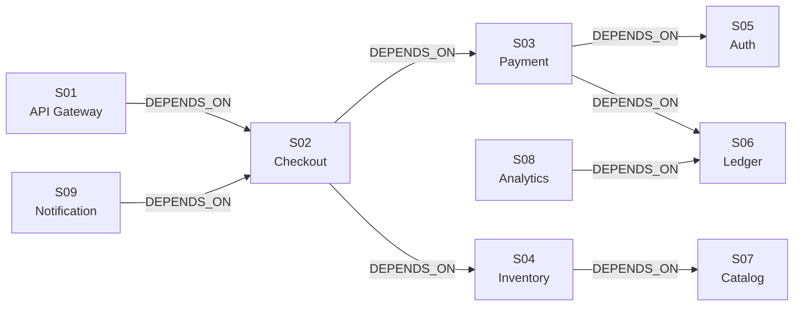
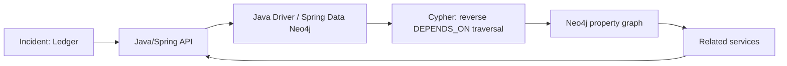

# Thinking in Relationships Instead of Tables and Joins

> **Chapter:** Neo4j Overview  
> **Module:** `DATABASE_ENGINE_GRAPH_NEO4J`  
> **Focus:** Shifting from a “fetch records then join tables” mindset to a “start from an entity and follow meaningful connections” mindset; knowing when this perspective solves problems better.
>
> In this module, Neo4j is used to model connected data as a **property graph** and query relationships and paths with **Cypher**. This lesson establishes the conceptual foundation for topics on nodes, relationships, indexes, constraints, query optimization, data import, the Java Driver, Spring Data Neo4j, and operating graph systems.

## 1. Learning Objectives

After this lesson, you will be able to:

1. Express the same domain problem using **tables–foreign keys–joins** and using **nodes–relationships–paths**.
2. Distinguish between single-record lookups, single-hop connection queries, and **multi-hop connection chain** queries.
3. Describe the direction and meaning of a `DEPENDS_ON` relationship, especially the difference between “A depends on B” and “B can impact A.”
4. Read SQL queries using `JOIN` and `WITH RECURSIVE` and map them to equivalent Cypher patterns.
5. Build and query a small service-dependency graph in Cypher, determine incident blast radius, and return an explanatory path.
6. Identify limits of graph querying: fan-out explosion, cycles, duplicate results, domain conditions, and data consistency.
7. Propose validation criteria before choosing Neo4j for a real system.

## 2. From Records to Relationships: A Shift in the Questions You Ask

Imagine a system with the services `Checkout`, `Payment`, `Inventory`, `Auth`, and `Ledger`. Operators want to know:

- Which services does `Checkout` call or directly depend on?
- If `Ledger` experiences an outage, which services are **potentially** impacted, including across multiple hops?
- What dependency chain from `API Gateway` to `Ledger` explains the impact scope?
- If a component changes, what are all the systems sitting “upstream” of it?

The first question needs only **one connection hop**. The subsequent ones require traversing a chain of relationships, sometimes of unknown depth.

There are two ways to organize the same facts:

**Relational perspective:** service details live in a `services` table; each dependency pair is a row in a `service_dependencies` table containing two foreign keys. You join rows matching keys to find related services.

**Graph perspective:** each service is a **node**; a dependency is a **directed relationship** between two nodes. You start from a known node and traverse along matching relationships.

Crucially, the underlying **domain facts** do not necessarily change. What changes is **which structure sits at the center of the model and how queries are expressed**. Relational databases can also represent and query graphs using edge tables, `JOIN`, and recursive queries; a graph database makes connections a first-class element of both the data model and the query language.

### A Quick Way to Choose Your Lens

- If the question is “What is the name of service `S06`?” — you are mainly looking up **properties of a single entity**.
- If the question is “What does `S02` directly depend on?” — you are looking up **one level of relationship**.
- If the question is “Who depends directly or indirectly on `S06` within at most four hops?” — you are exploring **a neighborhood of the connection network**.
- If the question is “Through which chain does the impact propagate?” — you need to return the **path**, not just a list of entities.

These are distinct query patterns, even though all of them start from the same dataset.

## 3. Running Scenario: Service Dependencies

Suppose an e-commerce platform has nine services:

| Code | Service | Role |
| --- | --- | --- |
| `S01` | API Gateway | API entry point |
| `S02` | Checkout | Coordinates the checkout flow |
| `S03` | Payment | Handles payment processing |
| `S04` | Inventory | Manages stock levels |
| `S05` | Auth | Authentication and authorization |
| `S06` | Ledger | Records transaction ledger entries |
| `S07` | Catalog | Product information |
| `S08` | Analytics | Data analytics |
| `S09` | Notification | Sends notifications |

A relationship is written as:

```text
(A)-[:DEPENDS_ON]->(B)
```

Convention throughout this lesson: **A depends on B**. When B is unavailable, A **may** be affected. This is a logical dependency model, not a guarantee that every failure in B halts A.

Sample relationships:



The diagram has **9 service nodes** and **8 dependency relationships**. For example, the path from API Gateway to Ledger is:

```text
API Gateway → Checkout → Payment → Ledger
```

This path consists of **3 relationships**. Viewed in reverse, when Ledger goes down, Payment, Checkout, API Gateway, and Notification may all be impacted at varying degrees; Analytics depends directly on Ledger.

### Distinguishing the Two Directions of the Same Relationship

Given the fact:

```text
(Payment)-[:DEPENDS_ON]->(Ledger)
```

- Traverse **with the arrow** from Payment to Ledger to ask: “What does Payment need?”
- Traverse **against the arrow** from Ledger to Payment to ask: “Who needs Ledger?”

Both questions use **the same relationship**, just traversed in opposite directions. There is no need to create an extra inverse edge `(Ledger)-[:IMPACTS]->(Payment)` just to find reverse impact, as doing so stores two copies of the same fact that can easily drift out of sync on updates.

## 4. How Would We Store This in a Relational Database?

A simple normalized relational design consists of two tables:

```sql
CREATE TABLE services (
    id VARCHAR(10) PRIMARY KEY,
    name VARCHAR(100) NOT NULL
);

CREATE TABLE service_dependencies (
    dependent_id VARCHAR(10) NOT NULL REFERENCES services(id),
    dependency_id VARCHAR(10) NOT NULL REFERENCES services(id),
    required BOOLEAN NOT NULL DEFAULT TRUE,
    PRIMARY KEY (dependent_id, dependency_id)
);
```

The `services` table stores entities. The `service_dependencies` table stores the two endpoints of each relationship:

| dependent_id | dependency_id | Meaning |
| --- | --- | --- |
| `S01` | `S02` | API Gateway depends on Checkout |
| `S02` | `S03` | Checkout depends on Payment |
| `S02` | `S04` | Checkout depends on Inventory |
| `S03` | `S05` | Payment depends on Auth |
| `S03` | `S06` | Payment depends on Ledger |
| `S04` | `S07` | Inventory depends on Catalog |
| `S08` | `S06` | Analytics depends on Ledger |
| `S09` | `S02` | Notification depends on Checkout |

Here:

- `dependent_id` is the **dependent** service.
- `dependency_id` is the service **being depended on**.
- `PRIMARY KEY (dependent_id, dependency_id)` ensures at most one row per pair under **the rules of this example**.
- `required` distinguishes a mandatory dependency from an optional link in extended models.

### 4.1. Single-Hop Query with JOIN

Retrieve the list of services Checkout directly depends on:

```sql
SELECT dependency.id, dependency.name
FROM services AS checkout
JOIN service_dependencies AS link
  ON link.dependent_id = checkout.id
JOIN services AS dependency
  ON dependency.id = link.dependency_id
WHERE checkout.id = 'S02'
ORDER BY dependency.id;
```

Result: **Payment (S03)** and **Inventory (S04)**.

In this query, two `JOIN` operations reconstruct the connection from foreign keys: from the Checkout row to the link row, and then to the target service row.

This is a valid and often very efficient organization. Never assume that having a `JOIN` makes a query automatically slow; relational databases have strong indexes, query optimizers, multiple join strategies, and transactional capabilities.

### 4.2. When Depth Is Not Known in Advance

To find indirect dependencies of Checkout as well, we must join relationships multiple times. If the depth were always exactly two hops, you could add another `JOIN`. When depth varies, RDBMSs such as PostgreSQL support a **recursive common table expression**:

```sql
-- Example using PostgreSQL syntax.
WITH RECURSIVE prerequisites(service_id, depth) AS (
    -- Direct dependencies of Checkout
    SELECT link.dependency_id, 1
    FROM service_dependencies AS link
    WHERE link.dependent_id = 'S02'

    UNION ALL

    -- From a dependency, continue finding its dependencies
    SELECT link.dependency_id, p.depth + 1
    FROM prerequisites AS p
    JOIN service_dependencies AS link
      ON link.dependent_id = p.service_id
    WHERE p.depth < 4
)
SELECT DISTINCT s.id, s.name
FROM prerequisites AS p
JOIN services AS s
  ON s.id = p.service_id
ORDER BY s.id;
```

Result on the sample data: **Payment, Inventory, Auth, Ledger, Catalog** — corresponding to `S03` through `S07`. The `depth < 4` bound caps the maximum depth; `DISTINCT` deduplicates services reachable via multiple branches.

Note: the statement above uses `UNION ALL` and only bounds depth; if the data contains a **dependency cycle**, the query can revisit already-seen nodes until hitting the depth limit. The outer `DISTINCT` does not stop intermediate rows from multiplying during recursion. In production SQL, design cycle detection and termination conditions appropriate to the problem.

**Observation:** SQL can solve the problem. However, when the requirement is “along which relationship types, across how many hops, in which direction, and returning which paths?”, expressing it as a connected chain in Cypher is often much closer to the domain language.

## 5. Representing the Same Data as a Property Graph

In Neo4j:

- Each service becomes a node `(:Service {id, name})`.
- Each `service_dependencies` row becomes a `-[:DEPENDS_ON]->` relationship.
- The `required` value belongs to the **relationship**, because it describes *service A depending on service B*.

```text
(:Service {id:'S02', name:'Checkout'})
   -[:DEPENDS_ON {required:true}]->
(:Service {id:'S03', name:'Payment'})
```

One difference in readability is that you can state the **connection pattern to find** directly, without explicitly writing pairs of foreign-key join predicates to stitch the endpoints together.

### 5.1. Creating Sample Data in Neo4j

The examples below use Cypher syntax supported in Neo4j 5.x. Run them in a **practice database**, in order; if the database already contains other services, global counts will include that existing data.

Create a constraint so service IDs are unique among nodes with the `Service` label:

```cypher
CREATE CONSTRAINT service_id_unique IF NOT EXISTS
FOR (s:Service) REQUIRE s.id IS UNIQUE;
```

Create the nine nodes using `MERGE` on the business key:

```cypher
UNWIND [
  {id: 'S01', name: 'API Gateway'},
  {id: 'S02', name: 'Checkout'},
  {id: 'S03', name: 'Payment'},
  {id: 'S04', name: 'Inventory'},
  {id: 'S05', name: 'Auth'},
  {id: 'S06', name: 'Ledger'},
  {id: 'S07', name: 'Catalog'},
  {id: 'S08', name: 'Analytics'},
  {id: 'S09', name: 'Notification'}
] AS row
MERGE (s:Service {id: row.id})
SET s.name = row.name;
```

Create the eight relationships. `MATCH` resolves both existing endpoint nodes; `MERGE` finds or creates the relationship of that type and direction between those two nodes:

```cypher
UNWIND [
  {dependentId: 'S01', dependencyId: 'S02'},
  {dependentId: 'S02', dependencyId: 'S03'},
  {dependentId: 'S02', dependencyId: 'S04'},
  {dependentId: 'S03', dependencyId: 'S05'},
  {dependentId: 'S03', dependencyId: 'S06'},
  {dependentId: 'S04', dependencyId: 'S07'},
  {dependentId: 'S08', dependencyId: 'S06'},
  {dependentId: 'S09', dependencyId: 'S02'}
] AS row
MATCH (dependent:Service {id: row.dependentId})
MATCH (dependency:Service {id: row.dependencyId})
MERGE (dependent)-[link:DEPENDS_ON]->(dependency)
SET link.required = true;
```

Verify on a database containing only the practice dataset:

```cypher
MATCH (s:Service)
RETURN count(s) AS so_dich_vu;   // Expected: 9
```

```cypher
MATCH ()-[r:DEPENDS_ON]->()
RETURN count(r) AS so_quan_he;   // Expected: 8
```

**Technical note:** the constraint on `Service.id` protects node uniqueness by ID, but does not by itself prevent duplicate relationships under concurrent write sessions. If business rules require strict uniqueness on relationships, design your write patterns and guards accordingly. `MERGE` also will not create a relationship if either initial `MATCH` finds no node.

### 5.2. Cypher: Reading a Single Connection

The query corresponding to the `JOIN` in section 4.1:

```cypher
MATCH (checkout:Service {id: 'S02'})
      -[:DEPENDS_ON]->(dependency:Service)
RETURN dependency.id AS id, dependency.name AS name
ORDER BY id;
```

Result: **S03 – Payment**, **S04 – Inventory**.

How to read it: “Find the Checkout node with ID S02, follow one outgoing `DEPENDS_ON` relationship, and return the service nodes at the other end.”

In Cypher, `MATCH` uses a **graph pattern**. The variables `checkout` and `dependency` represent nodes, while `-[:DEPENDS_ON]->` describes the connection type and direction.

At a single hop, both SQL and Cypher are concise and easy to optimize. The advantage of the graph perspective becomes clearer when connection structure plays the central role in the query.

## 6. Expressing Multiple Hops with One Path Pattern

Question: “Which services does Checkout depend on directly or indirectly within at most four hops?”

```cypher
MATCH (checkout:Service {id: 'S02'})
      -[:DEPENDS_ON*1..4]->(dependency:Service)
RETURN DISTINCT dependency.id AS id, dependency.name AS name
ORDER BY id;
```

In the pattern:

- `(checkout:Service {id: 'S02'})` identifies the **starting point**.
- `:DEPENDS_ON` selects the **exact relationship type** to traverse.
- `->` selects the **direction from dependent service to depended-on service**.
- `*1..4` allows paths containing **1 to 4 relationships**.
- `(dependency:Service)` is the node reached at the end of the path.
- `DISTINCT` returns each service once, even when multiple paths lead to it.

The result is still the five services `S03`, `S04`, `S05`, `S06`, and `S07`. In the sample data, the farthest path from Checkout has two relationships; the four-hop bound is an **upper limit**, not a requirement that paths be four hops long.

### Returning the Path Itself Instead of Just Nodes

```cypher
MATCH path = (checkout:Service {id: 'S02'})
             -[:DEPENDS_ON*1..3]->(dependency:Service)
RETURN [n IN nodes(path) | n.name] AS chuoi_dich_vu,
       length(path) AS so_buoc
ORDER BY so_buoc, chuoi_dich_vu;
```

`path` is a variable representing the **path**. `nodes(path)` extracts the nodes in order from start to end, and `length(path)` returns the number of relationships.

Expected paths:

| Service Chain | Hops |
| --- | ---: |
| Checkout → Payment | 1 |
| Checkout → Inventory | 1 |
| Checkout → Payment → Auth | 2 |
| Checkout → Payment → Ledger | 2 |
| Checkout → Inventory → Catalog | 2 |

Returning the **path** explains *why* a node was matched. This is vital in impact analysis, investigations, dependency-chain discovery, and explainable recommendations.

**Distinction:** a query returning `DISTINCT dependency` returns only the **set of target nodes**. A query returning `path` can return **multiple paths to the same node** when the graph has multiple routes. Choose the result shape to fit the question, and avoid confusing the number of paths with the number of services.

## 7. Impact Analysis: Traversing Dependencies in Reverse

Now flip the question: “If Ledger (`S06`) becomes unavailable, which services are **at risk** of impact along the dependency chain?”

Under the convention `A -[:DEPENDS_ON]-> B`, we traverse **against the arrow** starting from Ledger:

```cypher
MATCH (failed:Service {id: 'S06'})
      <-[:DEPENDS_ON*1..4]-(affected:Service)
RETURN DISTINCT affected.id AS id, affected.name AS name
ORDER BY id;
```

Expected result:

| Potentially Impacted Service | Minimum Hops to Ledger | Illustrative Dependency Path |
| --- | ---: | --- |
| Payment (`S03`) | 1 | Payment → Ledger |
| Analytics (`S08`) | 1 | Analytics → Ledger |
| Checkout (`S02`) | 2 | Checkout → Payment → Ledger |
| API Gateway (`S01`) | 3 | API Gateway → Checkout → Payment → Ledger |
| Notification (`S09`) | 3 | Notification → Checkout → Payment → Ledger |

This is a **structural candidate impact analysis**, not proof that those services have actually failed in production. A real system also accounts for criticality, circuit breakers, caches, fallback routes, configuration, and live operational health.

### 7.1. Equivalent SQL Query for Reverse Traversal

To see that this is **the same problem solvable in the relational model**, we can also write a PostgreSQL query:

```sql
WITH RECURSIVE impacted(service_id, depth) AS (
    -- Services directly depending on Ledger
    SELECT link.dependent_id, 1
    FROM service_dependencies AS link
    WHERE link.dependency_id = 'S06'

    UNION ALL

    -- Continue traversing backward: who depends on the services already found?
    SELECT link.dependent_id, i.depth + 1
    FROM impacted AS i
    JOIN service_dependencies AS link
      ON link.dependency_id = i.service_id
    WHERE i.depth < 4
)
SELECT DISTINCT s.id, s.name
FROM impacted AS i
JOIN services AS s
  ON s.id = i.service_id
ORDER BY s.id;
```

This SQL query answers the exact same question. Cypher makes the traversed relationship explicit via the `<-[:DEPENDS_ON*1..4]-` pattern, while SQL expresses each step by joining against a recursive result set. Practical ergonomics and performance depend on the query, data, and database engine in use.

### 7.2. Explaining Impact via the Fewest-Hop Path

Question: “From API Gateway to Ledger, what is the dependency chain with the fewest hops?”

```cypher
MATCH (start:Service {id: 'S01'})
MATCH (target:Service {id: 'S06'})
MATCH path = shortestPath(
  (start)-[:DEPENDS_ON*..6]->(target)
)
RETURN [n IN nodes(path) | n.name] AS chuoi,
       length(path) AS so_buoc;
```

Expected result:

```text
['API Gateway', 'Checkout', 'Payment', 'Ledger']
so_buoc = 3
```

Here, “shortest” means **fewest relationships**, not lowest latency, lowest risk, or highest failure probability. Weighted optimization problems require weights and appropriate algorithms.

### 7.3. When Relationships Carry Criticality Levels

In our data creation script, every `DEPENDS_ON` relationship has `required = true`. We can require every edge along a path to be a mandatory dependency:

```cypher
MATCH path = (failed:Service {id: 'S06'})
             <-[:DEPENDS_ON*1..4]-(affected:Service)
WHERE all(r IN relationships(path) WHERE r.required = true)
RETURN DISTINCT affected.id AS id, affected.name AS name
ORDER BY id;
```

`relationships(path)` retrieves the edges in the path; `all(...)` evaluates the condition across every edge. If optional dependencies are later added to the graph, this query excludes paths containing edges that do not satisfy the predicate.

**Keep in mind:** a property like `required = true` is only a **system-defined business annotation**. It does not replace measurements, fault-injection testing, or risk-evaluation rules. Filtering across all edges of a path can also become expensive if the number of candidate paths is large.

## 8. What Does “Relationships Are Data” Mean?

In the relational example, `service_dependencies` is an associative table holding two foreign keys. In the graph, `DEPENDS_ON` is an independent data element with a **type**, **direction**, **two endpoints**, and optional **properties**.

The graph model directly expresses the statement:

```text
Service A --DEPENDS_ON(required=true)--> Service B
```

Therefore, when framing queries, we naturally start with a relationship pattern:

- “Who depends on A?” → `(A)<-[:DEPENDS_ON]-(other)`.
- “Who does A depend on?” → `(A)-[:DEPENDS_ON]->(other)`.
- “Who does A depend on within at most three hops?” → `(A)-[:DEPENDS_ON*1..3]->(other)`.
- “Through which services are A and B connected?” → return `path` along with `nodes(path)`.

However, **relationships are not synonymous with every event**, and not every attribute needs to become a node. For example:

| Domain Fact to Store | Candidate Model | Reason |
| --- | --- | --- |
| Service name | `Service.name` | Describes a single entity |
| A depends on B | `(A)-[:DEPENDS_ON]->(B)` | Relationship that needs traversal |
| Whether connection A→B is mandatory | `DEPENDS_ON.required` | Property of the relationship |
| Each service belongs to an owning team | `Service.teamCode` or `(Service)-[:OWNED_BY]->(Team)` | Depends on whether team info needs independent traversal/storage |
| A deployment with ID, timestamp, approver | `:Deployment` node with related relationships | Event has its own identity and history |
| Repeated reliability checks of A→B | Separate assessment nodes or event chain | Avoids overwriting history in a single property |

If `Team` is merely a display string, a property may be enough. If you need to ask “Which team owns all affected services?” or “Who is on call in the owning team?”, modeling `Team` as a node lets you bridge domain layers through distinct relationships.

### Do Not Mechanically Turn Every JOIN into a Relationship

In a relational model, having a foreign key does not automatically mean it must become a relationship; having a table does not automatically mean it must become a node. Ask **whether users need to traverse this connection**, what **meaning, direction, properties, and lifecycle** the connection has, and which model reduces the complexity of your critical queries.

A property graph can also contain disconnected nodes; there is no rule requiring every node to be wired into a dense web.

## 9. Things You Still Must Control When Traversing a Graph

Concise syntax does not guarantee that a query runs efficiently, accurately, or safely on every graph.

### 9.1. Choose a Narrow Starting Point

Example:

```cypher
MATCH (service:Service {id: $serviceId})
      -[:DEPENDS_ON*1..3]->(dependency:Service)
RETURN DISTINCT dependency.id;
```

The parameter `$serviceId` selects one specific service. An appropriate constraint or index helps the engine locate the starting node; traversal then focuses on relevant connections.

If you omit the `id` filter and expand from **every** `Service` node, the number of paths to inspect can grow dramatically. Use `EXPLAIN` and `PROFILE` to inspect the query plan and runtime behavior before concluding an expression is fast or slow.

### 9.2. Bound Path Length and Relationship Types

A high-degree node — such as a shared core service depended on by thousands of other services — can create massive fan-out when traversed in reverse. With high average branching, raising a hop limit from two to four can multiply candidate paths sharply.

Specify explicitly:

- Which relationship types may be traversed, such as `DEPENDS_ON` only.
- Traversal direction: from dependent to prerequisite, or in reverse for impact analysis.
- Maximum hop count and stopping conditions.
- Business predicates on nodes/edges such as environment, status, and criticality.
- Desired output: distinct node set, one explanatory path, all paths, or path count.

### 9.3. Cycles and Duplicate Results

A graph can contain cycles:

```text
A → B → C → A
```

For dependency relationships, this can indicate a design issue worth investigating. Multi-hop queries must handle depth and path requirements explicitly, because cycles can produce many path variants or make concepts like “upstream dependency” ambiguous.

`DISTINCT` deduplicates the **final output**, but does not prevent expensive expansion of intermediate branches. If business rules prohibit dependency cycles, the system must enforce checks when creating or updating edges; Neo4j does not infer that rule from the `DEPENDS_ON` type name alone.

### 9.4. Correct Direction Is Not Enough: Semantics Must Match

In real systems, relationships can mean very different things:

- `DEPENDS_ON`: required for operation.
- `CALLS`: makes a runtime call.
- `RUNS_ON`: hosted on infrastructure.
- `OWNED_BY`: responsible team.
- `MONITORED_BY`: monitoring system.

These relationships cannot be interchanged casually. “A calls B” does not always mean “A cannot operate if B fails.” If a query mixes all relationship types without distinguishing semantics, impact-analysis results lose reliability.

### 9.5. Data Quality and Transactions

Missing edges cause **false negatives** (failing to detect a genuinely dependent service). Stale edges cause **false positives** (flagging a service that no longer depends on the component). Therefore, beyond modeling, you need:

- Business keys, constraints, and naming conventions for node labels and relationship types.
- A clear source of truth to avoid creating duplicate copies of the same relationship.
- Ingestion pipelines, drift detection, and updates/deletions when topology changes.
- Transaction management, access control, and relationship validation in operations.

If Neo4j runs alongside a relational database, design the data synchronization strategy, acceptable lag, and recovery procedure when sync fails.

## 10. When Should You Seriously Consider Neo4j?

**Worth evaluating** when core application features frequently traverse multi-hop connections, analyze paths, find connected components, or vary relationship patterns per query. Examples:

- Impact analysis across service, infrastructure, library, and software-package graphs.
- Content recommendations across user–product–topic networks.
- Investigating money-transfer chains, shared-device accounts, or connected rings.
- Analyzing prerequisite chains for courses, knowledge areas, or workflows.
- Tracing permission paths across groups–roles–resources.

**Weigh carefully** when the system mostly looks up records by ID, filters a single table, aggregates tabular metrics, or only needs one or two fixed `JOIN`s. PostgreSQL or an equivalent RDBMS may handle those workloads very well with lower overall operational overhead if it is already in your stack.

Comparison by **workload fit**, not a speed leaderboard:

| Workload | Relational DB | Neo4j / Property Graph |
| --- | --- | --- |
| Look up one service by ID | Strong fit; primary key / index | Strong fit; constraint / index |
| Find direct dependencies | Simple `JOIN` | Single relationship in `MATCH` |
| Traverse dependencies of unknown depth | Recursive CTE or app logic | Variable-length path pattern |
| Explain why A relates to B | Trace intermediate rows / recursion | Return `path`, nodes, and relationships |
| Monthly revenue aggregations | Classic SQL strength | Needs careful evaluation for the workload |
| Network of diverse entities and links | Possible across multiple tables | Expressed directly via labels and types |
| Data constraints and transactions | Mature RDBMS mechanisms | Supports transactions and constraints; requires deliberate design |

There is no rule that “Neo4j is faster than SQL because it avoids JOINs.” Cost depends on **edge degree distribution**, traversal depth, number of candidate paths, starting selectivity, filters, indexes, data model, concurrency, and infrastructure.

### Evaluating Technology Choices Empirically

Before committing to a technology, build a realistic benchmark suite spanning difficulty levels:

1. **Single lookup:** fetch one node or row by code.
2. **One hop:** find direct dependencies.
3. **Multi-hop:** compute impact scope across 2, 4, and 6 hops.
4. **Paths:** return explanatory paths with realistic filters.
5. **Updates:** add/remove dependencies and re-query under concurrent access.

Use test data with a realistic degree distribution, especially **high-degree nodes**, cycles, multiple routes to the same target, and continuously changing data. Compare correctness, latency, resource usage, consistency, observability, and maintenance cost. When real-world data is denser than demo data, measurements can shift substantially.

## 11. From Sample Queries to Java and Spring

In Java applications, Cypher queries are typically executed through the **Neo4j Java Driver** or via **Spring Data Neo4j** repositories.

For example, an API receiving the ID of a failing service can use a parameterized query:

```cypher
MATCH (failed:Service {id: $failedServiceId})
      <-[:DEPENDS_ON*1..4]-(affected:Service)
RETURN DISTINCT affected.id AS id, affected.name AS name
ORDER BY id;
```

The application passes `failedServiceId` via the driver's **parameter** mechanism instead of concatenating input strings into the Cypher query text. Results can be mapped into a list of affected services and enriched with live monitoring status before triggering alerts.

General flow:



In production operations, a “services at risk of impact” view also needs **topology sync timestamps, relationship data confidence, and live incident status**. A traversal that is accurate against stale data may still give the wrong diagnosis right now.

Driver configuration, domain mapping, transactions, indexes, constraints, and query-plan inspection are covered thoroughly in dedicated lessons of this module.

## 12. Practice Exercises

**Exercise 1 — Two representations.** Explain in domain terms why two rows `services(S03, Payment)` and `services(S06, Ledger)` can be linked via a row `service_dependencies(S03, S06)`. Then express that exact same fact as a Cypher pattern.

**Exercise 2 — Following direction.** Write Cypher to find all direct dependencies of Payment (`S03`). Which services are expected?

**Exercise 3 — Reverse traversal.** If Auth (`S05`) goes down, which services appear when traversing `DEPENDS_ON` backward up to four hops? Why is Analytics not in the result?

**Exercise 4 — Paths.** Write Cypher returning the node names in the shortest path by hop count from Notification (`S09`) to Ledger (`S06`). How many hops long is the expected path?

**Exercise 5 — Spotting modeling issues.** After creating the sample data, a teammate suggests adding `(Ledger)-[:IMPACTS]->(Payment)` and updating it alongside `(Payment)-[:DEPENDS_ON]->(Ledger)`. State one concrete risk and show how to query from Ledger to avoid duplicating data.

**Exercise 6 — Choosing technology.** One retail system only looks up products by SKU and exports monthly revenue reports. A second system continuously queries multi-hop dependency chains and must return explanatory paths. Which system is a stronger early candidate for evaluating Neo4j, and what should you measure?

**Exercise 7 — Checking result semantics.** If the graph has two different routes from Checkout to Ledger, do `RETURN DISTINCT dependency.id` and `RETURN path` necessarily return the same number of rows? Explain.

<details>
<summary>Answer Hints</summary>

1. `Payment` depends on `Ledger`, represented as `(payment:Service {id:'S03'})-[:DEPENDS_ON]->(ledger:Service {id:'S06'})`.
2. `MATCH (:Service {id:'S03'})-[:DEPENDS_ON]->(s:Service) RETURN s.name;`. Result: **Auth** and **Ledger**.
3. `MATCH (:Service {id:'S05'})<-[:DEPENDS_ON*1..4]-(s:Service) RETURN DISTINCT s.name;`. Result: **Payment**, **Checkout**, **API Gateway**, **Notification**. Analytics depends on Ledger and has no dependency path to Auth in the sample data.
4. `MATCH (a:Service {id:'S09'}), (b:Service {id:'S06'}) MATCH p = shortestPath((a)-[:DEPENDS_ON*..6]->(b)) RETURN [n IN nodes(p) | n.name] AS route, length(p) AS hops;`. Result: **Notification → Checkout → Payment → Ledger**, **3 hops**.
5. Risk: updating one edge while forgetting the other produces contradictory results. Query the reverse direction using `MATCH (ledger:Service {id:'S06'})<-[:DEPENDS_ON]-(s:Service) RETURN s.name;`.
6. The dependency-chain system has a much clearer reason to evaluate a graph database. Measure path correctness, latency as depth/branching grows, update and operational cost, real-world scale, and data synchronization capability.
7. No. `DISTINCT` collapses multiple routes leading to the same target node into one row; `path` can return multiple rows because each route is a distinct path result.

</details>

## 13. Summary: Path Thinking as a Problem-Solving Tool

- The relational model organizes data into **rows, tables, and keys**; the graph model represents **entities and connections** directly as nodes and relationships.
- RDBMSs can still solve multi-hop queries using **recursive CTEs**; Neo4j offers direct expression via **Cypher path patterns**.
- A `DEPENDS_ON` arrow carries specific business meaning. Going forward finds **dependencies**; going backward finds **what depends on you**.
- Querying **nodes** and querying **paths** answer two different questions: “who is connected?” versus “through which chain are they connected?”.
- When using Neo4j, bound traversals, govern data quality, and benchmark on real workloads. Complex connected problems are a strong reason to evaluate a graph database; the final decision should rest on empirical validation.
